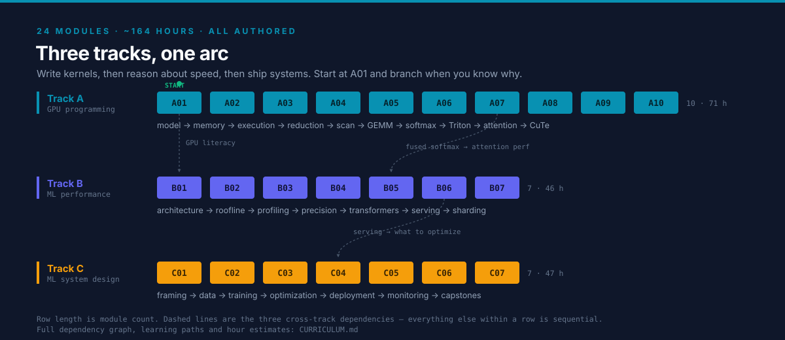
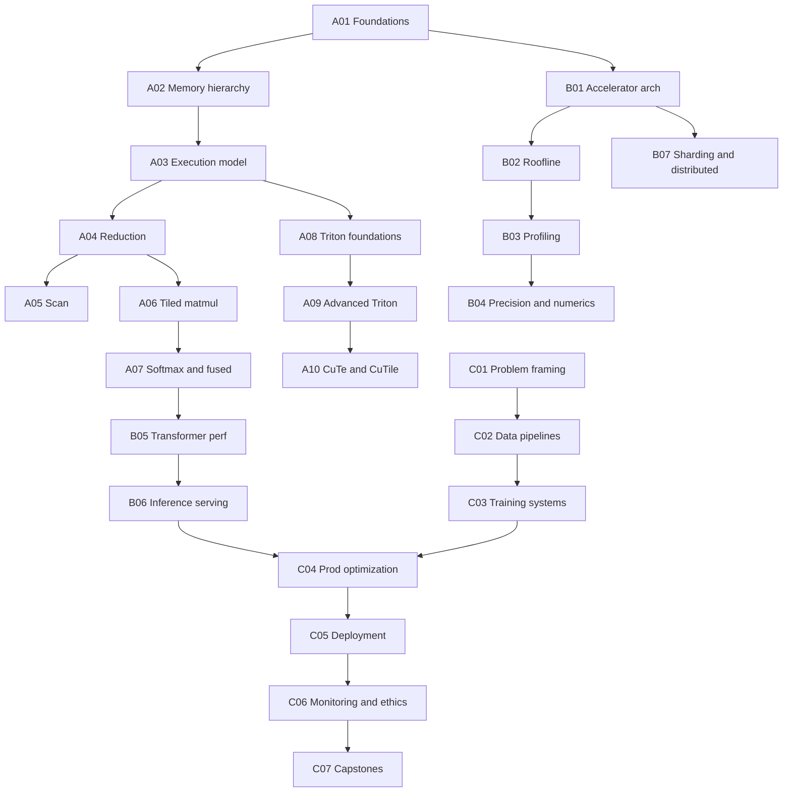
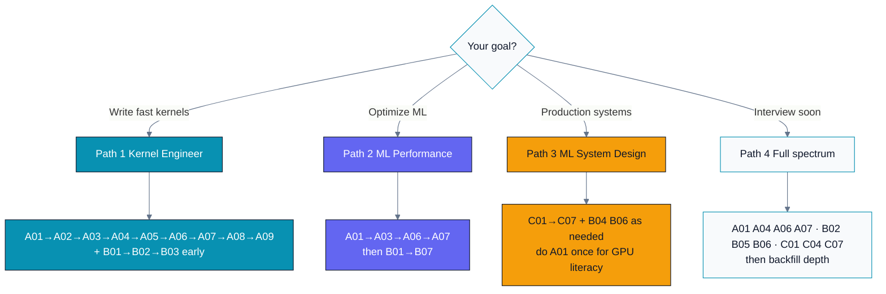
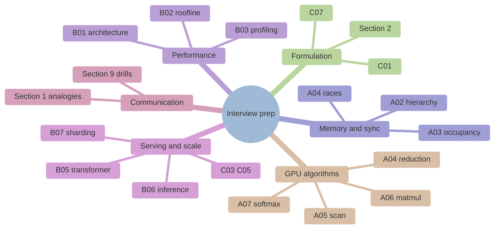

# Curriculum — Module Index & Progress Tracker

This is the master index for the GPU + ML Expert Tutor. It lists every module, the dependencies
between them, recommended learning paths, and a live progress + effort tracker.

**All 24 modules are authored.** Every one carries the full nine-section README, runnable labs, and
`exercises/` + `solutions/`. Status columns below are kept so future additions have a place to land.

---

## Legend

- **Status**: `DONE` (fully built to template) · `DRAFT` (partial) · `PLANNED` (not yet created)
- **Est. hours**: rough learner time to work through the module (read + labs + drills).
- **Depth**: prerequisite depth — how much prior GPU knowledge it assumes (1 = none, 5 = deep).

---

## Dependency graph

The map above answers "how much is there, and where am I?". The graph below answers "what must I do
first?" — they are different questions, so they get different pictures.

---

## Track A — GPU Programming Languages

| ID | Module | Status | Est. hours | Depth |
|----|--------|--------|-----------:|:-----:|
| [A01](tracks/A-gpu-programming/A01.foundations-and-programming-model/) | Foundations & programming model | **DONE** | 6 | 1 |
| [A02](tracks/A-gpu-programming/A02.memory-hierarchy-and-coalescing/) | Memory hierarchy & coalescing | **DONE** | 6 | 2 |
| [A03](tracks/A-gpu-programming/A03.execution-model-and-occupancy/) | Execution model: warps/wavefronts, occupancy, divergence | **DONE** | 7 | 2 |
| [A04](tracks/A-gpu-programming/A04.parallel-reduction/) | Parallel reduction (optimization ladder) | **DONE** | 6 | 3 |
| [A05](tracks/A-gpu-programming/A05.parallel-scan-prefix-sum/) | Parallel scan / prefix sum (Blelloch) | **DONE** | 6 | 3 |
| [A06](tracks/A-gpu-programming/A06.tiled-matrix-multiply/) | Tiled matmul (shared-memory tiling) | **DONE** | 8 | 3 |
| [A07](tracks/A-gpu-programming/A07.softmax-and-fused-kernels/) | Softmax & fused kernels (online softmax) | **DONE** | 7 | 4 |
| [A08](tracks/A-gpu-programming/A08.triton-foundations/) | Triton foundations | **DONE** | 6 | 3 |
| [A09](tracks/A-gpu-programming/A09.advanced-triton-flash-attention/) | Advanced Triton (autotuning, FlashAttention-style) | **DONE** | 9 | 4 |
| [A10](tracks/A-gpu-programming/A10.cute-cutlass-and-cutile/) | CuTe / CUTLASS / cuTile (NVIDIA-only, optional) | **DONE** | 10 | 5 |

## Track B — GPU Understanding & ML Performance

| ID | Module | Status | Est. hours | Depth |
|----|--------|--------|-----------:|:-----:|
| [B01](tracks/B-gpu-ml-performance/B01.accelerator-architecture/) | Accelerator architecture (CDNA vs Hopper) | **DONE** | 6 | 2 |
| [B02](tracks/B-gpu-ml-performance/B02.roofline-and-arithmetic-intensity/) | Roofline model & arithmetic intensity | **DONE** | 5 | 2 |
| [B03](tracks/B-gpu-ml-performance/B03.profiling-and-bottleneck-analysis/) | Profiling (`rocprofv3` / Nsight) | **DONE** | 6 | 3 |
| [B04](tracks/B-gpu-ml-performance/B04.precision-and-quantization/) | Precision & numerics (fp32→fp8, quantization) | **DONE** | 6 | 3 |
| [B05](tracks/B-gpu-ml-performance/B05.transformer-performance/) | Transformer architecture from a perf lens | **DONE** | 7 | 4 |
| [B06](tracks/B-gpu-ml-performance/B06.inference-serving-optimizations/) | Inference serving optimizations | **DONE** | 8 | 4 |
| [B07](tracks/B-gpu-ml-performance/B07.distributed-training-and-sharding/) | Model sharding & distributed training | **DONE** | 8 | 4 |

## Track C — ML System Design

| ID | Module | Status | Est. hours | Depth |
|----|--------|--------|-----------:|:-----:|
| [C01](tracks/C-ml-system-design/C01.problem-framing-and-metrics/) | Problem framing, metrics & decomposition | **DONE** | 5 | 1 |
| [C02](tracks/C-ml-system-design/C02.data-pipelines-and-features/) | Data pipelines & feature engineering | **DONE** | 6 | 2 |
| [C03](tracks/C-ml-system-design/C03.training-systems/) | Training systems (distributed, fault tolerance) | **DONE** | 7 | 3 |
| [C04](tracks/C-ml-system-design/C04.production-model-optimization/) | Production model optimization | **DONE** | 7 | 3 |
| [C05](tracks/C-ml-system-design/C05.deployment-and-serving-architecture/) | Deployment & serving architecture | **DONE** | 6 | 3 |
| [C06](tracks/C-ml-system-design/C06.monitoring-drift-and-ethics/) | Monitoring, drift, feedback loops, ethics | **DONE** | 6 | 3 |
| [C07](tracks/C-ml-system-design/C07.capstone-case-studies/) | Capstone case studies (LLM serving; recsys) | **DONE** | 10 | 4 |

---

## Recommended learning paths

You do not have to go strictly in order. Pick the path that matches your goal.

### Path 1 — "I want to write fast kernels" (Kernel Engineer)
`A01 → A02 → A03 → A04 → A05 → A06 → A07 → A08 → A09` (+ `A10` if on NVIDIA)
Supplement with `B01 → B02 → B03` early, so you can measure what you write.

### Path 2 — "I want to optimize ML inference/training" (ML Performance)
`A01 → A03 → A06 → A07` then `B01 → B02 → B03 → B04 → B05 → B06 → B07`.

### Path 3 — "I want to design production ML systems" (ML System Design)
`C01 → C02 → C03 → C04 → C05 → C06 → C07`, pulling in `B04`, `B06` when you hit optimization
and serving decisions. Do `A01` once for GPU literacy.

### Path 4 — "I'm interviewing broadly, soon" (Full-spectrum)
`A01 → A04 → A06 → A07` (core kernels) · `B02 → B05 → B06` (perf fundamentals) ·
`C01 → C04 → C07` (design). Then backfill depth where you feel weakest.

---

## Interview-skill coverage map

The role competencies map onto modules as follows, so you can target your prep:

| Competency | Primary modules |
|---|---|
| First-principles problem formulation | C01, C07, every Section 2 |
| Solutions that scale | B07, C03, C05, A06/A07 |
| Clean, bug-free coding & edge cases | Every Section 9 (Coding & Algorithms drills) |
| GPU parallel algorithms (reduction, scan, matmul, softmax) | A04, A05, A06, A07 |
| Memory models, races, synchronization | A02, A03, A04 |
| Perf bottleneck & tradeoff analysis | B01, B02, B03 |
| Roofline & accelerator architecture | B01, B02 |
| Inference serving, transformer arch, sharding | B05, B06, B07 |
| End-to-end ML system design | C01–C07 |
| Explaining complex ideas to any audience | Every Section 1 (Layman analogy) |

---

## Progress tracker

Update this table as modules are completed. It is the single source of truth for "what's done."

| Date | Module | Change | Learner est. hours |
|------|--------|--------|-------------------:|
| 2026-07-18 | A01 | Gold-standard module built (README + cuda/hip/triton + exercises/solutions + Makefile) | 6 |
| 2026-07-19 | A02 | Memory hierarchy & coalescing built (bandwidth + transpose labs, tiling, bank conflicts, exercises/solutions) | 6 |
| 2026-07-29 | A03–A07 | Core GPU algorithm ladder: execution model, reduction, scan + compaction, tiled GEMM, softmax + fusion | 34 |
| 2026-07-29 | A08–A10 | Triton foundations, FlashAttention-style fused attention, CuTe/CUTLASS/cuTile (NVIDIA-only) | 25 |
| 2026-07-29 | B01–B07 | Full ML performance track: architecture, roofline, profiling, precision, transformer perf, serving, sharding | 46 |
| 2026-07-29 | C01–C07 | Full ML system design track: framing, data, training, optimization, deployment, monitoring, capstones | 47 |

**Totals:** **24 of 24 modules DONE** · ~164 est. learner-hours authored.

Hour counts are the sum of the per-module estimates in the tables above; they are deliberate
over-estimates for a learner who does the labs and the drills rather than only reading.

---

## Build effort log (author-side)

Tracks how much effort has gone into *authoring* the curriculum, per the tracking requirement.

| Date | Work | Notes |
|------|------|-------|
| 2026-07-18 | Scaffold + shared docs + Module A01 | Initial build: README, CURRICULUM, 4 shared docs, A01 complete, legacy folders migrated under Track A. |
| 2026-07-18 | Brand + visuals | Parallel Spectrum theme, BRAND.md, agent skill, Mermaid diagrams across docs. |
| 2026-07-19 | A01 depth pass | Added overflow-safe size-math reference callout + sample sandbox outputs for exercises. |
| 2026-07-19 | A02 module | Built A02 (memory hierarchy, coalescing, tiled transpose, bank conflicts) with brand-themed diagrams + sample outputs. |
| 2026-07-29 | Content studio | `content/`: storyboard template, brand overlay spec, and shot-by-shot long-form + Shorts packs for A01 and A02. |
| 2026-07-29 | Canvas dashboard | Interactive study planner (goal-based paths, per-module completion, hours remaining) in the Cursor `canvases/` directory. |
| 2026-07-29 | Modules A03–A10 | Track A completed: ~19,000 lines across 8 modules, dual-vendor labs + drills. |
| 2026-07-29 | Modules B01–B07 | Track B completed: ~25,900 lines. Hardware figures web-verified with retrieval dates; all analytic tools stdlib-only. |
| 2026-07-29 | Modules C01–C07 | Track C completed: ~24,900 lines. Every design claim anchored to a runnable stdlib tool. |
| 2026-07-29 | Wire-up | Status tables, MkDocs nav for all 24 modules, track READMEs, canvas flags; repo-wide relative-link check (0 broken). |

### Verification standard applied throughout

Because most of this was authored without a GPU attached, the rule was: **never publish a number the
repo cannot reproduce.** In practice that meant benchmark tables were omitted in favour of expected
*ordering* and traffic ratios (which follow from the algorithms, not the silicon); analytic tools
print a banner marking their output as a model rather than a measurement; published figures are
attributed to their paper and conditions; and hardware specs carry a source link and a retrieval
date. Where two official vendor documents disagreed (B01, Infinity Cache bandwidth) the module
reports both rather than picking one.
