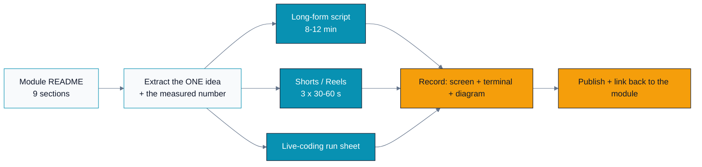

# Content Studio — turning modules into watchable content

This directory turns curriculum modules into **published content**: long-form YouTube lessons,
vertical Shorts/Reels, and live-coding streams. Everything here is an **editable source** — a
storyboard, a script, a run sheet — never a locked export. You (or an editor) record from these.

Brand rules come from [`../docs/BRAND.md`](../docs/BRAND.md) and the
[`parallel-programming-brand`](../.cursor/skills/parallel-programming-brand/SKILL.md) skill. Colors,
lower-thirds, and code styling are fixed so every video looks like the same series.

---

## Why this exists

A module README teaches a reader who chose to sit down and study. Video has to earn attention in
three seconds and hold it without the viewer being able to re-read a line. That is a different
craft, so each module gets a **separate content pack** rather than someone reading the README aloud.

The pipeline:



Every content pack starts from the module's *measured* result, because a real number on screen is
what makes a GPU video credible instead of generic.

---

## Directory layout

```
content/
├── README.md                  <- this guide
├── STORYBOARD_TEMPLATE.md     <- copy this per module
├── BRAND_OVERLAY.md           <- lower-thirds, title cards, code theme, captions
└── <module-id>-<slug>/
    ├── long-form.md           <- 8-12 min YouTube script (shot-by-shot)
    └── shorts.md              <- 3 vertical Shorts/Reels scripts
```

---

## The formats

| Format | Length | Aspect | Goal | Success signal |
|---|---|---|---|---|
| **Short / Reel** | 30–60 s | 9:16 | One idea, one number, one "huh!" | Watched to the end, saved |
| **Long-form** | 8–12 min | 16:9 | Teach the module's core skill | Retention past the demo |
| **Live coding** | 45–90 min | 16:9 | Show the messy real process | Chat questions answered |

### Shorts: the 5-beat structure

Shorts fail in the first second or not at all. Use this beat sheet:

1. **Hook (0–3 s)** — a claim or a number that sounds wrong. *"This one-line change made the GPU 8× faster."*
2. **Stakes (3–8 s)** — why the viewer should care. *"Same math. Same kernel. Only the memory access changed."*
3. **Reveal (8–35 s)** — the actual idea, on screen, with the code diff or diagram.
4. **Proof (35–50 s)** — the measured number in the terminal. Never a claim without the run.
5. **CTA (50–60 s)** — *"Full module and runnable code in the description."*

Rules: no intro card (it kills retention), burned-in captions always, one idea per Short, and the
number must come from a real run.

### Long-form: the arc

Follow the module's own logic — it is already pedagogically ordered:

| Minutes | Beat | Sourced from module section |
|---|---|---|
| 0:00–0:30 | Cold-open the payoff (show the final speedup first) | Section 5 |
| 0:30–1:30 | The analogy — make a layman get it | Section 1 |
| 1:30–3:30 | First principles: derive why the naive way breaks | Section 2 |
| 3:30–6:30 | Live code the fix, dual-vendor if relevant | Sections 3–4 |
| 6:30–8:30 | Run it, read the profiler, tie to the roofline | Section 5 |
| 8:30–10:00 | Honest tradeoffs and when NOT to do this | Section 6 |
| 10:00–11:00 | Where this shows up in real ML systems | Section 7 |
| 11:00–12:00 | The drill for the viewer + what's next | Section 9 |

Cold-opening with the result is deliberate: viewers stay for a payoff they have already seen is
real, and the analogy lands better once they know what it is explaining.

---

## Recording setup

- **Terminal:** dark, background `#0F172A`, JetBrains Mono, ≥16pt. Viewers on phones cannot read
  a 12pt terminal — this is the single most common mistake in GPU content.
- **Editor:** same font; hide the file tree while zoomed on code.
- **Diagrams:** render the module's Mermaid diagrams (GitHub and the MkDocs site both render them)
  and screen-capture. For a curriculum-overview shot, open the interactive **curriculum dashboard**
  canvas in Cursor (see [`BRAND_OVERLAY.md`](BRAND_OVERLAY.md) for which shots work on camera).
- **Live GPU:** always show `rocm-smi` / `nvidia-smi` once, so viewers know it is real hardware.
- **Audio** matters more than video quality. A cheap mic close to your mouth beats a good mic far away.

---

## Publishing checklist

- [ ] Title names the concrete outcome, not the topic ("Why your GPU kernel is 8× slower than it should be", not "Memory coalescing").
- [ ] Thumbnail: one number + one 3-word phrase, brand cyan `#0891B2` on slate `#0F172A`.
- [ ] Description links the module folder and the repo.
- [ ] Burned-in captions on Shorts; SRT on long-form.
- [ ] Chapters on long-form (use the arc table above).
- [ ] The measured number on screen matches what the code actually prints.
- [ ] Any hardware claim states the GPU it ran on.

---

## Content packs

| Module | Pack | Hook number | Source of number |
|---|---|---|---|
| A01 Foundations | [`A01-foundations/`](A01-foundations/) | Kernel is 44 µs of a 72 ms run (0.06%) | `rocprofv3` profile run |
| A02 Memory hierarchy & coalescing | [`A02-memory-coalescing/`](A02-memory-coalescing/) | 700 → 3,400 GB/s (4.8×) | A02 Section 5 reference run |

Each pack has a `long-form.md` (shot-by-shot YouTube script with chapters and a description block)
and a `shorts.md` (three vertical scripts). New modules get a pack by copying
[`STORYBOARD_TEMPLATE.md`](STORYBOARD_TEMPLATE.md).

**Re-run the lab on your own GPU before recording** and quote your own numbers on screen. The figures
above are from reference runs on AMD MI-series hardware; they will differ on yours, and an
unattributed number is worse than no number.
