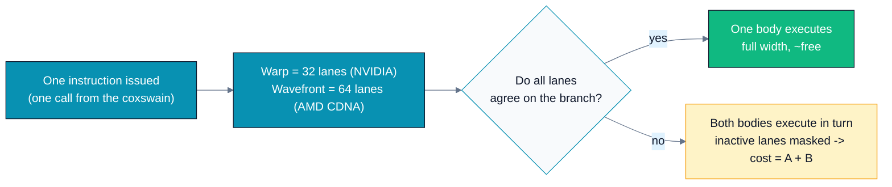
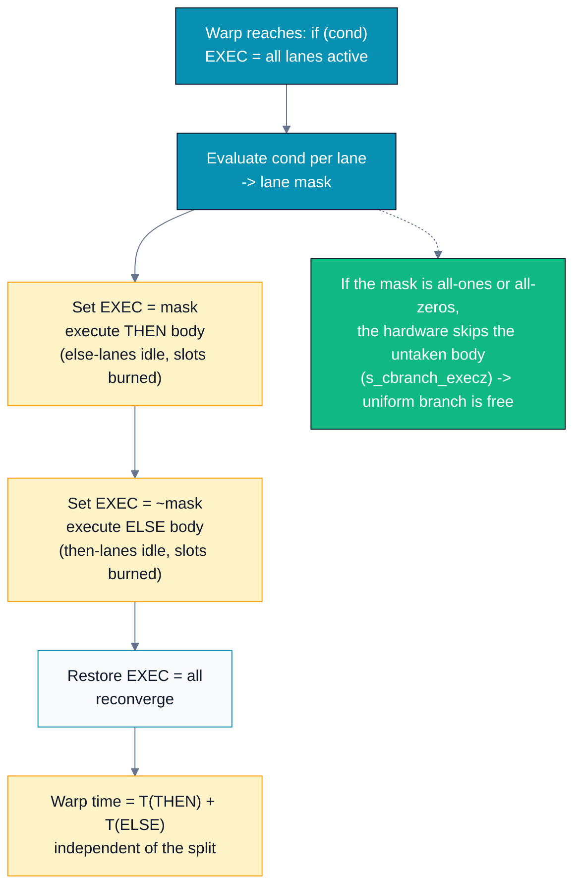
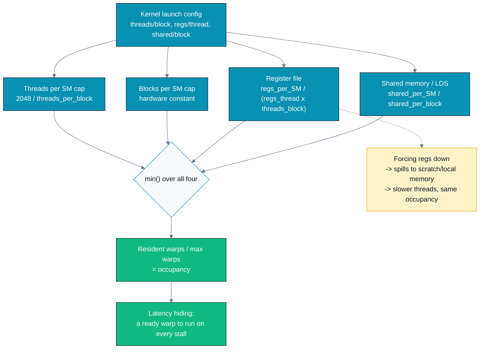
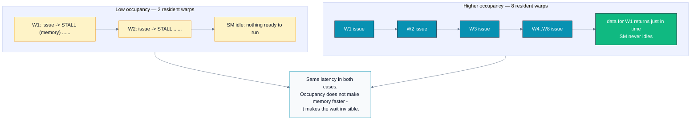
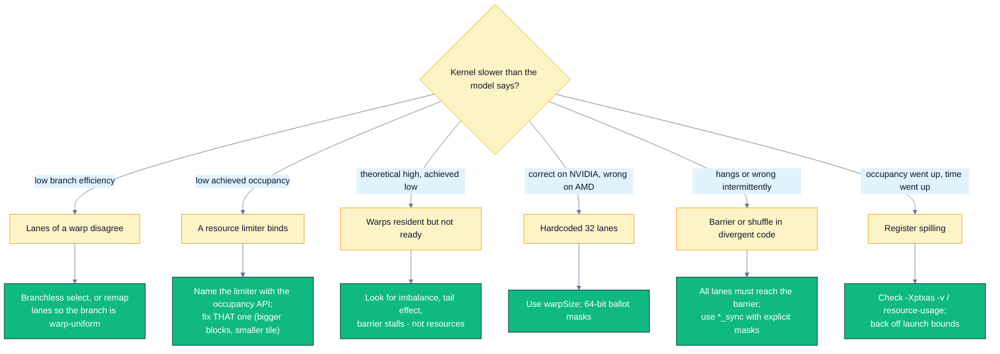

# A03 — Execution Model: Warps/Wavefronts, Occupancy & Divergence

> Track A · Module 03 · Status: **DONE** · Est. 6 hours · Depth 3/5
>
> Prerequisites: [A01](../A01.foundations-and-programming-model/) (grid/block/thread, error
> checking, event timing) and [A02](../A02.memory-hierarchy-and-coalescing/) (hierarchy,
> coalescing, LDS). Backends: AMD (`hipcc`) · NVIDIA (`nvcc`).
> Setup: [../../../docs/SETUP.md](../../../docs/SETUP.md).

---

## 1. TL;DR + Layman analogy

**TL;DR.** The block is how *you* organize threads; the **warp** (32 lanes, NVIDIA) or
**wavefront** (64 lanes, AMD CDNA) is how the *hardware* executes them. One instruction is
issued to all lanes of a warp at once, so two things follow and they are the whole module.
(1) **Divergence:** if lanes of the same warp take different branches, the hardware runs
*both* bodies with the inactive lanes masked off — a divergent if/else costs the **sum** of
its branches, not the average. (2) **Occupancy:** each SM/CU can host only so many warps at
once, capped by threads, blocks, registers, and shared memory; those resident warps are the
budget the scheduler spends **hiding memory latency**. More occupancy is a means, not a goal.

**Layman analogy — the rowing crew.** A warp is a **rowing eight**: one coxswain, one call,
and every rower pulls the *same* stroke at the same instant. That is why it is fast — one
instruction pays for 32 or 64 oars.

Now suppose you tell the odd-numbered seats to row *backwards* and the even seats to row
*forwards*. The cox cannot call two strokes at once. So the cox calls "forward!" — the odd
seats lift their oars out of the water and sit idle — then calls "backward!" — and now the
even seats sit idle. **The same total number of strokes takes twice as long**, because half
the boat is always idle. That is branch divergence, exactly. And notice the flip side: if you
tell the *whole* boat to row backwards, it costs nothing extra. **The branch is not the
problem; disagreement inside one boat is the problem.**

Occupancy is the second half of the picture: a regatta where crews constantly wait on the
dock for supplies. While one crew waits (a memory load, hundreds of cycles), the harbour
master launches another *already-moored* boat. Keep too few boats moored and the water sits
empty while everyone waits; that is low occupancy. Keep enough and the channel is always
busy — but past a point, extra boats just crowd the dock and share out the same supplies.

**Where the analogy breaks.** (a) Lanes are not people: masking a lane costs *nothing* except
the lost slot — no fatigue, no coordination overhead. (b) Real hardware is not strictly
lockstep everywhere: **NVIDIA Volta and later have independent thread scheduling**, where
lanes have their own program counters and reconverge only at explicit points, which is why
modern CUDA requires the `*_sync` warp primitives; **AMD CDNA wavefronts really do share one
program counter and an explicit `EXEC` mask**. (c) The doubling is *per warp*, not per thread
— a divergent branch inside a warp that is 99% one-sided still pays for both sides once.
(d) "More boats is better" fails at the top end: extra resident warps cost registers and
cache, and a well-tuned GEMM often runs *fast at low occupancy*.

**By the end of this module you can:** explain why the warp/wavefront is the real scheduling
unit; predict the cost of a divergent branch with a cost model and then *measure* it; compute
occupancy as a `min()` over four limiters and identify the binding one; explain why raising
occupancy sometimes does nothing; and write warp-level code that is correct on both a 32-lane
warp and a 64-lane wavefront.



One decision — "do the lanes of *this* warp agree?" — decides whether a branch is free or
costs double, and it is invisible in the source code.

---

## 2. First Principles

### Why lanes exist: amortizing the expensive part of an instruction

Executing an instruction has two costs: **fetching, decoding and scheduling** it (control),
and **doing the arithmetic** (data). On a CPU the control cost is enormous — branch
prediction, register renaming, out-of-order windows — and it is paid per instruction, for
*one* result.

A GPU makes a different bet: pay the control cost **once**, then hand the decoded instruction
to 32 or 64 arithmetic lanes, each with its own registers and its own data element. One fetch,
64 results. That is **SIMT** (Single Instruction, Multiple Threads), and it is why a GPU can
put an order of magnitude more FLOPs on the same silicon area.

The bet only pays off *if the lanes want the same instruction*. Everything in this module is a
consequence of that sentence.

### Derive divergence: one program counter, one mask

If 64 lanes share an instruction stream, they share a **program counter**. So what happens at
`if (x[i] > 0) A(); else B();` when some lanes want `A` and others want `B`? There is exactly
one honest answer available to the hardware: keep a **bitmask of active lanes** and execute
both sides in sequence.

```
EXEC = 1111111111111111   (all lanes active)
  evaluate predicate -> per-lane bit
EXEC = 1010101010101010   run A()      (odd lanes idle, but still consuming issue slots)
EXEC = 0101010101010101   run B()      (even lanes idle)
EXEC = 1111111111111111   reconverge
```

On AMD GCN/CDNA this is literally a 64-bit hardware register called `EXEC`, and the compiler
emits `s_and_saveexec_b64` / `s_cbranch_execz` around the branch. On NVIDIA pre-Volta it was a
hardware reconvergence stack; Volta and later give each thread its own PC plus convergence
barriers — a real behavioural difference we return to in §3.



The two rows on the left alternate because they happen *one after the other* — that sequencing is the
whole cost, and it is the one thing a static diagram cannot tell you. On the right, `s_cbranch_execz`
skips the untaken side outright, which is why a warp-uniform branch is nearly free.

**The cost model falls straight out:**

```
T_divergent_warp = T(A) + T(B)          # both bodies issue, whichever lanes are masked
T_uniform_warp   = T(A)   or   T(B)     # only the taken body issues
```

There is no "half of A plus half of B". A single lane wanting `B` drags the whole warp
through `B`. With `k` distinct paths (a `switch`, a 4-way class test), the cost is the **sum
of all `k`** paths any lane takes — up to a 32× or 64× penalty in the pathological case where
every lane wants something different.

**Worked example.** A warp of 32 lanes. Path A costs 100 cycles, path B costs 60.

| Case | Cycles per warp | Notes |
|---|---:|---|
| All 32 lanes take A | 100 | uniform, no tax |
| All 32 lanes take B | 60 | uniform, no tax |
| 16 take A, 16 take B | **160** | 100 + 60, regardless of the split |
| 31 take A, 1 takes B | **160** | one dissenting lane costs the full B |
| Branchless select (A and B fused into one body) | ~100–110 | pay once, all lanes active |

The last row is the point of §3's branchless techniques: if you can express the difference as
*data* (a coefficient, a `min`, a mask) instead of *control*, the tax disappears.

**And this is why `if (idx < n)` is nearly free.** Launch 1,000,000 threads in 256-thread
blocks and only the *final partial warp* has lanes on both sides of the comparison — one
warp out of ~15,600 (NVIDIA) or ~7,800 (AMD). The guard is uniform for every other warp, so
the cost is under 0.02%. Never skip the bounds check to "avoid a branch" — that is trading a
memory-corruption bug for a rounding error's worth of performance.

### Derive latency hiding, and therefore occupancy

A load from HBM costs hundreds of cycles (§A02: ~400–800). A CPU attacks that with caches,
prefetchers and out-of-order execution. A GPU has a blunter, cheaper weapon: **switch to
another warp that is ready to run.** Zero-cost context switch, because every resident warp's
registers are already sitting in the register file — nothing to save or restore.

How many warps do you need? Little's Law answers it: `concurrency = latency × throughput`.

```
Want 3 TB/s sustained, with ~600 ns of memory latency:
  bytes in flight = 3e12 B/s x 600e-9 s  =  1.8e6 B  =  ~1.8 MB in flight, always
If each thread keeps one 4-byte load outstanding:  1.8e6 / 4  =  ~450,000 threads
```

(Both inputs are device-specific; real kernels also keep several loads in flight per thread,
which lowers the thread count needed. The *magnitude* is the lesson: hiding memory latency at
these bandwidths requires **tens to hundreds of thousands** of threads in flight. That is the
whole reason GPUs are built to keep thousands of warps resident.)

Now the accounting. Each SM/CU has fixed resources; a block is allocated **whole** or not at
all. So the number of resident blocks is the smallest number any single resource permits:

```
blocks_resident = min( max_threads_per_SM / threads_per_block ,
                       max_blocks_per_SM ,
                       registers_per_SM  / (registers_per_thread * threads_per_block) ,
                       shared_per_SM     / shared_per_block )          # each floored

occupancy = (blocks_resident * threads_per_block / warp_size) / max_warps_per_SM
```

**Occupancy is a `min()` over four limiters.** That single sentence is the most useful thing
in this module, and it is why "reduce registers to raise occupancy" is wrong whenever
registers are not the binding term.

---

## 3. Deep Dive

### The scheduling unit on real silicon

| Concept | NVIDIA (Hopper/Ada) | AMD (CDNA2/CDNA3) |
|---|---|---|
| Lockstep bundle | **Warp = 32 lanes** | **Wavefront = 64 lanes** |
| Physical engine | SM, 4 processing blocks, each with its own warp scheduler | CU, 4 SIMD units, each with its own wavefront scheduler |
| Issue behaviour | a warp instruction issues to a 32-wide unit | a 64-lane wavefront is issued over multiple cycles on a narrower (16-lane) SIMD |
| Divergence machinery | reconvergence stack (pre-Volta); **per-thread PC + convergence barriers (Volta+)** | explicit 64-bit `EXEC` mask register, `s_cbranch_execz` |
| Max resident threads | 2048 per SM on Hopper/A100 (= 64 warps), 1536 on Ada/GA10x (= 48 warps) | 2048 per CU on MI300-class parts (= 32 wavefronts) |
| Scratchpad | shared memory, configurable carveout (up to ~228 KB/SM on Hopper; >48 KB per block needs opt-in) | **LDS, fixed 64 KB per CU** |
| Registers | 65,536 32-bit registers per SM; ≤255 per thread | vector register file split into architected VGPRs + AccVGPRs; capacity and granularity vary by generation |

Do not memorize the numbers — the `occupancy` lab **prints your device's actual values**, and
the ones you cannot query live in the [CUDA compute-capability
tables](https://docs.nvidia.com/cuda/cuda-c-programming-guide/index.html#compute-capabilities)
and the [AMD GPU architecture
specs](https://rocm.docs.amd.com/en/latest/reference/gpu-arch-specs.html).

**The one difference that will bite you:** 32 versus 64 lanes. A 256-thread block is 8 warps
on NVIDIA and 4 wavefronts on AMD. Any code that hardcodes 32 — a shuffle ladder starting at
16, a `__ballot` result stored in a `uint32_t`, a "one warp per row" tiling — is silently
wrong on CDNA. Use `warpSize`, and note the trap in §6.

### How divergence actually executes



The green box is the escape hatch and the reason warp-uniform branches cost nothing: when the
mask is all-ones or all-zeros, the hardware branches *over* the untaken body instead of
issuing it with everything masked.

Two consequences people miss:

- **Divergent loops cost the maximum, not the average.** `while (i < len[lane])` runs until
  the *longest* lane finishes; shorter lanes sit masked. Ragged workloads (variable-length
  sequences, sparse rows) are dominated by their worst lane — which is why real systems *sort
  or bucket by length* before launching.
- **Nesting multiplies.** A divergent branch inside a divergent branch inside a loop can
  serialize into a very deep tree. A `switch` over 8 data-dependent cases in a hot loop is
  the classic way to lose 8× and not know why.

### Branchless alternatives, and when they are wrong

| Technique | Example | Use when |
|---|---|---|
| Arithmetic select / predication | `float m = cond ? 1.0f : 0.5f;` then one code path | both sides are cheap and side-effect-free |
| `min` / `max` / `clamp` | `x = fmaxf(0.0f, x)` instead of `if (x < 0) x = 0;` | the branch was really a saturation |
| Mask multiply | `acc += valid * value;` | the "else" branch is a no-op |
| Hoist the branch out of the loop | select coefficients once, then loop | the condition is loop-invariant *and* the bodies differ only in constants |
| Remap lanes → data | give each warp one class of work (Exercise 1) | the bodies are genuinely different code |
| Sort / compact first | bucket tokens by expert, rows by length | divergence is data-driven and persistent |

**When branchless is the wrong answer:** if one side is *expensive* (a 200-cycle chain that
90% of lanes never need), forcing all lanes through it is slower than the divergence you were
avoiding. And predication is illegal when the untaken side has **side effects or can fault** —
never speculate a load that might be out of bounds or a division that might be by zero.
Compilers apply this same judgement automatically (if-conversion); the labs deliberately keep
the two loop bodies unmergeable so you can watch the hardware behaviour instead of the
compiler's cleverness.

### Occupancy arithmetic, end to end

Take a **representative** NVIDIA-like SM: 2048 threads, 32 blocks, 65,536 registers, 64 KB
shared memory, 32-lane warps (so 64 max warps). Kernel: 256 threads/block, 48 registers per
thread, 12 KB of shared memory per block.

| Limiter | Arithmetic | Blocks allowed |
|---|---|---:|
| Threads / SM | `2048 / 256` | 8 |
| Blocks / SM | — | 32 |
| Registers / SM | `256 × 48 = 12,288` regs/block; `floor(65,536 / 12,288)` | **5** |
| Shared / SM | `floor(65,536 / 12,288 B)` | **5** |

`blocks_resident = min(8, 32, 5, 5) = 5` → `5 × 256 = 1280` threads → `40` warps → `40/64 =`
**62.5% occupancy**, with registers *and* shared memory co-binding. Note what happens if you
now shave registers to 40/thread: `256 × 40 = 10,240`, `floor(65,536/10,240) = 6` blocks — but
shared memory still says 5, so **nothing changes**. Tune the binding limiter.



Occupancy is never one number you tune — it is whichever of four independent budgets runs out
first, which is why the sweep in Lab 2 prints the limiters next to the clock.

**Allocation is granular, so budgets round against you.** Registers are allocated in
granules per warp/wavefront and shared memory/LDS in fixed-size blocks. Asking for 8,193 bytes
of shared memory can consume the same budget as a much larger request and silently cost you a
resident block. Always let the occupancy API do the arithmetic rather than dividing by hand:

```cpp
int blocks_per_cu = 0;
HIP_CHECK(hipOccupancyMaxActiveBlocksPerMultiprocessor(
    &blocks_per_cu, reinterpret_cast<const void*>(my_kernel), block_size, dyn_lds_bytes));
// CUDA: cudaOccupancyMaxActiveBlocksPerMultiprocessor(&n, my_kernel, block_size, dyn_smem);
```

**Telling the compiler your intent.** `__launch_bounds__` lets the compiler cap register usage
so a target occupancy is achievable — and its second argument means **different things on the
two vendors**, which is a real portability trap:

```cpp
// CUDA: (maxThreadsPerBlock, minBlocksPerMultiprocessor)
__global__ void __launch_bounds__(256, 4) k_cuda(...);

// HIP:  (MAX_THREADS_PER_BLOCK, MIN_WARPS_PER_EXECUTION_UNIT)
__global__ void __launch_bounds__(256, 2) k_hip(...);
```

Blunter instruments: `nvcc -maxrregcount=N` and `hipcc --gpu-max-threads-per-block=N`. All of
them can push register pressure past the point where values must be **spilled** to scratch
("local") memory, which is backed by global memory. A spill turns a 1-cycle register read into
a several-hundred-cycle load; a kernel can easily get *slower at higher occupancy*. Check
`-Xptxas -v` (nvcc) or the compiler's resource-usage output (`hipcc ... -Rpass-analysis=kernel-resource-usage`)
for the spill counts before you celebrate an occupancy number.

### Why higher occupancy is *not* automatically faster

Occupancy buys **thread-level parallelism** to hide latency. But TLP is only one of three ways
to keep the pipes full, and the others fight it for the same registers:

1. **ILP (instruction-level parallelism).** A thread with 8 independent loads in flight hides
   as much latency as 8 threads with 1 each — but it needs 8× the registers, i.e. *lower*
   occupancy. This is the entire design of a high-performance GEMM: each thread holds a big
   register tile, occupancy is low, and throughput is near peak. Volkov's classic *Better
   Performance at Lower Occupancy* is the canonical treatment.
2. **Cache footprint.** More resident warps means more *concurrent* working sets sharing the
   same L1/L2. Past a point the extra warps thrash the cache and you lose more to misses than
   you gained in overlap.
3. **Diminishing returns.** Once the memory system is saturated, additional warps just wait in
   a longer queue. Going from 25% to 50% occupancy is often transformative; 75% to 100%
   frequently measures as noise.

The professional formulation: **occupancy is a diagnostic, not an objective.** If a kernel is
latency-bound *and* low-occupancy, raising occupancy is the highest-value fix. If it is
already bandwidth-saturated or compute-bound, occupancy is the wrong thing to look at.

### Warp/wavefront-level primitives (preview of A05)

Lanes of a warp can exchange registers directly, with no shared memory and no barrier. This is
the building block of every fast reduction, scan, and softmax.

| Operation | CUDA (modern) | HIP | Gotcha |
|---|---|---|---|
| Shift value down N lanes | `__shfl_down_sync(mask, v, n)` | `__shfl_down(v, n, warpSize)` | ladder must start at `warpSize/2`, not 16 |
| XOR-butterfly exchange | `__shfl_xor_sync(mask, v, lanemask)` | `__shfl_xor(v, lanemask, warpSize)` | the butterfly needs `log2(warpSize)` steps |
| Broadcast from a lane | `__shfl_sync(mask, v, srcLane)` | `__shfl(v, srcLane, warpSize)` | `srcLane` is modulo `width` |
| Vote: any / all lanes | `__any_sync` / `__all_sync` | `__any` / `__all` | CUDA's unsuffixed forms are deprecated |
| Ballot (per-lane bitmask) | `__ballot_sync` → **32-bit** `unsigned` | `__ballot` → **64-bit** `unsigned long long` | storing an AMD ballot in `uint32_t` drops half the wavefront |
| Currently-converged lanes | `__activemask()` | `__activemask()` | on Volta+ this is *not* "all lanes of the warp" |

Three rules that keep this portable:

1. **Never hardcode 32 or 64.** Use `warpSize` (a runtime device value in HIP — so it cannot
   size a `__shared__` array; `__AMDGCN_WAVEFRONT_SIZE__` is the compile-time form on AMD).
2. **Mask types must be 64-bit-capable** for any ballot/vote result on AMD.
3. **On NVIDIA Volta+, lockstep is not guaranteed** — use the `*_sync` variants with an
   explicit mask, and `__syncwarp()` where you previously relied on implicit convergence.
   Legacy code that "worked on Kepler" is the single richest source of Volta+ race conditions.

When in doubt, use a library that has already solved this: **rocPRIM / hipCUB** on AMD, **CUB**
on NVIDIA. Write the shuffle ladder once (Exercise 2) so you understand what they do, then use
theirs in production.

---

## 4. Hands-On Labs

All commands run from this module directory.

```bash
# AMD
make hip GPU_ARCH=gfx942     # build hip/ programs
make run-hip                 # run them

# NVIDIA
make cuda SM_ARCH=sm_90      # build cuda/ programs
make run-cuda
```

The drills are self-contained too: [`exercises/`](exercises/) and [`solutions/`](solutions/)
each have their own `Makefile`, so you can `cd exercises && make run` without coming back
here. From this directory, `make exercises` / `make solutions` build them in place, and
`make clean` cleans all three.

> **No `triton/` directory in this module — deliberately.** Triton's programming model is
> *block-level*: you write code over tensors of a block shape and the compiler assigns lanes,
> so warp-level divergence and shuffles are not expressible in the language. The one lever
> Triton exposes here is `num_warps` (and `num_stages`) as autotuning meta-parameters, which
> is really "let the autotuner search occupancy for me" — covered where it belongs, in the
> Triton module (A08). Teaching divergence and occupancy requires the lane-level control that
> only HIP/CUDA give you, so both labs are C++ only.

### Lab 1 — Divergence: the same branch, free or 2× (`divergence`)

Files: [`hip/divergence.cpp`](hip/divergence.cpp) · [`cuda/divergence.cu`](cuda/divergence.cu).

Three kernels, **identical arithmetic per element** (`iters` fused multiply-adds each):

| Kernel | Predicate | What the warp does |
|---|---|---|
| `lane_divergent` | `if (i & 1)` | lanes disagree → both FMA loops execute, half-masked |
| `warp_uniform` | `if ((i / warpSize) & 1)` | lanes agree → exactly one loop executes |
| `branchless` | none (`mul`/`add` selected arithmetically) | one loop, all lanes active, same results as `lane_divergent` |

The two branch bodies are the *same* operation with different constants, and the trip count is
a **runtime** argument specifically so the compiler cannot unroll and fuse them — otherwise it
would silently perform the branchless transform for you and there would be nothing to measure.

**What to observe:** `lane_divergent` should land near **2×** the `branchless` baseline, and
`warp_uniform` near **1×** — the same source-level `if`, differing only in *which lanes
disagree*. The program prints `PASSED` for all three (each verified against a CPU reference
that mirrors that kernel's predicate, so a swapped path shows up as `FAILED`), plus *useful*
GFLOP/s. The divergent kernel issues twice the FLOPs it reports; that gap **is** the tax.

If `lane_divergent ≈ warp_uniform`, your compiler if-converted the branch anyway. That is a
result, not a failure — inspect the ISA (`hipcc --save-temps`, or `cuobjdump -sass`) and you
will find the predicated form.

### Lab 2 — Occupancy: theory meets the clock (`occupancy`)

Files: [`hip/occupancy.cpp`](hip/occupancy.cpp) · [`cuda/occupancy.cu`](cuda/occupancy.cu).

A **dependent pointer chase** over a cache-resident 4 MB table: each hop's address is unknown
until the previous load returns, so one warp is stalled almost all the time and only *more
resident warps* can fill the machine. Lanes stay contiguous (`next[p] = (p + STRIDE) % n`), so
this measures dependent-load latency rather than coalescing — that was A02's job.

The program first prints the device's real limits (`warpSize`, max threads per SM/CU, shared
memory or LDS per SM/CU, register budget) and then runs **two controlled sweeps**, each row
carrying the runtime's *theoretical* occupancy next to the *measured* time:

1. **Block size** ∈ {64, 128, 256, 512, 1024}, no dynamic shared memory.
2. **Dynamic shared memory / LDS per block** ∈ {2, 8, 16, 32} KB at a fixed 256-thread block.

**What to observe:**

- In sweep 1, theoretical occupancy is often **flat or nearly flat** — a simple kernel is
  limited by the threads-per-SM cap at every block size — while the measured time still moves
  (scheduling granularity, wave quantization, and the launch tail). The lesson is precisely
  that *occupancy is not the only thing block size changes*.
- In sweep 2, every doubling of the shared-memory request **halves the resident blocks**, and
  the measured time rises with it. This is the occupancy cliff, on purpose, with the limiter
  named.
- Where the time stops improving even though occupancy keeps rising, you have located the
  **point of diminishing returns** on your GPU. That number is worth writing down.

The two tables use different kernels (the second stages its accumulator in shared memory), so
compare rows *within* a table, never across. Both verify against an exact integer CPU
reference and print `PASSED`.

### Lab 3 (optional) — Profile it

```bash
# AMD
make profile-hip     # rocprofv3 summary + traces
# NVIDIA
make profile-cuda    # nsys timeline; then: ncu --set full ./cuda/divergence.exe
```

**What to look for:**

- Nsight Compute → *Occupancy* section: compare **Theoretical Occupancy** with **Achieved
  Occupancy**. A large gap means the warps were resident but not *ready* — imbalance, tail
  effect, or barrier stalls, not a resource limit.
- Nsight Compute → *Source* page: the **branch efficiency** / divergent-branch counters point
  at the exact line where a warp split. `lane_divergent` should light up and `warp_uniform`
  should not.
- ROCm: `rocprofv3` for the dispatch summary (kernel durations for the three variants) and the
  ROCm Compute Profiler for occupancy and wavefront-level counters.
- Check for **register spills** while you are there (`-Xptxas -v` on nvcc,
  `-Rpass-analysis=kernel-resource-usage` on hipcc). A spilling kernel invalidates any
  occupancy conclusion you draw.

---

## 5. Performance Analysis

Unlike A01/A02, **neither lab here is bandwidth-bound**, and that is the point: divergence is a
*compute-issue* problem and occupancy is a *latency* problem. Different bottleneck, different
metric.

### Lab 1 — divergence is an instruction-issue tax

The right metric is **issued instructions vs useful instructions**. The kernels all perform
`n × iters` useful FMAs; the divergent one issues `2 × n × iters` because every warp walks both
loops. So:

```
predicted slowdown = (T_pathA + T_pathB) / max(T_pathA, T_pathB)
                   = 2.0   when the two paths cost the same (this lab, by construction)
```

**Expected shape of results** (numbers depend entirely on your GPU, clocks, and `iters` — the
program prints yours):

| Kernel | Relative time | Useful GFLOP/s | Why |
|---|---|---|---|
| `branchless` | 1.00× (baseline) | highest | one loop, all lanes active |
| `warp_uniform` | ≈1.0× | ≈ baseline | one loop per wavefront, all lanes active |
| `lane_divergent` | ≈2× | ≈ half baseline | both loops per wavefront, half the lanes masked |

The honest caveat: `warp_uniform` can be a few percent *off* the baseline because half the
wavefronts run the slightly cheaper path and half the more expensive one, so the SM's warps
finish at different times (a mild load imbalance). Anything in the 0.95–1.1× band is the same
result. What must not happen is `lane_divergent` landing at 1.0× — if it does, read the ISA
before believing the hardware suddenly got free divergence.

### Lab 2 — occupancy is a latency-hiding budget

From §2's Little's Law: throughput ≈ `concurrency / latency`. For a dependent chase, each
warp contributes ~one outstanding load, so `concurrency ≈ resident_warps` and throughput
should rise roughly **linearly with occupancy — until something else saturates.** That
"until" is the interesting part, and it is why the lab reports Ghops/s next to occupancy
rather than asserting a curve.



Occupancy never reduces a single load's latency; it only ensures the machine has other work to
issue while that load is in flight.

**Expected shape of results:**

| Sweep | Theoretical occupancy | Measured time | Reading |
|---|---|---|---|
| block 64 → 1024, 0 shared | roughly flat (thread cap binds) | varies modestly, usually worst at the extremes | small blocks waste scheduling slots; huge blocks quantize badly and lengthen the tail |
| shared 2 → 32 KB | **halves at each doubling** | rises as occupancy falls | shared memory/LDS is now the binding limiter |

**Optimization delta to internalize:** in sweep 2 you will see a multi-fold occupancy
reduction produce a clear slowdown *on a latency-bound kernel*. Run the same experiment on a
bandwidth-saturated kernel (A02's `bandwidth`) and the same occupancy loss barely registers.
**The value of occupancy is entirely conditional on your bottleneck** — which is why the
roofline framing from A01 §5 and Track B02 comes *first*, and occupancy tuning second.

---

## 6. Challenges, Drawbacks & Tradeoffs



Start at the symptom, not at the knob — every one of these six paths has a different fix, and
applying the wrong one is how kernels get slower during "optimization".

### Pitfall 1 — Barriers and shuffles inside divergent control flow

`__syncthreads()` must be reached by **all** threads of the block. Putting it inside
`if (threadIdx.x < 32)` is undefined behaviour: on some hardware it hangs, on some it
"works", and on some it silently returns stale data. The same applies to warp primitives —
a `__shfl_down` executed by only some lanes reads undefined values from the inactive ones.
This is why the reduction in Exercise 2 gives out-of-range lanes the **identity value**
instead of letting them return early.

### Pitfall 2 — Assuming lockstep (the Volta+ trap)

Pre-Volta CUDA code could rely on a warp being implicitly synchronized, so
`if (lane < 16) sdata[lane] += sdata[lane+16];` without any barrier "worked". On Volta and
later, **independent thread scheduling** makes that a race. The fix is the `*_sync` family
with an explicit mask, or `__syncwarp()`. AMD CDNA wavefronts *do* execute in lockstep with a
shared PC, so the buggy code often keeps working there — meaning **the portable code is the
stricter one**. Write to the stricter model.

### Pitfall 3 — Hardcoding the warp width

The single most common AMD portability bug: a shuffle ladder that starts at 16, a `uint32_t`
holding a ballot mask, `#define WARP 32`, or a block of 32 threads assumed to be exactly one
lockstep bundle. On a 64-lane wavefront each of these is wrong in a *different* way, and some
of them produce plausible-looking wrong numbers rather than crashes. Exercise 2 makes you feel
this one.

### Pitfall 4 — Chasing occupancy into a spill

`__launch_bounds__` / `-maxrregcount` will happily hit your occupancy target by pushing values
into scratch memory. You get the metric and lose the performance. Always read the spill
counts. Related: raising occupancy when the kernel is already bandwidth-bound or
compute-bound is pure effort with no return — and it may *cost* you, by shrinking the register
tile that was providing your ILP.

### Pitfall 5 — Block sizes that are not a multiple of the warp width

A 100-thread block becomes 4 warps on NVIDIA (28 lanes idle) or 2 wavefronts on AMD (28 lanes
idle) — you pay for a full warp either way. Worse, a 32-thread block on CDNA occupies a
64-lane wavefront at 50% lane utilization *forever*. **Multiples of 64 are safe on both
vendors**; 128 or 256 remains the sane default.

### Pitfall 6 — Wave quantization / the tail effect

If your grid is 1.1× the number of blocks the GPU can hold, you run two "waves" and the second
is 90% empty — the kernel takes ~2× as long as the work suggests. Theoretical occupancy says
nothing about this; achieved occupancy and the profiler timeline do. Prefer grid sizes that
are a multiple of `blocks_per_SM × SM_count`, or use a grid-stride loop (A02's `bandwidth`) so
the block count is yours to choose.

### Pitfall 7 — Divergence you genuinely cannot remove

Some workloads are irreducibly branchy: ray tracing, graph traversal, sparse solvers,
MoE routing, variable-length sequences. You do not "fix" these with cleverer `if`s; you
change the **data layout** — sort, bucket, compact, or pad to a uniform shape so that lanes
in a warp end up doing the same thing. That reorganization costs a pass over the data and
usually some coalescing (Exercise 1 makes you pay exactly that price and name it). Sometimes
the right answer is a CPU, or a different algorithm.

> [!TIP]
> ### 📐 Reference — the execution-model review checklist
>
> - **Is every branch in the hot path warp-uniform?** If it depends on `threadIdx.x` at fine
>   granularity or on per-element data, assume it diverges and estimate `sum of paths`.
> - **Is `warpSize` used everywhere the lane count matters?** No `32`, no `0xffffffff` masks
>   on AMD, no `uint32_t` ballots.
> - **Is the block size a multiple of 64?** Safe on both vendors.
> - **Do you know the binding occupancy limiter**, from the occupancy API rather than a guess?
> - **Are there register spills?** If yes, no occupancy conclusion is valid yet.
> - **Are all barriers reached by all threads**, outside divergent regions?
> - **Is occupancy even the right lever** — is this kernel latency-bound, or already saturated?
> - **Did you measure, on the target GPU?** Occupancy curves are not monotonic and do not
>   transfer between architectures.

---

## 7. Real-World Use Cases

- **Mixture-of-Experts routing.** Each token goes to a different expert — the definition of
  data-dependent divergence. Every production MoE kernel therefore **sorts/permutes tokens by
  expert** and launches contiguous, expert-uniform blocks. That is Exercise 1's lesson at
  cluster scale.
- **Variable-length attention.** Ragged sequence lengths make a naive kernel run at the
  longest sequence in the batch. FlashAttention-style kernels and vLLM's paged attention
  bucket and pad to uniform block shapes so that warps do equal work.
- **Warp-level reductions are everywhere.** Softmax, LayerNorm/RMSNorm, loss reduction, and
  the intra-GPU stage of an all-reduce all end in a shuffle ladder like Exercise 2's — see
  **CUB** (`cub::WarpReduce`) and **rocPRIM / hipCUB** (`rocprim::warp_reduce`), which PyTorch
  and every framework lean on.
- **GEMM deliberately runs at low occupancy.** CUTLASS, rocBLAS/Tensile and hand-written
  attention kernels hold large register tiles per thread to maximize ILP and data reuse,
  accepting 25–50% occupancy because it buys far more than latency hiding would. This is the
  Volkov result in production.
- **Autotuners search this space for you.** Triton's `num_warps`/`num_stages`, `torch.compile`
  configs, and Tensile's tuning space are all sweeping exactly the block-size/occupancy
  tradeoff that Lab 2 sweeps by hand — which is why doing it by hand once is worth six hours.
- **Persistent kernels** (used in Megatron-style overlapped comms and some inference engines)
  launch exactly `blocks_per_SM × SM_count` blocks and loop internally, to eliminate the wave
  quantization from Pitfall 6.

---

## 8. Cited References

Full list in [../../../docs/REFERENCES.md](../../../docs/REFERENCES.md).

- **CUDA C++ Programming Guide** — SIMT architecture, independent thread scheduling
  (Volta+), warp-level primitives, and the compute-capability tables used for the per-SM
  limits. <https://docs.nvidia.com/cuda/cuda-c-programming-guide/index.html>
- **CUDA C++ Best Practices Guide** — *Branching and Divergence*, *Occupancy*, register
  pressure and the occupancy API.
  <https://docs.nvidia.com/cuda/cuda-c-best-practices-guide/index.html>
- Luitjens. *Using CUDA Warp-Level Primitives* (NVIDIA Developer Blog) — why the `*_sync`
  forms are mandatory on Volta+, and how masks work.
  <https://developer.nvidia.com/blog/using-cuda-warp-level-primitives/>
- Luitjens. *Faster Parallel Reductions on Kepler* (NVIDIA Developer Blog) — the
  `__shfl_down` reduction ladder that Exercise 2 makes portable.
  <https://developer.nvidia.com/blog/faster-parallel-reductions-kepler/>
- Volkov (2010). *Better Performance at Lower Occupancy*, GTC — the ILP-vs-occupancy
  tradeoff quantified; the reason §3 refuses to treat occupancy as an objective.
  <https://www.nvidia.com/content/GTC-2010/pdfs/2238_GTC2010.pdf>
- **HIP C++ language extensions** — `warpSize`, `__shfl*`, `__ballot`, `__any`/`__all`,
  and `__launch_bounds__` (note HIP's second parameter is
  `MIN_WARPS_PER_EXECUTION_UNIT`).
  <https://rocm.docs.amd.com/projects/HIP/en/latest/reference/cpp_language_extensions.html>
- **HIP programming model** — wavefronts, workgroups, and the SIMT mapping.
  <https://rocm.docs.amd.com/projects/HIP/en/latest/understand/programming_model.html>
- **AMD CDNA 3 architecture white paper** — CU structure, SIMD units, 64-lane wavefronts,
  64 KB LDS per CU. <https://www.amd.com/content/dam/amd/en/documents/instinct-tech-docs/white-papers/amd-cdna-3-white-paper.pdf>
- **AMD GPU architecture specifications & ISA guides** — authoritative per-part limits
  (waves per SIMD, VGPR budgets, LDS granularity) and the `EXEC`-mask instructions
  (`s_cbranch_execz`). <https://rocm.docs.amd.com/en/latest/reference/gpu-arch-specs.html> ·
  <https://rocm.docs.amd.com/en/latest/conceptual/gpu-arch.html>
- **Nsight Compute Profiling Guide** — Theoretical vs Achieved Occupancy, branch-efficiency
  and warp-stall metrics referenced in Lab 3.
  <https://docs.nvidia.com/nsight-compute/ProfilingGuide/index.html>
- **ROCm Compute Profiler / `rocprofv3`** — the AMD equivalents used in Lab 3.
  <https://rocm.docs.amd.com/projects/rocprofiler-compute/en/latest/> ·
  <https://rocm.docs.amd.com/projects/rocprofiler-sdk/en/latest/>
- Little (1961). *A Proof for the Queuing Formula L = λW* — the concurrency-latency-throughput
  identity used in §2 and §5. <https://doi.org/10.1287/opre.9.3.383>
- **rocPRIM** / **CUB** — production warp- and block-level primitives; read them after
  Exercise 2. <https://rocm.docs.amd.com/projects/rocPRIM/en/latest/> ·
  <https://nvidia.github.io/cccl/cub/>

---

## 9. Self-Assessment & Interview Drills

### Conceptual (answers below)

1. A warp of 32 lanes hits `if (data[i] > 0) A(); else B();`. `A` costs 100 cycles, `B` costs
   40. Exactly **one** lane takes `B`. How many cycles does the warp spend, and what does that
   tell you about "unlikely" branches?
2. Why is `if (idx < n)` in every kernel essentially free, when §2 says divergence is
   expensive?
3. A kernel is at 100% theoretical occupancy but only 35% *achieved* occupancy. Name two
   plausible causes. Would lowering the register count help?
4. Your kernel is shared-memory-limited at 3 resident blocks with 128 threads/block. You
   double the block size to 256 and change nothing else. What happens to occupancy, and why?
5. A colleague reduces registers per thread from 64 to 32 to double occupancy, and the kernel
   gets **slower**. Give two distinct mechanisms that explain this.
6. A reduction using `__shfl_down` with a ladder starting at offset 16 produces exactly half
   the correct sum on an MI300 but is correct on an A100. Explain in one sentence.
7. Code that relied on implicit warp synchronization works on an AMD MI300 and races on an
   NVIDIA H100. What hardware feature explains the asymmetry, and which platform's behaviour
   should you code to?
8. Explain to a non-programmer why a GPU can be *twice* as slow at the same amount of work
   just because of an `if` statement.

<details>
<summary>Answers</summary>

1. **140 cycles** (`100 + 40`). The whole warp walks both bodies; the 31 lanes that wanted `A`
   sit masked through `B`. So "this branch is almost never taken" is **no defence at all** at
   warp granularity — the probability that matters is not "per thread" but "does *any* lane in
   the warp take it". Only a branch that is uniform across the entire warp is free.
2. Because it is **warp-uniform for every warp except the last partial one**. With `n` in the
   millions, exactly one warp in thousands has lanes on both sides of the comparison; the rest
   evaluate an all-ones or all-zeros mask and the hardware branches over the untaken side.
   Cost well under 0.1%, versus a memory-corruption bug if you omit it.
3. Warps were **resident but not ready**: (a) load imbalance / divergence — many warps blocked
   on the slowest lane or waiting at `__syncthreads()`; (b) **wave quantization / tail effect**
   — the last wave of blocks leaves most of the machine idle. Other candidates: a long
   dependency chain with no independent work, or serialization on atomics. Lowering registers
   would **not** help: occupancy is not the constraint; readiness is.
4. Occupancy **doubles** (to `3 × 256` threads instead of `3 × 128`). A shared-memory
   allocation is charged **per block**, so if the per-block allocation is unchanged, more
   threads per block amortize it over more warps. General rule: when shared memory binds,
   *bigger blocks are free occupancy* — until the register or thread limit takes over (see
   `solutions/03_occupancy_math_solution.md` for the full non-monotonic table).
5. (a) **Register spilling**: the values that no longer fit moved to scratch/local memory,
   backed by global — a 1-cycle read became a several-hundred-cycle load. (b) **Lost ILP**:
   the wide register tile was providing the memory-level parallelism; halving it means each
   thread has fewer independent operations in flight, and the extra warps do not compensate.
   (Also plausible: more resident warps thrashing L1/L2.)
6. `warpSize` is **64** on CDNA, so a ladder starting at 16 only reduces within each group of
   32 lanes — lane 0 ends up holding half the wavefront's sum — while on a 32-lane NVIDIA warp
   `warpSize/2 == 16` makes the hardcoded value accidentally correct.
7. **NVIDIA Volta+ independent thread scheduling**: lanes have their own program counters and
   are not guaranteed to reconverge, so register/shared exchanges need explicit `*_sync`
   primitives or `__syncwarp()`. AMD CDNA wavefronts share one PC and an `EXEC` mask, so the
   sloppy code happens to work. **Code to the stricter model (NVIDIA's)** — it is correct on
   both.
8. The chip gives one instruction to a whole team of 32 or 64 workers at a time, and they all
   have to do the same step. If an `if` splits the team, the chip has to run the first
   instruction set while half the team stands idle, then run the second while the other half
   stands idle — the same total work, twice the wall-clock time.

</details>

### Coding & Algorithms drills

Do these in [`exercises/`](exercises/); reference answers in [`solutions/`](solutions/).
Write real, compiling, edge-case-correct code — no pseudo-code. What the output should look
like (and what each wrong ratio means) is in
[`exercises/README.md` → *What the output looks like*](exercises/README.md#what-the-output-looks-like).

1. **Fix the divergence** (`exercises/01_fix_divergence.cpp`) — two structurally different
   iterative transforms are applied by element parity, so no compiler can predicate them away.
   Remap thread → element so each wavefront handles a single parity, measure the speedup, and
   state what you traded (hint: look at the resulting global access stride, and ask when that
   trade would flip).
2. **Portable wavefront reduction** (`exercises/02_warp_reduce.cpp`) — implement a
   `__shfl_down` sum that is correct on a 32-lane warp **and** a 64-lane wavefront, then
   combine the per-wavefront partials into a block total. The starter fails with a diagnostic
   *ratio* that tells you which of the two bugs you are looking at.
3. **Occupancy math, shared-memory-bound** (`exercises/03_occupancy_math.md`) — compute the
   four limiters, identify the binding one, show that capping registers achieves nothing, and
   derive why doubling the block size doubles occupancy for free. Includes a CDNA bonus on why
   the *percentage* is portable while the warp *count* is not.

### Stretch

- Change Lab 1's `iters` to 1 and re-run. The divergence tax should collapse into launch and
  memory overhead — explain why, and what that tells you about *where* divergence matters.
- Make Lab 1's branch 4-way instead of 2-way (`i & 3`) and predict the slowdown before
  measuring it. Does the measured ratio match `sum of paths / max path`?
- Add a third sweep to Lab 2 that varies **registers per thread** via `__launch_bounds__`,
  print the spill counts alongside, and find the point where more occupancy makes the kernel
  slower.
- Write the shuffle ladder from Exercise 2 as an XOR butterfly (`__shfl_xor`) so that **every**
  lane ends with the total, then compare instruction counts in the ISA.
