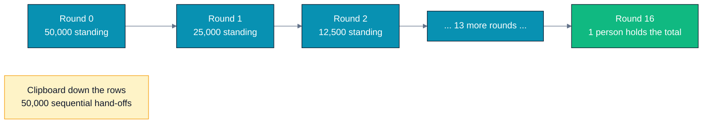
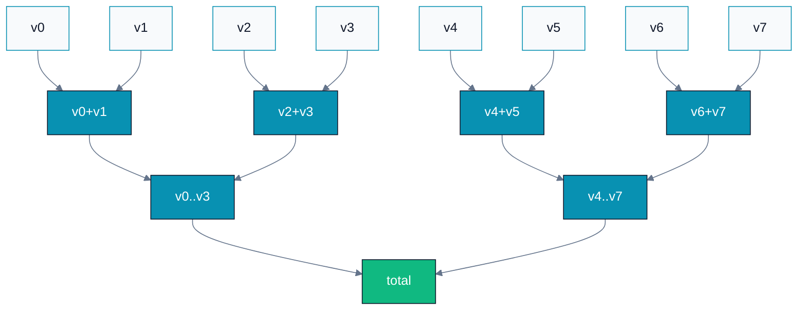
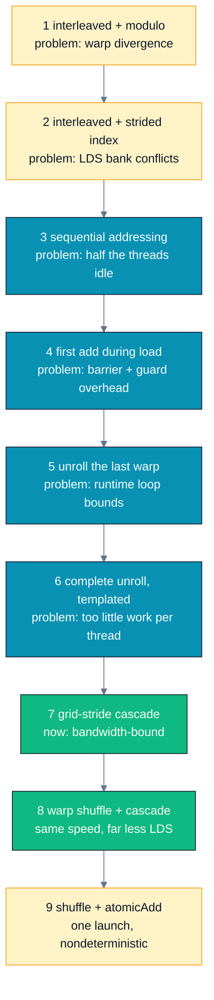
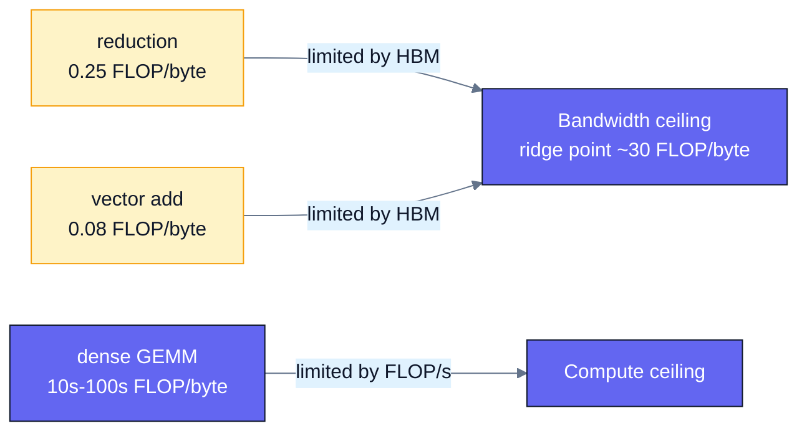
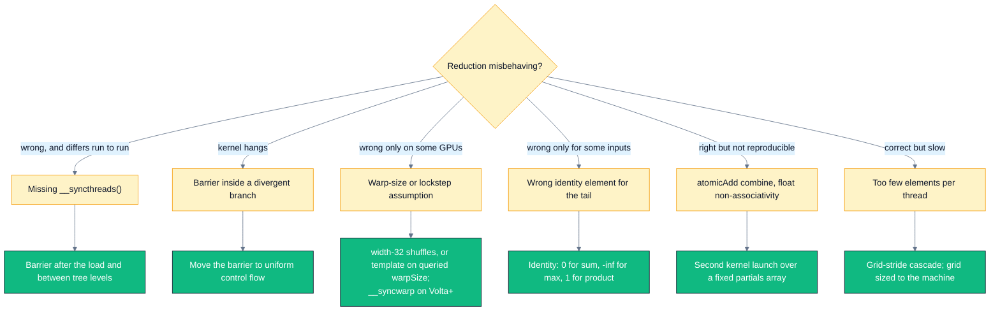

# A04 — Parallel Reduction

> Track A · Module 04 · Status: **DONE** · Est. 6 hours · Depth 3/5
>
> Prerequisites: [A01](../A01.foundations-and-programming-model/README.md) (kernels,
> grid/block/thread, error checking, event timing) and
> [A02](../A02.memory-hierarchy-and-coalescing/README.md) (shared memory /
> LDS, bank conflicts, `__syncthreads`). Backends: AMD (`hipcc`) · NVIDIA (`nvcc`) · Triton (Python).
> Setup: [SETUP.md](../../../docs/SETUP.md) ·
> Terms: [GLOSSARY.md](../../../docs/GLOSSARY.md) · Sources: [REFERENCES.md](../../../docs/REFERENCES.md).

---

## 1. TL;DR + Layman analogy

**TL;DR.** A **[reduction](../../../docs/GLOSSARY.md#reduction)** collapses `N` values into one
(sum, max, min, product, any/all). Done
sequentially it takes `N−1` dependent steps. Done as a **binary tree** it takes the *same* `N−1`
additions but only `log₂ N` *levels* — so 16.7 million numbers finish in 24 levels instead of 16.7
million. That is the algorithmic idea, and it is the easy half. The hard half is that a naive GPU
tree wastes most of the machine: it diverges inside the
[warp](../../../docs/GLOSSARY.md#warp-nvidia-and-wavefront-amd), conflicts in
[shared memory](../../../docs/GLOSSARY.md#shared-memory-nvidia-and-lds-amd), leaves
half the threads idle, and pays barrier overhead for steps that do not need one. This module walks
the classic **nine-rung optimization ladder** from Mark Harris's
*[Optimizing Parallel Reduction in CUDA](../../../docs/REFERENCES.md#optimizing-parallel-reduction-in-cuda-harris)*,
implements every rung in one benchmarked, verified program, and ends where every good
reduction ends: **memory-bandwidth-bound**, with success measured as a fraction of peak HBM.

**Layman analogy.** A stadium of **50,000 people** each holds a number, and you want the total. The
slow way is to pass a clipboard down every row — 50,000 hand-offs, one after another. The fast way:
everyone turns to the person on their right, adds the two numbers, and the person on the right sits
down. Now 25,000 people are standing. Repeat. After **16 rounds** (2¹⁶ = 65,536 > 50,000) exactly
one person is left standing, holding the total. The stadium did the same 50,000 additions either
way — the tree did not save *work*, it saved **waiting**.



*Same additions, 3000× fewer rounds of waiting — depth, not work, is what parallelism buys you.*

**Where the analogy breaks — and each break is a section of this module:**

- **Anyone can pair with anyone in a stadium.** On a GPU, two threads can only exchange values
  cheaply if they are in the same **warp/wavefront** (registers, via shuffle) or the same **block**
  (shared memory / LDS). Across blocks there is no cheap handshake at all — §3's *final combination*.
- **Sitting down is free for a person; it is not for a lane.** After round 1 half the stadium is
  idle, and nobody cares. On a GPU an idle lane still occupies a slot in a warp that is still being
  issued — which is why the ladder's biggest wins come from *giving every thread more data*, not
  from making the tree shallower (§3 stages 4 and 7).
- **One whistle reaches the whole stadium.** `__syncthreads()` only reaches one **block**. There is
  no cheap grid-wide whistle, which is why a reduction needs a second kernel launch or atomics (§3).
- **People adding on paper are exact.** Float addition is **not associative**, so changing the
  pairing order changes the last bits of the answer. That is a feature of the hardware, a hazard for
  reproducible ML, and the reason §6 spends real time on determinism.

**By the end of this module you can:** explain work vs depth and why a tree is the right shape;
implement and *benchmark* all seven classic reduction kernels plus the two modern warp-shuffle
variants; state exactly what each `__syncthreads()` protects and what breaks without it; write a
warp reduction that is correct on both 32-lane and 64-lane hardware; choose between a second kernel
launch and `atomicAdd` with the determinism tradeoff explicit; and judge any reduction against the
only number that matters — the fraction of peak HBM bandwidth it achieves.

---

## 2. First Principles

### The problem, stated precisely

Given an associative binary operator `⊕` with identity `e`, and `N` values, compute
`v₀ ⊕ v₁ ⊕ … ⊕ v_{N−1}`. **Associativity is the entire licence to parallelize**: it is what lets you
regroup `(a⊕b)⊕(c⊕d)` instead of `((a⊕b)⊕c)⊕d`. Commutativity is a bonus that lets you also reorder,
which is what a grid-stride loop quietly relies on.

Note what is *not* required: that the operator be exact. Float addition is associative *in theory*
(real numbers) but not *in practice* (rounding — the standard account is
[Goldberg, 1991](../../../docs/REFERENCES.md#what-every-computer-scientist-should-know-about-floating-point-arithmetic-goldberg-1991)).
We parallelize anyway, and pay attention in §6.

### Work versus depth — the two numbers that describe any parallel algorithm

| Metric | Meaning | Sequential sum | Tree sum |
|---|---|---|---|
| **Work** `W` | total operations performed | `N − 1` | `N − 1` |
| **Depth** `D` | longest chain of *dependent* operations | `N − 1` | `⌈log₂ N⌉` |

The tree is **work-efficient**: it does not do a single extra addition. It only rearranges which
additions may happen at the same time. For `N = 2²⁴ = 16,777,216`:

```
sequential : W = 16,777,215 ops,  D = 16,777,215 steps
tree       : W = 16,777,215 ops,  D = 24 steps
```

An algorithm that reduced depth by *doing more work* (many parallel algorithms do —
[prefix sum](../A05.parallel-scan-prefix-sum/README.md) is
the famous example) would be a worse trade here, because as we are about to see, work is what costs.

### Brent's theorem, and why it predicts the winning kernel

**Brent's theorem** bounds the time on `P` processors:

```
T_P  ≤  W / P  +  D
```

Read it as: *you pay for the work spread across your processors, plus the unavoidable depth.* Plug
in a data-center GPU. Call it `P ≈ 10⁵` concurrent lanes (a few hundred CUs/SMs × a few thousand
resident lanes each):

```
W / P = 16,777,215 / 100,000 ≈ 168
D     = 24
T_P   ≲ 192 "steps"
```

**The `W/P` term is 7× the `D` term.** The depth is already almost free; the work throughput is the
whole game. This single inequality predicts every rung of the ladder:

- Making the tree shallower buys you almost nothing (`D` is already tiny).
- Making each lane do *more useful work per unit of overhead* buys you everything — which is exactly
  what "first add during load" (stage 4) and the "algorithm cascade" (stage 7) do.
- Wasting lanes — divergence, idle threads, serialized bank accesses — inflates the *effective* `P`
  denominator, and that is what stages 1→3 fix.

### Why a tree and not "everyone atomically adds into one counter"?

Because that reintroduces the depth you just eliminated. `N` atomic increments of a single address
serialize on that address: depth `O(N)` in contention, no matter how many lanes you have. Atomics
are the right tool for the **last** `gridDim.x` values (a few thousand), not the first 16 million.
The tree's job is to get from 16 million to a few thousand cheaply; §3 covers who finishes the job.

### The naive version, and where it breaks

The textbook GPU reduction is: each block loads `blockDim.x` values into shared memory, then halves
the number of active threads each step.

```cpp
sdata[tid] = in[i];
__syncthreads();
for (unsigned s = 1; s < blockDim.x; s *= 2) {
    if (tid % (2 * s) == 0) sdata[tid] += sdata[tid + s];
    __syncthreads();
}
```

It is correct. It is also, on real hardware, **around an order of magnitude slower than it needs to
be** — and the reasons are not algorithmic at all. They are: which *lanes* are active, which
*banks* they touch, how many *elements* each thread was given, and how many
*[barriers](../../../docs/GLOSSARY.md#barrier)* it executes.
Section 3 removes them one at a time.

---

## 3. Deep Dive

### The shape of the computation



*Eight values, seven additions, three levels — `W = N−1`, `D = log₂N`. Every level needs a barrier,
because level `k+1` reads what level `k` wrote.*

The tree above is a static picture of a process that happens **in turn**, one round after the next,
and that distinction is where the cost hides:



Watch what the rounds do to the array. Half the lanes fall idle at every level, so by the final
round one lane in sixteen is still working — only 15 of the 64 lane-slots ever do anything. The
depth win is real and it is the reason to use a tree, but the idle fraction is a real bill, and
stage 7 below is the rung that pays it off.

The GPU version has **three** nested levels of this tree, and they are not the same mechanism:

| Level | Span | How values are exchanged | Sync primitive |
|---|---|---|---|
| Warp / wavefront | 32 or 64 lanes | registers, via `__shfl_*` | implicit lockstep (AMD) / `__syncwarp` (NVIDIA Volta+) |
| Block / workgroup | 128–1024 threads | shared memory / LDS | `__syncthreads()` |
| Grid | all blocks | global memory | second kernel launch, or atomics |

Almost every reduction bug and every reduction optimization lives at one of those three boundaries.

### The ladder



*Each rung names the problem the next rung solves; the colour change at stage 7 marks where the
kernel stops fighting itself and starts being limited only by HBM.*

#### Stage 1 — interleaved addressing with `%`: warp divergence

```cpp
if (tid % (2 * s) == 0) sdata[tid] += sdata[tid + s];
```

At `s = 1` the active threads are 0, 2, 4, 6, … — **every other lane**. A warp/wavefront issues one
instruction for all its lanes, so the hardware runs the add with half the lanes masked off. At
`s = 2` it is every fourth lane, and so on. There is *no* step at which a warp is fully busy, and
*every* warp in the block participates in *every* step. Two costs, not one:

- **[Divergence](../../../docs/GLOSSARY.md#divergence):** useful work per issued instruction falls
  as `1/(2s)`.
- **The `%` itself:** integer modulo by a runtime value is not a cheap instruction on a GPU. (Had
  `2*s` been a compile-time power of two the compiler would turn it into a mask; it cannot here.)

#### Stage 2 — strided index: divergence gone, bank conflicts arrive

```cpp
unsigned index = 2 * s * tid;
if (index < blockDim.x) sdata[index] += sdata[index + s];
```

Now the *first* `blockDim/(2s)` threads are the active ones — a contiguous range, so whole warps are
either fully active or fully idle. Divergence is gone. But look at the addresses: consecutive lanes
now touch shared-memory words `0, 2s, 4s, …`.

Shared memory (LDS on AMD) is banked: **32 [banks](../../../docs/GLOSSARY.md#bank-conflict) of
4-byte words**, and a warp can service 32
accesses in one cycle only if they land in 32 *distinct* banks
([A02 §3](../A02.memory-hierarchy-and-coalescing/README.md#3-deep-dive)). With a stride of `2s` words,
lanes collide modulo 32:

| step `s` | word stride | distinct banks touched by 32 lanes | conflict |
|---:|---:|---:|---|
| 1 | 2 | 16 | 2-way |
| 2 | 4 | 8 | 4-way |
| 4 | 8 | 4 | 8-way |
| 8 | 16 | 2 | 16-way |
| ≥16 | ≥32 | 1 | 32-way |

Each conflict serializes the access. You traded a divergence problem for a memory problem.

#### Stage 3 — sequential addressing: both problems gone

```cpp
for (unsigned s = blockDim.x / 2; s > 0; s >>= 1) {
    if (tid < s) sdata[tid] += sdata[tid + s];
    __syncthreads();
}
```

Walk the stride **down** instead of up. Active threads are always `tid < s` — contiguous, so no
divergence — and the two operands `sdata[tid]` and `sdata[tid + s]` are *consecutive words across
lanes*, so 32 lanes hit 32 distinct banks. Conflict-free. **This addressing pattern is the one that
appears in every production reduction**; stages 1 and 2 exist so you understand why.

#### Stage 4 — first add during the global load

Stage 3 has a structural embarrassment: at the very first step only half the threads work, at the
second only a quarter, and so on. Over the whole tree, average utilization is barely above one
thread. Harris's fix does not touch the loop at all — it changes the **launch**:

```cpp
unsigned i = blockIdx.x * (blockDim.x * 2) + threadIdx.x;
float v = (i < n) ? in[i] : 0.0f;
if (i + blockDim.x < n) v += in[i + blockDim.x];   // both loads coalesced
sdata[tid] = v;
```

Each block now consumes `2 × blockDim.x` elements, so you launch **half as many blocks**, each doing
one extra add during a load it was making anyway. Both loads are coalesced (lane `L` reads element
`base + L` and `base + blockDim + L`). Same total work, half the block-tree overhead. This is the
first hint of the idea that stage 7 takes to its limit.

#### Stage 5 — unroll the last warp

Once `s ≤ 32`, only one warp is still active. Everything the loop does for those last six steps is
overhead: a barrier that synchronizes 256 threads when 32 are working, and a `tid < s` guard whose
answer the hardware already knows. So stop the loop at 32 and write the tail straight:

```cpp
// HIP: safe as written, because AMD guarantees wavefront lanes run in lockstep.
__device__ void warp_tail_volatile(volatile float* s, unsigned tid) {
    s[tid] += s[tid + 32];
    s[tid] += s[tid + 16];
    s[tid] += s[tid + 8];
    s[tid] += s[tid + 4];
    s[tid] += s[tid + 2];
    s[tid] += s[tid + 1];
}
```

Three things about this famous six-line function, and all three are interview material:

1. **Why `volatile` is mandatory.** Without it the compiler is free to keep `s[tid]` in a register
   across the six statements and write it back once at the end — at which point the *other* lanes
   never see the intermediate values, and the answer is wrong. `volatile` forces every read and
   write to actually go to shared memory.
2. **Why it is fragile.** The whole trick rests on "lanes of one warp execute in lockstep, so no
   barrier is needed." AMD's HIP documentation states that guarantee explicitly for wavefronts.
   **NVIDIA voided it in Volta**: independent thread scheduling means lanes of a warp can have
   separate program counters and are not guaranteed to reconverge
   ([CUDA C++ Programming Guide](../../../docs/REFERENCES.md#cuda-c-programming-guide-nvidia)).
   The volatile-only tail is
   *undefined behavior* on Volta and later — it may still work, which is the worst possible failure
   mode. NVIDIA's own guidance is to insert `__syncwarp()` between the steps or to switch to
   shuffles. Our [`cuda/reduction.cu`](cuda/reduction.cu) does the former; compare it side by side
   with [`hip/reduction.cpp`](hip/reduction.cpp) — it is the only substantive difference between the
   two files.
3. **Why the constant is 32 and not `warpSize`.** On a 64-lane CDNA wavefront, unrolling from 32
   is still *correct* (lanes 0–31 are inside one wavefront), it just leaves the `s = 32` step running
   as a full barrier when it did not have to. Unrolling from 64 would be faster on CDNA and **wrong**
   on a 32-lane RDNA or NVIDIA part. There is no portable compile-time constant to use: as of
   ROCm 7.0 HIP's `warpSize` is deliberately **not** `constexpr` (matching CUDA), and
   `__AMDGCN_WAVEFRONT_SIZE__` is deprecated. The portable options are (a) hard-code 32 and accept a
   small loss on wave64, (b) template the kernel on the warp size and pick the instantiation on the
   host after querying `hipDeviceAttributeWarpSize` — the approach HIP's own documentation
   recommends.

#### Stage 6 — complete unroll with a templated block size

Make the block size a template parameter and the entire tree becomes straight-line code:

```cpp
template <unsigned BLOCK>
__global__ void reduce6(const float* in, float* out, unsigned n) {
    // ...
    if (BLOCK >= 512) { if (tid < 256) sdata[tid] += sdata[tid + 256]; __syncthreads(); }
    if (BLOCK >= 256) { if (tid < 128) sdata[tid] += sdata[tid + 128]; __syncthreads(); }
    if (BLOCK >= 128) { if (tid <  64) sdata[tid] += sdata[tid +  64]; __syncthreads(); }
    if (tid < 32) warp_tail_volatile(sdata, tid);
}
```

`BLOCK` is known at compile time, so every `if (BLOCK >= …)` is folded away and the loop counter,
its comparison, and its increment disappear. Note carefully where the barriers sit: **outside** the
`tid < …` guards. A `__syncthreads()` that only some threads of a block reach is undefined behavior
and in practice hangs the kernel — see §6.

#### Stage 7 — the algorithm cascade

Recall Brent: `T_P ≤ W/P + D`. Stages 1–6 have each thread consume one or two elements and then pay
`log₂(BLOCK)` levels of tree overhead. At `N = 2²⁴` with 256-thread blocks that is **32,768 blocks**
— 32,768 separate trees, 32,768 sets of barriers, and a second and third kernel launch to combine
them. The overhead is proportional to the number of blocks, and the number of blocks is proportional
to `N`.

So decouple them. Launch a grid sized to the **machine** (a few blocks per CU/SM), and have each
block stream through as much data as it takes using a **grid-stride loop**:

```cpp
float sum = 0.0f;
for (unsigned i = blockIdx.x * (BLOCK * 2) + tid; i < n; i += BLOCK * 2 * gridDim.x) {
    sum += in[i];
    if (i + BLOCK < n) sum += in[i + BLOCK];
}
sdata[tid] = sum;   // one tree per block, no matter how large n is
```

The serial fold is nearly free — it is a register add per element, with perfectly coalesced loads —
and it collapses `N` elements down to `gridDim.x × BLOCK` before a single barrier executes. The tree
overhead becomes `O(number of blocks)` instead of `O(N)`. **This is the rung that reaches peak
bandwidth**, and it is why the shallower-tree rungs before it stopped mattering.

[Harris's slides](../../../docs/REFERENCES.md#optimizing-parallel-reduction-in-cuda-harris) derive
the same result from the cost model: keep `O(N / log N)` threads, each doing
`O(log N)` serial work.

#### Stage 8 — warp shuffles: the modern idiom

`__shfl_down(v, delta, width)` lets lane `L` read lane `L + delta`'s register directly. No shared
memory, no address arithmetic, no barrier:

```cpp
__device__ float warp_reduce_shfl(float v) {
    for (int off = 16; off > 0; off >>= 1) v += __shfl_down(v, off, 32);
    return v;   // valid in lane 0
}
```

A whole-block reduction becomes: reduce within each 32-lane group, have one lane per group publish
to a tiny shared array, `__syncthreads()` once, reduce that array in the first group. **One barrier
instead of `log₂(BLOCK)`, and `BLOCK/32` floats of LDS instead of `BLOCK`** — which directly buys
[occupancy](../../../docs/GLOSSARY.md#occupancy) back.

Two portability points that come up constantly:

- **Lane count.** A NVIDIA warp and an RDNA wavefront are 32 lanes; a CDNA wavefront is 64. The
  code above uses `width = 32` deliberately: HIP's shuffle `width` argument splits the wavefront into
  independent sub-groups indexed by `laneIdx % width`, so a width-32 shuffle behaves identically on
  wave32 and wave64 hardware. It is the cheapest correct portability strategy; the fully-tuned
  alternative is to template on the warp size and select at launch.
- **The `_sync` variants.** On CUDA, `__shfl_down` was deprecated and replaced by
  `__shfl_down_sync(mask, …)` with a **32-bit** mask (`0xffffffff` for a full warp) — mandatory from
  Volta onward. HIP added `_sync` variants too, but the mask is **64-bit** (a wavefront can have 64
  lanes), enabled by default from ROCm 7.0. Porting CUDA code that passes `0xffffffff` to a HIP
  `_sync` builtin will trip a `static_assert` — that is the header protecting you from an implicitly
  promoted mask, not a bug.

**`__shfl_down` vs `__shfl_xor`.** `__shfl_down` produces the answer in lane 0 only; the butterfly
form `v += __shfl_xor(v, mask, 32)` produces it in **every** lane, for the same instruction count.
Use `xor` whenever all lanes need the result — [softmax](../../../docs/GLOSSARY.md#softmax)
normalization and layer-norm are the standard
examples, since every lane must then divide by the reduced value.

#### Finishing the job: combining across blocks

There is no cheap grid-wide barrier in the base programming model (cooperative groups offer
`grid.sync()`, at the cost of a launch that must fit entirely on the device at once). Three real
options:

| Strategy | Launches | Deterministic? | When to use |
|---|---|---|---|
| **Second kernel** on the partials | 2 (or 3) | **Yes** — fixed partials array, fixed traversal order | Default. Anything feeding training math. |
| **`atomicAdd`** from each block | 1 | **No** — block completion order varies | Small `N` where launch latency dominates, and the consumer tolerates drift |
| **`__threadfence()` + last-block-finishes** | 1 | Yes, if the last block reads the partials in index order | Single-launch *and* deterministic, at the cost of a fiddly atomic counter |

The determinism caveat is not pedantry. `atomicAdd` on floats makes the summation order depend on
how the scheduler happens to retire blocks, and because float addition is not associative, **the
same program on the same input can return different low-order bits on every run**. In a training
loop that means loss curves that do not reproduce across restarts and "is this diff a regression?"
becoming unanswerable. The main lab measures this directly — see the determinism probe at the end of
its output.

### Why every `__syncthreads()` is required

Shared memory is only guaranteed coherent across a block **at a barrier**. In the tree:

- **After the load, before the first step.** Thread `tid` writes `sdata[tid]`, then reads
  `sdata[tid + 128]` — a slot owned by a thread in a *different* wavefront. With 256 threads and
  64-lane wavefronts a block is four independently scheduled wavefronts; nothing orders wavefront
  3's store before wavefront 0's load. Without the barrier you read uninitialized shared memory.
- **Between every pair of tree levels.** Level `s` writes `sdata[0 … s−1]`; level `s/2` reads them.
  Same hazard, once per level.

The failure mode is a **data race**: not a crash, not a consistent wrong answer, but an answer that
is *sometimes* right. Exercise 2 makes you feel it.

**And the trap that is worse than forgetting one:** putting the barrier *inside* the divergent
branch.

```cpp
for (unsigned s = BLOCK/2; s > 0; s >>= 1) {
    if (tid < s) { sdata[tid] += sdata[tid + s]; __syncthreads(); }   // UNDEFINED
}
```

`__syncthreads()` is a block-wide rendezvous: every non-exited thread of the block must execute it,
and all must execute *the same* barrier. Wavefronts whose lanes all have `tid >= s` skip the branch
entirely and never arrive; the ones that did arrive wait forever. On real hardware this **hangs**
until a watchdog kills the kernel. Barriers belong at uniform control flow — always outside the
`if`. (Divergent *branches* are fine; divergent *barriers* are not.)

---

## 4. Hands-On Labs

All commands run from this module directory.

```bash
# AMD
make hip GPU_ARCH=gfx942     # build hip/ programs
make run-hip                 # run them

# NVIDIA
make cuda SM_ARCH=sm_90      # build cuda/ programs
make run-cuda

# Triton (either vendor)
python triton/reduction.py
```

The drills are self-contained too: [`exercises/`](exercises/) and [`solutions/`](solutions/) each
have their own `Makefile`, so you can `cd exercises && make run` without coming back here. From this
directory, `make exercises` / `make solutions` build them in place, and `make clean` cleans all three.

> **Match `GPU_ARCH` to your GPU.** `gfx950` = MI350, `gfx942` = MI300, `gfx90a` = MI200,
> `gfx1100` = RDNA3. Find yours with `/opt/rocm/bin/offload-arch` (or `rocminfo | grep gfx`).
> Toolchain troubleshooting (missing `libamdhip64.so`, `hipErrorNoBinaryForGpu`) is covered in
> [A01 §4](../A01.foundations-and-programming-model/README.md#4-hands-on-labs).

### Lab 1 — The whole ladder in one table (`reduction`)

Files: [`hip/reduction.cpp`](hip/reduction.cpp) · [`cuda/reduction.cu`](cuda/reduction.cu).

One program reduces the **same** 16.7 M-element array nine times, once per rung. For each it prints
the time, the effective bandwidth, the speedup over stage 1, the relative error against a
**float64** CPU reference, and PASSED/FAILED. Output shape:

```text
device          : <your GPU> (<N> CUs/SMs)
n               : 16777216 floats (64.0 MiB), block = 256, cascade grid = <8 x CUs>
reference (fp64): <exact sum>

stage                                                      ms      GB/s    vs #1    rel err  result
---------------------------------------------------- -------- --------- -------- ---------- ------
1 interleaved, modulo branch (divergent)                <...>     <...>    1.00x     <~1e-7> PASSED
...
9 shuffle + atomicAdd (1 launch, nondeterministic)      <...>     <...>    <...>     <~1e-7> PASSED

determinism probe (8 repeats of the same input):
  stage 8 (second kernel launch): bitwise identical every run   [min ..., max ...]
  stage 9 (atomicAdd): results DIFFER between runs              [min ..., max ...]
```

**What to observe — in this order:**

1. **Every stage says PASSED.** The ladder is nine *implementations of the same function*. Nothing
   in it trades correctness for speed. If a stage fails, that is a real bug, not a rounding effect.
2. **The relative error column is not zero, and not the same for every stage.** Each stage visits
   the additions in a different order; float addition is not associative. A drift around 1e-7 is
   the expected signature of a correct float32 tree.
3. **The jumps, not the absolute numbers.** Expect the big steps at stage 3 (divergence and bank
   conflicts both gone) and stage 7 (enough work per thread to saturate the memory system), and
   expect stages 7, 8 and 9 to cluster together — once you are bandwidth-bound, further kernel
   cleverness has nothing left to buy.
4. **The determinism probe.** Stage 8 and stage 9 compute the same sum with the same kernel; only
   the cross-block combine differs. Stage 8 should be bitwise identical across all eight repeats;
   stage 9 usually is not.

Absolute times and GB/s are **hardware-, driver-, and `N`-dependent** — do not compare your numbers
to anyone else's, compare them to your own machine's copy ceiling
([A02 Lab 1](../A02.memory-hierarchy-and-coalescing/README.md#4-hands-on-labs)).

### Lab 2 — What the compiler already knows (`triton/reduction.py`)

File: [`triton/reduction.py`](triton/reduction.py).

Triton's `tl.sum` emits the divergence-free, conflict-free, shuffle-based intra-block tree for you —
rungs 1 through 6 of the ladder are simply not decisions you get to make wrong. What Triton does
*not* decide is the part that actually determines performance: how many elements each program
consumes, and how the partials are combined. So the script benchmarks exactly those, plus
`torch.sum` as the library baseline.

**What to observe:** the cascade version should beat the one-program-per-block version and land near
`torch.sum` — which is itself a tuned cascade. The lesson is not "Triton is fast", it is **which
decisions survive the abstraction**: the top two rungs of the ladder are yours in every language.

### Lab 3 (optional) — Profile it

```bash
# AMD
make profile-hip     # rocprofv3 summary + traces
# NVIDIA
make profile-cuda    # nsys timeline; then: ncu --set full ./cuda/reduction.exe
```

**What to look for:**

- The **per-kernel durations** confirm the table, and show you the *second and third* launches that
  the table folds into one number.
- Nsight Compute's *Warp State* / branch-efficiency metrics on stage 1 versus stage 3 make the
  divergence visible; the *Shared Memory* section shows bank conflicts on stage 2 dropping to zero
  on stage 3. (`rocprofv3` exposes the equivalent LDS bank-conflict counter.)
- On stages 7–9, look at **DRAM throughput as a percentage of peak**. That number, not the kernel
  time, is the one to report in a review.

---

## 5. Performance Analysis

### The only ceiling that matters

A reduction reads `N` values and writes one. There is no reuse, no output traffic to speak of, and
one FLOP per element:

```
bytes moved      ≈ N * sizeof(float)          (the write is a single scalar)
FLOPs            = N - 1
arithmetic       = (N-1) / (4N) ≈ 0.25 FLOP/byte
effective_GBps   = N * sizeof(float) / kernel_time_seconds
```

A data-center GPU's
[roofline](../../B-gpu-ml-performance/B02.roofline-and-arithmetic-intensity/README.md) ridge point —
where [memory-bound becomes compute-bound](../../../docs/GLOSSARY.md#memory-bound-compute-bound-and-latency-bound) —
sits around
**30 FLOP/byte** (order 10² TFLOP/s ÷ order 10¹² B/s). At 0.25 FLOP/byte a reduction is roughly
**120× to the left of the ridge**: as memory-bound as a kernel can be.



*Reduction sits next to vector add on the memory-bound side; the practical consequence is that once
you reach a high fraction of HBM bandwidth, there is nothing left to optimize in the kernel.*

**Therefore: the success metric for a reduction is `effective_GBps / your measured copy ceiling`.**
Not the speedup over stage 1, not the instruction count. Get your ceiling from
[A02 Lab 1](../A02.memory-hierarchy-and-coalescing/README.md#4-hands-on-labs)
(`hip/bandwidth.exe`), and expect a well-tuned reduction to land in the 80–90% range of it.

### Expected shape of results

We deliberately do **not** publish a measured table here — the numbers depend on your GPU, driver,
ROCm/CUDA version, and `N`, and a stale table teaches the wrong thing. Run Lab 1 and fill in your
own. What is reproducible is the **ordering and the shape**:

| Transition | Why it helps | Expected magnitude |
|---|---|---|
| 1 → 2 | removes warp divergence and the runtime `%` | large |
| 2 → 3 | removes shared-memory bank conflicts | large |
| 3 → 4 | halves the block count, one free add per load | moderate |
| 4 → 5 | drops six barriers and six guards per block | moderate |
| 5 → 6 | folds the loop away at compile time | small |
| 6 → 7 | decouples tree overhead from `N` — **the bandwidth rung** | large |
| 7 → 8 | LDS traffic → registers | small (both are bandwidth-bound) |
| 8 → 9 | removes one kernel launch | small, and costs determinism |

Cumulatively this is a **large multiple**, not a few percent: the original Harris slides report
roughly a **30× improvement from kernel 1 to kernel 7** on a 4 M-element reduction (on a G80 — the
absolute numbers are of historical interest only; the ordering has held up across twenty years of
architectures). The per-stage table is in
[the deck](../../../docs/REFERENCES.md#optimizing-parallel-reduction-in-cuda-harris); reproduce its
*shape* on your own hardware rather than trusting either their numbers or ours.

### Reading your own result

1. Compute `effective_GBps` for your best stage (the program prints it).
2. Divide by your measured copy ceiling.
3. **Above ~80%:** you are done. Any further work belongs elsewhere in the pipeline — fuse this
   reduction into the kernel that produced the data, or stop reducing so often.
4. **Below ~60%:** check, in this order — is `N` large enough that launch latency is not dominating
   (see exercise 3, Q7)? Is each thread loading enough elements to keep requests in flight (try
   unrolling the grid-stride loop or using `float4` loads)? Is the grid actually filling the machine?

---

## 6. Challenges, Drawbacks & Tradeoffs



*Six symptoms, six distinct root causes — note that three of them produce a program that passes its
tests most of the time.*

### Pitfall 1 — The missing barrier (silent, intermittent, and the most common)

Covered in §3. What makes it dangerous is that it often *works*: with a small block, or a lucky
schedule, or a debug build, the wavefronts happen not to drift. Do not conclude from a green run
that a barrier was unnecessary. Conclude it from the memory model, and confirm with
`compute-sanitizer --tool racecheck`.

### Pitfall 2 — The divergent barrier (hangs, does not fail)

`__syncthreads()` inside `if (tid < s)`. Whole wavefronts never arrive, the rest wait forever. §3
has the code and the reasoning. The rule to memorize: **branch divergently all you like; synchronize
uniformly.**

### Pitfall 3 — Assuming a warp size, or assuming lockstep

Two separate assumptions, both fatal, and both invisible until you change hardware:

- **Size.** 32 on NVIDIA and RDNA, 64 on CDNA. A hand-unrolled 32-lane tail is correct everywhere
  but suboptimal on wave64; a hand-unrolled 64-lane tail is *wrong* on wave32. HIP's `warpSize` is
  intentionally not a compile-time constant (as of ROCm 7.0, matching CUDA), and
  `__AMDGCN_WAVEFRONT_SIZE__` is deprecated — query `hipDeviceAttributeWarpSize` on the host and
  dispatch to a templated kernel if you need the last few percent.
- **Lockstep.** AMD guarantees wavefront lanes execute in lockstep. NVIDIA does **not**, since Volta
  introduced independent thread scheduling. Warp-synchronous code that omits `__syncwarp()` or the
  `_sync` shuffle variants is undefined behavior on modern NVIDIA parts.

### Pitfall 4 — The identity element for partial tiles

`N` is almost never an exact multiple of the tile size, so some lanes have no data and must
contribute the operator's identity: `0` for sum, `1` for product, `−∞` for max, `+∞` for min,
`false` for logical-or. Using `0.0f` as the identity for a **max** reduction is the classic version
of this bug, and it is invisible until someone feeds you an all-negative array. That is exercise 1.

### Pitfall 5 — Determinism, and why ML cares

Float addition is not associative: `(a+b)+c ≠ a+(b+c)` in general. Consequences, in increasing order
of how much trouble they cause:

- **Across implementations.** The nine ladder stages produce nine slightly different answers to the
  same question. All are equally "correct"; none matches a sequential CPU sum exactly. Always verify
  against a **float64** reference with a tolerance, never against a float32 sequential loop.
- **Across runs.** Only the atomic-combine variant has this problem, and it is a real one. A
  gradient norm that changes in its last bits changes the clipping scale, which changes the update,
  which — after enough steps — changes the model. Debugging "my run diverged and I cannot reproduce
  it" is expensive; a deterministic second launch costs microseconds.
- **Precision loss.** A long *sequential* float32 sum stagnates: once the running total is large
  enough, adding a small value rounds to no change. The tree is actually **better** here — its error
  grows like `O(log N)` rather than `O(N)` — which is a rare case where the parallel algorithm is
  also the more accurate one. Where accuracy really matters, accumulate in float64 or use a
  compensated (Kahan) sum
  ([Goldberg, 1991](../../../docs/REFERENCES.md#what-every-computer-scientist-should-know-about-floating-point-arithmetic-goldberg-1991)),
  and accept the cost.

### Pitfall 6 — Reducing when you should not be reducing

The reduction itself is cheap; *launching* it is not. Below roughly ten million elements the two
kernel launches cost as much as moving the data (exercise 3 works the number out). In a training
loop, where you reduce a scalar loss or a per-layer gradient norm thousands of times per step, the
answer is never "write a faster reduction kernel" — it is **fuse** the reduction into the kernel that
produced the data, **batch** many small reductions into one launch, capture the sequence in a
**CUDA/HIP graph**, and above all do not call `.item()` inside the loop.

### Tradeoffs to hold in mind

- **Second launch vs atomics:** determinism and a partials buffer, versus one fewer launch. Default
  to the launch; deviate only with a reason you would write in a code review.
- **Shared memory vs shuffles:** shuffles use fewer barriers and less LDS (better occupancy) but
  only work within a warp, so you always need *some* shared memory for the block level.
- **Hand-written vs library:** rocPRIM / hipCUB / CUB / Thrust already implement everything in this
  module, tuned per architecture, and `torch.sum` calls into them. Write your own when you need to
  **fuse** the reduction with surrounding work (that is the real win) — not to beat the library at
  the standalone operation, because you will not.

---

## 7. Real-World Use Cases

Reduction is not a teaching toy; it is arguably the second most executed pattern in machine learning
after GEMM. Everywhere a tensor becomes a scalar (or a smaller tensor), this is the kernel.

- **The loss itself.** `loss = criterion(pred, target)` ends in a `mean` or `sum` over the batch —
  a reduction to a single scalar, run every forward pass. And `loss.item()` is the single most
  common accidental pipeline stall in PyTorch training loops, precisely because it forces a
  synchronization on the result of this reduction.
- **`torch.sum` / `torch.mean` / `torch.max` / `torch.norm`.** All of these dispatch to a tuned
  cascade reduction in ATen, backed by CUB (CUDA) or hipCUB/rocPRIM (ROCm). Every `dim=` argument
  variant is the same ladder with a different mapping of threads to the reduced axis; reducing along
  the **contiguous** axis is the coalesced case, reducing across it is the transpose problem from
  [A02](../A02.memory-hierarchy-and-coalescing/README.md) in disguise.
- **Gradient norms for clipping.** `clip_grad_norm_` computes `sqrt(Σ ‖g‖²)` over *every parameter
  tensor in the model* — thousands of small reductions per optimizer step. This is exactly the
  "many small reductions" case of §6 pitfall 6, which is why PyTorch ships `torch._foreach_norm`:
  one fused launch instead of thousands. It is also the place where the atomics-determinism issue
  bites hardest, since the clipping scale feeds directly into the weight update.
- **[Softmax denominators](../A07.softmax-and-fused-kernels/README.md).**
  `softmax(x)ᵢ = exp(xᵢ − max(x)) / Σⱼ exp(xⱼ − max(x))` needs **two**
  reductions per row — a max (for numerical stability) and a sum. Every lane needs both results, so
  this is the canonical `__shfl_xor` butterfly case.
  [FlashAttention](../../../docs/REFERENCES.md#flashattention-dao-et-al-2022)'s central trick is a *running*
  (online) version of these two reductions so the softmax never needs the full row in memory at once
  — the reduction pattern is the load-bearing part of the algorithm.
- **Normalization layers.** BatchNorm, LayerNorm, RMSNorm and GroupNorm all compute mean and
  variance over some axis — two reductions (or one, using the sum/sum-of-squares trick, which is
  faster and numerically worse). Because these run per layer per step, their launch overhead is a
  measurable fraction of training time, which is why every framework fuses them.
- **[Distributed training: allreduce](../../B-gpu-ml-performance/B07.distributed-training-and-sharding/README.md).**
  `torch.distributed.all_reduce`, [NCCL](../../../docs/REFERENCES.md#nccl-nvidia) and
  [RCCL](../../../docs/REFERENCES.md#rccl-amd) implement the
  *same* algorithm one level up the hierarchy — ring and tree allreduce are literally a reduction
  where the "lanes" are GPUs and the "shared memory" is the interconnect (Infinity Fabric,
  NVLink, InfiniBand). Data-parallel training performs one allreduce over the entire gradient buffer
  every step, and the same three questions apply: what is the tree shape, where are the barriers,
  and is the result bit-reproducible across runs?
- **Everything else that produces a metric.** Accuracy counts, token counts, histogram bins, loss
  scaling factors for mixed precision (which reduce over "did any gradient overflow?" — a logical-or
  reduction, identity `false`).

Libraries that embody this module: **rocPRIM / hipCUB** (AMD), **CUB / Thrust** (NVIDIA),
**RCCL / NCCL** for the multi-GPU version, and every `tl.sum` in a Triton kernel you will write in
[A08](../A08.triton-foundations/README.md).

**Where to go next.** [A05](../A05.parallel-scan-prefix-sum/README.md) asks the same tree for
*every* prefix rather than just the total, which is where the work-efficiency §2 got for free turns
into an explicit choice. [A07](../A07.softmax-and-fused-kernels/README.md) is the payoff §6 keeps
pointing at: two of these reductions per row, folded into the operator that produced the data
instead of launched after it.
[B03](../../B-gpu-ml-performance/B03.profiling-and-bottleneck-analysis/README.md) turns Lab 3 from
a sanity check into a method — divergence, bank-conflict and DRAM-throughput counters are how you
prove which rung a kernel is standing on instead of inferring it from the clock.

---

## 8. Cited References

Sources shared with other modules are cited by anchor into the
[master bibliography](../../../docs/REFERENCES.md), where the URL and its retrieval date live. The
last five are used only by this module, so they carry their citation in full.

- [**Optimizing Parallel Reduction in CUDA** (Harris)](../../../docs/REFERENCES.md#optimizing-parallel-reduction-in-cuda-harris)
  — the ladder §3 rebuilds rung by rung, the cost model behind the stage-7 cascade, and the source
  of the historical 30× figure quoted in §5.
- [**CUDA C++ Programming Guide**](../../../docs/REFERENCES.md#cuda-c-programming-guide-nvidia)
  — the normative statement of `__syncthreads()` semantics, warp-level primitives, and the
  independent thread scheduling that makes §3 stage 5's volatile-only warp tail undefined behavior
  on Volta and later.
- [**CUDA C++ Best Practices Guide**](../../../docs/REFERENCES.md#cuda-c-best-practices-guide-nvidia)
  — shared-memory bank conflicts (the stage-2 table), occupancy, event timing, and the
  effective-bandwidth definition §5 measures against.
- [**HIP Programming Model**](../../../docs/REFERENCES.md#hip-programming-model-amd) — the AMD
  spelling of the three-level hierarchy in §3: wavefronts, workgroups, LDS, `__syncthreads()`.
- [**Roofline** (Williams et al., 2009)](../../../docs/REFERENCES.md#roofline-williams-et-al-2009)
  — why 0.25 FLOP/byte settles the question of what a reduction can possibly be limited by, and
  therefore why §5 reports a fraction of peak bandwidth rather than a speedup.
- [**What Every Computer Scientist Should Know About Floating-Point Arithmetic** (Goldberg, 1991)](../../../docs/REFERENCES.md#what-every-computer-scientist-should-know-about-floating-point-arithmetic-goldberg-1991)
  — non-associativity, absorption in a long running sum, and compensated summation: the arithmetic
  behind §2's caveat and §6 pitfall 5.
- Lin, Y. & Grover, V. **Using CUDA Warp-Level Primitives** (NVIDIA blog) — why the volatile-only
  warp tail is unsafe on Volta+, and the `__syncwarp()` / `__shfl_*_sync` replacements.
  Retrieved 8 Aug 2026. <https://developer.nvidia.com/blog/using-cuda-warp-level-primitives/>
- **HIP C++ Language Extensions** — `warpSize` semantics (not a compile-time constant),
  wavefront lockstep guarantee, shuffle `width` sub-groups, the 64-bit `_sync` mask.
  Retrieved 8 Aug 2026.
  <https://rocm.docs.amd.com/projects/HIP/en/latest/how-to/hip_cpp_language_extensions.html>
- **rocPRIM** — AMD's production reduction/scan primitives; what to use instead of hand-rolling.
  Retrieved 8 Aug 2026. <https://rocm.docs.amd.com/projects/rocPRIM/en/latest/>
- Brent, R. P. (1974). *The Parallel Evaluation of General Arithmetic Expressions*, JACM 21(2) —
  the `T_P ≤ W/P + D` bound used in §2.
  <https://dl.acm.org/doi/10.1145/321812.321815>
- Higham, N. J. (1993). *The Accuracy of Floating Point Summation*, SIAM J. Sci. Comput. 14(4) —
  the `O(log N)` vs `O(N)` error growth claim in §6.
  <https://epubs.siam.org/doi/10.1137/0914050>

---

## 9. Self-Assessment & Interview Drills

### Conceptual (answers below)

1. A reduction over `N` elements has work `W = N−1` and depth `D = log₂N`. Your GPU has ~10⁵
   concurrent lanes and `N = 2²⁴`. Using Brent's bound, which term dominates — and what does that
   tell you about which optimizations are worth doing?
2. Stage 1 uses `if (tid % (2*s) == 0)` and stage 2 uses `index = 2*s*tid`. Both compute the same
   tree. Name the problem each one has, and explain why fixing the first created the second.
3. Why is `volatile` required in the classic unrolled warp tail, and why is that same code
   undefined behavior on an NVIDIA Volta or newer GPU? Give both fixes.
4. You hand-unroll the last **64** lanes because your MI300X has 64-lane wavefronts. What breaks,
   and on what hardware? What is the portable way to get the same win?
5. A colleague moves `__syncthreads()` inside `if (tid < s)` "so idle threads don't waste time at
   the barrier." What happens, and why is it worse than the original?
6. Your reduction returns a slightly different value on every run. The code has no race and passes
   `racecheck`. What is the most likely cause, and what would you change if the value feeds gradient
   clipping?
7. Convert a sum reduction to a max reduction. Which single line is most likely to be wrong, and
   which input exposes it?
8. Explain to a non-programmer, in two sentences, why adding up a million numbers on 1000 workers
   is not 1000× faster than one worker.

<details markdown="1">
<summary>Answers</summary>

1. `W/P = 16,777,215 / 100,000 ≈ 168` versus `D = 24` — the **work term dominates by ~7×**.
   Therefore optimizations that reduce *depth* (a shallower tree) are nearly worthless, while
   optimizations that raise *effective throughput per lane* (removing divergence, removing bank
   conflicts, giving each thread more elements) are where all the gains are. This is precisely why
   the ladder's two biggest rungs are stage 3 and stage 7.
2. Stage 1's active lanes are scattered (`0, 2, 4, …`), so the warp executes every step with most
   lanes masked off — **warp divergence** — and pays a runtime integer modulo. Stage 2 makes the
   active lanes contiguous (the first `blockDim/2s` threads), which kills divergence, but their
   shared-memory addresses now stride by `2s` words, which collides in the 32 LDS banks: a 2-way
   conflict at `s=1` growing to 32-way. Fixing the *lane mapping* changed the *address mapping*;
   stage 3's downward stride is the pattern that satisfies both constraints at once.
3. `volatile` prevents the compiler from caching `s[tid]` in a register across the six statements
   and writing back only at the end, which would hide the intermediate values from the other lanes.
   It is UB on Volta+ because **independent thread scheduling** removed the guarantee that warp
   lanes execute in lockstep and reconverge — `volatile` orders the *compiler*, not the *hardware*.
   Fixes: insert `__syncwarp()` between the steps (keeping the shared-memory tail), or replace the
   whole tail with `__shfl_down_sync` register shuffles. The shuffle version is preferred: it is
   faster, uses no shared memory, and has no volatile sharp edges.
4. It is wrong on any 32-lane device — NVIDIA (all of them) and AMD RDNA (gfx10/gfx11). Lanes 32–63
   are a *different* wavefront there, so reading `s[tid+32]` without a barrier is a cross-wavefront
   race. Portable win: template the kernel on the warp size, query
   `hipDeviceAttributeWarpSize` (or `cudaDeviceProp::warpSize`) on the host, and launch the matching
   instantiation. Cheaper approximation: use `width = 32` shuffle sub-groups, which behave
   identically on wave32 and wave64 (this module's approach).
5. Whole wavefronts whose lanes all have `tid >= s` never execute that barrier, so the wavefronts
   that did arrive wait for participants who will never come — the kernel **hangs** until a watchdog
   kills it. It is worse than the original because a hang gives no answer at all and no stack trace,
   whereas a missing barrier at least produces output you can compare. `__syncthreads()` must be
   reached by every non-exited thread of the block; branch divergently, synchronize uniformly.
6. Almost certainly an **`atomicAdd`-based cross-block combine**: block completion order varies with
   scheduling, and float addition is not associative, so the summation order — and therefore the low
   bits — changes run to run. For a gradient norm, switch to a deterministic second kernel launch
   over a fixed partials array (or the `__threadfence` last-block pattern). The few microseconds
   are worth reproducible training.
7. The **identity element** — the value assigned to lanes with no data. `0.0f` is right for sum and
   catastrophically wrong for max, because it beats every negative input. The exposing input is an
   array whose true maximum is negative, with a length that is not a multiple of the tile size (so
   that some lanes really are idle). Correct identity: `-INFINITY` (or `-FLT_MAX` if a downstream
   consumer cannot handle infinities).
8. Splitting the work means every worker has to hand their partial answer to someone else, and those
   hand-offs cost time that a single worker never pays. You also cannot start combining until enough
   workers have finished, so the slowest one sets the pace — with a million numbers the split is
   still a huge win, but with a hundred the hand-offs cost more than just adding them yourself.

</details>

### Coding & Algorithms drills

Do these in [`exercises/`](exercises/); reference answers in [`solutions/`](solutions/). Write real,
compiling, edge-case-correct code — no pseudo-code. Expected terminal output (PASS and the
instructive FAIL states) is in
[`exercises/README.md` → *Sample sandbox output*](exercises/README.md#sample-sandbox-output).

1. **Max reduction** (`exercises/01_max_reduce.cpp`) — re-target the sum reduction to `max`. Two
   TODOs: the operator, and the **identity element** for lanes with no data. Three test cases; the
   all-negative one with a non-multiple length is the one that catches a wrong identity, and the
   single-element one shows why small tests can't distinguish operators.
2. **Find the missing barriers** (`exercises/02_fix_sync.cpp`) — a block reduction with two absent
   `__syncthreads()` calls produces wrong and/or nondeterministic results across 20 repeats.
   Diagnose from the memory model, fix, and confirm the run-to-run stability. The header also
   documents the divergent-barrier trap that hangs rather than failing.
3. **Reduction roofline drill** (`exercises/03_reduction_analysis.md`) — given `N`, peak bandwidth,
   and a measured time, compute the theoretical floor, the fraction of peak achieved, where the
   remaining gap goes, and at what `N` launch overhead takes over. Ends with a code-review call on
   the atomics-versus-determinism tradeoff.

### Stretch

- **Butterfly reduction.** Rewrite the warp step with `__shfl_xor` so *every* lane ends with the
  total, then use it to write a single-pass row-softmax (max and sum in one kernel). Compare against
  `torch.softmax`.
- **Beat your own stage 7.** Add `float4` vectorized loads to the grid-stride loop and re-measure.
  Predict the gain from the memory-level-parallelism argument in §5 *before* you run it.
- **Deterministic single launch.** Implement the `__threadfence()` + atomic-counter "last block
  finishes" pattern, and prove with the determinism probe that it is bitwise stable across runs
  while still using only one launch.
- **Segmented reduction.** Reduce 10,000 independent rows of 512 elements each in one launch (one
  block per row), and compare against 10,000 separate small reductions. This is the
  `torch._foreach_norm` problem from §7.
