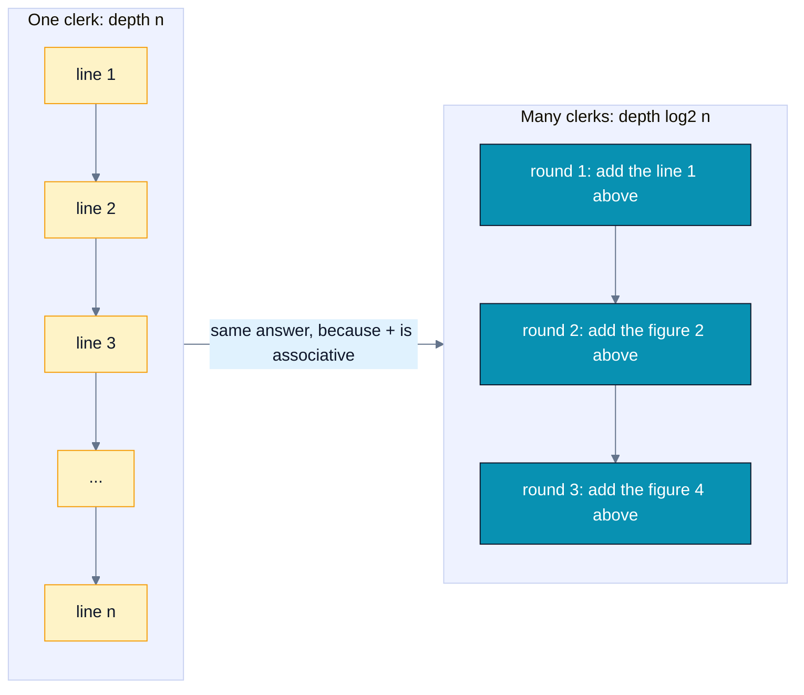
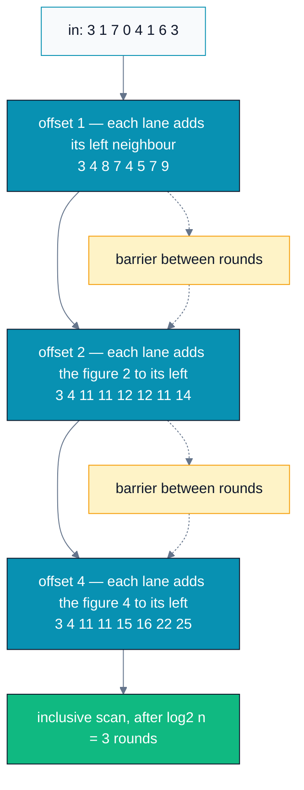
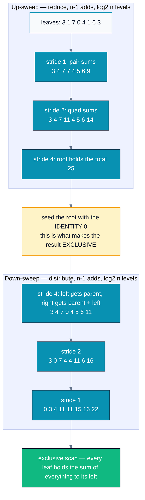
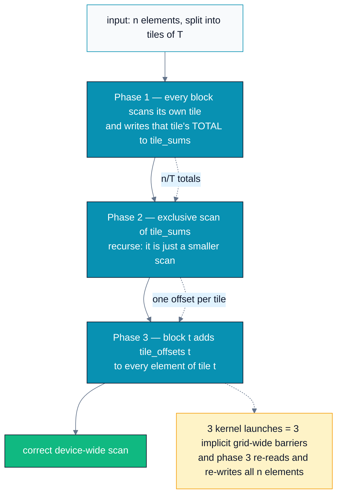
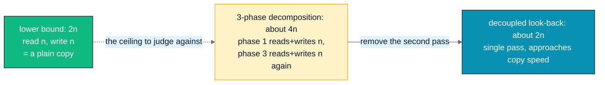
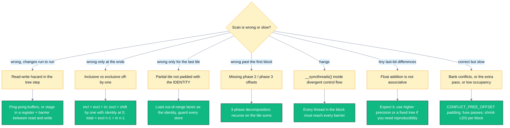

# A05 — Parallel Scan (Prefix Sum)

> Track A · Module 05 · Status: **DONE** · Est. 6 hours · Depth 3/5
>
> Prerequisites: [A01](../A01.foundations-and-programming-model/) (kernels, grid/block/thread,
> error checking, event timing) and [A02](../A02.memory-hierarchy-and-coalescing/) (shared
> memory / LDS, `__syncthreads()`, bank conflicts). Backends: AMD (`hipcc`) · NVIDIA (`nvcc`) ·
> Triton (Python). Setup: [../../../docs/SETUP.md](../../../docs/SETUP.md).

---

## 1. TL;DR + Layman analogy

**TL;DR.** `out[i] = in[0] + … + in[i]` looks irreducibly sequential: every output names the one
before it. It isn't — because **addition is associative**, the sums can be re-bracketed into a
tree of depth `log₂n`, and a tree is exactly what a GPU is good at. Two classic schedules of that
tree: **Hillis–Steele** (simple, `O(n log n)` work, `O(log n)` depth) and **Blelloch**
(up-sweep + down-sweep, `O(n)` work, `O(log n)` depth). Because a block can only cooperate over a
tile it holds on-chip, large arrays use a **3-phase decomposition** — scan each tile, scan the tile
totals, add the offsets back. Scan is not an exercise: it is the machinery under stream
compaction, radix sort, sparse-matrix row offsets, and every ragged/variable-length batch in ML
serving.

**Layman analogy — the bank statement.** A statement's **running balance** column looks strictly
sequential: line 7's balance is line 6's balance plus line 7's amount, so surely one clerk must
walk down the page. Now put a clerk on *every line* and run it in rounds. Round 1: every clerk
adds the amount **1 line above** them. Round 2: every clerk adds the (already-combined) figure
**2 lines above**. Round 3: **4 lines above**. After `log₂n` rounds — 10 rounds for a
thousand-line statement — every clerk is holding the correct running balance, and no clerk ever
waited for the clerk beside them. The trick isn't a clever shortcut; it's that "sum of lines 1–8"
can be bracketed as `((1+2)+(3+4)) + ((5+6)+(7+8))` instead of `1+2+3+…+8`, and both bracketings
give the same answer.

**Where the analogy breaks** — each break is a real engineering constraint:

- **Rounds need a barrier.** Nobody may start round 2 until *every* clerk finished round 1, or a
  clerk reads a half-updated figure. That barrier is `__syncthreads()`, and it means the slowest
  lane sets the pace (§3, §6).
- **Total work goes *up*, not down.** The single clerk did `n − 1` additions; the room of clerks
  does about `n log₂n`. Parallel does not mean less work — it means less *time*, bought with more
  work (§2, §5, and the drill in `exercises/03_scan_analysis.md`).
- **It assumes any clerk can cheaply read any earlier line.** True inside a block, where the tile
  is in shared memory / LDS. **False across blocks** — blocks cannot see or wait for each other,
  which is the entire reason for the 3-phase decomposition (§3).
- **Money in cents is exact; `float` isn't.** Re-bracketing changes the rounding, so the parallel
  balance can differ from the sequential one in the last bits (§6).



*The left column is a dependency chain `n` long; the right is the same arithmetic re-bracketed
into `log₂n` rounds — the whole module is about paying for that re-bracketing correctly.*

**By the end of this module you can:** explain why a scan is parallelizable at all and state the
exact algebraic property it depends on; implement Hillis–Steele and Blelloch tile scans that are
free of read-write hazards and bank conflicts; scan an array far larger than one block with the
3-phase decomposition; convert between inclusive and exclusive scans without off-by-ones; build
**stream compaction** on top of a scan and verify it against `std::copy_if`; and argue from a cost
model when the work-*inefficient* algorithm is the right choice.

---

## 2. First Principles

### The problem, and why it looks impossible

Given `in[0..n-1]` and an operator `⊕`, the **all-prefix-sums** (scan) operation produces:

```
inclusive:  out[i] = in[0] ⊕ in[1] ⊕ ... ⊕ in[i]        (out[i] includes in[i])
exclusive:  out[i] = identity ⊕ in[0] ⊕ ... ⊕ in[i-1]   (out[i] excludes in[i]; out[0] = identity)
```

The serial code is three lines and obviously optimal in *work*:

```cpp
float run = 0.0f;
for (int i = 0; i < n; ++i) { out[i] = run; run += in[i]; }   // exclusive
```

`n − 1` additions, and a dependency chain `n` long. That chain is why scan is a famous interview
question: the naive reading is "each output needs the previous output, so it cannot be
parallelized." Every learner has to be *shown* the escape hatch.

### The escape hatch is one line of algebra

`⊕` is **associative**: `(a ⊕ b) ⊕ c = a ⊕ (b ⊕ c)`. So the value of a prefix does not depend on
the *order in which you combine* its terms, only on which terms it contains:

```
in[0..7] summed serially :  ((((((a0+a1)+a2)+a3)+a4)+a5)+a6)+a7     depth 7
re-bracketed as a tree   :  ((a0+a1)+(a2+a3)) + ((a4+a5)+(a6+a7))   depth 3
```

That is the *whole* insight. Notice what is **not** required: commutativity. Scan works for
matrix multiply, function composition, `max`, `min`, bitwise ops, and the segmented-scan operator
in `exercises/02_segmented_scan.cpp` — none of which need `a ⊕ b = b ⊕ a`, all of which are
associative. That is why the literature states scan over "a binary associative operator" and why
`rocprim::inclusive_scan` and `tl.associative_scan` take an operator as a parameter.

### The cost model: work vs depth

Two numbers describe a parallel algorithm, and you must track both:

- **Work** = total operations (what you pay for in energy and in occupied lanes).
- **Depth** = length of the longest dependency chain (what you pay for in time, given enough
  lanes).

| Approach | Work | Depth | Verdict |
|---|---|---|---|
| Serial loop | `n − 1` | `n` | optimal work, hopeless depth |
| "Each output sums its own prefix" | `O(n²)` | `O(log n)` | good depth, absurd work |
| **Hillis–Steele** | `n log₂n − (n−1)` | `log₂n` | good depth, `O(log n)` extra work |
| **Blelloch** | `2(n − 1)` | `2 log₂n` | good depth **and** work-efficient |

The middle row is the trap worth naming: you *can* get `log n` depth by having thread `i`
independently sum `in[0..i]`, and it is a disaster — `n²/2` additions and every thread reading the
whole array. The two real algorithms both exist to get `log n` depth while **sharing partial
sums** instead of recomputing them.

An algorithm whose work matches the best serial algorithm up to a constant is called
**work-efficient**. Blelloch is (factor 2); Hillis–Steele is not. §5 and the analysis drill show
why "not work-efficient" still often measures the same on real hardware.

### Hillis–Steele, derived

If thread `i` currently holds the sum of the `s` elements ending at `i`, and it adds what thread
`i − s` holds, it now holds the sum of `2s` elements ending at `i`. Start at `s = 1` and double:

```
        i:      0   1   2   3   4   5   6   7
   in[i]:       3   1   7   0   4   1   6   3
 offset 1:      3   4   8   7   4   5   7   9     x[i] += x[i-1]
 offset 2:      3   4  11  11  12  12  11  14     x[i] += x[i-2]
 offset 4:      3   4  11  11  15  16  22  25     x[i] += x[i-4]
                ^inclusive scan of in
```

`log₂8 = 3` rounds. Lane `i` skips a round when `i < s` (nothing to its left) — which is exactly
why the work is `Σ(n − 2^k) = n log₂n − (n − 1)` rather than `n log₂n`.



*Each round doubles the span every lane covers; the dashed barriers are not decoration — without
them a lane reads a value another lane has already overwritten (§3).*

### Inclusive vs exclusive, and the conversion

They differ by one shift, and the difference matters because **downstream algorithms want the
exclusive form**: "how many elements come before me" is precisely a scatter address.

```
in         :  3   1   7   0   4   1   6   3
inclusive  :  3   4  11  11  15  16  22  25       <- Hillis-Steele, tl.cumsum, std::partial_sum
exclusive  :  0   3   4  11  11  15  16  22       <- Blelloch, rocprim::exclusive_scan
total = 25 :  present in inclusive[n-1]; NOT present anywhere in the exclusive result
```

```
exclusive -> inclusive :  incl[i] = excl[i] + in[i]                 no boundary case
inclusive -> exclusive :  excl[i] = (i == 0) ? identity : incl[i-1] two traps
grand total            :  excl[n-1] + in[n-1]                       the sum that fell off the end
```

The two traps in the second conversion: `excl[0]` is the **identity**, not `incl[0]`; and the
shift must write to a **different buffer**, because in place, thread `i − 1` races thread `i` for
the same slot. Both are the subject of `exercises/01_exclusive_to_inclusive.cpp`.

> [!NOTE]
> The **identity** is not a footnote. Padding a partial tile with the identity is what lets these
> algorithms handle non-power-of-two lengths (§6), and the identity is operator-specific: `0` for
> `+`, `1` for `×`, `-INFINITY` for `max`, `0u` for bitwise-or. Using `0` as the identity for a
> `max`-scan over negative data is a real, quiet bug.

---

## 3. Deep Dive

### Hillis–Steele: the read-write hazard is the lesson

The tempting kernel body is one line, and it is **wrong**:

```cpp
for (int offset = 1; offset < blockDim.x; offset *= 2) {
    if (tid >= offset) s[tid] += s[tid - offset];   // RACE
    __syncthreads();
}
```

Within one step, lane `tid` *reads* `s[tid - offset]` while lane `tid - offset` *writes* it. There
is no ordering between lanes of different warps/wavefronts, so whether you get the pre-step or
post-step value is a scheduling accident. The symptom is the worst kind: mostly-right answers that
change with block size and disappear under a debugger. Two correct fixes, both in `hip/scan.cpp`:

| Fix | Mechanism | LDS per tile | Barriers per step |
|---|---|---|---|
| **Ping-pong buffers** | read buffer A, write buffer B, swap roles | `2n` words | **1** |
| **Register staging** | read operand into a register, barrier, then write | `n` words | **2** |

```cpp
// register-staged variant: the barrier separates every read from every write
const float addend = (tid >= offset) ? s[tid - offset] : 0.0f;
__syncthreads();
s[tid] += addend;
__syncthreads();
```

Which is better is a real tradeoff, not a style question: ping-pong halves the barrier count,
register staging halves the LDS footprint (and LDS is an occupancy currency — A02 §6). At
`n = 1024` floats that is 8 KB vs 4 KB per block.

> [!TIP]
> Within a **single** warp/wavefront the hazard vanishes, because lanes execute in lockstep. That
> is why the fastest real block scans do the bottom `log₂(warp)` levels with `__shfl_up` — no
> shared memory, no barriers — and only use LDS to stitch wavefront totals together. `exercises/03`
> bonus Q10 walks through it.

### Blelloch: up-sweep then down-sweep

Blelloch gets work efficiency by building each partial sum **once** and then *distributing* it,
instead of recomputing overlapping sums. Two passes over the same in-place tree.

**Up-sweep (a reduction).** Pairwise-combine with doubling stride. After it, the slot at index
`2^k·j − 1` holds the sum of the `2^k` elements below it, and the **last slot holds the tile
total**.

**Seed the root with the identity.** Overwrite the last slot with `0`. This one assignment is what
makes the output *exclusive*: it declares "nothing precedes this whole range."

**Down-sweep.** Walk the same tree backwards with halving stride. At each node, the left child
receives the node's value, and the right child receives `node value + left child's old value`:

```cpp
const float left = temp[li];
temp[li] = temp[ri];          // left child gets what the parent had
temp[ri] += left;             // right child gets parent + left subtree sum
```

Read it as an invariant: *every node holds the sum of everything to the left of its subtree.*
The root starts with `0` (nothing precedes it) and the invariant is maintained downward, so the
leaves end up holding the exclusive prefixes.

Worked on the same 8 elements (this trace is what `hip/scan.cpp` computes):

```
in            :  3   1   7   0   4   1   6   3
up-sweep s=1  :  3   4   7   7   4   5   6   9      odd slots hold pair sums
up-sweep s=2  :  3   4   7  11   4   5   6  14      slots 3,7 hold quad sums
up-sweep s=4  :  3   4   7  11   4   5   6  25      slot 7 holds the total
seed root     :  3   4   7  11   4   5   6   0      identity at the root
down-sweep    :  3   4   7   0   4   5   6  11
down-sweep    :  3   0   7   4   4  11   6  16
down-sweep    :  0   3   4  11  11  15  16  22      exclusive scan
```



*Up-sweep computes every partial sum exactly once; the identity-seeded down-sweep hands those sums
back down as exclusive prefixes — that reuse is where the `O(n)` work comes from.*

Blelloch's cost: **twice the depth** of Hillis–Steele (`2 log₂n` levels, so `2 log₂n` barriers),
and terrible thread utilization near the root — the top level of each sweep has exactly **one**
active lane while every other wavefront in the block idles at the barrier. `exercises/03` asks you
to count exactly how many levels run below 25% utilization (answer: 14 of 20 at `n = 1024`).

### Bank conflicts, and the GPU Gems padding macro

Blelloch's tree indexes with power-of-two strides: at tree stride `offset`, adjacent active lanes
touch slots `2·offset` apart. Once that distance reaches **32 words** (i.e. `offset ≥ 16`), every
active lane targets **the same shared-memory bank** — shared memory / LDS is 32 banks of 4-byte
words on both CDNA and NVIDIA SMs (A02 §3) — so the access is a **32-way conflict**, serialized.

The fix from GPU Gems 3 Ch. 39 is to insert one dead slot every 32 elements, which shifts each
group into a different bank:

```cpp
#define LOG_NUM_BANKS 5
#define CONFLICT_FREE_OFFSET(i) ((i) >> LOG_NUM_BANKS)   // one pad slot per 32 elements

// every shared access adds its own padding to the logical index
int li = offset * (2 * tid + 1) - 1;
li += CONFLICT_FREE_OFFSET(li);
```

Arithmetic, so you can check it rather than trust it: logical index `i` becomes physical
`i + i/32`. Two lanes whose logical indices differ by 32 (same bank, conflict) land at physical
indices differing by 33 — and `33 mod 32 = 1`, so they now sit in *adjacent* banks. Identical trick,
identical reason, as A02's `tile[32][33]` transpose pad. Cost at a 1024-element tile: 32 wasted
words (128 bytes per block).

Hillis–Steele needs no padding at all — its accesses are `s[tid]` and `s[tid − offset]`, both
stride-1 across lanes. One more item on the "work-inefficient but cheap" side of the ledger.

### Scanning arrays larger than one block

A block can barrier internally; **blocks cannot barrier with each other**. `__syncthreads()` is
block-scoped by design (A01 §2: block independence is what lets the same binary scale across GPU
sizes). So a device-wide scan must be *decomposed*:



*Kernel-launch boundaries are the only grid-wide barrier you get for free; the cost of using three
of them is the extra full pass over the data in phase 3.*

Phase 2 is the same problem one size down, so the implementation is a **recursion**: with a
256-element tile, 4 M elements needs 16384 tile sums → 64 sums of those → one final tile. Three
levels, and `hip/scan.cpp` pre-allocates all of them in a workspace so no `hipMalloc` sits inside
the timed region.

### Decoupled look-back — the modern single-pass scan

The 3-phase scheme moves the data **twice** (`~4n`: phase 1 reads and writes `n`, phase 3 reads and
writes `n` again). The state of the art, used by CUB and rocPRIM, gets it down to `~2n` — one read,
one write, "memcpy speeds" — in a **single pass** (Merrill & Garland 2016, §8).

Sketch (we deliberately do **not** implement it here; correctness depends on memory-fence
discipline that deserves its own module):

1. Tiles are assigned to blocks in order, and each tile owns a **status descriptor** in global
   memory holding a flag plus two values: its local **aggregate** and its **inclusive prefix**.
2. A block reduces its tile, publishes `aggregate` and sets the flag to **A**, then starts
   **looking back** at its predecessors.
3. For each predecessor it inspects: flag **X** → not ready, keep polling; flag **A** → add that
   aggregate and keep walking further back; flag **P** → add that inclusive prefix and **stop**,
   because a full prefix subsumes everything before it.
4. The block now knows its exclusive prefix; it publishes its own inclusive prefix, fences, sets
   its flag to **P**, and scans its tile seeded with that prefix.

The "decoupled" part is the point: a block does redundant work (summing a few predecessor
aggregates) so it never has to *wait* on the full serial prefix chain. One honest consequence,
documented by CUB: because how many predecessors a block combines depends on **timing**, results
for pseudo-associative operators like float addition are **not run-to-run deterministic** (§6).

### AMD vs NVIDIA: where scan implementations diverge

| Concern | AMD CDNA | NVIDIA Hopper/Ada | Effect on your scan |
|---|---|---|---|
| Lockstep bundle | **wavefront = 64** | **warp = 32** | the warp-scan level is 6 shuffle steps vs 5; a hard-coded 32 is a portability bug |
| Scratchpad | **LDS, 64 KB/CU** | shared memory, up to ~228 KB/SM | AMD is tighter — prefer the register-staged (1×) variant over ping-pong (2×) for big tiles |
| Bank structure | 32 banks × 4 B | 32 banks × 4 B | `CONFLICT_FREE_OFFSET` with `LOG_NUM_BANKS = 5` is correct on both |
| Shuffle | `__shfl_up` (HIP) | `__shfl_up_sync` | HIP provides the unsynced spelling; CUDA's `_sync` form takes an explicit mask |
| Library | **rocPRIM** / hipCUB | **CUB** / Thrust | both offer `inclusive_scan`, `exclusive_scan`, and by-key/segmented variants |

The one that bites people: a block scan written assuming "32 lanes are implicitly synchronized" is
correct on NVIDIA and **wrong on AMD**, where the lockstep unit is 64. Use the vendor's warp-scan
primitive, or size your intra-warp step from `warpSize`.

---

## 4. Hands-On Labs

All commands run from this module directory.

```bash
# AMD
make hip GPU_ARCH=gfx942     # build hip/ programs
make run-hip                 # run them

# NVIDIA
make cuda SM_ARCH=sm_90      # build cuda/ programs
make run-cuda

# Triton (either vendor)
python triton/scan.py
```

The drills are self-contained too: [`exercises/`](exercises/) and [`solutions/`](solutions/) each
have their own `Makefile`, so you can `cd exercises && make run` without coming back here. From this
directory, `make exercises` / `make solutions` build them in place, and `make clean` cleans all three.

> **Match `GPU_ARCH` to your GPU.** `gfx950` = MI350, `gfx942` = MI300, `gfx90a` = MI200,
> `gfx1100` = RDNA3. Find yours with `/opt/rocm/bin/offload-arch` (or `rocminfo | grep gfx`).
> A01 §4 lists the two failure modes worth recognizing (`libamdhip64.so` not found →
> rpath/`LD_LIBRARY_PATH`; `hipErrorNoBinaryForGpu` → wrong arch).

### Lab 1 — Three scans and a decomposition (`scan`)

Files: [`hip/scan.cpp`](hip/scan.cpp) · [`cuda/scan.cu`](cuda/scan.cu).

The program runs three parts, all verified against a CPU prefix sum:

- **Part 1 — single-tile correctness.** Hillis–Steele (ping-pong), Hillis–Steele (in-place +
  register staging), and Blelloch on one 256-element tile. **What to observe:** the first two
  print `inclusive`, the third `exclusive` — the algorithms do not return the same thing, and the
  conversion is your job (`exercises/01`).
- **Part 2 — per-tile scans of the whole 4 M array.** Both algorithms, **same tile size and same
  tile count**, so the only difference is arithmetic and barrier count. **What to observe:** the
  gap between `O(n log n)` and `O(n)` is far smaller than the 4.5× extra-work factor suggests —
  often close to nothing. That is not a broken measurement; it is §5's whole point.
- **Part 3 — full 3-phase exclusive scan.** **What to observe:** the reported recursion depth
  (3 levels for 4 M elements at a 256-element tile), and that the effective GB/s is well under the
  copy ceiling you measured in A02 Lab 1 — because phase 3 pays a second full pass.

> The inputs are deliberately small integers, so every partial sum is exactly representable in
> `float` and the comparison against the CPU is **exact** (`!=`, not a tolerance). Any mismatch is
> an algorithm bug, never rounding. On real data that is not true — §6.

### Lab 2 — Stream compaction: the payoff (`compaction`)

Files: [`hip/compaction.cpp`](hip/compaction.cpp) · [`cuda/compaction.cu`](cuda/compaction.cu).

`std::copy_if` on the GPU: keep the non-zero elements, in order. Three kernels plus the scan:

```
mark   : flags[i] = (in[i] != 0)
scan   : offsets  = exclusive_scan(flags)      <- offsets[i] IS the output slot for a kept element
scatter: if (flags[i]) out[offsets[i]] = in[i]
count  : kept = offsets[n-1] + flags[n-1]      <- the total the exclusive scan dropped
```

**What to observe:** the GPU's kept count and every kept value match `std::copy_if` exactly, with
**no atomics anywhere**. That is the deeper lesson — an atomic counter would also produce a
compaction, but the output *order* would depend on scheduling. The scan makes the destination a
pure function of the input, so the result is deterministic and stable. Also note the two extra
`n`-sized arrays (`flags`, `offsets`): scan-based compaction trades memory for determinism.

### Lab 3 — Triton: the primitive and the composition (`triton/scan.py`)

Two functions, both verified against `torch.cumsum`: `rowwise_cumsum` (one program per row, the
common ML shape — per-sequence offsets) and `scan_1d` (the same 3-phase decomposition as Lab 1, in
about 20 lines). **What to observe:** `tl.cumsum` hands you the intra-block tree for free, and
everything left to write is the *composition across blocks* — the part that is genuinely a design
decision, not boilerplate.

### Lab 4 (optional) — Profile it

```bash
# AMD
make profile-hip        # rocprofv3 summary + traces into profiling_output/
# NVIDIA
make profile-cuda       # nsys timeline; then: ncu --set full ./cuda/scan.exe
```

**What to look for:** in the kernel trace, phase 1 and phase 3 of the 3-phase scan should have
comparable durations — visual proof that phase 3's extra pass is not a rounding error but
~half your runtime. In Nsight Compute, confirm the Blelloch kernel shows **~0 shared-memory bank
conflicts** thanks to `CONFLICT_FREE_OFFSET`; delete the macro and watch the metric jump.

---

## 5. Performance Analysis

### Scan is memory-bound, and that reframes everything

Per 1024-float tile, HBM traffic is 4096 B in + 4096 B out = 8192 B. The adds:

| Algorithm | adds per tile | **adds per byte** |
|---|---:|---:|
| Hillis–Steele | 9,217 | **1.13** |
| Blelloch | 2,046 | **0.25** |

A data-center GPU's roofline ridge point is on the order of **20–30 FLOP/byte** (divide your
part's peak fp32 by its peak HBM bandwidth). Both algorithms sit one to two orders of magnitude
below it: scan is **firmly memory-bound**, exactly like A01's vector add and A02's transpose.

The consequence is the most useful thing in this module: **the 4.5× extra work of Hillis–Steele is
mostly invisible** when bandwidth is the ceiling, because the extra adds execute in the shadow of
memory traffic. Asymptotic work efficiency is the right thing to reason about, and it is *not* the
thing that shows up on the clock at this scale. Measure, then argue.

Caveat to keep honest: the intensity above ignores **LDS traffic and barrier latency**, which
inside a tile are usually the real limiter. The HBM roofline gives you the floor on time; the
barrier schedule decides how close you get.

### The metric that actually moves: passes over the data



*For a memory-bound primitive the honest cost metric is bytes moved, not operations counted — which
is why the single-pass algorithm, not the work-efficient tree, was the real breakthrough.*

### What to expect when you run it

Absolute numbers depend on your GPU, driver, and `n`, so the labs print measurements rather than
this README asserting them. Run them and check the **shape**:

1. Get your **copy ceiling** first — A02 Lab 1 (`bandwidth`) — and write it down. Every number
   below is judged against it, not against a datasheet.
2. **Part 2 (per-tile scans)**: expect both algorithms in the same ballpark, within a small factor.
   If Hillis–Steele is *much* slower, look at LDS footprint hurting occupancy (it uses 2× the
   shared memory); if Blelloch is much slower, look at its 2× barrier count and idle wavefronts
   near the tree root.
3. **Part 3 (full 3-phase scan)**: expect meaningfully **less than half** the copy ceiling on the
   "useful bytes" metric the program reports, since it really moves about `4n` bytes plus the
   tile-sum levels. Getting close to the ceiling is exactly what decoupled look-back buys.
4. **Lab 2 (compaction)**: slower per useful byte than the scan alone — it also writes and reads an
   `n`-element flags array and an `n`-element offsets array. Fusing the predicate into a
   single-pass scan is how libraries close that gap.
5. **Sanity check against the library.** If your hand-written scan is far from
   `rocprim::inclusive_scan` / `cub::DeviceScan::ExclusiveSum`, the library is not cheating — it is
   single-pass, tuned per architecture, and processing several items per thread. That comparison is
   the stretch drill in §9.

**Optimization delta to internalize:** the lever here is *not* switching from `O(n log n)` to
`O(n)` arithmetic — it is removing a pass over memory. Same output, half the traffic.

---

## 6. Challenges, Drawbacks & Tradeoffs



*Sorted by the symptom you actually observe, because "my scan is wrong" has six distinct causes and
they are distinguishable from the failure pattern alone.*

### Pitfall 1 — The read-write hazard (the signature scan bug)

Covered in §3. `s[tid] += s[tid - offset]` with one barrier per step is a race between lanes in
different warps/wavefronts. It usually produces *nearly* correct output, which is worse than
garbage: it survives small tests and changes with block size. Fix with ping-pong buffers or
register staging — and note that "it works on my NVIDIA GPU" proves nothing, since a 32-lane
lockstep group can accidentally mask a bug that a 64-lane wavefront exposes (or vice versa).

### Pitfall 2 — Barriers in divergent control flow

`__syncthreads()` must be reached by **every** thread in the block. This deadlocks or is undefined:

```cpp
if (idx < n) {                 // the last partial block diverges here
    s[tid] = in[idx];
    __syncthreads();           // WRONG: threads with idx >= n never arrive
}
```

Put the guard on the *data*, not on the barrier — which is why the lab kernels write
`s[tid] = (idx < n) ? in[idx] : 0.0f;` and then barrier unconditionally.

### Pitfall 3 — Floating-point addition is not associative

Everything in §2 rests on associativity, and `float` addition **is not associative**:
`(a + b) + c ≠ a + (b + c)` in general, because each `+` rounds. So:

- Your parallel scan will differ from the sequential one in the last bits. That is not a bug.
- The result depends on the **tree shape**, so it changes when you change the block size, tile
  size, or algorithm. Any test using `==` against a serial reference on real data will fail.
- With **decoupled look-back** it is worse than shape-dependent: how many predecessor aggregates a
  block combines depends on timing, so results are **not reproducible run to run** — CUB documents
  this explicitly for "pseudo-associative" operators.
- Long scans of same-sign values lose precision progressively (the running sum grows while the
  addends stay small). Mixed-sign data can cancel catastrophically.

Mitigations, in order of cost: compare with a tolerance rather than `==`; accumulate in `double`
or with a compensated (Kahan/Neumaier) sum; or pin the tree shape and the launch configuration if
bit-reproducibility is a hard requirement. Note the labs sidestep this deliberately by using
small-integer inputs so exact comparison is meaningful — that is a *testing* strategy, not a
statement about real data.

### Pitfall 4 — Off-by-one, and the total that vanishes

An exclusive scan does not contain the grand total anywhere: the last combine falls off the end.
Code that needs it (compaction needs exactly this to size its output) must recover it as
`excl[n-1] + in[n-1]`, or have the scan publish it separately — which is why
`blelloch_scan_tile` takes a `tile_sums` pointer instead of only writing prefixes.

### Pitfall 5 — Non-power-of-two sizes and the identity

Blelloch's tree **requires** a power-of-two extent, so partial tiles must be padded with the
identity (the lab does it in the load: out-of-range lanes read `0.0f`). Two failure modes: forgetting
the pad (garbage in the tree), and using the *wrong* identity for the operator — `0` for a `max`
scan silently clamps negative data at zero. Hillis–Steele is more forgiving here, one more reason
it survives in production inside warps.

### Pitfall 6 — Bank conflicts and the cost of the fix

Without `CONFLICT_FREE_OFFSET`, Blelloch's upper tree levels serialize 32-way. With it, you pay one
dead word per 32 (128 bytes per 1024-element tile) and a genuinely non-obvious line of index math —
comment it, because a reviewer who does not know the trick will "simplify" it away.

### Tradeoffs to hold in mind

- **Work efficiency vs depth vs barriers.** Blelloch wins work (2×) and loses depth and barriers
  (2×). At tile scale, on memory-bound data, the barrier count often matters more. Neither is
  universally right — that is what `exercises/03` is for.
- **Memory for determinism.** Scan-based compaction needs two extra `n`-element arrays; an atomic
  counter needs one integer. You are buying deterministic, stable output order with memory and
  bandwidth. Sometimes (rendering, non-reproducible pipelines) that is a bad trade.
- **Grid-wide sync exists, and constrains you.** Cooperative groups give a grid barrier, letting
  you write a single-kernel scan — at the cost of an occupancy-limited launch (all blocks must be
  co-resident) and reduced portability. Decoupled look-back gets single-pass behavior *without*
  that constraint.
- **When not to write it yourself.** In production, call `rocprim::inclusive_scan` /
  `cub::DeviceScan` / `torch.cumsum`. They are single-pass, per-architecture tuned, and handle
  by-key and segmented variants. Write your own when you need to **fuse** the scan into a
  surrounding kernel (avoiding a round trip to HBM is usually the only good reason) — or when you
  are learning, which is what this module is.

---

## 7. Real-World Use Cases

Blelloch's 1990 report already lists the applications that made scan famous — deleting marked
elements from an array, quicksort, tridiagonal solves, dynamic processor allocation, lexical
analysis, regular-expression search, tree depth, image component labelling. The modern GPU/ML list
is the same idea in new clothes:

- **Stream compaction / filtering** (Lab 2). Sparse-tensor pruning, top-k candidate filtering,
  culling in graphics, dropping padding tokens, garbage collection of KV-cache blocks. Anywhere
  you see "keep the ones that pass and pack them densely," there is a scan.
- **Radix sort.** For each digit pass, a scan of the per-digit histogram gives each element's
  destination offset. Scan is why GPU radix sort is fast, and therefore why `torch.sort`,
  `rocprim::radix_sort`, and `cub::DeviceRadixSort` are fast.
- **Sparse matrix formats.** CSR's `row_ptr` array *is* an exclusive scan of the per-row non-zero
  counts. Building CSR from COO, or from a mask, is a scan.
- **Run-length encoding / decoding.** Encode: scan the "is this a new run" flags to get output
  positions. Decode: scan the run lengths to get each run's start, then a search per output element.
- **Ragged / jagged batches in ML serving.** This is the one to remember. FlashAttention's
  variable-length API takes `cu_seqlens` — *cumulative* sequence lengths, i.e. the exclusive scan
  of the per-sequence lengths — so a batch of differently-sized sequences can live in one flat
  tensor with no padding. PyTorch nested tensors, `torch.nn.utils.rnn.pack_padded_sequence`, and
  every paged-attention block table are built on the same offset computation.
- **Mixture-of-Experts routing.** Count tokens per expert (histogram), scan the counts to get each
  expert's slice of the buffer, then scatter tokens by their scanned offset. Same three-step shape
  as Lab 2 — mark, scan, scatter — at the heart of MoE inference.
- **Nucleus / top-p sampling.** Sort the token probabilities, take a cumulative sum, and cut where
  it crosses `p`. A `cumsum` sits in the hot path of text generation.

Libraries embodying this module: **rocPRIM / hipCUB** (`inclusive_scan`, `exclusive_scan`,
`segmented_inclusive_scan`, `inclusive_scan_by_key`), **CUB / Thrust**
(`DeviceScan::ExclusiveSum`), **torch.cumsum**, **`tl.cumsum` / `tl.associative_scan`** in Triton,
and cuDF/RAPIDS for dataframe group-by offsets.

---

## 8. Cited References

Full list in [../../../docs/REFERENCES.md](../../../docs/REFERENCES.md).

- Blelloch, G. (1990). *Prefix Sums and Their Applications*, CMU-CS-90-190 — the definitive
  treatment: the up-sweep/down-sweep algorithm, work efficiency, segmented scan, and the
  application list quoted in §7.
  <https://www.cs.cmu.edu/~guyb/papers/Ble93.pdf>
  (abstract: <https://www.cs.cmu.edu/~scandal/papers/CMU-CS-90-190.html>)
- Hillis, W. D. & Steele, G. L. (1986). *Data Parallel Algorithms*, CACM 29(12), 1170–1183 — the
  original `O(n log n)` doubling scan, and the source of "problems that at first glance seem
  inherently serial."
  <https://dl.acm.org/doi/10.1145/7902.7903>
- Ladner, R. E. & Fischer, M. J. (1980). *Parallel Prefix Computation*, JACM 27(4), 831–838 — the
  depth-vs-size tradeoff for prefix circuits; where the `log₂n` depth / `O(n)` size result comes
  from.
  <https://doi.org/10.1145/322217.322232>
- Harris, M., Sengupta, S. & Owens, J. D. *Parallel Prefix Sum (Scan) with CUDA*, GPU Gems 3
  Ch. 39 — the GPU implementation this module follows, including the `CONFLICT_FREE_OFFSET`
  bank-padding macro used verbatim in §3.
  <https://developer.nvidia.com/gpugems/gpugems3/part-vi-gpu-computing/chapter-39-parallel-prefix-sum-scan-cuda>
- Merrill, D. & Garland, M. (2016). *Single-pass Parallel Prefix Scan with Decoupled Look-back*,
  NVIDIA Technical Report NVR-2016-002 — the `~2n` single-pass algorithm described in §3, with the
  X/A/P status-flag protocol.
  <https://research.nvidia.com/publication/2016-03_single-pass-parallel-prefix-scan-decoupled-look-back>
- **CUB `DeviceScan` documentation** — the shipped decoupled-look-back implementation, and the
  explicit warning that results are not deterministic for pseudo-associative operators (§6).
  <https://nvidia.github.io/cccl/unstable/cub/api/structcub_1_1DeviceScan.html>
- **rocPRIM documentation** — the AMD equivalent: device-level `inclusive_scan`, `exclusive_scan`,
  segmented and by-key scans (§7).
  <https://rocm.docs.amd.com/projects/rocPRIM/en/latest/>
- **CUDA C++ Best Practices Guide** — shared memory, bank conflicts, `__syncthreads()` rules used
  throughout §3 and §6.
  <https://docs.nvidia.com/cuda/cuda-c-best-practices-guide/index.html>
- **HIP Programming Manual** — HIP shared memory, `__syncthreads`, wavefront size portability.
  <https://rocm.docs.amd.com/projects/HIP/en/latest/>
- **Triton language reference** — `tl.cumsum` and `tl.associative_scan`, used in
  `triton/scan.py`.
  <https://triton-lang.org/main/python-api/triton.language.html>
- Williams, Waterman & Patterson (2009). *Roofline* — the compute-vs-memory framing in §5.
  <https://dl.acm.org/doi/10.1145/1498765.1498785>
- **FlashAttention** — the `cu_seqlens` variable-length interface cited in §7 is an exclusive scan
  of sequence lengths.
  <https://github.com/Dao-AILab/flash-attention>

---

## 9. Self-Assessment & Interview Drills

### Conceptual (answers below)

1. A colleague says "prefix sum can't be parallelized, each output depends on the last." Rebut it
   in two sentences, naming the exact property you rely on — and name one operator that is
   associative but **not** commutative, to show what you do *not* need.
2. This block-scan step is wrong: `if (tid >= offset) s[tid] += s[tid - offset]; __syncthreads();`.
   Explain the race precisely, give two distinct fixes, and say what each costs.
3. Blelloch's down-sweep begins by writing the identity over the root. What is the output if you
   skip that write? What would you write instead if `⊕` were `max`?
4. You have an inclusive scan and a function that needs an exclusive one. Give the conversion, both
   edge cases, and explain why doing it in place is a bug.
5. Why can't a single kernel with `__syncthreads()` scan 16 M elements? Sketch the standard fix and
   state its cost in bytes moved relative to the theoretical minimum.
6. Two compaction implementations, one with `atomicAdd` and one with a scan, both produce the right
   *set* of kept elements. What does the scan version give you that the atomic version does not,
   and what does it cost?
7. Your scan's output changes in the 7th decimal place when you rebuild with a different block
   size. Bug or not? What if it changes between two runs of the *same* binary?
8. At `n = 1024`, Hillis–Steele does ~4.5× the additions of Blelloch, yet they measure nearly the
   same. Give the one-sentence explanation, and name the metric you should have been tracking
   instead.

<details>
<summary>Answers</summary>

1. Each output depends on the previous *value*, but not on the previous *computation*: because `⊕`
   is **associative**, the terms of any prefix can be re-bracketed into a tree of depth `log₂n`, so
   partial sums are shared rather than chained. You do **not** need commutativity — matrix
   multiplication (or function composition, or the segmented-scan operator) is associative and
   non-commutative, and scans fine.
2. Within one step, lane `tid` reads `s[tid - offset]` while lane `tid - offset` writes it; lanes in
   different warps/wavefronts have no ordering, so the value read is a scheduling accident. Fixes:
   (a) **ping-pong buffers** — read A, write B, swap: 1 barrier per step but 2× the LDS; (b)
   **register staging** — read the operand, `__syncthreads()`, then write: 1× LDS but 2 barriers per
   step.
3. Without the identity write, the last slot still holds the tile **total**, so the down-sweep
   propagates the total as if it preceded the whole range — every output is shifted by the total
   (and the result is neither inclusive nor exclusive). For `max` you would seed with the identity
   of `max`, i.e. `-INFINITY`; seeding `0` silently clamps negative data.
4. `excl[i] = (i == 0) ? identity : incl[i-1]`. Edge cases: `excl[0]` is the **identity**, not
   `incl[0]`; and the grand total (`incl[n-1]`) is not representable in the exclusive form, so
   recover it as `excl[n-1] + in[n-1]` if you need it. In place it is a race: thread `i-1` may
   overwrite slot `i-1` before thread `i` reads it — write to a second buffer, or stage in a
   register with a barrier between read and write.
5. Because `__syncthreads()` is **block-scoped** — blocks are independent by design and cannot wait
   for each other, and 16 M elements do not fit one block's shared memory anyway. Fix: the
   **3-phase decomposition** (per-tile scans → scan the tile totals, recursively → add tile
   offsets), which uses kernel-launch boundaries as grid-wide barriers. Cost: about `4n` bytes moved
   versus the `2n` minimum, because phase 3 re-reads and re-writes the whole output; decoupled
   look-back recovers the `2n`.
6. **Deterministic, stable order** — the scan makes each survivor's destination a pure function of
   the input, so the output matches `std::copy_if` element for element and is reproducible run to
   run; `atomicAdd` hands out slots in completion order, so the output permutation varies. Cost:
   two extra `n`-element arrays (flags and offsets) and the bandwidth to write and read them.
7. Rebuild-to-rebuild change with a different block size is **not a bug**: a different block size is
   a different reduction tree, and `float` addition is not associative, so the rounding differs.
   Change between two runs of the *same* binary is more interesting — expected if you are using a
   decoupled-look-back library scan (the number of predecessor aggregates combined depends on
   timing, which CUB documents), but a red flag for a hand-written fixed-tree scan, where it points
   at a race.
8. Scan is **memory-bound** (about 0.25–1.1 adds per byte against a ridge point of 20–30
   FLOP/byte), so the extra arithmetic hides in the shadow of HBM traffic. The metric to track is
   **bytes moved / passes over the data**, not additions — which is exactly why the single-pass
   algorithm, not the work-efficient tree, was the real advance.

</details>

### Coding & Algorithms drills

Do these in [`exercises/`](exercises/); reference answers in [`solutions/`](solutions/). Write real,
compiling, edge-case-correct code — no pseudo-code. Each drill's expected terminal output (PASS and
the instructive FAIL states) is captured in
[`exercises/README.md` → *Sample sandbox output*](exercises/README.md#sample-sandbox-output).

1. **Exclusive ↔ inclusive** (`exercises/01_exclusive_to_inclusive.cpp`) — convert both directions
   with correct boundary handling, and recover the grand total that an exclusive scan discards. The
   mismatch counts in the failing state (256 vs 255) are themselves the lesson.
2. **Segmented scan** (`exercises/02_segmented_scan.cpp`) — implement a scan that resets at
   flagged segment boundaries by carrying the flag through the tree with the value. This is the
   primitive under ragged ML batches, and it is a favourite follow-up once you have answered the
   plain-scan interview question.
3. **Work vs depth analysis** (`exercises/03_scan_analysis.md`) — count adds, barriers, and thread
   utilization for both algorithms, derive the extra-work factor, and argue the regimes where the
   work-inefficient version wins.

### Stretch

- Write the **warp/wavefront-level scan** with `__shfl_up`: no shared memory, no barriers,
  `log₂(warpSize)` steps. Then build a block scan by scanning the per-wavefront totals and adding
  them back. Compare against the LDS versions — and make it correct for **both** 32 and 64 lanes.
- Implement **decoupled look-back** for the multi-block scan, replacing the 3-phase pipeline with
  one kernel, and measure how much of the gap to the copy ceiling you close. Get the memory fences
  right, and think about what happens if a block spins on a predecessor that has not been scheduled.
- Benchmark against **`rocprim::inclusive_scan`** / **`cub::DeviceScan::ExclusiveSum`** at several
  `n`. Where do they beat you, and by how much? Profile to find out which of the differences
  (single pass, items-per-thread, arch-tuned tile size) accounts for most of it.
- Extend Lab 2 to **`copy_if` with an arbitrary predicate functor**, then to **partition**
  (survivors to the front, failures to the back from the other end) using the same single scan.
