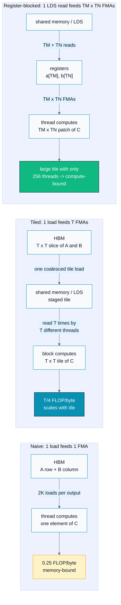
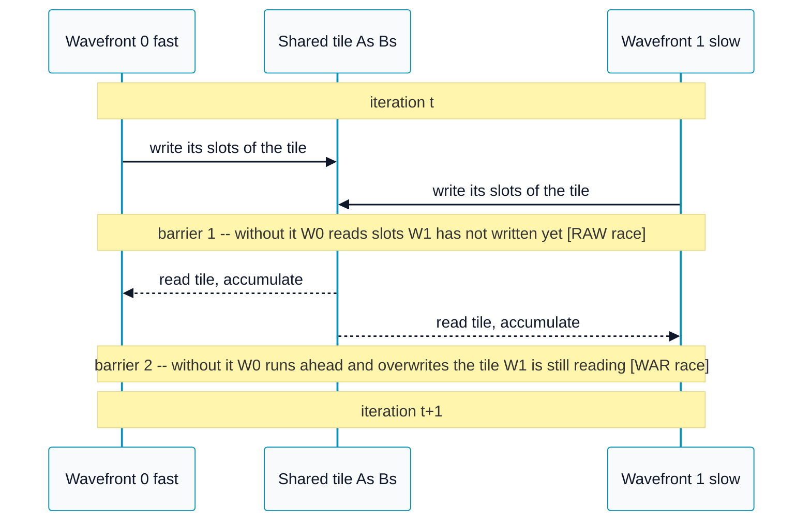
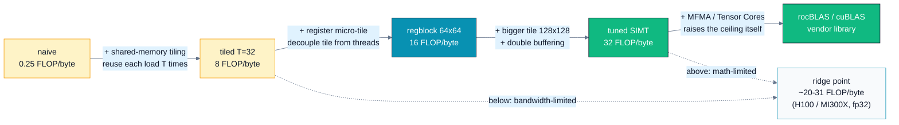
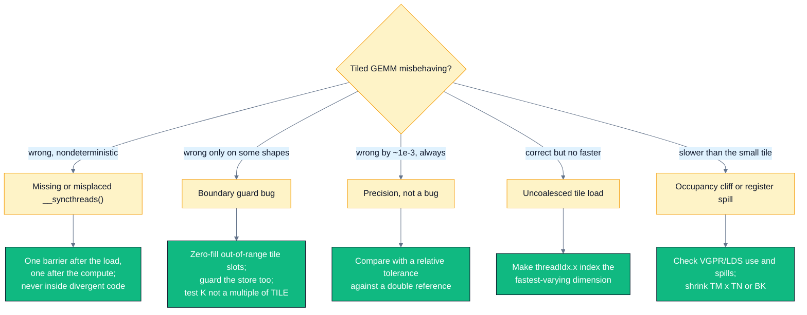

# A06 — Tiled Matrix Multiply (GEMM)

> Track A · Module 06 · Status: **DONE** · Est. 8 hours · Depth 3/5
>
> Prerequisites: [A01](../A01.foundations-and-programming-model/) (kernels, grid/block/thread, error
> checking, event timing) and [A02](../A02.memory-hierarchy-and-coalescing/) (coalescing, shared
> memory / LDS, `__syncthreads`, bank conflicts). A03 (occupancy) and A04 (reduction) deepen the
> analysis but are not required. Backends: AMD (`hipcc`) · NVIDIA (`nvcc`) · Triton (Python).
> Setup: [../../../docs/SETUP.md](../../../docs/SETUP.md).

---

## 1. TL;DR + Layman analogy

**TL;DR.** Matrix multiply is where essentially all of deep learning's arithmetic happens — linear
layers, attention projections, and convolutions (via implicit GEMM) are all `C = A · B`. A naive
GEMM does `2N³` FLOPs but issues `~2N³` operand loads, giving an arithmetic intensity of **0.25
FLOP/byte** that is *independent of `N`* — it is pinned to the far-left, hopelessly memory-bound end
of the roofline. Staging `T × T` tiles in shared memory reuses each loaded element `T` times, so
intensity becomes **`T/4`** and *scales with the tile*. Giving each thread a small register-held
micro-tile of `C` breaks the tile size free of the 1024-thread block limit, which is the only way a
SIMT kernel gets past the roofline ridge point and becomes genuinely compute-bound.

**Layman analogy — the library.** You are computing thousands of sums, and every number you need
lives on a shelf in a library across the building.

- **Naive GEMM** is walking to the shelf, fetching *one* number, walking back to your desk, adding
  it, and walking back for the next. The arithmetic is trivial; you spend your entire day walking.
- **Shared-memory tiling** is checking out a whole *stack* of books to a table in the reading room
  that your study group shares. One trip, then everyone at the table reuses those books many times
  before anyone walks back to the shelves. The walking is amortized over `T` uses.
- **Register blocking** is keeping a couple of pages open in your own hands. No trip to the shared
  table at all for those — the fastest possible access, but you only have two hands.

The analogy is load-bearing: it correctly predicts that the *ratio of work to trips* is what matters
(intensity), that a bigger stack means fewer trips (`I ∝ T`), and that the table has a fixed size, so
a bigger stack means fewer study groups can be seated (shared memory vs occupancy).

**Where it breaks.** Three places, and each one is a real GPU constraint the library has no analogue
for. (1) The reading-room table is shared by a *team working in lockstep*, so before anyone reads a
book, everyone must confirm the whole stack has arrived — that is `__syncthreads()`, and there is no
polite social equivalent. (2) The corridor to the shelves has a fixed total width shared by *all*
study groups at once; adding groups does not add bandwidth, which is why occupancy alone never fixes
a memory-bound kernel. (3) Real libraries do not have a special desk that multiplies 16×16 blocks of
numbers in one motion — GPUs do, and they are called **matrix cores** (§3).

**By the end of this module you can:** derive the arithmetic intensity of naive vs tiled vs
register-blocked GEMM from first principles and predict which side of the roofline each lands on;
implement all three in HIP, CUDA, and Triton with correct boundary handling for arbitrary `M/N/K`;
explain precisely what each `__syncthreads()` protects; and argue, with numbers, why your kernel
should not and will not beat rocBLAS or cuBLAS.

---

## 2. First Principles

### Why GEMM is the only kernel that really matters

Take a transformer layer. A forward pass through it is:

| Operation | Shape | What it is |
|---|---|---|
| QKV projection | `[B·S, d] × [d, 3d]` | GEMM |
| Attention scores `QKᵀ` | `[S, d] × [d, S]` per head | GEMM (batched) |
| Attention `·V` | `[S, S] × [S, d]` per head | GEMM (batched) |
| Output projection | `[B·S, d] × [d, d]` | GEMM |
| MLP up / down | `[B·S, d] × [d, 4d]`, `[B·S, 4d] × [d]` | GEMM |
| Softmax, LayerNorm, GELU | elementwise / row-wise | **not** GEMM — but ~1% of the FLOPs |

Convolutions join the list via **implicit GEMM** (im2col-free reformulation of a convolution as a
matrix product), which is how cuDNN and MIOpen implement most conv layers. So: **GEMM efficiency is
model efficiency.** A 2× GEMM improvement is roughly a 2× training-throughput improvement; a 2%
improvement in your softmax is noise.

### The derivation that explains everything

Set `M = N = K` for clarity, fp32 (4 bytes/element).

**Work is fixed.** Every output element is a `K`-long dot product — `K` multiplies and `K` adds:

```
FLOPs = 2 · M · N · K = 2N³
```

**Traffic is a design choice.** This is the whole module in one sentence.

**Naive.** One thread per output element reads a full row of `A` and a full column of `B`:

```
per thread:  2K FLOPs,  2K · 4 = 8K bytes
intensity :  2K / 8K = 0.25 FLOP/byte      <- constant, independent of N
whole kernel: N² · 8K bytes = 8N³ bytes
```

At `N = 4096` that is **549.8 GB of HBM traffic** to multiply matrices that together occupy
**201 MB**. You move the data set **`2N/3 = 2731` times over.**

**Tiled.** A block computes a `T × T` tile of `C` by sweeping `K` in `T`-deep slices, staging a
`T × T` piece of `A` and of `B` in shared memory each step:

```
elements loaded per block = (K/T) · 2T² = 2TK
blocks                    = (N/T)²
total bytes               = (N/T)² · 2TK · 4 = 8N³ / T
intensity                 = 2N³ / (8N³/T) = T / 4  FLOP/byte
```

**Every element loaded is used `T` times instead of once.** Intensity now *scales with the tile*:

| `T` | Intensity | HBM traffic at `N = 4096` |
|---|---|---|
| naive | 0.25 | 549.8 GB |
| 16 | 4 | 34.4 GB |
| 32 | 8 | 17.2 GB |
| 64 | 16 | 8.6 GB |
| 128 | 32 | 4.3 GB |

### Where the ridge point is

The roofline **ridge point** is `peak FLOP/s ÷ peak bytes/s` — the intensity at which a kernel stops
being bandwidth-limited and starts being math-limited.

| Device (datasheet, approximate) | fp32 vector peak | HBM bandwidth | Ridge point |
|---|---|---|---|
| AMD MI300X (CDNA 3) | ~163 TFLOP/s | ~5.3 TB/s | ~**31** FLOP/byte |
| NVIDIA H100 SXM (Hopper) | ~67 TFLOP/s | ~3.35 TB/s | ~**20** FLOP/byte |

Read the two tables together and the entire optimization ladder falls out:

- Naive at `0.25` is **~100×** below the ridge. It is not "a bit slow" — it is running the memory
  system at full tilt and the FMA units at ~1% duty cycle.
- `T = 32` reaches `8` — a **32× traffic reduction**, and still 2.5–4× short of the ridge.
- Crossing the ridge needs `T ≥ 80` (H100) or `T ≥ 124` (MI300X).

And here is the wall: with **one thread per output element**, a `T × T` tile needs `T²` threads.
`T = 80` means 6400 threads per block, and the hardware maximum is **1024** on both vendors. The
one-thread-per-output design *cannot* reach the compute-bound regime, ever, on any problem size.

That single fact is the reason register blocking exists. It is worked numerically in
[`exercises/03_intensity_math.md`](exercises/03_intensity_math.md).

### The reuse picture



Each rung of the ladder does the same trick one level further up the memory pyramid: move a datum
once into faster storage, then extract more arithmetic per move. Naive extracts 1 FMA per global
load; tiling extracts `T`; register blocking extracts `TM × TN` FMAs per *shared-memory* read.

---

## 3. Deep Dive

### The tiled kernel, and what each line is protecting

```cpp
__shared__ float As[TILE][TILE];
__shared__ float Bs[TILE][TILE];

float acc = 0.0f;
for (int t = 0; t < (K + TILE - 1) / TILE; ++t) {
    const int aCol = t * TILE + tx;
    const int bRow = t * TILE + ty;

    As[ty][tx] = (row < M && aCol < K) ? A[row * K + aCol] : 0.0f;
    Bs[ty][tx] = (bRow < K && col < N) ? B[bRow * N + col] : 0.0f;

    __syncthreads();                                  // barrier 1

    for (int k = 0; k < TILE; ++k) acc += As[ty][k] * Bs[k][tx];

    __syncthreads();                                  // barrier 2
}
if (row < M && col < N) C[row * N + col] = acc;
```

**Why the loads are coalesced.** In both staging statements the index that varies with
`threadIdx.x` is the *column* of a row-major matrix. Consecutive lanes therefore touch consecutive
addresses and the hardware fuses them into one wide transaction — the A02 rule, applied to the tile
load itself. Swap the roles and the tile load becomes the new bottleneck even though the compute is
unchanged.

**Why `: 0.0f` and not a skipped write.** Zero is the additive identity, so a zero-padded tile
contributes nothing to the dot product while keeping every thread on the same straight-line code
path. A *skipped* write leaves the previous iteration's value in that shared slot, and it is then
read by every thread in the block. See §6 and [`exercises/02_ragged_dims.cpp`](exercises/02_ragged_dims.cpp).

**The two barriers protect opposite hazards.**



- **Barrier 1** is a **read-after-write** guard: the tile must be *fully populated* before anyone
  reads it. Drop it and a fast wavefront reads slots a slow one has not written yet.
- **Barrier 2** is a **write-after-read** guard: the tile must be *fully consumed* before iteration
  `t+1` overwrites it. Drop it and a fast wavefront racing into the next iteration clobbers data a
  slow wavefront is still accumulating from.

Both failures are **nondeterministic and usually small** — the answer is *mostly* right, which is
far worse than being obviously wrong. And the standard rule applies: `__syncthreads()` must be
reached by *every* thread in the block, so it can never sit inside divergent control flow. Note that
a single-wavefront block appears to work without barriers on some hardware; that is an accident of
scheduling, not a guarantee, and it breaks the moment someone changes the block size.

### Register blocking: decoupling tile size from thread count

The tiled kernel's fatal constraint is `threads = T²`. Register blocking breaks it by giving each
thread a `TM × TN` patch of `C`:

```
block tile:   BM x BN of C,  swept in BK-deep slices
threads:      (BM/TM) x (BN/TN)
per thread:   acc[TM][TN] kept in registers for the whole kernel
```

With `BM = BN = 64`, `TM = TN = 4` you get a 64×64 tile from **256** threads instead of an illegal
4096. The inner loop becomes:

```cpp
for (int kk = 0; kk < BK; ++kk) {
    float a[TM], b[TN];
    for (int m = 0; m < TM; ++m) a[m] = As[kk][threadIdx.y * TM + m];   // TM shared reads
    for (int n = 0; n < TN; ++n) b[n] = Bs[kk][threadIdx.x * TN + n];   // TN shared reads
    for (int m = 0; m < TM; ++m)
        for (int n = 0; n < TN; ++n) acc[m][n] += a[m] * b[n];          // TM*TN FMAs
}
```

`TM + TN = 8` shared-memory reads feed `TM × TN = 16` FMAs. The tiled kernel needed 2 shared reads
per FMA; this needs 0.5 — a **4× reduction in shared-memory traffic per FLOP**, which is exactly the
factor `TM` (for `TM = TN`). Global intensity also improves, to
`BM·BN / (2·(BM + BN))` FLOP/byte — note it is **independent of `BK`**, so `BK` is free to be small
(cheap shared memory, deeper pipelining) without hurting intensity.

The cost is **registers**. `acc[4][4]` alone is 16 VGPRs per thread; an `8 × 8` micro-tile is 64
before you count operands and addresses. Push too far and the compiler spills to scratch memory —
which is HBM wearing a disguise, and instantly undoes everything. Check it explicitly:

```bash
hipcc -Rpass-analysis=kernel-resource-usage ...   # AMD: VGPR/SGPR/LDS/spill counts
nvcc  -Xptxas -v ...                              # NVIDIA: registers, spill stores/loads
```

### Layout, padding, and the bank conflicts that remain

The `hip/matmul.cpp` register-blocked kernel stores `A`'s tile **transposed** (`As[BK][BM]`) so that
the inner loop walks `m` contiguously. That transposing store is a textbook A02 bank-conflict
generator: with a row stride of `BM = 64` words, all 16 loader lanes writing column `aCol` land in
the same bank. The fix is the same one-word pad:

```cpp
__shared__ float As[BK][BM + 1];   // stride 65 shifts each column into a distinct bank
```

Two honest notes that matter more than the fix itself:

1. **The plain tiled kernel needs no padding.** `As[ty][k]` is the *same address* for every lane of a
   32-lane warp (they share `ty`) → hardware broadcast, and only two addresses across a 64-lane
   wavefront; `Bs[k][tx]` walks 32 consecutive words → 32 distinct banks. Reaching for `+1`
   reflexively is cargo-cult; check the access pattern first.
2. **A residual 2-way conflict remains** on `Bs[kk][tx * TN + n]`: the stride-4 pattern maps lanes
   `tx` and `tx + 8` onto the same bank. Padding does not help here because the conflict comes from
   the *stride*, not the row length. The real fix is a **vectorized `float4` shared read**, which
   also quarters the instruction count. Left as a stretch goal in §9.

### The next two rungs (explained; not implemented here)

**Double buffering / prefetch.** In the kernel above, the block alternates strictly between "load"
and "compute" with barriers between them — the memory pipe idles during compute and the FMA units
idle during load. Double buffering keeps *two* shared buffers and issues the global loads for slice
`t+1` before consuming slice `t`, so the two overlap:

```
load t -> [ compute t | load t+1 ] -> [ compute t+1 | load t+2 ] -> ...
```

It costs 2× shared memory and one extra barrier per iteration, and it needs the loads issued early
enough that the latency is genuinely hidden. NVIDIA gives you `cp.async` (Ampere+) and the
`cuda::pipeline` API for asynchronous global→shared copies; AMD CDNA has `buffer_load ... lds`
direct-to-LDS paths that Composable Kernel and hipBLASLt exploit. This is the single largest
remaining win for a hand-written kernel and it is the reason CUTLASS parameterizes on a *stage
count*.

**Split-K / Stream-K.** When `M` and `N` are small but `K` is huge (common in inference: a
`[1, d] × [d, 4d]` GEMV-shaped layer), there are not enough output tiles to fill the GPU. Split-K
partitions the reduction dimension across blocks and combines partial sums with a second pass or
atomics. Stream-K generalizes it to balance work across exactly the number of resident CUs. This is
also where GEMM stops being a pure tiling problem and becomes a scheduling problem.

### Matrix cores: MFMA and Tensor Cores

Everything above optimizes a **SIMT fp32 FMA** kernel. Modern accelerators have a *second*, much
faster math path that a hand-written SIMT kernel simply cannot reach.

| | AMD CDNA (MI200/MI300) | NVIDIA (Volta → Hopper/Blackwell) |
|---|---|---|
| Name | **Matrix Cores**, `MFMA` instructions | **Tensor Cores**, `mma` / `wmma` / `wgmma` |
| Granularity | one **wavefront** (64 lanes) cooperatively | one **warp** (32 lanes), or a warpgroup on Hopper |
| Typical shapes | `v_mfma_f32_16x16x16_f16`, `v_mfma_f32_32x32x8_f16` | `m16n8k16` (`mma.sync`), `m16n16k16` (WMMA) |
| Inputs / accumulate | fp16 / bf16 / fp8 / int8 in, **fp32 accumulate** | same family |
| Speedup vs fp32 SIMT | roughly an order of magnitude | roughly an order of magnitude |
| How you reach it | `__builtin_amdgcn_mfma_*`, **rocWMMA**, Composable Kernel | `nvcuda::wmma`, inline PTX `mma.sync`, **CUTLASS / CuTe** |

Three consequences you should be able to state in an interview:

1. **A hand-written fp32 SIMT GEMM is capped by the vector FMA ceiling**, which is roughly 8–16×
   below the matrix-core ceiling. No amount of tiling closes that gap — you are optimizing toward the
   wrong roof.
2. **Matrix cores make the memory problem worse, not better.** Raising the compute ceiling by 8×
   moves the ridge point right by 8×, so a matrix-core GEMM needs *far* more reuse (larger tiles,
   deeper pipelining, L2-aware scheduling) to stay fed. See the bonus in
   [`exercises/03_intensity_math.md`](exercises/03_intensity_math.md).
3. **The fragment layouts are fixed and non-obvious.** Each MFMA/MMA shape dictates precisely which
   lane holds which element of the A/B fragments and the accumulator. Getting that right by hand,
   for every shape and precision, is what CUTLASS/CuTe (NVIDIA) and rocWMMA/Composable Kernel (AMD)
   exist to do for you.

### CDNA vs Hopper, for this kernel

| Concern | AMD CDNA3 | NVIDIA Hopper | Effect on your tile choice |
|---|---|---|---|
| Lockstep width | wavefront = **64** | warp = **32** | Make `BN/TN` a multiple of the width so a wavefront covers whole rows of the C tile |
| Scratchpad | **LDS, 64 KB per CU** | shared memory, up to **228 KB per SM** | Size tiles against the *smaller* budget for portability |
| Banks | 32 × 4 B | 32 × 4 B | The `+1` padding trick ports unchanged |
| Async global→shared | `buffer_load` direct-to-LDS | `cp.async` / TMA | Double buffering is spelled differently on each |
| Max block | 1024 threads | 1024 threads | The constraint that forces register blocking, on both |

---

## 4. Hands-On Labs

All commands run from this module directory.

```bash
# AMD
make hip GPU_ARCH=gfx942     # build hip/ programs
make run-hip                 # run them

# NVIDIA
make cuda SM_ARCH=sm_90      # build cuda/ programs
make run-cuda

# Triton (either vendor)
python triton/matmul.py
```

The drills are self-contained too: [`exercises/`](exercises/) and [`solutions/`](solutions/) each
have their own `Makefile`, so you can `cd exercises && make run` without coming back here. From this
directory, `make exercises` / `make solutions` build them in place, and `make clean` cleans all three.

> **Match `GPU_ARCH` to your GPU.** `gfx950` = MI350, `gfx942` = MI300, `gfx90a` = MI200. Find yours
> with `/opt/rocm/bin/offload-arch`. Troubleshooting for `libamdhip64.so` and
> `hipErrorNoBinaryForGpu` is in [A01 §4](../A01.foundations-and-programming-model/README.md#4-hands-on-labs).

### Lab 1 — The optimization ladder (`matmul`)

Files: [`hip/matmul.cpp`](hip/matmul.cpp) · [`cuda/matmul.cu`](cuda/matmul.cu).

One program, three kernels, one set of matrices. Each variant is verified against a
**double-precision CPU reference** and timed with GPU events; the program prints ms, GFLOP/s,
speedup, and the max relative error.

The problem size is a compile-time constant so you can sweep it without editing code:

```bash
make hip MDIM=1024            # default: 1024^3, ~2.1 GFLOP per call
make hip MDIM=2048            # 8x the work; the CPU reference takes noticeably longer
make hip MDIM=1000            # NOT a multiple of 32 or 64 -> exercises every boundary guard
```

**What to observe.**

1. All three print `PASSED`, including at `MDIM=1000`. Correctness under ragged dimensions is a
   feature of the kernels, not of the size you happened to pick.
2. `naive < tiled < regblock` in GFLOP/s, with the largest jump at the first step. The arithmetic is
   byte-for-byte identical across all three; only the data movement differs.
3. The `max rel err` column sits around `1e-6` (roughly `√K · eps`), not `0`. That is not a bug —
   see the tolerance note below.
4. The footer prints each variant's *analytic* intensity. Check that the measured ordering matches
   what the intensity predicts.

> [!NOTE]
> **Why the tolerance is relative and why it is `1e-4`.** The GPU accumulates in a different *order*
> than the CPU reference (per-tile partial sums vs one running sum), and fp32 addition is not
> associative — so bit-exact equality is the wrong test; both answers are correct, they just round
> differently. fp32 has `eps ≈ 1.2e-7`, and summing `K` terms accumulates roughly `√K · eps` of
> relative error under random rounding: about `4e-6` at `K = 1024`. A `1e-4` bound leaves ~25×
> headroom for larger `K` while remaining far below the **O(1)** relative error that any real bug
> (missing guard, missing barrier, transposed index) produces. Inputs are drawn from `[0, 1)` so all
> partial sums are positive: that avoids catastrophic cancellation, which would make a relative
> check meaningless near zero. The reference itself accumulates in `double` so it is not the thing
> under test.

### Lab 2 — Triton block matmul (`triton/matmul.py`)

File: [`triton/matmul.py`](triton/matmul.py).

The same algorithm one abstraction level up: you declare a `BLOCK_M × BLOCK_N` tile of `C` and a
`BLOCK_K` slice of the reduction, and the compiler chooses the shared-memory staging, the barriers,
and (where available) whether `tl.dot` lowers onto matrix cores.

| C++ concept | Triton spelling |
|---|---|
| block / workgroup owning a C tile | one program, `tl.program_id` |
| `acc[TM][TN]` register micro-tile | `acc = tl.zeros((BLOCK_M, BLOCK_N), tl.float32)` |
| `if (row < M && col < N)` guard | `mask=` on `tl.load` / `tl.store` |
| the mandatory `: 0.0f` zero-fill | `other=0.0` |
| the entire `for kk` inner product | `tl.dot(a, b)` |
| `__syncthreads()` | implicit — the compiler inserts it |

**What to observe:** it prints `PASSED` plus TFLOP/s for both the Triton kernel and `torch.matmul`
(which calls rocBLAS/cuBLAS). The vendor library wins. That gap, and what closes it, is §6.

### Lab 3 (optional) — Profile the ladder

```bash
# AMD
make profile-hip     # rocprofv3 summary + traces
# NVIDIA
make profile-cuda    # nsys timeline; then: ncu --set full ./cuda/matmul.exe
```

**What to look for**, in this order:

| Metric | naive | tiled | regblock |
|---|---|---|---|
| DRAM / HBM read throughput | at or near peak | much lower | lower still |
| Memory (DRAM) throughput % vs Compute (SM/CU) throughput % | memory ≫ compute | closer | compute should lead |
| Shared-memory traffic | ~0 | high | ~4× lower per FLOP |
| Shared-memory bank conflicts | n/a | ~0 (see §3) | small, non-zero |
| Registers per thread | low | low | notably higher |

The single most useful view is Nsight Compute's **Speed Of Light** section (or Omniperf's roofline):
watch the point walk right across the roofline as you go down the ladder.

---

## 5. Performance Analysis

### The question, and how to answer it before you measure

Same question as always: **memory-bound or compute-bound?** For GEMM you can answer it on paper,
which is what makes this kernel such a good teaching vehicle. Compute the intensity, compare it to
the ridge point, and the profiler should merely *confirm* you.



The diagram is the module's thesis: the first three rungs move you *right* along the roofline toward
the ridge, and only the last one raises the roof.

### What to expect from Lab 1

> [!IMPORTANT]
> The table below deliberately gives **no absolute numbers**. GEMM throughput depends on the GPU,
> the clocks, the ROCm/CUDA version, and `MDIM`; quoting a number here would be fiction and you
> would then "fail" to reproduce it. What *is* reproducible is the ordering and the rough shape.

| Variant | Global intensity | Expected relative throughput | Limited by |
|---|---|---|---|
| `naive` | 0.25 FLOP/byte | baseline, `1×` | HBM bandwidth, hard |
| `tiled 32×32` | 8 FLOP/byte | typically several × naive | still HBM, plus the 1024-thread occupancy penalty |
| `regblock 64×64, 4×4` | 16 FLOP/byte | typically a further ~1.5–3× | shared-memory bandwidth and register pressure |
| `rocBLAS` / `cuBLAS` (`torch.matmul` in Lab 2) | — | typically several × `regblock` again | matrix cores, near the machine's real ceiling |

Two calibration notes so you can judge your own run:

- **A teaching kernel landing at roughly 10–30% of the vendor library is the expected outcome**, not
  a failure. §6 explains exactly what the remaining gap is made of.
- If `tiled` is *not* faster than `naive`, suspect a missing barrier (results would also be wrong),
  an uncoalesced tile load, or a shared-memory allocation so large that only one block is resident.

### Reasoning about the delta, not just observing it

Use the numbers to build the habit:

1. **Predict**: intensity → side of the ridge → expected limiter.
2. **Measure**: ms and GFLOP/s from the program; throughput percentages from the profiler.
3. **Reconcile**: `achieved GFLOP/s ÷ (intensity × measured HBM GB/s)` should be ≈ 1 for a
   bandwidth-limited kernel. When it is not, something *other* than your model is limiting you —
   occupancy, bank conflicts, or spills — and that is the interesting case.

For `naive`, that reconciliation should land close to 1 (it really is bandwidth-limited). For
`regblock` it should not, which is your evidence that you have left the memory-bound regime.

---

## 6. Challenges, Drawbacks & Tradeoffs

### The honest headline: this kernel will not beat rocBLAS or cuBLAS

Not "might not". **Will not.** Expect somewhere in the region of 10–30% of vendor-library
throughput for the register-blocked fp32 kernel, and less against a library running in bf16/fp8.
That is the correct outcome for a kernel whose purpose is to be *readable*. The gap is made of four
things, none of which are accidents:

1. **Matrix cores.** rocBLAS/hipBLASLt emit `MFMA`; cuBLAS/CUTLASS emit `mma`/`wgmma`. These reach a
   math ceiling roughly an order of magnitude above the fp32 SIMT FMA path this module uses. You are
   optimizing toward a lower roof. This alone accounts for most of the gap.
2. **Assembly-level scheduling.** Vendor kernels control instruction ordering, software pipelining
   depth, register allocation, and the exact interleaving of global loads, LDS writes, LDS reads and
   MFMA issue — often in hand-written assembly (Tensile for rocBLAS) or a template metaprogramming
   layer that generates it (CUTLASS/CuTe, Composable Kernel).
3. **Autotuned tile shapes.** There is no single best `(BM, BN, BK, TM, TN, stages, warps)`. The
   optimum depends on architecture, precision, and the *specific* `M/N/K`. Libraries ship thousands
   of pre-tuned variants and a heuristic (or an on-line tuner) to pick one. Our tile is a single
   hard-coded compromise.
4. **Shape specialization.** Tall-skinny, batched, GEMV-like, and split-K regimes each get a
   different algorithm entirely. Our one kernel handles them all *correctly* and none of them
   *optimally*.

**The production answer is therefore always: call the library.** Use `rocblas_sgemm` / `hipblaslt`,
`cublasGemmEx` / CUTLASS, or just `torch.matmul`. You write GEMM by hand for exactly two reasons:
to understand it (this module), and to **fuse** something into it that the library cannot — an
epilogue activation, a bias, a quantization step, or an attention-shaped access pattern
(FlashAttention). Fusion, not raw GEMM speed, is where hand-written kernels still win.

### Failure-mode decision tree



### Pitfall 1 — The boundary guard that fails silently

The classic. Three distinct bugs hide here, and they have *different signatures*:

| Bug | Symptom | Why |
|---|---|---|
| Guarded tile load with no zero-fill, **K** not a multiple of `TILE` | **Every** element wrong | The stale high-`k` shared slots are read by every in-range thread |
| Guarded tile load with no zero-fill, only **M/N** ragged | Nothing — it passes | The load is thread-matched to the read: out-of-range slots are only consumed by out-of-range threads, whose stores the guard discards |
| Missing **store** guard | Fringe garbage, then out-of-bounds writes | `C[row*N + col]` with `col ≥ N` aliases `C[row+1][col-N]`, corrupting valid results before it ever leaves the allocation |

That middle row is the one that bites people: a kernel can pass every rectangular test you throw at
it and still be broken, because you never tested a ragged `K`.
[`exercises/02_ragged_dims.cpp`](exercises/02_ragged_dims.cpp) walks all three.

### Pitfall 2 — Bigger tiles are not monotonically better

Doubling `TILE` doubles intensity *and* quadruples shared-memory use, halving (or worse) the number
of resident blocks. Past some point the loss of latency hiding beats the gain in reuse. There is no
formula; sweep and measure. This is the same occupancy-vs-reuse tension A02 raised, now with a
second dimension (`TM × TN` register pressure) added to it.

### Pitfall 3 — Register spilling silently reverts everything

Raise `TM × TN` far enough and the compiler runs out of registers and spills `acc` to scratch — which
lives in HBM. Your "register-blocked" kernel is now doing global traffic per FMA and is slower than
the plain tiled version. It will still be *correct*, which is why you must read the resource-usage
output rather than trust the design.

### Pitfall 4 — Benchmarking artefacts

- **No warmup.** The first launch pays lazy module load and cold caches. Always discard it.
- **Timing with host clocks.** Launches are asynchronous; use GPU events (or synchronize explicitly).
- **A size that flatters you.** Powers of two avoid every boundary path and can also alias badly in
  cache. Always also run a ragged size (`make hip MDIM=1000`).
- **Counting FLOPs wrong.** GEMM is `2·M·N·K`, with the factor 2 for the multiply *and* the add.
  Dropping it halves your reported GFLOP/s; adding a spurious factor doubles it.

### Pitfall 5 — Numerical expectations

fp32 addition is not associative, so a tiled kernel and a naive kernel produce *different* (both
correct) answers, and switching tile sizes changes the last bits of your output. This matters in
practice: it is why a "bitwise reproducible" training run must pin the GEMM algorithm, and why
comparing two frameworks' outputs with `==` is always wrong. Accumulate in fp32 even when operands
are fp16/bf16 — that is what matrix cores do natively, and for good reason.

> [!TIP]
> ### 📐 Reference — tiled GEMM review checklist
>
> - **Both barriers present?** One after the tile load, one after the inner product. Neither inside
>   divergent control flow.
> - **Every shared slot written every iteration?** Value or `0.0f` — never a skipped write.
> - **Store guarded** on both `row < M` and `col < N`?
> - **Tested with `K` not a multiple of the tile?** And with `K < TILE`?
> - **Tile loads coalesced?** `threadIdx.x` must index the fastest-varying (column) dimension.
> - **Resource usage checked?** `-Rpass-analysis=kernel-resource-usage` (hipcc) or `-Xptxas -v`
>   (nvcc): VGPRs, LDS bytes, and **zero spills**.
> - **FLOPs counted as `2·M·N·K`**, timing from GPU events, after a warmup.
> - **Verified against a `double` reference with a relative tolerance**, not `==`.

---

## 7. Real-World Use Cases

- **Every dense layer of every transformer.** QKV and output projections, and both MLP matrices, are
  GEMMs — the overwhelming majority of the FLOPs in training and in the prefill phase of inference.
  A06 is the kernel behind that number.
- **Attention.** `QKᵀ` and `scores·V` are batched GEMMs. **FlashAttention**
  ([Dao et al., 2022](https://arxiv.org/abs/2205.14135)) is, at its core, this module's tiling
  applied to attention so that the `S × S` score matrix is never materialized in HBM — the same
  reuse argument, applied to a fused kernel. Track A07/A09 build it.
- **Convolutions.** cuDNN and MIOpen implement most convolutions as **implicit GEMM**, mapping the
  conv into a tiled matrix product without materializing the im2col matrix.
- **The libraries themselves.** [rocBLAS](https://rocm.docs.amd.com/projects/rocBLAS/en/latest/) /
  [hipBLASLt](https://rocm.docs.amd.com/projects/hipBLASLt/en/latest/) and
  [Composable Kernel](https://github.com/ROCm/composable_kernel) on AMD;
  [CUTLASS](https://github.com/NVIDIA/cutlass) and cuBLAS on NVIDIA. Reading CUTLASS's
  [efficient GEMM](https://github.com/NVIDIA/cutlass/blob/main/media/docs/cpp/efficient_gemm.md)
  document after this module is the natural next step — you will recognize every layer of its
  hierarchy.
- **Quantized inference.** int8/fp8 GEMM kernels in vLLM, TensorRT-LLM, and SGLang are this same
  structure with a narrower operand type, a dequantization epilogue fused in, and matrix-core inner
  loops.
- **Triton and `torch.compile`.** When `torch.compile` fuses an epilogue into a matmul, it emits a
  Triton kernel shaped exactly like [`triton/matmul.py`](triton/matmul.py) and autotunes the block
  sizes — the automated version of this module's manual ladder.

---

## 8. Cited References

Full list in [../../../docs/REFERENCES.md](../../../docs/REFERENCES.md).

- **CUDA C++ Programming Guide — Shared Memory** (the canonical tiled matrix-multiply example this
  module's Lab 1 follows).
  <https://docs.nvidia.com/cuda/cuda-c-programming-guide/index.html#shared-memory>
- **CUDA C++ Programming Guide — Warp Matrix Functions (WMMA)** — the Tensor Core fragment API.
  <https://docs.nvidia.com/cuda/cuda-c-programming-guide/index.html#warp-matrix-functions>
- **CUDA C++ Best Practices Guide** — coalescing, shared memory, occupancy, and the
  measure-then-optimize discipline used in §5.
  <https://docs.nvidia.com/cuda/cuda-c-best-practices-guide/index.html>
- **NVIDIA CUTLASS** — production template library for GEMM; its *Efficient GEMM in CUDA* document is
  the reference for multi-level (block → warp → thread) blocking and pipelining.
  <https://github.com/NVIDIA/cutlass> ·
  <https://github.com/NVIDIA/cutlass/blob/main/media/docs/cpp/efficient_gemm.md>
- **rocBLAS documentation** (AMD's BLAS, `rocblas_sgemm` and friends).
  <https://rocm.docs.amd.com/projects/rocBLAS/en/latest/>
- **hipBLASLt documentation** — the tuned, epilogue-fusing GEMM path on CDNA.
  <https://rocm.docs.amd.com/projects/hipBLASLt/en/latest/>
- **AMD Matrix Cores** (ROCm blog) — what MFMA instructions do, their shapes, and how to reach them.
  <https://rocm.blogs.amd.com/software-tools-optimization/matrix-cores/README.html>
- **AMD Matrix Instruction Calculator** — enumerates every MFMA shape and its register layout per
  architecture.
  <https://github.com/ROCm/amd_matrix_instruction_calculator>
- **AMD CDNA 3 architecture white paper** — CU structure, LDS, and matrix-core throughput.
  <https://www.amd.com/content/dam/amd/en/documents/instinct-tech-docs/white-papers/amd-cdna-3-white-paper.pdf>
- **AMD Composable Kernel** — the tile-programming framework behind many ROCm GEMM/fused kernels.
  <https://github.com/ROCm/composable_kernel>
- Simon Boehm. *How to Optimize a CUDA Matmul Kernel for cuBLAS-like Performance: a Worklog* — a
  careful, reproducible step-by-step of exactly the ladder in §5, with measurements.
  <https://siboehm.com/articles/22/CUDA-MMM>
- Volkov & Demmel (2008). *Benchmarking GPUs to Tune Dense Linear Algebra* (SC '08) — the paper that
  established register blocking and low occupancy as legitimate GEMM strategies.
  <https://doi.org/10.1109/SC.2008.5214359>
- Williams, Waterman & Patterson (2009). *Roofline: An Insightful Visual Performance Model for
  Multicore Architectures* — the model used throughout §2 and §5.
  <https://doi.org/10.1145/1498765.1498785>
- Dao et al. (2022). *FlashAttention: Fast and Memory-Efficient Exact Attention with IO-Awareness* —
  tiling applied to attention; the §7 payoff.
  <https://arxiv.org/abs/2205.14135>
- **Triton — Matrix Multiplication tutorial** — the block-level model used in Lab 2, including L2
  grouping and autotuning.
  <https://triton-lang.org/main/getting-started/tutorials/03-matrix-multiplication.html>
- **HIP Programming Guide** — `__shared__`, `__syncthreads`, launch bounds, and LDS limits.
  <https://rocm.docs.amd.com/projects/HIP/en/latest/>

---

## 9. Self-Assessment & Interview Drills

### Conceptual (answers below)

1. Why is the naive GEMM's arithmetic intensity independent of `N`? Does making the matrices bigger
   ever help it?
2. A `T × T` tiled GEMM has intensity `T/4` FLOP/byte in fp32. Derive it in three lines.
3. Your GPU's ridge point is 20 FLOP/byte. What tile size does the one-thread-per-output design need
   to become compute-bound, and why can it never get there?
4. There are two `__syncthreads()` in the tiled k-loop. Name the hazard each one prevents, and
   describe the observable symptom of removing each.
5. A tiled GEMM passes for `1024×1024×1024` and for `1000×700×1024`, but fails for
   `1000×700×1000`. What is the bug, and why did the second shape not catch it?
6. Register blocking gives each thread a `4 × 4` micro-tile. By what factor does it reduce
   shared-memory reads per FLOP, and what resource does it consume instead?
7. Why does `BK` not appear in the register-blocked kernel's global arithmetic intensity? What *is*
   `BK` trading off?
8. You switch your GEMM from fp32 to bf16 with matrix cores and the kernel gets only 2× faster
   instead of 8×. Give the most likely explanation in one sentence.
9. Your hand-written kernel reaches 20% of `torch.matmul`. Is that a bug? Justify your answer with
   two specific mechanisms.
10. Why does a tiled GEMM produce a numerically *different* result from a naive one, and why is that
    not a correctness failure? What does it imply for reproducible training?

<details>
<summary>Answers</summary>

1. Each thread does `2K` FLOPs and reads `2K` operands (`8K` bytes), so `I = 2K/8K = 0.25` — the `K`
   cancels. Scaling `N` scales work and traffic *equally*. Bigger matrices never improve the naive
   kernel's position on the roofline; only reuse does.
2. Per block: `(K/T)` iterations × `2T²` elements = `2TK` elements. Blocks: `(N/T)²`. Total bytes
   `= (N/T)² · 2TK · 4 = 8N³/T`. With `FLOPs = 2N³`, `I = 2N³ / (8N³/T) = T/4`.
3. `T/4 ≥ 20 → T ≥ 80`. That needs `80² = 6400` threads per block against a hardware maximum of
   **1024**, so the configuration is illegal — and even if it were legal, `2·80²·4 = 50 KB` of shared
   memory would leave only one resident block, killing latency hiding. One thread per output caps you
   at `T = 32` (`I = 8`), permanently memory-bound. Register blocking is the only escape.
4. **Barrier 1** (after the load) prevents **read-after-write**: a fast wavefront reading tile slots a
   slow one has not written. **Barrier 2** (after the inner product) prevents **write-after-read**: a
   fast wavefront starting iteration `t+1` and overwriting the tile a slow one is still reading. Both
   symptoms are the same and are the worst kind: nondeterministic, usually-small errors that change
   run to run and often disappear under a debugger or a smaller block size.
5. The tile loads are guarded but do not **zero-fill** out-of-range slots, so on a ragged `K` the
   final k-slice reads stale shared memory. The `1000×700×1024` shape did not catch it because `K`
   was a multiple of the tile: M/N raggedness is self-contained (the load is thread-matched to the
   read, so out-of-range slots are only consumed by threads whose stores the guard discards).
   **Always test a ragged `K`.**
6. `TM + TN = 8` shared reads feed `TM × TN = 16` FMAs, i.e. 0.5 reads/FLOP versus 2 for the plain
   tiled kernel — a **4×** reduction (the factor is `TM` when `TM = TN`). It spends **registers**:
   `acc[4][4]` is 16 VGPRs before operands, and pushing it too far causes spills to scratch memory
   (which is HBM), reverting the entire optimization.
7. Per block the kernel loads `(K/BK) · BK · (BM + BN) = K·(BM + BN)` elements — `BK` cancels, giving
   `I = BM·BN / (2·(BM+BN))`. `BK` trades **shared-memory footprint and pipelining depth** (a small
   `BK` leaves room for double buffering and more resident blocks) against **loop overhead and
   barrier frequency**.
8. You became memory-bound. Raising the math ceiling ~8× moves the ridge point ~8× to the right, so
   the tile that was compute-bound in fp32 no longer supplies enough reuse — the kernel is now
   waiting on HBM, and the fix is bigger tiles plus double buffering, not faster math.
9. **Not a bug — that is the expected range for a readable teaching kernel.** Two concrete
   mechanisms: (a) the library issues **matrix-core instructions** (MFMA / `mma`) whose peak is
   roughly an order of magnitude above the fp32 SIMT FMA path you are using; (b) the library uses
   **autotuned tile shapes plus deep software pipelining** (multi-stage `cp.async` / direct-to-LDS
   loads) selected per architecture and per `M/N/K`, where you have one hard-coded compromise. Either
   one alone explains a several-fold gap.
10. fp32 addition is **not associative**, and the tiled kernel sums per-tile partial results in a
    different order from the naive running sum. Both are correct; they differ by rounding on the
    order of `√K · eps`. Implication: compare with a *relative tolerance* against a `double`
    reference, never `==`; and a bitwise-reproducible training run must pin the GEMM algorithm, tile
    shape, and split-K strategy, because changing any of them legitimately changes the last bits.

</details>

### Coding & Algorithms drills

Do these in [`exercises/`](exercises/); reference answers in [`solutions/`](solutions/). Expected
terminal output (PASS and instructive FAIL states) is in
[`exercises/README.md` → *Sample sandbox output*](exercises/README.md#sample-sandbox-output).

1. **Write the tiled kernel** ([`exercises/01_tiled_matmul.cpp`](exercises/01_tiled_matmul.cpp)) —
   from a skeleton, implement the two cooperative tile loads, the barrier before the compute phase,
   and the inner product. Verify against the provided naive kernel and compare GFLOP/s. Then explain
   the second barrier, which is given to you.
2. **Fix the ragged dimensions** ([`exercises/02_ragged_dims.cpp`](exercises/02_ragged_dims.cpp)) —
   the boundary-guard drill. Three shapes, two of which pass with the buggy kernel. Make all three
   pass, then answer why the M/N-ragged case passed and what an unguarded store would really do.
3. **Arithmetic-intensity drill** ([`exercises/03_intensity_math.md`](exercises/03_intensity_math.md))
   — paper only. FLOPs, bytes, and intensity for naive and for `T = 16/32/64`; find the ridge
   crossing on a given device; show why one-thread-per-output cannot reach it; then redo it for
   bf16 + matrix cores and state the new bottleneck.

### Stretch

- **Sweep the tile shape.** Parameterize `BM/BN/BK/TM/TN` and sweep them. Plot GFLOP/s against
  shared-memory bytes per block and against registers per thread. You will find a ridge, not a slope
  — explain it with the occupancy-vs-reuse tradeoff from §6.
- **Kill the residual bank conflict.** Replace the scalar `Bs[kk][tx*TN + n]` reads with a `float4`
  vector read (and the tile loads with `float4` global loads). Confirm with the profiler's
  bank-conflict counter that it drops, and note the instruction-count win as well.
- **Double buffer it.** Add a second shared buffer and issue the global loads for slice `t+1` before
  consuming slice `t`. Measure. Then read how CUTLASS parameterizes this as a *stage count*.
- **Compare against the library.** Link `rocblas_sgemm` (or `cublasSgemm`) into Lab 1 as a fourth
  row in the table. Knowing the real gap, in a number you measured yourself, is worth more than any
  claim in this README.
- **Implement one MFMA / WMMA tile.** Using `rocWMMA` or `nvcuda::wmma`, replace the innermost
  `TM × TN` FMA block with a single fixed-shape matrix-core operation for fp16 inputs. Do not expect
  it to be fast the first time — the exercise is understanding the fragment layout.
