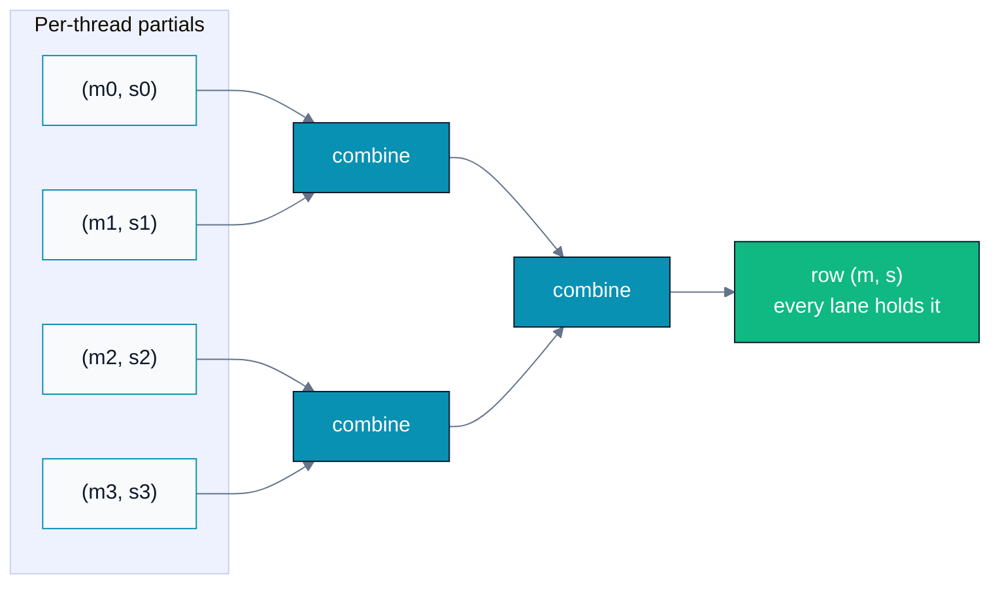
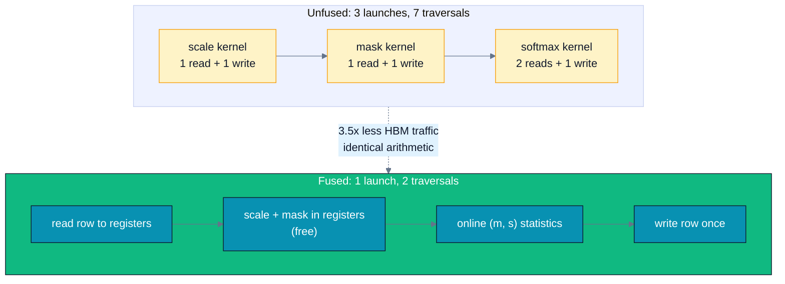

# A07 — Softmax & Fused Kernels

> Track A · Module 07 · Status: **DONE** · Est. 7 hours · Depth 4/5
>
> Prerequisites: [A04](../A04.parallel-reduction/README.md) (block and warp reductions), [A02](../A02.memory-hierarchy-and-coalescing/README.md) (why HBM traffic is the budget). [A06](../A06.tiled-matrix-multiply/README.md) helps but is not required.
> Backends: AMD (`hipcc`) · NVIDIA (`nvcc`) · Triton. Setup: [SETUP.md](../../../docs/SETUP.md) ·
> Terms: [GLOSSARY.md](../../../docs/GLOSSARY.md) · Sources: [REFERENCES.md](../../../docs/REFERENCES.md).

---

## 1. TL;DR + Layman analogy

**TL;DR.** [Softmax](../../../docs/GLOSSARY.md#softmax) turns raw scores into probabilities with `exp(x_i) / Σ exp(x_j)`. Written that
way it **overflows**: `expf(100)` is `+inf` in fp32, so one large score turns an entire row into
`nan`. The fix — subtract the row maximum first — is mathematically identical and numerically safe,
but naively costs an extra full pass over memory. This module fixes the overflow *and* wins the pass
back, using a running `(max, sum)` recurrence that merges partial results. Then it
[fuses](../../../docs/GLOSSARY.md#fusion)
`scale → mask → softmax` into one kernel and cuts [HBM](../../../docs/GLOSSARY.md#global-memory)
traffic by 3.5×. The recurrence you derive
here is the exact mechanism [FlashAttention](../../../docs/GLOSSARY.md#attention-and-flashattention)
uses, so this module is the bridge from kernels to
transformers.

**Layman analogy.** Softmax is **grading on a curve**. You have raw exam scores and want to convert
them into shares of a fixed pot of credit. The obvious method — raise each score to a power, then
divide by the total — breaks the moment one student scores 100, because the intermediate number is
too large for your calculator to hold. So you do what every examiner does: subtract the top score
first, so the best student sits at 0 and everyone else is negative. Nobody's *relative* standing
changes — the curve is identical — but every number you touch is now small and safe.

**Where the analogy breaks:** an examiner reads the whole class list before deciding the top score.
A GPU wants to avoid re-reading the list at all, because reading is the expensive part. Section 3's
real contribution is grading the class in a *single* pass, revising the curve on the fly whenever a
new top score appears.

**By the end of this module you can:** explain and prove the max-subtraction trick; derive the
online `(max, sum)` recurrence and show it equals the multi-pass result; implement row-wise softmax
with warp-portable reductions; handle additive `-inf` masking including the fully-masked-row `NaN`
trap; and quantify what kernel fusion buys on a memory-bound operator.

---

## 2. First Principles

### The problem: `exp` overflows almost immediately

`softmax(x)_i = exp(x_i) / Σ_j exp(x_j)` is correct mathematics and hostile arithmetic. In fp32 the
largest finite value is ≈ `3.4028e38`, so `expf(x)` overflows once `x > ln(3.4028e38) ≈ 88.7`.

That threshold is *low*. Attention logits, pre-normalization activations, and unbounded classifier
heads routinely exceed it. And overflow is not a graceful degradation:

```
exp(100)          = +inf
Σ exp(x_j)        = +inf          (one poisoned term is enough)
inf / inf         = nan           (the whole row, not just the big element)
```

In **fp16** it is far worse: the max finite value is `65504`, so `exp` overflows above
`ln(65504) ≈ 11.1`. A logit of 12 destroys a row. This is a headline reason attention needs care in
reduced precision.

### The fix, and why it is exact

Pick any constant `c` and multiply numerator and denominator by `exp(-c)`:

```
exp(x_i)            exp(x_i) · exp(-c)         exp(x_i - c)
---------------  =  --------------------  =  ----------------
Σ_j exp(x_j)        Σ_j exp(x_j) · exp(-c)    Σ_j exp(x_j - c)
```

`exp(-c)` cancels exactly, so **the result is unchanged for every `c`**. Now choose `c = max_j x_j`.
Then every exponent `x_i - c ≤ 0`, so every `exp` lands in `(0, 1]` — overflow becomes structurally
impossible, and the largest term is exactly `1.0`. Underflow can still occur for very negative
terms, but underflow yields `0`, which is the right answer to within representable precision, not
a `nan`.

This is not a heuristic or an approximation. It is an algebraic identity, and that is why it is
non-negotiable in production code.

### The cost: safety adds a pass

Count traversals of the row (this is the real currency — see §5):

| Formulation | Passes over the row |
|---|---|
| Naive (unsafe) | read to sum, read to normalize, write → **2 reads + 1 write** |
| Safe, textbook | read for max, read to sum, read to normalize, write → **3 reads + 1 write** |

Softmax does only a handful of FLOPs per element, so it is deeply
**[memory-bound](../../../docs/GLOSSARY.md#memory-bound-compute-bound-and-latency-bound)**: the pass count
*is* the runtime. Paying 33% more traffic for correctness feels like a bad trade — and Section 3
shows you do not have to make it.

---

## 3. Deep Dive

### The online recurrence: both statistics in one pass

The obstacle is that `max` seems to need its own pass, because you cannot start summing
`exp(x - max)` before you know `max`. The insight
([Milakov and Gimelshein, 2018](../../../docs/REFERENCES.md#online-normalizer-calculation-for-softmax-milakov-and-gimelshein-2018))
is that you *can* start —
you just have to be willing to **retroactively correct** the sum when a bigger max shows up.

Track a pair over the elements seen so far:

```
m = max of elements seen
s = Σ exp(x - m)   over elements seen
```

When a new element `x` arrives, the new max is `m' = max(m, x)`. The old sum was measured against
the old `m`, so rescale it:

```
s' = s · exp(m - m') + exp(x - m')
```

If `m' == m` the rescale factor is `exp(0) = 1` and nothing changes. If `x` is the new max, then
`exp(m - m') < 1` shrinks the accumulated sum onto the new reference point. Both factors are `≤ 1`,
so **the rescale can never overflow**.

### Why it parallelizes: the merge is associative

The same idea generalizes from "one new element" to "merge two partial results", which is what makes
it a *reduction* rather than a sequential scan. For partials `(m_a, s_a)` and `(m_b, s_b)`:

```
m = max(m_a, m_b)
s = s_a · exp(m_a - m) + s_b · exp(m_b - m)
```

This operator is **associative and commutative**, with identity `(-inf, 0)`. That is precisely the
requirement for a tree [reduction](../../../docs/GLOSSARY.md#reduction)
([A04](../A04.parallel-reduction/README.md)), so the same combine works across lanes, across a block, and
— in [FlashAttention](../../../docs/REFERENCES.md#flashattention-dao-et-al-2022) — across K/V tiles.
The implementation in
[`hip/softmax.cpp`](hip/softmax.cpp) exposes it as one `combine()` function used by every level.



Because the merge is associative, the `(max, sum)` pair reduces up a tree exactly like a plain sum —
which is why one pass suffices instead of two.

### The `-inf` guard is load-bearing

Look closely at the merge when *both* partials are empty or fully masked, i.e. `m_a = m_b = -inf`:

```
m  = -inf
s  = 0 · exp(-inf - -inf) + 0 · exp(-inf - -inf)
             ^^^^^^^^^^^^^^ = exp(nan) = nan
```

`-inf - (-inf)` is `nan` in
[IEEE-754](../../../docs/REFERENCES.md#what-every-computer-scientist-should-know-about-floating-point-arithmetic-goldberg-1991),
so an unguarded merge silently poisons the row. The module's
`combine()` therefore tests for `m == -inf` before computing a rescale factor. This is not a
theoretical concern: it is exactly what happens to a **fully-masked row** in a padded attention
batch, and it is the single most common `NaN`-in-attention bug. Exercise 2 makes you fix it.

### Warp-portable reductions

The reductions use `__shfl_xor` (a butterfly) rather than `__shfl_down`, so **every** lane ends up
holding the reduced value and no follow-up broadcast is needed. The lane count comes from the
device built-in `warpSize` —
**64 on CDNA [wavefronts](../../../docs/GLOSSARY.md#warp-nvidia-and-wavefront-amd), 32 on NVIDIA warps** — so nothing hard-codes a
width. Block size is 256: a power of two (the pair-combine tree halves it each step) and a multiple
of both 32 and 64, so it is well-formed on either vendor.

### Fusion: the scratch tensor should never exist

The attention score pipeline is elementwise-then-rowwise:

```
y = softmax( (Q Kᵀ) / √d + causal_mask )
```

Written the obvious way that is three kernel launches, and **a kernel boundary destroys all reuse**:
[registers](../../../docs/GLOSSARY.md#registers) do not survive it, and an L2 cache will not hold a multi-MiB tensor. So each stage makes a
full round trip to HBM.



Once the data is already in a register, scaling and masking are **free** — the arithmetic is
identical, only the memory traffic changes.

### Additive `-inf` masking, not multiplicative zero

The mask is *added* (`-inf` above the diagonal) rather than multiplied by zero, because
`exp(-inf) = 0` exactly, and addition composes: the same softmax kernel then serves causal, padding,
and sliding-window masks unchanged. Multiplying the *output* by zero would corrupt the normalizer,
since the masked terms would already have contributed to the sum.

### log-softmax and cross-entropy

For loss computation you want `log softmax(x)_i = (x_i - m) - log(s)`, which needs no division and
no `exp` of the final result. Composing `log(softmax(x))` as two separate ops instead throws away
precision and traffic for nothing. This is why frameworks expose a fused
`log_softmax` and a fused `cross_entropy` rather than making you build them.

---

## 4. Hands-On Labs

```bash
# AMD
make hip GPU_ARCH=gfx942      # builds hip/softmax.exe and hip/fused_softmax.exe
make run-hip

# NVIDIA
make cuda SM_ARCH=sm_90
make run-cuda

# Triton (either vendor)
python triton/softmax.py
```

### Lab 1 — Watch it overflow, then fix it ([`hip/softmax.cpp`](hip/softmax.cpp) · [`cuda/softmax.cu`](cuda/softmax.cu))

Four kernels compute the same row-wise softmax. **Row 0 is deliberately poisoned with `x = 100.0`.**

| # | Kernel | HBM traffic | Purpose |
|---|---|---|---|
| 1 | `softmax_naive_unsafe` | 2 reads + 1 write | The textbook formula. **Fails on purpose.** |
| 2 | `softmax_safe_3pass` | 3 reads + 1 write | Max subtraction. Correct, but safety costs a pass. |
| 3 | `softmax_online_2pass` | 2 reads + 1 write | Online recurrence: safety at the *naive* traffic cost. |
| 4 | `softmax_online_1pass` | 1 read + 1 write | Row cached in registers — the algorithmic minimum. |

Each is verified against a **double-precision** CPU reference (which uses the max trick itself, so
the reference is the correct distribution rather than a second demonstration of luck), and the
program prints per-kernel time, effective GB/s, max relative error, and `PASSED`/`FAILED`.

**What to observe.** Kernel 1 prints `FAILED` with `nan`, and the dump of row 0 shows exactly how a
single large value destroys every element in the row — not just its own. Then note the ordering of
the other three: kernel 3 achieves safety at kernel 1's traffic, and kernel 4 goes *below* it. The
lesson is that numerical safety did not have to cost performance; the naive implementation was
simply the wrong algorithm.

Kernel 4 requires `cols ≤ BLOCK * ITEMS` (1024 with the shipped `BLOCK 256`, `ITEMS 4`) because it
holds the row in registers with a static stride; the program checks this and tells you to raise
`ITEMS` rather than failing mysteriously.

### Lab 2 — Fusion ([`hip/fused_softmax.cpp`](hip/fused_softmax.cpp) · [`cuda/fused_softmax.cu`](cuda/fused_softmax.cu))

Runs `scale → causal mask → softmax` as three kernels, then as one, verifies both against the same
reference, and reports time plus the HBM bytes each path moves.

**What to observe.** The unfused path makes **7 traversals** of the tensor plus 3 launch overheads;
the fused path makes **2**. Since the operator is ≈ 1 FLOP/byte, the time ratio should track the
traffic ratio far more closely than any FLOP count would predict. The fused kernel loads the whole
row even for causal rows, deliberately, so the comparison stays apples-to-apples — skipping fully
masked blocks is FlashAttention's block-sparsity win and belongs to [A09](../A09.advanced-triton-flash-attention/README.md).

### Lab 3 — The same thing in ~40 lines ([`triton/softmax.py`](triton/softmax.py))

A fused row softmax in Triton, verified against `torch.softmax` and reporting GB/s. Compare the
line count and the absence of manual shuffle plumbing against Lab 1 — then note what you gave up:
explicit control over the register budget and the reduction shape.

---

## 5. Performance Analysis

### Softmax is memory-bound, so count traversals

Per element, row-wise softmax does roughly one `exp`, a compare, an add, and a divide — call it a
handful of FLOPs against 4 bytes read and 4 bytes written. That is an
[arithmetic intensity](../../../docs/GLOSSARY.md#arithmetic-intensity) around
**1 FLOP/byte**, which sits far below the ridge point of any modern data-center GPU (see
[B02](../../B-gpu-ml-performance/B02.roofline-and-arithmetic-intensity/README.md)). Consequence: **you cannot
optimize softmax by doing less math.** The only lever is moving fewer bytes.

For an `R × C` fp32 tensor, one traversal is `4·R·C` bytes:

| Variant | Traversals | Bytes moved | Relative to naive |
|---|---:|---|---:|
| naive (unsafe) | 3 | `12·R·C` | 1.00× |
| safe 3-pass | 4 | `16·R·C` | 1.33× |
| online 2-pass | 3 | `12·R·C` | 1.00× |
| online 1-pass | 2 | `8·R·C` | 0.67× |
| **unfused** scale+mask+softmax | 7 | `28·R·C` | 2.33× |
| **fused** scale+mask+softmax | 2 | `8·R·C` | 0.67× |

The fused path moves **3.5× fewer bytes** than the unfused one (`28 → 8`) for identical arithmetic.

### Judging your numbers

Run [A02 §4](../A02.memory-hierarchy-and-coalescing/README.md#4-hands-on-labs)'s `bandwidth` lab first to get your machine's
achievable copy ceiling, then compare: a well-written 1-pass softmax should reach a large fraction
of it, because it is doing little more than a read-modify-write. If it does not, the suspects are
insufficient parallelism (too few rows to fill the GPU), a `cols` value that makes the row-per-block
mapping wasteful, or reduction overhead dominating for very short rows.

Absolute numbers depend on your GPU, `R`, `C`, and toolchain — the labs compute them; this README
deliberately asserts none. What should be **stable across hardware** is the *ordering* and the
traffic ratios above, because those follow from the algorithms, not the silicon.

---

## 6. Challenges, Drawbacks & Tradeoffs

**The fully-masked row (`NaN`).** Covered in §3, and worth repeating because it is the bug you will
actually hit: a padded batch produces rows that are entirely `-inf`, and an unguarded merge computes
`exp(-inf - -inf) = nan`. Guard the combine, and decide deliberately what a fully-masked row
*should* output (uniform? zeros?) — there is no mathematically correct answer, so it is a product
decision you must document.

**Register pressure caps the 1-pass kernel.** Caching the row in registers is what buys the
algorithmic minimum, but it only works while `cols ≤ BLOCK * ITEMS`, and raising `ITEMS` raises
registers per thread, which lowers [occupancy](../../../docs/GLOSSARY.md#occupancy)
([A03 §3](../A03.execution-model-and-occupancy/README.md#3-deep-dive)) and can
spill. There is a real ceiling here: past some row length you must fall back to the 2-pass kernel or
tile the row — which is exactly the reasoning that produces FlashAttention.

**Reduced precision shrinks your headroom, not just your bytes.** In fp16, `exp` overflows above
`x ≈ 11.1`. Even *with* max subtraction, accumulating the sum in fp16 loses precision quickly for
long rows. The standard practice is to compute the statistics and the sum in **fp32** while storing
inputs and outputs in fp16/bf16 — cross-reference
[B04](../../B-gpu-ml-performance/B04.precision-and-quantization/README.md).

**Fusion costs flexibility.** A fused kernel is one more specialized kernel to maintain, and it
hard-codes the pipeline: change the mask shape or insert dropout and you are editing the kernel
rather than reordering ops. This is the tradeoff every framework faces, and it is why
`torch.compile`/Inductor generates fused kernels automatically instead of shipping every hand-fused
combination.

**Determinism.** The tree reduction fixes the summation order for a given block size, so results are
reproducible run-to-run — but they will differ from a sequential CPU sum, and they change if you
change the block size or item count. Floating-point addition is not associative (see
[A04](../A04.parallel-reduction/README.md)); do not treat a bit-level diff against a reference as a bug
without checking the tolerance argument first.

**When not to bother.** If your row length is tiny (a few dozen elements) the launch and reduction
overhead dominates and none of this matters. Profile before optimizing
([B03](../../B-gpu-ml-performance/B03.profiling-and-bottleneck-analysis/README.md)).

---

## 7. Real-World Use Cases

- **Attention.** Every transformer layer runs softmax over score rows. The online recurrence you
  derived here is the mechanism that lets **FlashAttention** tile attention without ever
  materializing the `N × N` score matrix — the single most important inference/training optimization
  of the last several years. That is [A09](../A09.advanced-triton-flash-attention/README.md).
- **Next-token sampling.** Temperature scaling, top-k, and top-p all operate on the softmax
  distribution; the scale-then-mask-then-softmax fusion in Lab 2 is literally the sampling path.
- **Classification heads and cross-entropy.** Fused `log_softmax` + NLL is the standard loss
  implementation, for exactly the numerical and traffic reasons in §3.
- **Mixture-of-Experts routing.** The gate is a softmax over experts, and masking unavailable
  experts with `-inf` is the same additive-mask pattern (including the fully-masked-row hazard).
- **Library evidence.** PyTorch ships fused `softmax`/`log_softmax`/`cross_entropy`;
  `torch.compile` fuses elementwise chains into rowwise reductions automatically; Triton's own
  tutorial ships a fused softmax as its canonical second example. If fusion were not worth it, none
  of that machinery would exist.

**Where to go next.** [A09](../A09.advanced-triton-flash-attention/README.md) is the direct
continuation: it tiles the `(max, sum)` recurrence you derived here across K/V blocks, which is the
whole reason attention can be computed exactly without materializing the score matrix. Take
[A08](../A08.triton-foundations/README.md) first if Lab 3 felt like a black box — A09 is written in
Triton, and it is easier to learn one new thing at a time.
[B05](../../B-gpu-ml-performance/B05.transformer-performance/README.md) then zooms out, placing this
operator inside a whole transformer where softmax is one line item in an end-to-end budget rather
than the kernel under the microscope.

---

## 8. Cited References

Every source this module leans on is shared with other modules, so each is cited by anchor into the
[master bibliography](../../../docs/REFERENCES.md), where the URL and its retrieval date live.

- [**Online normalizer calculation for softmax** (Milakov and Gimelshein, 2018)](../../../docs/REFERENCES.md#online-normalizer-calculation-for-softmax-milakov-and-gimelshein-2018)
  — the `(max, sum)` recurrence this module derives. §3 rests on it entirely, and so does everything
  downstream of it.
- [**FlashAttention** (Dao et al., 2022)](../../../docs/REFERENCES.md#flashattention-dao-et-al-2022)
  — generalizes the online recurrence to tiled attention; the reason §3's associativity argument is
  worth the space it takes.
- [**FlashAttention-2** (Dao, 2023)](../../../docs/REFERENCES.md#flashattention-2-dao-2023)
  — improved work partitioning. Read it once the recurrence is tiled in
  [A09](../A09.advanced-triton-flash-attention/README.md); it has nothing to add to a single-row
  softmax.
- [**CUDA C++ Programming Guide**](../../../docs/REFERENCES.md#cuda-c-programming-guide-nvidia)
  — warp shuffle functions, `__shfl_xor_sync` semantics: the normative description of the butterfly
  reduction §3 uses.
- [**CUDA C++ Best Practices Guide**](../../../docs/REFERENCES.md#cuda-c-best-practices-guide-nvidia)
  — memory-bound kernel guidance, fusion, event timing — the vendor framing behind §5's "count
  traversals" argument.
- [**HIP Programming Guide**](../../../docs/REFERENCES.md#hip-programming-guide-amd) — `warpSize`,
  wavefront semantics, cross-lane operations: the AMD half of the portability claim in §3.
- [**Triton documentation and tutorials**](../../../docs/REFERENCES.md#triton-documentation-and-tutorials-triton-project)
  — the canonical fused row softmax that Lab 3 reproduces.
- [**What Every Computer Scientist Should Know About Floating-Point Arithmetic** (Goldberg, 1991)](../../../docs/REFERENCES.md#what-every-computer-scientist-should-know-about-floating-point-arithmetic-goldberg-1991)
  — IEEE-754 behaviour, including the `inf`/`nan` propagation that makes §2's overflow and §3's
  `-inf` merge behave the way they do.

Full curriculum bibliography: [../../../docs/REFERENCES.md](../../../docs/REFERENCES.md).

---

## 9. Self-Assessment & Interview Drills

### Conceptual

1. Prove that subtracting the row max leaves softmax unchanged. Why is `max` the *best* choice of
   constant rather than merely a valid one?
2. In fp16, at roughly what logit value does the naive `exp` overflow, and why does that make
   reduced-precision attention harder than fp32 attention?
3. Write the merge rule for two partial `(m, s)` pairs. Prove the rescale factors can never cause
   overflow, and state the identity element.
4. A padded batch yields a row that is entirely `-inf`. Trace what an unguarded merge computes, and
   say where the `nan` is born.
5. The unfused pipeline makes 7 traversals and the fused one makes 2. Why does that ratio predict
   the speedup better than counting FLOPs would?
6. Your fused softmax reaches only 30% of the copy bandwidth you measured in
   [A02](../A02.memory-hierarchy-and-coalescing/README.md). Give three
   plausible causes and the check that distinguishes them.

<details>
<summary>Answers</summary>

1. Multiply numerator and denominator by `exp(-c)`; it cancels exactly, so any `c` gives the same
   result. Choosing `c = max` is best because it forces every exponent `≤ 0`, so every `exp` lies in
   `(0, 1]` — overflow becomes impossible and the largest term is exactly `1.0`. A smaller `c` leaves
   overflow possible; a much larger `c` pushes everything toward `0` and loses precision to underflow.
2. `ln(65504) ≈ 11.1`. Logits above ~11 overflow, and that is an ordinary magnitude in a real model,
   so fp16 attention *must* subtract the max and generally accumulate the statistics in fp32.
3. `m = max(m_a, m_b)`; `s = s_a·exp(m_a - m) + s_b·exp(m_b - m)`. Since `m ≥ m_a` and `m ≥ m_b`,
   both exponents are `≤ 0`, so both factors are in `(0, 1]` — the sum of two scaled-down
   non-negative numbers cannot overflow. Identity: `(-inf, 0)`.
4. `m_a = m_b = -inf` gives `-inf - (-inf) = nan` in IEEE-754, so `exp(nan) = nan`, and `0 · nan` is
   `nan` (not `0`). The `nan` is born in the *rescale factor*, before any multiplication by the zero
   sum — which is why guarding on `s == 0` is not sufficient; you must guard on `m == -inf`.
5. Because the operator is ≈ 1 FLOP/byte, it sits far below the roofline ridge point, so runtime is
   set by bytes moved, not by arithmetic. The FLOP count is *identical* between the two paths; only
   traffic differs, so traffic is the predictive quantity.
6. (a) Not enough parallelism — too few rows to fill the GPU; check by increasing `R` and seeing
   whether GB/s rises. (b) Short rows, so reduction and launch overhead dominate; check by
   increasing `C`. (c) Occupancy limited by register pressure from `ITEMS`; check with the occupancy
   API or by lowering `ITEMS` and re-measuring. A profiler
   ([B03](../../B-gpu-ml-performance/B03.profiling-and-bottleneck-analysis/README.md)) distinguishes them
   directly.

</details>

### Coding & Algorithms drills

In [`exercises/`](exercises/), with reference answers in [`solutions/`](solutions/):

1. **Safe softmax** ([`exercises/01_safe_softmax.cpp`](exercises/01_safe_softmax.cpp)) — implement
   the max-subtraction version from a skeleton: the block reduction for the row max and the
   normalizer are TODO'd. It fails on the poisoned row until you get it right.
2. **Masked softmax** ([`exercises/02_masked_softmax.cpp`](exercises/02_masked_softmax.cpp)) — add
   additive causal/padding masking, then handle the **fully-masked row** without producing `NaN`.
   This is the drill that maps most directly onto a real production bug.
3. **Online softmax math** ([`exercises/03_online_softmax_math.md`](exercises/03_online_softmax_math.md)) —
   derive the rescaling update, prove it equals the 3-pass result, and count HBM bytes for 3-pass vs
   1-pass at a given row size.

### Stretch

- Implement `log_softmax` and a fused cross-entropy; verify against a double-precision reference and
  compare traffic against composing `log(softmax(x))`.
- Extend the fused kernel to skip fully-masked blocks in the causal case and measure the additional
  saving. You have just derived FlashAttention's block sparsity — continue in
  [A09](../A09.advanced-triton-flash-attention/README.md).
