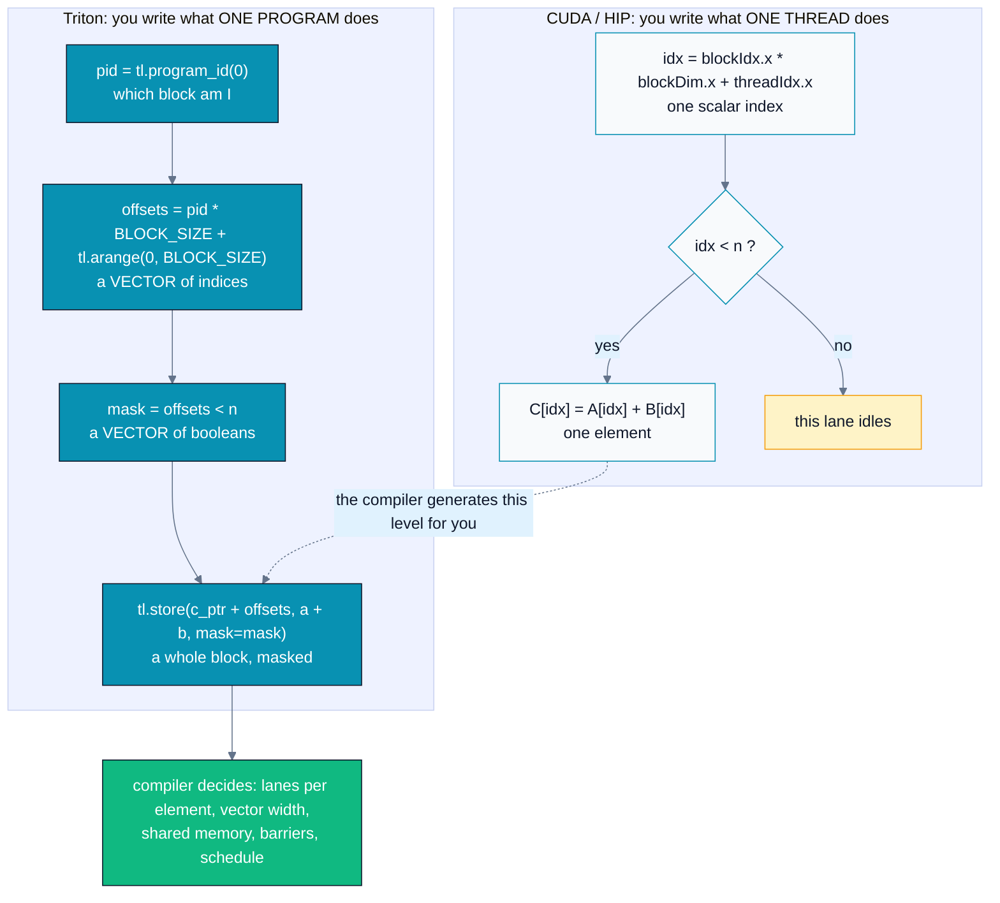
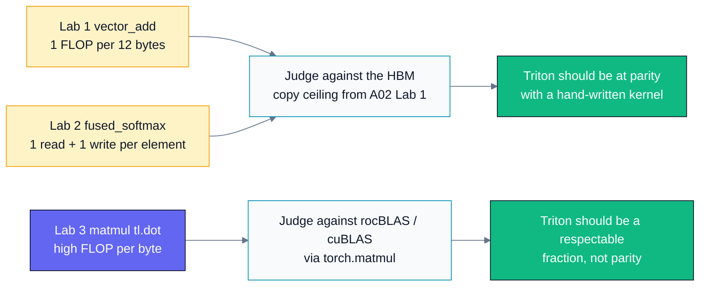
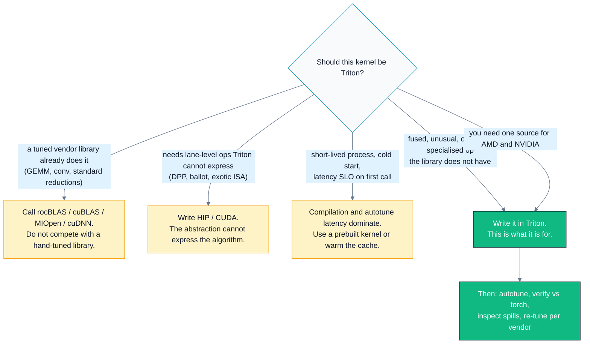

# A08 — Triton Foundations

> Track A · Module 08 · Status: **DONE** · Est. 6 hours · Depth 3/5
>
> Prerequisites: [A01](../A01.foundations-and-programming-model/README.md) (kernels,
> grid/block/thread, event timing), [A02](../A02.memory-hierarchy-and-coalescing/README.md)
> (coalescing, shared memory), [A03](../A03.execution-model-and-occupancy/README.md) (occupancy,
> divergence). [A04](../A04.parallel-reduction/README.md)–[A07](../A07.softmax-and-fused-kernels/README.md)
> strongly recommended: Labs 2–3 and the drills compare directly against those hand-written kernels.
>
> Backend: **Python** — one source that compiles for AMD *and* NVIDIA. No `hip/` or `cuda/`
> directory in this module, by design. Setup: [SETUP.md](../../../docs/SETUP.md) ·
> Terms: [GLOSSARY.md](../../../docs/GLOSSARY.md) · Sources: [REFERENCES.md](../../../docs/REFERENCES.md).

---

## 1. TL;DR + Layman analogy

**TL;DR.** [Triton](../../../docs/GLOSSARY.md#triton) is a Python DSL that JIT-compiles GPU
[kernels](../../../docs/GLOSSARY.md#kernel). Its one idea: raise the unit
of programming from **one thread** to **one block of elements**. You write what a *program*
(≈ one CUDA block / HIP workgroup) does to a block-shaped slab of data; the compiler decides how
that slab is split across lanes, how wide each load is, what goes in
[shared memory](../../../docs/GLOSSARY.md#shared-memory-nvidia-and-lds-amd), where the
barriers go, and what the instruction schedule looks like. The bounds check becomes a `mask`
argument instead of an `if`. One source file replaces the `hip/` + `cuda/` pair you have been
writing since [A01](../A01.foundations-and-programming-model/README.md). You give up per-lane
control and gain code you can actually maintain — plus a
tuning *search* (`@triton.autotune`) in place of tuning by hand.

**Layman analogy.** In A01–A07 you were a foreman who briefs **every worker individually**:
"worker 4,297, take item 4,297 off the shelf, add it to item 4,297 of the other pile, and if your
number is past the end of the list, stand still." Correct, and exhausting, and the same briefing
has to be rewritten for a warehouse whose crews are 64 people (AMD) versus 32 (NVIDIA).

Triton is writing **one work order for a whole crew**: "Crew 7: take shelf slots 7168 through
8191, add them pairwise, put the results on the output shelf, and ignore any slot past the end of
the list." A dispatcher — the compiler — works out how the crew divides those 1,024 slots among
its members, how many trips to the warehouse that takes, and which items ride together on one
truck. You write one order; it works in either warehouse.

**Where the analogy breaks** — and these three breaks are the whole of Sections 3 and 6:

1. **The dispatcher is not clairvoyant.** A badly sized work order ("crew of 1,024 slots" when 128
   would have fit in the crew's hands) is still slow, and you cannot fix it by micromanaging one
   worker. You fix it by rewriting the order, or by having the dispatcher *try several orders and
   time them* — that is `@triton.autotune`, and it is not free.
2. **You do not pick the crew size, you pick the number of crews.** `num_warps` counts
   [warps/wavefronts](../../../docs/GLOSSARY.md#warp-nvidia-and-wavefront-amd), and a warp is 32
   lanes on NVIDIA while a wavefront is 64 on AMD. The same
   `num_warps=4` is 128 threads on one vendor and 256 on the other. **The code is portable; the
   tuning is not.**
3. **Some jobs really do require talking to individual workers.** The lane-level tricks from
   [A04 §3](../A04.parallel-reduction/README.md#3-deep-dive)
   (`__shfl_down`, ballot, AMD DPP row-shifts) have no block-level spelling. When your algorithm
   needs one, the C++ kernel is not legacy — it is the only version that can express it.

**By the end of this module you can:** write, verify, and benchmark a Triton kernel from scratch;
translate any per-thread CUDA/HIP kernel into per-program Triton and back; use `mask`/`other`
correctly, including the numerical edge cases; use `tl.dot` and `@triton.autotune`; explain
precisely what the compiler decided for you and how to inspect it; and argue in a code review when
a Triton rewrite is the right call and when it is not.

---

## 2. First Principles

### Start from the bill, not the API

Look at what A01–A07 actually cost you, per kernel:

| Cost | Concretely |
|---|---|
| Two source trees | `hip/*.cpp` and `cuda/*.cu`, kept in sync by hand forever |
| Index boilerplate | `idx = blockIdx.x * blockDim.x + threadIdx.x`, in every kernel, identically |
| Bounds boilerplate | `if (idx < n)`, easy to forget, silent corruption when you do (A01 §6) |
| Manual tiling | Declare the shared tile, load it cooperatively, `__syncthreads()`, read it back (A02, A06) |
| Manual lane reductions | Shuffle trees, hand-unrolled, warp-size-dependent (A04) |
| Manual tuning | Sweep tile size and block size by editing constants and re-running (A03, A06) |
| Manual error checking | `HIP_CHECK` on every call, because the API reports failure by return value |

Now ask which of those lines carry *your* ideas. The index math does not — it is mechanically
derivable from "this program owns this contiguous slice." The bounds check does not — it is
derivable from the slice and `n`. The shared-memory staging does not — given a tile shape, the
loads, the barrier, and the read-back are a mechanical consequence. Even the shuffle tree is
mechanical once you have said "sum this block."

**Boilerplate that is mechanically derivable is a compiler's job.** Humans writing it by hand
produce exactly the bug classes
[A01 §6](../A01.foundations-and-programming-model/README.md#6-challenges-drawbacks--tradeoffs) and
[A02 §6](../A02.memory-hierarchy-and-coalescing/README.md#6-challenges-drawbacks--tradeoffs)
enumerate. That is the argument for Triton, and
it is an argument about *bugs and maintenance* before it is one about performance.

### What must stay yours

Not everything collapses. Two things resist:

- **The tile shape.** `BLOCK_M = 64` or `128`? There is no derivation — it trades operand reuse
  against register and shared-memory pressure, and the right answer depends on the GPU, the dtype,
  and the problem shape. A compiler cannot *derive* it, but it can **search** it.
- **The algorithm and the numerics.** `tl.exp` overflows exactly like `expf`. Triton will not
  discover the max-subtraction trick, the online-softmax recurrence, or the fp32 accumulator for
  you. [A07](../A07.softmax-and-fused-kernels/README.md#3-deep-dive)'s numerics are still your
  problem.

So the design falls out: express work per **block**, let the compiler own the intra-block
mechanics, keep the tile shape as an explicit knob, and provide a search over that knob. That is
Triton's design, and [Tillet, Kung, and Cox's 2019 paper](https://dl.acm.org/doi/10.1145/3315508.3329973)
makes tiles the first-class value in the language for exactly this reason.

### The mental-model mapping

Every construct you learned in A01–A07 has a Triton counterpart:

| CUDA/HIP | Triton |
|---|---|
| one thread | one lane inside a block-shaped tensor operation |
| `blockIdx.x` | `tl.program_id(axis=0)` |
| `blockDim.x` | `BLOCK_SIZE` (a `tl.constexpr`) |
| `if (idx < n)` guard | `mask = offsets < n` passed to `tl.load`/`tl.store` |
| manual shared-memory tiling | implicit, compiler-managed |
| grid of blocks | `grid = (triton.cdiv(n, BLOCK_SIZE),)` |

Read that table as a *translation*, not a *rename*. Three rows hide real changes in meaning:

- **`blockDim.x` → `BLOCK_SIZE`** is not the same number. `blockDim.x` is a thread count.
  `BLOCK_SIZE` is a count of *elements this program handles*, it is a compile-time constant (change
  it and you get a different compiled kernel), and the thread count is set separately by
  `num_warps`. They are frequently different values.
- **`if (idx < n)` → `mask=`** moves the guard from control flow into the memory operation. That is
  why it is harder to forget: `tl.load` takes `mask` as an argument, and a masked load also needs
  you to say what the inactive lanes *read* (`other=`), which forces you to think about the
  identity element (Section 6, Pitfall 5).
- **"manual shared-memory tiling → implicit"** does not mean "no shared memory." It means the
  compiler allocates and stages it, and you find out how much by inspecting the compiled kernel,
  not by reading your own source.



The left column is a scalar program you mentally replicate 50,000 times; the right column is one
program over vectors, and everything the left column spelled out lane-by-lane has moved into the
green box.

---

## 3. Deep Dive

### The API surface, in the order you need it

Seven constructs cover every kernel in this module and most kernels you will write.

| Construct | What it is | The C++ line it replaces |
|---|---|---|
| `@triton.jit` | Marks a Python function as a kernel. It is compiled on first call, per distinct set of `constexpr` values and argument types. | `__global__` |
| `tl.program_id(axis=0)` | This program's index along a grid axis (0, 1, or 2). | `blockIdx.x/y/z` |
| `tl.arange(0, BLOCK)` | A vector `[0, 1, ..., BLOCK-1]`. `BLOCK` must be a compile-time constant **power of two**. | `threadIdx.x`, vectorized |
| `tl.load(ptr + offs, mask=, other=)` | Gather a block of values. `mask` selects active lanes; `other` is what inactive lanes read. | the guarded load plus `if (idx < n)` |
| `tl.store(ptr + offs, val, mask=)` | Scatter a block of values. Inactive lanes write nothing. | the guarded store |
| `tl.sum(x, axis=)` / `tl.max(x, axis=)` | Block-wide reduction, lowered to a shuffle/LDS tree. | A04's hand-written reduction |
| `tl.dot(a, b)` | Block-by-block matrix product, accumulating in a wide type. Lowered onto MFMA (AMD) or Tensor Cores (NVIDIA) when the dtypes, shapes, and target allow. | A06's entire inner `k` loop |

Plus three pieces of plumbing: `tl.constexpr` (an argument the compiler specializes on),
`triton.cdiv(a, b)` (ceiling division, for grid sizing), and the launch syntax:

```python
kernel[grid](arg0, arg1, ..., BLOCK_SIZE=1024, num_warps=4)
```

The square brackets take the grid — a tuple, or a *callable* taking the meta-parameters when the
tile shape is not known until autotuning has run. Keyword arguments after the runtime arguments
set `constexpr` values and the launch meta-parameters (`num_warps`, `num_stages`).

### Pointer arithmetic is where the model clicks

`a_ptr` inside a kernel is a scalar pointer; `a_ptr + offsets` is a **block of pointers**, one per
element. That is the whole trick behind 2-D tiles: broadcast a column vector against a row vector
and you have named a rectangle of addresses.

```python
# rows: offs_m[:, None]   columns: offs_n[None, :]
ptrs = a_ptr + offs_m[:, None] * stride_am + offs_n[None, :] * stride_an
mask = (offs_m[:, None] < M) & (offs_n[None, :] < N)
tile = tl.load(ptrs, mask=mask, other=0.0)
```

Two habits worth adopting now, both visible in `triton/matmul.py`:

- **Pass strides, never assume contiguity.** `x.stride(0)` costs nothing and makes the kernel work
  on a transposed or sliced view. Assuming `row * n + col` is how a Triton kernel silently produces
  garbage on a non-contiguous tensor.
- **Keep the fastest-varying index contiguous across the block.**
  [A02](../A02.memory-hierarchy-and-coalescing/README.md)'s
  [coalescing](../../../docs/GLOSSARY.md#coalescing) lesson has not
  been repealed. The compiler will vectorize a contiguous access; it cannot repair a strided one.

### What actually happens on the first call

```mermaid
%%{init: {
  'theme': 'base',
  'themeVariables': {
    'primaryColor': '#F8FAFC',
    'primaryTextColor': '#0F172A',
    'primaryBorderColor': '#0891B2',
    'lineColor': '#64748B',
    'secondaryColor': '#E0F2FE',
    'tertiaryColor': '#EEF2FF',
    'fontFamily': 'Inter, Segoe UI, sans-serif'
  }
}}%%
flowchart LR
  PY["Python function<br/>decorated @triton.jit"] --> AST["AST walk<br/>at first call"]
  AST --> TTIR["Triton IR<br/>block-level, vendor-neutral"]
  TTIR --> TTGIR["TritonGPU IR<br/>layouts, warps, shared memory"]
  TTGIR --> LLVM["LLVM IR"]
  LLVM --> GCN["AMDGCN, then hsaco<br/>AMD"]
  LLVM --> PTX["PTX, then cubin<br/>NVIDIA"]
  GCN --> CACHE["on-disk cache<br/>TRITON_CACHE_DIR, default ~/.triton"]
  PTX --> CACHE
  CACHE --> LAUNCH["launch: grid of programs"]

  classDef trackA fill:#0891B2,stroke:#0F172A,color:#fff
  classDef amd fill:#FEE2E2,stroke:#ED1C24,color:#0F172A
  classDef nvidia fill:#ECFCCB,stroke:#76B900,color:#0F172A
  classDef neutral fill:#F8FAFC,stroke:#0891B2,color:#0F172A
  classDef success fill:#10B981,stroke:#0F172A,color:#fff
  class PY,AST,TTIR,TTGIR,LLVM trackA
  class GCN amd
  class PTX nvidia
  class CACHE neutral
  class LAUNCH success
```



The vendor split happens *late* — only the last two boxes differ, which is why one Python source
serves both, and why the cost of the first call is a real compilation, not a lookup.

> [!NOTE]
> The intermediate stage names above track Triton's implementation and have changed across
> releases. Treat them as "roughly what the dumps will show you," verify against your own version
> (`triton.__version__`), and use `MLIR_ENABLE_DUMP=1` if you want the ground truth. The ROCm
> Triton optimization guide walks through reading those dumps on AMD.

The important consequence is the **cache**. Compilation results are written to disk
(`~/.triton` by default, overridable with `TRITON_CACHE_DIR`), so the cost is paid once per
distinct kernel *variant* — and a new variant is created by a change in argument dtypes, in any
`tl.constexpr` value, or in the launch meta-parameters. In a long-lived training process this
rounds to zero. In a short-lived CLI, a serverless worker, or a cold-start inference path, it does
not (Section 6, Pitfall 1).

### `@triton.autotune` — replacing your tuning sweep with a search

```python
@triton.autotune(configs=[
    triton.Config({"BLOCK_M": 64,  "BLOCK_N": 64,  "BLOCK_K": 32}, num_warps=4, num_stages=2),
    triton.Config({"BLOCK_M": 128, "BLOCK_N": 128, "BLOCK_K": 32}, num_warps=8, num_stages=2),
], key=["M", "N", "K"])
@triton.jit
def matmul_kernel(...):
```

- **`configs`** is the search space *you* supply. Triton does not invent tile shapes; it times the
  ones you list and keeps the fastest. A good config list is most of the performance work.
- **`num_warps`** is how many warps/wavefronts cooperate on one program. See the portability note
  below — this is the single least portable knob.
- **`num_stages`** is the software-pipelining (prefetch) depth for loops, and matters mainly for
  loops with loads feeding `tl.dot`.
  [Triton's own documentation](../../../docs/REFERENCES.md#triton-documentation-and-tutorials-triton-project)
  describes it primarily in terms of NVIDIA SM80+ hardware; on AMD the useful value is empirical.
- **`key`** lists the *runtime* arguments whose change invalidates the tuning result. Every distinct
  key tuple triggers a fresh search, so `key=["M", "N", "K"]` on a workload with hundreds of shapes
  means hundreds of searches. Keep the key as small as correctness allows.

**Caching behaviour, precisely:** the first call for a given key compiles *and benchmarks every
config*, then remembers the winner for that key, in that process. Restart the process and the
compiled binaries come back from the on-disk cache, but the *benchmarking* runs again — so the
first call is never free. `triton/matmul.py` measures that cost explicitly and prints it, because
it is a property of your deployment, not a footnote.

### Portability reality on AMD — precisely, and no further

This is the part of Triton where confident overstatement is common. What is well established:

- **Triton runs on ROCm through the PyTorch ROCm wheels.** The ROCm PyTorch build ships
  `pytorch-triton-rocm`; you do not `pip install triton` from PyPI on an AMD machine (that is the
  NVIDIA build). AMD documents
  [Triton kernel optimization](https://rocm.docs.amd.com/en/latest/how-to/rocm-for-ai/inference-optimization/optimizing-triton-kernel.html)
  as a supported workflow and publishes guidance and tutorials for it.
- **The wavefront is 64 lanes on CDNA, and Triton's AMD backend uses that as its warp size.** So
  `num_warps=4` is 256 threads per program on MI300-class hardware and 128 on an NVIDIA GPU. Triton's
  own `triton.Config` documentation spells the arithmetic the NVIDIA way — "`num_warps=8` … 8 × 32 =
  256 threads" — which is correct on NVIDIA and wrong by 2× on AMD. That mismatch is a real, current
  source of confusion; a
  [2026 PyTorch fix](https://github.com/pytorch/pytorch/pull/188881) had to replace a hard-coded 32
  threads-per-warp in a Triton kernel launcher with a device query for exactly this reason.
- **Therefore a config tuned on NVIDIA is not automatically optimal on AMD** — not because the
  compiler is worse, but because the same `num_warps` denotes a different thread count, a different
  register budget per lane, and a different [occupancy](../../../docs/GLOSSARY.md#occupancy) point.
  Re-tune per vendor. Ideally, keep two config lists.
- **AMD exposes at least one knob NVIDIA does not.** `waves_per_eu` is an AMD-specific hint (it
  becomes the `amdgpu-waves-per-eu` LLVM function attribute) that pressures the register allocator
  and scheduler toward a target occupancy. It appears in ROCm's Triton tuning guidance and in
  autotuning search spaces for AMD targets. It is passed inside the `Config` kwargs dict, not as a
  `Config` constructor argument.

What I will **not** claim, because it moves faster than any document: which specific Triton version
supports which AMD feature, whether `num_stages` or `maxnreg` is honoured on your particular
backend and release, or how close a given Triton [GEMM](../../../docs/GLOSSARY.md#gemm) gets to
rocBLAS on your GPU. Triton's docs
themselves note `maxnreg` is "not supported on all platforms," and the AMD backend is under active
development. **Check `triton.__version__`, read the emitted assembly, and measure.** Anything in
this section that your measurement contradicts: believe your measurement.

### Where the wavefront difference actually bites

| Concern | NVIDIA | AMD (CDNA) | Consequence for your Triton code |
|---|---|---|---|
| Lanes per warp/wavefront | 32 | 64 | `num_warps=N` is `32N` vs `64N` threads |
| Smallest sane `BLOCK` for a 1-D kernel | 32-element granularity | 64-element granularity | `BLOCK` a multiple of 64 is safe on both |
| Matrix-core instruction behind `tl.dot` | Tensor Core (`mma`/`wgmma`) | MFMA | Shape/dtype eligibility differs; verify in the assembly |
| Occupancy knob | `num_warps`, `num_stages`, `maxnreg` | plus `waves_per_eu` | AMD tuning has an extra dimension |

None of this changes your *source*. All of it changes your *config list*. That distinction — code
portable, tuning not — is the honest one-line summary of Triton on AMD.

---

## 4. Hands-On Labs

This module is Python-only: there is no `hip/` or `cuda/` directory, because the hand-written C++
counterparts already exist in [A01](../A01.foundations-and-programming-model/README.md)
(`vector_add`), [A06](../A06.tiled-matrix-multiply/README.md) (`matmul`), and
[A07](../A07.softmax-and-fused-kernels/README.md) (`softmax`). Comparing
against them is the point of the labs, so read them side by side.

```bash
make help                 # targets + detected toolchain
make venv                 # PRINTS setup instructions; creates nothing
make run                  # all three labs (all must PASS)
make run-exercises        # exercises/ (FAIL expected until solved)
make run-solutions        # solutions/ (must all PASS)
make clean                # remove __pycache__

# or one at a time
python triton/vector_add.py
python triton/fused_softmax.py
python triton/matmul.py
```

Install first: `pip install -r requirements.txt` — but read the file, because the correct torch
wheel is vendor-specific and the ROCm wheel index is version-pinned. Every script checks
`torch.cuda.is_available()` and exits with a pointer to
[../../../docs/SETUP.md](../../../docs/SETUP.md) if no GPU is visible.

### Lab 1 — `vector_add`: the whole model in five lines

File: [`triton/vector_add.py`](triton/vector_add.py). Compare with
[`A01/hip/vector_add.cpp`](../A01.foundations-and-programming-model/hip/vector_add.cpp).

**What to observe.** Three things, in order:

1. **The reported warp/wavefront size**, printed from `torch.cuda.get_device_properties`. 64 on
   CDNA, 32 on NVIDIA. Multiply by `num_warps` (default 4) to get the thread count the compiler
   actually launched — the number you would have written by hand as `blockDim.x`.
2. **The bandwidth is essentially the same as `torch`'s `a + b`,** and both should land near the
   HBM copy ceiling you measured in
   [A02 Lab 1](../A02.memory-hierarchy-and-coalescing/README.md#4-hands-on-labs). For a
   memory-bound elementwise kernel, Triton is not leaving anything on the table — there is nothing
   to leave.
3. **The `compiler report`** (register count, spill count, shared-memory bytes, where your Triton
   version exposes them). You wrote no shared memory; if the number is non-zero, the compiler put
   it there. A non-zero *spill* count is the one to worry about — it means values the compiler
   wanted in registers went to memory instead.

### Lab 2 — `fused_softmax`: block reductions and the `other=` identity

File: [`triton/fused_softmax.py`](triton/fused_softmax.py). Compare with
[`A07/hip/softmax.cpp`](../A07.softmax-and-fused-kernels/hip/softmax.cpp).

One program owns one row; the row is loaded once and the whole max → exp → sum → divide chain
happens on-chip, so HBM sees exactly one read and one write.

**What to observe.**

1. `other=-float("inf")` on the load, not `0.0`. The padded lanes must be the **identity of the
   reduction that follows**, and for a `max` that is `-inf`. Change it to `0.0` and any row of
   negative values reports a max of 0 and the entire normalization is wrong — on the tail block
   only, which is how this bug survives testing.
2. The poisoned element `x[0, 7] = 100.0` proves the `x - m` subtraction is load-bearing:
   `tl.exp` overflows exactly like `expf`. Triton removed your index math, not your numerics.
3. The timing lands in the same ballpark as `torch.softmax`, which is itself a fused kernel. **The
   win of writing this yourself is not beating `torch.softmax` — it is fusing the operations
   *around* it** into the same kernel, which is what
   [A09](../A09.advanced-triton-flash-attention/README.md) and every real attention kernel do.

### Lab 3 — `matmul`: `tl.dot` plus a real autotune

File: [`triton/matmul.py`](triton/matmul.py). Compare with
[`A06/hip/matmul.cpp`](../A06.tiled-matrix-multiply/hip/matmul.cpp) and with
[`A06/triton/matmul.py`](../A06.tiled-matrix-multiply/triton/matmul.py), which uses a single
hand-picked config — the two Triton files differ almost only in the autotune decorator, which makes
the comparison clean.

**What to observe.**

1. **The first-call cost**, printed separately in milliseconds. That is JIT compilation plus
   benchmarking all six configs. Run the script twice in one process and the second call is
   microseconds; start a new process and you pay the benchmarking again.
2. **Which config won** (`best_config`). It is not always the biggest tile. Note it, then run the
   same script on a different GPU if you have one, and note that the winner changes. That is
   Section 3's portability claim, measured rather than asserted.
3. **The gap to `torch.matmul`** (rocBLAS/cuBLAS underneath). Expect the vendor library to stay
   ahead on a plain fp32 square GEMM. That is the correct and expected outcome, and Section 5
   explains why it is not a failure.

### Lab 4 (optional) — look at what the compiler produced

A Triton kernel is not finished when it passes; it is finished when you have looked at the output.

```bash
# AMD: dump the intermediate IR (see the ROCm Triton optimization guide)
MLIR_ENABLE_DUMP=1 python triton/matmul.py 2>&1 | head -100

# Either vendor: inspect the on-disk cache (assembly, metadata JSON)
TRITON_CACHE_DIR=$PWD/.triton-cache python triton/vector_add.py && ls -R .triton-cache

# AMD: profile it like any other kernel
rocprofv3 --summary --output-format csv -d profiling_output -- python triton/fused_softmax.py
# NVIDIA:
ncu --set full python triton/fused_softmax.py
```

**What to look for.** In the profiler, a Triton kernel is just a kernel — the same counters apply.
Check shared-memory traffic on the softmax kernel: you wrote none, so anything reported is the
compiler's reduction tree. Check occupancy against
[A03](../A03.execution-model-and-occupancy/README.md#3-deep-dive)'s model and see whether the
config the autotuner chose is the one your occupancy math would have predicted. When it is not, the
autotuner is usually right and your model is missing something (often instruction-level
parallelism).

> **Troubleshooting**
> - `RuntimeError: ... no active driver` / `torch.cuda.is_available()` is `False` — wrong wheel for
>   your vendor, or no GPU visible. See [../../../docs/SETUP.md](../../../docs/SETUP.md).
> - `ModuleNotFoundError: No module named 'triton'` on AMD after `pip install triton` — you
>   installed the NVIDIA build, or shadowed `pytorch-triton-rocm`. Reinstall torch from the ROCm
>   index and let it supply Triton (see `requirements.txt`).
> - First run takes many seconds and appears hung — that is compilation and autotuning. It is
>   measured and printed in Lab 3 for exactly this reason.
> - An `AttributeError` on `tl.something` — Triton's API moves between releases. Check
>   `triton.__version__` against the [current docs](https://triton-lang.org/) rather than assuming
>   this README is current.

---

## 5. Performance Analysis

### No table of numbers here, on purpose

Triton throughput depends on your GPU, your ROCm/CUDA version, **and your Triton version** — the
last one materially, because the AMD backend's code generation and default heuristics change
between releases. A plausible-looking table of GB/s in a README is worse than no table: it gets
quoted, it ages badly, and it is unfalsifiable to the reader. So this section gives you the
**shape** of the result and the command to produce your own numbers. Record yours in your notes
with the GPU, the ROCm/CUDA version, and `triton.__version__` next to them.

### First, ask the A01 question

Same question as every module:
**[memory-bound or compute-bound](../../../docs/GLOSSARY.md#memory-bound-compute-bound-and-latency-bound)?**
It decides what "good" means.



The two labs on the left are bandwidth problems with a known ceiling; the lab on the right is a
compute problem judged against a hand-tuned library — and those two situations have different
definitions of success.

### The expected shape of results

| Lab | Bound by | Compare against | Expected shape | Why |
|---|---|---|---|---|
| `vector_add` | HBM bandwidth | A02's copy ceiling; `torch`'s `a + b` | **At parity.** Elementwise Triton kernels typically land close to a hand-written kernel. | The kernel is three memory operations. There is no cleverness available to anyone — the ceiling is the ceiling. |
| `fused_softmax` | HBM bandwidth | `torch.softmax` | **Same order of magnitude.** | Both are fused single-pass kernels moving the same bytes. A large gap means a bad `BLOCK`/`num_warps` choice, not a bad compiler. |
| `matmul` (`tl.dot`) | Compute (matrix cores) | `torch.matmul` → rocBLAS/cuBLAS | **A respectable fraction, not parity.** | The vendor library is hand-tuned per architecture and per shape, with assembly-level scheduling and shape-specific kernels. Triton is a general compiler working from your six configs. |
| `matmul` autotuned vs. A06's single config | Compute | A06's `triton/matmul.py` | **Autotuned should win, sometimes substantially.** | Same kernel body; the only difference is that the tile shape and warp count were searched instead of guessed. |

That last row is the one before/after measurement this module owns, and you can run it in one line:

```bash
python ../A06.tiled-matrix-multiply/triton/matmul.py    # one hand-picked config
python triton/matmul.py                                  # six configs, searched
```

The kernel bodies are nearly identical. Any difference is attributable to the search — which is
exactly the experiment you want, and exactly the reason the `matmul.py` here does not also change
the launch ordering. ([A06](../A06.tiled-matrix-multiply/README.md) uses a 1024³ problem and this
module 2048³, so compare TFLOP/s, not milliseconds.)

### The cost nobody puts in the benchmark

Wall-clock performance of a Triton kernel has a term that a C++ kernel does not:

```
total_time = compile_time + autotune_time + N * kernel_time
```

For a training loop with `N` in the millions, the first two terms vanish. For a process that calls
the kernel a handful of times, they dominate completely — and `autotune_time` scales with
`len(configs) × distinct key tuples`. `triton/matmul.py` prints the first call separately so this
term is visible rather than amortized away silently. **When you report Triton performance, say which
regime you measured.** A benchmark loop measures `kernel_time`; production may not.

### Reading a Triton kernel's performance

The diagnostic ladder, cheapest first:

1. **Correctness.** A kernel that reports FAILED has no performance. Check first, every time.
2. **Bytes or FLOPs vs. the ceiling.** Compute effective GB/s or TFLOP/s yourself (all the scripts
   do). Being at 90% of the copy ceiling means stop optimizing.
3. **Spills.** From the compiled-kernel handle (`vector_add.py`'s `compiler_report`). Non-zero
   spills on a hot kernel usually means the tile is too big for the register budget — shrink
   `BLOCK`, or raise `num_warps` so the same tile is spread over more lanes.
4. **The config the autotuner picked.** If the winner is at the edge of your search space, your
   search space is too small — extend it in that direction and re-run.
5. **The profiler.** Occupancy, shared-memory traffic, memory efficiency. Same counters as
   [A02](../A02.memory-hierarchy-and-coalescing/README.md)/[A03](../A03.execution-model-and-occupancy/README.md);
   a Triton kernel is not special to `rocprofv3` or Nsight Compute.
6. **The assembly.** Last resort, and the only way to answer "did `tl.dot` actually emit MFMA?"

---

## 6. Challenges, Drawbacks & Tradeoffs



Three of the five branches say "not Triton" — which is the honest ratio, and the reason this section
comes before Section 7 rather than after it.

### Pitfall 1 — Compilation and autotuning latency are part of your latency

Covered in Section 5, restated here as a failure mode: a service that compiles a kernel on the
request path has a first-request latency measured in seconds. Mitigations, in order of preference:
warm the kernel at startup with representative shapes; shrink the `key` so fewer variants exist;
shrink the config list once you know the winner; bucket or pad shapes so the same variant is reused.
Persisting `TRITON_CACHE_DIR` across restarts saves the *compile*, not the *tuning*.

### Pitfall 2 — The autotuner runs your kernel many times, with real side effects

To time six configs, Triton *executes* the kernel six times on your actual arguments. If your kernel
accumulates in place (`out += ...`), or consumes a queue, or is otherwise not idempotent, autotuning
both corrupts the output and mis-times the kernel (later configs see different cache state). This is
what `triton.Config`'s `pre_hook` exists for — reset the buffers before each trial. If you cannot
make the kernel idempotent, do not autotune it on live data.

### Pitfall 3 — `tl.constexpr` is a recompilation trigger

Every distinct `constexpr` value produces a distinct compiled kernel. Passing a *data-dependent*
value as `constexpr` — sequence length, batch size, a padded width — turns one kernel into hundreds
and can make a process spend more time compiling than computing. Rule: `constexpr` is for values you
choose (tile shapes, flags), runtime arguments are for values your data chooses. When a shape must
be `constexpr` for performance, bucket it to a handful of powers of two.

### Pitfall 4 — Portable code is not portable tuning

The claim worth being precise about (Section 3): the *source* is portable, the *config* is not.
`num_warps=4` is 128 threads on NVIDIA and 256 on AMD, so it lands at a different occupancy point,
a different register budget per lane, and potentially a different `tl.dot` lowering. A config list
copied from an NVIDIA-tuned repository is a starting point, not a result. Re-tune on the hardware
you ship on, and expect to maintain two lists if you ship on both.

### Pitfall 5 — `mask` and `other` are a numerical trap, not a formality

Three distinct bugs live here, and Exercise 2 is built from them:

- **Wrong identity.** `other=` must be the identity of the reduction that follows: `0.0` for a sum,
  `-inf` for a max. Get it backwards and the answer is wrong *only on the tail block*, which is
  precisely the case a quick test on a power-of-two shape never exercises.
- **Confusing the bounds mask with the data mask.** `cols < n_cols` is memory safety. `keep != 0` is
  semantics. They are combined for the reduction but only the first may guard a load.
- **Unguarded division after a masked reduction.** A fully masked row has a count of zero, and
  `total / count` is a nan that propagates through every downstream layer and surfaces thousands of
  steps later as "the loss went to nan." Guard by clamping the **denominator**; `tl.where` is a
  select and evaluates both branches, so selecting the result afterwards still computed the nan.

### Pitfall 6 — Debugging is genuinely harder

There is no line-by-line debugger for a compiled Triton kernel. What you have: `tl.device_print`
for in-kernel values, an interpreter mode (`TRITON_INTERPRET=1`) that runs the kernel in Python so
you can use ordinary Python debugging at the cost of enormous slowdown, the IR dumps, and the
profiler. All of these are version-dependent — verify against the release you have. The practical
consequence is that **the PyTorch reference check is not optional decoration**; it is your primary
debugging instrument, which is why every script in this module has one.

### Pitfall 7 — Version churn is a maintenance cost you are signing up for

Triton's Python API, its tuning behaviour, and its AMD code generation all move between releases. A
kernel that was 5% behind cuBLAS can be 30% behind after a wheel bump, with no change to your
source. If you ship Triton kernels, you need a performance test with a threshold in CI and a named
owner who re-tunes. Otherwise the regression is found by a customer.

### When *not* to use Triton — the short list

1. **A tuned vendor library already has the kernel.** rocBLAS/cuBLAS for GEMM, MIOpen/cuDNN for
   convolution, rocPRIM/CUB for standard scans and sorts. These are hand-tuned per architecture and
   per shape; a general compiler will not beat them at their own game, and AMD's own guidance is
   explicit that Triton is not used where rocBLAS or MIOpen is faster. Use the library; spend your
   Triton budget on the op the library does not have.
2. **You need instructions or behaviour Triton does not expose.** Lane-level primitives
   ([A04](../A04.parallel-reduction/README.md)'s shuffles, AMD DPP), explicit barrier placement,
   precise register residency, specific asynchronous-copy or matrix-core instructions. Reach for HIP/CUDA — and note that "Triton cannot
   express it" is a statement about a version, so re-check when you upgrade.
3. **Compilation latency matters in a short-lived process.** Cold-start inference, CLI tools,
   serverless functions, anything where the kernel runs a handful of times per process.
4. **Nobody will own the tuning.** An unowned Triton kernel silently rots across version bumps.

### The tradeoff, stated plainly

You are trading **control and predictability** for **less code, fewer boilerplate bug classes, and
one source per vendor**. That is usually a good trade for a fused or unusual kernel and a bad trade
for a kernel that already exists in a tuned library. It is never a free trade, and a review that
treats it as free is the review that ships the regression.

---

## 7. Real-World Use Cases

Triton is not a teaching language. It is in the production path of systems you have probably used
today.

- **PyTorch `torch.compile` / TorchInductor generates Triton.** This is the big one: Inductor's GPU
  backend *emits Triton source* for the fused pointwise and reduction kernels it creates, and under
  `max-autotune` it also generates and benchmarks Triton GEMM/conv templates against the vendor
  libraries, keeping whichever wins. Every time you call `torch.compile` on a model on an NVIDIA or
  AMD GPU, you are running machine-generated Triton — which means the kernels in this module are the
  same *kind* of artifact Inductor produces, and reading Inductor's generated code (via
  `TORCH_LOGS=output_code`) is one of the best ways to learn idiomatic Triton.
- **vLLM** ships Triton kernels in its inference stack and uses them for portability across
  vendors — Triton kernels are a significant part of how the same serving code runs on ROCm and
  CUDA.
- **Unsloth** implements its fine-tuning speedups largely as hand-written Triton kernels (fused
  layer/RMS norm, fused cross-entropy, LoRA paths), trading library generality for fused kernels
  specialised to the training step.
- **[FlashAttention](../../../docs/GLOSSARY.md#attention-and-flashattention)-style fused
  attention.** The algorithm's whole point is tiling Q/K/V so the
  attention matrix never reaches HBM — exactly Lab 2's fusion idea extended to a matmul-softmax-matmul
  chain. Triton's own tutorial set includes a fused-attention kernel built on this algorithm, and
  Triton implementations of FlashAttention-style kernels are widely used where a hand-written CUDA
  kernel is not available for the target hardware or dtype. (The original FlashAttention reference
  implementation from
  [Dao et al.](../../../docs/REFERENCES.md#flashattention-dao-et-al-2022) is CUDA; the Triton
  versions are separate implementations of the same algorithm.)
- **AMD's own ROCm guidance** treats Triton as a first-class kernel-authoring path, with published
  optimization guides, tuning knobs (`waves_per_eu`), and developer-hub tutorials for writing and
  optimizing Triton kernels on Instinct hardware.

The pattern across all five: **Triton is where fused, shape-specialised, or vendor-portable kernels
live.** The unfused standard operations stay in rocBLAS/cuBLAS/MIOpen/cuDNN. That division of labour
is the practical answer to Section 6's decision tree.

**Where to go next.** [A09](../A09.advanced-triton-flash-attention/README.md) takes Lab 2's
single-row fusion as far as it goes — a matmul-softmax-matmul chain where the attention matrix never
reaches HBM — and is where `tl.dot`, `mask` and the autotuner stop being exercises.
[A10](../A10.cute-cutlass-and-cutile/README.md) goes the other way, down to the layout algebra
Triton hides, for the kernels where the compiler's choices are exactly what you need to override.
When a Triton kernel is slower than you expected and Section 5's ladder runs out,
[B03](../../B-gpu-ml-performance/B03.profiling-and-bottleneck-analysis/README.md) turns "the
profiler says so" into a named bottleneck.

---

## 8. Cited References

Full list in [../../../docs/REFERENCES.md](../../../docs/REFERENCES.md). Where a claim in this module
is version-dependent, the reference is the thing to re-check — not this README.

**The language and its documentation**

- Tillet, Kung, Cox (2019). *Triton: An Intermediate Language and Compiler for Tiled Neural Network
  Computations.* MAPL '19 (co-located with PLDI). The original paper; the source of the "tiles as
  first-class values" framing in §2.
  <https://dl.acm.org/doi/10.1145/3315508.3329973>
- [**Triton documentation**](../../../docs/REFERENCES.md#triton-documentation-and-tutorials-triton-project)
  — language reference and programming model; the source cited in §3 for the `num_stages`
  description, and the page to re-read when an API used in the labs has moved.
- **Triton tutorials** — vector add, fused softmax, matmul with autotune, fused attention. The labs
  in this module follow their structure deliberately, so you can read the upstream versions next to
  them.
  <https://triton-lang.org/main/getting-started/tutorials/index.html> (retrieved 8 Aug 2026)
- **`triton.Config` API reference** — the source of the `num_warps` / `num_stages` / `maxnreg`
  semantics quoted in §3, including the NVIDIA-centric "`num_warps=8` → 8 × 32 = 256 threads"
  arithmetic and the note that `maxnreg` is not supported on all platforms.
  <https://triton-lang.org/main/python-api/generated/triton.Config.html> (retrieved 8 Aug 2026)
- **Triton source repository** — the ground truth for what the AMD backend currently supports.
  <https://github.com/triton-lang/triton>

**Triton on AMD / ROCm**

- **ROCm — Optimizing Triton kernels.** Auto-tunable configurations (`waves_per_eu`, `BLOCK` sizes),
  MLIR and ISA analysis, TorchInductor knobs, and the occupancy computation. The source for §3's AMD
  claims, including the 64-lane wavefront and the `MLIR_ENABLE_DUMP` workflow.
  <https://rocm.docs.amd.com/en/latest/how-to/rocm-for-ai/inference-optimization/optimizing-triton-kernel.html>
  (retrieved 8 Aug 2026)
- **ROCm AI Developer Hub — Kernel development and optimization with Triton.** Hands-on notebook,
  including the recommendation to track recent Triton releases because AMD's optimization passes
  change between them.
  <https://rocm.docs.amd.com/projects/ai-developer-hub/en/latest/notebooks/gpu_dev_optimize/triton_kernel_dev.html>
  (retrieved 8 Aug 2026)
- **ROCm Blogs — *Unlock Peak Performance on AMD GPUs with Triton Kernel Optimizations*.**
  <https://rocm.blogs.amd.com/software-tools-optimization/kernel-development-optimizations-with-triton-on-/README.html>
- **PyTorch PR #188881 — `[ROCm] nativert: query warp size for Triton kernel launch`.** Concrete
  evidence for §3's warp-size claim: a hard-coded 32 threads-per-warp in a Triton kernel launcher
  was wrong on AMD, where wavefronts are 64 wide, and had to become a device query.
  <https://github.com/pytorch/pytorch/pull/188881>

**PyTorch integration**

- **`torch.compile` / TorchInductor documentation** — the compiler whose GPU backend emits Triton;
  the basis for §7's first bullet.
  <https://docs.pytorch.org/docs/stable/torch.compiler.html> (retrieved 8 Aug 2026)
- **PyTorch — Get Started Locally** — the current, version-pinned ROCm and CUDA wheel indices
  referenced by `requirements.txt` and `docs/SETUP.md`.
  <https://pytorch.org/get-started/locally/> (retrieved 8 Aug 2026)

**Carried forward from earlier modules**

- [**Roofline** (Williams et al., 2009)](../../../docs/REFERENCES.md#roofline-williams-et-al-2009)
  — the memory-vs-compute framing §5 uses to decide what "good" means for each lab, and why
  `vector_add` is judged against a bandwidth ceiling while `matmul` is judged against a library.
- [**HIP programming model**](../../../docs/REFERENCES.md#hip-programming-model-amd) — the
  per-thread model §2's mapping table translates from, and the AMD spelling of the wavefront
  arithmetic §3 keeps returning to.

---

## 9. Self-Assessment & Interview Drills

### Conceptual (answers below)

1. In Triton, what is the difference between `BLOCK_SIZE` and the number of threads the kernel
   actually runs with? Which argument controls the second one, and why is the answer different on
   AMD and NVIDIA?
2. You port a kernel to Triton and it is correct on `n = 1048576` but wrong on `n = 1000003`. Name
   the two most likely causes and how you would distinguish them.
3. A colleague copies a `@triton.autotune` config list from an NVIDIA-tuned repository and reports
   that Triton "does not work well on AMD." What specifically is wrong with that conclusion, and
   what would you ask them to change first?
4. Your kernel accumulates into its output buffer (`out += ...`). You add `@triton.autotune`. What
   breaks, and why?
5. A row-softmax kernel loads with `other=0.0` instead of `other=-float("inf")`. Construct the
   smallest input that produces a wrong answer, and explain why a test on a 1024-column tensor might
   never catch it.
6. `torch.compile` already generates Triton for fused pointwise operations. Give two situations
   where you would still hand-write the Triton kernel.
7. You measure your Triton GEMM at 70% of `torch.matmul`. Your manager asks you to "just make it
   faster than cuBLAS." Give the two-sentence answer that reframes the goal correctly.
8. Explain to a non-programmer, in two sentences, what Triton changed about GPU programming.

<details>
<summary>Answers</summary>

1. `BLOCK_SIZE` is a count of **elements one program handles** and is a compile-time constant
   (`tl.constexpr`); the **thread** count is `num_warps × warp_size`, set by the `num_warps` launch
   argument. They are usually different numbers. The answer differs by vendor because a warp is 32
   lanes on NVIDIA and a wavefront is 64 on AMD, so `num_warps=4` means 128 threads on one and 256
   on the other.
2. (a) A **missing or wrong `mask`**, so the tail program reads/writes out of range or drops
   elements; (b) a **wrong `other=` identity**, so the padded lanes of the tail block poison a
   reduction. Distinguish them: a masking bug corrupts or drops *specific elements* near the end,
   while an identity bug produces a wrong *reduced value* for the tail row/block while individual
   elements look fine. Test with a length just over a multiple of `BLOCK` and inspect the last block
   specifically.
3. The conclusion confuses portable *code* with portable *tuning*. The kernel source runs on AMD;
   the config list does not transfer, because the same `num_warps` is 2× the threads on AMD, which
   changes the occupancy point and the register budget per lane. Ask them to re-run the autotune on
   AMD hardware with a config list appropriate for a 64-lane wavefront (and to consider
   `waves_per_eu`) before drawing any conclusion.
4. The autotuner **executes the kernel once per config** to time it, so the accumulation happens
   repeatedly: the output is wrong, and the timings are also unreliable because each trial starts
   from a different buffer and cache state. Fix by making the kernel idempotent, or by supplying a
   `pre_hook` on each `triton.Config` that resets the buffer before the trial.
5. A single row of all-negative values with at least one masked (padding) lane — e.g. one row of
   `[-5.0, -3.0]` with `BLOCK = 4`. With `other=0.0` the padded lanes contribute `0.0`, the reported
   max is `0.0` instead of `-3.0`, and every output is scaled wrong. A 1024-column test never catches
   it because 1024 is a power of two: `BLOCK == n_cols`, so **there are no masked lanes at all** and
   `other` is never used.
6. Any two of: the fusion you need crosses a boundary Inductor will not fuse across (a matmul, a
   reduction it splits, a custom op); you need control Inductor does not expose (specific tile shapes,
   `waves_per_eu`, a particular `tl.dot` lowering); the op does not exist in PyTorch at all so there is
   nothing to trace; or you need a kernel with stable, reviewable, version-pinned performance rather
   than whatever the compiler emits this release.
7. "cuBLAS is hand-tuned assembly per architecture and per shape — beating it at plain fp32 GEMM is
   not a realistic or valuable target. The value of the Triton kernel is that it can *fuse* the
   operations around the GEMM, which cuBLAS cannot, so let us measure the fused sequence end to end
   rather than the GEMM in isolation."
8. It used to be that you wrote instructions for each of the GPU's fifty thousand tiny workers
   individually, and separately for each manufacturer's hardware. Triton lets you write one
   instruction for a whole crew at once, in Python, and a compiler works out the per-worker details
   for whichever manufacturer's chip you are on.

</details>

### Coding & Algorithms drills

Do these in [`exercises/`](exercises/); reference answers with reasoning in
[`solutions/`](solutions/). Expected output states — including the instructive FAIL states before
you solve them — are in
[`exercises/README.md` → *What the output should look like*](exercises/README.md#what-the-output-should-look-like).

1. **Fuse `relu(x + y)`** (`exercises/01_fused_relu_add.py`) — one Triton kernel instead of PyTorch's
   two, then quantify the HBM traffic you deleted (the intermediate never reaches memory: 3 units of
   traffic instead of 5) and report the measured speedup against the model's 40%.
2. **Masked mean over a row** (`exercises/02_masked_mean.py`) — exercises `mask`, the `other=0.0`
   identity for a sum, the difference between a bounds mask and a data mask, and the fully masked row
   that turns an unguarded divide into a nan.
3. **Triton vs. hand-written HIP/CUDA** (`exercises/03_triton_vs_cuda.md`) — written drill: count the
   lines by category, name the control you surrendered and the one row that still justifies a C++
   kernel, list five decisions the compiler made and how you would *see* each one, then write the
   review comment for a Triton rewrite that is 70 lines shorter and 6% slower.

### Stretch

- **Add the L2 swizzle.** `triton/matmul.py` uses a plain 2-D `(pid_m, pid_n)` grid. Rewrite it with
  the grouped/swizzled 1-D ordering from the upstream Triton matmul tutorial so that concurrently
  running programs reuse the same A and B tiles in L2, and measure the delta. This is a scheduling
  decision Triton leaves entirely to you, which makes it a good demonstration of what the compiler
  does *not* own.
- **Extend the search space until it stops helping.** Add `BLOCK` sizes and `num_warps` values beyond
  the current six configs (and `waves_per_eu` if you are on AMD). Record the winning config, the
  TFLOP/s, and the autotuning time. Plot performance against tuning cost — that curve is the real
  argument for keeping config lists small in production.
- **Cross-vendor tuning.** If you have access to both an AMD and an NVIDIA GPU, autotune the same
  kernel on both and diff the winning configs. Write one paragraph explaining the difference in terms
  of the 64-vs-32-lane execution unit. This is the claim from §3 turned into your own measurement.
- **Read machine-generated Triton.** Run any small model under
  `TORCH_LOGS=output_code python your_script.py` with `torch.compile` and read the Triton kernels
  TorchInductor emits. Find one fusion it performed that you would not have thought of, and one it
  missed that you would hand-write.

