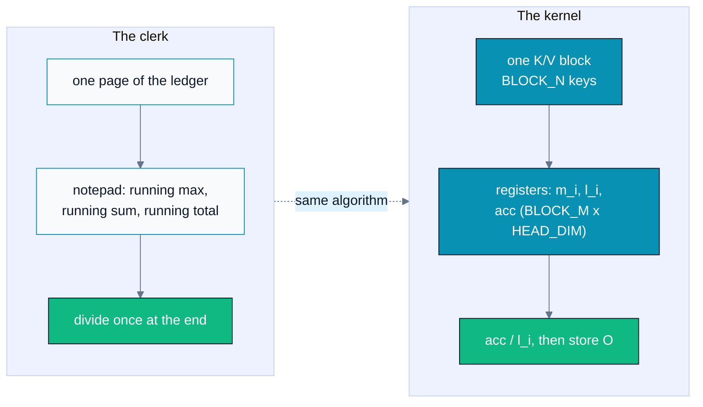
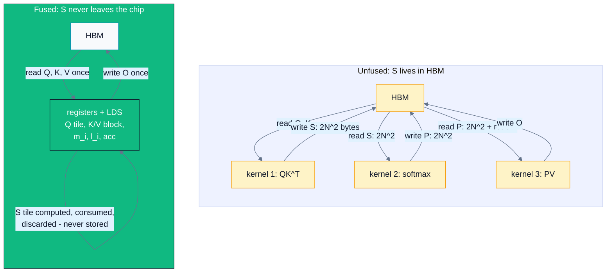
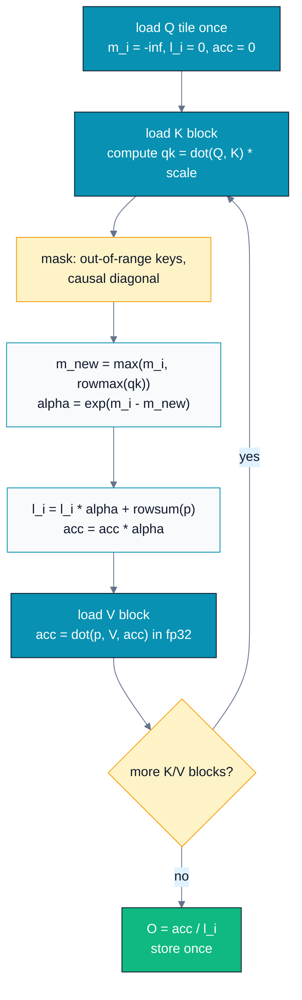
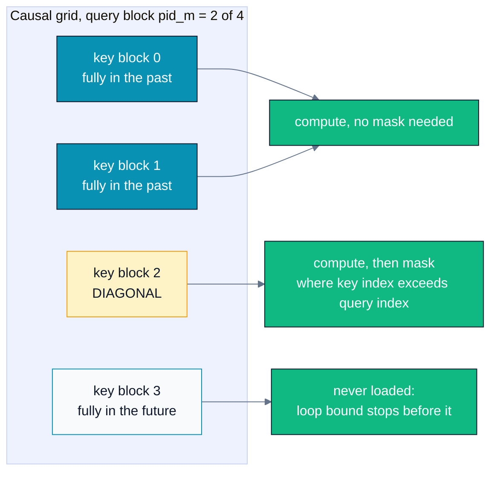
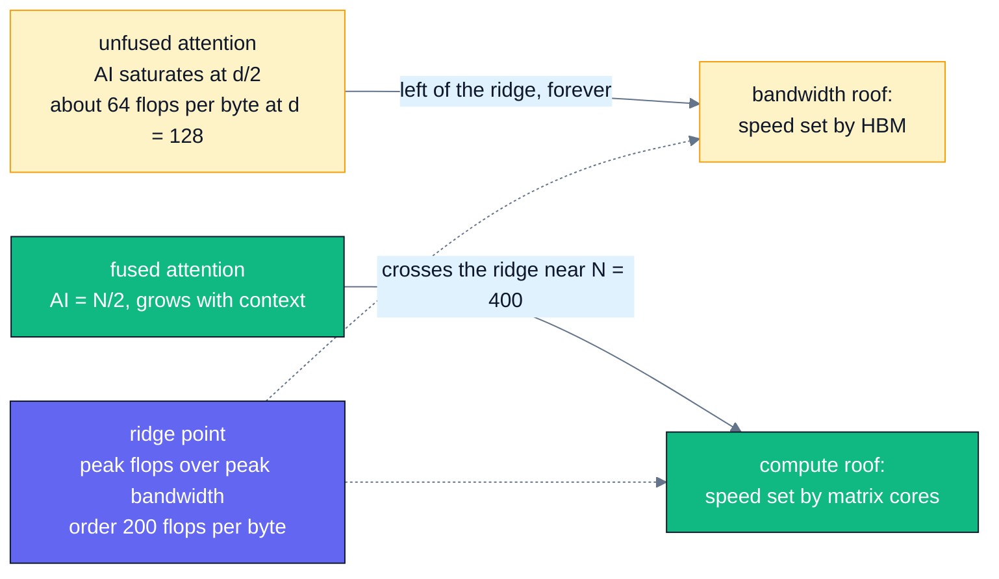
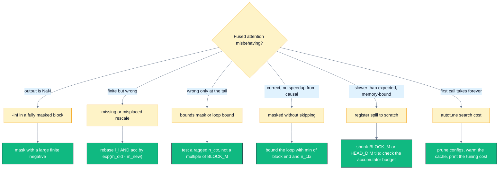

# A09 — Advanced Triton & FlashAttention

> Track A · Module 09 · Status: **DONE** · Est. 9 hours · Depth 4/5
>
> Prerequisites: [A04](../A04.parallel-reduction/README.md) (block reductions),
> [A06](../A06.tiled-matrix-multiply/README.md) (tiling, `tl.dot`),
> [A07](../A07.softmax-and-fused-kernels/README.md) (online softmax, fusion),
> [A08](../A08.triton-foundations/README.md) (`@triton.jit`, `tl.program_id`, masked
> `tl.load`/`tl.store`, `tl.constexpr`, `triton.cdiv`).
> Backend: Triton (Python) on either vendor. Setup:
> [SETUP.md](../../../docs/SETUP.md) ·
> Terms: [GLOSSARY.md](../../../docs/GLOSSARY.md) · Sources: [REFERENCES.md](../../../docs/REFERENCES.md).

This is the **capstone of Track A**. Everything you have built so far converges here:
the tiling from [A06 §3](../A06.tiled-matrix-multiply/README.md#3-deep-dive), the online
softmax from
[A07 §3](../A07.softmax-and-fused-kernels/README.md#the-online-recurrence-both-statistics-in-one-pass),
and the block reductions from [A04 §3](../A04.parallel-reduction/README.md#3-deep-dive)
fuse into one kernel — the kernel that decides how long a context modern LLMs can
afford.

---

## 1. TL;DR + Layman analogy

**TL;DR.** Standard attention computes `S = QK^T` and *writes the whole (N, N) score
matrix to HBM*, reads it back for the
[softmax](../../../docs/GLOSSARY.md#softmax), writes the probabilities, and reads
them again for `PV`. The useful compute is `O(N²·d)` but the memory traffic is
`O(N²)` — so as context grows the kernel spends its life shuttling a matrix it does
not need. **[FlashAttention](../../../docs/GLOSSARY.md#attention-and-flashattention)**
([Dao et al. 2022](../../../docs/REFERENCES.md#flashattention-dao-et-al-2022))
never materializes `S`: it tiles Q, K and V, keeps a
running output accumulator plus the online-softmax `(max, sum)` statistics on-chip,
and rescales the accumulator whenever a new block reveals a larger max. Traffic drops
to `O(N·d)`, the result is *exact* (not an approximation), and attention moves from
the bandwidth roof to the compute roof. This module builds that kernel in
[Triton](../../../docs/GLOSSARY.md#triton),
adds causal masking that **skips** future blocks rather than merely masking them, and
autotunes the tile shape.

**Layman analogy — totalling a ledger without ever printing the spreadsheet.** You
are asked for the weighted average of a million-row ledger, where each row's weight
is `exp(score)`. The naive clerk prints the entire spreadsheet of scores, walks back
to the filing cabinet to find the largest one, walks back again to exponentiate every
row, and walks back a third time to take the weighted sum. Every walk to the cabinet
is the slow part; the arithmetic was never the problem.

The FlashAttention clerk never prints anything. She keeps **two numbers on a
notepad** — the largest score seen so far, and a running sum — plus a **running
total** of the weighted values. She takes one page of the ledger at a time. When a
page contains a score larger than anything before it, she does not start over: she
multiplies her running sum and running total by a single correction factor
(`exp(old_max − new_max)`), then adds the new page. When she reaches the end, she
divides once. The answer is *identical* to the naive clerk's, and she visited the
cabinet once.

**Where the analogy breaks** — and these breaks are the module's engineering content:

- **One clerk, thousands of desks.** The real kernel has thousands of programs, each
  owning a *block of rows* of Q, all streaming K and V independently. There is no
  single sequential pass.
- **The notepad has a hard size limit.** "Keep it on-chip" means
  [registers](../../../docs/GLOSSARY.md#registers) and
  [LDS / shared memory](../../../docs/GLOSSARY.md#shared-memory-nvidia-and-lds-amd),
  and their budget is what caps the tile shape. Choose too large a
  tile and the accumulator spills to HBM, which reintroduces exactly the traffic you
  were avoiding.
- **The rescale is not free.** `exp(old_max − new_max)` multiplies the *entire*
  running accumulator, not a single number — `BLOCK_M × HEAD_DIM` values every time
  the max moves. It is cheap relative to the traffic it saves, but it is real work,
  and it is why the fused kernel does slightly *more* arithmetic than the unfused one.



*Read it as a mapping, not a pipeline: the notepad is the register-resident `(m, l,
acc)` triple, one ledger page is one `BLOCK_N` slice of keys, and "divide once" is the
single `acc / l_i` before the store.*

**By the end of this module you can:** show in bytes why unfused attention is
memory-bound; write the online rescaling update and prove it exact; build a
forward-only FlashAttention-style Triton kernel verified against PyTorch; make it
causal *and* faster by skipping future blocks; drive `triton.autotune` deliberately,
including its latency cost; and articulate precisely why your kernel is not
`flash-attn`.

---

## 2. First Principles

### Start with the bytes, not the API

Self-attention for one head, sequence length `N`, head dimension `d`, as
[*Attention Is All You Need*](../../../docs/REFERENCES.md#attention-is-all-you-need-vaswani-et-al-2017)
defines it:

```
S = Q K^T / sqrt(d)        (N, d) x (d, N) -> (N, N)
P = softmax(S, axis=-1)    (N, N)          -> (N, N)
O = P V                    (N, N) x (N, d) -> (N, d)
```

Now count. In fp16 (2 bytes per element), **the score matrix alone is `2·N²` bytes per
head**:

| N | `S` = `2·N²` bytes | Q, K, V, O together = `8·N·d` bytes (`d = 128`) |
|---:|---:|---:|
| 1,024 | 2 MiB | 1 MiB |
| 4,096 | 32 MiB | 4 MiB |
| 16,384 | **512 MiB** | 16 MiB |

At `N = 16k`, one head's intermediate is **32× larger than all four of its actual
inputs and outputs combined**. And the unfused pipeline moves that intermediate
across the HBM boundary **four times** — written by the matmul, read by the softmax,
written by the softmax, read by the second matmul:

```
naive traffic per head  =  8·N·d  +  4·(2·N²)  =  8·N·d + 8·N²    bytes (fp16)
fused traffic per head  =  8·N·d                                   bytes (fp16)
ratio                   =  1 + N/d
```

That closed form is the whole argument. `d` is fixed by the architecture (64–128 in
practice); `N` has gone from 512 to 128k+ across model generations. At `d = 128`:
**9× at N = 1k, 33× at N = 4k, 129× at N = 16k.** Note what cancels: the **dtype
disappears**. Moving to fp8 halves both sides and changes nothing about whether you
should fuse.

### Why "memory-bound" is a property of the *implementation*

Useful compute per head is `4·N²·d` flops (two matmuls at `2·N²·d` each). Divide by
the traffic above:

```
naive:  AI = 4·N²·d / (8·N·d + 8·N²)  =  N·d / (2·(N + d))   ->  d/2   as N grows
fused:  AI = 4·N²·d / (8·N·d)         =  N/2                 ->  unbounded
```

The unfused implementation's
[arithmetic intensity](../../../docs/GLOSSARY.md#arithmetic-intensity) **saturates at
`d/2` — 64 flops per byte at `d = 128` — and never improves, no matter how long the
sequence gets.** At
`N = 4096` it is already at 62.1, within 3% of its ceiling. Adding context adds flops
and bytes in the same proportion, so you cannot compute your way out.

The fused version's intensity grows *linearly in N*. With a
[roofline](../../../docs/GLOSSARY.md#roofline-model) ridge point
around 200 flops/byte (order-of-magnitude: ~1000 TFLOP/s fp16 over ~5 TB/s — use your
own GPU's numbers), the fused kernel crosses into compute-bound at `N ≈ 400`, while
the naive one is stuck on the bandwidth roof forever. **Attention is not intrinsically
[memory-bound](../../../docs/GLOSSARY.md#memory-bound-compute-bound-and-latency-bound);
unfused attention is.** That sentence is the paper
([Dao et al. 2022](../../../docs/REFERENCES.md#flashattention-dao-et-al-2022)).

### The traffic picture



*Count the arrows crossing the HBM boundary: six on the left, two on the right — and
four of the six carry an `N²`-sized payload, which is why the left side scales
quadratically and the right side linearly.*

### The fix is A07's trick, generalized

[A07 §3](../A07.softmax-and-fused-kernels/README.md#the-online-recurrence-both-statistics-in-one-pass)
showed that a softmax can be computed in **one streaming pass** by carrying a
running `(max, sum)` pair and rebasing whenever the max moves
([Milakov & Gimelshein 2018](../../../docs/REFERENCES.md#online-normalizer-calculation-for-softmax-milakov-and-gimelshein-2018)).
FlashAttention is
that same rebasing applied to a **matmul → softmax → matmul chain**: carry a third
piece of state, the output accumulator `acc`, and rebase it by the *same* factor.
Because `acc` is a linear function of the exponentials, one scalar per row rebases the
whole thing. Nothing else about the algorithm is new — which is exactly why this is
the right capstone for the track.

---

## 3. Deep Dive

### The rescaling update, written out

Program state, per query row (so all of the below is per-row, and the kernel does
`BLOCK_M` rows at a time):

| State | Shape | Invariant it maintains |
|---|---|---|
| `m_i` | `(BLOCK_M,)` | max score seen so far |
| `l_i` | `(BLOCK_M,)` | `sum(exp(s_j - m_i))` over all keys seen so far |
| `acc` | `(BLOCK_M, HEAD_DIM)` | `sum(exp(s_j - m_i) · V_j)` over all keys seen so far |

Both `l_i` and `acc` are the true sums scaled by one common factor, `exp(-m_i)`. Now a
new block arrives with row max `m_new_block`:

```
m      = max(m_old, m_new_block)                  the new common reference point
alpha  = exp(m_old - m)                           correction factor, in (0, 1]
P_new  = exp(qk_block - m)                        this block, referenced to m
l      = l_old * alpha + rowsum(P_new)
acc    = acc_old * alpha + P_new @ V_new
```

**Why it is exactly equal to the unfused result.** Rebasing the reference point from
`m_old` to `m` multiplies every already-accumulated term by
`exp(-m) / exp(-m_old) = exp(m_old - m) = alpha`. That is a *single scalar per row*
applied uniformly to every term, so no information is lost and no term is privileged.
At the end, the final `acc / l` cancels the shared `exp(-m)` factor entirely:

```
acc / l  =  [ sum_j exp(s_j - m) · V_j ] / [ sum_j exp(s_j - m) ]
         =  [ sum_j exp(s_j)     · V_j ] / [ sum_j exp(s_j)     ]   =  softmax(s) @ V
```

This is an **exact algebraic identity, not an approximation**. FlashAttention is not a
"fast approximate attention" method; it returns the same answer as the textbook
version, up to floating-point rounding. Say this precisely in an interview — a
surprising number of candidates believe it approximates.

**Why it is numerically safe.** Every exponent is `≤ 0` by construction: `qk - m ≤ 0`
because `m` is at least this block's max, and `m_old - m ≤ 0` because `m` is a max
including `m_old`. So `exp()` can never overflow. The worst case is underflow to zero,
which is the mathematically correct answer for a score far below the row max. This is
the same guarantee the unfused max-subtraction gives you — the fused version just
maintains it incrementally.

**Two implementation traps that follow directly from the math:**

1. **Mask with a large finite negative, not `-inf`.** The hazard is a row whose
   *entire seen range* is masked, because only then is the running max still `-inf`
   when the new block max is also `-inf` — and `alpha = exp(-inf + inf) = NaN`. That
   happens for the padding rows of the tail query block, and for real rows under any
   windowed, packed-varlen, or arbitrary mask that leaves a program's first visited
   block fully disallowed. With `-1e9` the running max stays finite and
   `exp(-1e9 - m)` underflows cleanly to 0. The upstream Triton tutorial uses `-1e6`
   for the same reason.
2. **Keep `acc` in fp32.** `P` gets rounded to fp16/bf16 before the second `tl.dot`
   so it can feed the matrix cores — production FlashAttention does the same — but the
   accumulator must stay wide, or the running sum degrades over `N/BLOCK_N`
   iterations.

### The kernel, in pseudocode

```
program (pid_m, batch*head):
    load Q tile [BLOCK_M, HEAD_DIM]        # once; reused for the whole walk
    m_i = -inf; l_i = 0; acc = 0
    for start_n in 0 .. hi step BLOCK_N:
        load K block [HEAD_DIM, BLOCK_N]   # loaded already transposed
        qk = dot(Q, K) * scale             # the S tile: lives and dies in registers
        apply bounds mask (+ causal mask on the diagonal block)
        m_new = max(m_i, rowmax(qk))
        alpha = exp(m_i - m_new)
        p     = exp(qk - m_new)
        l_i   = l_i * alpha + rowsum(p)
        acc   = acc * alpha
        load V block [BLOCK_N, HEAD_DIM]
        acc   = dot(p.to(V.dtype), V, acc) # fp32 accumulate
        m_i   = m_new
    store O tile = acc / l_i
```

Code: [`triton/flash_attention.py`](triton/flash_attention.py).



*The loop back-edge is the entire point: `qk` is created and destroyed inside one
iteration, so the `(N, N)` matrix never exists anywhere but registers, one
`BLOCK_M × BLOCK_N` tile at a time.*

### Causal masking: skipping beats masking

A causal (decoder) model requires query `i` to attend only to keys `j ≤ i`. There are
two completely different things to do about that, and conflating them is the most
common review finding in attention PRs:

| | What it does | What it buys |
|---|---|---|
| **Block skipping** | Never load or multiply K/V blocks lying strictly in the future of this query block | The performance. Roughly **2×**: loads, `tl.dot`, and `exp` all avoided |
| **Diagonal masking** | Element-wise mask inside the one block straddling the diagonal | The correctness. Costs a little extra work |

The loop bound is the whole trick:

```python
hi = tl.minimum((pid_m + 1) * BLOCK_M, n_ctx) if CAUSAL else n_ctx
```

The `min` with `n_ctx` is load-bearing, not cosmetic: without it the last, partial
query block walks past the end of the sequence doing fully-masked work.

**The accounting.** With `BLOCK_M = BLOCK_N = b` and `T = N/b` blocks per axis, query
block `i` visits `i + 1` key blocks, so the visited fraction is
`(1 + 2 + ... + T)/T² = (T+1)/(2T) → 1/2`. The *measured* speedup is always a bit
less than 2×, for three reasons worth naming: the diagonal block computes a full tile
and discards half of it; the programs are now imbalanced (`pid_m = 0` walks one block,
the last walks `T`), so the launch ends with the slowest program
([FlashAttention-2](../../../docs/REFERENCES.md#flashattention-2-dao-2023) is a
work-partitioning answer to exactly this); and the Q load, O store, and launch
overhead are fixed costs.



*Only one block per query block ever needs the element-wise mask — which is why
production kernels split the loop into an unmasked body plus a single masked diagonal
stage (the `STAGE` parameter in the upstream Triton tutorial) instead of testing the
mask on every iteration.*

### `triton.autotune` in depth

`@triton.autotune` benchmarks a list of `triton.Config`s on your actual arguments and
caches the winner — the decorator introduced in
[A08 §3](../A08.triton-foundations/README.md#3-deep-dive). Lab 1
([`triton/autotune_demo.py`](triton/autotune_demo.py)) exercises all of it.

```python
@triton.autotune(
    configs=[triton.Config({"BLOCK_M": 64, "BLOCK_N": 64}, num_warps=4, num_stages=2), ...],
    key=["n_ctx", "HEAD_DIM"],
)
@triton.jit
def kernel(...):
```

**The search space.**

| Knob | What it changes | How to reason about it |
|---|---|---|
| `BLOCK_M` | Query rows per program | Larger = more Q reuse per K/V byte read, but the `BLOCK_M × HEAD_DIM` fp32 accumulator grows with it, and it lives in **registers** |
| `BLOCK_N` | Keys per iteration | Larger = fewer iterations and bigger `tl.dot`s, but a bigger `S` tile and more live registers |
| `num_warps` | Threads per program | On NVIDIA a [warp](../../../docs/GLOSSARY.md#warp-nvidia-and-wavefront-amd) is 32 lanes, on **AMD a wavefront is 64** — so `num_warps=4` is 128 work-items on NVIDIA and **256 on AMD**. The same number means different occupancy on the two vendors |
| `num_stages` | Software-pipelining depth of the loop | How many future iterations' loads are kept in flight (multi-buffered) while the current one computes. More stages hide more latency but consume shared memory and registers, so past some depth occupancy falls and the kernel slows down |

**What `num_stages` actually does.** Triton pipelines the loop: it issues the global
loads for iteration `i + 1` (and `i + 2`, …) into shared-memory buffers *before* the
compute for iteration `i`, so memory latency overlaps with
[matrix-core](../../../docs/GLOSSARY.md#tensor-core-nvidia-and-matrix-core-amd) work. That is
why it only matters for loops with a real trip count — the K/V walk here, or the K
loop in a GEMM. Backend differences are real: the upstream fused-attention tutorial
restricts the HIP path to `num_stages = 1` while offering `[2, 3, 4]` on CUDA, and Lab
1 mirrors that so you are not benchmarking configurations that cannot help on your
hardware.

**What `key=[...]` controls.** The autotuner caches its winner per **tuple of `key`
argument values**. A change in any of them triggers a full re-search; a change in an
argument *not* listed reuses the cached choice. So `key` is a statement about which
arguments genuinely change the optimal tile shape — sequence length, head dimension,
dtype flags. Every extra key multiplies your worst-case tuning latency, and a missing
one silently uses a tile tuned for a different shape.

**The cost.** The first call at a new key **compiles and benchmarks every surviving
config**. Lab 1's space is `3 × 3 × 2 × 3 = 54` configs on CUDA (and 18 on HIP, where
`num_stages` is pinned to 1), which is seconds to minutes of wall clock before your
first result — invisible in a long training run, catastrophic in a
low-latency serving path or a unit test. Mitigations, in order of preference: shrink
the space by hand once you know your hardware; use `prune_configs_by` /
`early_config_prune`; set `TRITON_PRINT_AUTOTUNING=1` so the cost and the winner are
at least *visible*; warm the cache at startup rather than on the first request.

> [!NOTE]
> Autotuning also runs your kernel many times. For a kernel that **accumulates
> in-place**, that corrupts the output — pass `reset_to_zero=[...]` or
> `restore_value=[...]`. Our kernels only ever *store*, so they are safe.

### On-chip budget: why the tile cannot just be huge

The dominant register consumer is the fp32 accumulator, `BLOCK_M × HEAD_DIM` floats
per program:

```
BLOCK_M = 64, HEAD_DIM = 64:   64 * 64 * 4 B = 16 KiB per program
    with num_warps = 4 on AMD (4 * 64 = 256 lanes): 16 VGPRs per lane, for acc alone
BLOCK_M = 128, HEAD_DIM = 128: 128 * 128 * 4 B = 64 KiB per program  -> spills likely
```

Add the Q tile (held for the whole loop), the K and V blocks, and the `S` tile, and
the register file is the binding constraint on how large a tile you can pick. When it
is exceeded the compiler **spills to scratch memory — which is HBM** — and you
reintroduce precisely the traffic FlashAttention exists to remove. This is why
autotuning matters here more than in a simple elementwise kernel: the useful tile
shapes sit right at the edge of the register budget, and the edge is in a different
place on CDNA than on Hopper.

---

## 4. Hands-On Labs

**This module is Triton-only — there is no `hip/` or `cuda/` directory.** That is a
deliberate statement, not an omission: a hand-written HIP/CUDA FlashAttention is
roughly a thousand lines of layout-, pipelining- and intrinsic-specific code (go read
[`flash-attention`](https://github.com/Dao-AILab/flash-attention) or
[`aotriton`](https://github.com/ROCm/aotriton)), and it would teach the *toolchain*
rather than the *algorithm*. One ~150-line Triton kernel that runs on both vendors is
the better teacher, and it is also what the industry actually reaches for when
prototyping a new attention variant.

```bash
make deps                 # install torch (READ requirements.txt first if on ROCm)
make run                  # all three labs in order
make run-exercises        # the drills (FAIL is expected until solved)
make run-solutions        # the reference answers
make clean
```

Use `PYTHON=python` if `python3` is not your interpreter, and
`make run-benchmark SEQ="1024 4096 8192"` to sweep your own sequence lengths. Every
script guards on `torch.cuda.is_available()` and points at
[../../../docs/SETUP.md](../../../docs/SETUP.md) if no GPU is visible.

### Lab 1 — `triton.autotune`, deliberately (`triton/autotune_demo.py`)

The kernel is **step 1 of FlashAttention in isolation**: compute the softmax
statistics `(m, l)` of `QK^T` without materializing `S`. It is autotuned over
`BLOCK_M × BLOCK_N × num_warps × num_stages`, and it is verified against a fp32
PyTorch reference by comparing `m + log(l)` (log-sum-exp) rather than `m` and `l`
separately — the split between max and sum is not unique, but their combination is.

```bash
make run-autotune
TRITON_PRINT_AUTOTUNING=1 python triton/autotune_demo.py   # Triton's own report
```

**What to observe:** three timings, in this order. (1) The **first call** takes
*seconds* — that is compile plus benchmark for every config. (2) The **steady state**
is a fraction of a millisecond. (3) Changing `n_ctx`, which is in `key`, pays the
whole search **again**; changing the batch dimension, which is not in `key`, does not.
Then read the winning config and ask yourself why *that* tile won on *your* GPU.

### Lab 2 — The fused kernel (`triton/flash_attention.py`)

The capstone kernel: forward-only tiled attention with an optional causal mode,
verified against an fp32 PyTorch reference.

```bash
make run-flash
```

**What to observe:** `PASSED` for both the full and causal modes, with a max absolute
error of order `1e-3` against a tolerance of `2e-2` — fused and unfused sum in different
orders and the fused path rounds `P` to fp16 before the second matmul, so they agree
to *rounding*, not to the bit. Then compare the two timings: **causal should be
markedly faster**, and that saving comes from skipping blocks, not from masking them.

### Lab 3 — Naive vs fused across sequence lengths (`triton/benchmark_attention.py`)

```bash
make run-benchmark
make run-benchmark SEQ="512 1024 2048 4096 8192"
```

**What to observe:** the *shape* of the sweep, which is the lesson — the fused
kernel's advantage **grows with `N`**, and the analytic `byte ratio` column grows
faster than the measured `speedup` column (once the fused kernel is compute-bound it
stops converting saved bytes into saved time). Push `N` up until the naive path prints
`OOM`: that row is a result, not a harness bug. The byte columns are **analytic
estimates**, clearly labelled as such in the source; measure real traffic with a
profiler.

### Lab 4 (optional) — Profile it

```bash
# AMD
/opt/rocm/bin/rocprofv3 --summary --kernel-trace --output-format csv \
    -d profiling_output -- python triton/flash_attention.py
# NVIDIA
nsys profile --stats=true -o profiling_output/flash python triton/flash_attention.py
ncu --set full python triton/flash_attention.py
```

**What to look for:** in the naive path, **three** kernel dispatches per attention
call plus the traffic to match; in the fused path, **one**. In Nsight Compute, check
whether the fused kernel is limited by matrix-core throughput (expected at long `N`)
or by memory (which would suggest a register spill — see §3's budget arithmetic).

---

## 5. Performance Analysis

### Where the two implementations sit on the roofline



*The unfused implementation cannot leave the bandwidth roof by growing `N`, because
`N` adds flops and bytes in the same proportion; the fused one walks right along the
compute roof as context grows. Roofline formalism: Track
[B02](../../B-gpu-ml-performance/B02.roofline-and-arithmetic-intensity/README.md).*

### What to expect from the sweep

**No numbers are quoted here on purpose.** Absolute milliseconds depend on the GPU,
the dtype, the Triton and PyTorch versions, and the clocks at that moment — a table of
digits from someone else's machine is worse than no table, because it invites you to
"validate" against it. Run `make run-benchmark` and read *your* numbers. What is
architecture-independent is the **shape**:

| Sequence length | Expected relationship | Why |
|---|---|---|
| Short (hundreds) | Fused wins little, and may even lose | Kernel-launch and JIT overheads dominate; the `N²` term has not grown yet; PyTorch's matmuls are calling a heavily tuned vendor GEMM |
| Medium (1k–4k) | Fused pulls clearly ahead | The `1 + N/d` traffic ratio reaches 9×–33×; the naive path is squarely bandwidth-bound |
| Long (8k+) | Fused wins decisively, then the naive path stops running at all | `S` becomes hundreds of MiB **per head**; capacity, not just bandwidth, ends the argument |

**The crossover point is hardware-dependent** and moves with dtype and library
version. Three honest caveats to state whenever you report attention numbers:

1. **The measured speedup lags the byte ratio.** Bytes saved convert to time saved
   only while you are memory-bound. Once the fused kernel is compute-bound, further
   traffic reductions buy nothing.
2. **`torch.nn.functional.scaled_dot_product_attention` is not a naive baseline.** It
   dispatches to a fused backend (flash / memory-efficient / cuDNN, and AOTriton
   kernels on ROCm builds) and will usually beat this teaching kernel. Compare against
   it to stay honest, not to win.
3. **Autotuning makes the first call an outlier.** Always warm up, always time with
   `torch.cuda.Event`, and never report a first-call number.

### The optimization deltas to internalize

| Change | Traffic effect | Typical time effect |
|---|---|---|
| Unfused → fused | `1 + N/d` fewer bytes (129× at `N = 16k, d = 128`) | Large and growing with `N`; the biggest single win |
| Causal masking **with** block skipping | ~half the blocks visited | Approaching 2×, always somewhat less (diagonal block, imbalance, fixed costs) |
| Causal masking **without** block skipping | none | **none** — correct and pointless |
| Autotuning the tile shape | none | Meaningful, hardware-specific; the point is that the winner differs by GPU |

---

## 6. Challenges, Drawbacks & Tradeoffs



*Two failure modes dominate real review: `NaN` from `-inf` masking, and finite-but-wrong output from a missing rescale — the second is far more dangerous because nothing crashes.*

### Pitfall 1 — `-inf` masking produces `NaN`

Covered in §3. A row whose entire seen range is masked leaves `m = -inf`, and then
`exp(m_old - m) = exp(-inf + inf) = NaN` contaminates that row. Under plain causal
masking with our loop bound, every *real* row sees key 0 on the first iteration, so the
running max is finite from then on and `-inf` happens to survive — which is exactly why
this bug ships. It surfaces later, when someone adds a sliding-window mask, packs
variable-length sequences, or starts storing the log-sum-exp for a backward pass (that
store is not always bounds-masked, so the padding rows' `NaN` escapes). Mask with
`-1e9` from the start; it costs nothing.

### Pitfall 2 — A missing rescale does not crash

If you forget to multiply `l_i` and `acc` by `alpha`, the output stays finite and
plausible — each block's softmax is internally consistent, only the stitching is
wrong — and the result is silently biased toward whichever block held the largest
scores. Two consequences: **uniform random test inputs will hide this bug** (all
per-block maxima are similar), so test with deliberately unbalanced magnitudes; and a
`torch.allclose` with a lazy tolerance will pass. Exercise 2 makes you feel this.

### Pitfall 3 — Tolerances that hide bugs, or fail on rounding

Fused and unfused accumulate differently *by design*, so an exact comparison is wrong
and a loose one is useless. Our reasoning: outputs are convex combinations of `V` rows
and therefore `O(1)`, so an **absolute** tolerance is the meaningful one (a relative
bound explodes on near-zero entries); fp16 keeps 10 mantissa bits (~1e-3 relative) and
bf16 only 8 (~4e-3), so we use `atol = 2e-2` for fp16 and `5e-2` for bf16 — roughly an
order of magnitude above observed rounding, while a genuine algebra error shows up
orders of magnitude *above* that. Always compare against a **fp32** reference computed
from the same low-precision inputs, so the only difference under test is accumulation.

### Pitfall 4 — Autotuning in the wrong place

`triton.autotune` moves cost from steady state into the first call. In training that
is free; in a latency-sensitive serving path or a CI test it is a regression. Autotune
runs the kernel repeatedly, so in-place accumulating kernels need `reset_to_zero`.
And a first-call measurement in a benchmark is a measurement of the compiler.

### Pitfall 5 — Register pressure and the spill cliff

The `BLOCK_M × HEAD_DIM` fp32 accumulator plus the resident Q tile are the register
budget (§3). Exceed it and the compiler spills to scratch — which is HBM — quietly
converting your IO-optimal kernel back into a bandwidth-bound one. The tell: a fused
kernel that profiles as memory-bound at long `N`, where it should be compute-bound.

### Pitfall 6 — Shape constraints the kernel does not advertise

`tl.arange` needs power-of-two lengths and this kernel loads the full head dimension
in one tile, so `head_dim` must be 16/32/64/128 — asserted in the wrapper rather than
left to fail mysteriously inside the compiler. Real head dimensions are cooperative
here (64, 80, 128 in practice, and 80 would need padding), but *sequence* length must
not be constrained: test a ragged `n_ctx` (Exercise 1 uses 1000) so the bounds masks
and loop bounds are actually exercised.

### The honest limits: why this is not `flash-attn`

A teaching kernel in ~150 lines of Triton will not match
[`flash-attn`](https://github.com/Dao-AILab/flash-attention),
[`aotriton`](https://github.com/ROCm/aotriton), Composable Kernel, or cuDNN. It is
worth being precise about the gap, because "just use Triton" is a claim that gets
oversold:

| Missing | Why it matters |
|---|---|
| **Backward pass** | Training needs `dQ, dK, dV`. The backward pass recomputes `S` from the saved `(m, l)` statistics — more arithmetic, more state, and roughly triple the code. Forward-only is inference-only |
| **Assembly-level scheduling** | Production kernels hand-tune instruction order, LDS layouts, and swizzles that the Triton compiler chooses for you. That is where a large fraction of peak lives |
| **Warp specialization / asynchrony** | FlashAttention-3 dedicates warp groups to producing (loading) and consuming (computing) and overlaps GEMM with softmax ([arXiv:2407.08608](https://arxiv.org/abs/2407.08608)). Triton is gaining these capabilities; hand-written kernels already have them |
| **Direct matrix/tensor-core intrinsics** | `tl.dot` *may* lower to MFMA (AMD) or Tensor Cores (NVIDIA), but you do not control the instruction, the fragment layout, or the precision path the way `__builtin_amdgcn_mfma_*` / `wgmma` do |
| **Dropout, ALiBi, sliding window, softcapping** | Real attention layers carry a zoo of variants, each with its own masking and RNG-state requirements |
| **Variable-length / packed batches** | Serving packs sequences of different lengths with a cumulative-offsets layout to avoid padding waste. That changes every index computation in the kernel |
| **Paged [KV cache](../../../docs/GLOSSARY.md#kv-cache)** | Decoding reads K/V from non-contiguous pages ([vLLM](../../../docs/REFERENCES.md#pagedattention-and-vllm-kwon-et-al-2023)). Our kernel assumes one contiguous tensor |
| **fp8 and block quantization** | Getting fp8 accurate needs per-block scaling and incoherent processing, not just a cast |

**When not to write your own:** if a tuned library covers your case, use it — the
performance gap is large and the correctness surface (masking, varlen, numerics) is
where bugs hide. Write your own when you need a *variant* no library implements yet,
which is exactly the situation Triton is good at.

---

## 7. Real-World Use Cases

- **Every production LLM stack** runs a fused attention kernel. `flash-attn` on
  NVIDIA; on AMD, PyTorch's ROCm builds route their SDPA fast paths through
  [AOTriton](https://github.com/ROCm/aotriton)-generated kernels and Composable
  Kernel (check your own build with
  `torch.backends.cuda.flash_sdp_enabled()` and the SDPA backend context manager).
- **`torch.nn.functional.scaled_dot_product_attention`** is this algorithm behind a
  one-line API, dispatching among flash, memory-efficient, and math backends by
  shape, dtype, and masking. Hugging Face's `attn_implementation="sdpa"` /
  `"flash_attention_2"` selects which one your model uses.
- **Long-context training** exists *because* of this kernel. The jump from 2k to 128k+
  context is not a bandwidth improvement in hardware; it is the removal of the `O(N²)`
  memory term. The `1 + N/d` ratio from §2 is the whole business case.
- **Inference serving** goes further:
  [vLLM's PagedAttention](../../../docs/REFERENCES.md#pagedattention-and-vllm-kwon-et-al-2023)
  keeps the fused-attention idea and adds a paged KV cache so the running `(m, l, acc)`
  walk can read non-contiguous key/value pages.
- **`triton.autotune`** is how `torch.compile`'s generated Triton kernels pick tile
  shapes, and why the first invocation of a compiled model is slow while later ones are
  fast — the same first-call cost you measure in Lab 1, at framework scale.
- **The online-softmax pattern generalizes** well past attention: any streaming
  reduction that must stay numerically safe over data too large to hold at once —
  log-sum-exp over shards, distributed softmax across GPUs, top-k over streams — uses
  the same rebasing trick.

**Where to go next.**
[B05](../../B-gpu-ml-performance/B05.transformer-performance/README.md) zooms out from
this kernel to the whole transformer and tells you when attention is even the right
thing to optimize — at decode, with `N = 1`, the quadratic term you just removed is not
what is costing you.
[B06](../../B-gpu-ml-performance/B06.inference-serving-optimizations/README.md) is where
the paged-KV bullet above becomes a serving architecture rather than a footnote.
[A10](../A10.cute-cutlass-and-cutile/README.md) goes the other direction — below Triton,
to the layouts and instruction scheduling §6 lists as the gap between this kernel and a
production one.

---

## 8. Cited References

The sources this module leans on hardest are shared with the rest of the
curriculum, so each is cited by anchor into the
[master bibliography](../../../docs/REFERENCES.md), where the URL and its retrieval
date live. The implementation-specific material below keeps its own link.

- [**FlashAttention** (Dao et al., 2022)](../../../docs/REFERENCES.md#flashattention-dao-et-al-2022)
  — *Fast and Memory-Efficient Exact Attention with IO-Awareness.* The IO-complexity
  argument §2 counts bytes for, and the tiled algorithm Lab 2 builds.
- [**FlashAttention-2** (Dao, 2023)](../../../docs/REFERENCES.md#flashattention-2-dao-2023)
  — *Faster Attention with Better Parallelism and Work Partitioning.* Why the causal
  load imbalance §3 names is worth fixing rather than tolerating.
- Shah, Bikshandi, Zhang, Thakkar, Ramani, Dao (2024). *FlashAttention-3: Fast and
  Accurate Attention with Asynchrony and Low-precision.* Warp specialization,
  GEMM/softmax overlap, fp8 — the §6 "honest limits" list.
  <https://arxiv.org/abs/2407.08608>
- [**Online normalizer calculation for softmax** (Milakov and Gimelshein, 2018)](../../../docs/REFERENCES.md#online-normalizer-calculation-for-softmax-milakov-and-gimelshein-2018)
  — the rescaling identity §3 writes out, in its original one-pass form.
  [A07](../A07.softmax-and-fused-kernels/README.md) derives it for a single row; this
  module tiles it.
- Rabe & Staats (2021). *Self-attention Does Not Need O(n²) Memory.* The
  memory-complexity result, credited by the Triton tutorial alongside FlashAttention.
  <https://arxiv.org/abs/2112.05682>
- [**Attention Is All You Need** (Vaswani et al., 2017)](../../../docs/REFERENCES.md#attention-is-all-you-need-vaswani-et-al-2017)
  — the `softmax(QK^T/sqrt(d))V` definition §2 starts from and the whole module
  optimizes without changing.
- [**Triton documentation and tutorials**](../../../docs/REFERENCES.md#triton-documentation-and-tutorials-triton-project)
  — specifically the **Fused Attention tutorial**: the reference implementation,
  including the `STAGE` split for causal masking and the HIP-vs-CUDA `num_stages`
  choice mirrored in Lab 1 (retrieved 8 Aug 2026).
  <https://triton-lang.org/main/getting-started/tutorials/06-fused-attention.html>
- **`triton.autotune` API reference.** `configs`, `key`, `prune_configs_by`,
  `reset_to_zero`, and the `TRITON_PRINT_AUTOTUNING` environment variable — the §3
  autotuning discussion is a reading of this page (retrieved 8 Aug 2026).
  <https://triton-lang.org/main/python-api/generated/triton.autotune.html>
- **AMD ROCm blog — *Developing Triton Kernels on AMD GPUs*** (Greene, 2024). Triton
  on ROCm end to end, including benchmarking against PyTorch (retrieved 8 Aug 2026).
  <https://rocm.blogs.amd.com/artificial-intelligence/triton/README.html>
- **AMD ROCm blog — *Accelerating Large Language Models with Flash Attention on AMD
  GPUs*** (Greene, 2024). Flash Attention on Instinct hardware and its measured effect
  on prefill latency (retrieved 8 Aug 2026).
  <https://rocm.blogs.amd.com/artificial-intelligence/flash-attention/README.html>
- **AOTriton** — AMD's ahead-of-time-compiled Triton kernel library, including
  attention. <https://github.com/ROCm/aotriton>
- **`flash-attention`** — the reference production implementation (forward and
  backward, varlen, dropout, ALiBi).
  <https://github.com/Dao-AILab/flash-attention>
- [**PagedAttention and vLLM** (Kwon et al., 2023)](../../../docs/REFERENCES.md#pagedattention-and-vllm-kwon-et-al-2023)
  — *Efficient Memory Management for LLM Serving with PagedAttention.* The serving-side
  extension named in §6's limits table and §7.
- **PyTorch — `scaled_dot_product_attention`.** Backend dispatch and how to pin a
  specific one (retrieved 8 Aug 2026).
  <https://pytorch.org/docs/stable/generated/torch.nn.functional.scaled_dot_product_attention.html>

---

## 9. Self-Assessment & Interview Drills

### Conceptual (answers below)

1. In one sentence each: why is unfused attention memory-bound, and why does adding
   sequence length not fix it?
2. Write the three-line online update for `(m, l, acc)` and explain why the result is
   *exactly* equal to the unfused result rather than an approximation.
3. Why must masked scores be a large finite negative rather than `-inf`? Give the
   exact expression that produces `NaN`.
4. A colleague adds causal masking and reports the kernel is correct but no faster.
   What did they almost certainly not do, and what is the one-line fix?
5. Your fused kernel is *correct* but profiles as memory-bound at `N = 8192`, where
   the arithmetic says it should be compute-bound. What is your first hypothesis?
6. What does `num_stages` do, and why does it have no effect on a kernel whose loop
   runs twice?
7. `key=["n_ctx", "HEAD_DIM"]` — what exactly happens on a call where `n_ctx` changes?
   What happens if the batch size changes instead?
8. You must compare a fused fp16 kernel against a reference. What do you compare
   against, with what kind of tolerance, and why not a relative one?
9. At `d = 128` and fp16, how much HBM traffic does the naive path save by moving to
   fp8? What does that tell you about the case for fusing?
10. Name three things production `flash-attn` does that a 150-line Triton kernel does
    not, and pick the one that most limits *training* use.

<details markdown="1">
<summary>Answers</summary>

1. Because it materializes the `(N, N)` score matrix in HBM and moves it four times,
   so traffic is `O(N²)` while useful compute is `O(N²·d)` — the ratio is fixed.
   Growing `N` adds flops and bytes in the same proportion, so the arithmetic
   intensity saturates at `d/2` (≈64 flops/byte at `d = 128`) and never crosses the
   roofline ridge, no matter how long the sequence.
2. `m = max(m_old, m_block)`; `l = l_old·exp(m_old − m) + rowsum(exp(qk − m))`;
   `acc = acc_old·exp(m_old − m) + exp(qk − m) @ V`. It is exact because `l` and `acc`
   are always the true sums scaled by one common factor `exp(−m)`; rebasing multiplies
   *every* accumulated term by the same scalar `alpha`, and the final `acc / l` cancels
   the shared factor. Only floating-point rounding separates it from the unfused
   answer.
3. If a row's *entire seen range* is masked, the running max is still `-inf` when the
   new block max is `-inf`, so `alpha = exp(m_old − m_new) = exp(-inf + inf) = NaN` and
   the row is poisoned. With `-1e9`, `m` stays finite and `exp(-1e9 − m)` underflows
   cleanly to 0. Under plain causal masking every real row sees key 0 first, so the bug
   hides; it appears with padding rows, sliding-window or packed-varlen masks, or as
   soon as you store the log-sum-exp for a backward pass.
4. They masked without **skipping**: they still load and multiply every K/V block and
   then throw the results away. Fix: bound the loop,
   `hi = min((pid_m + 1) * BLOCK_M, n_ctx)`.
5. A **register spill**. The `BLOCK_M × HEAD_DIM` fp32 accumulator plus the resident Q
   tile exceeded the register budget, so the compiler spilled to scratch memory —
   which is HBM. Shrink the tile (or `num_warps`) and re-measure.
6. It sets the software-pipelining depth: how many future iterations' loads Triton
   keeps in flight (multi-buffered in shared memory) while the current iteration
   computes. With a trip count of two there is nothing to overlap — and on the HIP
   backend the upstream tutorial restricts itself to `num_stages = 1` anyway.
7. `n_ctx` is in `key`, so the cached winner is invalidated and the **entire config
   search runs again** on that call (seconds to minutes). A batch-size change is not in
   `key`, so the cached config is reused — at most a JIT compile for the new argument
   specialization, no search.
8. Compare against an **fp32** reference computed from the same fp16 inputs, so the
   only variable is accumulation order plus the deliberate rounding of `P`. Use an
   **absolute** tolerance (`atol ≈ 2e-2` for fp16): outputs are convex combinations of
   `V` rows and hence `O(1)`, and a relative tolerance would explode on the near-zero
   entries that attention produces in abundance.
9. It halves it — and it halves the fused path's traffic too, so the ratio stays
   `1 + N/d`. Precision reduction is orthogonal to fusion: it buys a constant factor,
   while fusion changes the asymptotics. You need both, in that order of importance.
10. Backward pass; assembly-level scheduling and LDS swizzling; warp specialization and
    async GEMM/softmax overlap; direct MFMA/WGMMA intrinsics; dropout/ALiBi/sliding
    window; variable-length packing; paged KV. The **backward pass** is the one that
    rules out training — forward-only is inference-only.

</details>

### Coding & Algorithms drills

Do these in [`exercises/`](exercises/); reference answers in
[`solutions/`](solutions/). Expected terminal output, including the instructive FAIL
states, is in
[`exercises/README.md` → *Sample sandbox output*](exercises/README.md#sample-sandbox-output).

1. **Causal masking, both halves** (`exercises/01_causal_mask.py`) — take a working
   non-causal tiled kernel and make it causal: skip the K/V blocks that lie strictly
   in the future (the ~2× win) *and* mask inside the diagonal block (the correctness
   fix). Verify against a causal PyTorch reference and measure both modes.
2. **The online rescale** (`exercises/02_online_rescale.py`) — implement the
   `(max, sum, acc)` update from a skeleton whose placeholder normalizes each block to
   its own max. The heart of FlashAttention, and a lesson in failure signatures: the
   bug produces finite, plausible, wrong numbers.
3. **Byte arithmetic** (`exercises/03_flash_math.md`) — paper drill: HBM traffic for
   naive vs fused at `N = 1k/4k/16k`, the sequence length at which the score matrix
   breaks a 256 MiB cache and a 192 GiB HBM budget, and why fusing changes the
   asymptotics rather than the constant.

### Stretch

- **Make the kernel return the log-sum-exp** (`m + log(l)`) alongside `O`. This is
  exactly what the backward pass needs in order to recompute `S` without storing it —
  the first step toward a trainable kernel.
- **Split the causal loop into two stages** (unmasked body + one masked diagonal
  block), as the upstream tutorial does, so the mask instructions execute once per
  program instead of once per iteration. Measure whether it helps on your GPU.
- **Autotune the fused kernel itself** over `BLOCK_M`, `BLOCK_N`, `num_warps`, and
  `num_stages`, then compare the winning config on an AMD GPU against an NVIDIA one.
  Explain the difference using wavefront size and register budget.
- **Benchmark against `torch.nn.functional.scaled_dot_product_attention`** and find
  the sequence length where the gap to the production kernel is largest. Profile that
  point and write down which of §6's missing techniques you think accounts for it.
