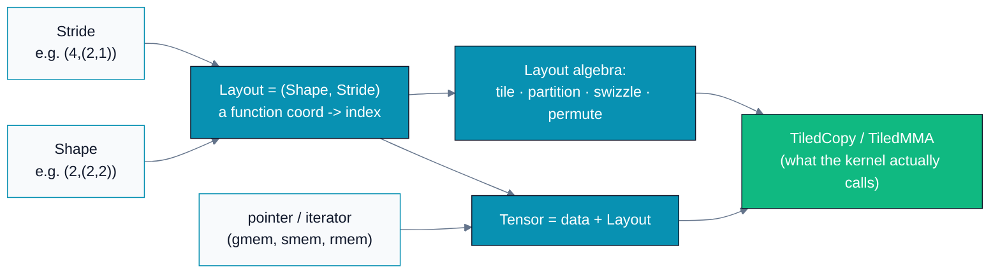
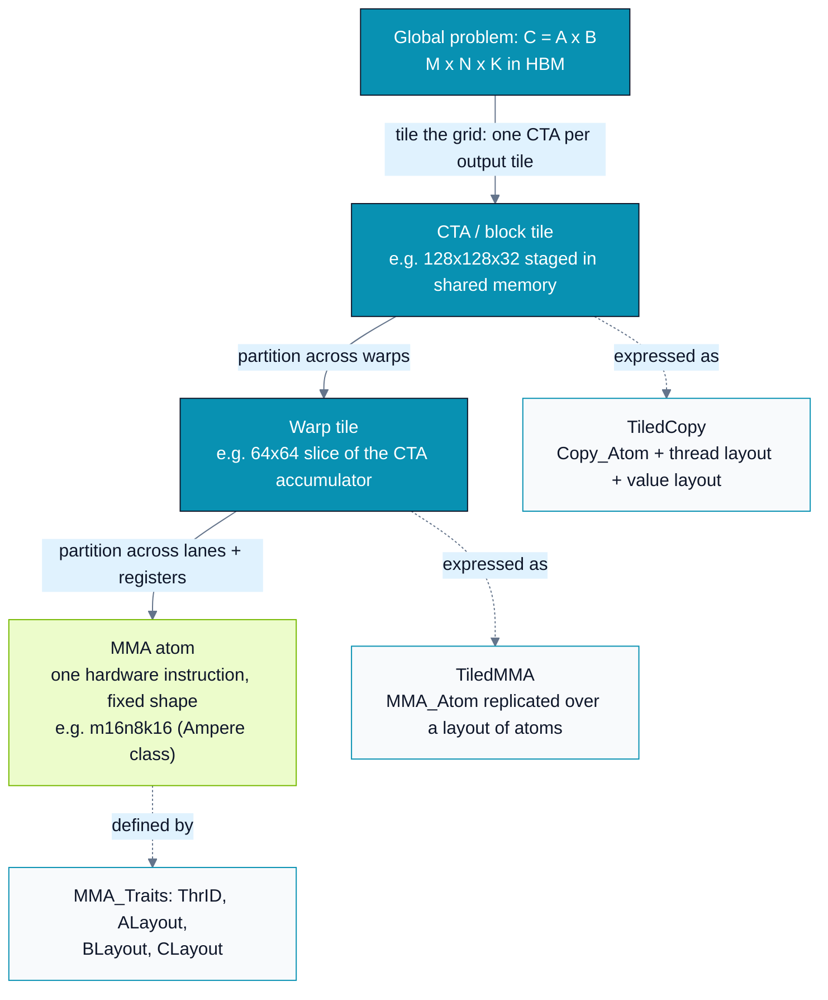
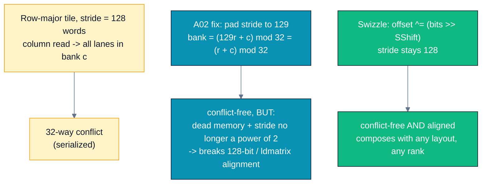
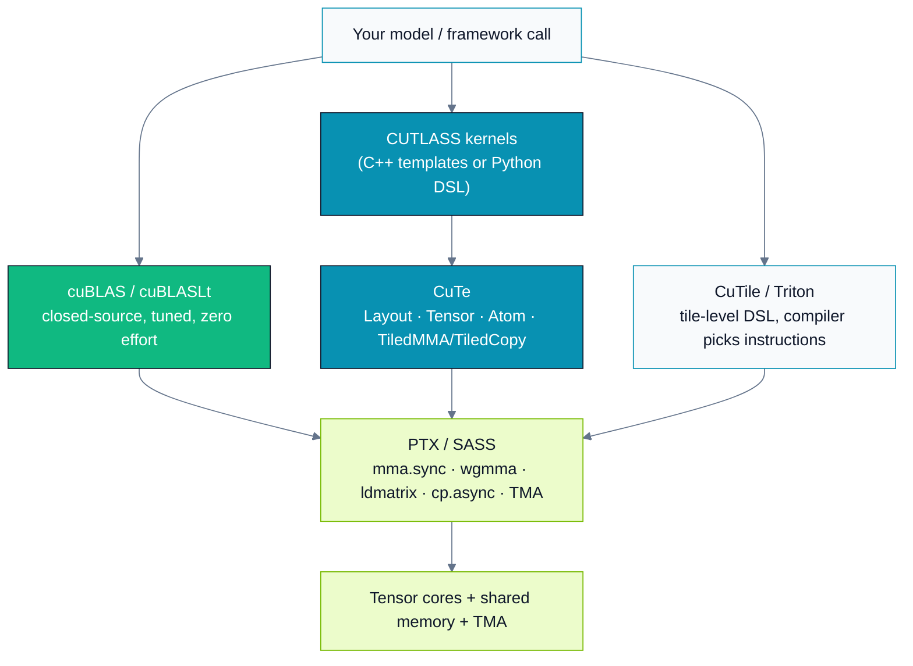
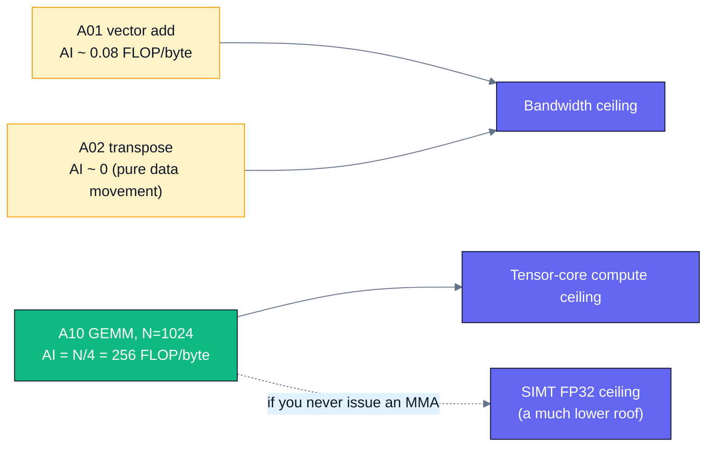
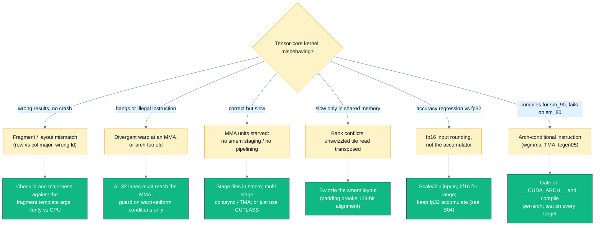

# A10 — CuTe, CUTLASS & CuTile — layout algebra and tensor cores

> Track A · Module 10 · Status: **DRAFT** · Est. 10 hours · Depth 5/5
>
> ## ⚠️ NVIDIA-only · OPTIONAL module — you can skip this and lose nothing
>
> Every other module in this curriculum is **dual-vendor** (AMD `hipcc` + NVIDIA `nvcc` + Triton).
> **This one is not.** CuTe, CUTLASS, and CuTile are NVIDIA-specific projects that emit PTX for
> NVIDIA tensor cores. There is no HIP port and no AMD build in this folder.
>
> **If you are on AMD, or you have no NVIDIA GPU: skip A10 entirely.** Nothing later in Track A,
> B, or C depends on it. Instead read the AMD counterparts, which solve the *same* problem with the
> *same* ideas (see [§1 → *If you are on AMD, read this instead*](#if-you-are-on-amd-read-this-instead)):
> **Composable Kernel / CK-Tile**, **hipBLASLt**, and the **MFMA** intrinsics.
>
> Prerequisites: [A02](../A02.memory-hierarchy-and-coalescing/README.md) (shared memory, bank conflicts),
> [A06](../A06.tiled-matrix-multiply/README.md) (tiled GEMM), [A09](../A09.advanced-triton-flash-attention/README.md) (why a compiler
> may beat your hand-written kernel). Backend: NVIDIA `nvcc` only.
> Setup: [../../../docs/SETUP.md](../../../docs/SETUP.md) ·
> Terms: [GLOSSARY.md](../../../docs/GLOSSARY.md) · Sources: [REFERENCES.md](../../../docs/REFERENCES.md).
>
> **Version-sensitive material.** CUTLASS and especially CuTile move fast. Every claim below is
> stamped **as of 2026-07-29** with a link to the authoritative source. Re-check the links before
> you trust a version number: the concepts are stable, the APIs and release status are not.

---

## 1. TL;DR + Layman analogy

**TL;DR.** [A06](../A06.tiled-matrix-multiply/README.md#5-performance-analysis)'s hand-written tiled
[GEMM](../../../docs/GLOSSARY.md#gemm) cannot reach peak, because peak requires
**[tensor cores](../../../docs/GLOSSARY.md#tensor-core-nvidia-and-matrix-core-amd)** —
fixed-shape mixed-precision matrix-multiply-accumulate instructions — plus deep software pipelining
and **swizzled** [shared-memory](../../../docs/GLOSSARY.md#shared-memory-nvidia-and-lds-amd)
layouts. Writing that by hand means writing pages of index
arithmetic that is wrong the moment a shape changes. **[CuTe](../../../docs/GLOSSARY.md#cute-and-cutlass)** (the core library inside **CUTLASS**)
replaces that index arithmetic with an *algebra*: a `Layout` is a `(Shape, Stride)` pair, a `Tensor`
is a pointer plus a `Layout`, and [tiling](../../../docs/GLOSSARY.md#tiling) / per-thread partitioning / swizzling all become
**composition of layouts** instead of hand-derived `%` and `/`. **CuTile** is a newer, higher-level
NVIDIA programming model where you write kernels over whole *tiles* and the compiler picks the
tensor-core and memory instructions for you. This module teaches the abstraction, runs one
dependency-free tensor-core GEMM you can actually measure, and gives you a defensible answer to
"cuBLAS, CUTLASS, or Triton?".

**Layman analogy — shipping containers, not parcel-by-parcel directions.**
Imagine you run a freight company. The naive way to ship a warehouse is to write a separate
instruction card for every single parcel: *"parcel #48 291 goes on truck 7, third row, second from
the left, rotated 90°."* It works, and it is exactly what hand-written GEMM index math is — a
formula per thread per element. Change the truck size and every card is wrong.

The industry solved this with **standard containers and stacking rules**. You no longer describe
parcels; you describe a *container* (a shape) and a *stacking rule* (how far apart consecutive
things sit — a stride). Then you **compose**: parcels stack into a container, containers stack onto
a truck, trucks fill a ship. Each level is the same kind of object, so the same rules apply at
every level, and the address of any individual parcel is *derived* by the algebra rather than
written down by hand. When the truck size changes you change one rule, not a million cards.

That is CuTe. `(Shape, Stride)` is the container spec. Composition is the stacking rule. The
hierarchy global tile → CTA tile → warp tile → MMA atom is the parcel/container/truck/ship chain.
And the **MMA atom is a container you did not get to choose** — the tensor core accepts one fixed
crate size (e.g. 16×8×16), so your whole packing plan must be built upward *from* it.

**Where the analogy breaks — and it matters.**
1. **Containers are inert; MMA atoms are not.** A shipping container doesn't care which lane of the
   truck it rides in. An MMA atom specifies *which of the 32 threads in the
   [warp](../../../docs/GLOSSARY.md#warp-nvidia-and-wavefront-amd) holds which
   element in which register* — the atom is a data layout **and** a thread layout at once
   (CuTe models this as `ThrID` + `ALayout`/`BLayout`/`CLayout`, see §3).
2. **Freight has no bank conflicts.** Two containers can share a lane. Two shared-memory addresses
   in the same **[bank](../../../docs/GLOSSARY.md#bank-conflict)** serialize. Swizzling (§3) exists purely because of this electrical
   constraint, and has no logistics analogue.
3. **Layouts are functions, not boxes.** A CuTe `Layout` is literally a function from integers to
   integers, and it can be non-injective or overlapping (e.g. a stride-0 broadcast). No physical
   container can hold the same parcel twice.

### If you are on AMD, read this instead

The *ideas* in this module are vendor-neutral; only the spelling is NVIDIA. Parallel reading:

| A10 concept | AMD counterpart | Where to read it |
|---|---|---|
| CUTLASS (template GEMM library) | **Composable Kernel (CK / CK-Tile)** — tile-based C++ template library, ROCm's answer to CUTLASS | <https://github.com/ROCm/composable_kernel> |
| CuTe layout algebra | **CK "Tensor Coordinate Transformation"** + tile distributions | <https://rocm.docs.amd.com/projects/composable_kernel/en/latest/> |
| cuBLAS / cuBLASLt default path | **rocBLAS / hipBLASLt** | <https://rocm.docs.amd.com/projects/hipBLASLt/en/latest/> |
| `mma.sync` / WMMA tensor-core instruction | **MFMA** matrix-core instructions, e.g. `__builtin_amdgcn_mfma_f32_16x16x16f16` | <https://rocm.docs.amd.com/projects/composable_kernel/en/latest/conceptual/ck_tile/hardware/gemm_optimization.html> and the CDNA3 ISA guide |
| Tensor-core shapes table | **CDNA3 MFMA instruction set** (16×16×16 fp16, 32×32×8 fp16, …) | <https://www.amd.com/content/dam/amd/en/documents/instinct-tech-docs/instruction-set-architectures/amd-instinct-mi300-cdna3-instruction-set-architecture.pdf> |
| CuTile / Triton (tile-level DSL) | **Triton** — genuinely dual-vendor; see [A08](../A08.triton-foundations/README.md) / [A09](../A09.advanced-triton-flash-attention/README.md) | <https://triton-lang.org/> |

If you use PyTorch or vLLM on ROCm you are *already* running CK under the FlashAttention and GEMM
backends, exactly as CUDA users are already running CUTLASS-derived kernels.

**By the end of this module you can:** explain why a hand-written SIMT GEMM plateaus below peak;
read and write a CuTe `(Shape, Stride)` layout and compute offsets from it by hand; describe the
global → CTA → warp → MMA-atom decomposition and how CUTLASS expresses it as `TiledCopy` /
`TiledMMA`; write a correct WMMA tensor-core GEMM tile from scratch and measure its GFLOP/s;
explain swizzling as the generalization of
[A02](../A02.memory-hierarchy-and-coalescing/README.md#3-deep-dive)'s `+1` padding trick; and defend
a choice between cuBLAS, CUTLASS/CuTe, [Triton](../../../docs/GLOSSARY.md#triton), and CuTile for a
concrete workload.

---

## 2. First Principles

### Start from the wall A06 hits

[A06 §3](../A06.tiled-matrix-multiply/README.md#3-deep-dive) built the textbook shared-memory tiled
GEMM. It is a *big* win over naive — and it still leaves
most of the machine on the floor. Three independent reasons, in order of severity:

**(1) You are not using the matrix hardware at all.** A06's inner loop is `acc += a * b` — an
`FFMA` in the SIMT pipeline. Modern NVIDIA SMs contain separate **tensor cores** that execute a
whole small matrix-multiply-accumulate per instruction. Count the work per *issued instruction*:

```
warp-wide FFMA        : 32 lanes x 1 MAC          =    32 MACs =    64 FLOP per instruction
mma.sync m16n8k16     : 16 x 8 x 16 MACs, 1 warp  = 2 048 MACs = 4 096 FLOP per instruction
                                                    ^^^^^^^^^^ 64x more work per instruction
```

That 64× is not a tuning delta you can close by picking a better `TILE`. It is a different
functional unit. If you never issue an MMA instruction, peak is unreachable by construction.
(Shapes: `mma.sync.aligned.m16n8k16` is the Ampere-class dense fp16/bf16 instruction — verified
below in §3 and in the PTX ISA reference in §8.)

**(2) The tensor core dictates the data layout, not you.** An MMA instruction is *warp-collective*
and the ISA fixes which of the 32 lanes holds which matrix element in which register. So "feed the
tensor core" is a layout problem: you must get a tile from
[global memory](../../../docs/GLOSSARY.md#global-memory), through shared memory,
into exactly the register positions the instruction demands. Get one index wrong and you get a
silently wrong GEMM.

**(3) Latency must be hidden by software, not just [occupancy](../../../docs/GLOSSARY.md#occupancy).** At tensor-core throughput the
global→shared copy becomes the critical path, so production kernels run a **multi-stage software
pipeline** (`cp.async` / TMA prefetching stage *k+1* while the MMA consumes stage *k*). That means
several shared-memory buffers, barriers, and index math that all depend on the pipeline depth.

Add these up and the honest conclusion is: **the index arithmetic explodes.** A06's kernel had two
index expressions. A production fp16 GEMM has a distinct index mapping for every hop (global→shared,
shared→register, register→MMA operand, accumulator→epilogue), at every level of the hierarchy, for
every tile shape and every data type. Written by hand, that is thousands of lines that must be
re-derived per shape.

### The naive fix, and why it fails

The obvious response is a macro/template soup: parameterize the tile sizes and let the preprocessor
generate the index math. CUTLASS 2.x essentially did this, and it worked — but the index arithmetic
was still *written out*, just parameterized. Every new instruction shape (Volta 8×8×4 → Ampere
16×8×16 → Hopper warpgroup GMMA → Blackwell) meant new hand-derived mappings, and composing two
transformations (tile it, *then* swizzle it) meant deriving a third expression by hand.

### The actual fix: make the index mapping a first-class value

Here is the whole idea in one move. Stop writing index *expressions* and start building index
*functions* you can compose.

> A **`Layout`** is a pair `(Shape, Stride)`. It is a function from a coordinate to a linear index:
> take the inner product of the (natural) coordinate with the stride.
> A **`Tensor`** is a `Layout` composed with data (a pointer or iterator).
> — *CuTe Layouts*, [NVIDIA CUTLASS docs](../../../docs/REFERENCES.md#cutlass-and-cute-nvidia)
> (v4.6.1, retrieved 2026-07-29)

Work the smallest possible example. Take shape `(4,2)` — four rows, two columns:

```
Shape (4,2), Stride (1,4)          Shape (4,2), Stride (2,1)
index(m,n) = m*1 + n*4             index(m,n) = m*2 + n*1

  0   4                              0   1
  1   5                              2   3
  2   6                              4   5
  3   7                              6   7

"column-major"                     "row-major"
```

Both are the *same logical 4×2 matrix*. The only difference is the stride tuple. So "row-major vs
column-major" stops being a special case in your code and becomes **data**: `stride`. Majorness is
simply *which mode has stride 1*. (Both tables above are from the official CuTe layout tutorial —
see §8.)

Now the payoff. Because a `Shape` may itself be a **tuple of shapes** (CuTe calls this an
`IntTuple` and the definition is recursive), one `Layout` can encode a whole hierarchy:

```
Shape  (2,(2,2))
Stride (4,(2,1))          natural coord (i,(j,k))  ->  index = i*4 + j*2 + k*1

      0   1   2   3        <- 1-D coordinate of the (2,2) multi-mode
    +---+---+---+---+
 0  | 0 | 2 | 1 | 3 |
    +---+---+---+---+
 1  | 4 | 6 | 5 | 7 |
    +---+---+---+---+
```

This layout is neither row-major nor column-major, it is still addressable with a plain 2-D
coordinate, and it took *one* line to describe. That is the object you can hand a tiler, a
partitioner, or a swizzle — and get another `Layout` back. **The error-prone index math of A06 has
become a composable value.**



*Read it left to right: everything downstream of `Layout` is derived by algebra, which is why one
abstraction covers both the copy path (`TiledCopy`) and the math path (`TiledMMA`).*

---

## 3. Deep Dive

### 3.1 What CUTLASS and CuTe actually are, as of 2026-07-29

| Thing | What it is | Status / version (as of 2026-07-29) |
|---|---|---|
| **CUTLASS** | NVIDIA's open-source C++ template library of GEMM/conv/attention building blocks and complete kernels | **4.6.1**, released **2026-07-15** ([release notes](https://github.com/NVIDIA/cutlass/releases/tag/v4.6.1)) |
| **CuTe** | The *core library inside* CUTLASS: `Layout`, `Tensor`, MMA/Copy atoms, `TiledMMA`, `TiledCopy`. C++ headers under `include/cute/` | Introduced in **CUTLASS 3.0**; CUTLASS 3.x/4.x are built on it throughout |
| **CUTLASS DSLs / CuTe DSL** | Python-native front end exposing the same CuTe concepts (layouts, tensors, atoms) without C++ template metaprogramming; `pip install nvidia-cutlass-dsl` | Added in **CUTLASS 4.0**. The CUTLASS README states CuTe DSL "is currently in public beta and will graduate out of beta by end of summer 2026" — **still beta as of 2026-07-29** |
| **CUTLASS Operator API** | Newer Python surface to discover and call CUTLASS DSL kernels from your own code; `pip install nvidia-cutlass-operators` | Introduced in the 4.6 line; treat as new |

> [!IMPORTANT]
> **Read the version banner in the [CUTLASS README](https://github.com/NVIDIA/cutlass) before you
> trust any of the above.** The four rows differ in maturity by more than an order of magnitude:
> CuTe C++ has been the backbone of CUTLASS since 3.0, while the Python DSL surface was still
> labelled public beta at the time of writing.

### 3.2 The hierarchy: global → CTA → warp → MMA atom

Every high-performance GEMM is the same recursive decomposition. CUTLASS's contribution is that
**each level is expressed as a layout, and the levels compose**.



*The solid arrows are the decomposition every GEMM does; the dashed arrows are the one thing to
remember from this module — CUTLASS names each level and makes it a composable object, so changing
the CTA tile shape does not force you to re-derive the warp or atom index math.*

Two vocabulary items carry the whole design (both quoted from the official CuTe MMA-atom doc,
retrieved 2026-07-29):

- An **Atom** is an *Operation* struct (a thin wrapper over one PTX instruction, declaring only its
  register operands) paired with an **`MMA_Traits`** specialization holding the meta-information:
  `Shape_MNK` (logical M×N×K of the instruction), `ThrID` (which hardware threads participate),
  and `ALayout` / `BLayout` / `CLayout` — *mappings from `(thread, value)` pairs to `(m,k)`,
  `(n,k)`, `(m,n)` coordinates*. That last point is the crux: **the atom's traits are layouts**, so
  the thread-to-data mapping the ISA imposes is expressed in the same algebra as your data.
- A **`TiledMMA`** builds larger patterns by replicating atoms over a *layout of atoms*, plus an
  optional tiler/permutation. `TiledCopy` does the same for `Copy_Atom` (`ld.global`, `cp.async`,
  TMA, …).

CuTe MMA atoms exist at several hardware granularities — the doc lists a single thread (plain FMA),
a **quadpair** (Volta), a **warp** (Ampere), and a **warpgroup** (Hopper). That is why one
abstraction can target four architectures: only the traits change.

### 3.3 Tensor cores and MMA shapes — the fixed crate sizes

[Tensor-core instructions](../A06.tiled-matrix-multiply/README.md#matrix-cores-mfma-and-tensor-cores)
are **fixed-shape and mixed-precision**: small M×N×K, low-precision
inputs, wider accumulator. You do not get to pick the shape; you build around it.

| Architecture | Main dense MMA interface | Granularity | Accumulator lives in |
|---|---|---|---|
| Volta (SM70) | `mma.sync` `m8n8k4` class | quadpair (8 threads) | registers |
| Ampere / Ada (SM80/89) | the `mma.sync.aligned.m16n8k*` family; `m16n8k16` for fp16/bf16 | warp (32 threads) | registers |
| Hopper (SM90) | `wgmma.mma_async` (CuTe: `SM90_64xNx16_*` atoms) | warpgroup (128 threads) | registers |
| Blackwell (SM100/SM103/SM120) | `tcgen05.mma` family | see PTX ISA | tensor memory (TMEM) for the SM100 path |

> [!WARNING]
> **Verify the row you care about before you write code against it.** The Volta/Ampere/Hopper rows
> are corroborated by the CuTe MMA-atom doc (which walks through `SM70_8x8x4_F32F16F16F32_NT` and
> `SM90_64x128x16_F16F16F16F16_TN` by name) and by the PTX ISA `mma`/`wgmma` sections. The
> **Blackwell row is the one I would not quote from memory** — `tcgen05.mma` and the TMEM
> accumulator path are new enough that shape lists, dtype combinations, and the SM100-vs-SM120
> split have been moving. Go to the
> [PTX ISA reference](https://docs.nvidia.com/cuda/parallel-thread-execution/index.html) and the
> CUTLASS release notes for your target, not to a blog post and not to this table.

A concrete, verifiable fact about `mma.sync.aligned.m16n8k16.row.col.f32.f16.f16.f32`: it is
warp-collective, and per thread it takes **four packed `.f16x2` registers for A** (8 fp16 values),
**two for B** (4 fp16 values), and **four `.f32` registers for C and D**. Multiply out: A is
16×16 = 256 fp16 = 8 per lane × 32 lanes ✓; B is 16×8 = 128 fp16 = 4 per lane ✓; C/D is 16×8 = 128
fp32 = 4 per lane ✓. The arithmetic closing exactly is how you sanity-check a fragment layout.

Because that per-lane assignment is *scattered*, Ampere added **`ldmatrix`**, a shared-memory load
whose whole purpose is to deliver a tile into registers already in MMA fragment order. Hopper's
`wgmma` goes further: A and/or B can be consumed **directly from shared memory** via a *matrix
descriptor* that records the strides and the swizzle mode. CuTe models even that in the same
algebra — the Hopper `ALayout` maps every thread to element `(0,0)` with stride 0 (all threads see
the whole tile) and lets the descriptor constructor inspect the `(M,K)` layout.

#### WMMA vs `mma.sync` — which should you write?

| API | What it is | Use it when |
|---|---|---|
| `nvcuda::wmma` (`fragment`, `load_matrix_sync`, `mma_sync`, `store_matrix_sync`) | Documented CUDA C++ warp-level API; fragments are **opaque** (you don't know which lane holds what) | Learning, portability across SM70+, quick prototypes. **This module's runnable lab uses it.** |
| `mma.sync` / `wgmma` PTX (inline asm, or via CuTe atoms) | The actual instructions; you own the fragment layout | Production kernels, unusual shapes, `ldmatrix`/`cp.async`/TMA pipelining — i.e. what CUTLASS does |

WMMA is deliberately less powerful: opacity is what makes it portable, and it is also why it leaves
performance on the table versus a CUTLASS kernel that controls the fragment layout explicitly.

### 3.4 Swizzling — A02's `+1` padding trick, generalized

[A02 §3](../A02.memory-hierarchy-and-coalescing/README.md#3-deep-dive) fixed a 32-way shared-memory
bank conflict by padding a `[32][32]` tile to `[32][33]`. That
works, and it is a *point solution*: it costs dead memory, it assumes 4-byte elements and 32 banks,
and — fatally for tensor cores — a padded row stride breaks the 128-bit alignment that vectorized
and `ldmatrix`-style loads require.

The general solution is a **swizzle**: instead of changing the stride, permute the *offset bits*
with XOR. CuTe expresses it as a functor, from `include/cute/swizzle.hpp` (CUTLASS 4.6.1):

```cpp
// Attributed: NVIDIA/cutlass, include/cute/swizzle.hpp (retrieved 2026-07-29)
template <int BBits, int MBase, int SShift = BBits>
struct Swizzle {
  // ...
  static auto apply(Offset const& offset) {
    return offset ^ shiftr(offset & yyy_msk{}, msk_sft{});   // ZZZ ^= YYY
  }
};
```

- `MBase` — number of least-significant bits left untouched (the contiguous vector you must not
  disturb, e.g. the 16 bytes of a 128-bit load).
- `BBits` — how many bits participate in the XOR mask.
- `SShift` — how far the mask is shifted (i.e. which higher bits drive the permutation).

Worked example, and the one worth internalizing: a **row-major 32×128 fp32 shared tile**. Reading
column `c` touches element offsets `c, 128+c, 256+c, …`. Bank = `offset mod 32`, so every one of the
32 lanes lands in bank `c` → **32-way conflict**. Row stride 128 = 2⁷, so choosing `SShift = 7`
(the row stride, in log₂) and `BBits = 5` (log₂ of 32 banks) makes the XOR mask cycle through
`0..31` as the row index advances → 32 distinct banks, **conflict-free**, with the row stride still
a clean power of two.



*Padding and swizzling both fix the conflict; only swizzling keeps the power-of-two stride that
vectorized and tensor-core-feeding loads depend on — which is why production kernels swizzle.*

The deeper point is compositional: **a swizzle is itself a layout-like function**, so it composes
with your data layout through the same algebra and resolves at compile time. Your kernel keeps
indexing in logical coordinates; the conflict-free physical offset is produced underneath. Hand-rolled
XOR math, by contrast, is re-derived for every tile geometry.

### 3.5 CuTile — what it is, and how new it is

**CuTile is a different bet from CuTe.** CuTe hands you *full* control of the thread-and-data
hierarchy; CuTile takes control away on purpose. From the official documentation (retrieved
2026-07-29):

> "cuTile is a parallel programming model for NVIDIA GPUs and a Python-based DSL. It automatically
> leverages advanced hardware capabilities, such as tensor cores and tensor memory accelerators,
> while providing portability across different NVIDIA GPU architectures."
> — [cuTile Python documentation](https://docs.nvidia.com/cuda/cutile-python/)

You write over **tiles**, not threads. The programming model, verified from the same docs:

- **Arrays** live in global memory, are mutable, have real strided layouts, and support little more
  than load/store inside a kernel. PyTorch tensors and CuPy arrays can be passed as arrays.
- **Tiles** are *immutable values with no defined storage* that exist only in kernel code. Tile
  dimensions must be **compile-time constants that are powers of two**. Tiles support elementwise
  arithmetic, matrix multiplication, reduction, and shape manipulation.
- `ct.load` / `ct.store` move between arrays and tiles; `@ct.kernel` marks the entry point;
  `ct.launch(...)` queues it.

If that reads like Triton — yes. Both are tile-level, block-scoped, Python-first, and both delegate
the thread mapping and instruction selection to a compiler. The difference is portability scope:
[Triton](../A08.triton-foundations/README.md) targets NVIDIA **and** AMD; CuTile targets NVIDIA and
lowers through NVIDIA's **Tile IR**.

**Maturity, stated precisely (as of 2026-07-29):**

| Fact | Source |
|---|---|
| CUDA Tile launched with **CUDA 13.1**; Python was the first supported language | [NVIDIA Technical Blog, 2026-05-26](https://developer.nvidia.com/blog/develop-high-performance-gpu-kernels-in-cpp-with-nvidia-cuda-tile/) |
| **cuTile Python 1.0.0** released **2025-12-02**; latest **1.5.0** on **2026-07-08** | [cuTile Python release notes](https://docs.nvidia.com/cuda/cutile-python/generated/release_notes.html) |
| Install: `pip install cuda-tile` (or `cuda-tile[tileiras]` to get the `tileiras` compiler in-env) | [NVIDIA/cutile-python](https://github.com/NVIDIA/cutile-python) |
| Requires **NVIDIA driver r580 or later** (Tile IR); CUDA Toolkit 13.1+ | repo README + docs prerequisites |
| Hopper (sm_90) support arrived with **CTK 13.3** / cuTile Python **1.4.0** (2026-05-26); earlier `tileiras` 13.2 covered Blackwell and Ampere/Ada only | release notes 1.4.0 + repo README |
| **CUDA Tile C++** (tile programming inside CUDA C++, `cuda_tile.h`, `cuda::tiles`, `nvcc --enable-tile`) shipped with **CUDA 13.3**; requires driver R580+ and compute capability 8.x+ | [NVIDIA Technical Blog, 2026-05-26](https://developer.nvidia.com/blog/develop-high-performance-gpu-kernels-in-cpp-with-nvidia-cuda-tile/) |
| An **experimental** package exists with APIs explicitly *not* part of the stable `cuda.tile` API | repo README |

**How to read that honestly.** cuTile Python is past 1.0 and on a fast release cadence, so
"experimental toy" would be wrong. But it is also roughly **eight months past 1.0 as of this
writing**, Hopper support landed only two months ago, C++ support landed two months ago, and it
carries an explicitly unstable experimental surface. My call, flagged as a judgement rather than a
fact: **treat cuTile as production-*viable* and evolving-fast, not as settled.** Pin your toolkit,
driver, and `cuda-tile` versions; expect to revisit code across releases; and check the release
notes rather than any tutorial (including this one) before you commit to it.

**What I could not verify and am therefore not claiming:** any performance comparison between
cuTile and Triton, CUTLASS, or cuBLAS; whether NVIDIA positions cuTile as a Triton replacement; and
the exact stability guarantees of the `cuda.tile` API beyond the repo's own "experimental package"
caveat. If you need those answers, the sources are NVIDIA's GTC sessions and the
[cuTile repo issues](https://github.com/NVIDIA/cutile-python/issues), not inference.

### 3.6 Where the abstractions sit relative to each other



*Three paths reach the same instructions; they differ only in how much of the layout decision you
make yourself, which is exactly the axis the §6 decision table scores.*

---

## 4. Hands-On Labs

> [!IMPORTANT]
> ### What is runnable here, and what is deliberately not
>
> **Lab 1 (`cuda/mma_tensor_core.cu`) has no external dependencies** — just `nvcc` and an SM70+
> GPU. It is the lab that carries this module's measurable content.
>
> **CUTLASS/CuTe is a large external repository** (the 4.6.1 install tarballs are >110 MB). This
> module does **not** vendor it, does not shim it, and does not pretend to build without it. Lab 2
> is gated behind `CUTLASS_DIR` and the `Makefile` **hard-fails with an explanatory message** if it
> is unset — by design, so you never get a green build that silently skipped the CuTe code.
>
> **The authoritative runnable CuTe examples live in the CUTLASS repo, and you should work through
> them there** rather than trusting a re-typed copy in a curriculum:
> - [`examples/cute/tutorial/`](https://github.com/NVIDIA/cutlass/tree/main/examples/cute/tutorial)
>   — including [`tiled_copy.cu`](https://github.com/NVIDIA/cutlass/blob/main/examples/cute/tutorial/tiled_copy.cu)
>   (partitioning + vectorized copy via `make_tiled_copy`) and
>   [`sgemm_2.cu`](https://github.com/NVIDIA/cutlass/blob/main/examples/cute/tutorial/sgemm_2.cu)
>   (`TiledCopy` **and** `TiledMMA` partitioning, with a pipelined inner loop).
> - The narrative walkthrough of those files:
>   [CuTe dense matrix-matrix multiply tutorial](https://docs.nvidia.com/cutlass/latest/media/docs/cpp/cute/0x_gemm_tutorial.html).
> - The Python path: [CuTe DSL quick start](https://docs.nvidia.com/cutlass/latest/media/docs/pythonDSL/quick_start.html)
>   (`pip install nvidia-cutlass-dsl`) — still public beta as of 2026-07-29.
>
> **There is no `hip/` or `triton/` directory in this module.** That is not an omission to fix
> later: CuTe/CUTLASS/CuTile have no AMD backend. The portable version of this material is
> [A08](../A08.triton-foundations/README.md)/[A09](../A09.advanced-triton-flash-attention/README.md) (Triton) and, on the AMD side,
> Composable Kernel — see the table in §1.

All commands run from this module directory.

```bash
make                                   # list targets, show CUTLASS_DIR state
make cuda SM_ARCH=sm_90                # Lab 1: build the dependency-free tensor-core GEMM
make run-cuda                          # build + run it

# Lab 2 needs CUTLASS. Without CUTLASS_DIR this FAILS with an explanatory message, on purpose:
make cute
# With it:
git clone --depth 1 https://github.com/NVIDIA/cutlass.git /path/to/cutlass    # run this yourself
make run-cute CUTLASS_DIR=/path/to/cutlass SM_ARCH=sm_90

make exercises / make solutions        # the drills (own Makefiles)
make profile-cuda                      # nsys timeline; then ncu for tensor-core metrics
```

Set `SM_ARCH` to your GPU: `sm_70` Volta, `sm_80` A100, `sm_89` Ada, `sm_90` Hopper,
`sm_100` Blackwell datacenter. Check with `nvidia-smi --query-gpu=compute_cap --format=csv`.

### Lab 1 — A tensor-core GEMM you can actually run (`mma_tensor_core`)

File: [`cuda/mma_tensor_core.cu`](cuda/mma_tensor_core.cu). No CUTLASS, no CuTe — just the
documented `nvcuda::wmma` API from the
[CUDA C++ Programming Guide](../../../docs/REFERENCES.md#cuda-c-programming-guide-nvidia).

It runs two kernels on the same `1024³` fp16 problem and verifies both against a CPU reference:

1. `simt_gemm` — a naive SIMT baseline (`acc += a*b` in the scalar pipeline). This is
   [A06](../A06.tiled-matrix-multiply/README.md#4-hands-on-labs)'s
   arithmetic without the tiling, deliberately: it isolates *"am I using the matrix hardware?"*
   from *"is my tiling good?"*.
2. `wmma_gemm` — one 16×16 output tile per warp, accumulating over K in 16-wide steps with
   `wmma::mma_sync`.

The whole tensor-core inner loop is six lines, and that is the point:

```cpp
// cuda/mma_tensor_core.cu -- the entire tensor-core inner loop
wmma::fill_fragment(acc, 0.0f);
for (int k = 0; k < K; k += WMMA_K) {
    wmma::load_matrix_sync(aFrag, A + rowTile * WMMA_M * K + k, K);   // lda = K (row-major)
    wmma::load_matrix_sync(bFrag, B + k * N + colTile * WMMA_N, N);   // ldb = N (row-major)
    wmma::mma_sync(acc, aFrag, bFrag, acc);                            // acc += aFrag * bFrag
}
wmma::store_matrix_sync(C + rowTile * WMMA_M * N + colTile * WMMA_N, acc, N, wmma::mem_row_major);
```

**What to observe.**
- Both kernels print `PASSED`. Correctness is not the lesson.
- The **GFLOP/s ratio** is the lesson, and it should be large — this is the §2 "64× work per
  instruction" argument showing up as wall-clock.
- The WMMA kernel is *still far from peak*, because it reads A and B straight from **global**
  memory every K-step: no shared-memory staging, no `cp.async` pipelining, no swizzle. That gap
  between "using tensor cores" and "using tensor cores well" is precisely the gap CUTLASS exists to
  close. Do not leave this lab thinking `mma_sync` is sufficient.
- The **arch guard.** The kernel body is wrapped in `#if !defined(__CUDA_ARCH__) || (__CUDA_ARCH__ >= 700)`
  and the host refuses to run on compute capability < 7.0 with a clear message rather than
  producing garbage. Tensor cores are not universal; code that targets them must say so.

### Lab 2 — CuTe layout algebra, on the host (`cute_layout_demo`)

File: [`cuda/cute_layout_demo.cu`](cuda/cute_layout_demo.cu). **Requires `CUTLASS_DIR`.**

Deliberately **host-only and GPU-free**: it constructs layouts, prints their coordinate→index
tables with `cute::print_layout`, and shows a swizzle turning a 32-way bank conflict into a
conflict-free access. Layout algebra is a *compile-time, host-visible* thing, so you can learn it
without a GPU in the loop — which also means the demo is small enough to audit line by line.

It uses only APIs from the official CuTe layout tutorial and `include/cute/swizzle.hpp` (both cited
in §8): `make_layout`, `make_shape`, `make_stride`, `print_layout`, `size<I>`, `flatten`, `select`,
`crd2idx`, and `Swizzle<BBits, MBase, SShift>`.

**What to observe.**
- The same `Shape (4,2)` with two different `Stride`s produces the row-major and column-major
  tables from §2 — majorness is data, not code.
- The hierarchical layout `(2,(2,2)):(4,(2,1))` is neither row- nor column-major yet is still
  indexable with a 2-D coordinate.
- In the swizzle section, the "before" column read maps all 32 lanes to **one** bank and the
  "after" read maps them to **32 distinct** banks —
  [A02 §3](../A02.memory-hierarchy-and-coalescing/README.md#3-deep-dive)'s lesson, without touching
  the stride.

> [!NOTE]
> I could not compile this file in the authoring environment (no NVIDIA toolchain, no CUTLASS
> checkout on this machine). Every construct in it is taken from the official docs cited in §8, but
> treat it as *reviewed, not executed* — if `nvcc` complains, the CUTLASS version you checked out is
> the source of truth, not this file. Build flags used: `-std=c++17 --expt-relaxed-constexpr
> -I$(CUTLASS_DIR)/include`.

### Lab 3 (optional) — Profile the tensor cores

```bash
make profile-cuda                                    # nsys timeline
ncu --set full ./cuda/mma_tensor_core.exe            # kernel counters
```

**What to look for in [Nsight Compute](../../../docs/REFERENCES.md#nsight-compute-nvidia):** on the WMMA kernel, a non-zero **tensor-core / "Tensor"
pipe utilization** (the SIMT kernel's is zero), alongside poor global **load efficiency** — the
memory path, not the math, is the WMMA kernel's limiter. The exact metric names vary by Nsight
Compute version; use `ncu --query-metrics | grep -i tensor` on your install rather than trusting a
hard-coded metric name.

---

## 5. Performance Analysis

> [!CAUTION]
> **There are no measured numbers in this section, and that is deliberate.** I did not have an
> NVIDIA GPU in the authoring environment, so any GFLOP/s table here would be fabricated. Below is
> the *analysis* you can do on paper plus the commands to fill in your own numbers. Run the labs and
> write your results into the blanks.

### Is a GEMM compute-bound? Do the arithmetic.

For a square `N³` fp16-in / fp32-out GEMM:

```
FLOP           = 2 * N^3                                  (one multiply + one add per MAC)
bytes moved    = 2 * (N^2 * 2)  +  N^2 * 4  =  8 * N^2     (A, B in fp16; C out in fp32)
arithmetic     = 2*N^3 / (8*N^2)  =  N / 4    FLOP/byte
intensity
```

So for the lab's `N = 1024`: **AI = 256 FLOP/byte** — and it grows *linearly* with N. Compare that
against your GPU's
[ridge point](../../B-gpu-ml-performance/B01.accelerator-architecture/README.md#the-ridge-point-computed-from-cited-peaks)
(peak fp16-tensor-core FLOP/s ÷ peak HBM bytes/s, both from your
GPU's datasheet or whitepaper): on current data-center parts the ridge point is well below 256, so a
large dense GEMM is firmly
**[compute-bound](../../../docs/GLOSSARY.md#memory-bound-compute-bound-and-latency-bound)**. That is
*why* GEMM is where tensor cores pay off, and
why vector add ([A01 §5](../A01.foundations-and-programming-model/README.md#5-performance-analysis),
AI ≈ 0.083) never could.

This also tells you the failure mode to expect: a compute-bound kernel that *doesn't* hit peak is
failing on **instruction supply** — the wrong functional unit (no MMA), or the MMA units starved by
the memory path.

### Roofline placement



*The dashed arrow is this module's whole thesis: a compute-bound kernel written in the SIMT pipeline
is capped by the wrong roof, and no amount of tiling raises it.*

### Fill in your own numbers

```bash
make run-cuda SM_ARCH=sm_90
```

| Kernel | Uses tensor cores? | Data path | Your GFLOP/s | Your % of datasheet peak |
|---|---|---|---:|---:|
| `simt_gemm` (naive, fp32 accumulate) | no | global → registers | `____` | `____` |
| `wmma_gemm` (this module's Lab 1) | yes | global → fragments | `____` | `____` |
| CUTLASS / cuBLAS fp16 GEMM (run it yourself, below) | yes | global → smem (swizzled, pipelined) → fragments | `____` | `____` |

Get the third row honestly instead of taking anyone's word for it:

```bash
# CUTLASS ships a profiler that reports GFLOP/s per kernel configuration.
# Build it from your CUTLASS checkout, then:
./cutlass_profiler --operation=Gemm --m=1024 --n=1024 --k=1024 \
                   --A=f16:row --B=f16:col --C=f32:row --accumulator-type=f32
```

**The three-step story your numbers should tell** (ratios, not absolutes — absolutes are
GPU-specific):
1. `simt_gemm` → `wmma_gemm`: a large jump, from using the matrix hardware at all.
2. `wmma_gemm` → CUTLASS: a *second* substantial jump, from shared-memory staging, swizzled layouts,
   multi-stage `cp.async`/TMA pipelining, and epilogue fusion. This is the gap that justifies a
   library.
3. CUTLASS vs cuBLAS on a *standard* shape: usually close. That closeness is the argument for
   defaulting to cuBLAS (§6) — CUTLASS earns its keep on *non-standard* shapes and fused epilogues,
   not by beating cuBLAS at its own game.

NVIDIA publishes its own CUTLASS-vs-cuBLAS relative-performance charts in the
[CUTLASS README](https://github.com/NVIDIA/cutlass); read them there with their stated hardware and
CUDA versions attached. I am not reproducing numbers from a chart I cannot verify.

---

## 6. Challenges, Drawbacks & Tradeoffs



*Diagnose top-down: correctness bugs are almost always a layout/majorness mismatch, performance
bugs are almost always the memory path rather than the MMA itself.*

### Pitfall 1 — The MMA is warp-collective; a divergent lane breaks it

`wmma::mma_sync` (and `mma.sync` underneath) requires **all 32 lanes of the warp** to execute it.
The [CUDA C++ Programming Guide](../../../docs/REFERENCES.md#cuda-c-programming-guide-nvidia) is
explicit that all threads in the warp must execute the same
`wmma` calls, in the same order; otherwise behavior is undefined and hangs are a realistic outcome.
So any bounds check around an MMA must be **warp-uniform**. In Lab 1 the tile guard depends on
`blockIdx` and `threadIdx.y` (the warp index), never on `threadIdx.x` — that is not stylistic.

### Pitfall 2 — Fragments are opaque, so majorness bugs are silent

With `nvcuda::wmma` you do not know which lane holds which element, so you cannot debug a layout
error by printing a lane's registers. A swapped `row_major`/`col_major` template argument or a wrong
leading dimension gives you a plausible-looking wrong matrix. **Verify against a CPU reference from
the first commit**, which is why Lab 1 does.

### Pitfall 3 — CUTLASS's real cost is compile time and template errors

CUTLASS C++ is deep template metaprogramming. The costs are concrete: long compile times, binary
bloat if you instantiate many configurations, and error messages that name internal template
parameters rather than your mistake. NVIDIA's own stated motivation for the Python DSLs was "a much
smoother learning curve, orders of magnitude faster compile times" — i.e. they consider this a real
problem, not a skill issue. Budget for it, and prefer generating only the configurations you ship.

### Pitfall 4 — Padding is not a substitute for swizzling here

[A02 §3](../A02.memory-hierarchy-and-coalescing/README.md#3-deep-dive)'s `+1` trick removes the bank
conflict but destroys the power-of-two row stride that 128-bit
vector loads, `ldmatrix`, and TMA descriptors depend on. In a tensor-core kernel, reach for a
swizzle. (Conversely, in a simple fp32 transpose, padding is simpler and fine — use the cheap fix
where it works.)

### Pitfall 5 — Numerics: fp16 *inputs*, not the accumulator, are usually the problem

fp16 MMA with fp32 accumulate is far more accurate than fp16 accumulate, but the *inputs* are still
rounded to ~3 decimal digits with a narrow exponent range. bf16 trades mantissa for range and is
usually the better default for training. Lab 1 sidesteps this on purpose by initializing with values
exactly representable in fp16 (multiples of 0.25) so a tight tolerance is meaningful and any failure
is a real bug, not rounding. Track
[B04](../../B-gpu-ml-performance/B04.precision-and-quantization/README.md) covers precision properly.

### Pitfall 6 — Arch-conditional instructions do not degrade gracefully

Hopper `wgmma`, TMA, and Blackwell `tcgen05` are arch-conditional: a kernel using them is not
portable *down*. CUTLASS documents that several Hopper/Blackwell PTX instructions fall in this
category and must be compiled for the specific target. Plan for per-arch compilation and per-arch
testing, and gate with `__CUDA_ARCH__`.

### The tradeoffs, named

| Axis | cuBLAS / cuBLASLt | CUTLASS / CuTe | Triton | CuTile |
|---|---|---|---|---|
| Effort to first correct result | minutes | days | hours | hours |
| Control over layout / pipeline | none | total | limited | limited |
| Fused custom epilogue | limited (cuBLASLt has a fixed menu) | yes, arbitrary | yes | yes |
| Unusual shapes / sparsity patterns | poor | best-in-class | good | see docs; newer surface |
| Portability to AMD | none | none | **yes** | none |
| Compile time | n/a (precompiled) | slow (C++) / faster (DSL) | JIT, autotuned | JIT |
| Maintenance burden on you | none | high | medium | medium, plus version churn |
| Debuggability | n/a | hard (templates) | medium | medium |

### When *not* to reach for CUTLASS/CuTe

- Your shapes are standard and cuBLAS already saturates the GPU. Measure first; you will often find
  there is nothing to win.
- You need one vendor-neutral source tree. CuTe cannot give you that — use
  [Triton](../A08.triton-foundations/README.md), or maintain a
  CUTLASS path and a Composable Kernel path and accept the duplication.
- Your bottleneck is elsewhere (data loading, communication, kernel launch overhead). Profile before
  you write a GEMM.
- You are a team of one maintaining production kernels. The template surface is a real long-term
  liability; the Python DSL reduces it but was still in public beta as of 2026-07-29.

---

## 7. Real-World Use Cases

- **cuBLAS/cuBLASLt is the default path** under `torch.matmul` / `torch.nn.Linear` on CUDA, and it
  is the right default. Most production FLOPs go through it.
- **CUTLASS shows up where cuBLAS cannot fit**: fused epilogues (GEMM + bias + activation + scale in
  one kernel), grouped and batched GEMMs with ragged shapes (mixture-of-experts routing), block-scaled
  low-precision formats, and attention variants. NVIDIA ships worked examples for exactly these —
  e.g. [example 113, Hopper GEMM with activation fusion](https://github.com/NVIDIA/cutlass/tree/main/examples/113_hopper_gemm_activation_fusion)
  and grouped FP8 GEMM kernels on Blackwell SM120 (both cited in the CUTLASS 4.6 release notes).
- **CuTe is the layer library authors build on.** Reading `examples/cute/tutorial/sgemm_2.cu` is
  the single highest-leverage hour in this module: it is a complete pipelined GEMM whose structure
  you will recognize in every serious kernel you read afterwards.
- **[FlashAttention](../../../docs/GLOSSARY.md#attention-and-flashattention)-class kernels** are the
  canonical "why fusion needs layout control" case: the
  whole point is to *never materialize* the attention matrix, which requires composing tile layouts
  through softmax and a second GEMM.
  [A07](../A07.softmax-and-fused-kernels/README.md)/[A09](../A09.advanced-triton-flash-attention/README.md)
  build the idea; CUTLASS and Triton are how it ships.
- **The AMD mirror image is already in production**: Composable Kernel powers the FlashAttention and
  GEMM backends used by PyTorch and vLLM on ROCm. Same hierarchy, same tile-based programming model,
  [MFMA](../A06.tiled-matrix-multiply/README.md#matrix-cores-mfma-and-tensor-cores) instead of
  `mma.sync`, LDS instead of shared memory, 64-lane wavefronts instead of 32-lane
  warps.
- **Tile-level DSLs (Triton, CuTile) are where the industry is moving** for everything that is not a
  vendor-tuned primitive: you get most of the performance for a fraction of the code, and you stop
  re-deriving index math per architecture. The open question — genuinely open, not rhetorical — is
  how much of the last 10–20% of peak you concede for that.

**Where to go next.** [A09](../A09.advanced-triton-flash-attention/README.md) is the portable route
to the fused-kernel cases above: the same layout-and-fusion reasoning, written in Triton, which
compiles for AMD as well as NVIDIA.
[B01 §3.2](../../B-gpu-ml-performance/B01.accelerator-architecture/README.md#32-matrix-engines-in-detail)
covers the matrix engines themselves on both vendors, and teaches you to read the datasheet peak that
§5 asked you to compare against. If you are on AMD, go back to
[A06](../A06.tiled-matrix-multiply/README.md) rather than forward from here — it makes the same
tiling-and-matrix-core argument in a form you can build and run.

---

## 8. Cited References

Every version-sensitive claim in this module traces to one of these, retrieved **2026-07-29**. Full
repo-wide list in [../../../docs/REFERENCES.md](../../../docs/REFERENCES.md).

**CUTLASS / CuTe (primary sources)**
- [**CUTLASS and CuTe repository**](../../../docs/REFERENCES.md#cutlass-and-cute-nvidia) — README
  carries the current version banner, the CuTe overview, the
  supported-GPU/compute-capability table, and the arch-conditional-instruction warning. It is the
  source behind §3.1's status table, §5's relative-performance charts, and §6's Pitfall 6; the
  bibliography entry holds the URL and its retrieval date.
- **CUTLASS 4.6.1 release notes** (published 2026-07-15) — the version and date used throughout §3.
  <https://github.com/NVIDIA/cutlass/releases/tag/v4.6.1>
- **CuTe Layouts** (CUTLASS docs, v4.6.1) — `Layout` = `(Shape, Stride)`; `Tensor` = `Layout` + data;
  `IntTuple`; the `(4,2)` row/column-major tables and the `(2,(2,2)):(4,(2,1))` table used in §2;
  `crd2idx`, `flatten`, `select`, `take`, `group`.
  <https://docs.nvidia.com/cutlass/latest/media/docs/cpp/cute/01_layout.html>
- **CuTe's support for MMA instructions** (CUTLASS docs) — Operation + `MMA_Traits` = Atom;
  `Shape_MNK` / `ThrID` / `ALayout` / `BLayout` / `CLayout`; atom granularities (thread, quadpair,
  warp, warpgroup); `TiledMMA` construction; the Hopper stride-0 `ALayout` for smem-sourced GMMA.
  <https://docs.nvidia.com/cutlass/latest/media/docs/cpp/cute/0t_mma_atom.html>
- **CuTe dense matrix-matrix multiply tutorial** — the `sgemm_1`/`sgemm_2` walkthrough referenced in
  §4 and §7.
  <https://docs.nvidia.com/cutlass/latest/media/docs/cpp/cute/0x_gemm_tutorial.html>
- **`include/cute/swizzle.hpp`** — the `Swizzle<BBits, MBase, SShift>` definition and
  `offset ^ ((offset & yyy_msk) >> SShift)` quoted in §3.4.
  <https://github.com/NVIDIA/cutlass/blob/main/include/cute/swizzle.hpp>
- **CuTe DSL quick start** (Python; public beta as of 2026-07-29) ·
  <https://docs.nvidia.com/cutlass/latest/media/docs/pythonDSL/quick_start.html> ·
  package: <https://pypi.org/project/nvidia-cutlass-dsl/>
- **CUTLASS 3.x design** — why CuTe made the components composable.
  <https://docs.nvidia.com/cutlass/latest/media/docs/cpp/cutlass_3x_design.html>

**CuTile / CUDA Tile**
- **cuTile Python documentation** — the model definition, arrays vs tiles, `@ct.kernel`, `ct.load`,
  `ct.store`, `ct.launch` quoted in §3.5.
  <https://docs.nvidia.com/cuda/cutile-python/>
- **cuTile Python release notes** — 1.0.0 (2025-12-02) through 1.5.0 (2026-07-08), including the
  1.4.0 Hopper/CTK-13.3 entry.
  <https://docs.nvidia.com/cuda/cutile-python/generated/release_notes.html>
- **NVIDIA/cutile-python repository** — install instructions, driver r580 requirement, `tileiras`
  arch coverage, and the explicitly experimental package.
  <https://github.com/NVIDIA/cutile-python>
- **"Develop High-Performance GPU Kernels in C++ with NVIDIA CUDA Tile"** (NVIDIA Technical Blog,
  2026-05-26) — CUDA Tile launched with CUDA 13.1; CUDA Tile C++ in CUDA 13.3; driver/CC requirements.
  <https://developer.nvidia.com/blog/develop-high-performance-gpu-kernels-in-cpp-with-nvidia-cuda-tile/>
- **Tile IR documentation** · <https://docs.nvidia.com/cuda/tile-ir/>

**CUDA / PTX (tensor cores)**
- [**CUDA C++ Programming Guide**](../../../docs/REFERENCES.md#cuda-c-programming-guide-nvidia) — its
  *Warp Matrix Functions* section is the normative reference for the `fragment` /
  `load_matrix_sync` / `mma_sync` / `store_matrix_sync` API used in Lab 1, the SM70+ requirement,
  and the all-threads-in-the-warp rule cited in §6.
- **PTX ISA — `mma`, `wgmma`, `ldmatrix`, `tcgen05`** — the authoritative shape and dtype lists.
  Go here before quoting any MMA shape, including the ones in §3.3.
  <https://docs.nvidia.com/cuda/parallel-thread-execution/index.html>
- [**CUDA C++ Best Practices Guide**](../../../docs/REFERENCES.md#cuda-c-best-practices-guide-nvidia)
  — coalescing, shared memory, bank conflicts (A02 background); the bank-conflict model §3.4's
  swizzle argument starts from.
- **NVIDIA architecture whitepapers** — tensor-core generations and datasheet peaks used for the
  §5 ridge-point comparison. Use the whitepaper for *your* GPU:
  [A100/Ampere](https://www.nvidia.com/content/dam/en-zz/Solutions/Data-Center/nvidia-ampere-architecture-whitepaper.pdf) ·
  [H100/Hopper](../../../docs/REFERENCES.md#nvidia-hopper-architecture-whitepaper-nvidia) ·
  [Blackwell](https://resources.nvidia.com/en-us-blackwell-architecture)

**AMD counterparts (for the reader skipping this module)**
- **Composable Kernel (CK / CK-Tile)** — tile-based programming model, tensor coordinate
  transformation, MFMA intrinsics such as `__builtin_amdgcn_mfma_f32_16x16x16f16`.
  <https://github.com/ROCm/composable_kernel> ·
  <https://rocm.docs.amd.com/projects/composable_kernel/en/latest/conceptual/ck_tile/hardware/gemm_optimization.html>
- **hipBLASLt** — the cuBLASLt analogue.
  <https://rocm.docs.amd.com/projects/hipBLASLt/en/latest/>
- **AMD Instinct MI300 / CDNA3 ISA reference** — the authoritative MFMA instruction list.
  <https://www.amd.com/content/dam/amd/en/documents/instinct-tech-docs/instruction-set-architectures/amd-instinct-mi300-cdna3-instruction-set-architecture.pdf>
- [**AMD matrix instruction calculator**](../../../docs/REFERENCES.md#amd-matrix-instruction-calculator-amd)
  — per-instruction MFMA shapes, cycle counts and register layouts, i.e. the AMD reading of §3.3's
  MMA-shape table.

**Background**
- [**Roofline** (Williams, Waterman and Patterson, 2009)](../../../docs/REFERENCES.md#roofline-williams-et-al-2009)
  — the §5 framing: why a GEMM's arithmetic intensity, not its FLOP count, decides which ceiling
  applies.

---

## 9. Self-Assessment & Interview Drills

### Conceptual (answers below)

1. A colleague says "I added shared-memory tiling and my fp16 GEMM is still at 8% of peak — the
   tiling must be wrong." Give the most likely explanation and the one question you'd ask to confirm
   it.
2. In one sentence each, define `Layout` and `Tensor` in CuTe. Then explain why "row-major vs
   column-major" stops being a code branch.
3. For the layout `Shape (4,2)`, `Stride (2,1)`, give the linear index for coordinates `(0,0)`,
   `(3,0)`, `(0,1)`, `(3,1)`.
4. Why does an `MMA_Traits` struct need both a `ThrID` and a `CLayout`? What would break if it only
   had the data layout?
5. A02 fixed a bank conflict by padding a shared tile from `[32][32]` to `[32][33]`. Why is that fix
   *inappropriate* in a tensor-core GEMM, and what replaces it?
6. You wrap `wmma::mma_sync` in `if (threadIdx.x < 16) { ... }`. What happens, and why?
7. Your fp16 GEMM matches a CPU fp32 reference to only ~1e-2 relative error. Is that a bug? What
   would you check?
8. Give one scenario where you would choose CUTLASS over cuBLAS, and one where choosing CUTLASS
   would be a mistake.
9. As of mid-2026, what is the honest maturity statement for (a) CuTe C++, (b) the CuTe Python DSL,
   (c) cuTile? Why does the distinction matter to a team picking a stack?
10. An AMD-only colleague asks what they lose by skipping this module. Answer in two sentences.

<details>
<summary>Answers</summary>

1. Most likely they are **not using tensor cores at all** — a tiled kernel whose inner loop is
   `acc += a*b` runs in the SIMT pipeline and is capped by the fp32 roof, roughly 64× less work per
   issued instruction than an `m16n8k16` MMA. The confirming question: *"does your inner loop issue
   an MMA instruction — `wmma::mma_sync`, `mma.sync`, or a library call?"* (Nsight Compute's
   tensor-pipe utilization answers it too: zero means no MMA.)
2. A **`Layout`** is a `(Shape, Stride)` pair, i.e. a function from a coordinate to a linear index.
   A **`Tensor`** is a `Layout` composed with data (a pointer or iterator). Majorness is just
   *which mode has stride 1*, so it lives in the `Stride` **value** rather than in a branch —
   the same code handles both.
3. `index(m,n) = m*2 + n*1` → `(0,0)=0`, `(3,0)=6`, `(0,1)=1`, `(3,1)=7`.
4. Because an MMA instruction fixes **both** which elements make up the tile *and* which of the
   participating threads holds each one in which register. `CLayout` alone would tell you the tile's
   shape in memory but not the `(thread, value) → (m,n)` assignment; without `ThrID` you could not
   map the atom's logical thread ids onto real lanes (Volta's quadpair — lanes 0–3 ∪ 16–19 — is the
   clearest case where they differ). You would produce a correctly shaped, incorrectly permuted result.
5. Padding changes the row stride to 33 words, which is no longer a power of two — that breaks the
   alignment required by 128-bit vector loads, `ldmatrix`, and TMA descriptors, and it wastes
   memory. The replacement is a **swizzle**: XOR-permute the offset bits (`Swizzle<BBits, MBase,
   SShift>`) so the stride stays 128 while a column read still lands in 32 distinct banks.
6. The MMA is **warp-collective** — all 32 lanes must execute it. Restricting it to 16 lanes is
   undefined behavior; realistic outcomes are a hang or garbage. Guards around an MMA must be
   warp-uniform (derive them from `blockIdx` or the warp index, never from `threadIdx.x` within a warp).
7. Not necessarily a bug — with fp16 *inputs* (~3 decimal digits, narrow exponent), ~1e-2 relative
   error against an fp32 reference can be expected. Check: (a) is the accumulator fp32, not fp16?
   (b) are you comparing against a reference that used the *same rounded* fp16 inputs, or against
   full-precision inputs? (c) does the error grow with K (accumulation) or stay flat (input
   rounding)? To isolate real bugs from rounding, use inputs exactly representable in fp16 (e.g.
   multiples of 0.25) and then demand a tight tolerance — that is what Lab 1 does.
8. **Choose CUTLASS** for a GEMM with a custom fused epilogue (bias + a nonstandard activation +
   quantization scale in one kernel) or ragged/grouped shapes such as MoE expert routing — cuBLAS
   offers no hook for either, and the avoided round trip to HBM is the entire win. **Mistake:** a
   standard fp16 `matmul` in a training loop where cuBLAS already saturates the GPU — you take on
   template complexity, compile time, and maintenance for approximately zero gain.
9. (a) **CuTe C++** — mature; it has been the backbone of CUTLASS since 3.0 and current CUTLASS is
   built on it. (b) **CuTe Python DSL** — introduced in CUTLASS 4.0 and still labelled *public beta*
   in the CUTLASS README as of 2026-07-29, with a stated intent to leave beta by end of summer 2026.
   (c) **cuTile** — past 1.0 (Python 1.0.0 in Dec 2025, 1.5.0 in Jul 2026), shipping fast, with
   Hopper and C++ support only landing in CUDA 13.3 (May 2026) and an explicitly experimental API
   package alongside the stable one. It matters because the three imply different commitments:
   pinned-version production, "expect churn, budget for migrations", and "prototype now, re-verify
   every release" respectively.
10. Nothing that later modules depend on — A10 is optional and NVIDIA-only. The transferable ideas
    (hierarchical tiling, layout algebra, matrix-core instructions, swizzling) are all present on
    AMD as Composable Kernel / CK-Tile, hipBLASLt, and MFMA intrinsics, so read those instead.

</details>

### Coding & Algorithms drills

Do these in [`exercises/`](exercises/); reference answers in [`solutions/`](solutions/).

1. **WMMA GEMM from a skeleton** (`exercises/01_wmma_gemm.cu`) — the harness, CPU reference, timing,
   and GFLOP/s report are written for you. You implement the fragment declarations, the
   `load_matrix_sync` calls with correct leading dimensions, the `mma_sync` accumulation loop, and
   the `store_matrix_sync`. It compiles as-is and **FAILS** (all zeros) until you do. Tests your
   ability to get a warp-collective, layout-sensitive API right — a very common interview exercise.
2. **Layout algebra drill** (`exercises/02_layout_algebra.md`) — paper exercise: compute linear
   offsets from `(Shape, Stride)` pairs including a hierarchical one, design the layout of a
   transposed view and of a tiled view, and work out the bank mapping of a padded shared tile. No
   compiler; the point is that you can do this arithmetic in an interview on a whiteboard.
3. **Library choice drill** (`exercises/03_library_choice.md`) — four concrete scenarios (standard
   fp16 GEMM in a training loop; GEMM + custom activation epilogue; a novel sparse-ish attention
   variant; a research prototype that must run on AMD *and* NVIDIA). Pick cuBLAS vs CUTLASS/CuTe vs
   Triton and justify with tradeoffs, including what you'd measure before committing.

### Stretch

- Extend Lab 1 to stage A and B tiles through **shared memory** before the WMMA loads, then measure
  the delta. This is the first of the two jumps in §5, done by hand.
- Then add double buffering with `cuda::memcpy_async` / `cp.async` and measure again. You are now
  reimplementing, badly, what CUTLASS does — which is the most persuasive argument for CUTLASS.
- Clone CUTLASS and work through
  [`examples/cute/tutorial/sgemm_2.cu`](https://github.com/NVIDIA/cutlass/blob/main/examples/cute/tutorial/sgemm_2.cu),
  annotating every `partition_S` / `partition_D` with the shape it produces.
- Install `cuda-tile` and port Lab 1's GEMM to a cuTile kernel. Compare lines of code, then compare
  GFLOP/s, then decide which number you'd put in a design doc.
