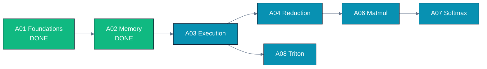

# Track A — GPU Programming Languages

Learn to **write** fast GPU kernels, CUDA and HIP side by side, then Triton, then (optionally)
CuTe/CuTile. You will build the canonical parallel patterns from scratch and understand why the
fast version is fast.

## Modules

| ID | Module | What you build | Status |
|----|--------|----------------|--------|
| [A01](A01.foundations-and-programming-model/) | Foundations & programming model | Vector add, coalescing experiment | **DONE** |
| [A02](A02.memory-hierarchy-and-coalescing/) | Memory hierarchy & coalescing | Bandwidth ceiling, tiled transpose | **DONE** |
| [A03](A03.execution-model-and-occupancy/) | Execution model, occupancy & divergence | Divergence cost, occupancy sweep | **DONE** |
| [A04](A04.parallel-reduction/) | Parallel reduction | The full optimization ladder, benchmarked | **DONE** |
| [A05](A05.parallel-scan-prefix-sum/) | Parallel scan / prefix sum | Hillis–Steele, Blelloch, stream compaction | **DONE** |
| [A06](A06.tiled-matrix-multiply/) | Tiled matrix multiply (GEMM) | Naive → tiled → register-blocked | **DONE** |
| [A07](A07.softmax-and-fused-kernels/) | Softmax & fused kernels | Online softmax, scale+mask+softmax fusion | **DONE** |
| [A08](A08.triton-foundations/) | Triton foundations | Vector add, fused softmax, autotuned matmul | **DONE** |
| [A09](A09.advanced-triton-flash-attention/) | Advanced Triton & FlashAttention | Tiled attention with causal block skipping | **DONE** |
| [A10](A10.cute-cutlass-and-cutile/) | CuTe / CUTLASS / cuTile | WMMA tensor-core GEMM, layout algebra | **DONE** *(NVIDIA-only, optional)* |

**Suggested order.** A01 → A02 → A03 establish the programming model, the memory hierarchy, and how
threads actually execute. A04 → A05 build the reduction and scan primitives that every later kernel
reuses. A06 → A07 are the two kernels that dominate deep learning. A08 → A09 rewrite that knowledge in
Triton and fuse attention. A10 is optional and NVIDIA-only — AMD readers can skip it without losing
the thread (it names the Composable Kernel / hipBLASLt / MFMA counterparts to read instead).

See the top-level [CURRICULUM.md](../../CURRICULUM.md) for the dependency graph and learning paths.

## Legacy raw examples

The folders `01.hello_world/`, `02.vector_add/`, and `03.hip_directives/` are the original
hand-written examples this repository started from. They are kept as raw reference material and are
being progressively refactored into the structured module format. **Start with `A01`**, which
absorbs and upgrades the hello-world and vector-add material into the full 9-section template
(with error checking, a CUDA path, a Triton path, profiling, and drills).
