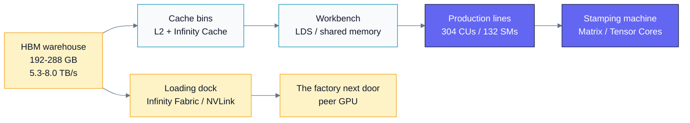
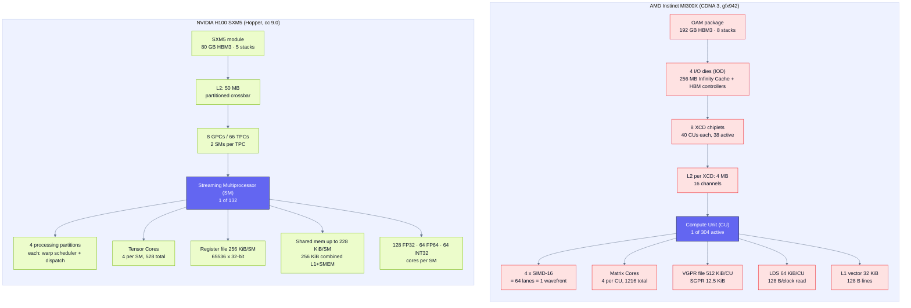
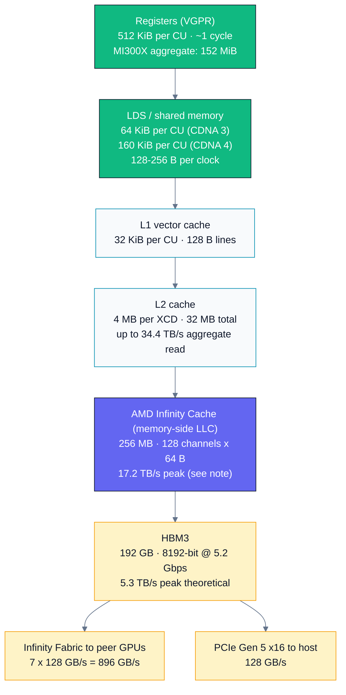
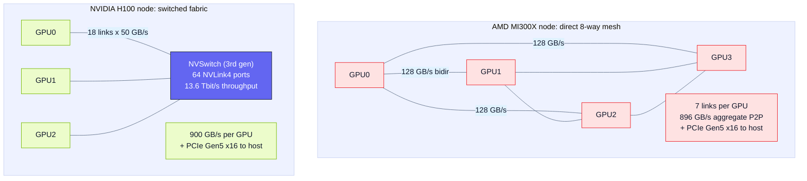
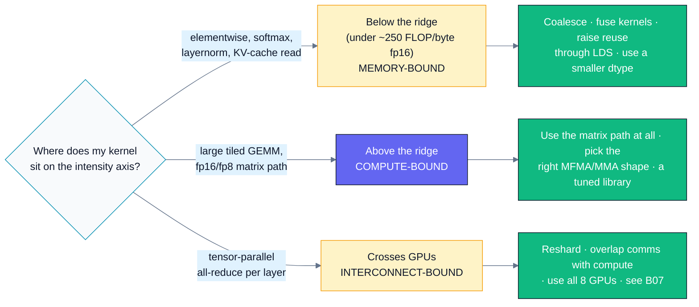
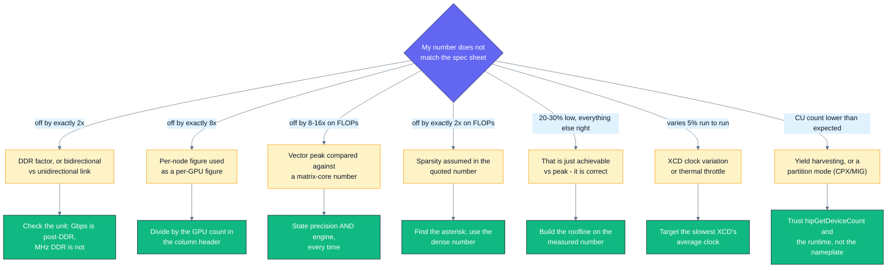

# B01 — Accelerator Architecture (AMD CDNA vs NVIDIA Hopper)

> Track B · Module 01 · Status: **DONE** · Est. 6 hours · Depth 2/5
>
> Prerequisites: [A01](../../A-gpu-programming/A01.foundations-and-programming-model/README.md)
> (kernels, grid/block/thread, error checking, event timing) and ideally
> [A02](../../A-gpu-programming/A02.memory-hierarchy-and-coalescing/README.md) (coalescing, the
> memory pyramid). Backends: AMD (`hipcc`) · NVIDIA (`nvcc`).
> Setup: [SETUP.md](../../../docs/SETUP.md) ·
> Terms: [GLOSSARY.md](../../../docs/GLOSSARY.md) · Sources: [REFERENCES.md](../../../docs/REFERENCES.md).
>
> **Every hardware figure in this module is cited to an AMD or NVIDIA document with a
> retrieval date.** Where two official sources disagree, both are shown and the
> disagreement is named. Where a figure could not be verified, it is omitted rather
> than guessed. That discipline *is* the module.

---

## 1. TL;DR + Layman analogy

**TL;DR.** A data-center GPU is not "a big pile of cores". It is a **factory floor**
with a specific, knowable structure: hundreds of near-identical
[execution engines](../../../docs/GLOSSARY.md#sm-nvidia-and-cu-amd)
(AMD **CU**, NVIDIA **SM**), each
holding a big register file and a software-managed
[scratchpad](../../../docs/GLOSSARY.md#shared-memory-nvidia-and-lds-amd); a
specialized **[matrix engine](../../../docs/GLOSSARY.md#tensor-core-nvidia-and-matrix-core-amd)**
inside each one that does exactly one
shape of small matrix multiply, absurdly fast; a deep cache hierarchy fed by HBM at
terabytes per second; and — on modern parts — several **compute chiplets** in one
package that are *not* uniformly close to memory. Every performance number you will
ever meet is a consequence of those five facts. Learn the structure now and every
later measurement becomes explainable instead of magical.

**Layman analogy — the factory.** Picture a factory:

| Factory | GPU |
|---|---|
| **Production lines** — hundreds of them, each with a small team | **CUs / SMs** — 304 on an MI300X, 132 on an H100 SXM |
| **Toolbox at each workstation** | **Registers (VGPRs)** — instant access, tiny, per worker |
| **Workbench beside the line** | **LDS / shared memory** — fast, shared by the team, must be loaded by hand |
| **Parts bins near the floor** | **L1 / L2 / Infinity Cache** — automatically stocked from the warehouse |
| **The warehouse across the yard** | **HBM** — enormous, and the trip is slow even though the truck is huge |
| **A specialized machine that stamps exactly one part shape, an order of magnitude faster than doing it by hand — and only that shape** | **Matrix Cores / Tensor Cores** — fixed-shape mixed-precision matrix multiply |
| **The loading dock** | **Infinity Fabric / NVLink** — how this factory talks to the factory next door |
| **Two buildings sharing one yard** | **Chiplets (XCDs)** — same package, but not the same distance to every warehouse door |

The analogy is *load-bearing*, meaning it predicts real behaviour:

- Adding production lines does nothing if the warehouse cannot supply parts fast
  enough. → **A [memory-bound](../../../docs/GLOSSARY.md#memory-bound-compute-bound-and-latency-bound)
  kernel does not get faster on a bigger GPU.**
- The stamping machine is idle if you hand it the wrong part shape. → **Matrix Cores
  only fire for the exact MMA shapes the ISA defines; everything else runs on the
  ordinary vector ALUs, up to ~16× slower.**
- Two buildings sharing a yard means some trips are longer than others. → **NUMA-like
  effects appear *inside* one GPU package (MI300X has 8 XCDs and 4 I/O dies).**

**Where the analogy breaks.** Three places, and knowing them matters:

1. **A factory worker can wait; a GPU lane cannot.** Lanes in a
   [wavefront/warp](../../../docs/GLOSSARY.md#warp-nvidia-and-wavefront-amd) execute
   in lockstep — one instruction drives 64 (AMD) or 32 (NVIDIA) lanes. The GPU hides
   the warehouse trip not by letting a worker wait productively, but by **swapping in
   an entirely different team** (another resident wavefront) mid-trip. Latency hiding
   through massive oversubscription has no clean factory equivalent.
2. **The "trucks" are fixed size whether or not you fill them.** Memory moves in
   cache lines (128 B on CDNA 3/4 L1 and L2; 128 B on NVIDIA L1/L2, delivered as four
   32 B sectors). Asking for 4 bytes still moves 32 or 128. A factory can order one
   bolt.
3. **The stamping machine changes the *precision* of the part, not just the speed.**
   fp8 and fp4 matrix throughput comes from representing numbers with fewer bits.
   That is a numerical accuracy decision disguised as a performance decision — the
   entire subject of [B04](../B04.precision-and-quantization/README.md).



*Read it as a supply chain: the amber boxes are the slow, shared, contended resources
that decide your wall clock, and the indigo boxes are the fast resources everyone
mistakenly assumes are the bottleneck.*

**By the end of this module you can:** name what is physically inside a CU and an SM
and map both onto the programming model from
[A01](../../A-gpu-programming/A01.foundations-and-programming-model/README.md); explain why "this GPU does N
TFLOPs" is a meaningless sentence and say what five qualifiers make it meaningful;
derive peak bandwidth and peak FLOP/s from a spec sheet in thirty seconds and catch
the DDR-factor and sparsity traps; run two labs that print *your* machine's real
architecture and measured peer bandwidth; and state the ratio between your achievable
bandwidth and your achievable matrix throughput — which is the roofline ridge point
you will formalize in [B02](../B02.roofline-and-arithmetic-intensity/README.md).

---

## 2. First Principles

### Start from the transistor budget, not from a diagram

A modern accelerator die has a fixed transistor budget (MI300X: **153 billion**;
H100: **80 billion**).<sup>[[1]](#ref-rocm-workload) [[2]](#ref-h100-wp)</sup> A
designer must spend it. Every architectural feature you will meet is the answer to
"what is the highest-value use of the next billion transistors?" — and for
throughput computing the answers, in order, are:

1. **More execution units**, because the workload is embarrassingly parallel
   ([A01](../../A-gpu-programming/A01.foundations-and-programming-model/README.md)).
2. **More register file**, because you cannot hide memory latency without many
   resident wavefronts, and every resident wavefront needs its own
   [registers](../../../docs/GLOSSARY.md#registers).
3. **More on-chip memory**, because off-chip
   [bandwidth](../../../docs/GLOSSARY.md#bandwidth) is the scarcest resource on the
   chip and every byte served from cache is a byte you did not pay HBM for.
4. **Specialized matrix engines**, because *instruction issue itself* is expensive and
   a matrix instruction amortizes one issue over hundreds of MACs.
5. **Interconnect**, because one package stopped being big enough for a frontier
   model several years ago.

Notice what is *absent*: branch predictors, deep out-of-order machinery, large
per-core caches. A GPU deliberately does not spend transistors making one instruction
stream fast. That is the A01 lesson, restated as a budget.

### Why the matrix engine exists: the energy of an instruction

This is the derivation that makes the fp32-vs-fp16-matrix gap stop being surprising.

Consider a single fp32 fused multiply-add on the vector path. The hardware must:
fetch and decode an instruction, read three operands from the register file, drive
them through the ALU, and write one result back. **The multiply-add is not the
expensive part** — the instruction fetch, decode, and register-file traffic dominate
the energy and the issue slot.

Now consider a `16×16×16` matrix multiply-accumulate: `D = A·B + C` where A, B and C
are 16×16 tiles. That is `16 × 16 × 16 = 4096` multiply-accumulates, i.e. **8192
FLOP**, from **one** instruction issue. The operands are read once and reused 16 times
each inside a systolic/pipelined array. The per-FLOP cost of instruction overhead
falls by three orders of magnitude.

The price is rigidity. The instruction does *that shape only*. CDNA 3 exposes a fixed
menu — `v_mfma_f32_16x16x16_f16`, `v_mfma_f32_32x32x8_f16`, and so on, one entry per
(shape × input type × output type) combination.<sup>[[3]](#ref-mfma-calc)</sup> Feed it
anything else and you are back on the vector ALUs.

**The resulting numbers on one real chip.** MI300X, at one clock, per compute unit per
cycle:<sup>[[4]](#ref-cdna3-wp)</sup>

| Operation | FLOP/CU/clock | MI300X peak | Ratio to fp64 vector |
|---|---:|---:|---:|
| fp64 vector FMA | 128 | 81.7 TFLOP/s | 1× |
| fp32 vector, packed | 256 | 163.4 TFLOP/s | 2× |
| fp16 / bf16 **matrix** | 2048 | 1307.4 TFLOP/s (1.3 PF) | 16× |
| fp8 **matrix** | 4096 | 2614.9 TFLOP/s (2.6 PF) | 32× |
| fp8 matrix, 2:4 sparse | 8192 | 5229.8 TFLOP/s (5.2 PF) | 64× |

*Derivation check, so you never have to trust a table:*
`304 CUs × 2048 FLOP/clock × 2.1 GHz = 1307.4 × 10¹² FLOP/s`. It works out every
time, which is the point of exercise 1.

**A 64× spread on identical silicon at an identical clock.** This is why "the GPU does
N TFLOPs" is not an engineering statement. Without a precision, an engine, and a
sparsity assumption, the sentence is compatible with any of six different numbers.

### Why chiplets exist: reticle limits and yield

You cannot make an arbitrarily large chip. Lithography has a **reticle limit** (the
maximum area a single exposure can pattern), and defect density means yield falls
roughly exponentially with die area — one fatal defect kills the whole die.

The chiplet answer: build several small dies, test them individually, and package the
good ones together. MI300X is **8 accelerator complex dies (XCDs)** on TSMC N5 sitting
on **4 I/O dies (IODs)** on N6, with the XCDs stacked *vertically above* the IODs in a
3D configuration and the IODs carrying the Infinity Cache and HBM
controllers.<sup>[[1]](#ref-rocm-workload) [[4]](#ref-cdna3-wp)</sup> CDNA 4 (MI350
series) keeps 8 XCDs but consolidates to **2 larger IODs**, explicitly to improve
communication and memory latency.<sup>[[5]](#ref-cdna4-wp)</sup>

There is also a *yield harvesting* fact hiding in the CU counts: an MI300X XCD
physically contains **40** CUs but ships with **38 active**;<sup>[[1]](#ref-rocm-workload)</sup>
a full GH100 die has **144** SMs but H100 SXM5 ships **132**.<sup>[[2]](#ref-h100-wp)</sup>
Both vendors disable a few units so a die with a small defect is still sellable.
**Never assume the marketing die diagram equals the shipping configuration — ask the
runtime.** That is precisely what `hip/device_query.cpp` does.

**And here is the cost you pay for chiplets:** a CU on XCD0 and a CU on XCD7 do not
have identical access to every HBM stack, and the XCDs do not even run at identical
clocks — ROCm documents a **3–10% clock variation between XCDs on MI300X**, with XCD0
typically fastest and XCD7 slowest.<sup>[[1]](#ref-rocm-workload)</sup> A single
"GPU" has become a small NUMA machine. Section 3 develops this.

### Why the memory wall keeps getting taller

Put the last two subsections together and something uncomfortable falls out.

Between MI300X and MI355X, AMD raised peak memory bandwidth from **5.3 TB/s to
8.0 TB/s** — a 1.51× improvement, and a genuinely large one.<sup>[[1]](#ref-rocm-workload)</sup>
Over the same step, fp16 matrix throughput went from **1.3 PF to 2.5 PF** (1.9×) and
the new MXFP4 path reaches **10.1 PF**, which is **7.7×** the previous generation's
fp16 rate.<sup>[[6]](#ref-mi350-blog)</sup>

Compute grew faster than bandwidth. The **ridge point moved right**: more kernels are
memory-bound on the new chip than on the old one, even though the new chip has more
of everything. Each generation of lower precision buys compute without buying
bandwidth, so the fraction of your workload that is bandwidth-limited *grows*.

This single trend is the reason Track B exists, and it is why
[B02](../B02.roofline-and-arithmetic-intensity/README.md)'s roofline,
[B03](../B03.profiling-and-bottleneck-analysis/README.md)'s profiling, and
[A07](../../A-gpu-programming/A07.softmax-and-fused-kernels/README.md)'s kernel
fusion are the highest-leverage skills in the curriculum.

---

## 3. Deep Dive

### 3.1 The chip hierarchy



*Read the two columns side by side: the shapes are strikingly similar (package →
memory-side cache → die/cluster → engine → lanes + registers + scratchpad), and the
one structural difference that matters is that AMD's compute is split across **8
separate chiplets each with its own L2**, while NVIDIA's 132 SMs share **one 50 MB
L2** — which is why the AMD side has an extra level and a workgroup-placement concern
that the NVIDIA side does not.*

All figures verified as of 29 Jul 2026 from
[ROCm GPU specifications](#ref-rocm-specs),
[the CDNA 3 white paper](#ref-cdna3-wp),
[the ROCm MI300/MI350 workload guide](#ref-rocm-workload) and
[the H100 architecture white paper](#ref-h100-wp).

#### Side-by-side, the numbers that matter

| Concept | AMD MI300X (CDNA 3) | NVIDIA H100 SXM5 (Hopper) | Source |
|---|---|---|---|
| Engine name | **Compute Unit (CU)** | **Streaming Multiprocessor (SM)** | — |
| Engines shipping | **304** active (8 XCDs × 38) | **132** (of 144 on a full GH100) | [[7]](#ref-rocm-specs) [[2]](#ref-h100-wp) |
| Lockstep bundle | **wavefront = 64** lanes | **warp = 32** lanes | [[7]](#ref-rocm-specs) [[8]](#ref-cuda-cc) |
| Lane organization | 4 × SIMD-16 per CU | 4 processing partitions per SM | [[4]](#ref-cdna3-wp) [[2]](#ref-h100-wp) |
| Scalar cores per engine | 64 stream processors (19,456 total) | 128 FP32 / 64 FP64 / 64 INT32 | [[1]](#ref-rocm-workload) [[2]](#ref-h100-wp) |
| Matrix units per engine | 4 Matrix Cores (1,216 total) | 4 Tensor Cores (528 total) | [[1]](#ref-rocm-workload) [[2]](#ref-h100-wp) |
| Register file per engine | **512 KiB** VGPR + 12.5 KiB SGPR | **256 KiB** = 65,536 × 32-bit | [[7]](#ref-rocm-specs) [[2]](#ref-h100-wp) |
| Scratchpad per engine | **LDS 64 KiB** | **shared memory up to 228 KiB** (256 KiB combined with L1) | [[7]](#ref-rocm-specs) [[9]](#ref-hopper-tuning) |
| L1 data cache | 32 KiB/CU, 128 B lines, 64-way | part of the 256 KiB unified L1/SMEM | [[4]](#ref-cdna3-wp) [[9]](#ref-hopper-tuning) |
| L2 | **4 MB per XCD** (32 MB total, 8 × 4 MB) | **50 MB**, one shared partitioned cache | [[7]](#ref-rocm-specs) [[2]](#ref-h100-wp) |
| Memory-side LLC | **256 MB Infinity Cache** | *(none)* | [[7]](#ref-rocm-specs) |
| Peak engine clock | 2,100 MHz | 1,980 MHz (non-tensor) / 1,830 MHz (tensor) | [[1]](#ref-rocm-workload) [[2]](#ref-h100-wp) |
| Memory | 192 GB HBM3, 8192-bit, **5.3 TB/s** | 80 GB HBM3, 5120-bit, **3.35 TB/s** | [[10]](#ref-mi300x-ds) [[11]](#ref-h100-page) |
| Scale-up link | 7 × Infinity Fabric @ 128 GB/s = **896 GB/s** | 18 × NVLink 4 @ 50 GB/s = **900 GB/s** | [[10]](#ref-mi300x-ds) [[12]](#ref-hopper-blog) |
| Host link | PCIe Gen 5 x16 (128 GB/s) | PCIe Gen 5 x16 (128 GB/s) | [[10]](#ref-mi300x-ds) [[11]](#ref-h100-page) |
| Max threads/block | 1,024 | 1,024 | runtime — see Lab 1 |
| Max resident threads/engine | query it (`maxThreadsPerMultiProcessor`) | 2,048 (cc 9.0) | [[8]](#ref-cuda-cc) |
| Transistors / TDP | 153 B / 750 W | 80 B / up to 700 W | [[1]](#ref-rocm-workload) [[2]](#ref-h100-wp) |

**Three observations a reviewer will expect you to make unprompted:**

1. **AMD has 2.3× the engines and 4× the VGPR per engine; NVIDIA has 3.5× the
   scratchpad per engine and a single large L2.** These are opposite bets. AMD leans
   on many wavefronts and a huge register file to hide latency; NVIDIA leans on a big
   software-managed scratchpad and (on Hopper) asynchronous bulk copies via the Tensor
   Memory Accelerator. Kernels tuned for one philosophy do not automatically perform
   on the other.
2. **The wavefront/warp difference (64 vs 32) is the most common portability bug** and
   the reason [A01](../../A-gpu-programming/A01.foundations-and-programming-model/README.md)
   insists on block sizes that are multiples of 64.
3. **The scale-up bandwidths are nearly identical (896 vs 900 GB/s), and both are
   ~6× smaller than HBM bandwidth.** Hold that ratio: it is why
   [B07](../B07.distributed-training-and-sharding/README.md)'s sharding
   strategies exist, and why "just add another GPU" is not a general answer.

> [!NOTE]
> **MI350 series (CDNA 4) is the same shape with rebalanced numbers**, and the deltas
> are instructive: **256** CUs instead of 304, **160 KiB** LDS per CU instead of 64,
> **2 IODs** instead of 4, LDS read bandwidth doubled to **256 B/clock**, HBM3E at
> **8.0 TB/s**, matrix throughput for ≤16-bit types **doubled**, and TF32 moved *out*
> of hardware to software emulation via bf16.<sup>[[1]](#ref-rocm-workload) [[5]](#ref-cdna4-wp)</sup>
> Fewer, fatter CUs with much more scratchpad — a design explicitly optimized for
> transformer GEMMs, which need large tiles. Note that AMD **removed** a hardware
> data type; peak tables are not monotonically increasing.

### 3.2 Matrix engines in detail

**What the instruction actually is.** A matrix instruction is *wavefront-wide* (AMD) or
*warp-wide* (NVIDIA): the whole 64-lane wavefront cooperates on one MMA, with each
lane holding a defined slice of A, B and C in its registers. Getting data into the
right lane in the right register is the hard part of hand-writing MFMA code, which is
why the [AMD Matrix Instruction Calculator](#ref-mfma-calc) exists — it prints the
element-to-lane mapping for every instruction.

**The fixed menu.** CDNA 3 offers instructions like `v_mfma_f32_16x16x16_f16`
(16×16 output tile, K=16, fp16 inputs, fp32 accumulate) and
`v_mfma_f32_32x32x8_f16`.<sup>[[3]](#ref-mfma-calc)</sup> The naming encodes
`M×N×K` and the types. Two practical consequences:

- **Accumulation is usually wider than input.** `f32_..._f16` means fp16 in, fp32
  accumulate. This is not a courtesy; summing thousands of fp16 products in fp16 loses
  catastrophic precision. [B04](../B04.precision-and-quantization/README.md) makes
  this quantitative.
- **Shape choice is a tuning knob with no universal answer.** ROCm's guidance is that
  for [GEMM](../../../docs/GLOSSARY.md#gemm) kernels on MI300X, `mfma_16x16`
  typically outperforms `mfma_32x32` even at
  large tile sizes.<sup>[[1]](#ref-rocm-workload)</sup> Benchmark; do not reason from
  first principles alone.

**CDNA 4's new formats.** MI350 series adds hardware support for the OCP micro-scaling
formats **MXFP8, MXFP6 and MXFP4** — block floating point with a shared exponent per
32 elements — and doubles execution resources for ≤16-bit types, so each CU "nearly
quadruples the number of operations per cycle" versus CDNA
3.<sup>[[5]](#ref-cdna4-wp)</sup> It also raises transcendental rates 2× specifically
to keep softmax from becoming the bottleneck once the GEMMs got faster — a beautiful
illustration of Amdahl's law shaping silicon.

**Hopper's equivalents.** Fourth-generation Tensor Cores deliver 2× the per-SM MMA rate
of A100 on equivalent types and 4× using the new FP8 type, plus the **Transformer
Engine**, which dynamically chooses between FP8 and 16-bit per layer and handles the
rescaling.<sup>[[2]](#ref-h100-wp)</sup> Hopper also adds the **Tensor Memory
Accelerator (TMA)** for asynchronous bulk global↔shared transfers and **thread block
clusters** with distributed shared memory (direct SM-to-SM access, ~7× faster than
round-tripping through global memory).<sup>[[2]](#ref-h100-wp)</sup> These are not
matrix features per se; they exist because once the matrix units are that fast,
*feeding them* is the problem.

#### The precision table, with sparsity separated out

Peak theoretical, per GPU, verified as of 29 Jul 2026. **Dense** and **sparse** are
kept in separate columns on purpose — conflating them is the single most common
spec-sheet error.

| Precision · engine | MI300X dense | MI300X sparse | MI355X dense | MI355X sparse | H100 SXM5 dense | H100 SXM5 sparse |
|---|---:|---:|---:|---:|---:|---:|
| fp64 vector | 81.7 TF | — | 78.6 TF | — | 33.5 TF | — |
| fp32 vector | 163.4 TF | — | 157.3 TF | — | 66.9 TF | — |
| fp64 matrix/tensor | 163.4 TF | — | 78.6 TF | — | 66.9 TF | — |
| tf32 matrix/tensor | 653.7 TF | — | *(SW via bf16)* | — | 494.7 TF | 989.4 TF |
| fp16 / bf16 matrix | 1.3 PF | 2.6 PF | 2.5 PF | 5.0 PF | 989.4 TF | 1978.9 TF |
| fp8 matrix | 2.6 PF | 5.2 PF | 5.0 PF | 10.1 PF | 1978.9 TF | 3957.8 TF |
| MXFP6 / MXFP4 matrix | — | — | 10.1 PF | — | — | — |

Sources: MI300X and MI355X from [ROCm workload guide](#ref-rocm-workload), the
[CDNA 3](#ref-cdna3-wp) and [CDNA 4](#ref-cdna4-wp) white papers and the
[MI350 series blog](#ref-mi350-blog); H100 from the
[H100 architecture white paper](#ref-h100-wp) and
[H100 product page](#ref-h100-page).

Three things to notice, because they are the whole point of the table:

- **fp64 matrix went *down* from MI300X (163.4 TF) to MI355X (78.6 TF).** CDNA 4 traded
  double-precision matrix throughput for low-precision AI throughput. If you run
  HPC codes, the newer chip is *worse* at your workload on that axis. Peaks are not
  monotone across generations, and "newer is faster" is not a safe assumption.
- **MI300X has hardware TF32; MI355X emulates it in software via
  bf16.**<sup>[[1]](#ref-rocm-workload)</sup> A framework that silently relies on
  TF32 will change behaviour across the generation boundary.
- **On H100, fp32 vector to fp8 tensor sparse spans 66.9 TF → 3957.8 TF: a 59× range
  on one chip.** Any TFLOPs claim without precision + engine + sparsity is compatible
  with a ~60× range of realities.

### 3.3 The memory system



*The pyramid spans roughly **three orders of magnitude in bandwidth** from register
file to PCIe — 34.4 TB/s of L2 read bandwidth down to 128 GB/s to the host — and the
whole craft of GPU performance engineering is moving work upward through those green
and blue levels before the amber ones become your ceiling.* All MI300X figures from
[ROCm GPU specifications](#ref-rocm-specs), the
[CDNA 3 white paper](#ref-cdna3-wp) and the
[MI300X data sheet](#ref-mi300x-ds), verified 29 Jul 2026.

#### HBM: capacity and bandwidth, generation by generation

| Product | Memory | Interface | Rate | Peak bandwidth | Source |
|---|---|---|---|---:|---|
| MI300X | 192 GB HBM3 (8 × 24 GB) | 8192-bit | 5.2 Gbps | **5.3 TB/s** | [[10]](#ref-mi300x-ds) [[4]](#ref-cdna3-wp) |
| MI300A | 128 GB HBM3 (8 × 16 GB), **unified with CPU** | 8192-bit | 5.2 Gbps | **5.3 TB/s** | [[13]](#ref-mi300a-ds) [[4]](#ref-cdna3-wp) |
| MI325X | 256 GB HBM3E | 8192-bit | 6.0 Gbps | **6.0 TB/s** | [[4]](#ref-cdna3-wp) |
| MI350X / MI355X | 288 GB HBM3E (8 × 36 GB) | 8192-bit | 8.0 Gbps | **8.0 TB/s** | [[5]](#ref-cdna4-wp) |
| H100 SXM5 | 80 GB HBM3 (5 stacks) | 5120-bit | 2619 MHz DDR | **3.35 TB/s** | [[2]](#ref-h100-wp) [[11]](#ref-h100-page) |
| H100 PCIe | 80 GB HBM2e | 5120-bit | 1593 MHz DDR | **~2.0 TB/s** | [[2]](#ref-h100-wp) |

**The trap in that table:** AMD quotes **Gbps** (a transfer rate, DDR already applied);
NVIDIA's whitepaper quotes **MHz DDR** (a clock, DDR *not* applied). Same physics,
different convention, factor of two between them. Exercise 1 drills exactly this.

#### Cache lines and transaction granularity

This is where architecture meets the
[coalescing](../../../docs/GLOSSARY.md#coalescing) lesson from
[A02 §2](../../A-gpu-programming/A02.memory-hierarchy-and-coalescing/README.md#2-first-principles).

| | AMD CDNA 3 / CDNA 4 | NVIDIA (Volta and later) |
|---|---|---|
| L1 line | **128 B** (doubled from 64 B in CDNA 2) | **128 B** |
| L2 line | **128 B** read; channels support a **64 B half-line write** | **128 B**, accessed as **4 × 32 B sectors** |
| Smallest transfer | 128 B line at L1 | **32 B sector** |
| Infinity Cache channel | 64 B wide, 128 channels | *(no equivalent)* |
| Optimal per-lane access | 16 B (`global_load_dwordx4`); a 64-lane wavefront then touches 512 B contiguous | 4 B/lane × 32 lanes = 128 B = 4 sectors, ratio 4 sectors per request |

Sources: [CDNA 3 white paper](#ref-cdna3-wp) and [CDNA 4 white
paper](#ref-cdna4-wp) for the AMD side; [Nsight Compute Profiling
Guide](#ref-ncu-guide) and [NVIDIA's global-memory-access
blog](#ref-nv-coalescing) for the NVIDIA side. Verified 29 Jul 2026.

**Why the 32 B sector matters.** On NVIDIA, a perfectly coalesced warp load of 4 B per
lane produces **1 request → 4 sectors**. A stride-32 access produces **1 request → 32
sectors**: the memory system moves 1,024 B to deliver 128 useful
bytes.<sup>[[15]](#ref-nv-coalescing)</sup> The A02 coalescing lab's `1/stride`
bandwidth curve is a direct consequence of this number, and now you know where the
number comes from.

#### Latency versus bandwidth: the distinction people conflate

These are different quantities and improving one can *worsen* the other.

- **Latency** is how long one request takes end to end (hundreds of cycles to HBM).
  Hardware does almost nothing to reduce it — DRAM physics sets it. A GPU **hides**
  it by having many resident wavefronts, so that while one waits, another issues.
- **Bandwidth** is how many bytes/second flow when many requests are in flight. This
  is what the datasheet quotes and what a streaming kernel consumes.

The bridge between them is
**[Little's Law](../../../docs/REFERENCES.md#littles-law-little-1961)**:
`concurrency = bandwidth × latency`. To
sustain 5.3 TB/s at, say, 600 ns of load-to-use latency you need roughly
`5.3e12 × 600e-9 ≈ 3.2 MB` of memory requests **in flight simultaneously**. That is
the real, physical reason a GPU needs thousands of resident threads and why ROCm
recommends a minimum of **1,024 workgroups** in a grid on
MI300X.<sup>[[1]](#ref-rocm-workload)</sup>
[Occupancy](../../../docs/GLOSSARY.md#occupancy) is not a vanity metric; it is
the mechanism by which bandwidth is reachable at all.

The practical corollary: **caches on a GPU are bandwidth amplifiers first and latency
reducers second.** AMD says so explicitly about Infinity Cache — its listed benefits
are "bandwidth amplification" and "power and latency
reduction," in that order.<sup>[[14]](#ref-hotchips-mi300x)</sup>

> [!WARNING]
> ### 🔍 Two official AMD documents, two Infinity Cache bandwidths
>
> - The [CDNA 3 white paper](#ref-cdna3-wp) states: *"The peak bandwidth from the
>   Infinity Cache is an astounding **17.2 TB/s**."*
> - AMD's [Hot Chips 2024 MI300X presentation](#ref-hotchips-mi300x) states:
>   *"256 MB at **14.7 TB/s** peak BW."*
>
> Both are official AMD material about the same product. The likely explanation is a
> different measurement boundary — the whitepaper's own memory-hierarchy figure
> annotates *three* distinct aggregate figures (51.6 TB/s, 17.2 TB/s, 5.3 TB/s) for
> different edges of the hierarchy, so "the" cache bandwidth depends on which arrow
> you measure. **This module does not resolve the discrepancy; it reports it.** For
> planning, use the smaller figure. If the number is load-bearing for a design,
> measure the cliff yourself (size a benchmark buffer just under and just over
> 256 MB) and ask your AMD field application engineer which boundary each figure
> describes. Exercise 2, claim 4 is this exact situation.

### 3.4 Chiplets, packaging, and NUMA inside one GPU

MI300X: **8 XCDs** (TSMC N5) stacked vertically on **4 IODs** (TSMC N6) that carry the
Infinity Cache and eight HBM3 stacks, all tied together by on-package Infinity Fabric
— 2.5D interposer plus 3D die stacking, 153 billion
transistors.<sup>[[4]](#ref-cdna3-wp) [[1]](#ref-rocm-workload)</sup>

Four consequences that show up in your profiler:

1. **L2 is per-XCD, not per-GPU.** Each XCD has its own 4 MB L2 shared by its 38 CUs.
   Two workgroups that share data land on the same L2 only if they land on the same
   XCD. ROCm's tuning guidance: because both MI300X and MI350X have 8 XCDs, use
   **multiples of 8** for workgroup counts to get even XCD distribution, and place
   data-sharing workgroups on the same XCD to reduce latency and improve benchmark
   stability.<sup>[[1]](#ref-rocm-workload)</sup> **That is a NUMA placement
   optimization, inside a single GPU.**
2. **Clocks differ between dies.** ROCm documents **3–10%** clock variation across
   XCDs on MI300X, XCD0 typically highest and XCD7 lowest, and advises computing
   achieved-efficiency targets against the **slowest** XCD's average clock — otherwise
   your target (e.g. 95% for DGEMM) is unreachable by
   construction.<sup>[[1]](#ref-rocm-workload)</sup> If you have ever seen a kernel's
   time vary 5% run to run for no visible reason, this is a candidate cause.
3. **The GPU can be partitioned.** MI300X supports SPX (all 8 XCDs as one device),
   DPX (4), QPX (2) and CPX (1 XCD, 24 GB), combined with NPS memory partitioning
   modes.<sup>[[1]](#ref-rocm-workload)</sup> One physical GPU can present as up to
   eight logical devices — which is why `hipGetDeviceCount()` is the truth and a
   nameplate is not. NVIDIA's analogue is **MIG**, up to 7 instances on H100 with
   separately partitioned L2 banks, memory controllers and DRAM address
   buses.<sup>[[2]](#ref-h100-wp) [[11]](#ref-h100-page)</sup>
4. **The Infinity Cache is *memory-side*, and that is a deliberate design choice.**
   AMD designed it to cache the contents of memory rather than absorb dirty lines
   evicted from L2. Two benefits follow: it does not participate in coherency (no
   snoop traffic, lower latency for lower-level snooping) and it can hold nominally
   uncacheable memory such as I/O buffers.<sup>[[4]](#ref-cdna3-wp)</sup> The L2, by
   contrast, is the lowest level where hardware maintains coherency automatically.

H100 is comparatively monolithic — one GH100 die, one 50 MB L2 (itself a partitioned
crossbar that localizes data for the GPCs directly attached to each
partition<sup>[[2]](#ref-h100-wp)</sup>) — so the *within-package* NUMA story is much
weaker. On Hopper the analogous locality concern moves up a level, into thread block
clusters and distributed shared memory.

### 3.5 Scale-up interconnect



*The topologies differ in kind, not just in bandwidth: AMD wires every GPU directly to
every other GPU (a full mesh, so a pair's bandwidth is one link's worth), while NVIDIA
routes all traffic through NVSwitch (so any pair can use a GPU's full link budget) —
which is why an AMD collective wants **all 8 GPUs participating** to engage all seven
of each GPU's links, whereas an NVSwitch pair-wise transfer can already saturate.*

| | AMD MI300X | AMD MI355X | NVIDIA H100 SXM5 |
|---|---|---|---|
| Technology | 4th Gen Infinity Fabric | 4th Gen Infinity Fabric | NVLink 4 + 3rd-gen NVSwitch |
| Per-link rate | 32 Gbps → **128 GB/s** bidirectional | 38.4 Gbps → **153.6 GB/s** bidirectional | 50 GB/s bidirectional (25 GB/s each way) |
| Links per GPU | **7** (+1 PCIe Gen 5) | **7** of 8 (one configured for PCIe Gen 5) | **18** |
| Aggregate P2P | **896 GB/s** | **1,075.2 GB/s** | **900 GB/s** |
| Topology | direct full mesh, 8 GPUs | direct full mesh, 8 GPUs | switched via NVSwitch |
| Host link | PCIe Gen 5 x16, 128 GB/s | PCIe Gen 5 x16, 128 GB/s | PCIe Gen 5, 128 GB/s |

Sources: [MI300X data sheet](#ref-mi300x-ds), [MI300 Series cluster reference
guide](#ref-mi300-cluster), [ROCm workload guide](#ref-rocm-workload),
[CDNA 4 white paper](#ref-cdna4-wp), [NVIDIA Hopper Architecture
In-Depth](#ref-hopper-blog), [H100 product page](#ref-h100-page). Verified 29 Jul 2026.

**Why interconnect bandwidth sets the ceiling for tensor parallelism** (the forward
reference to [B07](../B07.distributed-training-and-sharding/README.md)):

Tensor parallelism splits each weight matrix across `N` GPUs. Every layer therefore
ends with a collective (all-reduce or all-gather) to recombine partial results. That
collective runs at **fabric speed**, and the fabric is ~6× slower than HBM
(896 GB/s vs 5.3 TB/s on MI300X; 900 GB/s vs 3.35 TB/s on H100). Concretely:

```
[8192, 8192] bf16 activation            = 8192 x 8192 x 2 B = 134.2 MB
ring all-reduce moves ~2(N-1)/N x size  = 1.75 x 134.2 MB   ≈ 235 MB per GPU (N=8)
at ~700 GB/s achieved aggregate         ≈ 0.34 ms per all-reduce
x 80 transformer layers                 ≈ 27 ms of pure communication per forward pass
```

If your GEMMs take less than 27 ms, **you are now an interconnect-bound system** and
adding GPUs makes it worse, not better. This calculation — not a TFLOPs number — is
what decides how far a model can shard. Two more consequences:

- **AMD collectives want all 8 GPUs.** ROCm's guidance is explicit: with 2 or 4 GPUs
  you "can only use a fraction of the potential bandwidth" of the
  node.<sup>[[1]](#ref-rocm-workload)</sup> A direct mesh only delivers its aggregate
  when every link is busy.
- **"Bidirectional" is a factor-of-two trap.** A 128 GB/s bidirectional link is
  64 GB/s in each direction. A symmetric ring all-reduce genuinely uses both; a
  one-way `hipMemcpyPeer` does not. Lab 2 measures the unidirectional case
  specifically so you see the 2× yourself.

### 3.6 Unified and APU memory: MI300A

Everything in A01's host/device dance — `hipMalloc`, `hipMemcpy` H2D, kernel,
`hipMemcpy` D2H — exists because the GPU has *its own* memory across a slow bus. The
**MI300A APU deletes that premise.**

MI300A integrates, in one socket:<sup>[[13]](#ref-mi300a-ds) [[4]](#ref-cdna3-wp) [[16]](#ref-mi300a-overview)</sup>

- **6 XCDs** with 38 CUs each = **228 CDNA 3 compute units** (25% less GPU than
  MI300X, to make room for the CPU)
- **3 CCDs** with 8 "Zen 4" x86 cores each = **24 CPU cores**
- **128 GB of HBM3** (8 × 16 GB stacks) presenting **a single shared address space to
  both CPU and GPU**, at 5.3 TB/s
- **256 MB Infinity Cache shared between the XCDs and the CPU cores**
- Full hardware cache coherence across the whole thing

**What changes for the programmer.** With `HSA_XNACK=1` (the unified-shared-memory
mode), there are **no explicit host↔device copies**: the GPU page-faults on host
pointers and the pages migrate or are accessed in place. A pointer from `malloc` is a
valid kernel argument. AMD's stated motivation is exactly this — eliminating
host/device copies, and saving system power and area by removing DIMMs and the
CPU↔GPU link entirely.<sup>[[4]](#ref-cdna3-wp)</sup>

**What does *not* change.** Coalescing still matters. Cache lines are still 128 B. The
memory hierarchy is identical. Occupancy still governs whether you can reach 5.3 TB/s.
Unified memory removes a *data-movement* problem, not a *bandwidth* problem — and it
introduces a new one: the CPU and GPU now **compete for the same HBM bandwidth**, so a
memory-hungry CPU thread can starve your kernel in a way that is impossible on a
discrete part.

**How to detect it in code, portably:** `hipDeviceProp_t::integrated`,
`managedMemory` and `concurrentManagedAccess` — all printed by Lab 1. Never branch on
a device *name*; branch on the capability. (H100 has an analogous story via Grace
Hopper's NVLink-C2C CPU↔GPU coherence, but this module does not quote figures for it
because they were not verified here.)

### 3.7 How to read a spec sheet critically

The synthesis of everything above, as a checklist you can apply in a meeting.

**Peak numbers are ceilings you will never reach.** Every one is a product of
`units × lanes × clock × ops-per-lane-per-clock`, computed assuming perfect issue,
perfect data supply, no refresh, no ECC overhead, no thermal throttle and no clock
variation between dies. They are correct *and* unreachable, simultaneously.

**The five questions that turn a marketing number into an engineering number:**

| Question | Why it changes the answer | Typical factor |
|---|---|---|
| **Which precision?** | fp64 → fp4 spans the whole design | up to 32× |
| **Which engine?** | vector ALU vs matrix core | 8–16× |
| **Sparsity assumed?** | 2:4 structured sparsity doubles the peak *and* requires pruned weights | 2× |
| **Per GPU or per node?** | an 8-OAM platform figure is 8× a device figure | 8× |
| **Peak or measured?** | and if measured, on which workload, at which clock, on which XCD? | 1.2–3× |

**The three questions that are actually useful**, and all three are measurements, not
lookups:

1. **What is my *achievable* bandwidth?** Run the most bandwidth-friendly kernel that
   exists — a coalesced grid-stride copy on buffers much larger than the last-level
   cache — and use its number. That is
   [`exercises/03_measure_vs_spec.cpp`](exercises/03_measure_vs_spec.cpp) and A02's
   `bandwidth` lab. Expect **70–90% of peak** and treat that as the ceiling.
2. **What is my *achievable* matrix throughput?** Run a large well-tuned GEMM through
   hipBLASLt or cuBLAS at your precision and shape, and use *that* as the compute
   ceiling. A hand-written kernel will not beat a tuned library, so the library's
   number is your realistic roof.
3. **What is the ratio between them?** `achievable_FLOPs / achievable_bytes_per_s` is
   the **[roofline](../../../docs/REFERENCES.md#roofline-williams-et-al-2009) ridge
   point** in FLOP/byte. Kernels below it are memory-bound;
   above it, compute-bound. That single number tells you what kind of optimization
   will help before you write a line of code — and it is the first thing
   [B02](../B02.roofline-and-arithmetic-intensity/README.md) builds.

**One more habit: record the date.** Vendors revise datasheets. "MI300X memory
bandwidth is 5.3 TB/s (AMD MI300X data sheet, retrieved 29 Jul 2026)" is a citation
someone can audit. "MI300X does 5.3 TB/s" is folklore in twelve months.

---

## 4. Hands-On Labs

Both labs are **introspective**: they have no PASS/FAIL, because their output *is* the
deliverable. You will feed those numbers into the written drills, and into
[B02](../B02.roofline-and-arithmetic-intensity/README.md)'s
roofline. Run them on the machine you actually plan to optimize on.

```bash
# AMD
make hip            GPU_ARCH=gfx942     # build both hip/ labs
make run-hip                            # run them

# NVIDIA
make cuda           SM_ARCH=sm_90       # build both cuda/ labs
make run-cuda                           # run them
```

There is no `triton/` directory in this module, deliberately: nothing here is a
kernel-authoring exercise. This module is about *reading the machine*, and the runtime
APIs that expose it are C/C++ (`hipGetDeviceProperties`, `cudaGetDeviceProperties`).
Triton returns in [A08](../../A-gpu-programming/A08.triton-foundations/README.md) and B02.

The drills are self-contained too: [`exercises/`](exercises/) and
[`solutions/`](solutions/) each have their own `Makefile`, so you can
`cd exercises && make run` without coming back here. From this directory,
`make exercises` / `make solutions` build them in place, and `make clean` cleans all
three.

> **Match `GPU_ARCH` to your GPU.** `gfx950` = MI350 series, `gfx942` = MI300 series,
> `gfx90a` = MI200 series, `gfx1100` = RDNA 3. Find yours with
> `/opt/rocm/bin/offload-arch` (or `rocminfo | grep gfx`).
>
> **Troubleshooting**
> - `error while loading shared libraries: libamdhip64.so.7` — the loader cannot find
>   the ROCm runtime. The Makefile bakes an rpath to `$(HIP_PATH)/lib`, so freshly
>   built binaries are self-contained; if you build by hand, add
>   `-Wl,-rpath,/opt/rocm/lib`.
> - `hipErrorNoBinaryForGpu` / `device kernel image is invalid` — built for the wrong
>   arch. Rebuild with the correct `GPU_ARCH`.
> - **Both labs print a clear message and exit 0 when no GPU is visible.** If you see
>   that on a machine that has one, check `HIP_VISIBLE_DEVICES` /
>   `CUDA_VISIBLE_DEVICES` and, in a container, that `/dev/kfd` and `/dev/dri` (AMD)
>   or `--gpus all` (NVIDIA) were passed through.

### Lab 1 — Your machine's real architecture (`device_query`)

Files: [`hip/device_query.cpp`](hip/device_query.cpp) ·
[`cuda/device_query.cu`](cuda/device_query.cu).

Prints arch name, CU/SM count, clocks, HBM size, L2 size, LDS/shared memory per block
and per engine, register counts, warp/wavefront size, max threads per block and per
engine, the host/device memory-model flags, and then **three derived ceilings**:
theoretical peak HBM bandwidth, a deliberately conservative vector-FMA FLOP/s estimate,
and the ratio of the two.

**Every value comes from the runtime.** There is no hardcoded table in either file —
that is the design constraint, and it is why the labs remain correct on hardware that
did not exist when they were written.

**What to observe:**

- **Compare the reported CU/SM count against the marketing number.** If you are on
  MI300X you should see **304**, not 320 (8 × 40) — the yield-harvesting fact from
  Section 2 made visible.
- **Compare the derived peak bandwidth against the datasheet.** On MI300X the
  derivation `2 × 2600 MHz × 8192 bits / 8 = 5324.8 GB/s` should reproduce AMD's
  5.3 TB/s. If your driver reports a zero clock or bus width, the program says
  **"unavailable"** rather than printing a fabricated number — copy that behaviour
  into your own tools.
- **Notice how conservative the FLOP/s estimate is, and why.** It reports a
  vector-FMA lower bound and explicitly tells you that matrix/tensor throughput is
  *not exposed in device properties at all*. There is no runtime API that will tell
  you your chip's matrix peak. That is a real, permanent limitation, and it is why
  Section 3.2's table had to be built from cited documents.
- **On an APU (MI300A), watch `integrated` and `concurrentManagedAccess` flip.** That
  is Section 3.6 made concrete: the same binary can discover it does not need copies.

### Lab 2 — The interconnect, measured (`topology`)

Files: [`hip/topology.cpp`](hip/topology.cpp) · [`cuda/topology.cu`](cuda/topology.cu).

Enumerates every visible device, then for every ordered pair reports **(a)** whether
direct peer addressing is possible, **(b)** the runtime's own performance rank for the
link, **(c)** whether native device-scope atomics work across it, and finally **(d)**
a *measured* unidirectional 256 MiB copy bandwidth from device 0 to each peer.

**What to observe:**

- **A fully `Y` matrix is the 8-GPU direct mesh** (MI300X OAM baseboard) or the
  NVSwitch fabric. Any `.` entry means that pair must stage through host memory —
  crossing PCIe **twice** — and that changes which parallelism strategy is viable.
- **Compare the measured GB/s against the *right* spec number.** An MI300X Infinity
  Fabric link is 128 GB/s **bidirectional**, so a one-way copy competes for at most
  **64 GB/s**. Comparing your measurement against 128 (or worse, against the 896 GB/s
  aggregate) will make a perfectly healthy link look broken. This is the single most
  common interconnect arithmetic error.
- **Watch the performance-rank matrix for structure.** All zeros means a uniform
  fabric. Stepped values mean some pairs are further apart — a topology you must
  respect when you assign ranks to GPUs in a distributed job.
- **On a single-GPU machine the lab says so and exits cleanly.** That is the correct
  behaviour, not a failure; the single-GPU architecture story is complete without it.

### Lab 3 (drill) — Spec versus reality

[`exercises/03_measure_vs_spec.cpp`](exercises/03_measure_vs_spec.cpp) measures
achieved copy bandwidth and prints it as a percentage of the peak derived from your
device's own properties. It ships with three TODOs and **deliberately fails** until
you complete them — see
[`exercises/README.md`](exercises/README.md#sample-sandbox-output) for the exact
before/after output and what each failure is teaching.

---

## 5. Performance Analysis

This module produces no optimization delta of its own. Its output is the **two
ceilings** that every later measurement in Track B is judged against, plus the ratio
between them. Getting those two numbers right is the analysis.

### Peak versus achievable: the numbers to hold

| Ceiling | Where it comes from | Realistic fraction of peak | How you get it |
|---|---|---|---|
| **Memory bandwidth** | `2 × mem_clock × bus_width/8`, from device properties | **70–90%** | coalesced grid-stride copy, buffers ≫ LLC |
| **Matrix throughput** | vendor document (no runtime API exposes it) | **50–80%** for a well-tuned large GEMM | large GEMM through hipBLASLt / cuBLAS |
| **Vector FP32** | `2 × units × lanes × clock` (×2 again if packed) | **80–95%** for a pure FMA loop | rarely the binding constraint |
| **Peer bandwidth** | `links × per-link rate`, halved for unidirectional | **60–85%** of the per-direction figure | Lab 2, then `rccl-tests` / `nccl-tests` |

### The ridge point, computed from cited peaks

```
ridge_point = peak_compute_FLOP_per_s / peak_bandwidth_bytes_per_s        [FLOP/byte]
```

Using the verified figures from Section 3 (all peak theoretical, dense, per GPU):

| Device | Precision · engine | Peak compute | Peak bandwidth | **Ridge point** |
|---|---|---:|---:|---:|
| MI300X | fp32 vector | 163.4 TF | 5.32 TB/s | **30.7 FLOP/byte** |
| MI300X | fp16 matrix | 1307.4 TF | 5.32 TB/s | **245 FLOP/byte** |
| MI300X | fp8 matrix | 2614.9 TF | 5.32 TB/s | **491 FLOP/byte** |
| MI355X | fp16 matrix | 2500 TF | 8.00 TB/s | **313 FLOP/byte** |
| MI355X | MXFP4 matrix | 10100 TF | 8.00 TB/s | **1263 FLOP/byte** |
| H100 SXM5 | fp32 vector | 66.9 TF | 3.35 TB/s | **20.0 FLOP/byte** |
| H100 SXM5 | fp16 tensor | 989.4 TF | 3.35 TB/s | **295 FLOP/byte** |
| H100 SXM5 | fp8 tensor | 1978.9 TF | 3.35 TB/s | **590 FLOP/byte** |

Now place real kernels on that axis:

| Kernel | Arithmetic intensity | Verdict on any of the above |
|---|---:|---|
| `vector_add` (A01) | ~0.083 FLOP/byte | hopelessly memory-bound |
| copy / elementwise | ~0.1–0.5 | memory-bound |
| softmax, layernorm | ~1–5 | memory-bound |
| **non-tiled** matmul | ~2 | memory-bound (!) |
| **tiled** matmul, tile T | ~T/2 | crosses over around T ≈ 64–128 |
| Large training GEMM, fused | 100s–1000s | compute-bound |



*The single most consequential fact on this chart: with a fp16 ridge point around
250–300 FLOP/byte, **almost everything in a transformer except the big GEMMs is
memory-bound**, which is why fusion and dtype reduction beat "more FLOPs" almost every
time.*

### The measurement that ties it together

Run [`exercises/03_measure_vs_spec.cpp`](exercises/03_measure_vs_spec.cpp) and note
your achieved-versus-peak ratio. Then **rebuild the ridge-point table above using your
achieved bandwidth instead of the peak.** The ridge point moves *right* (a smaller
denominator, same numerator), meaning even *more* of your workload is memory-bound
than the datasheet arithmetic suggested.

That is the honest picture, and it is the one
[B02](../B02.roofline-and-arithmetic-intensity/README.md) formalizes. Profiling commands
(`rocprofv3`, `nsys`, `ncu`) are
[B03](../B03.profiling-and-bottleneck-analysis/README.md)'s subject; this module deliberately stops at what
you can establish with the runtime API and a stopwatch, because a number you derived
yourself is a number you will not misquote.

---

## 6. Challenges, Drawbacks & Tradeoffs



*Every branch on this tree is a factor-of-2, factor-of-8 or factor-of-16 error that a
competent engineer makes at least once — the tree exists so that you make each of them
exactly once.*

### Pitfall 1 — Quoting a peak as if it were achievable

The most common failure in performance conversations. "The GPU does 1.3 PFLOPs so our
model should train in X hours" is off by a factor of two to ten before you start,
because peak assumes perfect issue, perfect data supply, no throttle, and no clock
variation. **Always say "peak theoretical" out loud, and always pair it with a
measured or assumed-achievable fraction.**

### Pitfall 2 — Comparing across precisions or engines

MI300X's fp8 matrix peak (2.6 PF) is **32×** its fp64 vector peak (81.7 TF) on the
same silicon. Comparing your kernel's fp32 throughput against a matrix-core headline
number produces a "we're at 3% of peak!" panic when you may in fact be at 90% of the
ceiling you are actually able to reach. **Compare like with like, or the comparison is
noise.**

### Pitfall 3 — The sparsity asterisk

Every "with structured sparsity" figure is exactly 2× the dense figure and requires
2:4-pruned weights. Dense models — nearly all deployed LLMs — cannot reach it *in
principle*. Read the asterisk.

### Pitfall 4 — Per-node figures used per GPU

"10.4 PF BF16" for an 8×MI300X platform becomes 1.3 PF per GPU. An 8× planning error
is not recoverable by optimization.

### Pitfall 5 — Ignoring the fabric until integration week

HBM is ~6× faster than the scale-up fabric, so the moment a model crosses GPUs, the
fabric — not the GPU — is the design constraint. Teams that size a system on FLOPs and
HBM alone discover this during integration. **Do the all-reduce arithmetic from
Section 3.5 at design time.**

### Pitfall 6 — Assuming a GPU package is uniform

On MI300X, L2 is per-XCD, clocks vary 3–10% between XCDs, and workgroup counts that
are not multiples of 8 distribute unevenly.<sup>[[1]](#ref-rocm-workload)</sup> A
single "GPU" is a small NUMA machine, and treating it as uniform costs a few percent
silently and a lot loudly when you are chasing the last 10%.

### Pitfall 7 — Hardcoding architecture in code

The reason both labs in this module query everything at runtime: hardcoded CU counts,
warp sizes and cache sizes are wrong on the next SKU, wrong under partitioning
(CPX/MIG), and wrong in a container with a device mask. **Branch on capability flags,
never on a device name string.**

### Tradeoffs to hold in mind

- **Low precision buys throughput and costs accuracy** — and, because it does not buy
  bandwidth, it makes the memory wall *relatively* taller.
  [B04](../B04.precision-and-quantization/README.md) quantifies the accuracy
  side.
- **Matrix cores buy 8–16× and cost flexibility.** You must reshape your data to the
  ISA's fixed tiles and reason about lane-to-element mappings. Libraries
  (hipBLASLt, [CUTLASS](../../../docs/REFERENCES.md#cutlass-and-cute-nvidia),
  Composable Kernel) and Triton exist precisely to absorb this
  cost; hand-writing MFMA is worthwhile only for shapes the libraries handle badly.
- **Chiplets buy yield and area and cost uniformity.** More silicon per package for
  less money, at the price of NUMA effects and clock variation inside one device.
- **Unified memory (MI300A) buys programmability and costs isolation.** No copies, but
  CPU and GPU now contend for the same HBM bandwidth, and 228 CUs instead of 304
  because the CPU dies take the space.
- **Big scratchpads (Hopper's 228 KiB, CDNA 4's 160 KiB) buy tile size and cost
  occupancy.** Every KiB a block reserves is a KiB unavailable to a co-resident block.
  [A03 §3](../../A-gpu-programming/A03.execution-model-and-occupancy/README.md#3-deep-dive)
  has the occupancy math; the architectural point is that the *budget* differs by
  vendor and generation, so a tile size tuned on one part is not portable.
- **When architecture knowledge does *not* help:** if your kernel is memory-bound and
  already coalesced at 85% of achievable bandwidth, no amount of architecture trivia
  saves you. The answer is algorithmic — move less data (fusion, smaller dtypes,
  better blocking), not understand the silicon better.

---

## 7. Real-World Use Cases

**Framework and library autotuning.** PyTorch's ROCm/CUDA backends, hipBLASLt,
cuBLASLt, Composable Kernel, CUTLASS and Triton all dispatch on exactly the properties
Lab 1 prints. hipBLASLt ships per-architecture tuning logic keyed on the LLVM target
(`gfx942`, `gfx950`, …), and PyTorch's TunableOp searches GEMM implementations *on your
machine* because the right choice depends on CU count, LDS size and clock. Every one of
those systems is doing programmatically what you did by hand in Lab 1.

**Capacity planning and model sizing.** "Will a 405B-parameter model fit?" is
`params × bytes_per_param + KV cache + activations + ~10% overhead` against
192 GB (MI300X) / 288 GB (MI355X) / 80 GB (H100 SXM). AMD's own MI350 marketing
footnotes state the methodology explicitly, including the 10% overhead
assumption.<sup>[[6]](#ref-mi350-blog)</sup> Memory capacity, not FLOPs, is what
decides how many GPUs an inference deployment needs — which is why HBM capacity is
the axis vendors compete hardest on.

**Choosing a parallelism strategy.** Tensor parallelism needs high-bandwidth links
between every participating GPU, so it stays *inside* a node (896–1075 GB/s Infinity
Fabric, 900 GB/s NVLink). Pipeline and data parallelism tolerate the much slower
inter-node network and therefore cross node boundaries. **The topology from Lab 2 is
literally the input to that decision**, and it is what
[B07](../B07.distributed-training-and-sharding/README.md) formalizes.

**Kernel fusion decisions.** Knowing the ridge point (~250–300 FLOP/byte in fp16)
tells you immediately that softmax, layernorm, GELU, dropout, residual adds and KV
cache reads are all memory-bound, and therefore that fusing them into their
neighbouring GEMM is the highest-leverage change available.
[FlashAttention](../../../docs/REFERENCES.md#flashattention-dao-et-al-2022) is exactly
this insight applied to attention;
[A07](../../A-gpu-programming/A07.softmax-and-fused-kernels/README.md) is this
insight applied by hand.

**Quantization roadmaps.** MI355X's native MXFP8/MXFP6/MXFP4 support and H100's FP8
Transformer Engine are why fp8 and fp4 inference went from research to production. The
architectural fact (each halving of the data type doubles matrix peak and halves
memory traffic) is what makes
[quantization](../../../docs/GLOSSARY.md#quantization) the single highest-ROI inference
optimization. [B04](../B04.precision-and-quantization/README.md) covers the numerics;
[B06](../B06.inference-serving-optimizations/README.md) covers the serving side.

**Partitioning for multi-tenancy.** MI300X's CPX/QPX/DPX modes and H100's MIG let a
single device serve several small models with hardware isolation — the standard
deployment for inference endpoints where one model would not use 304 CUs. Note that
this changes what `hipGetDeviceCount()` returns, which is exactly why Pitfall 7 says
never to hardcode.

**Where to go next.**
[B02](../B02.roofline-and-arithmetic-intensity/README.md) takes the two ceilings and
the ridge point you just derived and turns them into a model that predicts, before you
profile, which of them a given kernel will hit.
[B03](../B03.profiling-and-bottleneck-analysis/README.md) replaces that prediction
with counters, so the architecture in this module becomes something you can observe
rather than assume.
[B07](../B07.distributed-training-and-sharding/README.md) picks up the fabric
arithmetic from §3.5 and decides how far a model can shard before the interconnect,
not the GPU, is the design constraint.

---

## 8. Cited References

Every hardware figure in this module traces to one of these. **Verified 29 Jul 2026.**
Repo-wide list in [../../../docs/REFERENCES.md](../../../docs/REFERENCES.md).

### AMD — architecture

<a id="ref-cdna3-wp"></a>**[4] AMD CDNA 3 Architecture White Paper**
(also in [REFERENCES.md](../../../docs/REFERENCES.md#amd-cdna-3-whitepaper-amd)) — CU internals,
Matrix Core per-clock rates and Table 1, LDS 64 KiB, L1 128 B lines, L2 4 MB /
16 channels / up to 34.4 TB/s aggregate read, Infinity Cache 256 MB at 17.2 TB/s
peak, HBM3 at 5.2 Gbps → 5.3 TB/s, MI300A CPU+GPU integration, 7 Infinity Fabric
links.
<https://www.amd.com/content/dam/amd/en/documents/instinct-tech-docs/white-papers/amd-cdna-3-white-paper.pdf>

<a id="ref-cdna4-wp"></a>**[5] AMD CDNA 4 Architecture White Paper** — 8 XCDs + 2
IODs, LDS 160 KiB at 256 B/clock, L1 128 B / 32 KiB / 64-way, L2 4 MB 16-way,
Infinity Cache 256 MB memory-side, HBM3E at 8 Gbps → 8.0 TB/s and 36 GB/stack,
MXFP8/MXFP6/MXFP4, Infinity Fabric at 38.4 Gbps → 153.6 GB/s per link and
1,075.2 GB/s aggregate.
<https://www.amd.com/content/dam/amd/en/documents/instinct-tech-docs/white-papers/amd-cdna-4-architecture-whitepaper.pdf>

<a id="ref-cdna-hub"></a>**AMD CDNA Architecture hub** — generation-by-generation data
type support table (including CDNA 4's MX formats).
<https://www.amd.com/en/technologies/cdna.html>

### AMD — product documents

<a id="ref-mi300x-ds"></a>**[10] AMD Instinct MI300X Data Sheet** — 304 CUs,
1,216 Matrix Cores, 19,456 stream processors, 2,100 MHz peak engine clock, 192 GB
HBM3, 5.3 TB/s, 8192-bit interface, 5.2 GT/s, 256 MB Infinity Cache, 7 × 128 GB/s
Infinity Fabric links, PCIe Gen 5 x16 at 128 GB/s, 8 XCDs with 38 CUs / 32 KB L1 /
4 MB L2.
<https://www.amd.com/content/dam/amd/en/documents/instinct-tech-docs/data-sheets/amd-instinct-mi300x-data-sheet.pdf>

<a id="ref-mi300a-ds"></a>**[13] AMD Instinct MI300A Data Sheet** — 24 "Zen 4" cores
in 3 chiplets, 6 XCDs × 38 CUs = 228 CUs, 128 GB unified HBM3 at 5.3 TB/s presenting a
single shared address space, 256 MB Infinity Cache shared between XCDs and CPUs,
SR-IOV for 3 partitions.
<https://www.amd.com/content/dam/amd/en/documents/instinct-tech-docs/data-sheets/amd-instinct-mi300a-data-sheet.pdf>

<a id="ref-mi355x-brochure"></a>**AMD Instinct MI355X GPU Brochure** — 256 CUs,
1,024 Matrix Cores, 16,384 stream processors, 2.4 GHz peak engine clock, 288 GB HBM3E,
8 TB/s, 8192-bit, 256 MB Infinity Cache, 7 × 153.6 GB/s Infinity Fabric, 1400 W,
FP64/FP32 vector 78.6/157.3 TFLOPS, MXFP4/MXFP6 10.0663 PFLOPS.
<https://www.amd.com/content/dam/amd/en/documents/instinct-tech-docs/product-briefs/amd-instinct-mi355x-gpu-brochure.pdf>

<a id="ref-mi350-blog"></a>**[6] AMD Instinct MI350 Series and Beyond (AMD blog)** —
per-GPU vs per-platform specification table (FP64 78.6 TF, FP16 matrix 2.5 PF,
MXFP8 5 PF, MXFP6/MXFP4 10.1 PF per MI355X GPU; 8× those figures per platform), and
the model-sizing methodology footnote.
<https://www.amd.com/en/blogs/2025/amd-instinct-mi350-series-and-beyond-accelerating-the-future-of-ai-and-hpc.html>

<a id="ref-mi300-cluster"></a>**AMD Instinct MI300 Series Cluster Reference
Architecture Guide**
(also in [REFERENCES.md](../../../docs/REFERENCES.md#amd-instinct-cluster-design-reference-amd))
— 128 GB/s bidirectional Infinity Fabric per GPU pair, 896 GB/s
peak aggregate, 8-GPU mesh topology, node-level layout.
<https://instinct.docs.amd.com/projects/cluster-documentation/latest/reference/cluster-design.html>
(retrieved 8 Aug 2026; the standalone `instinct-mi300-series-cluster-reference-guide.pdf`
this used to cite now 404s — AMD folded cluster guidance into the Instinct docs site)

<a id="ref-hotchips-mi300x"></a>**[14] AMD at Hot Chips 2024 — MI300X Accelerator and
Platform Architecture** — 4th Gen Infinity Fabric 896 GB/s, seven bidirectional links
at 128 GB/s, PCIe 5.0 at 128 GB/s, Infinity Cache "256 MB at 14.7 TB/s peak BW"
(**note the discrepancy with the CDNA 3 white paper's 17.2 TB/s — see §3.3**),
~10.4 PF BF16/FP16 for 8 GPUs.
<https://hc2024.hotchips.org/assets/program/conference/day1/23_HC2024.AMD.MI300X.ASmith(MI300X).v1.Final.20240817.pdf>

### AMD — ROCm documentation

<a id="ref-rocm-specs"></a>**[7] ROCm — AMD GPU specifications**
(also in [REFERENCES.md](../../../docs/REFERENCES.md#amd-gpu-architecture-specifications-amd))
— the authoritative
per-SKU table: CUs (304 MI300X, 256 MI350X/MI355X, 228 MI300A), wavefront size 64,
LDS (64 KiB CDNA 3, 160 KiB CDNA 4), L2 per XCD, Infinity Cache 256 MB, VGPR file
512 KiB, SGPR 12.5 KiB, L1 caches, VRAM per SKU.
<https://rocm.docs.amd.com/en/latest/reference/gpu-arch-specs.html>

<a id="ref-rocm-workload"></a>**[1] ROCm — MI300 Series / MI350 Series workload
optimization**
(also in [REFERENCES.md](../../../docs/REFERENCES.md#rocm-workload-optimization-guide-amd))
— the full CDNA 3 vs CDNA 4 comparison (XCDs, CUs per XCD 40/38 and
36/32, clocks, LDS, L2, Infinity Cache, transistors, TDP), peak theoretical table by
precision with dense and sparse columns, memory and I/O table (bandwidth, IF link
speed, P2P aggregate), partitioning modes, the 3–10% XCD clock variation guidance,
"use multiples of 8" workgroup guidance, the ≥1024-workgroup recommendation, and
`mfma_16x16` vs `mfma_32x32` guidance.
<https://rocm.docs.amd.com/projects/ai-ecosystem/en/latest/optimization/workload-optimization.html>
(retrieved 8 Aug 2026; AMD moved this page off `rocmdocs.amd.com`, which now 404s)

<a id="ref-mi300a-overview"></a>**[16] AMD Instinct MI300A APU Overview (amdgpu
docs)** — 6 XCDs × 38 CUs, 3 CPU chiplets / 24 cores, 8 × 16 GB HBM3 stacks, unified
address space and shared last-level cache, SPX and CPX partition modes.
<https://instinct.docs.amd.com/projects/amdgpu-docs/en/latest/gpu-partitioning/mi300a/overview.html>

<a id="ref-rocprof-cdna"></a>**ROCm Compute Profiler — CDNA architecture performance
model** — the CU block diagram (4 SIMDs, SIMD pairs, 128 B/clock LDS bus) used in §3.1.
<https://rocm.docs.amd.com/projects/rocprofiler-compute/en/develop/conceptual/cdna/cdna-performance-model.html>

<a id="ref-mfma-calc"></a>**[3] AMD Matrix Instruction Calculator**
(also in [REFERENCES.md](../../../docs/REFERENCES.md#amd-matrix-instruction-calculator-amd))
— the MFMA/SMFMAC
instruction menu per architecture (`v_mfma_f32_16x16x16f16`, `v_mfma_f32_32x32x8f16`,
…), computational throughput, and element-to-lane register mappings.
<https://github.com/ROCm/amd_matrix_instruction_calculator>

### NVIDIA

<a id="ref-h100-wp"></a>**[2] NVIDIA H100 Tensor Core GPU Architecture White Paper**
(also in [REFERENCES.md](../../../docs/REFERENCES.md#nvidia-hopper-architecture-whitepaper-nvidia))
— 144 SMs on a full GH100 vs 132 shipping on H100 SXM5 (114 on PCIe), 128 FP32 / 64 FP64
/ 64 INT32 cores and 4 Tensor Cores per SM, 65,536 32-bit registers and 256 KiB
register file per SM, 256 KiB combined L1+shared memory with shared configurable to
228 KiB, 50 MB L2 with partitioned crossbar, 5120-bit HBM3 at 2619 MHz DDR, boost
clocks 1980 MHz (non-tensor) and 1830 MHz (tensor), the full peak table by precision
with and without sparsity, Transformer Engine, TMA, thread block clusters, distributed
shared memory, MIG.
<https://resources.nvidia.com/en-us-hopper-architecture/nvidia-h100-tensor-c>

<a id="ref-h100-page"></a>**[11] NVIDIA H100 Tensor Core GPU product page** — the
official specification table: FP64 34 TF, FP64 Tensor 67 TF, FP32 67 TF, TF32 Tensor
989 TF*, BF16/FP16 Tensor 1,979 TF*, FP8 Tensor 3,958 TF*, INT8 3,958 TOPS*
(*with sparsity), 80 GB memory, 3.35 TB/s bandwidth, NVLink 900 GB/s, PCIe Gen 5
128 GB/s, up to 7 MIG instances, up to 700 W.
<https://www.nvidia.com/en-us/data-center/h100/>

<a id="ref-hopper-blog"></a>**[12] NVIDIA Hopper Architecture In-Depth (NVIDIA
Technical Blog)** — 18 fourth-generation NVLink links at 25 GB/s per direction for
900 GB/s total, 7× PCIe Gen 5 bandwidth, third-generation NVSwitch with 64 NVLink 4
ports and 13.6 Tbit/s throughput.
<https://developer.nvidia.com/blog/nvidia-hopper-architecture-in-depth/>

<a id="ref-cuda-cc"></a>**[8] CUDA C++ Programming Guide — Compute Capabilities
appendix** — per-compute-capability limits: for 9.0, 64 resident warps per SM,
2,048 resident threads per SM, 228 KiB maximum shared memory per SM, unified data cache
256 KiB with SMEM carveouts {0, 8, 16, 32, 64, 100, 132, 164, 196, 228} KiB.
<https://docs.nvidia.com/cuda/cuda-programming-guide/05-appendices/compute-capabilities.html>

<a id="ref-hopper-tuning"></a>**[9] NVIDIA Hopper Tuning Guide** — 64 K 32-bit
registers per SM, max 255 registers per thread, max 32 thread blocks per SM, shared
memory 228 KiB per SM and 227 KiB per thread block (CUDA reserves 1 KiB), 256 KiB
combined L1/texture/shared.
<https://docs.nvidia.com/cuda/archive/12.9.0/pdf/Hopper_Tuning_Guide.pdf>

<a id="ref-ncu-guide"></a>**Nsight Compute Profiling Guide** — the definitive
statement that a sector is an aligned 32 B chunk and an L1 or L2 cache line is four
sectors (128 B), plus the L1TEX request model.
<https://docs.nvidia.com/nsight-compute/ProfilingGuide/index.html>

<a id="ref-nv-coalescing"></a>**[15] Unlock GPU Performance: Global Memory Access in
CUDA (NVIDIA Technical Blog)** — global memory accessed via 32 B transactions;
coalesced access gives a 1:4 request-to-sector ratio, stride-32 gives 1:32 (1,024 B
moved for 128 useful bytes).
<https://developer.nvidia.com/blog/unlock-gpu-performance-global-memory-access-in-cuda/>

### Foundational

<a id="ref-roofline"></a>Williams, Waterman, Patterson (2009). *Roofline: An Insightful
Visual Performance Model for Multicore Architectures* — the compute-vs-memory framing
used in §5 and formalized in B02.
<https://dl.acm.org/doi/10.1145/1498765.1498785>

<a id="ref-little"></a>Little, J. D. C. (1961). *A Proof for the Queuing Formula
L = λW* — the concurrency-bandwidth-latency identity behind §3.3's latency-hiding
argument.
<https://doi.org/10.1287/opre.9.3.383>

### Explicitly not verified

For honesty, the following are **not** asserted anywhere in this module because they
were not confirmed against a primary vendor source during authoring:

- Absolute cycle-count latencies for any cache level on any specific part. The
  ~1 cycle / ~20–30 cycle / hundreds-of-cycles figures in A02 are order-of-magnitude
  community measurements, not vendor specifications, and this module quotes
  **bandwidths** rather than latencies for that reason.
- Grace Hopper (GH200) NVLink-C2C CPU↔GPU bandwidth figures, which would be the
  natural NVIDIA comparison for §3.6's MI300A discussion.
- Achieved (as opposed to peak) bandwidth or FLOP/s for any specific part. Those are
  measurements, and the labs exist so that you produce your own rather than inherit
  someone else's.
- Any figure for Blackwell, MI400/MI450, or other parts announced after the dates on
  the documents above.

---

## 9. Self-Assessment & Interview Drills

### Conceptual (answers below)

1. A colleague says "MI300X does 1.3 PFLOPs, H100 does 1,979 TFLOPs, so AMD is only
   ~1.5× faster." Give three separate reasons this comparison is broken.
2. Why is a Matrix Core roughly 8–16× faster than the vector ALUs for matrix
   multiplication, when it is built from the same transistors on the same process at
   the same clock? Answer from first principles, not by citing a table.
3. MI300X peak HBM bandwidth is 5.3 TB/s and peak Infinity Fabric aggregate is
   896 GB/s. A teammate proposes solving a memory-bandwidth problem by splitting the
   tensor across two GPUs. What is wrong with the plan, and when would it actually
   work?
4. A vendor quotes "8192-bit interface at 5.2 Gbps" and another quotes "5120-bit
   HBM3 at 2619 MHz DDR". Compute both bandwidths. What is the trap?
5. Your kernel achieves 78% of the theoretical peak bandwidth you derived from device
   properties. Is that good, and what would you do next?
6. Why is a single MI300X package effectively a NUMA machine, and name two concrete
   coding consequences.
7. On MI355X, fp64 matrix throughput (78.6 TF) is *lower* than on MI300X (163.4 TF),
   while fp16 matrix throughput is nearly double. Explain the design decision and say
   who is hurt by it.
8. Explain to a non-programmer, in three sentences, why a GPU with twice the
   "TFLOPs" might run their model at exactly the same speed.
9. `hipGetDeviceCount()` returns 6 on a machine you were told has one GPU. Give two
   plausible explanations that do not involve a broken driver.
10. What is the roofline ridge point, why is it different for fp32 vector and fp16
    matrix on the same chip, and which of the two should you use?

<details markdown="1">
<summary>Answers</summary>

1. **(a) Precision and engine are not matched.** 1.3 PF is MI300X fp16/bf16 *matrix*
   dense; 1,979 TF is H100 fp16 tensor **with sparsity** — the H100 dense figure is
   989.4 TF. Comparing a dense number to a sparse number is a built-in 2× error.
   **(b) Peak is not achievable.** Neither chip reaches its peak; the achievable
   fractions differ by library maturity, and for real workloads a
   memory-bandwidth-bound layer will not care about either number.
   **(c) FLOPs is often the wrong metric entirely.** With a ridge point near
   250–300 FLOP/byte in fp16, most of a transformer's kernels are bandwidth-bound, so
   the relevant comparison is 5.3 TB/s vs 3.35 TB/s (and 192 GB vs 80 GB of capacity,
   which decides how many GPUs you need at all). A defensible comparison names
   precision, engine, sparsity, scope, and a workload.
2. Because the expensive part of an arithmetic instruction is *not* the arithmetic. A
   vector FMA pays instruction fetch, decode, three register-file reads and one write
   to produce 2 FLOP. A `16×16×16` MMA pays **one** instruction issue to produce
   8,192 FLOP, reading each operand once and reusing it 16 times inside the array.
   The per-FLOP overhead falls by about three orders of magnitude, and the transistors
   go into the reuse network rather than into a faster multiplier. The price is
   rigidity: the unit does exactly the shapes the ISA defines, so data that is not in
   that shape gets no benefit.
3. It is backwards. Splitting across GPUs converts a **5.3 TB/s** problem into one
   that also involves an **896 GB/s** fabric — roughly 6× slower — plus
   synchronization. Unless each GPU's *share* of the data now fits somewhere much
   faster, you have added a slower link to the critical path. It *does* work when the
   motivation is **capacity**, not bandwidth: if the tensor does not fit in 192 GB, two
   GPUs give you 384 GB and 2× the aggregate HBM bandwidth, and if the communication
   per step is small relative to the compute per step, it is a win. The test is
   arithmetic: compare bytes-communicated-per-layer against the fabric rate versus
   FLOPs-per-layer against the compute rate.
4. `8192 bits / 8 = 1024 B × 5.2e9 transfers/s = 5324.8 GB/s ≈ 5.3 TB/s`.
   `5120 bits / 8 = 640 B × (2 × 2.619e9) = 3352 GB/s ≈ 3.35 TB/s`.
   **The trap is the DDR factor.** "Gbps" / "GT/s" is a *transfer* rate with DDR
   already applied; "MHz DDR" is a *clock* and needs the ×2. Apply the factor twice
   and you report 10.6 TB/s; omit it and you report 1.68 TB/s. Read the unit, not the
   number.
5. **It is good** — 70–90% is the normal band for a coalesced streaming kernel, since
   DRAM refresh, ECC overhead and read/write bus turnaround are unavoidable. What you
   do next is (a) **stop comparing against the peak** and rebuild your roofline's
   memory ceiling on the *achieved* number, and (b) go look at whether your kernel is
   even memory-bound — if its arithmetic intensity is above the ridge point, bandwidth
   was never the constraint and you have been optimizing the wrong axis.
6. Because MI300X is 8 XCD chiplets on 4 I/O dies, and **L2 is per-XCD (4 MB), not per
   GPU**, while the XCDs also run at slightly different clocks (3–10% spread).
   Consequences: **(a)** use workgroup counts that are multiples of 8 so blocks
   distribute evenly across XCDs, and try to place data-sharing workgroups on the same
   XCD so they share an L2; **(b)** compute achieved-efficiency targets against the
   *slowest* XCD's average clock, and expect a few percent of run-to-run variance that
   is the hardware, not your code.
7. CDNA 4 spent its transistor budget on low-precision AI throughput — doubling
   execution resources for ≤16-bit types and adding MXFP8/6/4 — and the fp64 matrix
   path was the thing sacrificed to pay for it. AMD also moved TF32 out of hardware.
   **Who is hurt: traditional HPC.** Codes in computational fluid dynamics, molecular
   dynamics, finite element analysis and linear solvers that need fp64 matrix
   throughput are *slower* on the newer chip on that axis. The lesson generalizes:
   peak tables are not monotone across generations, and "we upgraded the GPUs" can be
   a regression for a specific workload. Always check the axis you actually use.
8. Their model spends most of its time *moving* numbers around, not multiplying them —
   like a kitchen where the cooking is instant but everything has to be carried in
   from a warehouse across town. Doubling the "TFLOPs" makes the cooking faster,
   which changes nothing if the trucks are the bottleneck. To make it actually
   faster you either move less stuff (fuse steps, use smaller numbers) or get faster
   trucks (more memory bandwidth).
9. **(a) The GPU is partitioned.** MI300A supports CPX mode, which exposes its 6 XCDs
   as 6 logical devices of 38 CUs and 16 GB each; MI300X's CPX exposes 8. NVIDIA's MIG
   does the same thing up to 7 instances. **(b) You are seeing more than one physical
   device after all** — e.g. the host has multiple GPUs and someone described only the
   one they cared about, or a container's device mask is wider than expected. Either
   way the lesson is identical: **the runtime is the truth**, which is why neither lab
   in this module hardcodes a device count.
10. The ridge point is `peak_compute_FLOP_per_s / peak_bandwidth_bytes_per_s`, in
    FLOP/byte: the arithmetic intensity at which the compute ceiling and the bandwidth
    ceiling cross. Below it a kernel is memory-bound, above it compute-bound. It
    differs by precision and engine because the **numerator** changes by up to 32× on
    one chip while the denominator does not change at all — MI300X is ~31 FLOP/byte
    for fp32 vector and ~245 for fp16 matrix. **Use the one that matches the code
    path your kernel actually takes**: a hand-written fp32 kernel that never issues an
    MFMA is judged against ~31, and a hipBLASLt fp16 GEMM against ~245. Using the
    wrong one is how people conclude a perfectly good kernel is at 3% of peak.

</details>

### Coding & Algorithms drills

Do these in [`exercises/`](exercises/); reference answers in
[`solutions/`](solutions/). Expected output for the code drill — including the
instructive FAIL states — is in
[`exercises/README.md` → *Sample sandbox output*](exercises/README.md#sample-sandbox-output).

1. **Derive the peaks** ([`exercises/01_derive_peaks.md`](exercises/01_derive_peaks.md))
   — compute peak bandwidth and peak FLOP/s for MI300X and H100 SXM5 from published
   clocks, bus widths and unit counts; hit the published figures; explain the
   factor-of-two puzzles you find on the way.
2. **Spec-sheet audit** ([`exercises/02_spec_sheet_audit.md`](exercises/02_spec_sheet_audit.md))
   — take six **real, correctly quoted** vendor claims apart, including two official
   AMD documents that give different Infinity Cache bandwidths. Produce the paragraph
   you would put in a design doc.
3. **Measure vs spec** ([`exercises/03_measure_vs_spec.cpp`](exercises/03_measure_vs_spec.cpp))
   — derive the theoretical peak from device properties, measure achieved copy
   bandwidth with a grid-stride kernel, and report the ratio. Full error checking, a
   correctness check that catches an incomplete copy, and no hardcoded properties.

### Stretch

- **Extend `topology` to the full N×N measured matrix** (all 56 ordered pairs on an
  8-GPU node) and print it as a heat map. Does the measured matrix agree with the
  performance-rank matrix? Where it disagrees, why?
- **Find the Infinity Cache cliff.** Sweep the copy-benchmark buffer size from 16 MB
  to 2 GB and plot bandwidth against size. You should see a step near the 256 MB
  Infinity Cache capacity. Which of the two published bandwidth figures (17.2 or
  14.7 TB/s) does your measurement sit closer to, and what does that let you say —
  and *not* say — about the discrepancy?
- **Measure the matrix-core gap yourself.** Time a large fp32 GEMM and a large fp16
  GEMM through hipBLASLt or cuBLAS at identical dimensions. How close is the ratio to
  the 8× the spec sheets imply, and where did the rest go?
- **Do the derivation for a chip you have never used.** Pick any accelerator announced
  after the dates in Section 8, find its official spec sheet, and derive its peak
  bandwidth, peak matrix throughput and ridge point. Then predict, before measuring,
  which of your kernels would be memory-bound on it.
