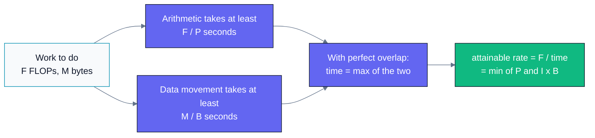
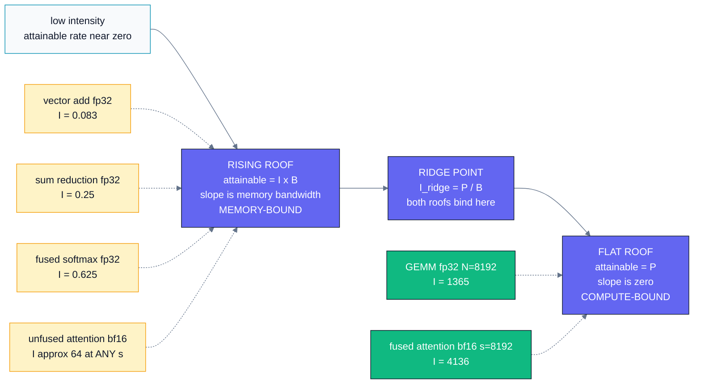
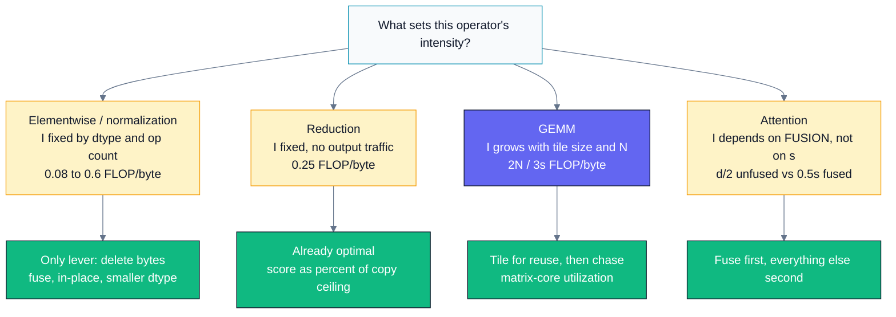
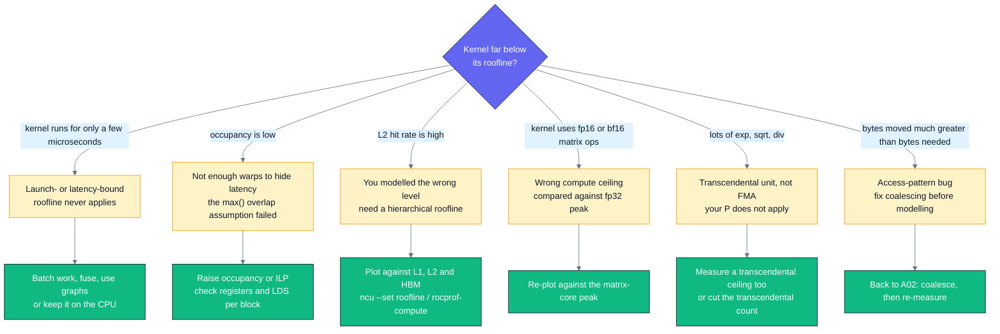

# B02 — Roofline Model & Arithmetic Intensity

> Track B · Module 02 · Status: **DONE** · Est. 6 hours · Depth 3/5
>
> Prerequisites: [A01](../../A-gpu-programming/A01.foundations-and-programming-model/) (kernels,
> error checking, event timing) and
> [A02](../../A-gpu-programming/A02.memory-hierarchy-and-coalescing/) (the measured bandwidth
> ladder this module turns into a model).
> Backends: AMD (`hipcc`) · NVIDIA (`nvcc`) · Python (stdlib only, for the plotter).
> Setup: [../../../docs/SETUP.md](../../../docs/SETUP.md).

---

## 1. TL;DR + Layman analogy

**TL;DR.** A kernel cannot go faster than two hard limits allow: the rate the machine can do
arithmetic (**peak FLOP/s**, call it `P`) and the rate it can move bytes (**bandwidth**, `B`).
If a kernel does `I` FLOPs for every byte it pulls from memory, then bandwidth alone caps it at
`I × B` FLOP/s. Put the two together and you have the entire roofline model:

```
attainable FLOP/s  =  min(P,  I × B)
```

`I` is the kernel's **arithmetic intensity**. The intensity where the two limits meet is the
**ridge point**, `I_ridge = P / B`. Below it you are **memory-bound** and the only lever that
matters is moving fewer bytes; above it you are **compute-bound** and the only lever that matters
is issuing better arithmetic. One division, one comparison, and you know which half of the
optimization literature to ignore.

**Layman analogy — the restaurant kitchen.** A chef can chop 100 ingredients a minute. The
delivery van brings 10 ingredients a minute. However brilliant the chef, the kitchen produces
10 dishes' worth of prep a minute — the chef spends 90% of every minute waiting at the door.
That kitchen is *delivery-bound*, and hiring a faster chef changes nothing; you need more vans,
or you need recipes that do **more work per ingredient** (a stew that simmers for an hour off one
crate beats a salad that consumes a crate a minute). Now flip it: give the kitchen twenty vans
and the ingredients pile up in the corner, because the chef is the limit. Extra vans stop
helping the moment deliveries outpace chopping. **The ratio of chopping-per-ingredient is the
arithmetic intensity, and the crossover where extra vans stop helping is the ridge point.**

**Where the analogy breaks — and it does, in three places you must know:**

1. **It assumes a steady stream of orders.** For a single sandwich, the dominant cost is the
   waiter walking to the kitchen and back. GPU equivalent: a kernel so small that launch
   overhead (~4 µs) dwarfs both ceilings. The roofline is silent about that entire regime.
2. **It assumes one chef with one skill.** A real GPU has *several* compute ceilings — fp32
   vector units, fp32 matrix cores, bf16 matrix cores, fp8 matrix cores, a slow transcendental
   unit — each with its own `P`, differing by more than 30×. Comparing against the wrong one
   gives a confidently wrong verdict.
3. **It assumes the pantry does not exist.** Real kitchens keep some ingredients on the shelf.
   A cache-resident working set changes the byte count entirely, which is why serious analysis
   uses a *hierarchical* roofline with one ceiling per memory level.

Section 6 makes all three concrete. A model whose failure modes you cannot state is a model you
cannot trust.



Both branches are hard lower bounds on time; the model optimistically assumes they overlap
perfectly, so it takes the larger of the two rather than their sum — remember that, because it is
the first assumption to fail in practice.

**By the end of this module you can:** derive `min(P, I × B)` from scratch; compute the
arithmetic intensity of any operator in under a minute; find your machine's real ridge point by
measuring rather than reading a datasheet; place a measured kernel on the chart and name the
right next optimization; and state precisely where the model misleads you.

---

## 2. First Principles

### Derive the whole model in four lines

Forget plots. Take a kernel that performs `F` floating-point operations and moves `M` bytes
between the GPU and HBM. The machine can retire at most `P` FLOP/s and move at most `B` bytes/s.
Two independent lower bounds on the runtime follow immediately:

```
time  >=  F / P          (you cannot do the arithmetic faster than the ALUs retire it)
time  >=  M / B          (you cannot get the data faster than the memory system delivers it)
```

If the two activities overlap perfectly — arithmetic on the data already resident while the next
bytes are in flight — then the binding constraint is whichever is larger:

```
time  >=  max(F/P,  M/B)
```

Now convert to a *rate*, because that is what people quote. Divide `F` by the time and define
the arithmetic intensity `I = F / M`:

```
rate  =  F / time  <=  F / max(F/P, M/B)
                    =  min(F / (F/P),  F / (M/B))
                    =  min(P,  (F/M) x B)
                    =  min(P,  I x B)
```

That is the roofline. Everything else in this module — every operator table, every diagram,
every profiler chart — is bookkeeping on those two terms.

> **The load-bearing assumption is `max`, not `+`.** If a kernel cannot overlap loads with math
> at all, the honest bound is `time >= F/P + M/B`, which is up to 2× worse. The roofline takes
> the optimistic branch on the grounds that GPUs are built to overlap (many resident warps, one
> stalls while another computes). When a kernel has too few warps to overlap, the model becomes
> an optimistic fiction — see Section 6.

### Arithmetic intensity, defined precisely

```
I  =  FLOPs performed  /  bytes moved across the level you are modelling
```

The second half of that sentence carries all the subtlety. "Bytes moved" is **not** the size of
the tensors, and **not** the bytes your code asked for. It is the traffic that actually crossed
the boundary you care about:

| If you model... | Then bytes means... | And the ceiling `B` is... |
|---|---|---|
| HBM / device memory | traffic between L2 and HBM | achievable HBM bandwidth |
| L2 | traffic between L1 and L2 | achievable L2 bandwidth |
| L1 / LDS | traffic between registers and L1 | achievable L1 bandwidth |

Three consequences that trip people up:

- **A cache-resident working set changes the answer.** A 16 KB row read five times generates
  `5 × 16 KB` of L1/L2 traffic but only `16 KB` of HBM traffic. Its HBM intensity is 5× its L2
  intensity. Both numbers are correct; they answer different questions. This is exactly why
  **hierarchical rooflines** exist (Yang, Kurth & Williams — see Section 8).
- **Wasted bytes count.** An uncoalesced kernel that fetches 128-byte lines to use 4 bytes of
  each moves 32× the bytes it needed. Its *measured* intensity collapses by 32×, and it will sit
  neatly on a roofline it should never have been anywhere near. Always compare against the
  intensity of the *ideal* implementation, not the one you wrote.
- **`I` is a property of the algorithm and its data layout, not of the GPU.** Vector add has
  `I = 1/12` on every device ever built. What changes between devices is the *ridge point* you
  compare it against.

### The ridge point, and why it is absurdly high now

Set the two terms of `min(P, I × B)` equal:

```
P  =  I_ridge x B      =>      I_ridge  =  P / B      [FLOP/byte]
```

This single number tells you the intensity a kernel must exceed to be limited by arithmetic
rather than by memory. Here it is for two current data-center parts, from vendor-published peak
specifications (these are datasheet numbers, not measurements — Lab 1 measures the real ones):

| Device | `B` (HBM) | Compute ceiling | `P` | `I_ridge` = `P/B` |
|---|---|---|---|---|
| AMD MI300X | 5.3 TB/s | fp32 vector | 81.7 TFLOP/s | **15.4** FLOP/byte |
| AMD MI300X | 5.3 TB/s | fp32 matrix | 163.4 TFLOP/s | **30.8** |
| AMD MI300X | 5.3 TB/s | **fp16/bf16 matrix** | 1307.4 TFLOP/s | **246.7** |
| AMD MI300X | 5.3 TB/s | fp8 matrix | 2614.9 TFLOP/s | **493.4** |
| NVIDIA H100 SXM | 3.35 TB/s | fp32 vector | 66.9 TFLOP/s | **20.0** |
| NVIDIA H100 SXM | 3.35 TB/s | TF32 tensor | 494.7 TFLOP/s | **147.7** |
| NVIDIA H100 SXM | 3.35 TB/s | **bf16 tensor** | 989.4 TFLOP/s | **295.3** |
| NVIDIA H100 SXM | 3.35 TB/s | fp8 tensor | 1978.9 TFLOP/s | **590.7** |

Read the bolded rows and then read this: **a bf16 matrix-core kernel must do about 250–300
floating-point operations for every single byte it reads from HBM before arithmetic becomes its
limit.** A vector add does **0.083**. That is a factor of roughly **3,000**.

This is the most important number in ML performance engineering, and it explains the shape of
the entire field:

- Matrix cores made `P` grow by more than 20× in a few generations. `B` grew by perhaps 3×.
  So the ridge point marched right, and kernels that used to be near it are now far to its left.
- **Faster compute makes more kernels memory-bound, not fewer.** Every elementwise op, every
  normalization, every attention softmax, the entire decode phase of inference — all of them are
  pinned to the bandwidth roof on modern hardware.
- Which is why the dominant optimizations of the last five years are all *byte-deleting*
  techniques: kernel fusion, FlashAttention, quantization, activation checkpointing trade-offs,
  paged KV caches. None of them make the math faster. They make there be less traffic.



Mermaid cannot draw a log-log plot, so this is the roofline's *shape* rendered as a diagram:
a line rising with slope `B`, a knee at the ridge point, then a horizontal ceiling at `P`, with
real operators hung underneath the region they land in — and note that four of the six sit on
the rising part, which is the whole story of ML kernels. For an actual plotted chart with axes,
run `tools/roofline_plot.py` (Lab 3).

---

## 3. Deep Dive

### Worked arithmetic intensity for real operators

The skill is mechanical once you have seen it done. For each operator: count FLOPs, count the
bytes that must cross HBM in the *best possible* implementation, divide. Conventions used
throughout: one FMA is 2 FLOPs, `exp` is charged as 1 FLOP, fp32 is 4 bytes.

#### Elementwise — `C[i] = A[i] + B[i]`

```
per element:  1 add                      ->  1 FLOP
              read A (4) + read B (4) + write C (4)  ->  12 bytes
I = 1 / 12 = 0.083 FLOP/byte
```

Against MI300X's bf16 ridge of 247, this is **2,960× too low**. There is no tuning, no block
size, no occupancy trick that makes vector add compute-bound. Its *only* possible optimization
is to stop being a separate kernel — which is what fusion means. This formalizes what
[A01 §5](../../A-gpu-programming/A01.foundations-and-programming-model/README.md#5-performance-analysis)
sketched.

#### Reduction — `sum(A)`

```
per element:  1 add                      ->  1 FLOP
              read A (4)                 ->  4 bytes   (the output is one scalar; ignore it)
I = 1 / 4 = 0.25 FLOP/byte
```

Three times better than vector add purely because there is nothing to write back. Still 1,000×
below the ridge. A good reduction is judged by **what fraction of the copy ceiling it reaches**,
never by its GFLOP/s — a point [A04](../../A-gpu-programming/A04.parallel-reduction/) makes with
code and this module makes with a model.

#### Softmax — and why fusion is the whole game

The textbook safe softmax is three passes over the row (find the max, exponentiate, normalize):

```
FLOPs per element:  max compare (1) + subtract (1) + exp (1) + accumulate (1) + divide (1) = 5
bytes, 3-pass:      pass 1 reads 4; pass 2 reads 4 writes 4; pass 3 reads 4 writes 4  = 20
I_3pass = 5 / 20 = 0.25 FLOP/byte

bytes, fused single pass (online normalization): read 4, write 4  = 8
I_fused = 5 / 8 = 0.625 FLOP/byte
```

**2.5× the intensity, identical arithmetic, identical output.** Both are still deeply
memory-bound — the classification did not change — but the fused version's roof is 2.5× higher,
so it finishes 2.5× sooner. Internalize this: *fusion rarely changes your verdict; it moves you
up the memory-bound slope by deleting bytes.* That is the model's prediction for
[A07](../../A-gpu-programming/A07.softmax-and-fused-kernels/), which measures it.

#### GEMM — the operator that escapes

Square `N × N × N` matrix multiply, element size `s` bytes. Perfect tiling means each of A, B, C
crosses HBM exactly once, i.e. `3N²` *elements*:

```
FLOPs =  2N³                      (one FMA per MAC, N³ MACs)
bytes =  3N² x s
I     =  2N³ / (3N² s)  =  2N / (3s)
```

**Intensity grows linearly with `N`.** That is what makes GEMM the only major ML primitive that
is genuinely compute-bound — and only once it is big enough. Solving `2N/(3s) >= I_ridge`:

| Precision | `s` | `I(N)` | MI300X ridge | Smallest compute-bound `N` |
|---|---|---|---|---|
| fp32 (vector) | 4 | `N/6` | 15.4 | **93** |
| fp32 (matrix) | 4 | `N/6` | 30.8 | **185** |
| bf16 (matrix) | 2 | `N/3` | 246.7 | **741** |
| fp8 (matrix) | 1 | `2N/3` | 493.4 | **741** |

Two things to notice. First, a bf16 GEMM smaller than about `N = 740` is **memory-bound on
MI300X** — which is why small-batch inference GEMMs and thin projection layers behave nothing
like the GEMM in the benchmarks. Second, fp8 and bf16 need the *same* `N`: dropping to fp8
doubles `P` and halves the bytes, and the two effects cancel exactly for GEMM. For
memory-bound operators there is no such cancellation, and halving the bytes is a clean 2× win.
That asymmetry is the real reason quantization pays off more on the memory-bound parts of a model
than on its GEMMs.

Also notice what the `3N²` assumed: **perfect reuse**. A naive one-thread-per-output kernel reads
a full row and column per output element, moving `2N³` elements instead of `3N²` — intensity
collapses to `2N³/(2N³ × 4) = 0.25 FLOP/byte`, the same as a reduction, no matter how large `N`
gets. Tiling is not a 20% optimization; it is the difference between `I = 0.25` and `I = N/6`.
[A06](../../A-gpu-programming/A06.tiled-matrix-multiply/) builds exactly that.

#### Attention — memory-bound unless fused

One head, sequence length `s`, head dimension `d`, bf16. FLOPs are dominated by the two GEMMs:
`F = 4s²d + 5s²`. The byte count depends entirely on whether the `s × s` score matrix touches
HBM:

```
unfused (QK^T, softmax, PV as three kernels):
    bytes = 8sd + 8s²          (score matrix written once, read twice)
    I     = s(4d + 5) / (8(d + s))     ->  (4d + 5)/8  ~=  d/2   as s grows

fused (FlashAttention-style, score matrix stays on chip):
    bytes = 8sd                (Q, K, V read once; O written once)
    I     = s(4d + 5) / (8d)           ->  grows linearly in s
```

At `d = 128` the unfused intensity converges to **64.6 FLOP/byte and stays there** — 512, 8192,
or 32768 tokens, it barely moves, because its traffic is `O(s²)` and grows exactly as fast as its
FLOPs. Against MI300X's bf16 ridge of 247 it is memory-bound at *every* sequence length; the
inequality has no solution. The fused version is `≈ 0.505 s`, crossing the ridge at
`s ≈ 490` on MI300X and staying compute-bound forever after.

**That is FlashAttention's justification stated as an inequality rather than an anecdote**, and
it is why [A09](../../A-gpu-programming/A09.advanced-triton-flash-attention/) treats fused
attention as an algorithm change rather than an optimization. Exercise 2 walks the full derivation, including the causal, decode, and
grouped-query variants — decode attention lands at `I ≈ 1 FLOP/byte`, which is why token
generation throughput tracks HBM bandwidth almost linearly.



Four operator families, four different reasons their intensity is what it is — and the point of
the diagram is that the *lever* falls out of the intensity's structure, not out of guesswork.

### AMD vs NVIDIA: same model, different ceilings and different names

| Concept | AMD CDNA3 (MI300X) | NVIDIA Hopper (H100) |
|---|---|---|
| Vector FLOP unit | VALU (`v_fma_f32`), 64-lane wavefront | CUDA cores (FFMA), 32-lane warp |
| Matrix unit | **Matrix Core**, `MFMA` instructions | **Tensor Core**, `HMMA`/`QGMMA` instructions |
| HBM ceiling | HBM3, 5.3 TB/s | HBM3, 3.35 TB/s |
| On-chip level worth modelling | LDS (64 KB/CU), L2, Infinity Cache | Shared memory (up to 228 KB/SM), L2 (50 MB) |
| Built-in roofline tool | `rocprof-compute` (ROCm Compute Profiler), `--roof-only` | Nsight Compute, `--set roofline` or `--set full` |
| HBM byte counters | `FETCH_SIZE`, `WRITE_SIZE` | `dram__bytes_read.sum`, `dram__bytes_write.sum` |
| fp32 FLOP counters | VALU FLOP counters (`rocprof-compute` derives them) | `sm__sass_thread_inst_executed_op_ffma_pred_on.sum` (×2), plus `fadd`/`fmul` |

Note that **both vendors ship an empirical roofline**: neither tool reads peaks off a datasheet.
`rocprof-compute` runs its own microbenchmarks to establish the ceilings and stores them in
`roofline.csv`; Nsight Compute derives them from measured achievable throughputs. Lab 1 is a
hand-rolled version of the same idea, and doing it yourself once is what makes the tools' output
legible.

### How to place a real kernel on the roofline

Five steps, in this order. Do not skip step 5.

1. **Count FLOPs analytically.** From the algorithm, not from a counter. `2N³` for a GEMM,
   `4s²d` for attention. Analytic counts are what you *should* be doing; hardware counters tell
   you what you *did*, including waste. You want both, and the gap between them is informative.
2. **Get bytes.** Analytically for the ideal implementation, and from the profiler for the real
   one (`FETCH_SIZE`/`WRITE_SIZE`, or `dram__bytes_*`). A large ratio between the two is an
   access-pattern bug, not a roofline result — go back to
   [A02](../../A-gpu-programming/A02.memory-hierarchy-and-coalescing/).
3. **Compute `I` and the roof.** `I = FLOPs / bytes`; `roof = min(P, I × B)` with `P` and `B`
   from Lab 1, not from a datasheet.
4. **Compute achieved FLOP/s** from your measured kernel time, and plot the point.
5. **Compare achieved to roof, then act.** The decision rule:

| Situation | What it means | What to do next |
|---|---|---|
| `I < I_ridge` and achieved ≈ roof | Memory-bound and bandwidth-optimal | Reduce bytes: fuse, raise reuse via tiling/shared memory, use a smaller dtype, avoid materializing intermediates. Nothing else will help. |
| `I > I_ridge` and achieved ≈ roof | Compute-bound and near peak | Improve the instruction mix: use matrix cores, packed ops, fewer transcendentals; then raise ILP or occupancy. |
| achieved « roof (say < 50%) | **Bound by something the roofline does not model** | Do *not* optimize bytes or FLOPs yet. Check occupancy, warp-stall reasons, launch size, register spills, and tail effects. Section 6. |
| `I` near `I_ridge` | Both roofs bind | Check load/math overlap (software pipelining, prefetch), then re-measure. |

Step 5's third row is the one that separates engineers who have used a roofline from engineers
who have read about one.

---

## 4. Hands-On Labs

All commands run from this module directory. There is no `triton/` directory here: the module's
subject is a *model*, and the labs that matter are microbenchmarks that must control instruction
selection and memory traffic precisely — which is exactly what a high-level DSL abstracts away.
Triton kernels are analyzed *with* this model in A08 and B03.

```bash
# AMD
make hip GPU_ARCH=gfx942     # build hip/ programs
make run-hip                 # ceilings first, then the intensity sweep

# NVIDIA
make cuda SM_ARCH=sm_90      # build cuda/ programs
make run-cuda

# Roofline chart (any machine, no GPU needed, stdlib Python only)
make plot
```

The drills are self-contained too: [`exercises/`](exercises/) and [`solutions/`](solutions/)
each have their own `Makefile`, so you can `cd exercises && make run` without coming back here.
From this directory, `make exercises` / `make solutions` build them in place, and `make clean`
cleans all three.

> **Match `GPU_ARCH` to your GPU.** `gfx950` = MI350, `gfx942` = MI300, `gfx90a` = MI200,
> `gfx1100` = RDNA3. Find yours with `/opt/rocm/bin/offload-arch` (or `rocminfo | grep gfx`).
> Troubleshooting for `libamdhip64.so` and `hipErrorNoBinaryForGpu` is in
> [A01 §4](../../A-gpu-programming/A01.foundations-and-programming-model/README.md#4-hands-on-labs);
> this module shares Track A's `common.mk`, so the same rpath fix applies.

### Lab 1 — Measure your two ceilings (`measure_ceilings`)

Files: [`hip/measure_ceilings.cpp`](hip/measure_ceilings.cpp) ·
[`cuda/measure_ceilings.cu`](cuda/measure_ceilings.cu).

Two microbenchmarks, one per axis:

- **`copy_kernel`** — a fully coalesced grid-stride copy, the most bandwidth-friendly kernel that
  can exist. Its GB/s is your **memory roof `B`**. (This is
  [A02's `bandwidth`](../../A-gpu-programming/A02.memory-hierarchy-and-coalescing/hip/bandwidth.cpp)
  lab, reused deliberately: the ladder you measured there is the axis you are now drawing.)
- **`fma_peak_kernel`** — a register-resident FMA loop with **8 independent chains** and one
  store per thread for the whole kernel. Its GFLOP/s is your **compute roof `P`**.

**What to observe:** the printed ridge point `I_ridge = P / B`. Write it down; every verdict in
this module is relative to it. Then compare `B` to your GPU's datasheet HBM peak — you should
land at a healthy fraction, and the *achievable* number is the honest one to build a model on.

**Two design details worth understanding, because they are the difference between a measurement
and a mistake:**

- **Why 8 independent chains?** One dependent chain (`v = fma(v, a, b)` over and over) measures
  FMA *latency*, not *throughput*: each instruction waits for the previous one. With enough
  independent chains per thread the scheduler always has a ready instruction, and you measure the
  pipeline's issue rate. A single-chain version of this kernel can under-report peak by several
  times, which would put a false floor under your entire roofline.
- **Why `a = 1.0f, b = 0.0f`?** The chain becomes the identity, so the expected output is
  exactly the sum of the seeds and **verification is bit-exact**. The compiler cannot fold the
  FMAs away because `a` and `b` are runtime kernel arguments it cannot see, and IEEE-754
  semantics forbid reassociating them. You get a benchmark that is simultaneously trivially
  verifiable and honestly doing the work.

### Lab 2 — Discover the ridge point empirically (`roofline_sweep`)

Files: [`hip/roofline_sweep.cpp`](hip/roofline_sweep.cpp) ·
[`cuda/roofline_sweep.cu`](cuda/roofline_sweep.cu).

This is the key lab, and its design is the lesson. **One kernel with arithmetic intensity as a
tunable parameter.** Every thread loads a float, applies `K` fused multiply-adds to it in
registers, and stores it. Bytes per element are fixed at 8; FLOPs per element are `2K`. So:

```
I(K)  =  2K FLOPs / 8 bytes  =  K / 4   FLOP/byte
```

Sweeping `K ∈ {0, 1, 2, 4, ..., 512}` walks `I` from 0 to 128 FLOP/byte — a single kernel
traversing the entire roofline. `K` is a **template parameter**, not a kernel argument, so the
FMA sequence unrolls into straight-line code and no loop overhead pollutes the low-`K` end where
the measurement is most delicate. Four independent chains per thread keep the high-`K` end
throughput-bound rather than latency-bound, for the same reason as Lab 1.

**What to observe.** Two tables. The first is raw: per `K`, the achieved GB/s and GFLOP/s. The
second places each point against the ceilings and prints a bar. The shape to look for:

- **At small `K`:** GB/s pins near the copy ceiling; GFLOP/s is tiny. The kernel is doing almost
  nothing but moving data — you are on the rising roof.
- **As `K` grows:** GFLOP/s climbs roughly linearly (double `K`, double the rate) while GB/s
  holds. The extra arithmetic is *free*, hidden behind memory traffic that was happening anyway.
  This is the single most counter-intuitive fact in GPU performance, and here you watch it happen.
- **At large `K`:** GFLOP/s flattens against the compute roof and GB/s collapses. Adding
  arithmetic now costs time linearly.
- **The knee between the two regimes is the ridge point** — and the program computes it from the
  two extremes of its own sweep (`I_ridge = max GFLOP/s ÷ max GB/s`) rather than asserting it.

`K = 0` is the pure-copy case, which is how the sweep calibrates its own bandwidth roof without
needing Lab 1's numbers passed in.

**Every row verifies.** Because `a = 1.0f` and `b = 0.0f`, the output must equal the input
bit-for-bit for every `K`. A sweep whose fast points are fast because they are wrong is worse
than no sweep.

> **Expect hardware-specific numbers and a hardware-independent shape.** Where your knee lands
> depends on your GPU, its clocks, and its thermal state. *That there is a knee, that GFLOP/s
> rises then flattens, and that GB/s does the mirror image* — that is universal. Do not compare
> your absolute numbers to anyone else's; compare your ridge point to your operators' intensities.
>
> **This is the slowest file in the curriculum to compile** (tens of seconds). The `K = 256` and
> `K = 512` instantiations unroll into a couple of thousand FMA instructions each, which is the
> price of measuring throughput rather than loop overhead.

### Lab 3 — Draw the chart and classify (`tools/roofline_plot.py`)

File: [`tools/roofline_plot.py`](tools/roofline_plot.py). Pure standard library — no numpy, no
matplotlib — so it runs on a bare login node.

```bash
# with the ceilings Lab 1 printed for your machine
python tools/roofline_plot.py --peak-gflops 78500 --peak-gbps 4650 --demo-kernels

# add your own kernel; numeric fields accept the formula, not just the product
python tools/roofline_plot.py --peak-gflops 78500 --peak-gbps 4650 \
    --kernel "my_softmax, 5*2**24, 8*2**24, 410"

# illustrative ceilings, for when you have no GPU in front of you
make plot
```

It prints an ASCII log-log roofline (`#` for the roof, `:` for the ridge, letters for kernels)
plus a table giving each kernel's intensity, its roof, the fraction of that roof it reached, and
**the next step you should take**. The `--kernel` spec is `name, flops, bytes[, achieved_gflops]`;
pass the achieved rate and the tool will tell you when a kernel is far below its own roof and
therefore *not* bound by the roof you were about to optimize against.

**What to observe:** how brutally left-of-ridge the entire elementwise/reduction/softmax family
is, and how far the fused GEMM and attention points are from them. The chart makes the 3,000×
gap from Section 2 visceral in a way the table does not.

### Lab 4 (optional) — Compare against the vendors' own rooflines

```bash
# AMD: runs its own ceiling microbenchmarks, then plots your kernels
rocprof-compute profile -n b02_sweep --roof-only -- ./hip/roofline_sweep.exe
rocprof-compute analyze -p workloads/b02_sweep/MI300X

# NVIDIA
ncu --set roofline -o b02_sweep ./cuda/roofline_sweep.exe     # then open in the Nsight Compute UI
make profile-hip        # or: make profile-cuda   (timeline-level view)
```

**What to look for:** the vendor tools' ceilings should be close to Lab 1's — if `rocprof-compute`
or Nsight Compute reports a compute roof much *higher* than yours, your FMA loop is not saturating
the pipes (chains, occupancy, or instruction selection). More importantly, look at the
**hierarchical** roofline both tools offer: the same kernel plotted against L1, L2, and HBM
ceilings simultaneously. A kernel that looks memory-bound against HBM but sits at the L2 ceiling
has a *cache* problem, not a bandwidth problem — a distinction the single-level model in
Section 2 physically cannot express.

---

## 5. Performance Analysis

### The recipe, applied

The point of this module is that "is it memory- or compute-bound?" becomes a two-minute
arithmetic exercise rather than an opinion. Concretely, for any kernel:

```
I        = FLOPs / bytes                     <- analytic, plus profiler bytes for the real thing
roof     = min(P, I x B)                     <- P and B from measure_ceilings, not a datasheet
achieved = FLOPs / measured_seconds
verdict  = compare I to I_ridge, then compare achieved to roof
```

### Expected shape of the sweep

`roofline_sweep` computes every number below at run time, so this table gives the **shape**, with
`<measured>` where your hardware decides. The intensity column is analytic and must match
exactly — it is `K/4` by construction.

| `K` | `I` (FLOP/byte) | GB/s | GFLOP/s | regime |
|---:|---:|---:|---:|---|
| 0 | 0.00 | `<measured>` — this is your `B` | 0 | bandwidth calibration |
| 1 | 0.25 | ≈ `B` | small, ≈ `0.25 B` | memory-bound |
| 4 | 1.00 | ≈ `B` | ≈ `1.0 B` | memory-bound |
| 16 | 4.00 | ≈ `B` | ≈ `4.0 B` | memory-bound |
| 64 | 16.00 | falling | rising | approaching the ridge |
| 128 | 32.00 | well below `B` | ≈ `P` | compute-bound |
| 512 | 128.00 | far below `B` | `<measured>` — this is your `P` | compute-bound |

The signature to look for: **a rising line that flattens.** GFLOP/s roughly doubles with each
doubling of `K` while the kernel is on the memory roof, then stops responding once it hits the
compute roof. `B` and `P` are read off the two ends of the sweep, and their ratio *is* the ridge
point. Nothing here is asserted; the transition is located by the measurement.

On current data-center parts the knee should appear somewhere around `I = 15–30 FLOP/byte`
(`K ≈ 60–120`) for fp32, consistent with the datasheet ridge points in Section 2 — but treat that
as a prediction the lab either confirms or refutes on your hardware, not as an expected result.

### Reading a memory-bound kernel correctly

For a kernel with `I` far left of the ridge, **GFLOP/s is the wrong headline**. Consider A02's
transpose ladder, measured there on an MI300X (`gfx942`, ROCm 6.2) — transpose does *zero*
arithmetic, so `I = 0` and the roofline degenerates to the bandwidth axis alone:

| Kernel (from A02) | `I` | Measured BW | % of A02's measured copy ceiling |
|---|---|---|---|
| `bandwidth` (copy) | 0 | ~4800 GB/s | ceiling |
| `transpose_naive` | 0 | ~700 GB/s | ~15% |
| `transpose_tiled` | 0 | ~2600 GB/s | ~54% |
| `transpose_tiled_padded` | 0 | ~3400 GB/s | ~70% |

Those are A02's numbers, not new measurements. What B02 adds is the *interpretation*: with
`I = 0` there is no compute roof to reach and no FLOP/s worth quoting, so the only meaningful
score is **percentage of achievable bandwidth**. The naive kernel is not "slow at math"; it is
moving roughly 5× more bytes than the problem requires because its writes are uncoalesced. The
roofline's honest verdict on a zero-FLOP kernel is: go look at your access pattern.

### A before/after the model predicts in advance

Softmax, from Section 3, is the cleanest case where the model makes a falsifiable prediction
*before* any code is written:

| Version | FLOPs | HBM bytes | `I` | Predicted speedup |
|---|---|---|---|---|
| 3-pass safe softmax | `5N` | `20N` | 0.25 | baseline |
| Fused single-pass | `5N` | `8N` | 0.625 | **2.5×** |

Both are memory-bound, so runtime is `bytes / B` in each case and the ratio is exactly
`20N / 8N = 2.5`. If A07's fused kernel measures ~2.5× and not ~5×, the model was right and the
implementation is fine. If it measures 1.2×, the model is telling you the fused version is not
actually achieving bandwidth — go find out why. **A model earns its place by being wrong in
informative ways**, and that only works if you commit to the prediction first.

---

## 6. Challenges, Drawbacks & Tradeoffs

The roofline is the most useful performance model in GPU engineering, and it is wrong in at least
nine identifiable ways. Knowing them is the difference between a tool and a talisman.



Six of the nine failure modes as a triage tree — note that every branch ends in "the roofline is
not your problem yet," which is the most common state a real kernel is in.

### Pitfall 1 — The latency-bound regime is invisible

The roofline has no axis for latency. It silently assumes the kernel runs long enough to reach
steady state with enough parallelism to saturate whichever unit binds. A kernel with 4 resident
warps per SM, or one that runs for 3 µs, is limited by **neither** roof — it is limited by
instruction and memory latency it has no other work to hide behind, and by the ~4 µs it costs to
launch it at all.

Concretely: a 4096-element fp32 vector add moves 49 KB. At 4 TB/s that traffic takes **12
nanoseconds**, against a launch overhead of roughly 4,000 ns — a factor of 325. Its intensity is
identical to the 64-million-element version, so the roofline gives an identical, useless verdict.
**A point far below its own roof is the model telling you it does not apply.** That is not a
failure to read past; it is the single most valuable signal the chart produces.

### Pitfall 2 — Perfect overlap is assumed, not achieved

Section 2 derived `time >= max(F/P, M/B)`. The pessimistic bound is `F/P + M/B`. A kernel with a
strictly serial structure — load a tile, barrier, compute it, barrier, load the next — approaches
the sum and can therefore sit at 50% of its roofline while being perfectly well written for its
structure. Software pipelining, double buffering, and asynchronous copies
(`cp.async` / `buffer_load_dword ... lds`) exist to close exactly this gap. The roofline scores
the outcome; it never tells you overlap was the missing ingredient.

### Pitfall 3 — There is no cache in the model

The single-level roofline pretends memory is one flat pool at bandwidth `B`. Real GPUs have
registers, LDS/shared memory, L1, L2, and (on MI300X) Infinity Cache — differing by orders of
magnitude in both bandwidth and latency. Two consequences:

- A kernel whose working set fits in L2 moves far fewer HBM bytes than a naive count suggests, so
  its true HBM intensity is much higher than you computed and it may not be HBM-bound at all.
- A kernel can be *L2-bandwidth-bound* while sitting comfortably below the HBM roof. On the
  single-level chart it looks like an unexplained underperformer.

The fix is the **hierarchical roofline**: one ceiling per level, the kernel plotted against all
of them (Yang, Kurth & Williams; both vendors' profilers implement it). This is not an academic
refinement — it is the difference between "add more reuse" and "your reuse is already working,
the problem is L2 throughput."

### Pitfall 4 — There is more than one compute ceiling

`P` is not a property of a GPU; it is a property of a GPU *and an instruction mix*. MI300X has
at least four meaningfully different compute roofs (fp32 vector 81.7, fp32 matrix 163.4, bf16
matrix 1307.4, fp8 matrix 2614.9 TFLOP/s) spanning **32×**. Pick the wrong one and:

- Comparing a bf16 matrix-core kernel against the *fp32* ceiling makes it look compute-bound when
  it is memory-bound, and sends you off optimizing arithmetic that was never the problem.
  (Exercise 1 row 8 is exactly this trap: `I = 124 FLOP/byte` is compute-bound against a ridge of
  15 and memory-bound against a ridge of 300. Same kernel, opposite verdicts.)
- Comparing an fp32 kernel against the *matrix-core* ceiling makes everything look hopelessly
  memory-bound and tells you nothing.

Vendor peak figures compound this: some published numbers assume structured sparsity (2× the
dense rate) or packed fp32 dual-issue. Rule: **one chart, one dtype, one instruction class, and
measure the ceiling yourself.**

### Pitfall 5 — Not all FLOPs cost the same

`exp`, `rsqrt`, and `div` do not execute on the FMA pipes. Charging them 1 FLOP each and scoring
against an FMA-derived `P` understates their cost, sometimes by an order of magnitude. A softmax
or a GELU is dense in transcendentals; its "FLOP/s" against an FMA roof is not a meaningful
utilization number. Similarly, fp64 has its own much lower ceiling, and predicated-off lanes in a
divergent warp consume issue slots while contributing zero counted FLOPs.

### Pitfall 6 — "Bytes" and "FLOPs" are both ambiguous

Before comparing two roofline numbers, confirm you are counting the same things:

| Ambiguity | The two readings |
|---|---|
| Bytes | Requested by the kernel vs actually moved by the memory system (uncoalesced access inflates the second by up to 32×) |
| Bytes | HBM traffic vs L2 traffic vs total load/store instruction bytes |
| FLOPs | Algorithmically necessary vs actually executed (a naive GEMM executes the same FLOPs but moves `2N³` elements) |
| FLOPs | FMA as 2 or as 1; `exp` as 1 or as its true instruction cost; sparsity counted or not |

Two engineers can compute intensities 32× apart for the same kernel and both be arithmetically
correct. State your convention.

### Pitfall 7 — It scores the implementation, never the algorithm

A perfectly tuned `O(n²)` kernel at 98% of roofline loses to a sloppy `O(n log n)` kernel at 30%.
The roofline cannot see algorithmic complexity, and it cannot see that a kernel did not need to
run at all — an unnecessary layout conversion at 99% of roofline is 99%-efficient waste. "We hit
roofline" is a statement about a kernel, not about a program.

### Pitfall 8 — The ceilings move

`P` and `B` are not constants. Clocks throttle under power and thermal limits, so a GPU running a
sustained matrix-core workload has a materially lower `P` than the one your short microbenchmark
measured. ECC settings, memory clock states, MIG/partition mode, and neighbour tenants all move
`B`. Treat Lab 1's numbers as valid for the machine in the state you measured it, re-measure when
the environment changes, and be suspicious of a kernel that appears to exceed 100% of roofline —
that usually means the ceiling was measured in a friendlier clock state than the kernel ran in.

### Pitfall 9 — It stops at the device boundary

There is no PCIe, NVLink, Infinity Fabric, or network axis in the classic roofline. For a
multi-GPU or multi-node workload the binding ceiling is frequently interconnect bandwidth, and
the on-device roofline will cheerfully report that every kernel is fine while the job is 70%
idle waiting on an all-reduce. The extension exists (add a ceiling per interconnect level, with
intensity measured in FLOPs per byte *communicated*) and it is the right tool for B07's sharding
material — but it is not what you get out of the box.

### Tradeoffs to hold in mind

- **Analytic vs measured counts.** Analytic FLOPs and bytes tell you what the algorithm deserves;
  profiler counters tell you what your code did. Use both — the *gap* is where the bugs live.
- **Simple vs hierarchical.** The single-level model fits on a napkin and answers the first
  question correctly most of the time. The hierarchical model is far more informative and costs
  a profiling run plus real interpretive effort. Start simple; escalate when the simple model
  stops explaining your measurements.
- **When not to reach for the roofline at all.** Short kernels, launch-bound pipelines,
  host-side bottlenecks, data-loading stalls, communication-bound distributed training. Profile
  the timeline first; a roofline on a kernel that accounts for 2% of wall-clock is a beautifully
  drawn distraction.

---

## 7. Real-World Use Cases

- **FlashAttention** (Dao et al., 2022) is the roofline argument made into an algorithm: keep the
  `s × s` score matrix in on-chip memory so HBM traffic drops from `O(s²)` to `O(sd)`, converting
  attention from permanently memory-bound to compute-bound above a few hundred tokens. The paper's
  framing — "IO-awareness" — *is* arithmetic intensity.
- **Kernel fusion in `torch.compile`, Triton, and XLA.** Every fusion pass is a byte-deletion
  pass, and the profit is predicted by exactly the calculation in Section 3's softmax example.
  When `torch.compile` fuses an elementwise chain, it is moving you up the memory-bound slope.
- **Quantization (fp8, int8, int4, MXFP).** For memory-bound layers, halving the element size
  halves the bytes and doubles the attainable rate immediately — no math required. For GEMMs the
  win is smaller than it looks, because peak and bytes scale together (Section 3's table). Knowing
  which of your layers is which is a roofline question.
- **LLM inference serving.** Prefill is compute-bound (large GEMMs, high intensity); decode is
  memory-bound (`I ≈ 1 FLOP/byte`, dominated by streaming the KV cache and the weights). That
  single distinction drives continuous batching, paged attention, speculative decoding,
  grouped-query attention, and weight-only quantization — all of them intensity plays. B06 builds
  on this directly.
- **GEMM library tile selection.** cuBLAS, rocBLAS, CUTLASS, and hipBLASLt pick tile shapes to
  push intensity above the ridge point for the given problem size and dtype. The heuristic tables
  inside those libraries are, in effect, precomputed roofline decisions.
- **Vendor profilers ship it as a first-class feature.** Nsight Compute's roofline charts
  (including hierarchical ones) and ROCm Compute Profiler's `--roof-only` mode exist because this
  is the first chart a performance engineer looks at. Both run their own microbenchmarks for the
  ceilings — the same thing Lab 1 does by hand.
- **Hardware and system procurement.** "How much HBM bandwidth per FLOP/s does this part have?"
  is a ridge-point question, and it is why bandwidth-per-FLOP is a headline number in accelerator
  comparisons. NERSC used hierarchical roofline analysis as part of characterizing workloads for
  the Perlmutter system (Yang, Kurth & Williams).
- **Regression gates in CI.** Because the ceilings are measurable, "this kernel must stay above
  70% of achievable HBM bandwidth" is a testable assertion — far more robust than a wall-clock
  threshold, which drifts with every clock and driver change.

---

## 8. Cited References

Full list in [../../../docs/REFERENCES.md](../../../docs/REFERENCES.md).

- Williams, S., Waterman, A., & Patterson, D. (2009). *Roofline: An Insightful Visual Performance
  Model for Multicore Architectures.* Communications of the ACM 52(4). **The original paper**;
  Section 2's derivation and the ridge-point terminology come from here.
  <https://dl.acm.org/doi/10.1145/1498765.1498785>
- Yang, C., Kurth, T., & Williams, S. (2019/2020). *Hierarchical Roofline analysis for GPUs:
  Accelerating performance optimization for the NERSC-9 Perlmutter system.* Concurrency and
  Computation: Practice and Experience. The multi-level extension discussed in Section 6,
  Pitfall 3. <https://doi.org/10.1002/cpe.5547>
- Yang, C. (2020). *Hierarchical Roofline Analysis: How to Collect Data using Performance Tools on
  Intel CPUs and NVIDIA GPUs.* arXiv:2009.02449. Practical counter-collection recipes behind
  Section 3's counter table. <https://arxiv.org/abs/2009.02449>
- **NERSC — Roofline Performance Model.** LBNL/NERSC's practitioner documentation, including the
  Empirical Roofline Toolkit methodology that Lab 1 mirrors.
  <https://docs.nersc.gov/tools/performance/roofline/>
- **Empirical Roofline Toolkit (ERT)**, Berkeley Lab. The reference implementation of measuring
  ceilings by microbenchmark rather than reading a datasheet.
  <https://bitbucket.org/berkeleylab/cs-roofline-toolkit/>
- **NVIDIA Nsight Compute — Kernel Profiling Guide** (chapter *Roofline Charts*) and the Nsight
  Compute reference on hierarchical roofline sections and the `roofline` section set.
  <https://docs.nvidia.com/nsight-compute/ProfilingGuide/index.html> ·
  <https://docs.nvidia.com/nsight-compute/NsightCompute/index.html>
- **AMD ROCm Compute Profiler (formerly Omniperf)** — empirical hierarchical roofline on
  MI200/MI300 (L1/LDS/L2/HBM ceilings), `--roof-only`, `roofline.csv`.
  <https://rocm.docs.amd.com/projects/rocprofiler-compute/en/latest/what-is-rocprof-compute.html> ·
  <https://rocm.docs.amd.com/projects/rocprofiler-compute/en/latest/how-to/analyze/cli.html>
- Ofenbeck, G., Steinmann, R., Caparrós Cabezas, V., Spampinato, D. G., & Püschel, M. (2014).
  *Applying the roofline model.* IEEE ISPASS. An honest treatment of how hard it is to measure
  the quantities the model needs — the source of Section 6, Pitfall 6.
  <https://doi.org/10.1109/ISPASS.2014.6844463>
- Dao, T., Fu, D., Ermon, S., Rudra, A., & Ré, C. (2022). *FlashAttention: Fast and Memory-Efficient
  Exact Attention with IO-Awareness.* NeurIPS. The attention derivation in Section 3 and
  Exercise 2. <https://arxiv.org/abs/2205.14135>
- Ivanov, A., Dryden, N., Ben-Nun, T., Li, S., & Hoefler, T. (2021). *Data Movement Is All You
  Need: A Case Study on Optimizing Transformers.* MLSys. Quantifies how much of transformer
  runtime is data movement rather than arithmetic. <https://arxiv.org/abs/2007.00072>
- **AMD Instinct MI300X product specifications** — the HBM and per-precision peak figures in
  Section 2's table. <https://www.amd.com/en/products/accelerators/instinct/mi300/mi300x.html>
- **NVIDIA H100 Tensor Core GPU specifications** — the H100 SXM figures in Section 2's table.
  <https://www.nvidia.com/en-us/data-center/h100/>
- **CUDA C++ Best Practices Guide** — effective-bandwidth measurement and the arithmetic-intensity
  framing used in the labs.
  <https://docs.nvidia.com/cuda/cuda-c-best-practices-guide/index.html>

---

## 9. Self-Assessment & Interview Drills

### Conceptual (answers below)

1. Derive `attainable = min(P, I × B)` from two inequalities. Which of the two is optimistic, and
   what is the pessimistic version?
2. A GPU has `P = 900 TFLOP/s` (bf16) and `B = 3.0 TB/s`. What is the ridge point? A bf16 kernel
   has `I = 40 FLOP/byte`. Memory- or compute-bound, and what is its attainable rate?
3. **The interview question.** A kernel measures **12.0 TFLOP/s**. You determine analytically
   that it performs `4.0 × 10^11` FLOPs and the profiler reports it moved `2.0 × 10^10` bytes of
   HBM traffic. The machine's measured ceilings are `P = 60 TFLOP/s` (fp32) and `B = 3.0 TB/s`.
   Is it memory-bound or compute-bound, and **what do you do next?**
4. Your teammate reports that fusing five elementwise kernels made the pipeline "compute-bound."
   Why is that almost certainly wrong, and what did fusion actually buy?
5. Two engineers compute arithmetic intensities for the same kernel that differ by 8×. Neither
   made an arithmetic mistake. Give two distinct explanations.
6. Why does a *faster* GPU make *more* of your kernels memory-bound? Answer in terms of the ridge
   point.
7. Unfused attention's arithmetic intensity converges to a constant as sequence length grows,
   while fused attention's grows linearly. Explain both in one sentence each.
8. A kernel sits at 96% of its roofline. Name two ways it could still be a bad kernel.
9. Explain to a non-programmer, in two sentences, why buying a GPU with twice the arithmetic
   throughput might not speed up their program at all.

<details>
<summary>Answers</summary>

1. `time >= F/P` (ALU limit) and `time >= M/B` (memory limit). With perfect overlap,
   `time >= max(F/P, M/B)`; converting to a rate gives `F/time <= min(P, (F/M)·B) = min(P, I·B)`.
   The **`max` is the optimistic step** — it assumes loads and math overlap completely. The
   pessimistic version is `time >= F/P + M/B`, up to 2× worse, and it is what you approach when a
   kernel has too few resident warps or a strictly serialized load-compute-load structure.

2. `I_ridge = 900e12 / 3.0e12 = 300 FLOP/byte`. With `I = 40 < 300` the kernel is
   **memory-bound**; attainable rate = `40 × 3.0 TB/s = 120 TFLOP/s`, i.e. at best 13% of peak
   compute no matter how well the inner loop is written. The lever is bytes, not FLOPs.

3. Do the arithmetic before forming an opinion:
   ```
   I        = 4.0e11 / 2.0e10 = 20 FLOP/byte
   I_ridge  = 60e12 / 3.0e12  = 20 FLOP/byte     <- exactly at the ridge
   roof     = min(60, 20 x 3.0) = 60 TFLOP/s
   achieved = 12 / 60 = 20% of roof
   ```
   The kernel sits **exactly on the ridge point**, so in principle both roofs bind — but it is
   reaching only **20% of either**, and that is the finding. **It is neither memory- nor
   compute-bound: it is bound by something the roofline does not model.** Optimizing bytes or
   FLOPs now would be guessing.

   What to do next, in order:
   - Check the **kernel duration and grid size** first. If it runs for a few microseconds, or the
     grid does not fill the device (or leaves a long tail wave), it is launch/latency-bound and
     nothing on the chart applies.
   - Check **achieved occupancy and warp-stall reasons**. Too few resident warps means the
     `max()` overlap assumption failed; the kernel is paying latency it has no work to hide.
     Look for register spills and oversized LDS allocations as the cause.
   - Check whether the **byte count is real**. If the profiler's 2.0e10 bytes is much larger than
     the algorithm requires, the true intensity is higher and you have a coalescing bug — fix
     that and re-measure before touching anything else.
   - Check the **instruction mix and the right ceiling**. If the FLOPs are transcendentals or
     fp64, or if the kernel uses matrix cores, `P = 60 TFLOP/s` is the wrong roof.
   - Only once achieved is close to roof does the roofline's verdict become actionable — and at
     `I = 20` on a ridge of 20, that verdict will be "improve overlap," since both roofs bind.

   The general rule, which is what the question is really testing: **a point far below its own
   roof is the model telling you it does not apply.**

4. Fusing elementwise ops removes intermediate round-trips: five kernels at `8N` bytes each
   (`40N`) become one at `8N`. FLOPs are unchanged at `5N`, so intensity goes from
   `5N/40N = 0.125` to `5N/8N = 0.625` — still ~400× below a matrix-core ridge point. It is
   **emphatically still memory-bound**. What fusion bought is a **5× higher roof and a ~5× lower
   runtime**, which is the actual goal. Fusion deletes bytes; it does not usually change the
   classification.

5. Any two of: (a) one counted **HBM** traffic while the other counted **L2 or total load/store**
   traffic; (b) one counted the **ideal/analytic** byte count while the other used the
   **profiler's actual** bytes, which include waste from uncoalesced access (up to 32× on a
   32-lane warp); (c) one counted an FMA as 2 FLOPs and the other as 1, or charged `exp`
   differently; (d) one included sparsity-adjusted FLOPs. All are defensible; none are
   comparable without stating the convention.

6. Matrix cores raised `P` by more than 20× while HBM bandwidth grew perhaps 3×, so
   `I_ridge = P/B` moved sharply right. A kernel's intensity is a property of its *algorithm* and
   does not move at all. So the same kernel that used to sit near the ridge now sits far to its
   left — the ceiling ran away from it.

7. **Unfused:** it writes and re-reads the `s × s` score matrix, so its HBM traffic is `O(s²)`,
   growing at exactly the same rate as its `O(s²d)` FLOPs; the ratio therefore saturates at a
   constant fixed by the head dimension (`≈ d/2`). **Fused:** the score matrix never leaves
   on-chip memory, so traffic stays `O(sd)` while FLOPs remain `O(s²d)`, and the ratio grows
   linearly in `s`.

8. (a) **The roof is too low because the bytes are wrong** — an uncoalesced kernel moving 8× more
   bytes than necessary has an 8× lower intensity and thus an 8× lower roof; hitting 96% of it
   means efficiently wasting bandwidth. (b) **The algorithm is wrong** — a perfectly executed
   `O(n²)` kernel loses to a mediocre `O(n log n)` one, and a kernel that never needed to run
   (a redundant layout conversion, say) is pure waste no matter how efficiently it runs.

9. Their program spends most of its time waiting for data to arrive from memory, not doing
   calculations — like a kitchen where the chef is idle waiting on deliveries. Doubling the chef's
   speed changes nothing until you also widen the delivery road.

</details>

### Coding & Algorithms drills

Do these in [`exercises/`](exercises/); reference answers in [`solutions/`](solutions/). Expected
output shape is in
[`exercises/README.md` → *Expected output shape*](exercises/README.md#expected-output-shape).

1. **Classify these kernels** (`exercises/01_classify_kernels.md`) — nine real operators, two
   different ridge points. Compute each intensity, classify it, and name the first optimization
   you would attempt. Part C is the important half: the tiny launch, the kernel at 13% of its
   roof, and the cache-resident working set.
2. **The arithmetic intensity of attention** (`exercises/02_ai_of_attention.md`) — derive
   `I(s, d)` for fused and unfused attention, take the limits, and solve for the sequence length
   at which fusion changes the classification. Stretch parts cover causal masking, decode, and
   grouped-query attention.
3. **Place your own kernel** (`exercises/03_place_your_kernel.cpp`) — a reduction and an
   FMA-heavy kernel are provided, verified, and timed; you write the instrumentation that reports
   their FLOPs and bytes and places them on the ceilings you measured in Lab 1. The reduction
   should land at `I ≈ 0.25`; the FMA kernel at `I = 16`, whose verdict genuinely depends on your
   hardware.

### Stretch

- Extend `roofline_sweep` so the bytes per element are tunable too (e.g. read `r` neighbouring
  elements per output). You now have a 2-D family of kernels; confirm that only the *ratio*
  matters and that two kernels with the same `I` but different absolute sizes land on the same
  point.
- Take the same sweep and reduce the launch to 2 blocks. Every intensity is unchanged, yet every
  point should collapse far below its roof. You have just built Pitfall 1 on purpose — now
  explain the chart to someone who has only read Section 2.
- Build a two-level roofline by hand: add an L2 ceiling measured with a working set that fits in
  L2, and plot a kernel against both. Compare your chart to `ncu --set roofline` or
  `rocprof-compute --roof-only`.
- Instrument the fused vs 3-pass softmax from A07 and check the model's 2.5× prediction from
  Section 5. If it misses, find out which of Section 6's nine pitfalls explains the gap.
