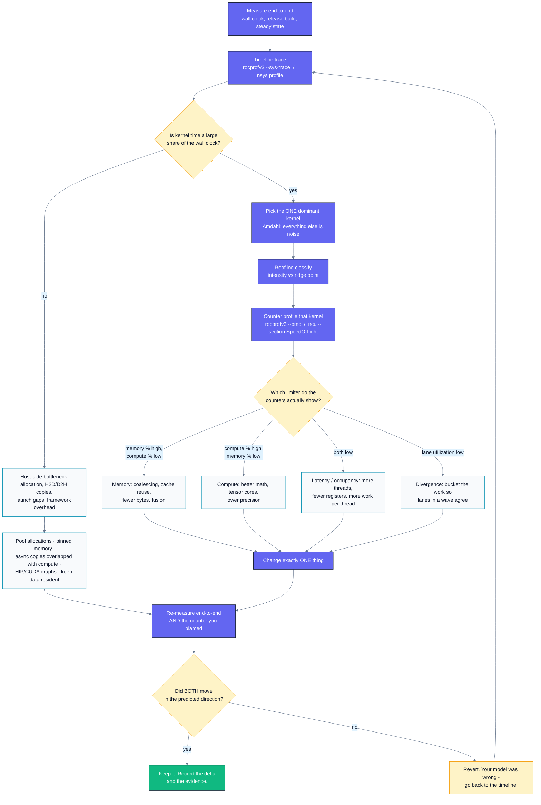
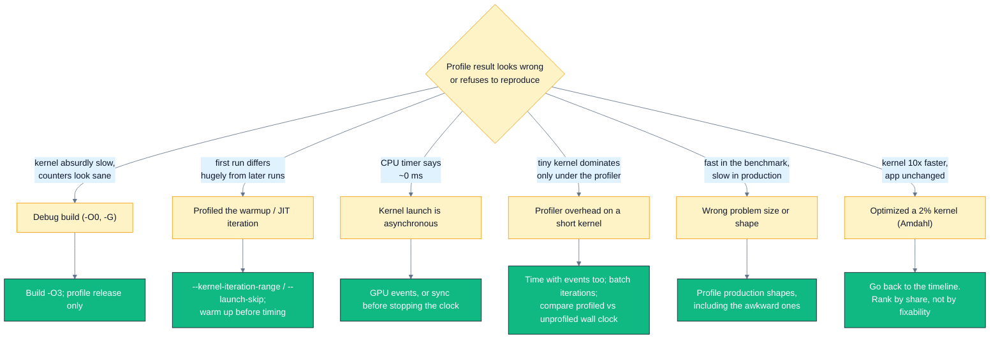

# B03 — Profiling & Bottleneck Analysis

> Track B · Module 03 · Status: **DONE** · Est. 6 hours · Depth 3/5
>
> Prerequisites: [A01](../../A-gpu-programming/A01.foundations-and-programming-model/README.md)
> (kernels, async launches, event timing, its `rocprofv3` walkthrough),
> [A02](../../A-gpu-programming/A02.memory-hierarchy-and-coalescing/README.md) (coalescing, LDS,
> bank conflicts), [B02](../B02.roofline-and-arithmetic-intensity/README.md) (roofline & arithmetic
> intensity — this module is where you *test* a roofline hypothesis).
> Backends: AMD (`hipcc` + `rocprofv3`) · NVIDIA (`nvcc` + `nsys`/`ncu`).
> Setup: [SETUP.md](../../../docs/SETUP.md) ·
> Terms: [GLOSSARY.md](../../../docs/GLOSSARY.md) · Sources: [REFERENCES.md](../../../docs/REFERENCES.md).

---

## 1. TL;DR + Layman analogy

**TL;DR.** [Profiling](../../../docs/GLOSSARY.md#profiler) is not "run the profiler and read the
numbers". It is a **decision procedure**: form a hypothesis from the
[roofline](../../../docs/GLOSSARY.md#roofline-model), then take the *cheapest measurement that could
kill it*. There are two levels and they are not interchangeable. **Timeline/system tracing**
(`rocprofv3 --sys-trace`, `nsys profile`) answers *where does wall-clock go* across host API, copies,
and [kernels](../../../docs/GLOSSARY.md#kernel) — always run this first, because it is how you
discover that your kernel is 0.014% of the
run. **Kernel counter profiling** (`rocprofv3 --pmc`, `ncu`) answers *what limits this one kernel* —
run it only after the timeline proves the kernel matters. Everything else in this module is
mechanics for those two sentences.

**Layman analogy — the doctor who does not order every scan.** A patient says "I feel bad." A bad
doctor orders every test in the catalogue, gets 400 numbers, and now has 400 things that are
slightly off and no diagnosis. A good doctor takes a **history** (what changed, when, what makes it
worse), forms a **hypothesis** ("this sounds cardiac"), and orders the **one test that confirms or
rules it out**. Then — and this is the part engineers skip — if the test comes back clean, the
hypothesis is *dead* and you go back to the history, rather than reading tea leaves in the noise.
Vitals first (pulse, blood pressure — cheap, whole-body, tells you where to look); targeted imaging
second (expensive, high-resolution, useless without a suspected organ). That is exactly
timeline-then-counters.

**Where the analogy breaks — and it breaks in three load-bearing ways:**

1. **The scan changes the patient.** Counter collection can *serialize kernel dispatches and replay
   them*, so profiling overhead distorts precisely the small, fast kernels you most want to measure.
   No X-ray makes a bone more broken.
2. **You can re-run the patient identically.** A GPU workload is reproducible; you can bisect, A/B,
   and re-measure until the cause is isolated. Medicine cannot.
3. **Curing the organ may not help the patient.** A kernel can be genuinely sick and fixing it
   changes end-to-end time by nothing, because it was 2% of the run. Amdahl's law has no medical
   equivalent, and it is the reason section 6's "optimizing a 2% kernel" is the most expensive
   mistake on the list.

**By the end of this module you can:** state a bottleneck hypothesis before you profile; choose
timeline vs. counter profiling deliberately; drive `rocprofv3`, `nsys`, and `ncu` with the flags
that matter; map each counter to the *action* it implies; name the six profiling mistakes that
silently invalidate a measurement; and diagnose four unlabelled kernels from evidence alone.

---

## 2. First Principles

### The measurement is not the point; the decision is

Every profiler run should be able to finish this sentence *before* it starts:

> "If ______ is above/below ______, I will do ______; otherwise I will do ______."

If you cannot fill that in, you are not profiling — you are collecting. Collection feels productive
and produces a wall of counters, from which a motivated engineer can justify any conclusion they
already held. The discipline that prevents this is falsifiability: **a hypothesis that no
measurement could kill is not a hypothesis.**

Where does the hypothesis come from? From B02's roofline. Arithmetic intensity is computable **from
the source code**, with no hardware:

```
intensity = FLOPs performed / bytes moved to and from HBM
```

Compare it to the machine's **ridge point** (peak FLOP/s ÷ peak bytes/s) and you have predicted the
bound before you have run anything:

| Kernel | Intensity | Predicted bound | What the profiler is now for |
|---|---:|---|---|
| Vector add / elementwise | ~0.08–0.25 FLOP/byte | memory | *Confirm* it reaches the bandwidth roof — and if not, find out why |
| Transpose | 0 FLOP/byte | memory (pure) | Same, plus: which access pattern is wasting transactions |
| Dense GEMM, large | tens–hundreds | compute | Confirm it reaches the FLOP roof; if not, look for tensor-core underuse |

Notice that in every row the profiler's job is to **confirm or kill a prediction**, never to
"discover" the answer from scratch. Discovery mode is what produces 400 numbers and no decision.

### Why there must be two levels, derived rather than asserted

A GPU program's wall clock is composed of things that are not the same *kind* of thing:

```
wall clock = host work (allocation, framework, Python)
           + host->device and device->host transfer
           + gaps where the GPU is idle waiting for a launch
           + kernel execution
```

A hardware counter is a register **inside a compute unit**. It can only tell you about the last
line. Counters are structurally incapable of seeing the other three — a profile in which every
kernel runs at 95% of Speed-of-Light is entirely consistent with a GPU that is idle 80% of the wall
clock.

So the first measurement must be a **timeline**, which timestamps everything (API calls, copies,
dispatches) and can therefore attribute wall clock across all four lines. Only once the timeline
says "the kernel line is the big one" does a counter register become the right instrument.

A01 already paid this lesson off with real data: in its `rocprofv3` run, `vector_add` took
**44,242 ns — 0.014% of captured time**, while `hipMemcpy` was 62.6% and `hipMalloc` 22.0%. An
engineer who started with `ncu --set full` would have spent the day tuning 0.014% of the program.

### The cheapest measurement that could kill the hypothesis

Order your instruments by cost, and stop as soon as one of them decides:

```
wall clock (a stopwatch)        ~0 overhead   -> is there even a problem?
GPU events around the kernel    ~0 overhead   -> is the time on the device?
timeline trace (--sys-trace)    low overhead  -> which phase owns the wall clock?
counter collection (--pmc/ncu)  HIGH overhead -> what limits this one kernel?
```

Each row costs more and answers a narrower question. Skipping down the ladder is the single most
common way to waste a day, and the reason is structural, not a matter of taste: **the expensive
instrument answers a question you have not yet earned the right to ask.**

---

## 3. Deep Dive

### The decision procedure, as a flowchart



**How to read it:** the two diamonds on the left spine are the only places the procedure branches on
*evidence*; everything else is mechanical. The loop back from `REVERT` to the timeline is the part
that makes this a discipline rather than a checklist — a change that did not move the counter you
blamed means your model of the kernel is wrong, and no amount of further tuning on that model will
help.

### Two levels, side by side

```mermaid
%%{init: {
  'theme': 'base',
  'themeVariables': {
    'primaryColor': '#F8FAFC',
    'primaryTextColor': '#0F172A',
    'primaryBorderColor': '#0891B2',
    'lineColor': '#64748B',
    'secondaryColor': '#E0F2FE',
    'tertiaryColor': '#EEF2FF',
    'fontFamily': 'Inter, Segoe UI, sans-serif'
  }
}}%%
flowchart LR
  subgraph L1["LEVEL 1 - Timeline / system trace (run FIRST)"]
    direction TB
    L1Q["Question: where does<br/>wall-clock time go?"]
    L1T["AMD: rocprofv3 --sys-trace --summary<br/>NVIDIA: nsys profile --stats=true"]
    L1S["Sees: host API, allocations,<br/>H2D/D2H copies, launch gaps,<br/>kernel dispatches"]
    L1O["Overhead: low"]
    L1Q --> L1T --> L1S --> L1O
  end
  subgraph L2["LEVEL 2 - Kernel counters (only if L1 says the kernel matters)"]
    direction TB
    L2Q["Question: what limits<br/>THIS one kernel?"]
    L2T["AMD: rocprofv3 --pmc / rocprof-compute<br/>NVIDIA: ncu --section SpeedOfLight"]
    L2S["Sees: occupancy, memory vs compute<br/>throughput, cache hit rates,<br/>stall reasons, bank conflicts"]
    L2O["Overhead: HIGH - replays or<br/>serializes dispatches"]
    L2Q --> L2T --> L2S --> L2O
  end
  L1O -->|"kernel is dominant"| L2Q

  classDef trackB fill:#6366F1,stroke:#0F172A,color:#fff
  classDef neutral fill:#F8FAFC,stroke:#0891B2,color:#0F172A
  classDef warn fill:#FEF3C7,stroke:#F59E0B,color:#0F172A
  class L1Q,L1T,L2Q,L2T trackB
  class L1S,L2S neutral
  class L1O neutral
  class L2O warn
```



**How to read it:** the arrow between the two boxes only points one way, and it has a **condition on
it**. Level 2 is not "more detail about the same thing" — it answers a strictly narrower question at
much higher cost, and running it unconditionally is the defining mistake of amateur profiling.

### `rocprofv3` in practice

> **Verified against the ROCm 7.2.4 `rocprofv3` documentation**
> ([Using rocprofv3](https://rocm.docs.amd.com/projects/rocprofiler-sdk/en/docs-7.2.4/how-to/using-rocprofv3.html)),
> checked **29 July 2026**. Flag names in this tool have churned across releases — always confirm
> against the docs for *your* installed version, and print it with `rocprofv3 --version`.

#### The tool-name lineage (read this before you copy a Stack Overflow answer)

AMD's profiler tooling has been renamed more than once, and stale instructions are everywhere:

| Era | Tool | Status |
|---|---|---|
| ROCm ≤ 5.x | `rocprof` (v1) | legacy; text/XML counter input files, `--stats`, `--basenames` |
| ROCm 5.x–6.x | `rocprofv2` | transitional |
| ROCm 6.2+ | **`rocprofv3`** | current, built on the ROCprofiler-SDK |
| formerly Omniperf | **`rocprof-compute`** (package `rocprofiler-compute`) | renamed in ROCm 6.3 |
| formerly Omnitrace | **`rocprof-sys-*`** (package `rocprofiler-systems`) | renamed in ROCm 6.3 |

The Omniperf→`rocprof-compute` and Omnitrace→`rocprof-sys` renames landed in **ROCm 6.3.0**
([release notes](https://rocm.docs.amd.com/en/docs-6.3.0/about/release-notes.html)); `apt install
omniperf` no longer resolves. `rocprof-compute` is the right tool when you want a *guided*,
roofline-and-hierarchy analysis rather than raw counters.

#### The flags that matter

Note the `--` separator: everything after it is your executable and its arguments, not the
profiler's.

| Flag | What it does | When you want it |
|---|---|---|
| `--sys-trace` / `-s` | All-inclusive trace: HIP API, HSA API, marker, RCCL, memory copies/allocations, kernel dispatches | **Level 1 default.** The first command you run. |
| `--runtime-trace` / `-r` | Same as `--sys-trace` minus HIP-compiler and HSA API tracing | When the HSA layer is noise and you only care about your own HIP calls |
| `--kernel-trace` | Kernel dispatches only | Cheapest possible timeline; also gives you grid/block sizes and register/LDS usage per dispatch |
| `--hip-trace` | HIP API only — **does not** imply kernel or copy tracing (it did in older `rocprof`) | Isolating host-side API cost |
| `--summary` / `-D` | One aggregated table across enabled domains, to stderr | Always. This is the table you read first. |
| `--summary-per-domain` | A separate summary per domain | When you want `KERNEL_DISPATCH` totals that are not tangled with inclusive HIP times |
| `--summary-groups REGEX` | Summary for a chosen set of domains, e.g. `'KERNEL_DISPATCH\|MEMORY_COPY'` | Getting a clean, non-overlapping device-side view |
| `--stats` / `-S` | Per-domain statistics CSVs (`*_stats.csv`) alongside the traces | Post-processing in a script |
| `--output-format csv` / `-f` | Output as CSV. **The default is `rocpd`, a SQLite3 database, as of ROCm 7.x** | Always, if anything downstream reads text |
| `-d <dir>` | Output directory (default `%hostname%/%pid%`) | Always — keeps runs separable |
| `-u {sec,msec,usec,nsec}` | Summary time units | Reading a summary without counting zeros |
| `--pmc <counters…>` | **Level 2.** Collect hardware counters | Only after the timeline justifies it |
| `--list-avail` / `-L` | List the counters your GPU actually supports | Before you cite a counter name |
| `--kernel-include-regex` | Restrict counter collection to matching kernels | Always, for `--pmc` — collection is expensive |
| `--kernel-iteration-range a-b` | Profile only iterations `a`…`b` of each matching kernel | **Skipping warmup.** See mistake #2. |
| `--truncate-kernels` / `-T` | Shorten demangled names (was `--basenames` in `rocprof` v1) | Readable CSVs |

#### What lands on disk

`--sys-trace --output-format csv -d out` writes one CSV per domain into `out/<hostname>/`, each
prefixed with the pid:

| File | Contents | The column you came for |
|---|---|---|
| `*_kernel_trace.csv` | Every dispatch | `Kernel_Name`, `Start/End_Timestamp`, **`Grid_Size_X`, `Workgroup_Size_X`**, `VGPR_Count`, `LDS_Block_Size` |
| `*_hip_api_trace.csv` | Every HIP call | `Function`, `Start/End_Timestamp`, `Correlation_Id` |
| `*_hsa_api_trace.csv` | What HIP lowered to | Usually noise until it isn't |
| `*_memory_copy_trace.csv` | Each transfer | `Direction` (H2D/D2H), timestamps |
| `*_memory_allocation_trace.csv` | Each alloc/free | `Allocation_Size`, `Operation` |
| `*_agent_info.csv` | The CPU/GPU "agents" present | Your device inventory and arch |
| `pmc_1/*_counter_collection.csv` | `--pmc` results, **one row per counter per dispatch** | `Kernel_Name`, `Counter_Name`, `Counter_Value` |

`Grid_Size_X` × `Workgroup_Size_X` from the kernel trace is worth calling out: it diagnoses an
under-launched kernel from a *level-1* trace, with no counters at all.

#### Reading the summary — the one column people misread

A01 § 4 walks through a real summary in detail; the trap worth repeating here is **`PERCENT (INC)`
is inclusive**. A `hipMemcpy`'s duration *contains* the HSA calls and the device copy it triggers, so
percentages across nested domains overlap and **do not sum to 100**. Read it as "which operations
dominate", never as a pie chart. For a genuine, non-overlapping breakdown use the
`KERNEL_DISPATCH` + `MEMORY_COPY` domains — which is exactly what
[`tools/parse_rocprof.py`](tools/parse_rocprof.py) computes for you.

### Nsight in practice

> **Verified against** the [Nsight Systems User Guide](https://docs.nvidia.com/nsight-systems/UserGuide/index.html)
> and the [Nsight Compute CLI reference](https://docs.nvidia.com/nsight-compute/NsightComputeCli/)
> plus the [Nsight Compute Profiling Guide](https://docs.nvidia.com/nsight-compute/ProfilingGuide/index.html),
> checked **29 July 2026**.

**Level 1 — `nsys`, the timeline:**

| Flag | What it does |
|---|---|
| `nsys profile --stats=true` | Run, capture, and print summary tables. Also builds a `.sqlite` next to the `.nsys-rep` — on a big capture this can take minutes |
| `--trace=cuda,nvtx,osrt` (`-t`) | Choose what to trace. Fewer APIs = less overhead. `osrt` = OS runtime, which is how you see host-side blocking |
| `-o <name>` | Report name |
| `nsys stats <report>.nsys-rep` | Re-print summaries later without re-running |
| `nsys stats -r cuda_gpu_kern_sum <report>` | One specific report; `--help-report` lists them all |

**Level 2 — `ncu`, the kernel:**

| Flag | What it does |
|---|---|
| `--set full` | Every section. Thorough and **slow** — many replay passes per kernel |
| `--section SpeedOfLight` | The headline: Compute (SM) Throughput % vs. Memory Throughput %, both as a percentage of the hardware maximum. **This single section gives you the memory-vs-compute verdict.** |
| `--section MemoryWorkloadAnalysis` | *Why* memory throughput is what it is: the memory chart, cache tables, shared-memory bank conflicts |
| `--section Occupancy` | Theoretical vs. achieved occupancy, and which resource caps it |
| `--section WarpStateStats` | Stall reasons — which wait dominates |
| `--kernel-name regex:<re>` (`-k`) | Profile only matching kernels |
| `--launch-skip N` (`-s`) | **Skip the first N matching launches.** This is how you avoid profiling warmup/JIT |
| `--launch-count N` (`-c`) | Profile only N launches. Three is plenty |
| `--list-sets` / `--list-sections` | What your install actually offers |
| `--query-metrics` | Look a metric name up rather than guessing it |

If no `--set`, `--section`, or `--metrics` is given, `ncu` collects the **`basic`** set
(`LaunchStats`, `Occupancy`, `SpeedOfLight`, `WorkloadDistribution`) — already enough for a
first-pass verdict at a fraction of `--set full`'s cost.

**The Speed-of-Light reading, in one line:** high Memory %, low Compute % → memory-bound. High
Compute %, low Memory % → compute-bound. **Both low → latency-bound**, which means neither pipe is
saturated and the kernel is starved of parallelism or waiting on dependencies. That third case is
the one people misdiagnose, and it is `kernel_delta` in this module's lab.

> One caveat from the profiling guide worth knowing: SoL's "Memory Throughput" is the **maximum
> across memory subsystems** (L1, L2, DRAM, shared), not DRAM alone. Open the Throughput Breakdown
> before you conclude "we are DRAM-bound".

### The command → tells you → do next table

**This is the module's most reusable artifact.** Copy it into your own notes.

#### AMD (ROCm)

| Command | What it tells you | What to do next |
|---|---|---|
| `rocprofv3 --summary --sys-trace --output-format csv -d out -- ./app` | Where wall clock goes across HIP API, copies, allocations, dispatches | If kernels are a small share → attack copies/allocations/launch gaps and **stop here** |
| `python3 tools/parse_rocprof.py out` | Non-overlapping device breakdown + GPU-busy fraction of the traced span | Low GPU-busy % → host-bound; high → pick the dominant kernel |
| `rocprofv3 --kernel-trace --output-format csv -d out -- ./app` | Per-dispatch duration **and `Grid_Size_X` / `Workgroup_Size_X`** | Threads ≪ CUs × slots → under-launched. Fix the grid; no counters needed |
| `rocprofv3 --summary-groups 'KERNEL_DISPATCH\|MEMORY_COPY' --sys-trace -- ./app` | A clean device-side summary with no inclusive-API overlap | Compare copy time to kernel time → decide whether to overlap or fuse |
| `rocprofv3 --list-avail` | Counters your GPU actually supports | Pick names from here, never from memory |
| `rocprofv3 --pmc MeanOccupancyPerCU --kernel-include-regex 'k' -- ./app` | Mean occupancy per CU | Near zero → more threads / smaller blocks / fewer registers |
| `rocprofv3 --pmc VALUUtilization ... ` | % of lanes active in a wave | Low → **divergence** (or a block size that is not a multiple of 64). Bucket the work |
| `rocprofv3 --pmc MemUnitStalled MemUnitBusy ...` | Memory unit stalled vs. busy | Stalled high → fewer/larger/coalesced accesses |
| `rocprofv3 --pmc L2CacheHit FetchSize WriteSize ...` | L2 hit rate and actual bytes moved | Fetch ≫ useful bytes → uncoalesced. Hit rate low → no reuse; tile it |
| `rocprofv3 --pmc LDSBankConflict ...` | % of time LDS is stalled by bank conflicts | Non-zero → pad the shared tile (A02) |
| `rocprofv3 --pmc VALUBusy ...` | % of time the vector ALU is processing | High with low `VALUUtilization` → busy doing masked-off work |
| `rocprof-compute profile -n run -- ./app` then `rocprof-compute analyze` | Guided, hierarchical analysis (roofline, CU/L2/HBM breakdown) | Use when raw counters have not converged on an answer |

#### NVIDIA (CUDA)

| Command | What it tells you | What to do next |
|---|---|---|
| `nsys profile --stats=true -t cuda,osrt -o rep ./app` | Timeline + summary tables: API, memcpy, kernels, gaps | Kernels a small share → attack host side and **stop here** |
| `nsys stats -r cuda_gpu_kern_sum rep.nsys-rep` | Per-kernel total GPU time, ranked | Pick the top kernel; ignore the rest (Amdahl) |
| `ncu -k regex:'k' -s 3 -c 3 --section SpeedOfLight ./app` | Compute % vs. Memory % of peak, past warmup | Memory high → §MemoryWorkloadAnalysis. Compute high → math/precision. **Both low → latency-bound** |
| `ncu ... --section MemoryWorkloadAnalysis ./app` | Sectors per request, cache hit rates, bank conflicts | Sectors/request ≫ 1 → uncoalesced. Bank conflicts → pad |
| `ncu ... --section Occupancy ./app` | Theoretical vs. achieved occupancy and the limiter | Achieved ≪ theoretical → imbalance/tail. Theoretical low → registers or shared memory |
| `ncu ... --section WarpStateStats ./app` | Which stall reason dominates | Long-scoreboard → memory latency. Barrier → imbalanced blocks |
| `ncu --set full -o rep ./app` | Everything, including source-level counters | Only when targeted sections have failed to explain it |
| `ncu --list-sections` / `--query-metrics` | What exists on your install | Confirm a name before citing it |

---

## 4. Hands-On Labs

All commands run from this module directory. The build uses Track A's shared toolchain file, so
`GPU_ARCH` / `SM_ARCH` work exactly as they do in A01/A02.

```bash
make help                              # every target, with your detected ROCm path
make run-hip  GPU_ARCH=gfx942          # AMD
make run-cuda SM_ARCH=sm_90            # NVIDIA
```

> **Match `GPU_ARCH` to your GPU.** `gfx950` = MI350, `gfx942` = MI300, `gfx90a` = MI200,
> `gfx1100` = RDNA3. Find yours with `/opt/rocm/bin/offload-arch`.

### Lab 1 — The mystery kernels: four bottlenecks, no labels

Files: [`hip/mystery_kernels.cpp`](hip/mystery_kernels.cpp) · [`cuda/mystery_kernels.cu`](cuda/mystery_kernels.cu).

Four kernels — `kernel_alpha`, `kernel_beta`, `kernel_gamma`, `kernel_delta`. All four print
`PASSED`. Each is limited by a **different** cause, and one of them is essentially optimal. The
program prints name, time, effective GB/s, and PASS/FAIL, and **deliberately never says which is
which**. That is the exercise.

```bash
make run-hip GPU_ARCH=gfx942
./hip/mystery_kernels.exe gamma        # one kernel, for cheap counter runs
```

**What to observe:** three of the four produce a byte-for-byte identical output array, and two of
those three have *character-for-character identical kernel bodies* — yet all three take different
times. Before you profile anything, that fact alone should tell you something about where at least
one of the bottlenecks cannot possibly live.

**What to observe second:** the effective GB/s column is computed identically for all four (8 bytes
per element). For one of them that number is actively misleading. Deciding which, and why, is worth
more than any counter you will collect today.

Full drill: [`exercises/01_diagnose_mystery.md`](exercises/01_diagnose_mystery.md).

### Lab 2 — Level 1: the timeline

```bash
make profile-hip GPU_ARCH=gfx942       # rocprofv3 --summary --summary-per-domain --sys-trace
make parse                             # non-overlapping device breakdown
```

```bash
make profile-cuda SM_ARCH=sm_90        # nsys profile --stats=true
```

**What to observe:** the GPU-busy fraction of the traced span, and the ranking of the four kernels
by device time. Then open `profiling_output/<host>/*_kernel_trace.csv` and look at `Grid_Size_X`
and `Workgroup_Size_X` for each kernel. One of the four diagnoses itself from those two columns
alone — a level-1 trace answering a question most people reach for counters to solve.

### Lab 3 — Level 2: counters, one kernel at a time

Only for kernels Lab 2 says matter:

```bash
make profile-kernel-hip KERNEL=kernel_beta GPU_ARCH=gfx942
make profile-ncu        KERNEL=kernel_beta SM_ARCH=sm_90
```

The AMD target collects `MeanOccupancyPerCU VALUUtilization MemUnitStalled L2CacheHit` — occupancy,
divergence, memory pressure, and cache behaviour in one pass — restricted with
`--kernel-include-regex` and `--kernel-iteration-range 4-8` so you profile steady state, not the
three warmup dispatches. Override the set with `PMC='...'`; check availability with
`rocprofv3 --list-avail`.

**What to observe:** `kernel_alpha` and `kernel_beta` have *identical* occupancy and *identical*
`VALUUtilization`, and differ enormously in memory behaviour. That controlled comparison — two
counters held constant, one moving — is what makes the diagnosis a proof rather than a story.

### Lab 4 — Read the numbers you already have

You do not need a GPU for this one. A01 § 4 contains a **real, sanitized `rocprofv3` run** with a
44,242 ns kernel inside a run dominated by `hipMemcpy` (62.6% inclusive) and `hipMalloc` (22.0%).
[`exercises/02_amdahl.md`](exercises/02_amdahl.md) makes you compute what a 10× kernel speedup would
have been worth on that run. The answer is forty microseconds, and it is the most useful arithmetic
in this module.

> **Sanitize before you share.** Profiler logs carry hostnames, pids, and absolute paths. A01's
> recipe works here too:
> ```bash
> make profile-hip GPU_ARCH=gfx950 2>&1 | sed -E "s#profiling_output/[^/]+/#profiling_output/<host>/#g; s/[0-9]{6,}/<pid>/g"
> ```

### A note on what this module does *not* ship

There is no `triton/` directory. Triton kernels are profiled with exactly the tools above (they
compile to the same dispatches and appear in `kernel_trace.csv` under their generated names), so a
Triton variant would add a language without adding a profiling lesson. The Triton-specific tooling —
`TRITON_PRINT_AUTOTUNING`, the autotuner's own timings — belongs with the Triton module in A08.

---

## 5. Performance Analysis

### Mapping every counter to an action

A counter you cannot act on is trivia. The middle column is the one that matters.

| Counter (AMD → NVIDIA) | What it means | If it is bad, do this |
|---|---|---|
| `MeanOccupancyPerCU` → Achieved Occupancy | Fraction of the machine's wave/warp slots actually resident | Launch more blocks; cut registers per thread; cut LDS per block; give each thread more work. **But:** high occupancy is not the goal — it is a means of hiding latency, and a low-occupancy kernel at the bandwidth roof needs nothing |
| `MemUnitBusy` / `MemUnitStalled` → Memory Throughput % (SoL) | How hard the memory system is working, and how much of that is stall | **Busy and near peak** on a memory-bound kernel = healthy. **Stalled high** = you are asking for bytes badly: coalesce, use larger transactions, move fewer bytes |
| `FetchSize` / `WriteSize` → sectors per request | Bytes actually moved vs. bytes you needed | Actual ≫ useful → uncoalesced. Restructure indexing so the innermost stride is 1 |
| `L2CacheHit` → L2 Hit Rate | Reuse at the last shared cache level | Low with a working set that *should* fit → tile the loop so reuse happens while data is resident |
| `LDSBankConflict` → shared bank conflicts | Serialization inside on-chip scratchpad | Pad the minor dimension by one word, or change the layout (A02) |
| `VALUUtilization` → Branch Efficiency | Fraction of lanes actually active per wave | Low → **divergence**, or a block size that is not a multiple of the wave width. Bucket/sort work so a wave agrees |
| `VALUBusy` → Compute (SM) Throughput % | How hard the vector ALU is working | High with low utilization = busy executing masked-off lanes. High with high utilization on a compute-bound kernel = healthy |
| — → WarpStateStats stall reasons | *Why* warps are not issuing | Long-scoreboard → memory latency (more parallelism, or better locality). Barrier → imbalanced work inside a block. MIO throttle → too many shared/LDS ops |

**The two-counter rule.** No single counter names a bottleneck. Every diagnosis in this module is a
**pair**: one counter that is bad, and one that is *fine* and thereby eliminates a competing
explanation. `MemUnitStalled` high on its own could be a memory problem or a symptom of something
else; `MemUnitStalled` high *while occupancy and `VALUUtilization` are unchanged from a known-good
kernel* is a memory problem.

### The worked example, from real data

The numbers below are **real**, from A01 § 4's documented `rocprofv3` run of `vector_add` over
16.7M floats (device-side, non-overlapping traces):

| Device activity | ns | Share of device activity |
|---|---:|---:|
| `MEMORY_COPY_HOST_TO_DEVICE` | 2,357,053 | 65.4% |
| `MEMORY_COPY_DEVICE_TO_HOST` | 1,205,206 | 33.4% |
| `vector_add` kernel dispatch | 44,242 | **1.2%** |
| Total | 3,606,501 | 100% |

Now apply Amdahl to the kernel:

```
p = 44,242 / 3,606,501 = 0.0123
k = 10  ->  S = 1 / (0.9877 + 0.00123) = 1.011x     saving = 39.8 microseconds
k -> inf ->  S = 1 / 0.9877             = 1.012x
```

And against the *full* captured time, where the same run reports the kernel at **0.014%**:

```
k -> inf  ->  S = 1 / (1 - 0.00014) = 1.00014x       i.e. 0.014%
```

**A perfect kernel — infinitely fast — changes that program's runtime by 0.014%.** This is the whole
argument for timeline-first profiling, stated in numbers rather than adjectives. The optimization
worth doing on that run is not in the kernel at all: pool the allocations, pin the host memory,
overlap the copies with compute, and best of all keep the data resident so most copies never happen.

### The measured before/after: A02's ladder, re-read as counters

A02 measured a ~5× total win on transpose (MI300X `gfx942`, ROCm 6.2, `n = 4096`) and *asserted* the
mechanism. B03's job is to prove it:

| Rung | A02's measured BW | The one thing that changed | The one counter that should move |
|---|---:|---|---|
| `transpose_naive` | ~700 GB/s | — (baseline: strided global **writes**) | `MemUnitStalled` high |
| `transpose_tiled` | ~2600 GB/s | Strided access relocated from HBM into LDS | `MemUnitStalled` falls, `LDSBankConflict` **rises** |
| `transpose_tiled_padded` | ~3400 GB/s | LDS row stride 32 → 33 words | `LDSBankConflict` falls to ~0 |

Read the middle rung carefully: tiling *created* a bank-conflict problem in exchange for deleting a
much larger coalescing problem. A profile that only looked at `LDSBankConflict` would call the
tiled kernel a regression. Proving this ladder from counters is
[`exercises/03_profile_your_transpose.md`](exercises/03_profile_your_transpose.md).

---

## 6. Challenges, Drawbacks & Tradeoffs



**How to read it:** every branch on the left is a symptom you will actually see in a terminal, and
every one of them means *the measurement is invalid*, not *the kernel is slow* — which is why the
six below are mistakes rather than findings.

### Mistake 1 — Profiling a debug build

`-O0` (and NVIDIA's `-G`, which disables most device optimization) changes register allocation,
inlining, and loop structure so thoroughly that the profile describes a program you are not
shipping. You will "discover" register spills that do not exist at `-O3`. Both this module's
Makefile and Track A's `common.mk` build with `-O3`; if you build by hand, do the same. Keeping
`-g` alongside `-O3` for source attribution is fine and is what `common.mk` does.

### Mistake 2 — Profiling the first iteration

The first launch of any kernel pays costs that have nothing to do with its steady-state speed: lazy
module load and code-object finalization (JIT/PTX on NVIDIA), allocator first touch, and clocks
still ramping from idle. This is why every timing loop in this curriculum runs explicit **warmup**
iterations before the timed ones — see the comment on `time_kernel` in
[`hip/mystery_kernels.cpp`](hip/mystery_kernels.cpp), which exists to make this point in code.

Under a profiler, warm up the *profiler's* view too:

```bash
rocprofv3 --pmc VALUUtilization --kernel-iteration-range 4-8 --kernel-include-regex 'k' -- ./app
ncu --launch-skip 3 --launch-count 3 -k regex:'k' --section SpeedOfLight ./app
```

### Mistake 3 — Trusting a CPU timer around an async launch

`kernel<<<...>>>()` returns before the GPU has started. A `std::chrono` reading immediately after it
times the *launch call*, typically a few microseconds, regardless of how long the kernel runs. Use
GPU events (`hipEventRecord`/`cudaEventRecord`) around the region, or synchronize before stopping a
host timer. A01 § 6 covers this; it reappears here because under a profiler it produces a
particularly confusing symptom — the profiler's kernel duration and your program's printed time
disagree by orders of magnitude, and the profiler is the one telling the truth.

### Mistake 4 — Profiler overhead distorting small kernels

Counter collection is not free. `ncu` **replays** a kernel launch once per pass to collect metric
sets that cannot be gathered simultaneously; `rocprofv3 --pmc` serializes dispatches and can fail
outright if a counter set does not fit in one pass. For a 5 µs kernel, per-dispatch instrumentation
can be a large fraction of the measurement.

Defences: keep the counter set small (that is what `--section SpeedOfLight` over `--set full` buys
you); use `--kernel-include-regex` / `-k` so you instrument one kernel instead of hundreds; and
**always** keep a non-profiled, event-timed wall-clock number as ground truth. If the profiled and
unprofiled timings disagree wildly, believe the unprofiled one for *duration* and use the profiler
only for *ratios*.

### Mistake 5 — Profiling a different problem size than production

Bottlenecks migrate with shape. A GEMM that is compute-bound at batch 256 can be launch-bound at
batch 1; a reduction that fits in L2 at 4 MB thrashes HBM at 400 MB; a kernel that is perfectly
coalesced at a power-of-two width is not at width 4097. Profile the shapes you actually serve —
including the awkward ones — and be explicit in any report about which shape a number came from.

### Mistake 6 — Optimizing a kernel that is 2% of runtime

The expensive one, because it *feels* like the most productive week you have had. You picked the
kernel because it was fixable, not because it was dominant. Section 5's real numbers are the
antidote: a perfect `vector_add` was worth 0.014%.

The habit that prevents it: before starting work, write down **`p`** (the phase's share of end-to-end
time) and **`1/(1-p)`** (the ceiling on all possible work there). If the ceiling does not justify the
calendar time, you have your answer before you start.
[`exercises/02_amdahl.md`](exercises/02_amdahl.md) drills exactly this.

> [!TIP]
> ### 📐 Reference — the pre-flight checklist
>
> Run through this before you believe any profile:
>
> - [ ] **Release build?** `-O3`, no `-G`.
> - [ ] **Warmup skipped?** Explicit warmup iterations *and* `--kernel-iteration-range` /
>       `--launch-skip`.
> - [ ] **Timed with GPU events**, not a host clock around an async launch?
> - [ ] **Production problem size and shape**, including the awkward ones?
> - [ ] **Timeline before counters?** Do you know this kernel's share of wall clock?
> - [ ] **Hypothesis written down** before collection, in falsifiable form?
> - [ ] **Counter names confirmed** with `--list-avail` / `--query-metrics`, not from memory?
> - [ ] **Sanitized** (hostnames, pids, paths) before sharing?
> - [ ] **One change at a time**, with the counter you blamed re-checked afterwards?

### Tradeoffs worth holding

- **Resolution vs. distortion.** The more detail you collect, the more the measurement perturbs the
  thing measured. Start coarse.
- **Vendor tools vs. portability.** `ncu` is more polished than the ROCm equivalents today, and
  `rocprof-compute`'s guided analysis has no exact `ncu` counterpart. Your *methodology* must be
  portable even when the tooling is not — which is why this module teaches the decision procedure
  first and the flags second.
- **Counters vs. experiments.** Sometimes the fastest way to test "is it bank conflicts?" is to add
  the padding and re-measure, not to find the counter. A controlled A/B is a legitimate,
  often-cheaper instrument.
- **Time spent profiling vs. time spent fixing.** Profiling has diminishing returns too. Once you
  can name the limiter and the action, stop measuring and go change something.

---

## 7. Real-World Use Cases

- **Framework performance work.** The PyTorch profiler and `torch.profiler`'s Chrome trace are
  timeline tools with exactly the structure of §3's level 1 — they exist because the first question
  about a slow training step is almost never "which kernel is inefficient" but "how much of the step
  is not kernel time at all". Kernel launch overhead, dataloader stalls, and host-side graph
  construction all show up there and nowhere else.
- **The 0.014% lesson at production scale.** The reason real training loops use pinned memory,
  `non_blocking=True` transfers, CUDA/HIP graphs, and persistent on-device activations is the same
  arithmetic as A01's `vector_add` run: the kernels were never the problem.
- **Inference serving.** Diagnosing a latency regression in vLLM / SGLang / TensorRT-LLM starts with
  a timeline: is the time in prefill kernels, decode kernels, KV-cache movement, scheduling, or
  Python? Only then does anyone open `ncu`. B06 builds on this.
- **Kernel libraries.** rocBLAS, CUTLASS, MIOpen, and Triton autotuners all encode a version of this
  loop — measure, classify, change one thing, re-measure — at machine speed, over a search space of
  tile sizes. Autotuning is this module's workflow automated.
- **Multi-GPU.** `rocprofv3 --rccl-trace` and `nsys`'s NCCL tracing move the timeline question up a
  level: is the time in compute, in the collective, or in ranks *waiting* at the barrier for a
  straggler? A single-rank profile systematically mismeasures `p` here — see
  [`exercises/02_amdahl.md`](exercises/02_amdahl.md) question 14. B07 goes further.
- **Regression CI.** Teams gate merges on profiled metrics (`gpu__time_duration.sum`,
  `dram__bytes.sum`, kernel durations from `kernel_trace.csv`) parsed from profiler output — the
  automated descendant of [`tools/parse_rocprof.py`](tools/parse_rocprof.py).

---

## 8. Cited References

Every tool claim in this module traces to one of these. Versions and dates checked are stated so
you can tell when this page has gone stale. Full list in
[../../../docs/REFERENCES.md](../../../docs/REFERENCES.md).

**AMD / ROCm**

- **Using `rocprofv3`** — every flag in §3's AMD table (`--sys-trace`, `--kernel-trace`,
  `--hip-trace`, `--summary`, `--summary-per-domain`, `--summary-groups`, `--stats`,
  `--output-format`, `-d`, `--pmc`, `--kernel-include-regex`, `--kernel-iteration-range`,
  `--truncate-kernels`, `--list-avail`) and the CSV schemas. *ROCm 7.2.4 docs, checked 2026-07-29.*
  <https://rocm.docs.amd.com/projects/rocprofiler-sdk/en/docs-7.2.4/how-to/using-rocprofv3.html>
- **ROCprofiler-SDK counter collection services** — how derived metrics such as `GPU_UTIL` and
  `MeanOccupancyPerCU` are defined from raw counters. *Checked 2026-07-29.*
  <https://rocm.docs.amd.com/projects/rocprofiler-sdk/en/latest/api-reference/counter_collection_services.html>
- **MI300 / MI200 performance counters and metrics** — definitions of `VALUUtilization`,
  `VALUBusy`, `MemUnitBusy`, `MemUnitStalled`, `L2CacheHit`, `LDSBankConflict`, `FetchSize`,
  `WriteSize`, `SQ_WAVES`, `GRBM_GUI_ACTIVE`. *ROCm 7.2.1 docs, checked 2026-07-29.*
  <https://rocm.docs.amd.com/en/docs-7.2.1/conceptual/gpu-arch/mi300-mi200-performance-counters.html>
- **ROCm 6.3.0 release notes** — the Omniperf → **ROCm Compute Profiler** (`rocprof-compute`) and
  Omnitrace → **ROCm Systems Profiler** (`rocprof-sys-*`) renames. *Checked 2026-07-29.*
  <https://rocm.docs.amd.com/en/docs-6.3.0/about/release-notes.html>
- **ROCm Compute Profiler documentation** — guided/roofline analysis mode.
  <https://rocm.docs.amd.com/projects/rocprofiler-compute/en/latest/index.html>

**NVIDIA**

- **Nsight Systems User Guide** — `nsys profile`, `--stats=true` (and its SQLite side effect),
  `--trace`/`-t`, `nsys stats -r`. *Checked 2026-07-29.*
  <https://docs.nvidia.com/nsight-systems/UserGuide/index.html>
- **Nsight Compute CLI** — `--set`, `--section`, `--launch-skip`/`-s`, `--launch-count`/`-c`,
  `--kernel-name`/`-k`, `--list-sets`, `--list-sections`, `--query-metrics`, and the `basic` default
  set. *Checked 2026-07-29.* <https://docs.nvidia.com/nsight-compute/NsightComputeCli/>
- **Nsight Compute Profiling Guide** — the section catalogue (SpeedOfLight, MemoryWorkloadAnalysis,
  Occupancy, WarpStateStats, SchedulerStats, ComputeWorkloadAnalysis), metric-name suffix grammar,
  and the caveat that SoL "Memory Throughput" is a maximum across subsystems. *Checked 2026-07-29.*
  <https://docs.nvidia.com/nsight-compute/ProfilingGuide/index.html>
- **CUDA C++ Best Practices Guide** — event-based timing, async launch semantics, overlapping
  transfers with compute. <https://docs.nvidia.com/cuda/cuda-c-best-practices-guide/index.html>

**Foundational**

- Amdahl, G. (1967). *Validity of the single processor approach to achieving large scale computing
  capabilities* — the ceiling behind §6's mistake 6.
  <https://dl.acm.org/doi/10.1145/1465482.1465560>
- Williams, Waterman, Patterson (2009). *Roofline: An Insightful Visual Performance Model* — the
  hypothesis-generating model this module tests. <https://dl.acm.org/doi/10.1145/1498765.1498785>
- Ruetsch & Micikevicius (2009). *Optimizing Matrix Transpose in CUDA* — the ladder exercise 3
  re-derives from counters, including the partition-camping fix.
  <https://developer.download.nvidia.com/CUDA/training/StreamsAndConcurrencyWebinar.pdf>

**In this repository**

- [A01 § 4 — Reading the `rocprofv3` output](../../A-gpu-programming/A01.foundations-and-programming-model/README.md#reading-the-rocprofv3-output)
  — the source of every real `rocprofv3` number quoted in §5 and in
  [`exercises/02_amdahl.md`](exercises/02_amdahl.md).
- [A02 § 5 — Performance Analysis](../../A-gpu-programming/A02.memory-hierarchy-and-coalescing/README.md#5-performance-analysis)
  — the source of the transpose bandwidths in §5 (MI300X `gfx942`, ROCm 6.2).

---

## 9. Self-Assessment & Interview Drills

### Conceptual (answers below)

1. Your kernel runs at 95% of Speed-of-Light memory throughput, and the application is still slow.
   Give two distinct explanations that are fully consistent with both facts.
2. Nsight Compute reports **both** Compute Throughput and Memory Throughput below 20%. What class of
   bottleneck is this, and what are two possible causes?
3. You time a kernel with `std::chrono` around the launch and get 0.004 ms; `rocprofv3` reports 4.1
   ms for the same dispatch. Who is right, and what did you actually measure?
4. A phase is 8% of end-to-end time. What is the maximum end-to-end speedup available from *any*
   work on it, however brilliant? Would you fund three engineer-weeks for it?
5. Why must you run a timeline trace before a counter profile? Answer in terms of what a hardware
   counter is physically capable of observing.
6. Two kernels have identical occupancy and identical `VALUUtilization`, but one is 8× slower. What
   have you already ruled out, and what is the short list of remaining causes?
7. Your teammate profiles with `ncu --set full` on a 5 µs kernel and reports it takes 400 µs. What
   happened, and what should they run instead?
8. A colleague cites `rocprof --stats` output from a 2023 blog post. Name two things about the AMD
   tooling that have changed since, and what you would ask them to re-run.
9. `LDSBankConflict` reads ~0 for a kernel that is at 15% of the bandwidth ceiling. What, precisely,
   have you learned from that counter?
10. In a 4-GPU run with a collective barrier, a kernel is 2% of one rank's profile. Why might the
    real `p` be far larger, and how would you measure it correctly?

<details>
<summary>Answers</summary>

1. **(a)** The kernel is a small fraction of wall clock — the time is in host allocation, H2D/D2H
   copies, launch gaps, or framework overhead. A01's real run is exactly this: a healthy kernel at
   0.014% of captured time. **(b)** The kernel is saturating bandwidth while moving *far more bytes
   than the algorithm requires* — 95% of peak on 10× the necessary traffic is 95% efficient at being
   wasteful. Fusion or better reuse reduces the byte count; nothing about the SoL number reveals
   this, because SoL measures rate, not necessity.
2. **Latency-bound.** Neither pipe is saturated, so the machine is waiting rather than working.
   Causes: not enough parallelism to hide latency (too few threads/blocks — `kernel_delta` in Lab 1;
   or occupancy capped by registers/shared memory), or long dependency chains and barriers that
   serialize execution regardless of how many threads are resident.
3. **`rocprofv3` is right.** The launch is asynchronous, so `std::chrono` measured the time for the
   host to *enqueue* the kernel — a few microseconds of driver work — and nothing about execution.
   Fix: GPU events around the region, or `hipDeviceSynchronize()` before stopping the host clock.
4. `S_max = 1/(1 - 0.08) = 1.087×` — **8.7%, and that is with an infinitely fast phase.** Three
   engineer-weeks for at most 8.7% is a hard sell unless something outside the arithmetic changes it
   (fleet-scale recurring savings, or `p` is much larger on a different configuration that matters).
   Compute the ceiling *before* funding, not after.
5. A hardware counter is a register inside a compute unit; it can only observe what happens **inside
   a kernel while that kernel executes**. It is structurally blind to host API time, memory copies,
   and idle gaps between dispatches. Only a timestamped timeline can attribute wall clock across all
   of those, and therefore only a timeline can tell you whether the kernel is worth analyzing at all.
6. Ruled out: **parallelism/occupancy** (identical occupancy) and **divergence** (identical
   `VALUUtilization`). Remaining: the memory access pattern (coalescing, cache behaviour, total bytes
   moved), or a difference in the actual instruction mix/count. Check `MemUnitStalled`, `L2CacheHit`,
   and `FetchSize`/`WriteSize` against useful bytes. This is `kernel_alpha` vs. `kernel_beta`.
7. `--set full` collects every section, which requires **many replay passes per launch** — the kernel
   is re-executed repeatedly to gather metric sets that cannot be captured together. The 400 µs is
   instrumentation, not the kernel. They should run `--section SpeedOfLight` (or the default `basic`
   set) with `-k regex:...`, `--launch-skip`, and `--launch-count 3`, and keep an unprofiled
   event-timed number as ground truth for duration.
8. **(a)** `rocprof` v1 was superseded by `rocprofv2` and then **`rocprofv3`** (ROCm 6.2+), with
   different flags — `--basenames` became `--truncate-kernels`, `--stats` no longer includes default
   kernel stats, `--hip-trace` no longer implies kernel/copy tracing, and the default output format
   is now **`rocpd` (SQLite3)** rather than CSV. **(b)** Omniperf and Omnitrace were renamed in ROCm
   6.3 to **`rocprof-compute`** and **`rocprof-sys-*`**. Ask them to re-run with `rocprofv3` on a
   stated ROCm version and to paste `rocprofv3 --version`.
9. **Almost nothing.** You have learned only that LDS bank conflicts are not the limiter — which may
   simply mean the kernel does not use LDS at all (`transpose_naive` has no shared memory and scores
   a perfect ~0). A good reading on one counter never implies health; it eliminates one hypothesis.
   Pair it with a top-level roof comparison that establishes whether there is a problem, then use
   counters to identify which one.
10. With a barrier, step time is set by the **slowest rank**, so a straggler's cost is multiplied by
    every rank that waits for it — your single-rank profile computed `p` against the wrong
    denominator. Measure it correctly by tracing all ranks together (`rocprofv3 --rccl-trace`, or
    `nsys` with NCCL tracing) and looking at how long ranks spend *inside* the collective. Time spent
    waiting in a barrier is time attributable to the straggler.

</details>

### Coding & Algorithms drills

Do these in [`exercises/`](exercises/); reference answers in [`solutions/`](solutions/). The
evidence standard is in
[`exercises/README.md` → *What "evidence" looks like*](exercises/README.md#what-evidence-looks-like):
a verdict is not complete without a primary counter, a corroborating number, and a predicted fix.

1. **Diagnose the mystery kernels** ([`exercises/01_diagnose_mystery.md`](exercises/01_diagnose_mystery.md))
   — profile `mystery_kernels` and name all four bottlenecks with the counter evidence that proves
   each. Includes the trap where effective GB/s points at the wrong answer.
2. **Amdahl drill** ([`exercises/02_amdahl.md`](exercises/02_amdahl.md)) — from a phase breakdown,
   compute the end-to-end ceiling of a 10× kernel win, rank proposals by saving per engineer-week,
   and repeat the exercise on A01's real profiler numbers. Then argue four cases where the
   arithmetic is not the whole answer.
3. **Prove the transpose** ([`exercises/03_profile_your_transpose.md`](exercises/03_profile_your_transpose.md))
   — show from counters *why* A02's padded transpose wins, with the bank-index arithmetic, and
   predict what happens at `TILE = 16` before you measure it.

### Stretch

- Extend [`tools/parse_rocprof.py`](tools/parse_rocprof.py) to detect **launch gaps**: sort
  `kernel_trace.csv` by `Start_Timestamp` and report total idle time between consecutive dispatches
  as a percentage of the traced span. That single number is often the most actionable output of a
  timeline.
- Write a fifth mystery kernel with a *fifth* distinct bottleneck (register spilling to scratch is a
  good one — watch `Scratch_Size` in `kernel_trace.csv`) and have a colleague diagnose it cold.
- Add a CI gate: parse `kernel_trace.csv` after each build, compare per-kernel durations against a
  stored baseline, and fail the build on a regression beyond a threshold. Decide what threshold
  survives run-to-run noise on your hardware, and justify it with measured variance rather than a
  round number.
