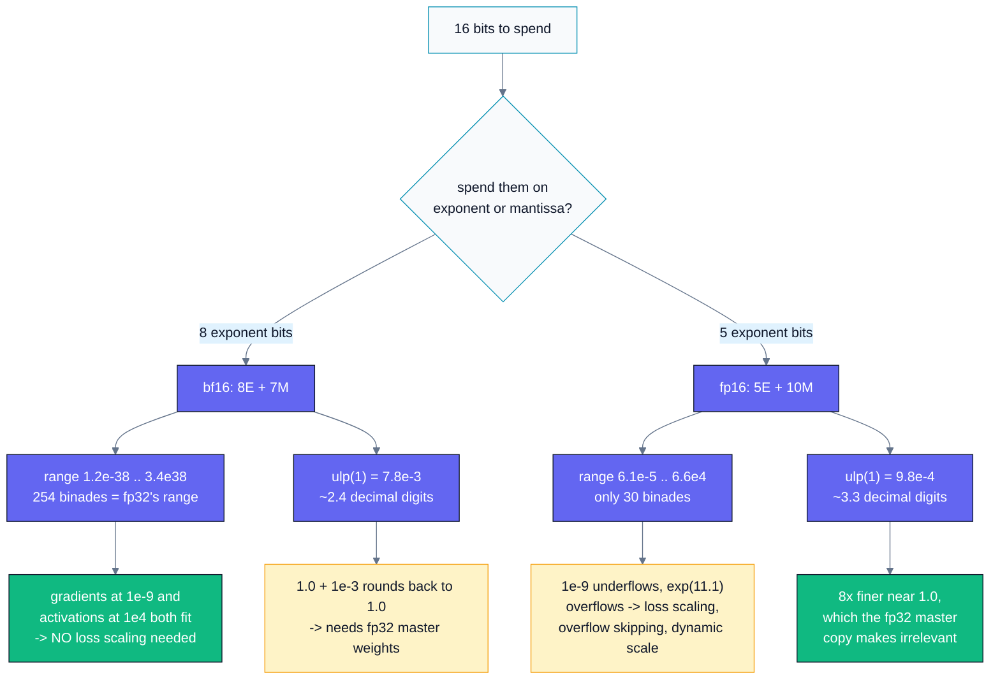
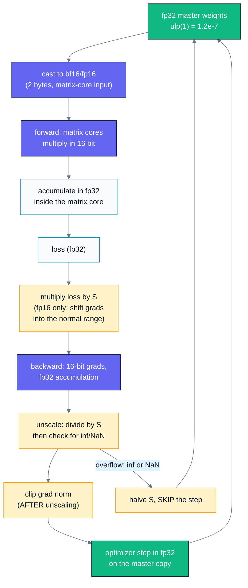
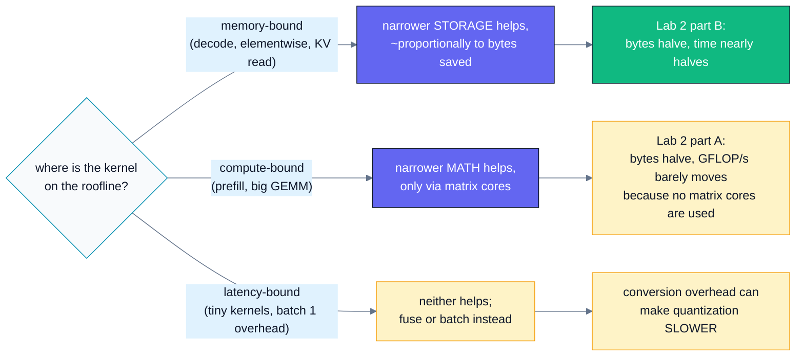
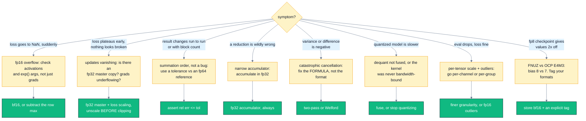

# B04 — Precision & Quantization

> Track B · Module 04 · Status: **DONE** · Est. 6 hours · Depth 3/5
>
> Prerequisites: [A01](../../A-gpu-programming/A01.foundations-and-programming-model/README.md)
> (kernels, error checking, event timing), [A04](../../A-gpu-programming/A04.parallel-reduction/README.md)
> (reductions and summation order), [A07](../../A-gpu-programming/A07.softmax-and-fused-kernels/README.md)
> (softmax and the max-subtraction trick), and B02's roofline vocabulary — arithmetic
> intensity, ridge point, memory- vs compute-bound.
> Backends: AMD (`hipcc`) · NVIDIA (`nvcc`) · Python/numpy for the quantization demo.
> See [../../../docs/SETUP.md](../../../docs/SETUP.md).

---

## 1. TL;DR + Layman analogy

**TL;DR.** Every numeric format spends its bits on two different things: **exponent bits
buy dynamic range, mantissa bits buy precision.** That single sentence explains every
format in this module. `bf16` keeps fp32's 8 exponent bits and cuts the mantissa to 7, so
it has fp32's range with coarse steps — which is why it needs no loss scaling and why it
displaced `fp16` (5 exponent bits, 10 mantissa bits: more precise, but it overflows and
underflows in real training). Narrower formats are faster for two separate reasons — fewer
bytes moved, and higher matrix-core throughput — and the two reasons apply in different
regimes. Quantization (fp32 → int8/int4) then trades measurable accuracy for memory and
bandwidth, and the only honest acceptance test is a **task-level eval before and after**,
not "the loss looked fine".

**Layman analogy — the ruler.** Measuring something with a ruler involves two independent
choices. First, **which unit**: millimetres, metres, or kilometres. That is the
**exponent** — it decides the *span* of things you can describe at all. Second, **how many
tick marks** the ruler has between each unit. That is the **mantissa** — it decides how
precisely you can describe whatever is in span.

Now the module in one paragraph of ruler-talk. `fp32` is a ruler with every unit from
nanometres to light-years, marked in ~7 significant digits. `bf16` keeps **exactly the same
range of units** but with only ~2–3 digits of tick marks — you can still measure a
light-year or a nanometre, just coarsely. `fp16` throws away most of the units (its biggest
number is 65504 and its smallest normal one is 0.00006) in exchange for finer ticks: a
better ruler for things in the middle, useless for things at the extremes. `fp8 E4M3` has
about 15 units and 8 ticks. And a gradient of `1e-9`? On the fp16 ruler that is off the
bottom of the scale — it reads exactly zero, and a weight that receives zero does not learn.

**Where the analogy breaks — and this break is the whole of §2.** A real ruler has
*uniformly spaced* ticks along its entire length. A floating-point format does not: it
re-scales its ticks at every power of two, so the gap between representable numbers near
`1.0` is tiny while the gap near `1e6` is large. That is why `1000000.0 + 0.01` can equal
`1000000.0` exactly. **`int8` quantization is the uniform ruler** — one fixed step size
across a chosen range — which is exactly why it needs a scale factor per tensor, per
channel, or per group, and why one outlier value ruins the ticks for everything sharing
that ruler. Floating point adapts its ticks to the number; integers do not. Hold both
pictures and most of this module is predictable.

**By the end of this module you can:** state the bit layout and range of fp32/tf32/bf16/
fp16/fp8-E4M3/fp8-E5M2/int8 from memory and derive their limits rather than recalling
them; explain why bf16 needs no loss scaling and fp16 does, with numbers; quantify both
mechanisms by which low precision is faster and say when each applies; write a
mixed-precision kernel that stores narrow and accumulates wide; recognise catastrophic
cancellation, summation-order sensitivity, and `exp` overflow in a kernel review; choose
between per-tensor, per-channel, and per-group quantization and defend the choice; and
state the evidence you need before shipping a quantized model.

---

## 2. First Principles

### The problem: you have N bits. What do you buy with them?

Forget formats and start from the requirement. You must represent numbers that span many
orders of magnitude (a weight of `0.02`, an activation of `1e4`, a gradient of `1e-9`) using
a fixed number of bits. There are exactly two strategies.

**Strategy 1 — fixed point.** Choose one step size `s` and represent `k · s` for integers
`k`. With 8 bits you get 256 evenly spaced values. Simple, and the hardware is an integer
adder. The problem: if `s` is small enough to resolve `1e-9`, the largest number you can
express is `127e-9`; if the largest number is `1e4`, then `s ≈ 79` and everything below 40
is zero. **Fixed point buys precision at a fixed scale, and cannot span orders of
magnitude.** This is `int8`, and it is why int8 always travels with a scale factor.

**Strategy 2 — floating point.** Spend some bits on an **exponent** and represent
`value = (-1)^sign × 1.mantissa × 2^(exponent - bias)`. The step size is now *relative*: it
scales with the magnitude of the number. You get many orders of magnitude at the cost of
never being exact.

That decomposition is the entire design space:

```
        1 bit           E bits                    M bits
      ┌───────┬────────────────────────┬────────────────────────────┐
      │ sign  │       exponent         │          mantissa          │
      └───────┴────────────────────────┴────────────────────────────┘
                        │                              │
                        ▼                              ▼
                 DYNAMIC RANGE                     PRECISION
            how big / small a number          how many significant
            you can express at all            digits it carries

  fp32   S EEEEEEEE MMMMMMMMMMMMMMMMMMMMMMM     8 exp, 23 man  ->  ±3.4e38, ~7.2 digits
  tf32   S EEEEEEEE MMMMMMMMMM                  8 exp, 10 man  ->  ±3.4e38, ~3.3 digits
  bf16   S EEEEEEEE MMMMMMM                     8 exp,  7 man  ->  ±3.4e38, ~2.4 digits
  fp16   S EEEEE MMMMMMMMMM                     5 exp, 10 man  ->  ±65504,  ~3.3 digits
  E4M3   S EEEE MMM                             4 exp,  3 man  ->  ±448,    ~1.2 digits
  E5M2   S EEEEE MM                             5 exp,  2 man  ->  ±57344,  ~0.9 digits
  int8     IIIIIIII  (× one scale)              uniform grid   ->  ±127·s,  step = s
```

Read the two 16-bit rows against each other. `bf16` and `fp16` are the *same size*. They
differ only in how they split the bits, and that split decides everything about how they
fail.

### The numbers, derived rather than tabulated

For a format with `E` exponent bits, `M` mantissa bits and bias `b`:

```
emin           = 1 - b                                (exponent of the smallest normal)
emax           = (2^E - 2) - b                        (IEEE: all-ones exponent is inf/NaN)
max finite     = (2 - 2^-M) · 2^emax
min normal     = 2^emin
min subnormal  = 2^(emin - M)
ulp(1)         = 2^-M                                 ("machine epsilon", FLT_EPSILON)
decimal digits ≈ (M + 1) · log10(2)
dynamic range  = emax - emin + 1  binades
```

| format | bits | E | M | bias | max finite | min normal | min subnormal | `ulp(1)` | digits | binades |
|---|---:|---:|---:|---:|---:|---:|---:|---:|---:|---:|
| **fp32** | 32 | 8 | 23 | 127 | 3.4028e38 | 1.1755e-38 | 1.4013e-45 | 1.192e-7 | 7.2 | 254 |
| **tf32** | 32 (19 used) | 8 | 10 | 127 | 3.4012e38 | 1.1755e-38 | 1.1479e-41 | 9.766e-4 | 3.3 | 254 |
| **bf16** | 16 | 8 | 7 | 127 | 3.3895e38 | 1.1755e-38 | 9.1835e-41 | 7.812e-3 | 2.4 | 254 |
| **fp16** | 16 | 5 | 10 | 15 | 6.5504e4 | 6.1035e-5 | 5.9605e-8 | 9.766e-4 | 3.3 | 30 |
| **fp8 E4M3** | 8 | 4 | 3 | 7 | 448 | 1.5625e-2 | 1.9531e-3 | 1.250e-1 | 1.2 | 15 |
| **fp8 E5M2** | 8 | 5 | 2 | 15 | 5.7344e4 | 6.1035e-5 | 1.5259e-5 | 2.500e-1 | 0.9 | 30 |
| **fp8 E4M3FNUZ** | 8 | 4 | 3 | **8** | **240** | 7.8125e-3 | 9.7656e-4 | 1.250e-1 | 1.2 | 15 |
| **int8** (symmetric) | 8 | — | — | — | 127 · `s` | — | — | `s` | 2.4 | — |

You do not have to trust this table: `hip/precision_limits.cpp` **computes every cell** from
`(E, M, bias)` at run time, so Lab 1 prints it on your machine. Two rows need footnotes:

- **fp8 E4M3 is not IEEE-shaped.** It has *no infinities* and reserves only one mantissa
  pattern at the top exponent for NaN, which buys back one extra binade — hence a max of
  `1.75 × 2^8 = 448` rather than 240 ([FP8 Formats for Deep Learning](https://arxiv.org/abs/2209.05433),
  Table 1). E5M2 keeps IEEE conventions and has infinities.
- **E4M3FNUZ is a different format with the same name.** AMD CDNA 3 (`gfx942`, MI300X)
  implements the *FNUZ* variants — bias 8, no infinities, a single NaN encoding, no
  negative zero — so its maximum is **240**, not 448
  ([HIP low-precision types](https://rocm.docs.amd.com/projects/HIP/en/latest/reference/low_fp_types.html)).
  The same 8 bits decode to values a factor of two apart on the two vendors. Exercise 1E is
  about that trap.

### The key insight: bf16 versus fp16



*The diagram is the argument for why bf16 won: both formats lose something, but bf16 loses
precision (fixable with an fp32 master copy that you need anyway) while fp16 loses range
(fixable only with loss scaling, overflow detection, and step skipping — machinery that can
silently misbehave). Range failures are catastrophic and precision failures are gradual, so
you give up precision.*

The mechanical reason bf16 is convenient goes further: **bf16 is the top 16 bits of an
fp32**. Same sign, same exponent field, mantissa truncated from 23 bits to 7. Converting is
a shift plus a rounding increment — no exponent rebiasing, no range check, no possibility
of unexpected overflow (both formats have the same `emax`). That is the conversion in
`hip/precision_limits.cpp`:

```cpp
const unsigned int lsb = (fb.u >> 16) & 1u;
return static_cast<unsigned short>((fb.u + 0x7FFFu + lsb) >> 16);   // round to nearest even
```

fp16 conversion, by contrast, must rebias the exponent (127 → 15), cope with a range that
is 112 binades narrower at each end, and generate subnormals or infinities for values fp32
held comfortably. That asymmetry is not an accident of history; it follows from the bit
layout.

### Why lower precision is faster — two separate mechanisms

**Mechanism 1: fewer bytes moved.** Take any kernel and write its arithmetic intensity as
`I = FLOPs / bytes`. Halving the element width halves the denominator, so `I` **doubles** —
and for a memory-bound kernel, achievable FLOP/s is `I × bandwidth`, so the ceiling doubles
too. Worked example, the elementwise `y = a·x + y` from Lab 2:

```
per element: read x, read y, write y = 3 elements, 2 FLOPs (one FMA)
fp32:  12 bytes/element -> at 3 TB/s, ceiling = 3e12/12 = 250 G elements/s
fp16:   6 bytes/element -> at 3 TB/s, ceiling = 3e12/6  = 500 G elements/s
```

Same for GEMM's global traffic: A06 derives `I = T/4 FLOP/byte` for an fp32 tiled GEMM with
tile `T`; with 2-byte operands it becomes `I = T/2`. **Halving the element size doubles the
intensity for free, before any faster arithmetic is involved.**

**Mechanism 2: matrix cores run reduced precision much faster.** This is a *compute*
ceiling, not a bandwidth one. NVIDIA's A100 datasheet is a clean, published example
([Ampere architecture whitepaper](https://images.nvidia.com/aem-dam/en-zz/Solutions/data-center/nvidia-ampere-architecture-whitepaper.pdf)):

| A100 peak | rate | vs FP32 CUDA cores |
|---|---:|---:|
| FP32 (vector) | 19.5 TFLOPS | 1× |
| TF32 tensor core | 156 TFLOPS | 8× |
| FP16 / BF16 tensor core | 312 TFLOPS | 16× |
| INT8 tensor core | 624 TOPS | 32× |

AMD's CDNA 3 whitepaper makes the same point for MI300X/MI325X: FP8 peak throughput is
**16× the FP32 peak**, and the Matrix Cores add full-rate TF32 and FP8 support relative to
CDNA 2 ([CDNA 3 white paper](https://www.amd.com/content/dam/amd/en/documents/instinct-tech-docs/white-papers/amd-cdna-3-white-paper.pdf)).

**Now the honest part, and it matters more than either mechanism: doubling a ceiling is not
a 2× end-to-end win.** Reasons you will meet in that order:

1. Your kernel may not be *at* the ceiling it just raised. Lab 2's tiled GEMM halves its
   global traffic and barely changes its GFLOP/s, because at a 32×32 tile it is limited by
   shared-memory traffic and instruction issue, not HBM.
2. Reduced-precision *storage* does not automatically use reduced-precision *math*. Lab 2's
   kernel widens every operand to fp32 and does fp32 FMAs; only a matrix-core path
   (hipBLASLt / cuBLASLt / a WMMA-MFMA kernel) converts narrow operands into higher
   arithmetic throughput.
3. Conversion is not free: narrowing and widening are real instructions, and a naive
   dequantize-then-GEMM does *more* work than fp16 unless it is fused.
4. Amdahl. If the GEMMs are 60% of your step time, making them infinitely fast buys 2.5×.
5. Some tensors must stay wide — the fp32 master weights, the optimizer moments, the
   softmax accumulator, LayerNorm statistics. Those bytes do not shrink.
6. Quantization adds *new* traffic: scales, zero-points, and (for outlier schemes) a second
   GEMM.

So the correct claim is "halving the bytes doubles the **memory-bound ceiling**", and
whether that becomes speed is an empirical question that §5's labs answer with numbers.

---

## 3. Deep Dive

### Mixed-precision training: why each piece exists



*Every warn-coloured box is machinery that exists only because a 16-bit format is
imperfect: the amber path down the middle is what fp16 forces on you and bf16 mostly
deletes, and the green boxes are the fp32 island that neither format can do without.*

**Why the fp32 master copy exists.** This is the numeric example worth memorising. In
bf16, `ulp(1) = 2^-7 = 7.8e-3`, so the representable neighbours of `1.0` are `1.0` and
`1.0078`. An update of `1e-3` applied to a weight of `1.0` lands at `1.001`, which rounds
**back to 1.0**. The update is not small — it is *gone*, and it will be gone every step,
because rounding is deterministic. Lab 1 section 4 prints the exact threshold per format:
fp16 loses `1.0 + 1e-4`, bf16 loses `1.0 + 1e-3`, fp32 keeps down to `1e-7`. Keep the
weights in fp32, apply updates there, and cast down only to feed the next forward pass.

Cost, from Exercise 2: bf16 weights (2) + fp32 master (4) + fp32 Adam `m` (4) + fp32 `v` (4)
+ 16-bit gradient (2) = **16 bytes per parameter**, which is *exactly what pure fp32
training costs*. Mixed precision does not halve parameter memory. It halves **activation**
memory and buys matrix-core throughput; the "half the memory" claim is true of activations
and false of parameter state.

**Why fp32 accumulation exists.** A dot product of length `K` performs `K` roundings of a
growing sum. In fp16, once the running sum reaches a magnitude where `ulp/2` exceeds the
next term, that term contributes **nothing** — the sum stagnates. Concretely: summing
`1e6` terms of `1e-2` in fp16 stalls at about **32** instead of `1e4`, a 99.7% error,
because `ulp/2` at 32 is `1.6e-2 > 1e-2`. Lab 1 section 5 measures the error growth with
`K`; Lab 2 shows the same effect as a failed GEMM row. Storage precision costs a *bounded
relative error*; accumulator precision costs *the result*. **Every matrix core in existence
multiplies narrow and accumulates in fp32** for exactly this reason.

**Why loss scaling exists (fp16 only).** Multiply the loss by `S` before `backward()` and
every gradient is scaled by `S`, shifting the whole magnitude histogram up into fp16's
normal range; divide by `S` before the optimizer step. Choose `S` as a power of two so the
scaling is *exact* (it only adds to the exponent field). Exercise 2 works a realistic
gradient histogram: ~64% of the values are subnormal in fp16, ~3% round to exactly zero,
and `S = 2^16` is the largest power of two that keeps the maximum gradient finite. Dynamic
loss scaling hill-climbs `S`: halve it and **skip the step** on any `inf`/`NaN`, double it
after `N` clean steps. bf16 needs none of this because nothing in the histogram is within
30 orders of magnitude of underflow.

### Hardware support, and where the vendors diverge

| feature | AMD CDNA 3 (`gfx942`, MI300X/MI325X) | NVIDIA Ampere → Hopper |
|---|---|---|
| Matrix unit | Matrix Cores, `MFMA` instructions | Tensor Cores, `WMMA`/`MMA` |
| fp16 / bf16 in, fp32 accumulate | yes | yes (Volta / Ampere onward) |
| tf32 | yes, full-rate on CDNA 3 | yes, from Ampere; default math mode for fp32 DL |
| fp8 | **E4M3FNUZ / E5M2FNUZ** on `gfx942`; OCP variants on newer targets (`gfx12x` per the HIP reference) | **OCP E4M3 / E5M2** from Hopper |
| int8 | yes | yes |
| structured sparsity | 2:4 for INT8/FP8/FP16/BF16 | 2:4 from Ampere |
| bf16 C++ type | `__hip_bfloat16` (`hip/hip_bf16.h`) | `__nv_bfloat16` (`cuda_bf16.h`) |
| fp8 C++ type | `__hip_fp8_e4m3_fnuz`, `__hip_fp8_e4m3` | `__nv_fp8_e4m3`, `__nv_fp8_e5m2` |

Sources: [CDNA 3 white paper](https://www.amd.com/content/dam/amd/en/documents/instinct-tech-docs/white-papers/amd-cdna-3-white-paper.pdf),
[HIP low-precision floating-point types](https://rocm.docs.amd.com/projects/HIP/en/latest/reference/low_fp_types.html),
[Ampere whitepaper](https://images.nvidia.com/aem-dam/en-zz/Solutions/data-center/nvidia-ampere-architecture-whitepaper.pdf),
[Transformer Engine FP8 primer](https://docs.nvidia.com/deeplearning/transformer-engine/user-guide/examples/fp8_primer.html).

Three consequences for portable code:

1. **`tf32` is a math mode, not a storage format.** It is 19 bits (1 sign + 8 exponent + 10
   mantissa) held inside a 32-bit register, so it saves *no memory at all*. AMD's own
   whitepaper calls the name "somewhat of a misnomer" and describes it as a hybrid of
   fp16's mantissa with bf16's exponent. Its purpose is to let fp32 code use the matrix
   cores unchanged: inputs are rounded to tf32, products accumulate in fp32, and the result
   is a standard fp32. If you see a "free 8× speedup on fp32" it is usually tf32 being
   enabled, and it is a *silent precision reduction* — 10 mantissa bits, not 23. Know which
   of your fp32 kernels are actually running tf32.
2. **`fp8` means two different formats.** CDNA 3 (`gfx942`) uses the FNUZ variants
   (max 240); Hopper and AMD's newer targets use OCP (max 448). Bit patterns are not
   interchangeable — the biases differ by one, so identical bits decode a factor of two
   apart. The HIP reference is explicit that `gfx940/941/942` support FNUZ fp8 and *not* OCP
   fp8, and that the OCP classes target `gfx12x`; for any other specific part, check the
   documentation for that architecture rather than assuming. Never ship an fp8 checkpoint
   without a format tag.
3. **The `bf16` type names differ.** `__hip_bfloat16` versus `__nv_bfloat16`, in headers
   with different names. This module's labs therefore implement bf16 as a 16-bit storage
   type with an exact round-to-nearest-even conversion, so a single source file builds on
   both vendors — and, usefully, makes the bit layout the visible object of study. fp16 is
   the one narrow type spelled identically (`__half`, `__float2half`, `__half2float`), so
   the labs use the real hardware type there.

### Numerical hazards, with the numbers

**Hazard 1 — `exp` overflow in softmax.** fp16's max finite is `65504`, and
`ln(65504) = 11.0899`. So `exp(x)` leaves fp16 at `x ≈ 11.09` — an entirely ordinary
attention logit. Lab 1 section 3 sweeps `x` and prints the first overflow at `x = 11.10`.
The fix is A07's: subtract the row maximum first, so every argument is `≤ 0` and
`exp(·) ≤ 1`. Note that this is not a precision optimisation; it is the difference between
a working kernel and `NaN`. bf16 would not overflow here (its max is `3.4e38`,
`ln = 88.7`), which is one more reason it is the safer default.

**Hazard 2 — a long dot product in a narrow accumulator.** Covered above; Lab 1 section 5
prints the error growing with `K` for fp16 against fp32 against fp64, with the summation
order held *identical* (a single-threaded kernel) so precision is the only variable.

**Hazard 3 — summation order.** Floating-point addition is **not associative**:
`(a+b)+c ≠ a+(b+c)`. A tree reduction over 256 blocks and one over 1024 blocks partition
the sum differently, so they produce different results — both correct. Lab 1 section 6
measures the spread across launch configurations. Two practical consequences: a reduction
is **not bit-reproducible** across grid sizes, so regression tests must use a tolerance
against an fp64 reference; and "the loss changed after I retuned the launch config" is
expected behaviour, not a bug. This is A04's reduction, revisited with a numerical eye.

**Hazard 4 — catastrophic cancellation.** Subtracting two nearly equal numbers destroys
the leading digits and promotes rounding noise to the result. The canonical instance is
one-pass variance, `E[x²] − E[x]²`. With `x ≈ 1e6` and true variance `1/3`, both terms are
about `1e12` and agree to 12 digits; fp32 carries ~7, so **nothing correct survives** — Lab
1 section 7 prints a garbage (often negative) variance next to a correct two-pass result at
the same precision. The lesson is that the fix is *algebraic*, not numeric: subtract the
mean first, or use Welford's online update, which is what framework LayerNorm kernels do.
Extra precision only moves the cliff.

### Post-training quantization versus quantization-aware training

**PTQ** takes a trained fp32/bf16 model and converts weights (and optionally activations)
to int8/int4 using statistics from a small **calibration set**. Cheap — minutes to hours,
no gradients — and the default choice. **QAT** inserts fake-quantization nodes into
training or fine-tuning so the model *learns* weights that survive quantization, using a
straight-through estimator for the non-differentiable rounding. More expensive (a training
run) and usually reserved for aggressive targets (int4 and below) or for models where PTQ
measurably fails. The decision rule is empirical: try PTQ, evaluate, and escalate to QAT
only when the eval says you must.

**The quantization map itself.** For a block of values sharing one scale:

```
symmetric   : s = max|w| / 127          q = clip(round(w / s), -127, 127)      w' = q · s
asymmetric  : s = (max - min) / 255     z = round(-min/s) - 128
              q = clip(round(w / s) + z, -128, 127)                            w' = (q - z) · s
```

Symmetric drops the `-128` code so that `0.0` maps exactly to integer `0` — which keeps
padding, pruned weights and post-ReLU zeros exact, and makes the dequantization a single
multiply. Asymmetric adds a zero-point, which is what you need for a range that is not
centred on zero (post-ReLU activations), at the cost of an extra integer per block and
cross-terms in the GEMM. In practice: **weights symmetric, activations asymmetric.**

**Granularity is the lever that matters most.** The scale is set by the *largest magnitude
in its block*, so one outlier ruins the resolution of everything sharing that block:

| granularity | one scale per | when it fails |
|---|---|---|
| per-tensor | whole matrix | any single outlier channel destroys the whole tensor's resolution |
| per-channel | row (output feature) | an outlier *inside* a row still coarsens that row |
| per-group | run of `g` weights in a row (`g` = 32/64/128) | outliers still coarsen their own group; alignment matters |
| per-element | nothing left to share | no compression |

`tools/quantize_demo.py` measures exactly this on a matrix with one outlier channel: going
from per-tensor to per-channel drops the typical-row error by ~45× (the ratio of the two
`|w|max` values), and keeping the single outlier row in fp16 drops the total error another
5× for ~1.5% more memory. Exercise 3 then shows the limit of group-wise scaling: it
*contains* outlier damage rather than removing it, and how well it contains it depends on
an alignment you do not control.

### The LLM quantization methods, and what each one optimizes

| method | what it does | what it optimizes for | cost |
|---|---|---|---|
| **weight-only int8/int4**, round-to-nearest | quantize `W` per channel or per group; dequantize inside the GEMM | memory and bandwidth on a memory-bound decode; simplest possible kernel | accuracy at int4 without a smarter scheme |
| **LLM.int8()** ([arXiv:2208.07339](https://arxiv.org/abs/2208.07339)) | decompose the matmul: outlier *feature columns* (a tiny fraction, but with huge magnitudes) stay in fp16, the rest is int8; sum the two partial products | zero-degradation int8 inference at scale, where a handful of emergent outlier features otherwise wreck per-tensor scales | two GEMMs, irregular layout, a runtime outlier threshold |
| **GPTQ** ([arXiv:2210.17323](https://arxiv.org/abs/2210.17323)) | one-shot, layer-wise weight quantization that minimises the *output* error using approximate second-order (Hessian) information, quantizing column by column and compensating the remaining columns | the best int3/int4 weight-only accuracy from a single calibration pass, no retraining | a calibration pass with Hessian estimation per layer; sensitive to the calibration data |
| **AWQ** ([arXiv:2306.00978](https://arxiv.org/abs/2306.00978), MLSys 2024) | observes that ~1% of weights are salient, identified by **activation** magnitude rather than weight magnitude; searches a per-input-channel scale that shrinks those weights before quantization | int4 accuracy that generalises (no backprop, no reconstruction, so less calibration overfitting) plus a fast fused kernel | a calibration pass to observe activations; the scaling must fold into an adjacent op |
| **KV-cache quantization** ([KIVI, arXiv:2402.02750](https://arxiv.org/abs/2402.02750)) | quantize the stored keys and values (int8/fp8, or 2-bit with per-channel keys and per-token values, keeping a small recent window in fp16) | the memory *and* bandwidth of long-context, large-batch serving | a quantize/dequantize step on the attention path; quality risk at long context |

The through-line: **every one of these is an answer to "the scale is only as good as the
largest value it must cover."** LLM.int8() removes the offending values from the block; AWQ shrinks them
before quantizing; GPTQ accepts them and compensates the *other* weights; group-wise
scaling shrinks the block so fewer values share the damage.

### KV-cache quantization: usually the highest-leverage win

For a decoder, the KV cache is the one tensor that grows with **batch × context** while the
weights stay fixed. Size it once and you will never forget it:

```
per token per layer : 2 (K and V) × n_kv_heads × head_dim  values
Llama-3-8B shape    : 2 × 8 × 128 = 2048 values/layer/token
                      × 32 layers  = 65,536 values/token
                      × 2 bytes    = 128 KiB per token           <- memorise this
context 8192        : 1 GiB per sequence
batch 32            : 32 GiB  ... against 16 GB of fp16 weights
```

At that operating point the cache is **twice the weights**, and at 128k context it dwarfs
them. Because decode re-reads the entire cache for every generated token, halving its bytes
halves that read (latency) *and* halves its footprint (→ larger batch → throughput). One
change, both benefits — which is why fp8/int8 KV caches ship in vLLM, SGLang and
TensorRT-LLM. B06 takes this further into paged attention and serving-level batching;
Exercise 1D has you do the arithmetic.

---

## 4. Hands-On Labs

All commands run from this module directory. The GEMM/axpy lab needs a GPU; the
quantization demo needs only Python and numpy.

```bash
# AMD
make hip            GPU_ARCH=gfx942     # build both hip/ programs
make run-hip                            # run them

# NVIDIA
make cuda           SM_ARCH=sm_90       # build both cuda/ programs
make run-cuda                           # run them

# CPU only
make python                             # tools/quantize_demo.py

# Drills (own Makefiles, so `cd exercises && make run` also works)
make exercises      # syntax-check the Python drill
make solutions
make clean           # cleans here + exercises/ + solutions/
```

> **Match `GPU_ARCH` to your GPU.** `gfx950` = MI350, `gfx942` = MI300, `gfx90a` = MI200,
> `gfx1100` = RDNA3. Find yours with `/opt/rocm/bin/offload-arch` (or `rocminfo | grep gfx`).
>
> **Knobs.** `MDIM=2048` changes the GEMM size (the host reference is `O(MDIM³)` in double,
> so start-up time grows quickly above ~1536). `B04_NO_NATIVE_FP8=1` skips the optional
> vendor-fp8 cross-check in Lab 1.
>
> **Troubleshooting.** `error while loading shared libraries: libamdhip64.so` — the loader
> cannot find the ROCm runtime; the shared `common.mk` already bakes an rpath, so this
> usually means you built by hand (add `-Wl,-rpath,/opt/rocm/lib`).
> `hipErrorNoBinaryForGpu` — built for the wrong arch; rebuild with the right `GPU_ARCH`.

### Lab 1 — What each format can and cannot represent (`precision_limits`)

Files: [`hip/precision_limits.cpp`](hip/precision_limits.cpp) ·
[`cuda/precision_limits.cu`](cuda/precision_limits.cu).

Seven sections, all of them printed rather than asserted: the derived format table; a
round-trip of one value through every format; fp16 `exp()` overflow; `1.0 + tiny`; a dot
product in fp16/fp32/fp64 at fixed summation order; the same fp32 dot product at varying
block counts; and one-pass versus two-pass variance.

**What to observe, in order of importance:**

1. In section 4, the row where `fp16 1+t` and `bf16 1+t` both read exactly `1.000000000`.
   That is a weight update disappearing. Note that **fp16 keeps more of these than bf16** —
   precision near 1.0 is a mantissa question — and that neither is safe.
2. In section 5, the fp16 column's error growing with `n` while fp32's stays flat. The
   summation order is identical across the three columns; only the accumulator changed.
3. In section 6, the fp32 result **changing** with the block count. Nothing is broken. If
   this surprises you, that is the most valuable surprise in the module.
4. In section 3, that fp16 `exp()` overflows at `x = 11.10`, and that fp32 has headroom to
   `x ≈ 88.7`.
5. In section 7, a variance that is negative (or off by seven orders of magnitude) computed
   from two fp32 sums that are each individually accurate to seven digits.

If your GPU and toolchain expose a vendor fp8 type, section 2 also cross-checks the
software converter against it and names the variant (`__hip_fp8_e4m3_fnuz` on AMD,
`__nv_fp8_e4m3` on NVIDIA). If not, it prints a skip message and continues — the software
table is unaffected.

### Lab 2 — The accuracy/speed tradeoff, measured (`mixed_precision_gemm`)

Files: [`hip/mixed_precision_gemm.cpp`](hip/mixed_precision_gemm.cpp) ·
[`cuda/mixed_precision_gemm.cu`](cuda/mixed_precision_gemm.cu).

**[A]** One tiled GEMM, four variants: fp32/fp16/bf16 storage with fp32 accumulation, plus
fp16 storage with an fp16 accumulator. Reports ms, GFLOP/s, analytic global traffic,
effective GB/s, and max/mean relative error against a **double-precision host reference
computed from the original fp32 inputs** — the honest question being "how far is this
pipeline from exact arithmetic on the data I actually have", not "how close is it to its
own rounded inputs".

**[B]** The same three storage types on a memory-bound `y = a·x + y` over 16.7M elements.

**What to observe:**

1. The `MB global` column halves exactly as the byte accounting predicts when you move to
   16-bit storage. The `GFLOP/s` column moves much less. **That gap is the lesson of §2's
   "two mechanisms".**
2. bf16's error is about **8× fp16's**, which is precisely the ratio of their `ulp(1)`
   (`2^-7` vs `2^-10`). The formats behave exactly as their mantissa widths say they will.
3. The fp16-accumulator row is *far* worse than the fp16-storage row and is labelled
   `FAILED (expected)`. It is held to the same tolerance on purpose. Narrow storage costs a
   bounded relative error; a narrow accumulator costs the result.
4. In **[B]**, a speedup approaching (but short of) 2× for the 16-bit rows, with a GB/s
   column that is roughly *equal* across rows — the signature of being bandwidth-bound in
   all three cases, where the byte count alone sets the time.

### Lab 3 — Why per-channel and outlier handling exist (`tools/quantize_demo.py`)

File: [`tools/quantize_demo.py`](tools/quantize_demo.py). Pure numpy, no GPU:

```bash
make python        # or: python tools/quantize_demo.py
```

Six int8 schemes on one synthetic weight matrix with a single outlier channel: per-tensor
and per-channel × symmetric and asymmetric, plus per-channel-with-one-fp16-row
(LLM.int8() in miniature) and per-group.

**What to observe:** the per-tensor step size is ~45× coarser than the typical row needs,
purely because one row contains values 45× larger; per-channel fixes the typical rows and
leaves the outlier row exactly as it was; keeping that one row in fp16 fixes it for ~1.5%
more memory. Also watch the `vs fp32` column: per-group at `g = 32` with fp32 scales adds
12.5% scale overhead on top of the int8 payload, taking the compression from 4.00× to
3.56× — which is why shipped kernels store scales in fp16 and use `g = 64` or `128`.

### Lab 4 (optional) — Profile the conversions

```bash
make profile-hip     # rocprofv3 summary + traces into profiling_output/
make profile-cuda    # nsys timeline; then: ncu --set full ./cuda/mixed_precision_gemm.exe
```

**What to look for:** the conversion instructions themselves (`V_CVT_*` on AMD, `CVT` on
NVIDIA) in the kernel's instruction mix, and whether the 16-bit variants show a lower
memory-throughput percentage than the fp32 one. If the 16-bit kernel is *not* faster and
its memory throughput is *not* the limiter, you have just measured why the matrix cores —
not the storage width — are what production kernels are after.

---

## 5. Performance Analysis

### The two ceilings, quantified

Write both roofline ceilings for a kernel with element width `w` bytes:

```
memory-bound ceiling  =  I(w) × bandwidth,      where I(w) = FLOPs / (elements × w)
compute-bound ceiling =  peak FLOP/s for the precision the MATH unit uses
```

Halving `w` doubles `I`, which doubles the *first* ceiling and does nothing to the second.
Switching from fp32 FMAs to matrix-core fp16/bf16 raises the *second* ceiling by 8–16× on
current hardware and does nothing to the first. **A change that only touches storage moves
one ceiling. You have to know which one you were standing under.**



*Same one-line code change — a narrower storage type — with three different outcomes
depending on which ceiling the kernel was already touching; Lab 2 deliberately contains one
kernel from the top branch and one from the middle so you can see both in a single run.*

### Worked example: batch-1 decode is a bandwidth problem

A 13B-parameter model, decode at batch 1, on a GPU with 3 TB/s and ~1000 TFLOP/s bf16:

```
work per token   : ~2 FLOPs per weight
intensity (fp16) : 2 FLOP / 2 bytes = 1 FLOP/byte
intensity (int8) : 2 FLOP / 1 byte  = 2 FLOP/byte
ridge point      : 1000e12 / 3e12   = 333 FLOP/byte
```

Two orders of magnitude below the ridge — so tokens/second is `bandwidth ÷ weight bytes`:
about **115** in fp16 (26 GB), **231** in int8, **462** in int4. Weight-only quantization is
one of the few changes that moves decode throughput almost proportionally, and it does so
*without* using a single int8 matrix-core instruction. The same change during **prefill**
(large batch, weights reused across many tokens) buys much less, because prefill is near
the compute ceiling instead.

### What the labs print, and what to expect

**Do not trust a benchmark table you did not run.** This module deliberately contains no
fabricated numbers; the labs print theirs. Expect these *shapes*, all hardware-dependent
in magnitude:

| measurement | expected shape | why |
|---|---|---|
| Lab 2[A] `MB global`, fp32 → fp16/bf16 | exactly 2× smaller (minus the fp32 `C` write) | analytic, not measured |
| Lab 2[A] `GFLOP/s`, fp32 → fp16/bf16 | modest change, far less than 2× | kernel is LDS/issue-bound and uses no matrix cores |
| Lab 2[A] `max rel err`, fp16 vs bf16 | bf16 ≈ 8× fp16 | ratio of `ulp(1)`: `2^-7` vs `2^-10` |
| Lab 2[A] fp16 accumulator | orders of magnitude worse; `FAILED (expected)` | `K` roundings of a growing sum |
| Lab 2[B] `ms/iter`, fp32 → fp16/bf16 | approaching 2× faster, short of it | bandwidth-bound; overhead does not shrink |
| Lab 2[B] `GB/s` across rows | roughly equal | all three saturate the same HBM limit |
| Lab 1[5] fp16 dot-product error | grows with `n`; fp32 stays flat | error accumulates per rounding |
| Lab 1[6] fp32 sum vs block count | changes in the last few digits | addition is not associative |

A useful sanity check on your own runs: in Lab 2[B], compute `bytes / time` yourself and
compare it against your GPU's datasheet HBM bandwidth (MI300X ≈ 5.3 TB/s, H100 ≈ 3.35
TB/s). If the fp32 and fp16 rows report the same GB/s, they are both bandwidth-bound and
the speedup you measured *is* the byte ratio. If the fp16 row reports *lower* GB/s, you
have fallen off the bandwidth limit and something else (launch overhead, occupancy,
conversion instructions) now dominates — which is itself the interesting finding.

### Profiling what precision actually changed

```bash
# AMD
rocprofv3 --summary --sys-trace --output-format csv -d profiling_output -- ./hip/mixed_precision_gemm.exe
# NVIDIA
ncu --set full ./cuda/mixed_precision_gemm.exe
```

Three counters answer "did my precision change do what I thought":

1. **Memory throughput (% of peak)** — if it was already near peak in fp32 and is still
   near peak in fp16, you got the byte-count win and nothing more; that is success for a
   memory-bound kernel.
2. **Matrix-core / tensor-core utilisation** — if it is zero in both, you did not buy
   mechanism 2 at all. Reach for a library.
3. **Conversion instruction count** (`V_CVT_*` / `CVT`) — if a "quantized" kernel spends
   real time converting, the dequantization was not fused and you have paid for
   compression without collecting it.

---

## 6. Challenges, Drawbacks & Tradeoffs

### The one that matters: quantization is a quality decision

Everything else in this section is a bug you can find. This one is a judgement you have to
make, and it is where teams get hurt.

**Reducing precision changes your model's outputs.** Not "might, in edge cases" — it does,
always, by an amount your loss curve is nearly blind to. So:

- **"The loss looked fine" is not evidence.** Loss and perplexity are averages over a
  generic corpus, dominated by easy, high-probability tokens. Quantization damage
  concentrates in rare high-information tokens, in long-context behaviour, in multi-step
  reasoning, and in the tails you actually care about. A model can lose a capability
  entirely while its perplexity moves in the third decimal place.
- **A weight-space norm is not evidence either.** `tools/quantize_demo.py` shows weight
  error and output error moving together only because its test activations are isotropic
  Gaussian. Real activations concentrate in a few channels, so weight-space error can badly
  under-predict what the next layer feels. That gap is precisely what AWQ exploits.
- **What is evidence:** a **task-level eval, run before and after, on the same prompts with
  the same decoding parameters, with a pass/fail threshold agreed *in advance*.** Ideally
  several: one generic benchmark, one that mirrors your product, and one adversarial or
  long-context set. Report a confidence interval, because eval noise is real and a 0.5%
  move on 200 examples means nothing.

**And a plan for when quality drops** — in escalation order, cheapest first:

1. **Raise the granularity.** Per-tensor → per-channel → per-group (`g = 128 → 64`). Costs
   scale bytes and a slightly more complex kernel; usually recovers most of the loss.
2. **Keep outliers in higher precision.** Mixed-precision decomposition (LLM.int8()): the
   offending channels stay fp16, the rest is int8. Costs an extra GEMM and an irregular
   layout.
3. **Raise the precision of sensitive layers.** The first and last layers, embeddings,
   LayerNorm and the softmax are routinely excluded from quantization. Costs memory only
   for those layers, which are a small fraction of the parameters.
4. **Use a smarter PTQ method.** GPTQ or AWQ instead of round-to-nearest — same bit width,
   better accuracy, at the cost of a calibration pass and a dependency.
5. **Go up a bit width.** int4 → int8, or int8 → fp8/bf16. You are giving back the memory
   you came for; do it knowingly rather than by accident.
6. **QAT.** A training run to make the model robust to quantization. Expensive; justified
   for aggressive targets or high-volume deployments.

Do this in order and stop at the first step that passes the eval. Skipping to step 6
because step 1 is unglamorous is the most common waste of engineering time in this area.

### The pitfalls, as a decision tree



*Read it as a triage table: the left column is what you will actually observe, and note how
many distinct symptoms trace back to the same two root causes — a too-narrow accumulator,
and a scale that has to cover an outlier.*

### The specific traps, spelled out

**Trap 1 — accumulating in the storage precision.** The single most common hand-written
kernel bug in this area. `__half acc = 0;` inside a reduction loop is wrong at any length
that matters. Always widen: store narrow, accumulate in fp32. Lab 2's fourth row exists to
make this unforgettable.

**Trap 2 — clipping before unscaling.** With loss scaling, gradients are `S×` too large
until you unscale. Clip first and the clip fires on *every* step, shrinking the effective
learning rate by roughly `S`; the mirror-image mistake makes the clip never fire at all.
Both are silent — training just stops working or stops being protected. Correct order:
unscale → check finiteness → clip → step.

**Trap 3 — not skipping the step on overflow.** `w = w - lr·NaN` makes the weight `NaN`,
and Adam's moments become permanently `NaN`. The run is dead, and the `NaN` loss appears
several steps after the cause.

**Trap 4 — assuming `fp8` means one format.** CDNA 3's E4M3FNUZ (bias 8, max 240) and OCP
E4M3 (bias 7, max 448) are different encodings with the same name. Bit patterns are off by
a factor of two, and `0x80` is `NaN` in one and `-0.0` in the other. There is no error
message. Tag your formats.

**Trap 5 — expecting tf32 to save memory.** It is 19 bits in a 32-bit register. It buys
matrix-core throughput for fp32 code and *nothing* in bandwidth. Also: it is often on by
default, so some of your "fp32" results already carry only 10 mantissa bits.

**Trap 6 — quantizing the thing that is not the bottleneck.** Weight quantization on a
long-context serving workload where the KV cache is twice the weights is effort spent on
the smaller number. Measure the footprint first (§3's KV arithmetic).

**Trap 7 — calibration-set overfitting.** PTQ methods that reconstruct against a
calibration set can quietly specialise to it. This is one of AWQ's stated motivations for
avoiding backpropagation and reconstruction. Evaluate on data the calibration never saw.

**Trap 8 — non-reproducibility treated as a defect.** Fixing it means fixing the reduction
order, which costs performance. Decide deliberately; do not let a flaky exact-equality test
push you into it by accident.

### When *not* to reduce precision

- **When you are latency-bound, not bandwidth- or compute-bound.** Conversion overhead can
  make a small kernel slower.
- **When the quantity is a statistic rather than a datum:** loss values, LayerNorm mean and
  variance, softmax accumulators, gradient norms, running averages. These are reductions,
  and reductions want width.
- **When you cannot evaluate the result.** No eval, no quantization. That is not
  conservatism; it is the difference between an engineering change and a gamble.
- **When the model is already small relative to your memory.** You are taking on quality
  risk to save memory you were not short of.
- **In numerically delicate algorithms** — iterative solvers, anything with subtraction of
  nearly equal quantities, physics with conservation laws. HPC codes often need fp64 for
  reasons that have nothing to do with model quality.

---

## 7. Real-World Use Cases

**Training.**
- **PyTorch AMP** (`torch.autocast` + `torch.amp.GradScaler`) is exactly §3's diagram: an
  op-type allowlist decides what runs in bf16/fp16, reductions and losses stay fp32, and
  `GradScaler` implements dynamic loss scaling with skip-on-overflow. The API forces the
  correct order (`scaler.unscale_()` before `clip_grad_norm_()`, then `scaler.step()`)
  because Trap 2 is so common.
- **NVIDIA Transformer Engine** implements fp8 training with per-tensor delayed scaling
  (an amax history) and the E4M3-forward/E5M2-backward split from the FP8 paper, plus
  MXFP8 block scaling (one E8M0 scale per 32 values) on newer hardware.
- **Optimizer/state sharding** (ZeRO, FSDP) exists partly because §3's byte accounting says
  12 of the 14 bytes per parameter are master weights and moments.

**Inference and serving.**
- **bitsandbytes** ships LLM.int8() and 4-bit (NF4) quantization under the Hugging Face
  `load_in_8bit` / `load_in_4bit` flags.
- **GPTQ** and **AWQ** are the two dominant weight-only PTQ methods, with kernels in
  AutoGPTQ, AutoAWQ, vLLM, SGLang and TensorRT-LLM. AWQ's fused int4 kernels are a good
  study in making dequantization free by folding it into the GEMM epilogue.
- **llama.cpp's k-quants** are group-wise schemes with per-block scales (and
  super-block scales) — §3's granularity table, taken to its practical conclusion for
  CPU and consumer GPU inference.
- **fp8 / int8 KV caches** in vLLM, SGLang and TensorRT-LLM: the highest-leverage memory
  win for long context, as §3 sizes it. B06 covers the serving side.
- **Vendor GEMM libraries** are where mechanism 2 actually lives: hipBLASLt/rocBLAS on
  ROCm, cuBLASLt/CUTLASS on CUDA. If your low-precision kernel is not faster, the first
  question is whether a library would have used the matrix cores you are not using.

**Standards and hardware.** The **OCP 8-bit Floating Point Specification** and the **OCP
Microscaling (MX) Formats** specification are the reason fp8/fp6/fp4 are becoming
interoperable rather than per-vendor; AMD CDNA 4 and NVIDIA Blackwell both implement MX
formats with block-level exponents, which is the industry's answer to "one scale per tensor
cannot cover a wide distribution".

---

## 8. Cited References

Grounding for the claims above. Full list in
[../../../docs/REFERENCES.md](../../../docs/REFERENCES.md).

**Formats and standards**
- **IEEE 754-2019**, *Standard for Floating-Point Arithmetic* — sign/exponent/mantissa,
  rounding modes, subnormals, the definition of `ulp`.
  <https://standards.ieee.org/ieee/754/6210/>
- Micikevicius et al. (2022). *FP8 Formats for Deep Learning* — E4M3/E5M2 bit layouts,
  biases, max values (448 / 57344), the non-IEEE special-value handling in E4M3, and the
  E4M3-for-weights-and-activations / E5M2-for-gradients recommendation.
  <https://arxiv.org/abs/2209.05433>
- **OCP 8-bit Floating Point Specification (OFP8)** and **OCP Microscaling Formats (MX)** —
  the interoperable definitions the vendors implement.
  <https://www.opencompute.org/documents/ocp-8-bit-floating-point-specification-ofp8-revision-1-0-2023-12-01-pdf-1>
- Goldberg (1991). *What Every Computer Scientist Should Know About Floating-Point
  Arithmetic* — still the best single treatment of cancellation and rounding.
  <https://dl.acm.org/doi/10.1145/103162.103163>

**Mixed-precision training**
- Micikevicius et al. (2018). *Mixed Precision Training* (ICLR) — the fp32 master-weight
  copy, fp32 accumulation, and loss scaling, with the underflow analysis this module's
  Exercise 2 reproduces.
  <https://arxiv.org/abs/1710.03740>
- **PyTorch AMP documentation** — `autocast`, `GradScaler`, the op allowlists, and the
  required unscale-before-clip ordering.
  <https://pytorch.org/docs/stable/amp.html>
- **NVIDIA Transformer Engine — FP8 primer** — delayed scaling with amax history, the
  E4M3-forward/E5M2-backward split, MXFP8 block scaling.
  <https://docs.nvidia.com/deeplearning/transformer-engine/user-guide/examples/fp8_primer.html>

**Quantization methods**
- Dettmers et al. (2022). *LLM.int8(): 8-bit Matrix Multiplication for Transformers at
  Scale* — emergent outlier features and mixed-precision decomposition.
  <https://arxiv.org/abs/2208.07339>
- Frantar et al. (2023). *GPTQ: Accurate Post-Training Quantization for Generative
  Pre-trained Transformers* (ICLR) — one-shot second-order weight quantization to int3/int4.
  <https://arxiv.org/abs/2210.17323>
- Lin et al. (2024). *AWQ: Activation-aware Weight Quantization for LLM Compression and
  Acceleration* (MLSys, best paper) — salient weights identified by activation magnitude,
  per-input-channel scaling search.
  <https://arxiv.org/abs/2306.00978>
- Liu et al. (2024). *KIVI: A Tuning-Free Asymmetric 2bit Quantization for KV Cache* (ICML)
  — per-channel keys, per-token values, and the fp16 residual window.
  <https://arxiv.org/abs/2402.02750>
- Jacob et al. (2018). *Quantization and Training of Neural Networks for Efficient
  Integer-Arithmetic-Only Inference* — the affine (scale + zero-point) formulation and QAT
  with straight-through estimators.
  <https://arxiv.org/abs/1712.05877>

**Vendor documentation for the hardware claims**
- **AMD CDNA 3 white paper** — Matrix Core data types, tf32 as a 19-bit hybrid, OCP-compliant
  fp8 (E5M2 for training, E4M3 for inference), FP8 peak at 16× the FP32 peak on
  MI300X/MI325X, 2:4 structured sparsity.
  <https://www.amd.com/content/dam/amd/en/documents/instinct-tech-docs/white-papers/amd-cdna-3-white-paper.pdf>
- **HIP — Low-precision floating-point types** — `__half`, `__hip_bfloat16`, the four fp8
  classes, and the table showing that `gfx940/941/942` implement **FNUZ** fp8 but not OCP
  fp8.
  <https://rocm.docs.amd.com/projects/HIP/en/latest/reference/low_fp_types.html>
- **NVIDIA A100 / Ampere architecture whitepaper** — TF32 (8 exponent, 10 mantissa, 1 sign),
  BF16 tensor cores, and the published FP32/TF32/FP16/INT8 peak table used in §2.
  <https://images.nvidia.com/aem-dam/en-zz/Solutions/data-center/nvidia-ampere-architecture-whitepaper.pdf>
- **NVIDIA — Accelerating AI Training with TF32 Tensor Cores** — TF32 as a default math
  mode for fp32 workloads, and why it needs no script changes.
  <https://developer.nvidia.com/blog/accelerating-ai-training-with-tf32-tensor-cores/>
- **CUDA C++ Programming Guide** — `__half`/`__nv_bfloat16`/`__nv_fp8_*` types, conversion
  intrinsics, and WMMA.
  <https://docs.nvidia.com/cuda/cuda-c-programming-guide/index.html>

**Within this curriculum**
- A04 (reductions) for the summation-order result, A06 (tiled GEMM) for the arithmetic
  intensity derivation reused in §2, A07 (softmax) for the max-subtraction trick, B02 for
  the roofline vocabulary, and B06 for KV-cache quantization in a serving context.

---

## 9. Self-Assessment & Interview Drills

### Conceptual (answers below)

1. `bf16` and `fp16` are both 16 bits. One of them can represent `1e-9` and the other
   cannot; one of them can represent `1.0009765625` and the other cannot. Which is which,
   and what single sentence explains both facts?
2. Your fp16 training run produces `NaN` after 400 steps. Someone suggests increasing the
   loss scale. Are they right? What would you check first, and what are the two distinct
   failure modes you are choosing between?
3. A colleague replaces `float acc = 0.0f;` with `__half acc = 0;` in a reduction kernel
   "to match the fp16 inputs". Estimate the damage for a reduction of length 4096 and
   explain the mechanism in one sentence.
4. Why does a parallel reduction give a different answer when you change the block count,
   and what should the unit test assert instead of equality?
5. You quantize a weight matrix to int8 with one scale for the whole tensor and the model
   degrades badly. Before changing anything else, what one number would you look at to
   diagnose it, and what is the cheapest fix?
6. Someone reports "int8 gave us 2× on the GEMMs but only 15% end-to-end". Give three
   distinct explanations, ordered by how likely they are.
7. Explain to a non-programmer, in two sentences, why making numbers "less accurate" can
   make a computer *faster* — and why it is not free.
8. An fp8 checkpoint trained on an H100 produces garbage on an MI300X. No exceptions, no
   `NaN` — just bad outputs. What is your first hypothesis?

<details>
<summary>Answers</summary>

1. **bf16** represents `1e-9` (8 exponent bits → range down to `1.2e-38`); **fp16**
   represents `1.0009765625` (10 mantissa bits → `ulp(1) = 2^-10 = 9.77e-4`, and
   `1 + 2^-10` is exactly that value; bf16's `ulp(1)` is `2^-7`, so its nearest neighbour
   above 1.0 is `1.0078125`). The sentence: **exponent bits buy range, mantissa bits buy
   precision, and with 16 bits you must choose.**
2. Almost certainly **wrong** — a `NaN` in fp16 usually means *overflow*, and raising the
   loss scale makes overflow more likely. First check **where** the `inf` appears: if it is
   in the gradients, the loss scale is too *high* (dynamic scaling should have halved it —
   check that overflow detection and step-skipping are actually wired up); if it is in a
   forward activation (an attention logit, an `exp`), loss scaling is irrelevant because it
   only scales the backward pass, and the fix is bf16, fp32 for that op, or the
   max-subtraction trick. The two failure modes are **overflow of already-large values** and
   **underflow of small gradients**; they pull the scale in opposite directions, which is
   why the scale is tuned dynamically rather than set once.
3. Catastrophic. With 4096 terms, the running sum grows until each new term is below half an
   `ulp` of it and contributes **nothing**; relative errors of percent-to-order-of-magnitude
   are typical (Lab 1 section 5 and Lab 2's fourth row measure it). Mechanism: **fp16 has
   10 mantissa bits, so the accumulator's resolution degrades as it grows, and `n`
   successive roundings compound.** Store narrow, accumulate wide.
4. Because floating-point addition is **not associative**: a different block count means a
   different partition of the sum and therefore a different rounding sequence. The test
   should assert a **relative error against an fp64 reference** below a tolerance derived
   from the accumulation length (`~sqrt(n)·eps` for random rounding), never bit equality
   across launch configurations.
5. Look at **`max|W|` per channel versus `max|W|` for the whole tensor**. If one channel's
   maximum is much larger than the rest, the single scale is sized for that channel and
   every other channel is being quantized with a step size that is far too coarse — the
   ratio of those two numbers is roughly the factor by which you are wasting your 8 bits.
   Cheapest fix: **per-channel scales** (`tools/quantize_demo.py` measures a ~45×
   improvement in typical-row error for ~1.5% more memory).
6. In likelihood order: (a) **Amdahl** — GEMMs are only part of the step; if they are 30% of
   the time, 2× on them is 15% overall, which matches the number exactly; (b) the
   **dequantization is not fused**, so the saved bytes are being spent on conversion work
   elsewhere; (c) other phases became the bottleneck (attention, KV-cache reads,
   normalisation, host-side scheduling, launch overhead at small batch). Always ask for the
   profile, not the ratio.
7. Computers spend most of their time *moving* numbers, not calculating with them, so
   describing each number with fewer digits means less to move and the work finishes sooner
   — and the specialised arithmetic units go faster on short numbers too. It is not free
   because the digits you dropped were carrying information: the answers change slightly,
   and whether "slightly" matters can only be settled by testing the thing you actually
   care about, not by looking at the size of the change.
8. **Two different E4M3s.** Hopper implements OCP E4M3 (exponent bias 7, max 448); MI300X
   (`gfx942`) implements E4M3**FNUZ** (bias 8, max 240). The same bits decode to values a
   factor of two apart, and because the error is a uniform scale factor it produces plausible
   but wrong outputs rather than a crash. Fix: store the checkpoint in bf16/fp32 with an
   explicit format tag and quantize at load time for the target hardware.

</details>

### Coding & Algorithms drills

Do these in [`exercises/`](exercises/); reference answers in [`solutions/`](solutions/).
Expected output for the code drill, before and after, is captured in
[`exercises/README.md` → *What "done" looks like*](exercises/README.md#what-done-looks-like).

1. **Format selection** (`exercises/01_format_selection.md`) — five scenarios (pre-training
   a 70B model, serving 13B on one GPU, a loss reduction plus LayerNorm, a KV cache, and an
   fp8 checkpoint moved between vendors). Every answer needs a range number, a precision
   number, a throughput argument, and a stated risk.
2. **Loss scaling** (`exercises/02_loss_scaling.md`) — from a gradient magnitude histogram,
   compute what fraction underflows in fp16, size the largest usable power-of-two scale,
   get the clip/unscale ordering right, and total the true memory bill of mixed precision.
3. **Group-wise quantization** (`exercises/03_quantize_error.py`) — implement per-channel
   and group-wise int8, account for the scale bytes honestly, and explain why shrinking the
   group size stops helping.

### Stretch

- Add a **matrix-core** variant to Lab 2 (`__builtin_amdgcn_mfma_f32_16x16x16f16` on CDNA,
  `wmma` on NVIDIA, or simply call hipBLASLt/cuBLASLt) and re-measure. This is the only way
  to see mechanism 2 in this module's code, and the gap between it and the hand-written
  tiled kernel is the honest answer to "why use a library".
- Extend `precision_limits` with an **fp8 storage** variant of the GEMM (software E4M3, both
  OCP and FNUZ) and plot error against bit width for fp32/bf16/fp16/fp8. Predict the shape
  from the mantissa widths first, then check.
- Implement **dynamic loss scaling** on a toy fp16 training loop and log the scale factor
  over time. Then deliberately break the ordering (clip before unscale) and observe how
  ordinary the resulting loss curve looks.
- Take the KV-cache arithmetic from §3 and compute the batch size your GPU can serve at 4k,
  32k and 128k context in fp16 versus fp8. Decide which context length makes cache
  quantization mandatory rather than optional.
