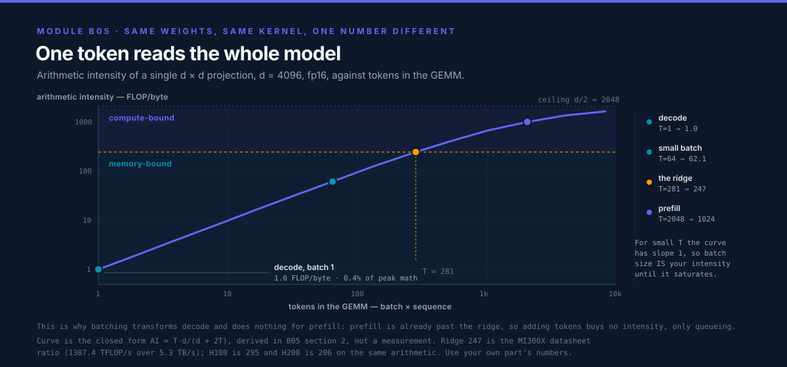
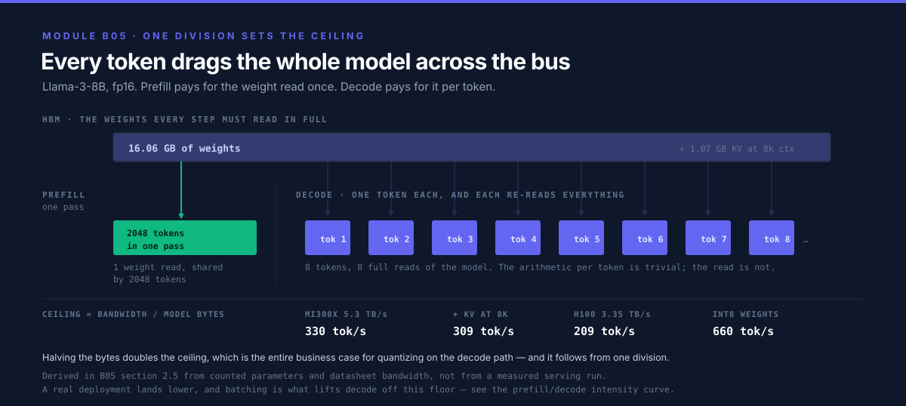
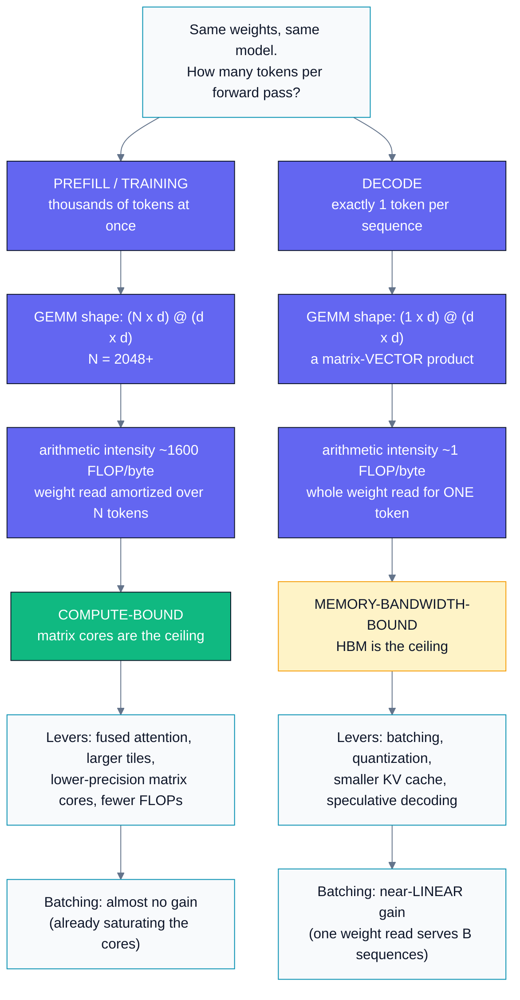
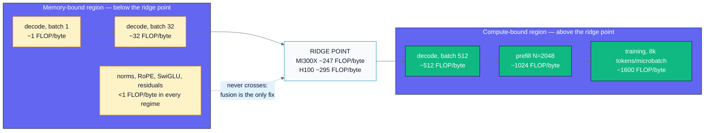
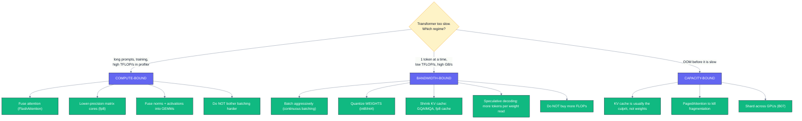

# B05 — Transformer Performance

> Track B · Module 05 · Status: **DONE** · Est. 7 hours · Depth 4/5
>
> Prerequisites: [A07](../../A-gpu-programming/A07.softmax-and-fused-kernels/README.md) (fusion,
> online softmax) and
> [B02](../B02.roofline-and-arithmetic-intensity/README.md)'s roofline vocabulary. You should know
> *what* a transformer does; this module is about where its time and memory go.
> Tooling: Python only — `tools/` is stdlib-only, `bench/` needs a GPU + `torch`.
> Setup: [SETUP.md](../../../docs/SETUP.md) ·
> Terms: [GLOSSARY.md](../../../docs/GLOSSARY.md) · Sources: [REFERENCES.md](../../../docs/REFERENCES.md).

---

## 1. TL;DR + Layman analogy

**TL;DR.** A transformer layer is `(4 + 2m)d²` parameters — about `12d²` at the usual FFN
multiplier `m = 4` — and a forward pass costs about `2 ×` params in FLOPs per token, `6 ×` for
training. Those two formulas plus the [KV-cache](../../../docs/GLOSSARY.md#kv-cache) size are the
whole back-of-envelope toolkit. The one
insight that matters more than any other: **the same model has two completely different performance
personalities.** Processing many tokens at once
([prefill](../../../docs/GLOSSARY.md#prefill-and-decode), training) gives you big
[GEMMs](../../../docs/GLOSSARY.md#gemm), high
[arithmetic intensity](../../../docs/GLOSSARY.md#arithmetic-intensity), and a
**[compute-bound](../../../docs/GLOSSARY.md#memory-bound-compute-bound-and-latency-bound)**
workload. Generating one token at a time (decode)
collapses those GEMMs into matrix-*vector* products with arithmetic intensity ≈ 1, making you
**memory-bandwidth-bound** — you re-read every weight in the model to produce a single token. That
single fact predicts single-stream generation speed to within a small factor from nothing but a
spec sheet, and it explains why batching is transformative for decode and nearly pointless for
prefill.

**Layman analogy — the banquet and the à la carte customer.** You are a chef in a kitchen with a
huge pantry down a long corridor.

- **The banquet order (prefill / training).** 500 identical plates. You walk to the pantry *once*,
  haul out everything, and then cook continuously for an hour. Your *hands* are the bottleneck.
  Hiring a faster runner for the corridor changes nothing; you need more hands.
- **The à la carte customer (decode).** One plate. But this recipe is bizarre: to make even one
  plate you must *touch every single ingredient in the pantry*. So you spend the entire order
  walking the corridor and almost no time cooking. Your *hands are idle*; the **corridor** is the
  bottleneck. A faster pair of hands buys you nothing at all.

Same kitchen, same chef, same recipe — the bottleneck moved from your hands to the corridor purely
because of *how many plates you make per pantry trip*. That is the prefill/decode split, and it is
why "how fast is this GPU?" is an unanswerable question until you say which regime you mean.

**The analogy is load-bearing** — it makes a correct prediction. Ingredients in a pantry get
consumed, but **model weights are read-only**: one trip down the corridor can serve *many*
customers at once. So if 32 customers order simultaneously, you haul the pantry out once and plate
32 dishes — 32× the throughput for barely more time. That is exactly why batching rescues decode,
and the analogy tells you it will *not* help the banquet, which was never corridor-limited.

**Where it breaks.** Three places, each worth knowing:
1. The corridor is not a fixed-width pipe. You only get full HBM bandwidth with well-shaped,
   [coalesced](../../../docs/GLOSSARY.md#coalescing) accesses
   ([A02](../../A-gpu-programming/A02.memory-hierarchy-and-coalescing/README.md)); a badly laid-out
   read gets a fraction of the spec sheet number.
2. There is no pantry analogue for the **KV cache** — a per-customer notebook that grows with every
   plate you serve them. Eventually the notebooks, not the pantry, are what fill the kitchen, and
   that is what caps how many customers you can serve at once (§3.4).
3. Real kitchens don't have a hard ceiling on hands *and* corridor simultaneously. The
   [roofline model](../../../docs/GLOSSARY.md#roofline-model)
   ([B02](../B02.roofline-and-arithmetic-intensity/README.md)) does, and crossing from one ceiling
   to the other is the whole story here.

**By the end of this module you can:** derive a model's parameter count, prefill FLOPs, decode
FLOPs, and KV-cache size from its config on a whiteboard; predict single-stream tokens/second from a
GPU's bandwidth; explain why the two regimes respond differently to batching; size the maximum
concurrency for a serving deployment; and diagnose from a profile which regime you are in and
therefore which optimization is worth doing.

---

## 2. First Principles

### 2.1 Count the parameters, from the shapes

Forget the diagrams. A decoder layer — the architecture of
[Vaswani et al. (2017)](../../../docs/REFERENCES.md#attention-is-all-you-need-vaswani-et-al-2017),
minus the encoder — is a small pile of matrices. With hidden size `d`, `h` heads,
head dimension `d_head = d/h`, and FFN inner width `d_ffn = m·d`:

| Tensor | Shape | Parameters |
|---|---|---|
| `W_Q` | `d × d` | `d²` |
| `W_K` | `d × d` | `d²` |
| `W_V` | `d × d` | `d²` |
| `W_O` | `d × d` | `d²` |
| **attention subtotal** | | **`4d²`** |
| `W_up` | `d × md` | `md²` |
| `W_down` | `md × d` | `md²` |
| **FFN subtotal** | | **`2md²`** |
| **layer total** | | **`(4 + 2m)d²`** |

Note what is *absent*: the per-head split is a **reshape, not a matrix**. All `h` heads share one
`d × d` projection, which is why head count never appears in the parameter count. LayerNorm/RMSNorm
gains are `O(d)` and biases (when present) are `O(d)` — utterly negligible against `O(d²)`, so
back-of-envelope work drops them.

**Worked example.** `d = 4096`, `m = 4`:

```
attention = 4 d²  = 4 × 4096²  = 4 × 16,777,216  =  67.1 M
FFN       = 2md²  = 8 × 4096²  = 8 × 16,777,216  = 134.2 M
layer     = 12 d² = 12 × 16,777,216              = 201.3 M
```

So **`12d²` per layer** is the number to memorize. For a 32-layer model that is 6.44 G parameters in
the blocks, plus `vocab × d` per embedding table.

> **Sanity check against a published model.** GPT-3 175B has `L = 96`, `d = 12288`, MHA, `m = 4`
> (Brown et al. 2020, Table 2.1). Then `12d² = 12 × 12288² = 1.812 G` per layer, `× 96 = 173.9 G`,
> plus a `50257 × 12288 = 0.62 G` tied embedding = **174.6 G**. The published figure is 175 B. The
> `12d²` rule lands within 0.3% — the gap is learned positional embeddings and norm gains.
> Reproduce with `make calc-175b`.

### 2.2 Convert parameters to FLOPs: the factor of 2

A matrix multiply `y = Wx` with `W` of shape `n_in × n_out` costs, per token, one multiply and one
add per weight: **2 FLOPs per parameter per token**. That is the entire derivation.

```
forward FLOPs per token ≈ 2 × (non-embedding parameters)
```

For a `12d²` layer: `24d²` FLOPs per token. For `d = 4096`: `24 × 16.78 M = 403 MFLOP` per layer per
token.

**Backward is twice forward.** Training a layer needs two extra GEMMs of the same shape: the
gradient with respect to the *input* (to propagate backward) and the gradient with respect to the
*weights* (to update them). Each costs the same `2 × params` as the forward pass, so:

```
forward           = 2 × params per token
backward          = 4 × params per token   (2 for dL/dx, 2 for dL/dW)
forward+backward  = 6 × params per token
```

This is the `C ≈ 6ND` heuristic behind the scaling-law literature — `C` total FLOPs for `N`
parameters and `D` training tokens
([Kaplan et al. 2020](../../../docs/REFERENCES.md#scaling-laws-for-neural-language-models-kaplan-et-al-2020);
[Hoffmann et al. 2022](../../../docs/REFERENCES.md#training-compute-optimal-large-language-models-hoffmann-et-al-2022)
use it to derive the
compute-optimal token/parameter ratio). It is one of the most reused numbers in the field:

```
Training a 7 B model on 2 T tokens ≈ 6 × 7e9 × 2e12 = 8.4e22 FLOPs
On 1000 GPUs at 400 TFLOP/s effective: 8.4e22 / (1000 × 4e14) = 2.1e5 s ≈ 2.4 days
```

That estimate — done in 20 seconds with no code — is routinely within a factor of two of a real
training run's wall clock, and it is exactly the question an interviewer asks.

### 2.3 The quadratic term nobody can optimize away

Everything above is *linear* in sequence length: `N` tokens cost `N ×` the per-token figure.
Attention is not. Building the score matrix `S = QKᵀ` multiplies `(N × d)` by `(d × N)`:

```
QK^T   : 2 N² d FLOPs      (summed over all heads: Σ_heads 2 N² d_head = 2 N² d)
softmax(S) @ V : 2 N² d FLOPs
attention total: 4 N² d FLOPs per layer
```

And unfused, `S` must be *materialized*: `h × N²` elements per layer, **`O(N²)` memory**. At
`N = 8192`, `h = 32`, fp16, that is `32 × 8192² × 2 B = 4.3 GB` for one layer of one sequence — the
number that made [FlashAttention](../../../docs/GLOSSARY.md#attention-and-flashattention)
([Dao et al. 2022](../../../docs/REFERENCES.md#flashattention-dao-et-al-2022)) necessary rather
than merely nice.

**When does attention overtake the FFN?** Set the two per-layer FLOP counts equal:

```
4 N² d  =  2 (4 + 2m) d² N          (attention  vs  all the projections + FFN)
    2N  =  (4 + 2m) d
     N  =  (2 + m) d
```

**At `m = 4`, the crossover is `N = 6d`.** For `d = 4096` that is `N = 24,576` tokens. Below it the
GEMMs dominate; above it the quadratic term takes over and grows without bound.

This is the single most misunderstood point about transformer cost. "Attention is quadratic" is
true, and for typical `d` and typical context lengths **attention is still a minority of the
FLOPs**. At `N = 8192` with a Llama-3-8B shape, attention is 23.5% of a layer's prefill FLOPs — real
but not dominant. Attention's *memory* behaviour is the urgent problem long before its FLOP count
is.

### 2.4 Now shrink `N` to 1, and watch the machine change character

Here is the pivot the whole module turns on. Take one projection, `W` of shape `d × d`, and push `T`
tokens through it in fp16 (2 bytes/element):

```
FLOPs = 2 T d²
bytes = d² × 2        (the weight matrix)
      + 2 T d × 2     (activations in and out)

arithmetic intensity  =  2 T d² / (2 d² + 4 T d)  =  T d / (d + 2T)  FLOP/byte
```

Evaluate at `d = 4096`:

| `T` (tokens in the GEMM) | Arithmetic intensity | Regime on an MI300X (ridge ≈ 247 FLOP/byte) |
|---:|---:|---|
| 1 | **1.0** FLOP/byte | hopelessly **memory-bound** |
| 8 | 8.0 | memory-bound |
| 64 | 62.1 | memory-bound |
| 281 | 247 | **at the ridge point** |
| 2048 | 1024 | **compute-bound** |
| 8192 | 1638 | compute-bound |

Those six rows are samples off one curve, and the *shape* of the curve is what the table cannot show:



Slope 1 on the left, flat on the right. Everything in this module follows from which side of the
bend your workload sits on.

Look at the `T = 1` row. You moved 33.6 MB of weights to do 33.6 MFLOP of arithmetic: **one FLOP per
byte**, on a machine that needs 247 to break even. You are using **0.4%** of the available
arithmetic. The matrix cores are idle; the entire cost is the weight read.

And note the middle row: for small `T`, intensity ≈ `T`. So **the batch size at which decode becomes
compute-bound is roughly the machine's ridge point** — a couple of hundred concurrent sequences on
current hardware. That is a remarkably clean result, and it is why serving systems fight so hard for
batch size.

### 2.5 The prediction that makes this module worth your time

If decode is bandwidth-bound and each token requires reading every weight once, then the time per
token has a hard floor:

```
                    model bytes
time per token  ≥  ─────────────
                    HBM bandwidth

                        HBM bandwidth
tokens per second  ≤  ────────────────
                         model bytes
```

**Worked example — Llama-3-8B in fp16 on an MI300X.** The model is 8.03 G parameters
(`make calc-8b`), so 16.06 GB of weights. MI300X HBM3 delivers 5.3 TB/s:

```
tokens/s ≤ 5300 GB/s / 16.06 GB = 330 tokens/s
```

Add the KV cache read for an 8192-token context (1.07 GB) and it falls to **309 tokens/s**. On an
H100 SXM (3.35 TB/s) the same model ceilings at `3350 / 16.06 = 209 tokens/s`.

Two lines of arithmetic, no code, no GPU — and a real single-stream deployment will land in the
low hundreds of tokens/s. **Quantize the weights to int8** and the model halves to 8.03 GB, so the
ceiling *doubles* to 660 tokens/s. That is the entire business case for
[quantization](../../../docs/GLOSSARY.md#quantization) on the decode
path, and it follows from one division.

The formula is easy to accept and still design against, because what it does not convey is the
*repetition* — that the same 16 GB is dragged across the bus again for token 2, and token 3, and
token 900:



Prefill gets one arrow for the whole prompt. Decode gets one per token, forever.

---

## 3. Deep Dive

### 3.1 The two regimes, side by side



*Read the two columns as answers to the same question about the same weights: the only input that
changed is the token count per pass, and it moved the bottleneck from the matrix cores to HBM —
which inverts the entire optimization list, and inverts whether batching is your best lever or
nearly useless.*

The opposite bottlenecks below — one arrangement of weights, two ceilings — are derived in full by
[Pope et al. (2022)](../../../docs/REFERENCES.md#efficiently-scaling-transformer-inference-pope-et-al-2022),
which is the source this section follows. The asymmetry in the last row is the practical payoff and
the reason [B06](../B06.inference-serving-optimizations/README.md) exists:

| | Prefill / training | Decode |
|---|---|---|
| Tokens per pass | `B × N`, thousands | `B`, one per sequence |
| Dominant GEMM shape | matrix–matrix | matrix–**vector** |
| Arithmetic intensity | 10³ FLOP/byte | ~1 FLOP/byte, ≈ `B` when batched |
| Bottleneck | matrix cores | HBM bandwidth |
| Latency metric | time-to-first-token (TTFT) | inter-token latency (ITL) |
| Effect of doubling batch | ~2× the time, ~same throughput | ~same time, ~2× throughput |
| Effect of halving weight bytes | little | ~2× throughput |
| Effect of 2× faster matrix cores | ~2× | **nothing** |

The last two rows are the ones that get budget approved or rejected. A vendor slide advertising 2×
the FLOPs is advertising a prefill improvement; if your production workload is 10-token prompts and
500-token responses, you are buying almost nothing.

### 3.2 Inside a layer, with per-stage costs

```mermaid
%%{init: {
  'theme': 'base',
  'themeVariables': {
    'primaryColor': '#F8FAFC',
    'primaryTextColor': '#0F172A',
    'primaryBorderColor': '#0891B2',
    'lineColor': '#64748B',
    'secondaryColor': '#E0F2FE',
    'tertiaryColor': '#EEF2FF',
    'fontFamily': 'Inter, Segoe UI, sans-serif'
  }
}}%%
flowchart TB
  IN["x : (B, N, d)"] --> N1["RMSNorm<br/>0 GEMM FLOPs · 2Nd bytes<br/>MEMORY-BOUND"]
  N1 --> QKV["Q, K, V projections<br/>params 2d² + 2·d·d_kv<br/>FLOPs 2N(2d² + 2·d·d_kv)"]
  QKV --> ROPE["RoPE on Q, K<br/>0 GEMM FLOPs · elementwise<br/>MEMORY-BOUND"]
  ROPE --> KV["append K, V to cache<br/>+2·d_kv·dtype bytes per token per layer"]
  KV --> SCORE["QK^T<br/>FLOPs 2N²d · materializes h·N² scores<br/>QUADRATIC in N"]
  SCORE --> SM["softmax<br/>0 GEMM FLOPs · reads+writes h·N²<br/>MEMORY-BOUND, the fusion target"]
  SM --> AV["scores @ V<br/>FLOPs 2N²d"]
  AV --> O["O projection<br/>params d² · FLOPs 2Nd²"]
  O --> R1["residual add<br/>3Nd bytes · MEMORY-BOUND"]
  R1 --> N2["RMSNorm<br/>MEMORY-BOUND"]
  N2 --> FFN1["FFN gate + up<br/>params 2·d·d_ffn · FLOPs 4N·d·d_ffn<br/>the FLOP and byte heavyweight"]
  FFN1 --> ACT["SwiGLU<br/>0 GEMM FLOPs · 3N·d_ffn bytes<br/>MEMORY-BOUND, widest tensor in the layer"]
  ACT --> FFN2["FFN down<br/>params d·d_ffn · FLOPs 2N·d·d_ffn"]
  FFN2 --> R2["residual add<br/>MEMORY-BOUND"]
  R2 --> OUT["out : (B, N, d)"]

  classDef trackB fill:#6366F1,stroke:#0F172A,color:#fff
  classDef warn fill:#FEF3C7,stroke:#F59E0B,color:#0F172A
  classDef neutral fill:#F8FAFC,stroke:#0891B2,color:#0F172A
  class QKV,SCORE,AV,O,FFN1,FFN2 trackB
  class N1,ROPE,SM,R1,N2,ACT,R2 warn
  class IN,OUT,KV neutral
```



*Indigo boxes hold all the parameters and all the FLOPs; amber boxes hold none of the parameters and
are pure HBM traffic — and there are **seven** of them against six GEMMs. The GEMMs decide your FLOP
bill, but the amber boxes decide how much of the machine you actually get to use, because each one
is a full round trip to HBM for arithmetic that could have been done in registers.*

### 3.3 The elementwise tax, quantified

"LayerNorm is cheap" is true in FLOPs and false in time. Add up the HBM traffic of the amber boxes
for **one token, one layer** of a Llama-3-8B shape (`d = 4096`, `d_ffn = 14336`, `d_kv = 1024`,
bf16 = 2 B/element), counting one read of each input and one write of the output:

| Operation | Elements touched | Bytes |
|---|---|---:|
| RMSNorm (pre-attention) | read `d`, write `d` | 16,384 |
| RoPE on Q and K | read + write `d + d_kv` | 20,480 |
| residual add (attention) | read `2d`, write `d` | 24,576 |
| RMSNorm (pre-FFN) | read `d`, write `d` | 16,384 |
| SwiGLU activation | read `2·d_ffn`, write `d_ffn` | 86,016 |
| residual add (FFN) | read `2d`, write `d` | 24,576 |
| **total** | | **188,416 B ≈ 188 KB per token per layer** |

Compare against the layer's weights: 218.1 M parameters × 2 B = **436 MB**. So:

```
elementwise traffic overtakes the weight read when
    tokens per pass  >  436,207,616 / 188,416  ≈  2,315 tokens
```

**This is the whole argument for [fusion](../../../docs/GLOSSARY.md#fusion), made numerically.** In
*decode* (1–64 tokens per pass) the
elementwise ops are ~0.04% of the traffic and fusing them is a rounding error — spend your effort on
batching instead. In *training or prefill* with 4k–8k tokens per pass, that same unfused elementwise
traffic **exceeds the entire weight read**, and fusing norms + activation + residual into their
neighbouring GEMMs
([A07](../../A-gpu-programming/A07.softmax-and-fused-kernels/README.md)'s technique, applied at
model scale) is one of the largest single wins
available. Note also the asymmetry inside the table: SwiGLU alone is 46% of the total, purely
because it operates on the `d_ffn`-wide tensor rather than the `d`-wide one.

The lesson generalizes: **which optimization is correct depends on the regime**, and the same code
change can be essential or worthless depending on tokens-per-pass.

### 3.4 KV cache: the thing that actually limits concurrency

During decode you must not recompute K and V for tokens you already processed, so you cache them.
Per sequence:

```
KV bytes = 2 × layers × N × d_kv × dtype_bytes
           │                │
           │                └─ width of ONE of K or V  = kv_heads × d_head
           └─ K and V are two separate tensors
```

Under **MHA**, `d_kv = d` — every query head has its own K/V head. This is expensive, and the fix is
to let several query heads *share* one K/V head:

| Scheme | KV heads | `d_kv` | KV cache size | Quality |
|---|---|---|---|---|
| **MHA** (Vaswani et al. 2017) | `h` | `d` | baseline | baseline |
| **GQA** (Ainslie et al. 2023) | `h/g` | `d/g` | `1/g` of MHA | ~MHA with uptraining |
| **MQA** (Shazeer 2019) | 1 | `d_head` | `1/h` of MHA | measurable degradation |

**Worked example — Llama-2-70B** (`L = 80`, `d = 8192`, `h = 64`, `kv_heads = 8`, `d_head = 128`;
Touvron et al. 2023, Table 1 and the reference implementation's `ModelArgs`). So `d_kv = 8 × 128 =
1024`, an 8× reduction from `d = 8192`:

```
GQA :  2 × 80 × 1024 × 2 B  =   327,680 B = 328 KB per token
MHA :  2 × 80 × 8192 × 2 B  = 2,621,440 B = 2.62 MB per token   (8x more)

at N = 4096:
GQA :  328 KB × 4096  =  1.34 GB per sequence
MHA :  2.62 MB × 4096 = 10.74 GB per sequence
```

Now put it on a GPU. The 70B model in fp16 is 68.98 G params = **137.95 GB**, on an MI300X with
192 GB:

```
free for KV = 192 − 137.95 = 54.05 GB

with GQA :  54.05 / 1.34  =  40 concurrent sequences
with MHA :  54.05 / 10.74 =   5 concurrent sequences
```

**GQA is worth 8× the concurrency**, which — because decode throughput scales with batch — is worth
close to 8× the serving throughput at the same latency. That is why essentially every model released
after 2023 uses GQA or MQA. It is not an accuracy optimization; it is a *concurrency* optimization
that happens to cost little accuracy.

**Why the KV cache, not the weights, is the binding constraint.** The weights are a fixed
one-time cost: pay 137.95 GB once and serve any number of requests. The KV cache is `O(batch × N)` —
it grows with *both* the concurrency you want and the context length you advertise. Double your
advertised context from 4k to 8k and you halve your maximum concurrency, without changing the model
at all. Every serving system's hardest problem is KV-cache management, which is why vLLM's central
contribution was **PagedAttention** — treating the cache as pageable blocks to eliminate the
fragmentation waste that this simple division ignores
([Kwon et al. 2023](../../../docs/REFERENCES.md#pagedattention-and-vllm-kwon-et-al-2023)).

Run `python tools/model_calculator.py --preset llama2-70b --gpu mi300x --batch 32` to reproduce all
of the above, and change `--kv-dtype fp8` to see what cache quantization buys.

### 3.5 Architectural variants, read as performance decisions

Every "architecture choice" in a model card is really a decision on this table:

| Variant | Parameters | FLOPs per token | Memory traffic | Why you would do it |
|---|---|---|---|---|
| **MHA → GQA** | slightly ↓ | ~unchanged | **KV cache ÷ g** | concurrency; the highest-leverage change on this list |
| **MHA → MQA** | ↓ | ~unchanged | **KV cache ÷ h** | maximum concurrency, accept quality loss |
| **post-norm → pre-norm** | unchanged | unchanged | unchanged | trainability at depth (Xiong et al. 2020) — free |
| **LayerNorm → RMSNorm** | ↓ (no bias) | ↓ slightly | ↓ slightly | one less pass over the data (Zhang & Sennrich 2019) |
| **GELU → SwiGLU** | **↑ 50% of FFN** | ↑ 50% of FFN | ↑ | better quality per parameter (Shazeer 2020) |
| **dense → MoE** | **↑↑ 10–100×** | **~flat** (top-k routing) | ↑↑ | quality at fixed FLOPs — but see below |

Two of these deserve care because they are commonly misread.

**SwiGLU is not free.** It needs a *third* matrix (gate, up, down instead of up, down), so the FFN
becomes `3·d·d_ffn` rather than `2·d·d_ffn`. Implementers compensate by shrinking `d_ffn` from `4d`
to about `8d/3`, keeping the parameter count roughly constant. Llama-3-8B
([Grattafiori et al. 2024](../../../docs/REFERENCES.md#the-llama-3-herd-of-models-grattafiori-et-al-2024))
sets `d_ffn = 14336` with
`d = 4096` — a ratio of 3.5, so the FFN is `3 × 3.5 = 10.5 d²` against the textbook `8d²`. Its
attention block, thanks to GQA, is only `2.5d²` instead of `4d²`. Net: **13.00 d² per layer**,
almost exactly the textbook `12d²`. The two deviations nearly cancel — which is why the crude rule
keeps working on modern models, and why you should know *why* it works rather than trusting it
blindly.

**MoE decouples parameters from FLOPs, and that is a trap as much as a feature.** A mixture-of-
experts layer holds `E` copies of the FFN but routes each token to `k` of them (Shazeer et al. 2017;
Fedus et al. 2021). Parameters go up ~`E/k`×; FLOPs per token stay flat. Read that through §2.5:
decode throughput is `bandwidth / model_bytes`, and MoE **multiplied model_bytes** while leaving
FLOPs alone. So MoE makes the compute-bound regime cheaper per unit quality and the
bandwidth-bound regime *harder*. It also introduces load-imbalanced, data-dependent routing —
all-to-all traffic, expert hotspotting, and padding waste — none of which appears in a FLOP count.
MoE is a bet that you will serve at high enough batch to be compute-bound.

### 3.6 Where the hardware enters

The regime boundary is a property of the *machine*, not the model. It is the roofline ridge point
of [Williams et al. (2009)](../../../docs/REFERENCES.md#roofline-williams-et-al-2009):

```
ridge point = peak FLOP/s / peak bandwidth   [FLOP/byte]
```

| Accelerator | Dense bf16/fp16 peak | HBM bandwidth | Ridge point | Capacity |
|---|---:|---:|---:|---:|
| AMD MI300X | 1307.4 TFLOP/s | 5.3 TB/s | **247 FLOP/byte** | 192 GB |
| AMD MI355X | ~2.5 PFLOP/s | 8.0 TB/s | ~313 FLOP/byte | 288 GB |
| NVIDIA H100 SXM | 989.4 TFLOP/s | 3.35 TB/s | **295 FLOP/byte** | 80 GB |
| NVIDIA H200 SXM | 989.4 TFLOP/s | 4.8 TB/s | 206 FLOP/byte | 141 GB |

(Vendor-published dense peaks, no sparsity doubling. Confirm against the datasheet for your exact
SKU and clock configuration — these move between revisions.)

Three things follow, and they are the architecture-aware part of this module:

1. **Ridge points are in the low hundreds and have been *rising*.** FLOPs have grown faster than
   bandwidth for a decade, so the batch size needed to escape the memory-bound regime keeps
   climbing. Decode gets *relatively* worse on each generation unless you also batch harder.
2. **Capacity is the concurrency budget.** MI300X's 192 GB versus H100's 80 GB is not a minor spec:
   from §3.4, a 70B fp16 model leaves 54 GB for KV on an MI300X and **does not fit at all** on an
   80 GB H100 without sharding
   ([B07](../B07.distributed-training-and-sharding/README.md)). Capacity buys batch, and batch is
   decode throughput.
3. **Compare H100 and H200.** Identical compute, 43% more bandwidth. For prefill that is worth
   nearly nothing; for decode it is worth ~43% more tokens/s. Same silicon, and which number matters
   depends entirely on which regime you are serving.

---

## 4. Hands-On Labs

This module is Python-first: it *analyzes* and *measures* transformers rather than writing kernels
(the kernels themselves are
[A06](../../A-gpu-programming/A06.tiled-matrix-multiply/README.md) /
[A07](../../A-gpu-programming/A07.softmax-and-fused-kernels/README.md) /
[A09](../../A-gpu-programming/A09.advanced-triton-flash-attention/README.md)). There is no `cuda/`,
`hip/`, or `triton/` directory and
nothing to compile. `make` with no target prints the full list.

```bash
make                    # help
make calc               # all presets, analytical (no GPU, no third-party packages)
make profile            # time a decoder layer: prefill vs decode      [needs GPU + torch]
make scaling            # decode throughput vs batch size              [needs GPU + torch]
make run                # calc + both benchmarks
make check              # smoke-test the calculator
```

`tools/` is stdlib-only on purpose — you can size a model on a login node, in a bare container, or
on a laptop during an interview. `bench/` needs a GPU and refuses to run on CPU with a message
pointing you back to the calculator, because a CPU timing here would teach the wrong lesson rather
than merely being slow.

### Lab 1 — Size a model on paper (`tools/model_calculator.py`)

No GPU required. Everything it prints is a **derived estimate** from the §2 formulas: an analytical
*ceiling* assuming perfect overlap, zero launch overhead, and 100% of vendor-published bandwidth.
Real hardware lands below it.

```bash
python tools/model_calculator.py --preset llama3-8b --gpu mi300x
python tools/model_calculator.py --preset llama2-70b --gpu mi300x --batch 32
python tools/model_calculator.py --preset gpt3-175b --gpu h100
# your own architecture:
python tools/model_calculator.py -L 48 -d 6144 --heads 48 --kv-heads 8 \
    --ffn 16384 --glu --vocab 64000 --seq 8192 --gpu mi355x
```

**What to observe.** Four things, in this order:

1. The **`12d²` rule survives contact with real models.** `--preset gpt3-175b` reports exactly
   `12.00 d²` per layer; `--preset llama3-8b` reports `13.00 d²` despite using both GQA and SwiGLU,
   because those two deviations nearly cancel (§3.5).
2. The **decode throughput ceiling is a single division** and it is close to reality. 8B/fp16 on
   MI300X: 330 tokens/s.
3. The **`--dtype int8` lever doubles it**, because it halves the bytes. Try it — this is the whole
   quantization argument in one flag.
4. The **`--kv-heads` lever multiplies concurrency.** Run `--preset llama2-70b` and read the "same
   model with MHA instead" line: 40 sequences versus 5.

### Lab 2 — Watch a layer change regime (`bench/profile_layer.py`)

Builds one Llama-style decoder layer (RMSNorm, GQA + RoPE, SwiGLU) from plain torch ops and times
each sub-operation twice: once at a prefill shape (2048 new tokens) and once at a decode shape (1 new
token, attending over a 2048-token cache). Same weights both times.

```bash
python bench/profile_layer.py
python bench/profile_layer.py --hidden 8192 --ffn 28672 --heads 64 --kv-heads 8
python bench/profile_layer.py --prefill-seq 4096 --batch 4 --dtype bfloat16
```

It warms up before timing (the first call pays lazy init and GEMM heuristic selection — constants
large enough to swamp the decode measurements, which are only tens of microseconds) and times with
`torch.cuda.Event`, not a host clock, because kernel launches are asynchronous
([A01 §6](../../A-gpu-programming/A01.foundations-and-programming-model/README.md#6-challenges-drawbacks--tradeoffs)).

**What to observe:**

- In the **prefill** table, the `TFLOP/s` column is high for the GEMM rows and the FFN rows dominate
  the time — time is tracking FLOPs, and the FFN holds most of the parameters.
- In the **decode** table, the same GEMM rows show `FLOP/B` collapsed to ~1 and it is now the `GB/s`
  column that is large. Same kernels, same weights, opposite bottleneck.
- The `us/token` line at the bottom of each regime differs by **two to three orders of magnitude**.
  Decode does ~2048× less work per step but the step is nowhere near 2048× faster.
- The reported **materialized score matrix** size: this is the `O(N²)` allocation FlashAttention
  eliminates. Watch it grow quadratically as you raise `--prefill-seq`.
- The per-category summary: what fraction of the layer is GEMM versus attention versus elementwise.
  Compare the elementwise share between the two regimes and check it against §3.3's crossover
  prediction of ~2315 tokens.

The layer is deliberately **unfused** and does **not** call a flash-attention kernel — it is the
naive baseline that A07 fuses and
[B06](../B06.inference-serving-optimizations/README.md) optimizes. Numbers are per-sub-op; their
sum approximates an
unfused layer but is not identical to an end-to-end forward pass, which gets some inter-kernel
overlap.

### Lab 3 — Prove batching amortizes the weight read (`bench/batch_scaling.py`)

The hypothesis from §2.4–2.5, stated as a falsifiable claim: *if* decode cost is the weight read,
*then* running 32 sequences per step should cost barely more than running 1.

```bash
python bench/batch_scaling.py --bandwidth 5300
python bench/batch_scaling.py --layers 16 --batches 1,2,4,8,16,32,64,128,256,512
```

**What to observe** — the expected *shape*, which is the lesson (absolute numbers are yours):

- **step latency**: nearly **flat** across the small batch sizes, then bending upward.
- **aggregate tokens/s**: nearly **linear** in batch across that flat region.
- **weight GB/s**: climbs toward a large fraction of peak and holds roughly constant while
  bandwidth-bound — then *falls*, which is the signature of having left the regime.
- **TFLOP/s**: low but rising linearly. The math was never the limit.
- **FLOP/B**: in fp16 this column equals the batch size *exactly* (2 FLOPs per weight per token ÷ 2
  bytes per weight). Compare it against your machine's ridge point from §3.6 and you can read off
  where the knee should be before you see it.

The knee — where latency starts growing proportionally with batch — is the crossover to
compute-bound, and the calculator predicts roughly where it lands. Finding it, and finding that it
sits at a batch size in the hundreds, is the experimental payoff of the whole module.

Attention over the KV cache is deliberately **excluded** from this benchmark. Its byte count scales
*with* batch (each sequence owns its cache), so including it would mask the effect under test. That
interaction is precisely what caps real serving batch sizes, and it is B06's subject.

---

## 5. Performance Analysis

### 5.1 Placing both regimes on the roofline



*One model occupies the entire horizontal span of the roofline depending only on tokens-per-pass —
so "optimize the transformer" is meaningless until you say where on this line you are sitting. Note
that the elementwise ops sit permanently on the left and **cannot be batched across the ridge**: no
batch size raises their intensity, because they read and write proportionally to their own output.
Fusion is the only lever that moves them, which is why it is
[A07](../../A-gpu-programming/A07.softmax-and-fused-kernels/README.md)'s whole subject.*

### 5.2 Analytical results (derived — not measured)

Produced by `tools/model_calculator.py`, which evaluates §2's formulas. These are **ceilings**, not
benchmarks: perfect overlap, no launch overhead, full published bandwidth. Reproduce with
`make calc`.

**Llama-3-8B shape** (32 layers, `d = 4096`, 32 heads, 8 KV heads, `d_ffn = 14336`, vocab 128256):

| Quantity | Derived value | Where it comes from |
|---|---:|---|
| Parameters per layer | 218.1 M (13.00 `d²`) | §2.1, GQA + SwiGLU |
| Total parameters | 8.03 G | matches the published "8B" |
| Weights, fp16 | 16.06 GB | `params × 2 B` |
| Forward FLOPs per token | 13.96 GFLOP | `2 × non-embedding params` |
| Training FLOPs per token | 41.88 GFLOP | `6 × non-embedding params` |
| KV cache per token | 131.1 KB | `2 × 32 × 1024 × 2 B` |
| KV cache at N=8192 | 1.07 GB per sequence | above `× 8192` |
| Attention/FFN FLOP crossover | N ≈ 26,624 tokens | `p_layer / 2d` |
| **Decode ceiling, MI300X** | **330 tokens/s** | `5300 / 16.06` |
| **Decode ceiling, H100** | **209 tokens/s** | `3350 / 16.06` |
| Decode ceiling, MI300X, int8 | 660 tokens/s | weights halve |
| Batch for compute-bound decode | ~280 sequences | intensity ≈ ridge point |

**Llama-2-70B shape** on a single 192 GB MI300X:

| Quantity | Derived value |
|---|---:|
| Total parameters | 68.98 G |
| Weights, fp16 | 137.95 GB |
| HBM left for KV | 54.05 GB |
| KV per sequence at N=4096, **GQA** | 1.34 GB → **40 concurrent** |
| KV per sequence at N=4096, **MHA** | 10.74 GB → **5 concurrent** |
| Decode ceiling, batch 1 | 38 tokens/s |
| Decode ceiling, batch 32 | 938 tokens/s aggregate, 29 per sequence |

Read the last two rows together: **32× the batch bought 24× the aggregate throughput while
per-user speed only fell from 38 to 29 tokens/s.** That trade — a small latency concession for a
large throughput gain — is the single most important economic fact in LLM serving, and it exists
*only* because decode is bandwidth-bound.

### 5.3 Measured results — run them yourself

There is no measured table in this README on purpose. Timings depend on GPU, ROCm/CUDA version,
torch version, clocks, and thermal state, and a copied-in number would be a fabrication rather than
evidence. Run `make profile` and `make scaling` on your hardware and expect these **shapes**:

| Measurement | Expected shape | What confirms the theory |
|---|---|---|
| `profile_layer`, prefill | GEMM rows dominate; high TFLOP/s | time tracks FLOPs |
| `profile_layer`, decode | same rows, `FLOP/B ≈ 1`, high GB/s | time tracks bytes |
| `profile_layer`, µs/token | 100–1000× worse in decode | the weight read, unamortized |
| `batch_scaling`, latency | flat, then a knee | fixed weight read, then compute |
| `batch_scaling`, throughput | near-linear before the knee | batching amortizes the read |
| `batch_scaling`, weight GB/s | rises to a plateau, then falls | HBM is the limiter, until it isn't |
| `batch_scaling`, knee location | batch in the hundreds | matches the ridge point |

If your measured single-stream tokens/s is **far below** the calculator's ceiling, that gap is the
finding — and it is what
[B03](../B03.profiling-and-bottleneck-analysis/README.md)'s profilers are for. The usual causes, in
order of frequency: kernel
launch overhead dominating tiny decode kernels (fix: CUDA/HIP graphs), unfused elementwise ops, a
Python-side bottleneck between steps, and memory layouts that fail to coalesce
([A02](../../A-gpu-programming/A02.memory-hierarchy-and-coalescing/README.md)).

---

## 6. Challenges, Drawbacks & Tradeoffs



### Pitfall 1 — Optimizing the wrong regime

The most expensive mistake in this module's subject area. Teams buy FLOPs for a decode-bound
service, or hand-fuse elementwise kernels for a workload where they are 0.04% of traffic (§3.3).
**Always establish the regime first**, with two numbers: tokens per forward pass, and achieved
FLOP/byte. Everything else follows.

### Pitfall 2 — Quoting one tokens/second number

"This model does 300 tokens/s" is meaningless without batch size, context length, and whether it
counts prefill. Per-sequence and aggregate throughput differ by the batch size; a benchmark that
generates 10 tokens after a 4000-token prompt is measuring prefill and calling it decode. Always
report **batch, prompt length, generated length, and whether TTFT is included**.

### Pitfall 3 — Believing `2 × params` too literally

The rule ignores three things that eventually bite: the `4N²d` attention term (§2.3, matters beyond
`N ≈ (2+m)d`), the `2 × vocab × d` lm_head (significant for small models with large vocabularies —
Llama-3-8B's embeddings are 13% of its parameters), and everything memory-bound (§3.3). It is a
*first* estimate. Its value is that it is right within ~10% for the FLOP-dominant term and takes 20
seconds.

### Pitfall 4 — Sizing the KV cache without the runtime's overhead

`2 × L × N × d_kv × bytes` is the floor. A real serving stack adds block-granularity rounding,
fragmentation, a fixed reserve, CUDA-graph pools, and activation scratch. Provisioning at exactly
your computed maximum concurrency will OOM in production. Compute the number, then leave headroom —
and read §3.4's PagedAttention note for why the waste is not a constant factor.

### Pitfall 5 — Ignoring launch overhead in decode

A decode step for a 32-layer model is hundreds of tiny kernels, each doing a few tens of
microseconds of work. Launch overhead of a few microseconds each is then a *significant fraction* of
the step. This is why CUDA/HIP graphs and `torch.compile` matter disproportionately for decode, and
why a naive PyTorch decode loop can land far below the bandwidth ceiling while the GPU sits idle
between kernels. If your measured tokens/s is well under the ceiling and the profiler shows gaps,
this is your bug — not bandwidth.

### Pitfall 6 — Treating MoE parameters as free

Covered in §3.5: MoE holds FLOPs flat but multiplies bytes, and decode pays for bytes. An MoE model
can be *slower* per token in single-stream decode than a dense model with a tenth the parameters,
while being far cheaper at high batch. Know which regime you are buying for.

### Tradeoffs worth holding in mind

- **Batch size**: throughput ↑, per-user latency ↑, KV memory ↑ linearly. There is an optimum, it is
  workload-specific, and it is the central tuning decision in
  [B06](../B06.inference-serving-optimizations/README.md).
- **Context length**: capability ↑, KV cache ↑ linearly, attention FLOPs ↑ quadratically, maximum
  concurrency ↓. Advertising a 128k context is a serving cost decision disguised as a feature.
- **Quantization**: bytes ↓ so decode throughput ↑ proportionally; accuracy ↓ by an amount that
  depends heavily on method and on *what* you quantized (weights, activations, or the KV cache are
  three different decisions). [B04](../B04.precision-and-quantization/README.md) is the authority
  here.
- **GQA group size**: KV ÷ g and concurrency × g against a quality cost that grows with `g` — MQA
  (`g = h`) is the aggressive end and is measurably worse than GQA at moderate `g`.

---

## 7. Real-World Use Cases

- **Capacity planning.** "How many GPUs to serve 10,000 concurrent users at 30 tokens/s?" is
  answered with §2.5 and §3.4 and nothing else: bandwidth ÷ model bytes gives per-GPU token rate,
  capacity minus weights over KV-per-sequence gives per-GPU concurrency, and the more binding of the
  two sets your fleet size. This calculation, done in a meeting, routinely changes hardware
  decisions worth millions.
- **Inference serving stacks.** vLLM, SGLang, and TensorRT-LLM are, architecturally, machines for
  exploiting §3.1's asymmetry:
  [continuous batching](../../../docs/GLOSSARY.md#continuous-batching) to keep the decode batch
  full, PagedAttention to
  fit more sequences in the KV budget, and chunked prefill / prefill–decode disaggregation so that
  compute-bound prefill does not stall bandwidth-bound decode.
  [B06](../B06.inference-serving-optimizations/README.md) builds this.
- **Why FlashAttention exists.** §2.3's `O(N²)` materialized score matrix — 4.3 GB for a single
  layer at `N = 8192` — is not merely slow, it is unallocatable at long context. FlashAttention tiles
  the computation so the score matrix never leaves on-chip memory (Dao et al. 2022).
  [A07](../../A-gpu-programming/A07.softmax-and-fused-kernels/README.md) builds the
  online-softmax core of it.
- **Model design.** GQA, MQA, sliding-window and other sparse attention patterns, and MLA are
  all §3.4's arithmetic driving an architecture decision.
  [Ainslie et al. (2023)](../../../docs/REFERENCES.md#multi-query-and-grouped-query-attention-ainslie-et-al-2023)
  motivate GQA explicitly in inference-cost terms, not quality terms.
- **Speculative decoding.** Reads directly off §2.4: if a decode step is bandwidth-bound, verifying
  `k` draft tokens costs almost the same as generating 1, because the weight read is the cost and it
  is shared. The speedup comes from raising tokens-per-weight-read, exactly like batching.
- **The quantization business case.** §2.5's division is why int8/fp8/int4 weight quantization
  became universal for serving: it is the only lever that improves decode throughput *without*
  increasing latency or memory pressure, unlike batching, which trades against both.

**Where to go next.** [B06](../B06.inference-serving-optimizations/README.md) turns this module's
decode arithmetic into a serving system — continuous batching, PagedAttention, and speculative
decoding all exist to buy back the tokens-per-weight-read that §2.4 says you are missing.
[B04](../B04.precision-and-quantization/README.md) supplies the other half of §2.5's halve-the-bytes
lever: which formats survive the accuracy budget, and where fp8 differs between vendors.
[B07](../B07.distributed-training-and-sharding/README.md) picks up where one GPU stops — the 70B
model that does not fit in §3.6's capacity column, and the interconnect traffic that sharding adds.

---

## 8. Cited References

Sources shared with other modules are cited by anchor into the
[master bibliography](../../../docs/REFERENCES.md), where the URL and its retrieval date live;
sources only this module uses carry their URL here.

**Architecture**

- [**Attention Is All You Need** (Vaswani et al., 2017)](../../../docs/REFERENCES.md#attention-is-all-you-need-vaswani-et-al-2017)
  — the original architecture, and the source of the tensor shapes §2.1 counts parameters from;
  also the MHA baseline the KV-cache table in §3.4 measures GQA and MQA against.
- Shazeer (2019). *Fast Transformer Decoding: One Write-Head is All You Need* — MQA, and the first
  clear statement that the KV cache is the decode bottleneck. <https://arxiv.org/abs/1911.02150>
- [**Multi-query and grouped-query attention** (Ainslie et al., 2023)](../../../docs/REFERENCES.md#multi-query-and-grouped-query-attention-ainslie-et-al-2023)
  — GQA and the `1/g` KV reduction §3.4 turns into a concurrency multiplier, and the argument in
  §7 that GQA is an inference-cost decision rather than a quality one.
- Shazeer (2020). *GLU Variants Improve Transformer* — SwiGLU and the third FFN matrix (§3.5).
  <https://arxiv.org/abs/2002.05202>
- Zhang & Sennrich (2019). *Root Mean Square Layer Normalization* — RMSNorm.
  <https://arxiv.org/abs/1910.07467>
- Su et al. (2021). *RoFormer: Enhanced Transformer with Rotary Position Embedding* — RoPE, one of
  §3.3's memory-bound elementwise ops. <https://arxiv.org/abs/2104.09864>
- Xiong et al. (2020). *On Layer Normalization in the Transformer Architecture* — pre-norm vs
  post-norm. <https://arxiv.org/abs/2002.04745>
- Shazeer et al. (2017). *Outrageously Large Neural Networks: The Sparsely-Gated Mixture-of-Experts
  Layer* — MoE. <https://arxiv.org/abs/1701.06538>
- Fedus, Zoph & Shazeer (2021). *Switch Transformers* — MoE at scale, top-1 routing.
  <https://arxiv.org/abs/2101.03961>

**Performance and serving**

- [**Efficiently Scaling Transformer Inference** (Pope et al., 2022)](../../../docs/REFERENCES.md#efficiently-scaling-transformer-inference-pope-et-al-2022)
  — the canonical treatment of the prefill/decode split, the arithmetic intensity of decode, and
  batching; the direct source for §3.1's two-regime table. Read it if you read only one paper here.
- [**FlashAttention** (Dao et al., 2022)](../../../docs/REFERENCES.md#flashattention-dao-et-al-2022)
  — why §2.3's `O(N²)` materialized score matrix, not attention's FLOP count, is the real problem,
  and the IO-aware tiling that removes it.
- [**PagedAttention and vLLM** (Kwon et al., 2023)](../../../docs/REFERENCES.md#pagedattention-and-vllm-kwon-et-al-2023)
  — KV-cache fragmentation as the limit on concurrency, and why §3.4's simple division understates
  the waste in a real serving stack.
- [**Roofline** (Williams et al., 2009)](../../../docs/REFERENCES.md#roofline-williams-et-al-2009)
  — the ridge point that decides which regime you are in, used throughout §2.4, §3.6 and §5.1.

**Scaling laws — the `6N` heuristic**

- [**Scaling laws for neural language models** (Kaplan et al., 2020)](../../../docs/REFERENCES.md#scaling-laws-for-neural-language-models-kaplan-et-al-2020)
  — source of the `C ≈ 6ND` estimate §2.2 derives from the forward/backward FLOP split (see its
  Table 1 / Appendix compute accounting).
- [**Training compute-optimal large language models** (Hoffmann et al., 2022)](../../../docs/REFERENCES.md#training-compute-optimal-large-language-models-hoffmann-et-al-2022)
  — Chinchilla; uses the same `6ND` accounting to derive the compute-optimal token budget, which is
  what makes §2.2's heuristic worth memorizing rather than looking up.

**Model configurations quoted in this module**

Every config below was checked against its primary source before being used; the calculator prints
the citation alongside each preset.

- Brown et al. (2020). *Language Models are Few-Shot Learners* — GPT-3 175B: 96 layers, `d = 12288`,
  96 heads, MHA (Table 2.1). Used in §2.1's `12d²` validation. <https://arxiv.org/abs/2005.14165>
- Touvron et al. (2023). *Llama 2: Open Foundation and Fine-Tuned Chat Models* — Llama-2-70B: 80
  layers, `d = 8192`, 64 heads, 8 KV heads (GQA), `d_ffn = 28672`, vocab 32000, 4k context (Table 1
  plus the reference implementation's `ModelArgs`). Used in §3.4. <https://arxiv.org/abs/2307.09288>
- [**The Llama 3 herd of models** (Grattafiori et al., 2024)](../../../docs/REFERENCES.md#the-llama-3-herd-of-models-grattafiori-et-al-2024)
  — Llama-3-8B: 32 layers, `d = 4096`, 32 heads, 8 KV heads (GQA), `d_ffn = 14336`, vocab 128256,
  untied embeddings, 8k context. Config values cross-checked against the published Llama 3 model
  card and `config.json`. This is the shape every worked example in §2.5, §3.3, §3.5 and §5.2 uses.

**Hardware specifications**

- AMD Instinct MI300X / MI355X product pages — HBM capacity, bandwidth, and dense matrix-core peaks
  used in §3.6. <https://www.amd.com/en/products/accelerators/instinct.html> (retrieved
  8 Aug 2026)
- NVIDIA H100 / H200 datasheets — same figures for the Hopper column.
  <https://www.nvidia.com/en-us/data-center/h100/> (retrieved 8 Aug 2026)

---

## 9. Self-Assessment & Interview Drills

### Conceptual

1. A decoder layer has `d = 8192` and an FFN multiplier `m = 4`, using MHA. How many parameters is
   the layer, and how many forward FLOPs per token?
2. You are told a model has 13 B parameters and you must estimate the FLOPs to train it on 1 T
   tokens. Do it in your head, and say what you are ignoring.
3. **The classic.** Estimate the single-stream generation speed of a 70 B-parameter model in fp16 on
   one MI300X (5.3 TB/s HBM). Then say what changes if you serve it in int8, and what changes if you
   batch 32 requests.
4. Attention is `O(N²)` and the FFN is `O(N)`. For `d = 4096, m = 4`, at what sequence length does
   attention overtake the FFN in FLOPs? Is a 4096-token context above or below that?
5. Your team doubles the matrix-core throughput of its accelerator with no change to HBM bandwidth.
   Which of your workloads gets faster: training, prefill, batch-1 decode, batch-512 decode?
6. A model uses GQA with 8 KV heads instead of 64. What exactly does that buy, and what is the
   *mechanism* by which it improves serving throughput (not just memory)?
7. Why does batching help decode enormously but prefill barely at all? Answer in terms of arithmetic
   intensity.
8. LayerNorm has almost no FLOPs. Give a concrete scenario where LayerNorm and friends nevertheless
   account for more HBM traffic than reading the entire weight matrix, and one where they are
   negligible.
9. An MoE model has 8× the parameters of a dense model but the same FLOPs per token. Which is faster
   at batch 1, and which at batch 1024? Why?
10. Explain to a non-engineer, in three sentences, why generating text is slow but reading a long
    document is fast, on the same hardware.

<details markdown="1">
<summary>Answers</summary>

1. `(4 + 2m)d² = 12d² = 12 × 8192² = 12 × 67.1 M = 805 M parameters`. FLOPs per token `= 2 × params
   = 1.61 GFLOP`. (Attention's `4N²d` term is separate and depends on `N`.)
2. `C ≈ 6ND = 6 × 13e9 × 1e12 = 7.8e22 FLOPs`. Ignoring: the attention `N²` term, the lm_head,
   activation recomputation (which adds roughly another forward pass, so ~`8ND` with full
   checkpointing), optimizer overhead, and any gap between achieved and peak FLOP/s. As a wall-clock
   estimate you also need effective (not peak) throughput — typically 30–50% of peak.
3. 70 B params × 2 B = **140 GB** of weights. Decode reads them all per token, so
   `5300 GB/s ÷ 140 GB ≈ 38 tokens/s`. **int8**: 70 GB, so ~76 tokens/s — bytes halved, ceiling
   doubled. **Batch 32**: the weight read is shared, so aggregate throughput goes to roughly
   `32 × 38 ≈ 1200 tokens/s`, but *per-user* speed stays near 38 (falling somewhat as the KV cache
   reads and activation traffic add up — the calculator gives ~29 for a 4k context). Also note 140 GB
   of weights leaves only ~52 GB for KV on a 192 GB card, which is what actually caps the batch.
4. `N = (2 + m)d = 6d = 24,576` tokens. A 4096-token context is far **below** it — at 4k, attention
   is a modest fraction of the FLOPs. This is why "attention is the expensive part" is usually wrong
   about FLOPs and usually right about *memory*.
5. Training and prefill get faster (they are compute-bound). Batch-1 decode gets **exactly no
   faster** — it is bandwidth-bound and the matrix cores were already idle. Batch-512 decode is
   likely past the ridge point, so it improves too. This is why the answer to "is the new GPU better"
   is "for which regime?"
6. It cuts the KV cache by 8× (`d_kv` goes from `d` to `d/8`). Mechanism: the KV cache, not the
   weights, is what consumes the HBM left over after loading the model, so an 8× smaller cache means
   ~8× more concurrent sequences fit — and since decode throughput scales with batch, ~8× the
   aggregate throughput at the same latency. It is a concurrency optimization, not a bandwidth one.
7. Decode's arithmetic intensity is ≈ 1 FLOP/byte, hundreds of times below the ridge point, and
   batching multiplies it by roughly the batch size — so batching moves you toward the compute
   ceiling and each doubling roughly doubles throughput. Prefill's intensity is already ~10³
   FLOP/byte, well *above* the ridge point, so the matrix cores are already the limit and batching
   adds proportional work for proportional time: more throughput per step, but no better throughput
   per second.
8. **Significant:** training or prefill with thousands of tokens per pass. From §3.3, the
   elementwise HBM traffic is ~188 KB per token per layer against a 436 MB weight read, so beyond
   ~2,300 tokens per pass the elementwise ops move *more* bytes than the weights. **Negligible:**
   batch-1 decode, where 188 KB against 436 MB is ~0.04%. Same code, same layer — the regime decides.
9. **Batch 1: the dense model wins**, and by a lot. Decode is bandwidth-bound and the MoE has 8× the
   bytes to read (routing means you *touch* fewer experts per token, but the weights still occupy
   HBM and the achieved read pattern is far less efficient than a dense sweep). **Batch 1024: the
   MoE wins** — compute-bound at that batch, and it delivers more quality per FLOP. MoE is a bet on
   serving at high batch.
10. Reading a document lets the machine work on thousands of words simultaneously, so it spends its
    time doing arithmetic — which is what it is good at. Writing must produce one word before it can
    start the next, and each single word requires the machine to page through its entire memory of
    what it has learned. So writing is limited by how fast it can read its own memory, not by how
    fast it can think.

</details>

### Coding & Algorithms drills

Do these in [`exercises/`](exercises/); reference answers with full working in
[`solutions/`](solutions/). All three are paper drills — the skill being tested is producing correct
arithmetic under time pressure on a whiteboard, which is exactly the interview format. Use
`tools/model_calculator.py` **only to check yourself afterwards**.

1. **Size a model** ([`01_size_a_model.md`](exercises/01_size_a_model.md)) — from a config, derive
   parameters, weight memory in fp16 and int8, prefill versus decode FLOPs, and the predicted decode
   tokens/s on a given GPU.
2. **KV-cache budget** ([`02_kv_cache_budget.md`](exercises/02_kv_cache_budget.md)) — given HBM
   capacity, weights, and a target context length, compute maximum concurrency under MHA versus GQA,
   then state what you would change to double it.
3. **Regime diagnosis** ([`03_regime_diagnosis.md`](exercises/03_regime_diagnosis.md)) — five
   profiler-style observations. For each: prefill/compute-bound or decode/bandwidth-bound, and the
   right optimization. Includes cases where the obvious answer is wrong.

### Stretch

- Extend `tools/model_calculator.py` to model **MoE**: add `--experts` and `--top-k`, keep FLOPs at
  the top-`k` count while parameters and bytes scale with `E`, and confirm §3.5's claim that decode
  throughput degrades while prefill throughput per parameter improves.
- Add a **tensor-parallel** flag: divide weight bytes and FLOPs by the TP degree, but add the
  all-reduce traffic (two per layer, `2 × B × N × d × bytes` each). Find the TP degree where
  interconnect traffic starts dominating — then check your answer against
  [B07](../B07.distributed-training-and-sharding/README.md).
- Use `bench/batch_scaling.py` to find your machine's empirical knee, and compare it to the ridge
  point you compute from the datasheet. If they disagree by more than ~2×, profile
  ([B03](../B03.profiling-and-bottleneck-analysis/README.md)) and explain
  the gap — the usual culprit is launch overhead, not bandwidth.
- Reproduce §3.3's crossover experimentally: sweep `--prefill-seq` in `bench/profile_layer.py` and
  find the token count at which the elementwise category's share of time stops falling.
