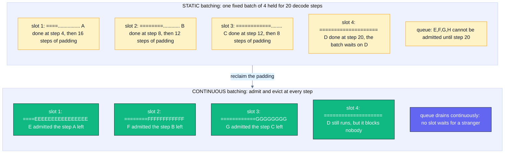
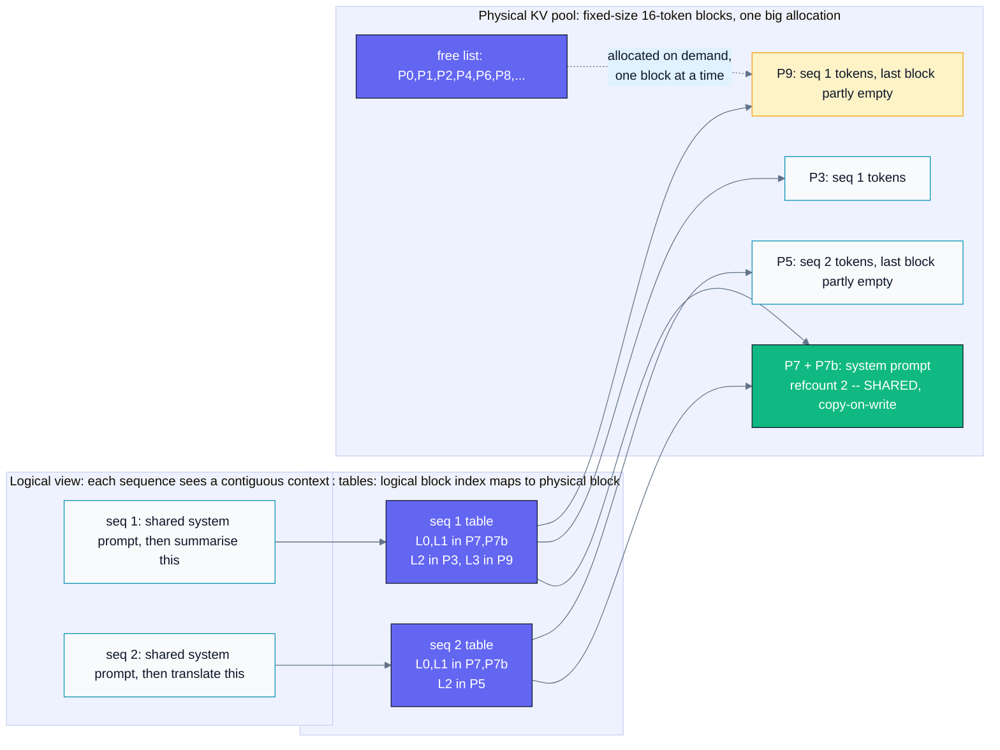
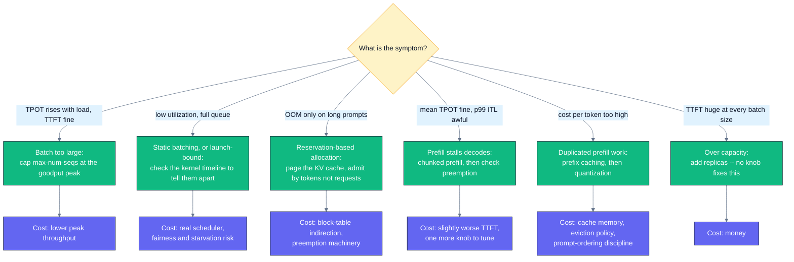

# B06 — Inference Serving Optimizations

> Track B · Module 06 · Status: **DONE** · Est. 6 hours · Depth 4/5
>
> Prerequisites: **B04** (quantization, fp8) and **B05** (prefill vs decode, KV-cache sizing) — see
> [../README.md](../README.md) for track order. Both are referenced but neither is required: §2
> re-derives the one result this module stands on.
> Backends: **none required** — this is a systems module. Everything runs on stdlib Python 3
> (`sim/`), so you can do the whole thing on a laptop. See [../../../docs/SETUP.md](../../../docs/SETUP.md).

---

## 1. TL;DR + Layman analogy

**TL;DR.** A trained model is not a service. Turning it into one means meeting a **latency SLO** at
the **highest throughput you can**, and those two goals fight each other: batching more requests
raises tokens/s and raises every individual user's latency. So you do not "optimize latency" or
"optimize throughput" — you fix an SLO and maximize **goodput**, the rate of requests served *within*
that SLO. The three levers that matter most, in order: **continuous batching** (admit and evict at
every decode step, so the batch never idles), **paged KV cache** (stop reserving memory for a context
length nobody reaches), and **prefix caching** (stop re-computing the same system prompt thousands of
times a day). **Speculative decoding** is a fourth, narrower lever: it buys latency at low
concurrency, and stops paying at high concurrency.

**Layman analogy — the restaurant.**

Your GPU is a kitchen with one chef. Requests are diners.

**Static batching** is a communal table. The host seats four diners, then refuses to seat anyone —
even with three empty chairs — until *every* diner at that table has finished dessert and left. One
diner orders a coffee and is gone in five minutes; another works through a nine-course tasting menu.
The three empty chairs stay empty for an hour while a queue forms at the door.

**Continuous batching** is the same kitchen with a competent host: the moment a chair frees, the next
person in line sits down. Nobody waits for a stranger's dessert.

**PagedAttention** is the coat check. The naive version gives every guest an entire wardrobe in case
they arrived in seventeen coats; you run out of wardrobes after six guests. The paged version issues
numbered, identical, small lockers, hands out more as each guest actually needs them, and lets a party
that arrived in one shared taxi *share* the locker holding their shared umbrella.

**Prefix caching** is prepping the base sauce once instead of from scratch for every order — when
every dish starts from the same 1800-token system prompt, you were re-making the same sauce all day.

**Speculative decoding** is a fast junior cook who plates a guess at the next few bites; the chef
glances at all of them at once and either passes them or redoes them. It works because the chef's
bottleneck was walking to the pantry (streaming weights from HBM), not the knife work — checking four
guesses costs barely more than checking one.

**Where the analogy breaks — and it matters:**

1. **Diners don't slow each other down; sequences do.** In a real restaurant, seating one more guest
   doesn't make everyone else's food arrive later. On a GPU it does: every admitted sequence adds work
   to *every* step, so each new "guest" makes all current guests eat slower. This is the entire
   latency–throughput tradeoff, and the analogy gives you the wrong intuition about it. §2 fixes that
   with arithmetic.
2. **The restaurant can add a table; the GPU cannot add HBM.** Concurrency is capped by a fixed memory
   budget you compute in advance (§3, exercise 1), not by floor space you can rent.
3. **The host doesn't know how long anyone will stay.** Output length is unknown at admission — you
   cannot see the menu order. Every scheduling policy here is a decision made under that uncertainty,
   which is why "just reserve what each request needs" is not an available option.



*Read the dots: under static batching every `.` is a slot the GPU still pays for (padding, KV memory,
per-step cost) while producing nothing — in the simulation in §5, 71% of computed slot-time is exactly
that, and continuous batching converts it into finished requests.*

**By the end of this module you can:** define TTFT, TPOT/ITL, throughput and goodput precisely enough
to survive an interview; explain why static batching wastes a GPU and continuous batching is the
single biggest throughput win in practice; explain PagedAttention as OS virtual memory and derive the
concurrency it buys; compute maximum concurrency from an HBM budget and name the binding resource;
turn a latency SLO into a batch-size cap and say why the naive answer is too big; do the
acceptance-rate arithmetic for speculative decoding and say when it stops paying; and triage five
production symptoms to the right optimization with a falsifier for each.

---

## 2. First Principles

### The one result everything rests on: two phases, two bottlenecks

A generative request has two phases with *opposite* performance characters. (This is B05's territory;
here is the compressed derivation, because nothing in this module makes sense without it.)

**Prefill** processes the whole prompt at once. All `P` prompt tokens go through the model in parallel,
so the matrix multiplies are tall: for each weight matrix you load it once and do `P` rows of work.
Arithmetic intensity is high → **prefill is compute-bound**. It produces exactly one token (the first).

**Decode** generates one token per step per sequence. For a single sequence, each weight matrix is
loaded from HBM to multiply against a *single* row. You move gigabytes of weights to do megaflops of
work → **decode is memory-bandwidth-bound**, and it is *catastrophically* so at batch 1.

That asymmetry is the source of everything that follows:

| | Prefill | Decode |
|---|---|---|
| Work shape | `P` tokens at once, one pass | 1 token per sequence per step |
| Bound by | compute (FLOP/s) | **memory bandwidth (weights + KV)** |
| Sets which metric | **TTFT** | **TPOT / ITL** |
| Batching helps? | Already efficient at batch 1 | **Enormously** — the weight pass is shared |
| Spare capacity | none | **spare compute** — which speculation spends |

**Why batching is such a bargain for decode.** Model the decode step cost:

```
t_step(B) = a + b·B
    a = one full pass over the model weights from HBM + launch/scheduler overhead   (independent of B)
    b = per-sequence marginal cost: read THAT sequence's KV cache, do its arithmetic
```

`a` is paid once per step no matter what. With the module's cost model (`a = 5.00 ms`,
`b = 0.086 ms/seq` at a nominal 2000-token context) going from `B = 1` to `B = 128` costs **3.1×** the
per-step latency and buys **40.6×** the throughput. That ratio — and not any kernel optimization — is
why serving systems are built around batching.

**And why it is not free.** `t_step` is also, directly, each user's inter-token latency. Every sequence
you admit makes every other sequence slower. You cannot escape this by writing a better kernel; it is
in the shape of the problem.

### The metrics, defined precisely

Getting these exactly right is half of a serving interview. Vague versions of these definitions are
where bad dashboards come from.

| Metric | Definition | Dominated by | Note |
|---|---|---|---|
| **TTFT** | `t(first output token) − t(request arrival)` | queue wait **+ prefill** | Includes queueing. A TTFT that excludes queue time measures your engine, not your service. |
| **ITL** | gap between two consecutive output tokens | one decode step | A *distribution*, not a number. Its tail is what users feel. |
| **TPOT** | `(t(last token) − t(first token)) / (N_out − 1)` | decode | The **mean** ITL for one request. It hides stalls by construction. |
| **E2E latency** | `TTFT + (N_out − 1) × TPOT` | both | For long outputs, decode dominates completely. |
| **Throughput** | output tokens/s, and requests/s, server-wide | batch size | Cheap to inflate: make everyone wait longer. |
| **Per-user token rate** | `1 / TPOT` | decode | The number to compare against reading speed (~5–10 tok/s to read, so ~20+ tok/s feels instant). |
| **Goodput** | rate of requests completed **within SLO** | everything | The only one of these the business actually has. |

Two traps worth internalising now:

- **TPOT is a mean and will lie to you.** A single 250 ms stall in a 165-token response moves TPOT by
  ~1.5 ms — invisible — while the user watches the output freeze. If your SLO is about perceived
  smoothness, put it on **p99 ITL**, not on TPOT. §5 shows two policies with identical mean TPOT and a
  10× difference in worst-case ITL.
- **Throughput and goodput can move in opposite directions.** In §5's sweep, raising the batch cap from
  32 to 128 raises throughput 1.6% and *drops* goodput 12%. Optimizing the dashboard instead of the
  SLO is the most common serving mistake there is. Formalising the objective as goodput under a TTFT
  and TPOT budget is exactly what [DistServe](https://arxiv.org/abs/2401.09670) does.

### The latency–throughput tradeoff, stated as an optimization problem

You do not get to pick both. What you actually solve is:

```
maximize    throughput(B)
subject to  p95_TTFT(B) <= TTFT_budget
            p95_TPOT(B) <= TPOT_budget
```

Both constraints bind from *opposite* directions. Small `B` starves the engine, so requests queue and
**TTFT** blows up. Large `B` makes each step slow, so **TPOT** blows up. Goodput therefore has an
interior maximum, and finding it is the job. Exercise 2 walks the whole curve.

### Why static batching wastes the GPU: the naive approach, and where it breaks

The obvious design: collect `B` requests, run prefill, loop decode steps until done, return all `B`,
repeat. It is how you would first write it, and it is how pre-2022 serving systems worked.

It fails because **output lengths are wildly unequal and unknown in advance**. Real traffic has
lognormal-ish output lengths: a median around 100 tokens with a tail past 1000. So a batch's lifetime
is set by its *longest* member:

```
batch of 4, outputs of 4, 8, 12, 20 tokens
total useful slot-steps  = 4 + 8 + 12 + 20 = 44
total occupied slot-steps = 4 x 20          = 80
waste = 36/80 = 45%   ... and it gets worse as B grows and the tail lengthens
```

Two compounding costs: the finished slots still consume per-step compute and KV memory (nothing shrinks
until the batch retires), and — worse — **no new request can be admitted**, so arrivals queue behind a
batch that is mostly idle. The queue grows while the GPU computes on padding. Orca named this precisely:
"requests that have finished earlier than other requests in a batch cannot return to the client, while
newly arrived requests have to wait until the current batch completely finishes"
([Yu et al., OSDI '22](https://www.usenix.org/conference/osdi22/presentation/yu)).

The fix follows immediately from the diagnosis: **make the scheduling unit the iteration, not the
request.**

---

## 3. Deep Dive

### 3.1 Continuous / in-flight batching

**The mechanism.** Schedule at the granularity of one decode step. Before each step the scheduler
(a) removes sequences that hit an EOS token or their length limit, freeing their slots and KV blocks,
and (b) admits waiting requests into the free slots. The batch composition changes every few
milliseconds, and the batch stays full whenever there is work.

Orca calls this **iteration-level scheduling**, and pairs it with **selective batching**: most
operations (the big GEMMs, layer norms, activations) batch cleanly across sequences because they are
per-token, but **attention** cannot — each sequence has a different context length and its own KV
cache — so attention is handled per sequence (today: by a batched attention kernel that takes per-
sequence lengths and block tables). Understanding *why* attention is the awkward one is the difference
between reciting "continuous batching" and understanding it.

**Why this is the single biggest throughput win in practice.** It converts padding into finished
requests — recovering exactly the waste computed above — and it collapses queueing delay, because a
request now waits for the next *step* (milliseconds) rather than the next *batch* (seconds). Orca
reports **36.9× throughput at the same latency level** versus NVIDIA FasterTransformer on GPT-3 175B
(their measurement, their hardware, their workload — an extreme case against a static baseline, not a
number to expect anywhere else). Every serious engine — vLLM, SGLang, TensorRT-LLM, TGI — does this
now; if a system does not, that is the first thing to fix and nothing else is worth measuring.

**What it costs.** A real scheduler, and one specific new problem:

**Prefill delays ongoing decodes.** A prefill is a big compute job. If it takes a whole step, every
sequence currently decoding sees a gap of `a + prefill_per_token × P`. For a 4000-token prompt in the
module's cost model that is a **~193 ms freeze** in the middle of somebody else's answer. Mean TPOT
barely notices; the user absolutely does.

Two follow-on techniques exist because of this:

- **Chunked prefill** (Sarathi / Sarathi-Serve): split the prompt into fixed-size chunks (e.g. 512
  tokens) and **piggyback a chunk onto a decode step**. One weight pass serves both, exploiting the
  "arithmetic-intensity slack" of a bandwidth-bound decode step, and the worst-case stall becomes
  `a + per_token × chunk_size` — a number *you* choose. Sarathi-Serve calls the result **stall-free
  scheduling** and reports up to **2.6×** higher serving capacity for Mistral-7B on one A100, **3.7×**
  for Yi-34B on two A100s, and **5.6×** for Falcon-180B with pipeline parallelism, under tail-latency
  SLOs ([Agrawal et al., 2024](https://arxiv.org/abs/2403.02310) — their numbers, their conditions).
- **Prefill/decode disaggregation**: stop sharing a GPU between the two phases at all. Run prefill on
  one pool of GPUs and decode on another, shipping the KV cache over the interconnect. The phases then
  scale, and are tuned, independently — including with *different parallelism strategies* and even
  different hardware, since decode does not need the newest compute.
  [Splitwise](https://arxiv.org/abs/2311.18677) reports **1.4× higher throughput at 20% lower cost**, or
  **2.35× more throughput at the same cost and power budget**; [DistServe](https://arxiv.org/abs/2401.09670)
  frames the same split explicitly as goodput optimization. The cost is a KV-cache transfer on the
  critical path and a much more complex deployment — this is a large-fleet technique, not a first move.

### 3.2 PagedAttention: the KV cache is the scarce resource

**Start from the memory arithmetic.** For each token in a sequence's context, every layer caches a key
and a value vector per KV head:

```
kv_bytes_per_token = 2 (K and V) x layers x kv_heads x head_dim x dtype_bytes
```

For a 70B-class GQA model (80 layers, 8 KV heads, head_dim 128, fp16) that is **320 KiB per token**. A
single 8192-token conversation therefore carries **2.5 GiB** of state. On a 192 GB GPU whose fp16
weights already consume 130 GiB, you have ~42 GiB left — room for **16** such conversations. The KV
cache, not the weights and not the FLOPs, is what limits how many users you can serve.

**Where the naive allocator throws it away.** Allocate one contiguous buffer per sequence, sized for
the maximum context, because you do not know how long the output will be:

- **Reservation waste** — the dominant one. A 2050-token conversation in an 8192-token buffer wastes
  75% of its allocation. Raise the advertised context to 128k and the same allocator drops from 16
  concurrent sequences to **one**, without a single user sending a long prompt.
- **Internal fragmentation** — the unused tail of a buffer.
- **External fragmentation** — variable-size buffers leave gaps that fit nothing; you can have plenty
  of free bytes and still fail an allocation.

The vLLM paper characterises existing systems as wasting **60–80%** of KV memory this way
([Kwon et al., 2023](https://arxiv.org/abs/2309.06180)).

**The fix is 1960s operating-systems design.** This analogy is not decorative — it is precisely the
same mechanism:

| Operating system | PagedAttention |
|---|---|
| Process address space | A sequence's logical KV cache (token 0..N) |
| Page (fixed size) | **KV block** (fixed number of tokens, e.g. 16) |
| Page table | **Block table**: logical block index → physical block number |
| Physical frame | A slot in one big pre-allocated GPU KV pool |
| Demand paging | Allocate a block only when the sequence fills the previous one |
| Copy-on-write | Fork a sequence (beam search, parallel samples) sharing blocks until divergence |
| Shared memory pages | **Prefix sharing**: one copy of a shared system prompt for all requests |
| Swapping | Preempt a sequence: swap its blocks to host memory (or discard and recompute) |



*The block table is the whole trick: because physical blocks need not be contiguous or contemporaneous,
waste per sequence collapses to at most one partly-filled block (`P9`), and identical prefixes can point
at the same physical block (`P7`, refcount 2) instead of storing it twice.*

**What paging buys, quantified.** Internal fragmentation is now **bounded** at `block_size − 1` tokens
per sequence — a constant, independent of the advertised context length. That is the entire argument:
paging converts an unbounded, product-driven reservation waste into a waste you can name and budget
for. The vLLM paper reports **2–4× higher throughput at the same latency level** versus
FasterTransformer and Orca, with the gain larger for longer sequences, larger models, and more complex
decoding algorithms — because larger batches become possible once the memory is not being wasted
([Kwon et al., 2023](https://arxiv.org/abs/2309.06180); their measurements on their hardware and
workloads).

**Beam search and parallel sampling get it for free.** `n` samples from one prompt share the prompt's
blocks with a reference count and only copy a block when they actually diverge — copy-on-write, exactly
as `fork()` does. Under contiguous allocation each beam needed its own full copy.

**Block size is a real tradeoff.** Smaller blocks waste less and share at finer granularity, but mean
more block-table entries, more indirection per attention kernel, and worse memory locality. 16 tokens
is the common default; some backends require specific values (AMD's AITER MLA path documents
`--block-size 1` for MLA models — check your backend's docs rather than assuming).

### 3.3 Prefix / prompt caching: the cheapest large win

Paging makes sharing *possible*; prefix caching makes it *automatic*. If a new request's token prefix
matches a prefix already in the pool, point at those blocks instead of re-computing them.

Three places this happens constantly in real products:

1. **System prompts.** A support assistant with an 1800-token system prompt and 60-token answers spends
   30× more compute on the prompt than on the answer — and it is the *same* prompt every time.
2. **Few-shot examples.** Long, fixed, shared across every request.
3. **Multi-turn conversation.** Turn `n+1`'s prompt is turn `n`'s prompt plus the exchange. The entire
   conversation so far is a cache hit.

SGLang's **RadixAttention** generalises this: keep the KV cache of finished requests in a **radix tree**
keyed by token prefix, with LRU eviction and a *cache-aware* scheduler that sorts incoming requests by
matched prefix length to raise the hit rate. SGLang reports up to **6.4× higher throughput** versus the
state-of-the-art systems it compares against on prefix-heavy workloads such as few-shot learning,
multi-turn chat, and agent control ([Zheng et al.](https://arxiv.org/abs/2312.07104); their numbers,
their workloads).

**Why this is usually the highest-value item on the list and the least discussed:** it is pure
deduplication. There is *no* accuracy tradeoff — the cached K and V are bit-identical to what
recomputation would produce — no new model to operate, and it attacks the amount of work rather than
the speed of the work.

**The design rule it implies:** a prefix cache can only match a **prefix**. Put the shared part of your
prompt *first* and the per-request part *last*. Injecting per-user RAG context ahead of the shared
system prompt silently destroys your hit rate, and it is a one-line ordering bug in a template.

### 3.4 Speculative decoding: spending spare compute

**The mechanism.** A small **draft** model autoregressively proposes `k` tokens. The large **target**
model then scores all `k` proposed positions in **one** forward pass. A rejection-sampling rule accepts
the longest correct prefix and samples a corrected token at the first mismatch.

**Why it works — and this is the payoff of §2.** Decode is *bandwidth*-bound: the cost is dominated by
streaming the weights, and scoring `k+1` token positions instead of 1 reuses that same weight pass.
The extra positions are nearly free *because the compute was idle anyway*. Speculative decoding is
therefore not a clever trick layered on top of the bottleneck analysis — it is a direct consequence of
it, and it inherits the analysis's expiry condition (see below).

**It is lossless.** With the correct verification/rejection-sampling scheme the output distribution is
*identical* to sampling from the target model. Leviathan et al. demonstrate 2–3× acceleration on T5-XXL
"with identical outputs" ([arXiv:2211.17192](https://arxiv.org/abs/2211.17192)); Chen et al. published
the equivalent scheme concurrently ([arXiv:2302.01318](https://arxiv.org/abs/2302.01318)). This
matters politically as much as technically: you are not asking anyone to accept a quality regression.

**The acceptance-rate math.** Model per-token acceptance as i.i.d. with probability `α`. Expected tokens
produced per verification step:

```
E(alpha, k) = 1 + alpha + alpha^2 + ... + alpha^k = (1 - alpha^(k+1)) / (1 - alpha)
```

The leading `1` is the **bonus token**: even if all `k` drafts are rejected, the target's own
verification pass still yields one correct token, so you never do *worse* than one token per step in
token terms. Cost of a step, in units of one target forward pass:

```
C(k) = 1 + k*c + k*v
    c = draft cost ratio (one draft forward / one target forward)
    v = marginal target cost per extra scored position
speedup S = E(alpha, k) / C(k)
```

Two structural facts fall straight out (sweep them in [`sim/speculative_model.py`](sim/speculative_model.py)):

- **`E` saturates, `C` does not.** As `k → ∞`, `E → 1/(1−α)` while `C` grows linearly in `k`. So there
  is an optimal `k` for every `α`, and it is small when `α` is small: at `α = 0.3` the best `k` is 2
  (1.26×); at `α = 0.9` it is 12 or more (4.66×). "Draft more tokens" stops helping quickly.
- **`v` is the expiry condition.** `v ≈ 0` only while decode is bandwidth-bound. Fill the batch and
  decode becomes compute-bound; `v` grows; the same draft model that gave 2.31× at `α=0.7, k=4` drops
  to **0.87× — an actual slowdown** — by the time `v` reaches 0.5. **Speculative decoding is a latency
  optimization for low-to-moderate concurrency.** Benchmark it at your real concurrency, never at
  batch 1.

**Variants that remove the separate draft model** (its biggest operational cost):

- **Medusa** — extra decoding heads on the target model predict several future tokens in parallel,
  verified with tree attention. No second model to train, serve, or version. Reports >2.2× (Medusa-1,
  frozen backbone, lossless) and 2.3–3.6× (Medusa-2, backbone fine-tuned together)
  ([Cai et al., 2024](https://arxiv.org/abs/2401.10774)).
- **EAGLE** — drafts at the *feature* level (the second-to-top-layer hidden state) rather than the token
  level, then reuses the target's LM head. Reports 2.7–3.5× latency speedup on LLaMA2-Chat 70B "while
  maintaining the distribution of the generated text" ([Li et al., 2024](https://arxiv.org/abs/2401.15077)).
- **N-gram / prompt lookup** — no model at all: propose the continuation by string-matching against the
  prompt. Nearly free, and startlingly effective when the output quotes the input (summarization, code
  editing, RAG). Try this before you train anything.

### 3.5 The other levers, and where each belongs

| Lever | What it buys | What it costs | Link |
|---|---|---|---|
| **Weight quantization** (fp8/fp4/int4) | Weights are the largest HBM consumer; halving them can more than double the KV pool. Also raises decode throughput, which is weight-bandwidth-bound. | Accuracy risk; needs task-level eval, not just perplexity. | B04 |
| **KV-cache quantization** (fp8/int4) | Linear concurrency gain: fp8 KV doubles it. | Feeds straight into the attention softmax; long-context retrieval degrades first. | B04 |
| **HIP/CUDA graphs** | Decode launches dozens of tiny kernels per step; capturing the step as a graph replays it with one launch. Real win when launch overhead is a large share of a small step — i.e. at small batch, where latency matters most. | Static shapes: you capture per batch-size bucket and pad, or fall back to eager for odd shapes. Harder to profile. | [A01](../../A-gpu-programming/A01.foundations-and-programming-model/) |
| **Tensor parallelism** | **Latency.** Splits every layer across GPUs, so one step is faster. Also shards weights *and* KV heads, raising capacity. | An all-reduce **inside every layer** — needs a fast intra-node fabric (Infinity Fabric / NVLink). Stops shrinking KV once TP exceeds `kv_heads`. | B07 |
| **Pipeline / data parallelism** | **Throughput.** Pipeline splits by layer (cheap point-to-point comms, but bubbles); data parallelism just runs independent replicas — the simplest scaling there is. | Pipeline bubbles (uniform batches from chunked prefill help); neither improves single-request latency. | B07 |
| **Prefill/decode disaggregation** | Removes phase interference entirely; each pool tuned and scaled independently. | KV transfer on the critical path; substantially more complex operations. | §3.1 |

**The one-line rule for TP vs PP/DP:** *tensor parallelism for latency, pipeline and data parallelism
for throughput.* Pope et al.'s *Efficiently Scaling Transformer Inference* derives this properly —
an analytic model of partitioning strategies and the resulting latency/throughput Pareto frontier
([arXiv:2211.05102](https://arxiv.org/abs/2211.05102)). If you are choosing a parallelism layout, read
that paper rather than copying someone's flags.

### 3.6 Capacity planning: the arithmetic to do before you deploy

**Step 1 — the memory budget, per GPU.**

```
kv_pool = (HBM - weights/TP - activations_and_workspace) x (1 - fragmentation_headroom)
```

Do the GB↔GiB conversion **once, explicitly**: a "192 GB" datasheet means 192 × 10⁹ bytes = 178.8 GiB.
Planning in "192 GiB" invents 27 GB you do not have — more than the headroom you were about to reserve.

**Step 2 — concurrency from memory.**

```
kv_bytes_per_token = 2 x layers x kv_heads_per_gpu x head_dim x kv_dtype_bytes
max_seqs_paged     = kv_pool / (kv_bytes_per_token x ceil(mean_len / block) x block)
```

Use the **mean actual** length, not the advertised maximum — that substitution is the entire value of
paging, and using the maximum here silently reintroduces the reservation model you just escaped.

**Step 3 — the batch cap from the SLO.**

```
t_step(B) = a + b*B  <=  TPOT_budget    =>    B <= (TPOT_budget - a) / b
```

**Step 4 — take the minimum, and name the binding resource.**

```
operating_concurrency = min(max_seqs_paged, B_slo)
```

Then say which one it was, out loud, in the design doc. If **memory** binds, kernel work buys nothing —
spend on quantization, paging, prefix sharing, or TP. If **latency** binds, you have spare HBM — spend
it on prefix caching or a bigger prefill budget, and stop asking for more memory.

**Step 5 — distrust step 3.** The latency curve is a *necessary* condition, not the answer: it omits
queueing delay, prefill stealing decode capacity, the difference between p95 and the mean, and context
growth over a request's lifetime. In §5's sweep the curve says 81 and the goodput-maximizing cap is 32.
Validate with a load test against your real arrival process, scored on goodput.

---

## 4. Hands-On Labs

**There is no GPU code in this module, and that is deliberate.** The lessons here are *scheduling* and
*memory-accounting* lessons: they live above the kernel, and a kernel would obscure them. Instead you
get three analytic models that make the lessons measurable on a laptop — and, because they are
deterministic, arguable. Kernel-level work is Track A; roofline and profiling are B02/B03.

```bash
make help              # list targets
make run               # all three models, default parameters
make run-sweep         # the batch-cap sweep: the latency/throughput/goodput knee
make run-exercises     # the exact runs the exercises refer to
make clean
```

Stdlib Python 3 only — no `pip install`, no GPU, no compiler. On Windows: `make run PYTHON=python`.

> [!IMPORTANT]
> Everything these programs print is a **model output** from the analytic cost model documented in
> each file's header, **not a measurement on hardware**. Use them for ratios, shapes and reasoning.
> The moment you quote their milliseconds as a benchmark result, you have made exactly the mistake
> §6 warns about.

### Lab 1 — Static vs continuous vs chunked prefill

```bash
python sim/serving_sim.py
```

One seeded trace (300 requests, 12 req/s Poisson, lognormal prompt and output lengths) run under three
scheduling policies with an identical cost model.

**What to observe:**

1. **Throughput** nearly doubles from static to continuous — same hardware, same arithmetic, only the
   scheduler changed.
2. **`padded_slot_waste_pct`** is ~71% under static and **0%** under continuous. This is the number
   behind "GPU utilization collapses": the GPU is *busy*, and busy computing on sequences that already
   finished.
3. **Mean TTFT** falls from ~13 seconds to ~41 ms. Requests now wait for the next *step*, not the next
   *batch*.
4. **Goodput** goes from 8% to 100% of requests. Note how much larger that change is than the
   throughput change — that gap is why goodput is the metric.
5. **`itl_max_ms`**: continuous batching shows ~293 ms while its mean TPOT looks perfect. Chunked
   prefill cuts it to ~30 ms with *no* throughput cost and slightly worse TTFT. Find that trade in the
   table; it is the whole reason chunked prefill exists.
6. **The honest surprise:** static batching has the *best* `itl_max_ms` of the three, because it never
   interleaves a prefill into a running batch. A policy can win a metric and still be indefensible —
   which is why you pick an SLO before you pick a policy.

### Lab 2 — Walk the latency–throughput curve

```bash
make run-sweep
```

**What to observe:** raw throughput rises monotonically and saturates. **Goodput does not** — it peaks
at `max_batch = 32` and then *falls* while throughput is flat. Anyone tuning on the throughput
dashboard sets 128 and ships a worse product. Then re-run with a tighter TPOT budget
(`--slo-tpot-ms 8`) and watch the optimum move left: the right batch size is a *function of the SLO*,
not a property of the model.

### Lab 3 — Plan the memory, find the binding resource

```bash
python sim/kv_cache_planner.py --preset gqa-70b --gpu mi300x --context 8192 --compute-batch-cap 128
```

**What to observe:**

1. **Weights are 73% of HBM** before a single request arrives. Only a quarter of the GPU serves users.
2. **Paged vs contiguous:** 4.2× the concurrency from allocation policy alone.
3. Now try `--context 131072`. Contiguous collapses to **1** sequence; paged is **unchanged**. Long
   context is a serving-architecture feature, not a model feature.
4. Try `--kv-dtype fp8` and `--tp 8`, then `--tp 16` — and read the warning. Doubling GPUs from TP=8 to
   TP=16 buys ~5% more KV capacity, because `kv_heads = 8` has nothing left to shard.
5. Watch the **verdict line** flip from memory-bound to latency-bound when you add `--weight-dtype fp8`.
   The fix for a memory-bound deployment was in the *weights*, not the KV cache.

### Lab 4 — Find where speculation stops paying

```bash
python sim/speculative_model.py
python sim/speculative_model.py --draft-cost 0.2 --alpha 0.5
```

**What to observe:** the optimal `k` grows with `α` and shrinks with draft cost; the break-even table
shows the minimum acceptance rate that makes drafting worthwhile at each `k`; and the
verification-cost sensitivity table shows the same configuration going from **2.31× to 0.87×** as the
batch fills and `v` rises. That last table is the one to remember in an interview.

---

## 5. Performance Analysis

All figures in this section are **simulated** — outputs of the analytic cost model in
[`sim/serving_sim.py`](sim/serving_sim.py) (`a = 5.00 ms` fixed step cost, `b = 0.086 ms` per sequence
at a nominal 2000-token context, 47 µs/token prefill, 0.3 ms launch overhead per step), on one seeded
trace. They are not measured on an MI300X or an H100. Published measurements are collected separately
below, with attribution.

### 5.1 The scheduler is the biggest single lever

`python sim/serving_sim.py` — 300 requests, 12 req/s Poisson, seed 1234, `max_batch = 32`,
SLO: TTFT ≤ 1000 ms, TPOT ≤ 50 ms.

| policy | tok/s | req/s | mean TTFT | p95 TTFT | mean TPOT | p95 TPOT |
|---|---:|---:|---:|---:|---:|---:|
| static | 815.6 | 4.80 | 13355.9 ms | 32685.3 ms | 5.80 ms | 6.03 ms |
| continuous | **1541.0** | **9.07** | **41.0 ms** | 137.4 ms | 7.79 ms | 10.63 ms |
| continuous + chunked prefill | 1539.3 | 9.06 | 58.2 ms | 197.6 ms | 7.76 ms | 10.65 ms |

| policy | mean occupancy | padded slot waste | GPU idle | launch overhead | p99 ITL | **max ITL** | goodput req/s | goodput % |
|---|---:|---:|---:|---:|---:|---:|---:|---:|
| static | 8.65 | **71.0%** | 0.45% | 4.4% | 6.13 ms | 6.14 ms | 0.384 | **8.0%** |
| continuous | 11.98 | 0.0% | 0.86% | 4.5% | 69.93 ms | **293.11 ms** | 9.07 | **100%** |
| continuous + chunked | 12.01 | 0.0% | 0.85% | 4.2% | 29.62 ms | **29.82 ms** | 9.06 | **100%** |

**Four readings, in order of importance:**

1. **Continuous batching gives 1.9× the throughput and 326× better mean TTFT** with an identical cost
   model and an identical trace. Nothing about the hardware or the kernels changed. This is why
   "does it do continuous batching" is the first question to ask about a serving stack.
2. **Goodput moved 12.5× (8% → 100%) while throughput moved 1.9×.** The metric you choose determines
   how big you think your win is. Static batching's failure is mostly a *queueing* failure, and
   throughput alone under-reports it.
3. **Static batching burns 71% of its computed slot-time on finished sequences** while reporting only
   0.45% "GPU idle". The coarse utilization counter says the GPU is busy; it is busy doing nothing
   useful. This is the trap in exercise 3.2 — never trust a single utilization number.
4. **Chunked prefill cuts worst-case ITL by ~10× (293 → 30 ms) at zero throughput cost**, paying ~17 ms
   of mean TTFT. Both continuous rows have *the same mean TPOT to two decimals*: the defect chunked
   prefill fixes is invisible in the mean and obvious in the tail.

### 5.2 The latency–throughput–goodput knee

`make run-sweep` — chunked prefill, 20 req/s, TTFT ≤ 2000 ms, TPOT ≤ 12 ms.

| max_batch | tok/s | p95 TTFT | mean TPOT | p95 TPOT | occupancy | goodput req/s | goodput % |
|---:|---:|---:|---:|---:|---:|---:|---:|
| 4 | 684 | 54586 ms | 5.63 | 6.80 | 3.96 | 0.31 | 7.7% |
| 8 | 1184 | 22991 ms | 6.34 | 7.76 | 7.75 | 1.00 | 14.3% |
| 16 | 1659 | 7714 ms | 7.96 | 10.48 | 13.26 | 3.06 | 31.3% |
| 24 | 1907 | 2829 ms | 9.66 | 13.46 | 17.83 | 7.82 | 69.7% |
| **32** | **2012** | **781 ms** | 10.89 | 15.61 | 20.77 | **8.25** | **69.7%** |
| 48 | 2044 | 242 ms | 11.56 | 17.00 | 21.93 | 7.30 | 60.7% |
| 64 | 2044 | 242 ms | 11.56 | 17.00 | 21.93 | 7.30 | 60.7% |
| 128 | **2044** | 242 ms | 11.56 | 17.00 | 21.93 | 7.30 | 60.7% |

**The shape is the lesson.** Throughput rises 3× from cap 4 to cap 48 and then flattens. Goodput peaks
at cap 32 and then **falls 12%** while throughput rises 1.6%. Both SLO constraints bind, from opposite
directions: below the peak, queueing destroys TTFT (55 seconds at cap 4); above it, p95 TPOT crosses
the 12 ms budget and stays there.

Note also the **p95-vs-mean trap** sitting in the table: at cap 48, mean TPOT is 11.56 ms — inside the
12 ms budget — while p95 TPOT is 17.00 ms, outside it. Tune against the mean and you ship a service
that fails one request in twenty.

### 5.3 Where the reported numbers come from

These are **other people's published measurements**, on their hardware, with their models and
workloads. They are not comparable to §5.1–5.2, not comparable to each other, and not a forecast for
your deployment. They are here to calibrate expectations about which levers are *large*.

| Technique | Reported result | Source (their conditions) |
|---|---|---|
| Continuous / iteration-level batching | **36.9×** throughput at the same latency vs FasterTransformer | Orca, GPT-3 175B ([Yu et al., OSDI '22](https://www.usenix.org/conference/osdi22/presentation/yu)) |
| PagedAttention | **2–4×** throughput at the same latency vs FasterTransformer and Orca; existing systems characterised as wasting **60–80%** of KV memory | vLLM ([Kwon et al., 2023](https://arxiv.org/abs/2309.06180)) |
| Chunked prefill / stall-free scheduling | **2.6×** capacity (Mistral-7B, 1×A100), **3.7×** (Yi-34B, 2×A100), **5.6×** (Falcon-180B, pipeline parallel) under tail-latency SLOs | Sarathi-Serve ([Agrawal et al., 2024](https://arxiv.org/abs/2403.02310)) |
| Prefix caching (RadixAttention) | up to **6.4×** throughput on prefix-heavy workloads | SGLang ([Zheng et al.](https://arxiv.org/abs/2312.07104)) |
| Speculative decoding | **2–3×** acceleration on T5-XXL, *identical outputs* | [Leviathan et al., 2023](https://arxiv.org/abs/2211.17192) |
| Medusa (extra decoding heads) | **>2.2×** (Medusa-1, lossless), **2.3–3.6×** (Medusa-2) | [Cai et al., 2024](https://arxiv.org/abs/2401.10774) |
| EAGLE (feature-level drafting) | **2.7–3.5×** latency speedup on LLaMA2-Chat 70B, distribution preserved | [Li et al., 2024](https://arxiv.org/abs/2401.15077) |
| Prefill/decode disaggregation | **1.4×** throughput at **20%** lower cost, or **2.35×** throughput at equal cost and power | Splitwise ([Patel et al.](https://arxiv.org/abs/2311.18677)) |
| FP8/FP4 quantization on Instinct | **2–4×** reduction in model memory, up to **1.6×** throughput, "minimal impact on accuracy" | [AMD ROCm vLLM optimization guide](https://rocm.docs.amd.com/en/latest/how-to/rocm-for-ai/inference-optimization/vllm-optimization.html) (MI300X/MI325X/MI350X/MI355X) |

Two things to notice. **Orca's 36.9× is not a bigger win than vLLM's 2–4×** — they are measured against
different baselines (Orca vs a static-batching system; vLLM vs Orca, which already had continuous
batching). Reading a table like this without reading the baselines is how people end up promising
multiplicative stacks of speedups that never materialise. And the **gains are not additive**: once
paging has let you run a large batch, speculative decoding's benefit largely evaporates (§3.4).

---

## 6. Challenges, Drawbacks & Tradeoffs



*Every branch has a cost attached on purpose: none of these techniques is free, and a design review
that lists only the wins is not a design review.*

### 6.1 Scheduler complexity is a real, permanent cost

Continuous batching replaces a `for` loop with a stateful scheduler that runs every few milliseconds
and must handle: admission, preemption, eviction, KV-block allocation and reference counting, chunked-
prefill budgeting, sequences that finish mid-step, stop sequences, cancelled requests, and a request
that grows past its block budget while running. This code is concurrent, on the hot path, and its bugs
are non-deterministic and load-dependent — the worst combination to debug. It is also where most of the
real engineering in a serving engine lives. **The practical conclusion: use vLLM, SGLang or
TensorRT-LLM. Do not write this.** Understanding it is mandatory; implementing it is rarely justified.

### 6.2 Fairness and starvation

Continuous batching gives the scheduler freedom, and freedom is a policy question nobody asked you.
Concrete failure modes:

- **Long-request starvation.** Under FCFS with a full batch, a request needing a 4000-token prefill may
  never find a large enough gap while short requests keep slipping in. Preferring short requests
  maximizes throughput and can leave the long ones waiting indefinitely.
- **Short-request head-of-line blocking.** The reverse policy: one enormous prefill delays hundreds of
  cheap requests. Chunked prefill mitigates it; it does not eliminate the priority question.
- **Preemption thrash.** When KV blocks run out, someone gets preempted (swapped to host memory, or
  discarded and recomputed later). Under sustained pressure the victim gets preempted repeatedly, and
  its latency becomes unbounded while aggregate throughput still looks fine.
- **Noisy neighbours.** One tenant submitting 100k-token prompts consumes KV blocks that everyone
  else needed. Without per-tenant token budgets, one customer sets everyone's latency.

None of these show up in a throughput benchmark. They show up as a p99.9 and as support tickets. If
you deploy a multi-tenant endpoint, **decide the priority policy explicitly** and measure per-tenant
tail latency, not just aggregate.

### 6.3 Tail latency is the metric that gets skipped

The recurring theme of this module. Mean TPOT is smooth and reassuring and structurally hides stalls:
§5.1 has two policies with the same mean TPOT to two decimals and a 10× difference in worst-case ITL.
Sources of tail latency that aggregate metrics erase: prefill interference, preemption and recompute,
a cold prefix cache after eviction, a rejected speculative batch, CPU-side scheduling hiccups, and
tokenizer or logit-processing stalls on the host. **Record every inter-token interval, or accept that
you cannot manage the tail.**

### 6.4 Memory fragmentation does not vanish — it becomes bounded

Paging is a huge improvement, not a solution to all memory problems:

- Internal fragmentation still exists, bounded at `block_size − 1` tokens per sequence. Bounded is not
  zero, and with a large block size and many short sequences it is a real tax.
- Block size is a genuine tradeoff (§3.2): smaller wastes less and shares better, but costs indirection
  and locality.
- The KV pool itself is usually a fixed fraction of HBM chosen at startup (`--gpu-memory-utilization`).
  Set it too high and a transient activation spike OOMs the process; too low and you leave concurrency
  unused. That knob is a fragmentation-headroom decision, and it is why exercise 1 reserves 5%.
- Prefix-cache blocks compete with active-sequence blocks. A high hit rate is worth memory, but the
  eviction policy is now on your latency critical path.

### 6.5 A draft model is a second production model

The failure modes speculative decoding adds are all operational, and none of them appear in the paper:

- **Two models in HBM.** The draft's weights come out of your KV pool — i.e. directly out of your
  concurrency budget.
- **Acceptance rate silently decays.** `α` depends on the draft agreeing with the target *on your
  traffic*. Traffic shifts (a new language, a new customer, a new prompt template) and `α` drops; the
  system is still *correct* — it is lossless — but it is now slower than not speculating, and nothing
  alerts you. **Monitor acceptance rate as a first-class production metric.**
- **It reverses sign under load.** §3.4: 2.31× at low concurrency, 0.87× when the batch is full. An
  optimization that becomes a pessimization exactly when you are busiest is an operational hazard, not
  just a tuning question. Consider disabling it above a concurrency threshold.
- **Two models to version, evaluate and deploy.** Every target-model update needs the draft re-checked.
  Medusa/EAGLE trade this for a training dependency and a modified architecture; n-gram drafting trades
  it for nothing at all, which is why n-gram is the right first experiment.
- **Batch-shape complexity.** Variable accepted-token counts per sequence per step make the batch ragged,
  which interacts awkwardly with graph capture and with paged block accounting.

### 6.6 The operational burden, summarised

| Technique | Complexity | Accuracy risk | Ops burden | When *not* to do it |
|---|---|---|---|---|
| Continuous batching | High (use a library) | None | Low — it is the default | Never; this is table stakes |
| Paged KV | High (use a library) | None | Low | Never |
| Chunked prefill | Low (a flag + a budget) | None | Low | If TTFT is your only SLO and prompts are short |
| Prefix caching | Medium | None | Medium — memory + eviction + prompt ordering | If prompts are genuinely unique |
| Weight/KV quantization | Medium | **Real** | Medium — needs an eval gate | Before you have a task-level eval |
| HIP/CUDA graphs | Medium | None | Medium — static shapes, harder profiling | Large batches, where launch overhead is noise |
| Speculative decoding | High | None (lossless) | **High** — second model, α monitoring | High concurrency; throughput-oriented serving |
| P/D disaggregation | Very high | None | **Very high** | Anything smaller than a large fleet |

### 6.7 When to stop optimizing

The most valuable judgement in this module. If your GPUs are memory-bound on capacity and you have
already paged, quantized and cached prefixes, **the next step is more GPUs, not more cleverness**.
Exercise 2's answer turns on exactly this: throughput flat at 2044 tok/s across every batch cap from 48
up, while 20 req/s is offered and 11.8 completed, means the tuning space is exhausted. Recognising a
saturated system and asking for capacity is senior behaviour; producing another 3% while the service
misses its SLO is not.

---

## 7. Real-World Use Cases

**Engines that implement this module.** Every one of these is worth reading rather than reinventing:

- **[vLLM](https://github.com/vllm-project/vllm)** — the reference implementation of PagedAttention and
  continuous batching, now also chunked prefill, prefix caching, speculative decoding, and
  disaggregated serving. Runs on AMD via ROCm; see the
  [ROCm vLLM optimization guide](https://rocm.docs.amd.com/en/latest/how-to/rocm-for-ai/inference-optimization/vllm-optimization.html)
  for AITER kernels, attention-backend selection, and the `--max-num-seqs` /
  `--max-num-batched-tokens` / `--gpu-memory-utilization` knobs that are exactly the quantities in
  §3.6.
- **[SGLang](https://github.com/sgl-project/sglang)** — RadixAttention prefix caching plus a frontend
  language for structured LLM programs; the system to study if your workload is prefix-heavy.
- **NVIDIA TensorRT-LLM / Triton** — in-flight batching with compiled kernels; the highest-performance
  option on NVIDIA at the cost of an engine-build step per model/shape.
- **Hugging Face TGI** — continuous batching in a production server with a simpler operational model.

**Where each lever shows up in a product:**

- **Chat assistants** — TTFT is what users judge; streaming plus prefix caching of the system prompt
  and the conversation so far. Multi-turn chat is the single best prefix-cache workload there is.
- **Code completion in an IDE** — brutally latency-sensitive, short outputs, low concurrency per user.
  This is speculative decoding's home turf, and n-gram/prompt-lookup drafting is unusually effective
  because completions frequently quote the surrounding file.
- **Batch document processing** — no interactive SLO at all, so maximize throughput: the largest batch
  memory allows, no speculation, aggressive quantization. A completely different operating point on
  the same engine.
- **RAG pipelines** — long prompts, short answers. Prefill-dominated, so chunked prefill and prefix
  caching of retrieved-document blocks matter far more than decode optimizations. Watch the
  prompt-ordering rule from §3.3: putting retrieved context *before* the system prompt kills the cache.
- **Agentic workloads** — many short calls sharing a large common prefix, often with branching. This is
  precisely what RadixAttention and copy-on-write block sharing were built for.
- **Large fleets** — prefill/decode disaggregation (Splitwise, DistServe) becomes worth its operational
  cost only at a scale where phase-specific hardware provisioning pays for the extra machinery.

---

## 8. Cited References

Grounding for every non-obvious claim above. Master list in
[../../../docs/REFERENCES.md](../../../docs/REFERENCES.md).

**Scheduling and batching**

- Yu, Jeong, Kim, Kim, Chun (2022). *Orca: A Distributed Serving System for Transformer-Based
  Generative Models.* OSDI '22 — iteration-level scheduling and selective batching; the origin of
  continuous batching. <https://www.usenix.org/conference/osdi22/presentation/yu>
- Agrawal, Kedia, Panwar, Mohan, Kwatra, Gulavani, Tumanov, Ramjee (2024). *Taming Throughput-Latency
  Tradeoff in LLM Inference with Sarathi-Serve.* OSDI '24 — chunked prefill and stall-free scheduling.
  <https://arxiv.org/abs/2403.02310>

**Memory management**

- Kwon, Li, Zhuang, Sheng, Zheng, Yu, Gonzalez, Zhang, Stoica (2023). *Efficient Memory Management for
  Large Language Model Serving with PagedAttention.* SOSP '23 — the vLLM paper; paging, block tables,
  copy-on-write, prefix sharing. <https://arxiv.org/abs/2309.06180>
- Zheng, Yin, Xie, Huang, Sun, Yu, Cao, Kozyrakis, Stoica, Gonzalez, Barrett, Sheng (2023/2024).
  *SGLang / RadixAttention* — automatic KV-cache reuse in a radix tree with LRU eviction and
  cache-aware scheduling. <https://arxiv.org/abs/2312.07104> ·
  [LMSYS write-up](https://www.lmsys.org/blog/2024-01-17-sglang/)

**Speculative decoding**

- Leviathan, Kalman, Matias (2023). *Fast Inference from Transformers via Speculative Decoding.* ICML —
  the acceptance-rate analysis and the lossless verification scheme. <https://arxiv.org/abs/2211.17192>
- Chen, Borgeaud, Irving, Lespiau, Sifre, Jumper (2023). *Accelerating Large Language Model Decoding
  with Speculative Sampling.* <https://arxiv.org/abs/2302.01318>
- Cai, Li, Geng, Peng, Lee, Chen, Dao (2024). *Medusa: Simple LLM Inference Acceleration Framework with
  Multiple Decoding Heads.* <https://arxiv.org/abs/2401.10774>
- Li, Wei, Zhang, Zhang (2024). *EAGLE: Speculative Sampling Requires Rethinking Feature Uncertainty.*
  <https://arxiv.org/abs/2401.15077>

**Parallelism, disaggregation and scaling**

- Pope, Douglas, Chowdhery, Devlin, Bradbury, Levskaya, Heek, Xiao, Agrawal, Dean (2022). *Efficiently
  Scaling Transformer Inference.* — analytic partitioning model and the latency/throughput Pareto
  frontier; the basis for "TP for latency, PP/DP for throughput". <https://arxiv.org/abs/2211.05102>
- Patel, Choukse, Zhang, Shah, Goiri, Maleki, Bianchini (2023). *Splitwise: Efficient Generative LLM
  Inference Using Phase Splitting.* <https://arxiv.org/abs/2311.18677>
- Zhong, Liu, Chen, Hu, Zhu, Liu, Jin, Zhang (2024). *DistServe: Disaggregating Prefill and Decoding
  for Goodput-optimized Large Language Model Serving.* OSDI '24 — the formal goodput framing used in
  §2. <https://arxiv.org/abs/2401.09670>

**Engines and vendor documentation**

- **vLLM documentation** — engine arguments, scheduling, prefix caching, speculative decoding.
  <https://docs.vllm.ai/>
- **AMD ROCm: vLLM V1 performance optimization** — AITER kernels, attention-backend selection,
  parallelism strategies, FP8/FP4 quantization, engine tuning on Instinct MI300X/MI325X/MI350X/MI355X.
  <https://rocm.docs.amd.com/en/latest/how-to/rocm-for-ai/inference-optimization/vllm-optimization.html>
- **SGLang** <https://github.com/sgl-project/sglang> · **vLLM** <https://github.com/vllm-project/vllm>

**Background this module assumes**

- Vaswani et al. (2017). *Attention Is All You Need.* <https://arxiv.org/abs/1706.03762>
- Dao et al. (2022). *FlashAttention.* <https://arxiv.org/abs/2205.14135>

---

## 9. Self-Assessment & Interview Drills

### Conceptual (answers below)

1. Define TTFT, TPOT and goodput precisely. Which of the three can you improve by making the service
   *worse* for users, and how?
2. A colleague says "we doubled throughput by raising the batch size, ship it." What single number do
   you ask for before agreeing?
3. Why is decode memory-bandwidth-bound while prefill is compute-bound, and which *one* metric does
   each phase dominate?
4. Static batching wastes the GPU. Name the *two* distinct costs of a finished-but-unretired sequence,
   and say which one is usually larger.
5. Explain PagedAttention to a backend engineer who has never touched a GPU, in three sentences, using
   only concepts from operating systems.
6. Internal fragmentation with 16-token blocks is at most 15 tokens per sequence. Why is that stated as
   a *bound* rather than an average, and why does the bound matter more than the average when sizing a
   pool?
7. Speculative decoding is described as "free." What exactly is free, and what is not?
8. Your speculative setup gives 2.3× on a dev box and 0.9× in production. Nothing is broken. What
   changed?
9. Mean TPOT is 9 ms and healthy; p99 inter-token latency is 280 ms. What is the most likely cause, and
   what is the fix?
10. Why does tensor parallelism help latency while pipeline parallelism helps throughput? And why does
    TP stop reducing KV-cache size past a certain degree?
11. You have 4 GPUs and a 7B model that fits on one. Two candidate layouts: TP=4 on one replica, or 4
    independent replicas. Which for an interactive chat app, which for overnight batch scoring, and why?
12. A prefix cache is deployed and the hit rate is 2%, though every request "uses the same system
    prompt." Name the most likely bug.

<details>
<summary>Answers</summary>

1. **TTFT** = time from request *arrival* to first output token — it includes queue wait, and is
   dominated by prefill. **TPOT** = `(t_last − t_first) / (N_out − 1)`, the mean inter-token interval
   for one request, dominated by the decode step. **Goodput** = the rate of requests completed *within
   the SLO*. **Throughput** is the one you can inflate by hurting users: batch harder and tokens/s
   rises while every individual request gets slower. That is exactly why goodput exists as a metric.

2. **Goodput, or p95 TPOT.** In §5.2, going from cap 32 to cap 128 raised throughput 1.6% and dropped
   goodput from 69.7% to 60.7%, because p95 TPOT crossed the budget. "Doubled throughput" with no
   latency number attached is not a result.

3. **Prefill** pushes all `P` prompt tokens through the model at once, so each weight matrix is loaded
   once and used for `P` rows of work — high arithmetic intensity, compute-bound. **Decode** produces
   one token per sequence per step, so at small batch each weight matrix is loaded to multiply a single
   row — gigabytes moved for megaflops, bandwidth-bound. Prefill dominates **TTFT**; decode dominates
   **TPOT/ITL**.

4. (a) The finished slot still consumes per-step compute and KV memory, because nothing is released
   until the batch retires; (b) **no new request can be admitted**, so arrivals queue behind a mostly
   idle batch. **(b) is usually far larger** — in §5.1 the throughput difference is 1.9× while the
   TTFT difference is 326×, and goodput moves 12.5×. The wasted compute is the visible cost; blocked
   admission is the expensive one.

5. "Each sequence needs a growing array of cached vectors, one entry per token. Instead of giving every
   sequence one big contiguous buffer sized for the worst case, we keep one pool of fixed-size blocks
   and give each sequence a page table mapping its logical positions to physical blocks. It is virtual
   memory: blocks are allocated on demand, identical prefixes are shared like shared memory pages with
   a reference count, and forks copy-on-write."

6. Internal fragmentation is whatever is unused in the *last* block, which depends on the actual length
   modulo the block size — averaged over a length distribution it is about `(block−1)/2` tokens, but you
   do not control which lengths arrive. When sizing a pool you must survive the **worst** case, so the
   bound is the number to plan with. The deeper point: the bound is a *constant*, independent of the
   advertised context length, whereas reservation waste grows with it. Bounded waste is what makes
   paging safe.

7. **Free:** the extra token *positions* inside the verification pass, because decode was
   bandwidth-bound — the weights were already streamed, so scoring `k+1` positions costs almost what
   scoring 1 costs. **Not free:** the `k` draft forward passes (`k·c`), the draft model's weights
   sitting in HBM and out of your KV budget, the discarded work when drafts are rejected (55.7% of
   drafted tokens at α=0.7, k=4), and the operational cost of a second production model. And it stops
   being free the moment decode becomes compute-bound.

8. **Concurrency.** The dev box ran near batch 1, where decode is bandwidth-bound and the spare compute
   speculation spends is genuinely idle. Production runs a full batch, decode is no longer
   bandwidth-bound, the marginal cost per extra scored position (`v`) is real, and the same
   configuration goes from 2.31× to below 1×. (Second possibility: the acceptance rate `α` is lower on
   production traffic than on the dev prompts. Both are worth checking, and both are reasons to
   monitor `α` and concurrency together.)

9. **Prefill interference.** A new request's prefill occupies a whole decode step, freezing every
   sequence currently generating. A 250 ms stall inside a 165-token response moves mean TPOT by ~1.5 ms
   — invisible — while the user watches the output stop. **Fix: chunked prefill** with a token budget,
   which caps the stall at roughly `fixed_step + per_token × chunk`. In §5.1 that is 293 ms → 30 ms at
   zero throughput cost. If the spikes do not correlate with prefills, suspect preemption/recompute or
   a host-side stall instead.

10. **TP** splits every layer's work across GPUs, so a single forward pass — and therefore one decode
    step — is genuinely faster; the price is an all-reduce *inside every layer*, which needs a fast
    intra-node fabric. **PP** splits by layer, so one request still traverses all layers sequentially
    (no latency gain) but many requests can be in flight in different stages (throughput gain) with
    only cheap point-to-point transfers. **DP** is just independent replicas: maximum throughput per
    dollar, zero latency benefit. TP stops shrinking the KV cache once TP exceeds `num_key_value_heads`:
    with 8 KV heads and TP=8 there is one head per rank, and at TP=16 the cache must be **replicated**
    — exercise 1 measures the result as a 5% capacity gain for 2× the GPUs.

11. **Interactive chat: TP=4** — it is the only layout that reduces per-token latency, and chat is
    judged on TTFT and per-user token rate. **Overnight batch scoring: 4 replicas** — no interactive
    SLO, so maximize throughput per GPU; replicas avoid all collective-communication overhead and give
    you 4 independent failure domains. Same hardware, opposite answers, because the SLO changed. This
    is the question that separates people who memorised "use tensor parallelism" from people who know
    what it is for.

12. **The variable part of the prompt is at the front.** A prefix cache can only match a *prefix*, so
    injecting per-user context, a timestamp, a session ID or retrieved documents before the shared
    system prompt makes every request unique from token 0. Reorder the template so everything shared
    comes first. (Runners-up: the cache is evicted between requests because it is sized too small, or
    a per-request field like a date is embedded *inside* the system prompt.)

</details>

### Design & analysis drills

Do these in [`exercises/`](exercises/); reference answers with full reasoning in
[`solutions/`](solutions/). Each maps to a competency a serving interview actually probes.

1. **Capacity plan** ([`exercises/01_capacity_plan.md`](exercises/01_capacity_plan.md)) — a 70B GQA
   model on one MI300X at 8k context: derive KV bytes per token, build the HBM budget, compute max
   concurrency under contiguous *and* paged allocation, name the binding resource, and quantify fp8 KV
   versus TP=8 — including what happens when TP exceeds the KV-head count.
2. **SLO → batch cap** ([`exercises/02_slo_batching.md`](exercises/02_slo_batching.md)) — given a
   TTFT/TPOT budget and a per-step latency curve, fit `t_step(B) = a + b·B`, compute the largest
   admissible batch, predict the goodput, then run the sweep and explain why the simulated optimum is
   *smaller* than the curve's answer.
3. **Triage** ([`exercises/03_pick_the_optimization.md`](exercises/03_pick_the_optimization.md)) — five
   production symptoms, five mechanisms. For each: the fix, the confirming measurement, and the
   falsifier. Then rank all five by expected value and justify what you would *not* do.

### Stretch

- Extend [`sim/serving_sim.py`](sim/serving_sim.py) with a **KV-block budget** as a second admission
  constraint, plus preemption when blocks run out. Measure how much the tail latency of preempted
  requests degrades, and compare swap-out against discard-and-recompute.
- Add a **prefix cache** to the simulator: give a configurable fraction of requests a shared 1800-token
  prefix and let cache hits skip that prefill work. Sweep the hit rate and find the point where the
  capacity gap from exercise 2 closes without new hardware.
- Add a **priority scheduler** with a per-tenant token budget and demonstrate the starvation mode from
  §6.2. Then find a policy that bounds worst-case wait without giving up more than 5% throughput.
- Add **speculative decoding** to the serving simulator (per-step accepted-token counts drawn with
  probability `α`) and reproduce the sign reversal from §3.4 end-to-end: a latency win at low arrival
  rate that becomes a throughput loss at high arrival rate.
