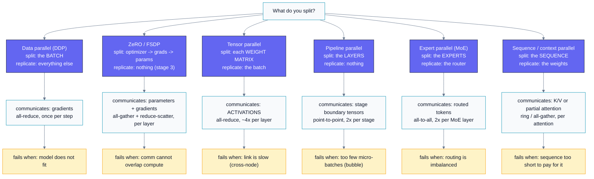
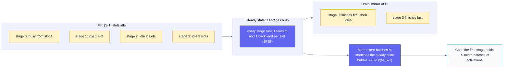
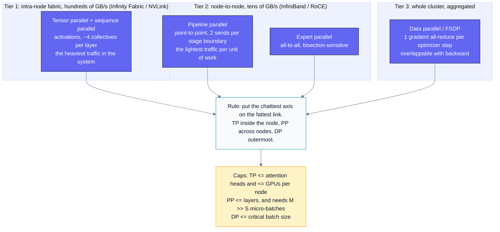
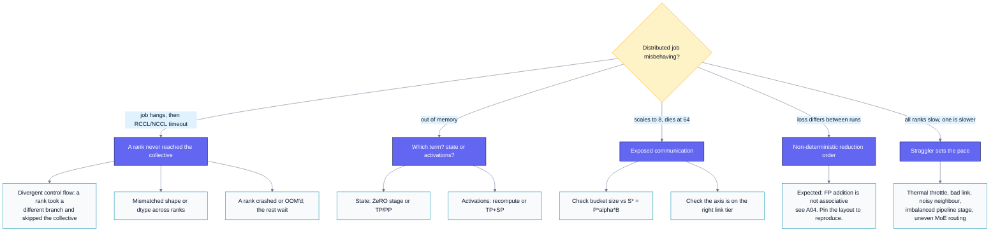

# B07 — Distributed Training & Sharding

> Track B · Module 07 · Status: **DONE** · Est. 8 hours · Depth 4/5
>
> Prerequisites: [A01](../../A-gpu-programming/A01.foundations-and-programming-model/README.md)
> (kernels, host/device model), [A04](../../A-gpu-programming/A04.parallel-reduction/README.md)
> (reduction — and its floating-point associativity warning), and
> [B01](../B01.accelerator-architecture/README.md) for the **interconnect hierarchy**, whose
> [§3.5](../B01.accelerator-architecture/README.md#35-scale-up-interconnect) measures the links this module spends: 7 × 128 GB/s bidirectional Infinity
> Fabric per MI300X (896 GB/s aggregate) against 5.3 TB/s of HBM — a ~6× gap that
> is the reason everything below exists. Helpful:
> [B05](../B05.transformer-performance/README.md) (transformer shapes),
> [B06](../B06.inference-serving-optimizations/README.md) (serving and the KV cache).
> This module derives what it needs so it stands alone, and builds on B01's link
> arithmetic rather than repeating it.
>
> **Backends: none.** All three tools in [`tools/`](tools/) are pure-Python
> analytic models — no GPU, no `torch`, no `numpy`. You can do this entire module
> on a laptop, and you *should*: the point is to make the go/no-go decision before
> you ask for 512 GPUs.
> Setup: [SETUP.md](../../../docs/SETUP.md) ·
> Terms: [GLOSSARY.md](../../../docs/GLOSSARY.md) · Sources: [REFERENCES.md](../../../docs/REFERENCES.md).

---

## 1. TL;DR + Layman analogy

**TL;DR.** A modern model does not fit on one GPU, and the reason is arithmetic you
can do in your head: mixed-precision Adam costs **16 bytes per parameter** of
resident state before a single activation exists, so a 70-billion-parameter model
needs ~1043 GiB of state on hardware that has 192 GiB per device. So you *shard*,
and there are exactly four axes to shard along — **data** (split the batch),
**ZeRO/FSDP** (split the optimizer state, gradients, then parameters),
**tensor** (split individual matrices), and **pipeline** (split the layers) — plus
two specialised ones, **expert** (MoE) and **sequence/context**. Each axis trades
memory for a different *collective communication* pattern, and every collective
runs on a bandwidth hierarchy that spans three orders of magnitude from
intra-node links to the data-centre network. Choosing a parallelism strategy *is*
choosing which communication pattern you can afford where. Real systems nest
three or four axes at once, and the nesting order follows directly from that
bandwidth hierarchy.

**Layman analogy — a construction company building one enormous housing project.**

- **Data parallel** is several *identical crews* building *identical houses* on
  separate lots. Each crew works from the same blueprint, discovers its own set of
  small corrections during the day, and every evening all crews get on a call and
  agree on one merged set of blueprint edits before tomorrow. That evening call is
  an **all-reduce**. It is simple and it scales beautifully — as long as one crew
  can hold the whole blueprint and all its tools.
- **ZeRO / FSDP** is the same crews, but now the *tool library is split between
  them*: crew 3 physically stores the plumbing tools, crew 7 the electrical ones.
  When you need to plumb a wall, you radio for the plumbing tools, use them, and
  give them straight back. Nobody stores everything, so each crew's shed is far
  smaller — you just spend the day radioing for tools. That is
  **all-gather just in time**.
- **Tensor parallel** is *several workers on the same wall*. Worker A lays the left
  half of every brick course, worker B the right half — so after every single
  course they must compare edges and agree. They finish the wall much faster, but
  only if they can literally shout to each other. Put them on radios across town
  and they will finish *slower* than one worker alone. This is why tensor
  parallelism lives **inside a node**, on NVLink or Infinity Fabric.
- **Pipeline parallel** is an *assembly line*: framers, then electricians, then
  drywall, then painters. The electricians sit idle until the framers finish the
  first house, and the framers sit idle at the end while the painters catch up.
  That idle time is the **bubble**, and the fix is to keep many houses in flight at
  once (**micro-batching**) so everybody is busy in the middle.
- **Expert parallel (MoE)** is *specialist subcontractors*: each house needs only
  two of the twelve specialists, but you don't know which two until you inspect it,
  so every house gets trucked to whichever yards it needs. That routing traffic is
  an **all-to-all**, and a day when everyone needs the same specialist is a day
  that specialist becomes the bottleneck.

**Where the analogy breaks — three places, all load-bearing:**

1. **Crews can tolerate disagreement; gradients cannot.** Two crews whose walls
   differ by a millimetre still produce two fine houses. Two data-parallel ranks
   whose parameters differ produce a *divergent* model. Synchronisation here is a
   correctness requirement, not a coordination nicety — and because
   floating-point addition is not associative, even a *correct* all-reduce that
   sums in a different order gives a slightly different answer
   ([A04](../../A-gpu-programming/A04.parallel-reduction/README.md) makes this
   precise). Bit-exact reproducibility across a reconfigured cluster is
   something you *choose to pay for*, not something you get.
2. **The analogy has no bandwidth hierarchy.** In real hardware, "shouting across
   the wall" (intra-node, hundreds of GB/s), "radioing the next site"
   (inter-node, tens of GB/s), and "posting a letter" differ by 10–100×. That
   single ratio is what decides the entire parallelism layout.
3. **The slowest crew sets everyone's pace.** A synchronous training step ends
   when the *last* rank arrives at the barrier, so one GPU that is 10% slow makes
   1024 GPUs 10% slow. Section 6 does the statistics of that.



*Read this diagram as the module's index: every axis is defined by the triple
**what it splits → what it must communicate → what makes it fail**. If you can
reconstruct that triple for all six axes from memory, you can pass any
distributed-training interview.*

**By the end of this module you can:** compute a training memory budget per GPU
from parameters, optimizer, and activations; derive the ring all-reduce cost model
and say whether a given collective is latency- or bandwidth-bound; derive the
pipeline bubble fraction and the micro-batch count needed to hide it; choose and
*justify* a parallelism combination for a given model, cluster, and interconnect;
and name the failure mode each axis brings with it.

---

## 2. First Principles

### 2.1 Why you must shard at all: do the memory arithmetic

Start with the thing everyone forgets: **the parameters are the small part.**

Mixed-precision training with Adam keeps *five* tensors per weight. Walk through
why each one has to exist:

| Tensor | dtype | bytes/param | Why it cannot be dropped |
|---|---|---:|---|
| Parameter (compute copy) | bf16 | 2 | What the matmuls actually read |
| Gradient | bf16 | 2 | Produced by backward, consumed by the optimizer |
| Master weight | fp32 | 4 | bf16 has ~8 mantissa bits; small updates would round to zero |
| Adam first moment `m` | fp32 | 4 | Momentum — Adam's whole point |
| Adam second moment `v` | fp32 | 4 | Per-parameter scaling — Adam's other whole point |
| **Total** | | **16** | |

This is the **16 bytes per parameter** figure from the ZeRO paper
([arXiv:1910.02054](https://arxiv.org/abs/1910.02054), which writes it as
`2Ψ + 2Ψ + KΨ` with `K = 12` for Adam). Note that plain fp32 + Adam is *also* 16
bytes/param (4+4+4+4) — mixed precision buys you speed and activation memory, not
state memory.

**Concrete model that cannot fit.** Take a Llama-2-70B-shaped model
([arXiv:2307.09288](https://arxiv.org/abs/2307.09288)): `Ψ = 70e9`, `L = 80`
layers, hidden `h = 8192`, `a = 64` heads, sequence `s = 4096`.

```
state = 70e9 params x 16 bytes = 1.12e12 bytes = 1043 GiB
```

An MI300X has **192 GB of HBM3**; an H100 SXM has 80 GB. So the *state alone*
needs `1043 / 192 = 5.4` MI300X-class GPUs, and you have not yet stored a single
activation. Data parallelism cannot help you here — DDP replicates all 1043 GiB on
every rank. **This is the entire reason sharding exists.**

### 2.2 Activations: the term that scales with your batch and your context

Activation memory is what backward needs from forward. For one transformer layer
with 2-byte activations, Megatron's accounting
([arXiv:2205.05198](https://arxiv.org/abs/2205.05198), eq. 1) is:

```
activation bytes per layer = s*b*h * (34 + 5*a*s/h)
```

The `34` covers the linear projections, LayerNorms, GeLU, and dropout masks. The
`5*a*s/h` term is the attention score matrix, and it is **quadratic in sequence
length** — that is the term that kills long-context training.

Apply it to our 70B at `s=4096, b=1, h=8192, a=64`:

```
5*a*s/h        = 5 * 64 * 4096 / 8192          = 160
per layer      = 4096 * 1 * 8192 * (34 + 160)  = 6.51e9 bytes = 6.06 GiB
all 80 layers  = 80 * 6.06                     = 485 GiB
```

**485 GiB of activations for a micro-batch of one.** Add the state:

```
   1043 GiB   state (params + grads + optimizer)
+   485 GiB   activations (micro-batch 1, seq 4096)
+    10 GiB   framework/fragmentation reserve
= 1538 GiB per GPU needed   vs   192 GiB available   ->   8.0x over budget
```

```
per-GPU HBM budget, 70B model, micro-batch 1, seq 4096   (analytic)

 0 GiB                                                          1538 GiB
 |----------------------------------------|--------------------|--|
 |<------------ state 1043 -------------->|<-- activ 485 ----->|res|
 |==== 192 GiB of MI300X HBM ====|
 ^ you are here                  ^ ...and the model is here
```

### 2.3 Activation checkpointing: buy memory with FLOPs

If you do not store the activations, you must recompute them. Store only each
layer's *input* and re-run its forward pass during backward
([arXiv:1604.06174](https://arxiv.org/abs/1604.06174)):

```
full recompute = 2*s*b*h per layer = 2 * 4096 * 8192 = 67.1 MB/layer
all 80 layers  = 5.4e9 bytes = 5.0 GiB          (was 485 GiB -> 97x less)
```

The price, derived: a weight matmul costs `2*P*T` FLOPs forward and `4*P*T`
backward (one matmul for the input gradient, one for the weight gradient), so
forward is `2/6 = 1/3` of the step. Recomputing the whole forward pass adds
another `2*P*T`:

```
FLOPs with recompute / FLOPs without = 8/6 = 1.33   ->  ~33% more math
```

**Published measurement, attributed:** Korthikanti et al. report **42.1% Model
FLOPs Utilization with full activation recomputation vs 54.2% without** for a 530B
GPT-style model on 2240 A100s — a 29% throughput difference
([arXiv:2205.05198](https://arxiv.org/abs/2205.05198)). Their *selective*
recomputation targets only the quadratic attention term, leaving `34*s*b*h/t` per
layer and costing just 2.7% extra FLOPs for GPT-3. That is why selective
recomputation is the modern default.

Verify all of the above with the planner:

```powershell
python tools/memory_planner.py --preset llama2-70b --gpus 8 --micro-batch 1
```

```text
model      : 70.0B params, L=80, h=8192, heads=64
step shape : seq=4096, micro-batch=1, recompute=none
cluster    : 8 GPUs x 192 GiB (reserve 10 GiB, usable 182 GiB)
state      : 2+2+12 = 16 bytes/param -> 1043 GiB unsharded (5.4 GPUs of pure state)

strategy                        axes                      state    activ  reserve    total  fits 192 GiB?
---------------------------------------------------------------------------------------------------------
DDP (replicate everything)      dp=8 tp=1 pp=1 z0        1043.1    485.0     10.0   1538.1  NO
ZeRO-1 (shard optimizer)        dp=8 tp=1 pp=1 z1         358.6    485.0     10.0    853.6  NO
ZeRO-2 (+ shard grads)          dp=8 tp=1 pp=1 z2         244.5    485.0     10.0    739.5  NO
ZeRO-3 / FSDP (+ shard params)  dp=8 tp=1 pp=1 z3         133.6    485.0     10.0    628.6  NO
Tensor parallel tp=8            dp=1 tp=8 pp=1 z0         130.4     60.6     10.0    201.0  NO
Pipeline parallel pp=8          dp=1 tp=1 pp=8 z0         130.4    485.0     10.0    625.4  NO
---------------------------------------------------------------------------------------------------------
all figures GiB per GPU, analytic model (not measured)
```

Three lessons are visible in that table before you read another word of theory:

1. **No single axis saves you.** Even ZeRO-3 across 8 GPUs leaves 628 GiB/GPU,
   because it does not touch the 485 GiB of activations.
2. **Only tensor parallelism shrinks activations** (60.6 GiB here), because it is
   the only axis that splits the tensors *inside* a layer.
3. **Pipeline parallelism does not reduce activation memory.** Look again: `pp=8`
   still shows 485 GiB. Section 3.4 derives why.

### 2.4 Collectives are the primitives

Every parallelism axis is built from five collective operations. Learn these five
and the rest is bookkeeping.

| Collective | What each rank ends up with | Used by |
|---|---|---|
| **all-reduce** | The sum (or max/avg) of all ranks' buffers, everywhere | DDP gradients, tensor-parallel activations |
| **reduce-scatter** | Rank `i` gets the reduced *slice* `i` | ZeRO-2/3 gradients, sequence parallel |
| **all-gather** | Every rank gets the concatenation of all slices | ZeRO-3 parameters, sequence parallel |
| **all-to-all** | Rank `i` sends slice `j` to rank `j` — a transpose | MoE expert routing |
| **broadcast** | One rank's buffer, copied to all | Initial weights, checkpoint restore |

The identity worth memorising: **`all-reduce = reduce-scatter + all-gather`**.
That is not a curiosity — it is why ZeRO-2 gets its memory saving *for free*
(it was already doing both halves) and why sequence parallelism can replace an
all-reduce with reduce-scatter + all-gather at identical volume.

**AMD ships [RCCL](https://github.com/ROCm/rccl); NVIDIA ships
[NCCL](https://docs.nvidia.com/deeplearning/nccl/user-guide/docs/index.html).**
RCCL is API-compatible with NCCL, so PyTorch's `dist.init_process_group("nccl")`
maps onto RCCL on a ROCm build. Both implement ring *and* tree algorithms and pick
between them by message size and topology.

### 2.5 Derive the ring all-reduce cost model

This is the single most useful formula in distributed training, so derive it, do
not memorise it.

Arrange `P` ranks in a logical ring. Split each rank's `S`-byte buffer into `P`
chunks of `S/P` bytes.

**Phase 1 — reduce-scatter (`P-1` steps).** In each step every rank sends one
chunk to its right neighbour and adds the chunk it receives from its left. After
`P-1` steps, rank `i` holds the *fully reduced* chunk `i`. Bytes sent per rank:
`(P-1) * S/P`.

**Phase 2 — all-gather (`P-1` steps).** Now circulate those finished chunks the
same way, without reducing. Bytes sent per rank: another `(P-1) * S/P`.

```
bytes moved per rank = 2 * (P-1)/P * S            <-- the key result
time  T(S,P)         = 2*(P-1)*alpha  +  (2*(P-1)/P) * S/B
                       \___latency___/    \____bandwidth____/
```

with `alpha` = per-step latency and `B` = achievable per-link bandwidth. Two
consequences that people get wrong constantly:

- **As `P` grows, the volume converges to `2S`, not `P*S`.** `2(P-1)/P → 2`. A
  large-message ring all-reduce over 1024 ranks moves barely more data per rank
  than over 8. Ring all-reduce is **bandwidth-bound and essentially independent of
  rank count** — this is exactly why it replaced parameter servers
  ([Horovod, arXiv:1802.05799](https://arxiv.org/abs/1802.05799), building on
  [Baidu's ring all-reduce](https://github.com/baidu-research/baidu-allreduce)).
- **Small messages are a different world.** The latency term `2(P-1)*alpha` scales
  *linearly* with `P` and does not care about size at all.

**Where is the crossover?** Set the two terms equal:

```
2*(P-1)*alpha = (2*(P-1)/P) * S/B
        alpha = S / (P*B)
           S* = P * alpha * B          <-- latency/bandwidth crossover
```

Beautifully simple, and it holds for reduce-scatter and all-gather too (the ring
depth cancels). Concretely, for `P = 8`, `alpha = 8 us`, `B = 50 GB/s`:

```
S* = 8 * 8e-6 * 50e9 = 3.2e6 bytes = 3.05 MiB
```

Below ~3 MiB you are paying for launches, not for wire. **This is why gradient
bucketing exists**: a 70B model has thousands of individual parameter tensors,
many of them under 1 MiB, and all-reducing each one separately would spend all its
time in latency. Fuse them into buckets larger than `S*` and the same bytes cost
almost nothing extra. PyTorch DDP's default bucket is 25 MB — comfortably above
`S*` for typical clusters, which is not a coincidence.

```powershell
python tools/collective_cost.py --gpus 8 --bw 50 --latency 8
```

```text
op=allreduce  ranks=8  link=50 GB/s  alpha=8 us
latency/bandwidth crossover S* = P*alpha*B = 3.05 MiB (below this, fuse your messages)

  size MiB   time ms  latency %  busbw GB/s  regime
--------------------------------------------------------------
      0.25     0.121       92.4         3.8  latency-bound
      1.00     0.149       75.3        12.3  latency-bound
      4.00     0.259       43.3        28.4  bandwidth-bound
     16.00     0.699       16.0        42.0  bandwidth-bound
     64.00     2.461        4.6        47.7  bandwidth-bound
    256.00     9.507        1.2        49.4  bandwidth-bound
   1024.00    37.693        0.3        49.9  bandwidth-bound
--------------------------------------------------------------
analytic ring model, not measured
```

The `busbw` column is the NCCL/RCCL "bus bandwidth" convention: algorithm
bandwidth `S/T` scaled by the ring factor `2(P-1)/P`, so you can compare it
against the raw link speed. At 0.25 MiB you achieve 3.8 GB/s on a 50 GB/s link —
**7% efficiency, purely from launch overhead.**

> [!NOTE]
> **Honesty about the model, and what `--bw` means.**
>
> 1. This is a *ring-only* model. Below the crossover, real NCCL/RCCL switch to
>    tree or one-shot algorithms and beat the ring substantially, so the tool
>    *overstates* small-message cost. Treat the ring numbers as an upper bound for
>    small messages and a good estimate for large ones, and get the truth from
>    `rccl-tests` / `nccl-tests` on your actual fabric.
> 2. `--bw` is the **bandwidth one rank can drive into the collective**, not a
>    single wire's rate. [B01 §3.5](../B01.accelerator-architecture/) pins the
>    hardware down: an MI300X has 7 Infinity Fabric links at 128 GB/s
>    *bidirectional*, i.e. ~64 GB/s per direction per link, and 896 GB/s aggregate.
>    A single-ring collective would use one link (~64 GB/s each way); real
>    libraries run *several rings concurrently* across all 7 links, which is why a
>    few hundred GB/s is the right order for an intra-node 8-GPU group and why
>    this module uses 300 GB/s as its intra-node figure and 25–50 GB/s across
>    nodes. **Do not quote the 896 GB/s aggregate as `--bw`** — that is B01's
>    "most common interconnect arithmetic error."

---

## 3. Deep Dive

### 3.1 Data parallel (DDP) — replicate the model, split the batch

**Mechanism.** Every rank holds a full copy of the model and optimizer. Each rank
runs forward and backward on its own slice of the global batch, producing a full
gradient. One all-reduce averages the gradients so every rank applies an identical
update and the replicas stay in lockstep.

**Communication volume per step:** `2Ψ` bytes moved per rank (the `2(P-1)/P ≈ 2`
factor times the `Ψ`-element gradient buffer), *independent of rank count*.

**Why it is still the default.** The all-reduce for layer `i`'s gradients can start
as soon as layer `i`'s backward finishes, while layer `i-1` is still computing.
With bucketing, communication hides almost entirely behind the backward pass — a
well-tuned DDP job can be ~90% efficient at hundreds of ranks.

**When it wins:** the model fits on one device and you want more throughput.
**Failure mode:** the model does not fit — full stop. Also, scaling data
parallelism means growing the *global batch*, and past some critical batch size
you get fewer optimizer steps for the same tokens and convergence suffers. Data
parallelism is bounded by statistics, not just by hardware.

### 3.2 ZeRO / FSDP — shard the state, all-gather just in time

The insight of ZeRO ([arXiv:1910.02054](https://arxiv.org/abs/1910.02054)) is that
DDP's replication of *state* is pure waste: every rank stores 16 bytes/param but
only needs a given parameter for the microseconds it is being used.

| Stage | Shards | Per-GPU state bytes | Comm volume/step | 70B on 8 GPUs |
|---|---|---|---|---|
| DDP | nothing | `16Ψ` | `2Ψ` | 1043 GiB |
| **ZeRO-1** | optimizer | `4Ψ + 12Ψ/N` | `2Ψ` | 359 GiB |
| **ZeRO-2** | + gradients | `2Ψ + 14Ψ/N` | `2Ψ` | 245 GiB |
| **ZeRO-3 / FSDP** | + parameters | `16Ψ/N` | `3Ψ` | 134 GiB |

Derive the comm volumes and the free-lunch boundary:

- **Stages 1 and 2 are free.** DDP's all-reduce *is* a reduce-scatter followed by
  an all-gather. ZeRO-2 keeps only its own slice after the reduce-scatter instead
  of gathering the whole gradient — same wire traffic, `N`× less gradient memory.
  If you are running DDP and it fits, **you should be running ZeRO-2**; there is
  no cost.
- **Stage 3 costs 1.5×.** Parameters must be all-gathered before forward
  (`Ψ`), all-gathered again before backward (`Ψ`), and gradients reduce-scattered
  (`Ψ`): `3Ψ` versus DDP's `2Ψ`. In exchange the state term drops by `N`.
- **Nothing in ZeRO touches activations.** That is why the §2.3 table shows ZeRO-3
  at 628 GiB — the 485 GiB of activations is untouched.

PyTorch's FSDP is the productionised form of stage 3 and adds the engineering that
makes it viable: prefetching the next layer's all-gather, overlapping it with the
current layer's compute, and rate-limiting outstanding collectives
([arXiv:2304.11277](https://arxiv.org/abs/2304.11277)).

**When it wins:** the model does not fit but you want to keep DDP's simple
programming model. **Failure mode:** the just-in-time all-gathers must overlap
with compute. On a slow interconnect, or with layers too small to cover the
gather, ZeRO-3 becomes a serial "gather, compute a little, gather" stall — and the
transient buffer for the in-flight layer means "fully sharded" never means zero
resident parameters.

### 3.3 Tensor parallel — split the matrices, pay in activations

**The Megatron trick** ([arXiv:1909.08053](https://arxiv.org/abs/1909.08053)) is to
choose *which dimension* you split so that consecutive splits cancel. Take an MLP
block `Y = GeLU(X A)`, `Z = Y B`:

- Split `A` **by columns**: `A = [A1 | A2]`, so `X A = [X A1 | X A2]`. GeLU is
  elementwise, so each rank can apply it to its own half with **no
  communication** — this is exactly why column-first matters, and why you must
  not split `A` by rows (a row split would need `X` reduced *before* the
  nonlinearity).
- Split `B` **by rows** to match: `Z = Y1 B1 + Y2 B2`. Each rank computes a
  partial sum, and **one all-reduce** finishes the block.

So a column-parallel layer followed by a row-parallel layer costs exactly **one
all-reduce per block**. A transformer layer has two such blocks (attention and
MLP), giving **2 all-reduces forward + 2 backward = 4 per layer**, each of size
`s*b*h*2` bytes — the *activations*, not the weights.

**This is the crucial asymmetry.** DDP communicates gradients once per optimizer
step. Tensor parallelism communicates activations **every layer, every
micro-batch**. Put numbers on it for our 70B, `s=4096, b=1, h=8192, L=80`:

```
one message   = 4096 * 8192 * 2 bytes = 64 MiB
messages      = 4 per layer * 80 layers = 320 per micro-batch
compute       = 6 * 70e9 * 4096 FLOP = 1720 TFLOP
              / (8 GPUs * 400 TFLOP/s achieved) = 538 ms
```

| Fabric | one 64 MiB all-reduce (tp=8) | 320 messages | vs 538 ms of compute |
|---|---:|---:|---|
| Intra-node, 300 GB/s | 0.461 ms | **148 ms** | +27% — acceptable |
| Cross-node, 25 GB/s | 4.908 ms | **1571 ms** | **2.9× the compute** — catastrophic |

That table *is* the rule "keep tensor parallelism inside a node." Not folklore —
a factor of 12 in link bandwidth turning a 27% overhead into a 3.9× slowdown.
Reproduce it with:

```powershell
python tools/collective_cost.py --gpus 8 --bw 300 --latency 5 --bytes 67108864
python tools/collective_cost.py --gpus 8 --bw 25  --latency 15 --bytes 67108864
```

**Sequence parallelism is TP's companion, not a competitor.** The LayerNorm and
dropout regions between the tensor-parallel blocks are replicated across the TP
group, wasting activation memory. Splitting them along the *sequence* dimension
and replacing the block's all-reduce with reduce-scatter + all-gather costs the
same bytes (by the identity in §2.4) and reduces per-layer activation memory to
`sbh(34/t + 5as/ht)` ([arXiv:2205.05198](https://arxiv.org/abs/2205.05198)).
Free memory for zero extra traffic — always enable it with TP.

**When it wins:** the model (or a layer) is too big for one device and you have a
fat intra-node fabric; also when you need *low latency* (§3.8).
**Failure mode:** it is bandwidth-hungry and latency-exposed every layer, the
all-reduce sits on the critical path where it cannot be overlapped, and TP degree
is capped by the number of attention heads (you cannot split 64 heads across 128
ranks).

### 3.4 Pipeline parallel — split the layers, fight the bubble

Assign layers `1..L/S` to stage 0, the next group to stage 1, and so on. Stage `i`
sends its output activations to stage `i+1` — a **point-to-point** send, the
cheapest communication in this module, which is why pipeline parallelism is the
axis you stretch *across* nodes.

The problem is idleness. Naively, stage 1 cannot start until stage 0 finishes, so
with one batch only one stage is ever busy.

**Derive the bubble.** Split the batch into `M` micro-batches and let each stage
take time `t` per micro-batch. Stage `S-1` cannot start its first micro-batch
until it has traversed the previous `S-1` stages: `(S-1)*t` of fill. The drain at
the end is the mirror image, and under a flush-based schedule the two together
add exactly `(S-1)*t` to the critical path:

```
total time   = (M + S - 1) * t
ideal time   =  M * t
bubble       = (S-1) / (M + S - 1)
efficiency   =  M    / (M + S - 1)
```

With `S = 8, M = 8`: bubble `= 7/15 = 46.7%`. **Nearly half the cluster idle.**
Solve for the `M` you need to reach efficiency `E`:

```
E = M / (M + S - 1)   ->   M >= E*(S-1)/(1 - E)
E = 0.90, S = 8       ->   M >= 0.9*7/0.1 = 63
```

You need **63 micro-batches for 8 stages** to hit 90%. That is roughly `8×` the
stage count, and it is the reason pipeline parallelism demands a large global
batch.

```
1F1B timeline, S = 4 stages, M = 4 micro-batches   (F = forward, B = backward)
each cell is one micro-batch on one stage; '.' is bubble

 stage 0 | F1 F2 F3 F4 B1 B2 B3 B4 .  .  .
 stage 1 | .  F1 F2 F3 B1 B2 B3 B4 .  .  .
 stage 2 | .  .  F1 F2 B1 B2 B3 B4 .  .  .
 stage 3 | .  .  .  F1 B1 B2 B3 B4 .  .  .
           ^^^^^^^^                ^^^^^^^
             fill                   drain
           (S-1)=3 slots          (S-1)=3 slots  ->  bubble = 3/(4+3) = 43%
```



*The bubble is fixed at `(S-1)` slots by pipeline depth; the only lever is making
the steady state longer, and the bill for that arrives as activation memory.*

**Schedules, in the order they were invented:**

- **GPipe** ([arXiv:1811.06965](https://arxiv.org/abs/1811.06965)) — all forwards,
  then all backwards. Correct and simple, but the peak activation memory is
  proportional to `M`, so the very knob that shrinks the bubble blows up memory.
- **1F1B / PipeDream** ([arXiv:1806.03377](https://arxiv.org/abs/1806.03377)) —
  once the pipeline is full, alternate one forward and one backward. Same bubble
  fraction as GPipe, but in-flight activations are capped at `~S` micro-batches
  instead of `M`. This decoupling is why 1F1B won.
- **Interleaved 1F1B** ([arXiv:2104.04473](https://arxiv.org/abs/2104.04473),
  §2.2.2) — give each device `v` non-contiguous model chunks so per-chunk stage
  time is `t/v` and the bubble becomes `((S-1)/v) / (M + (S-1)/v)`. Divides the
  bubble by `v` at the cost of `v`× more point-to-point messages. The authors
  report up to ~10% throughput improvement.

**Now the counter-intuitive memory result promised in §2.3.** Under 1F1B, the
first stage holds `~S` in-flight micro-batches, and each stage owns `L/S` layers:

```
activation memory per stage ~= (L/S layers) * (S micro-batches) = L micro-batch-layers
```

The `S` cancels. **Pipeline parallelism divides parameter and optimizer memory by
`S` but leaves activation memory essentially unchanged** — confirmed by Megatron's
own accounting, where total activation memory has no `p` in it
([arXiv:2205.05198](https://arxiv.org/abs/2205.05198), eq. 5). If activations are
your problem, pipelining is the wrong tool.

```powershell
python tools/pipeline_bubble.py --stages 8 --micro-batches 8 --sweep
```

```text
stages S=8  micro-batches M=8  chunks v=1
bubble fraction (S-1)/v / (M + (S-1)/v) = 46.7%
pipeline efficiency                     = 53.3%
to reach 90% efficiency you need M >= 63 (=7.9x the stage count)
cost of that: the first stage keeps ~8 micro-batches of activations alive under 1F1B

  S \ M       1       2       4       8      16      32      64     128
-----------------------------------------------------------------------
      2     50%     67%     80%     89%     94%     97%     98%     99%
      4     25%     40%     57%     73%     84%     91%     96%     98%
      8     12%     22%     36%     53%     70%     82%     90%     95%
     16      6%     12%     21%     35%     52%     68%     81%     90%
     32      3%      6%     11%     21%     34%     51%     67%     81%
-----------------------------------------------------------------------
pipeline efficiency %, analytic model with v=1 (balanced stages, free P2P)
```

**When it wins:** you need to span *nodes* and only have cheap links, and your
global batch is large enough to supply micro-batches.
**Failure mode:** the bubble when `M` is small; **stage imbalance** (embedding and
loss layers are heavier than transformer blocks, so equal *layer counts* are not
equal *work*, and the slowest stage sets the pace of all of them); and the
scheduling complexity of weight stashing for correctness.

### 3.5 Expert parallel (MoE) — cheap parameters, expensive routing

A Mixture-of-Experts layer replaces one FFN with `E` FFNs and a router that sends
each token to its top-`k` experts (`k=2` in GShard,
[arXiv:2006.16668](https://arxiv.org/abs/2006.16668); `k=1` in Switch Transformer,
[arXiv:2101.03961](https://arxiv.org/abs/2101.03961)). Parameters scale with `E`
while FLOPs per token stay constant — the entire appeal.

**Expert parallelism** places different experts on different GPUs. Since a token's
expert may live anywhere, every MoE layer needs an **all-to-all** to ship tokens
to their experts and a second all-to-all to bring the results back. All-to-all is
the least forgiving collective: it stresses *bisection* bandwidth rather than a
ring, so its cost depends on your topology in a way ring collectives do not.

**Failure mode is load imbalance.** Routing is data-dependent, so a popular
expert receives more tokens than its GPU has capacity for. The standard fixes are
a **capacity factor** (a hard per-expert token cap, dropping the overflow) plus an
auxiliary **load-balancing loss** that pushes the router toward uniform
assignment. Both are visible in the loss curve: too tight a capacity factor
silently drops tokens and quality stalls.

### 3.6 Sequence / context parallel — for when `s` is the problem

The `5*a*s/h` term in §2.2 is quadratic in sequence length, so at 128K context the
attention activations dominate everything else. Two distinct techniques share the
name:

- **Sequence parallelism** (Megatron sense) — shard the LayerNorm/dropout regions
  along sequence to remove TP's replicated activations
  ([arXiv:2205.05198](https://arxiv.org/abs/2205.05198)). Memory-motivated,
  zero extra communication.
- **Context / ring parallelism** — shard the sequence itself across ranks and pass
  K/V blocks around a ring so each rank computes its slice of attention against
  everything ([Ring Attention, arXiv:2310.01889](https://arxiv.org/abs/2310.01889)).
  This makes context length scale with rank count and overlaps the K/V transfer
  with attention compute.

**Failure mode:** for short sequences the extra communication buys nothing, and
causal masking makes the ring's work uneven (early ranks attend over less
history), so a naive split leaves ranks idle.

### 3.7 Why real systems nest 3 or 4 axes — and in that specific order

Production configurations look like `TP=8` inside a node, `PP` across a few nodes,
`DP`/FSDP outermost, sometimes with `EP` for MoE and `CP` for long context. The
ordering is not taste; it falls out of matching each axis's traffic to the
bandwidth tier that can carry it.



*Every "best practice" about 3D parallelism is a corollary of one sentence: the
axis that communicates most per unit of compute gets the fastest link available.*

The search space is real enough that it has been automated —
[Alpa](https://arxiv.org/abs/2201.12023) treats inter- and intra-operator
parallelism as a joint optimisation problem and compiles a plan.

### 3.8 Inference sharding is a different problem

Training optimises tokens/second at a fixed memory budget. Serving optimises
**latency at a percentile** *and* throughput, and those pull in opposite
directions — so the same axes get used for different reasons.

| Axis | In training | In serving |
|---|---|---|
| Tensor parallel | fits big layers, needs fat links | **reduces latency**: each GPU does `1/t` of the matmul, so time-per-token falls — until the per-layer all-reduce dominates |
| Pipeline parallel | spans cheap links | **raises throughput, raises latency**: a request traverses all stages, so its latency is the sum of stages |
| Data parallel | more tokens/step | replicate the whole engine for more QPS; nothing shared |

**The latency subtlety that catches everyone.** During decode, the tensor-parallel
all-reduce carries `b*h*2` bytes — for `b=1, h=8192` that is **16 KiB**, four
hundred times *smaller* than training's 64 MiB message. Per §2.5 that puts you
deep in the latency-bound regime:

```powershell
python tools/collective_cost.py --gpus 8 --bw 300 --latency 5 --bytes 16384
```

```text
single message 0.02 MiB: 0.070 ms (latency 70.0 us + wire 0.000 ms)
```

The wire time is *zero to three decimal places*. With 2 all-reduces per layer over
80 layers, the ring model charges ~11 ms per token in pure latency. So
**decode-phase tensor parallelism is bounded by interconnect latency and
algorithm choice, not bandwidth** — which is exactly why NCCL/RCCL use one-shot
and tree algorithms for small messages, and why a fabric with great bandwidth but
mediocre latency can disappoint on decode while looking great on training.

**The KV cache must be sharded consistently with the attention heads.** With
`TP = t`, rank `r` owns a subset of heads, so it must own the K and V for *exactly
those* heads — otherwise every step needs a cache reshuffle. Two consequences:

- KV cache memory per rank is `2 * L * s * h_kv * elem / t` for a sequence
  (factor 2 for K and V). Grouped-query attention shrinks `h_kv`, which is why GQA
  and TP interact.
- The TP degree is capped by the number of *KV* heads, not query heads. An 8-KV-head
  GQA model cannot cleanly run `TP=16` without replicating KV.

The paging, batching, and cache-management side of this is
[B06](../B06.inference-serving-optimizations/)'s subject — it reaches the same
one-line rule (*tensor parallelism for latency, pipeline and data parallelism for
throughput*) from the serving side, and the underlying partitioning analysis is
Pope et al.'s ([arXiv:2211.05102](https://arxiv.org/abs/2211.05102)). The sharding
constraint is this module's. See also
[vLLM / PagedAttention](https://arxiv.org/abs/2309.06180) and
[DeepSpeed-Inference](https://arxiv.org/abs/2207.00032).

---

## 4. Hands-On Labs

No GPU needed. All commands run from this module directory.

```powershell
make help            # list every target
make run             # run all three tools with the module's worked examples
make run-exercises   # print the exercise prompts
```

Each tool also has `--help`, `--json` (for piping into your own analysis), and the
planner has `--explain` (prints every derivation with its citation).

### Lab 1 — Prove the model does not fit (`tools/memory_planner.py`)

```powershell
python tools/memory_planner.py --list-presets
python tools/memory_planner.py --preset llama2-70b --gpus 8
python tools/memory_planner.py --preset llama2-70b --gpus 8 --recompute full
python tools/memory_planner.py --explain
```

**What to observe.** With `--recompute none`, nothing fits on 8×192 GiB. Switch to
`--recompute full` and activations collapse from 485 GiB to 5 GiB — a 97× cut that
flips ZeRO-3, TP, and PP to `YES` while **DDP, ZeRO-1, and ZeRO-2 still fail**,
because recomputation does not touch the state term at all. Memory problems have a
shape: find out whether *state* or *activations* is your binding constraint before
choosing an axis, because the two are fixed by completely different tools.

### Lab 2 — Find the fit, then explain the ranking (`--suggest`)

```powershell
python tools/memory_planner.py --preset llama2-70b --gpus 64 --suggest --top 6
```

```text
strategy                        axes                      state    activ  reserve    total  fits 192 GiB?
---------------------------------------------------------------------------------------------------------
tp=1 pp=1 z3 rc=selective       dp=64 tp=1 pp=1 z3         19.6     85.0     10.0    114.6  YES
tp=1 pp=1 z2 rc=full            dp=64 tp=1 pp=1 z2        144.6      5.0     10.0    159.6  YES
tp=1 pp=1 z3 rc=full            dp=64 tp=1 pp=1 z3         19.6      5.0     10.0     34.6  YES
tp=1 pp=2 z2 rc=selective       dp=32 tp=1 pp=2 z2         79.5     85.0     10.0    174.5  YES
tp=2 pp=1 z2 rc=selective       dp=32 tp=2 pp=1 z2         79.5     42.5     10.0    132.0  YES
---------------------------------------------------------------------------------------------------------
cheapest fit (heuristic score 6): dp=64 tp=1 pp=1 z3 recompute=selective -> 114.6 GiB/GPU
```

**What to observe.** At 64 GPUs, FSDP plus selective recomputation fits with
headroom — which is precisely the recipe the open-source community converged on
for 70B fine-tuning. The ranking column is a *documented heuristic* (see
`Plan.disruption` in the source), not a measurement: it encodes "prefer ZeRO
stages over recompute over TP over PP." Disagree with that ordering for your
cluster? Edit the weights — that is the point of it being three lines of Python.

### Lab 3 — Locate the latency/bandwidth crossover (`tools/collective_cost.py`)

```powershell
python tools/collective_cost.py --gpus 8   --bw 50  --latency 8
python tools/collective_cost.py --gpus 8   --bw 300 --latency 5
python tools/collective_cost.py --gpus 512 --bw 25  --latency 20
python tools/collective_cost.py --gpus 8 --bw 50 --latency 8 --params 7 --step-ms 250
```

**What to observe.** (a) `S* = P*alpha*B` moves *right* as the link gets faster —
a faster fabric makes *more* of your messages latency-bound, so bucketing matters
more on good hardware, not less. (b) Raising `P` from 8 to 512 barely changes the
large-message time, confirming ring all-reduce's rank-independence. (c) The
bucketing table shows 1 MiB buckets taking **4× longer** than 400 MiB ones for the
same bytes — the entire difference is launch latency.

### Lab 4 — Size the pipeline (`tools/pipeline_bubble.py`)

```powershell
python tools/pipeline_bubble.py --stages 8 --micro-batches 8
python tools/pipeline_bubble.py --stages 8 --target-efficiency 0.95
python tools/pipeline_bubble.py --stages 8 --micro-batches 32 --chunks 2 --stage-ms 40
python tools/pipeline_bubble.py --sweep
```

**What to observe.** The sweep's diagonal structure is the lesson: efficiency
depends on `M/S`, not on `M` or `S` alone. Doubling stages requires doubling
micro-batches to stand still. Then check what `--chunks 2` does — interleaving
halves the bubble, which is why Megatron bothers with non-contiguous layer
assignment.

### Lab 5 — Make the actual decision (drills)

Go to [`exercises/`](exercises/): a fitting drill, a selection drill across four
scenarios, and a communication-budget drill. Reference answers with full working
in [`solutions/`](solutions/). Use the tools to check your arithmetic — but do the
arithmetic first, because interviews do not come with a Python prompt.

---

## 5. Performance Analysis

> Every number in this section is produced by the analytic models in `tools/`.
> **No scaling measurement in this module was taken on hardware.** Where a
> measured figure appears, it is attributed to the paper that measured it.

### The one metric that matters: scaling efficiency

```
scaling_efficiency(N) = throughput(N) / (N * throughput(1))
```

If a step is `T_compute` of math plus `T_comm` of communication that you failed to
overlap, then:

```
efficiency = T_compute / (T_compute + T_exposed_comm)
           = 1 / (1 + T_exposed_comm / T_compute)
```

So the quantity to drive down is the **exposed communication ratio**. Three ways
to shrink it, in order of leverage:

1. **Overlap it** (make `T_exposed` ≈ 0 while `T_comm` stays the same) — bucketing
   plus backward-pass overlap in DDP, prefetched all-gathers in FSDP.
2. **Reduce the volume** — a cheaper axis, or fewer sync points via gradient
   accumulation.
3. **Buy bandwidth** — the expensive answer, and useless if you are latency-bound.

### Worked example: is this DDP job communication-bound?

A 7B model, bf16 gradients, 16 ranks on a 25 GB/s inter-node fabric:

```powershell
python tools/collective_cost.py --gpus 16 --bw 25 --latency 15 --params 7 --step-ms 900
```

```text
DDP gradient all-reduce for 7B params @ 2B: 13351 MiB -> 1050.5 ms
  fraction of a 900 ms step: 116.7%  -> COMMUNICATION-BOUND

bucketing (total 13351 MiB, bandwidth-bound above 5.72 MiB):
 bucket MiB  count   time ms  latency %  overlap?  bandwidth-bound?
------------------------------------------------------------------
          1  13352    7058.4       85.1  yes       no
          4   3338    2552.1       58.9  yes       no
         25    535    1290.8       18.7  yes       yes
        100    134    1110.3        5.4  yes       yes
        400     34    1065.3        1.4  yes       yes
```

Read it carefully, because a >100% fraction is the model telling you something
useful: **the all-reduce alone takes longer than the step you claimed**, so the
job is impossible without overlap, and even perfect overlap cannot hide 1050 ms
behind 900 ms. The fix is not a bigger bucket alone (the table shows 25 MiB is
already 81% wire time, and even 400 MiB only reaches the 1050 ms floor set by
volume and bandwidth). The fixes are structural:
accumulate gradients so one all-reduce serves several micro-batches, use ZeRO-2 so
the same traffic buys memory too, or move the DP group onto a faster tier.

### Communication-to-compute ratio, per layer

```powershell
python tools/collective_cost.py --gpus 8 --bw 300 --latency 5 --layer-ratio --hidden 8192 --grad-accum 8
```

```text
one layer: 805.3M params, 158.33 TFLOP fwd+bwd (grad-accum 8)
  compute 395.824 ms @ 400 TFLOP/s
  gradient all-reduce 1536.0 MiB -> 9.465 ms (1% latency)
  comm/compute ratio  0.024  -> hideable behind backward
```

With `--grad-accum 1` that same ratio is 0.19 — still hideable, but 8× worse.
**Gradient accumulation is a communication optimisation as much as a memory one**,
because it amortises a fixed per-step collective over more compute.

### The axes, side by side

| Axis | Per-GPU state | Activation memory | Traffic per unit compute | Where it lives |
|---|---|---|---|---|
| DDP | `16Ψ` | unchanged | `2Ψ` per optimizer step | anywhere |
| ZeRO-1/2 | `4Ψ+12Ψ/N` / `2Ψ+14Ψ/N` | unchanged | `2Ψ` per step (same as DDP) | anywhere |
| ZeRO-3 / FSDP | `16Ψ/N` | unchanged | `3Ψ` per step | prefers fast links |
| Tensor parallel | `16Ψ/t` | **`/t`** (with SP) | `4 × s·b·h·2` **per layer** | inside a node only |
| Pipeline parallel | `16Ψ/p` | **unchanged** | 2 P2P sends per boundary | across nodes |
| Expert parallel | `16Ψ_expert/e` | unchanged | 2 all-to-all per MoE layer | bisection-sensitive |

### What to measure once you have hardware

The analytic models tell you what *should* happen. Confirm with:

| Question | AMD | NVIDIA |
|---|---|---|
| What does my fabric actually do? | [`rccl-tests`](https://github.com/ROCm/rccl-tests) `all_reduce_perf` | `nccl-tests` `all_reduce_perf` |
| Where is the time going in a step? | `rocprofv3 --sys-trace`, PyTorch profiler | Nsight Systems, PyTorch profiler |
| Is a collective exposed or overlapped? | trace view: is the RCCL kernel concurrent with compute? | same, NCCL kernels |
| Topology and link speeds | `rocm-smi --showtopo`, `amd-smi topology` | `nvidia-smi topo -m` |

Compare `busbw` from `all_reduce_perf` against the link's spec sheet. If the
measured `busbw` is far below what §2.5's model predicts for a large message, the
problem is topology or configuration (wrong NIC, PCIe path, missing GPU-direct
RDMA), not algorithm choice.

---

## 6. Challenges, Drawbacks & Tradeoffs



*Triage in this order: a hang is almost always one rank taking a different code
path, and an OOM is almost always the term you did not budget for.*

### Stragglers: a synchronous step runs at the speed of the slowest rank

This is the most under-appreciated cost of scale. A synchronous step ends when the
*last* rank reaches the barrier, so the step time is `max` over ranks — and the
maximum of many samples is much worse than the mean.

Model per-rank time as `T(1 + ε)` with `ε` zero-mean, standard deviation `σ`. For
approximately Gaussian jitter the expected maximum of `N` samples grows like
`σ*sqrt(2 ln N)`:

```
sigma = 2% jitter, N = 1024 ranks
sqrt(2 * ln 1024) = sqrt(13.86) = 3.72
expected step ~= T * (1 + 0.02 * 3.72) = T * 1.074    ->  ~7% lost to jitter alone
```

Nothing is broken in that scenario. No rank is faulty. You lose 7% because you
have 1024 samples of a 2% distribution. And if *one* GPU is thermally throttled to
90% speed, you lose 10% across the whole cluster — which is why per-rank step-time
histograms belong in your dashboard, not just the average.

### Checkpointing is not free

A checkpoint must persist the full sharded state: `16Ψ` bytes if you save
optimizer state (and you must, to resume training exactly).

```
70B model: 16 * 70e9 = 1.12e12 bytes = 1043 GiB per checkpoint
at 10 GB/s aggregate to shared storage  -> ~112 s   (blocking, if synchronous)
at 200 GB/s parallel filesystem         -> ~5.6 s
every 30 minutes at 112 s               -> 6.2% of wall-clock lost
```

Hence asynchronous/overlapped checkpointing, sharded checkpoint formats (each rank
writes its own shard), and the hard tradeoff: checkpoint often and pay throughput,
or checkpoint rarely and re-do more work when a node fails. At thousand-GPU scale,
node failures are routine, and mean-time-to-failure shrinks linearly with node
count — checkpoint interval is a reliability calculation, not a preference.

### Determinism and reproducibility

Floating-point addition is **not associative**: `(a+b)+c ≠ a+(b+c)` in general
(see [A04 §Numerical stability](../../A-gpu-programming/A04.parallel-reduction/README.md)).
A collective's reduction order depends on rank count, topology, and the algorithm
NCCL/RCCL selected for that message size. Therefore:

- The *same* code on the *same* data with a different rank count gives a
  numerically different (not wrong — different) result.
- A rerun on the same cluster can differ if the library picks a different
  algorithm because of a different message size after a bucketing change.
- Bit-exact reproducibility requires pinning the world size, the topology, the
  algorithm, and the accumulation dtype — and costs performance.

Budget for "statistically equivalent," and reserve bit-exactness for debugging
sessions where you actually need it.

### RCCL/NCCL timeouts: the classic production symptom

The signature is a job that appears alive with GPUs at 100% utilisation, then dies
with a watchdog timeout naming a collective and a rank. **A collective timeout is
almost never a networking bug.** It means one rank did not arrive, and the usual
causes are:

1. **Divergent control flow** — a rank hit a data-dependent `if` (a batch with no
   valid samples, an early `break`, a rank-0-only logging path that calls a
   collective) and skipped or added a collective. The other ranks wait forever.
2. **Mismatched metadata** — different shapes or dtypes for the "same" collective
   across ranks, often from a ragged last batch.
3. **A rank already died** — OOM or a segfault on rank 37 leaves the other 1023
   blocked in the collective. **Always read the earliest error in the earliest
   log, not the timeout**, which is a symptom.
4. **A genuinely slow rank** exceeding the watchdog window.

Debugging: set `TORCH_DISTRIBUTED_DEBUG=DETAIL`, enable `NCCL_DEBUG=INFO` /
`RCCL`'s equivalent to see algorithm and topology choices, and log which
collective each rank last entered.

### Tradeoffs to hold in mind

| Axis | You gain | You pay |
|---|---|---|
| DDP | simplicity, near-linear scaling | model must fit; global batch grows |
| ZeRO-1/2 | state memory for free | nothing meaningful — use it |
| ZeRO-3 / FSDP | `N`× state reduction | 1.5× traffic; needs overlap to survive |
| Tensor parallel | fits big layers, cuts activations *and* latency | heaviest traffic, node-local only, capped by heads |
| Pipeline parallel | spans cheap links, cuts state memory | the bubble, stage balancing, no activation relief |
| Expert parallel | parameters without FLOPs | all-to-all, load imbalance, dropped tokens |
| Sequence/context | long context becomes possible | pointless for short sequences; uneven with causal masks |
| Activation recompute | ~97× activation memory here | ~33% more FLOPs (selective: ~2.7%) |

**When not to distribute at all:** if the model fits and one GPU saturates your
data pipeline, adding ranks adds failure modes and gets you a bigger global batch
you may not want. Distribution is a response to a *specific* binding constraint —
name the constraint first.

---

## 7. Real-World Use Cases

- **Megatron-LM / NeMo** (NVIDIA) — the reference implementation of tensor +
  pipeline + data parallelism with interleaved schedules and sequence parallelism.
  The 3D layout in §3.7 is theirs ([arXiv:2104.04473](https://arxiv.org/abs/2104.04473)).
- **DeepSpeed** (Microsoft) — ZeRO stages 1–3, ZeRO-Offload, and ZeRO-Infinity
  ([arXiv:2104.07857](https://arxiv.org/abs/2104.07857)) which extends the same
  sharding idea to NVMe. Where "shard the optimizer state" became a product.
- **PyTorch FSDP / DDP** — what most teams actually run.
  `torch.distributed.fsdp` is stage-3 sharding with the overlap machinery
  ([arXiv:2304.11277](https://arxiv.org/abs/2304.11277)); `DistributedDataParallel`
  is the bucketed all-reduce of §3.1.
- **RCCL on AMD Instinct** — `dist.init_process_group("nccl")` on a ROCm PyTorch
  build routes to [RCCL](https://github.com/ROCm/rccl) over Infinity Fabric
  intra-node and RoCE/InfiniBand across nodes. The §3.7 tiering is why MI300X
  nodes put 8 GPUs on a fully-connected mesh of 7 × 128 GB/s links
  ([B01 §3.5](../B01.accelerator-architecture/)): that mesh *is* the
  tensor-parallel domain, and its boundary is where your TP degree stops.
- **Mixture-of-Experts in production** — GShard's 600B translation model
  ([arXiv:2006.16668](https://arxiv.org/abs/2006.16668)) and Switch Transformer's
  trillion-parameter models ([arXiv:2101.03961](https://arxiv.org/abs/2101.03961))
  are why all-to-all performance became a first-class fabric requirement.
- **Serving stacks** — vLLM and TensorRT-LLM expose `tensor_parallel_size` and
  `pipeline_parallel_size` as the primary latency/throughput knobs, with KV-cache
  sharding tied to head assignment exactly as in §3.8
  ([arXiv:2309.06180](https://arxiv.org/abs/2309.06180)).
- **Automated planners** — [Alpa](https://arxiv.org/abs/2201.12023) searches the
  parallelism space rather than hand-tuning it; the search space is the one this
  module taught you to enumerate.

---

## 8. Cited References

Full curriculum list in [../../../docs/REFERENCES.md](../../../docs/REFERENCES.md).

**The four axes**

- Shoeybi et al. (2019). *Megatron-LM: Training Multi-Billion Parameter Language
  Models Using Model Parallelism* — column-then-row tensor parallelism.
  <https://arxiv.org/abs/1909.08053>
- Narayanan et al. (2021). *Efficient Large-Scale Language Model Training on GPU
  Clusters Using Megatron-LM* — 3D parallelism, interleaved 1F1B, bubble analysis.
  <https://arxiv.org/abs/2104.04473>
- Rajbhandari et al. (2019). *ZeRO: Memory Optimizations Toward Training Trillion
  Parameter Models* — the `16Ψ` budget and stages 1/2/3.
  <https://arxiv.org/abs/1910.02054>
- Rajbhandari et al. (2021). *ZeRO-Infinity* — extending sharding to CPU/NVMe.
  <https://arxiv.org/abs/2104.07857>
- Zhao et al. (2023). *PyTorch FSDP: Experiences on Scaling Fully Sharded Data
  Parallel* — the production engineering of stage 3.
  <https://arxiv.org/abs/2304.11277> ·
  [PyTorch FSDP docs](https://docs.pytorch.org/docs/stable/fsdp.html)
- Huang et al. (2018). *GPipe: Efficient Training of Giant Neural Networks using
  Pipeline Parallelism* — micro-batching and the bubble.
  <https://arxiv.org/abs/1811.06965>
- Narayanan et al. (2018/2019). *PipeDream* — 1F1B scheduling and weight stashing.
  <https://arxiv.org/abs/1806.03377> ·
  [SOSP'19 version](https://dl.acm.org/doi/10.1145/3341301.3359646)

**Memory and activations**

- Korthikanti et al. (2022). *Reducing Activation Recomputation in Large
  Transformer Models* — the `sbh(34 + 5as/h)` formula, sequence parallelism,
  selective recomputation, and the 42.1% vs 54.2% MFU comparison.
  <https://arxiv.org/abs/2205.05198>
- Chen et al. (2016). *Training Deep Nets with Sublinear Memory Cost* — activation
  checkpointing. <https://arxiv.org/abs/1604.06174>
- Micikevicius et al. (2017). *Mixed Precision Training* — why the fp32 master
  weight exists. <https://arxiv.org/abs/1710.03740>

**Collectives and libraries**

- Sergeev & Del Balso (2018). *Horovod* — ring all-reduce for deep learning,
  building on Baidu's implementation. <https://arxiv.org/abs/1802.05799> ·
  [baidu-allreduce](https://github.com/baidu-research/baidu-allreduce)
- **RCCL** (AMD) — ROCm Collective Communication Library.
  <https://github.com/ROCm/rccl> ·
  [docs](https://rocm.docs.amd.com/projects/rccl/en/latest/)
- **NCCL** (NVIDIA) — collective operations, algorithms, and the `busbw`
  convention.
  <https://docs.nvidia.com/deeplearning/nccl/user-guide/docs/index.html> ·
  [nccl-tests performance notes](https://github.com/NVIDIA/nccl-tests/blob/master/doc/PERFORMANCE.md)
- **rccl-tests** — the AMD equivalent for measuring your own fabric.
  <https://github.com/ROCm/rccl-tests>

**MoE, long context, and serving**

- Lepikhin et al. (2020). *GShard* — top-2 routing, capacity factor, all-to-all
  expert parallelism at 600B parameters. <https://arxiv.org/abs/2006.16668>
- Fedus et al. (2021). *Switch Transformers* — top-1 routing and the
  load-balancing loss. <https://arxiv.org/abs/2101.03961>
- Liu et al. (2023). *Ring Attention with Blockwise Transformers* — context
  parallelism. <https://arxiv.org/abs/2310.01889>
- Pope et al. (2022). *Efficiently Scaling Transformer Inference* — the analytical
  partitioning model behind "TP for latency, PP/DP for throughput," and multiquery
  attention's effect on KV-cache scaling. <https://arxiv.org/abs/2211.05102>
- Kwon et al. (2023). *Efficient Memory Management for LLM Serving with
  PagedAttention* (vLLM) — KV-cache management under tensor parallelism.
  <https://arxiv.org/abs/2309.06180>
- Aminabadi et al. (2022). *DeepSpeed-Inference* — inference-oriented sharding.
  <https://arxiv.org/abs/2207.00032>
- Zheng et al. (2022). *Alpa: Automating Inter- and Intra-Operator Parallelism*.
  <https://arxiv.org/abs/2201.12023>

**Model shapes used in the tool presets**

- GPT-3 <https://arxiv.org/abs/2005.14165> · Llama 2
  <https://arxiv.org/abs/2307.09288> · Llama 3
  <https://arxiv.org/abs/2407.21783> · Megatron-Turing NLG 530B
  <https://arxiv.org/abs/2201.11990>

---

## 9. Self-Assessment & Interview Drills

### Conceptual

1. A colleague says "we have 8×192 GB = 1536 GB of HBM, so a 70B model fits
   comfortably with data parallelism." What is wrong with the sentence, in one
   number?
2. Derive the bytes each rank sends in a ring all-reduce of `S` bytes over `P`
   ranks. Why does the result mean ring all-reduce is *not* meaningfully more
   expensive at 1024 ranks than at 8?
3. Your gradient all-reduce achieves 4 GB/s `busbw` on a 50 GB/s link. Before
   touching the network, what is the most likely cause and the fix?
4. Why is tensor parallelism normally confined to a single node, while pipeline
   parallelism is stretched across nodes? Answer with the quantity that differs.
5. You run pipeline parallelism with 16 stages and 16 micro-batches and see ~50%
   utilisation. Compute the expected efficiency, and give two different fixes.
6. Someone proposes pipeline parallelism to solve an activation-memory OOM.
   Why will it not work, and what will?
7. Your job hangs and dies with an RCCL timeout on rank 37 after 30 minutes of
   healthy training. What are your first three hypotheses, in order?
8. Retraining the identical model on 128 GPUs instead of 64 gives a slightly
   different loss curve. Is this a bug?
9. For low-latency serving of a large model, why does tensor parallelism help
   latency while pipeline parallelism hurts it — and what caps the TP degree?
10. Explain to a non-engineer, in three sentences, why adding a hundred more GPUs
    can make training *slower*.

<details>
<summary>Answers</summary>

1. Aggregate HBM is not per-GPU HBM. DDP **replicates** state, so each rank needs
   the full `70e9 × 16 = 1043 GiB` — 5.4× more than the 192 GiB it has. The
   relevant number is always per-GPU. (And activations add another 485 GiB at
   micro-batch 1, seq 4096.)
2. Reduce-scatter is `P-1` steps of `S/P` bytes, all-gather another `P-1` steps of
   `S/P`: `2(P-1)/P × S` per rank. As `P → ∞` that tends to `2S`, a constant. Only
   the latency term `2(P-1)α` grows with `P`, and for large messages it is
   negligible — so large-message ring all-reduce is bandwidth-bound and nearly
   rank-independent.
3. 8% of peak means you are latency-bound: your messages are below
   `S* = P·α·B`. Fix it by **bucketing** — fuse small gradient tensors into buckets
   larger than `S*` (tens of MiB) so the same bytes amortise the launch cost. Only
   after that does a network investigation make sense.
4. **Traffic per unit of compute.** TP all-reduces *activations* about four times
   per layer per micro-batch (64 MiB each in the §3.3 example, ~320 messages per
   micro-batch); PP sends stage-boundary activations point-to-point twice per
   boundary. In the §3.3 numbers TP costs 148 ms on a 300 GB/s fabric and 1571 ms
   on a 25 GB/s one, against 538 ms of compute — fine intra-node, fatal across
   nodes.
5. `efficiency = M/(M+S-1) = 16/31 = 51.6%`, so the observation is exactly the
   model, not a bug. Fixes: (a) raise `M` — 90% needs `M ≥ 0.9×15/0.1 = 135`;
   (b) use interleaved 1F1B with `v` chunks to divide the bubble by `v`;
   (c) reduce `S` and take the memory saving elsewhere (ZeRO or TP).
6. Under 1F1B the worst-loaded stage holds `~S` in-flight micro-batches of `L/S`
   layers each, so activation memory `≈ L` micro-batch-layers regardless of `S` —
   the `S` cancels. PP divides *state*, not activations. What works: activation
   recomputation (selective first), tensor parallelism with sequence parallelism
   (activations `/t`), a smaller micro-batch, or context parallelism if `s` is the
   culprit.
7. (a) A rank took a divergent code path and skipped or added a collective — most
   likely a data-dependent branch or a rank-conditional call. (b) Rank 37 (or
   another rank) actually died — OOM or crash — and the timeout is a downstream
   symptom, so read the *earliest* error in the logs. (c) Shape/dtype mismatch for
   the same collective, e.g. from a ragged final batch. Only after those:
   a genuinely slow rank or a fabric fault.
8. No. Floating-point addition is not associative, and a different world size
   changes the reduction order inside the collective (and may change which
   algorithm the library selects). Expect statistical equivalence, not
   bit-exactness, unless you have deliberately pinned world size, topology,
   algorithm, and accumulation dtype — and paid for it.
9. TP splits each matmul `t` ways, so per-token compute time drops roughly `1/t`;
   PP makes a request traverse every stage, so its latency is the *sum* of stage
   latencies (it buys throughput, not latency). TP's cap: the decode all-reduce is
   tiny (`b·h·2` = 16 KiB at `b=1, h=8192`), so it is pure latency and stops
   improving once the collective dominates; structurally, TP degree is bounded by
   the number of (KV) attention heads and by GPUs per node, and the KV cache must
   be sharded to match the head assignment.
10. Every GPU has to agree with all the others before taking the next step, so the
    whole group moves at the pace of the slowest member — and the more members you
    have, the likelier one of them is having a bad moment. On top of that, the
    agreeing itself takes time and travels over links that are far slower than the
    chips. Past a point you add more talking than working.

</details>

### Coding & Algorithms drills

Do these in [`exercises/`](exercises/); reference answers in
[`solutions/`](solutions/). Show your arithmetic — every drill is checkable
against the tools, and "the tool said so" is not an answer.

1. **Fit the model** ([`01_fit_the_model.md`](exercises/01_fit_the_model.md)) —
   given a model shape and a GPU's HBM, find the *minimum viable* parallelism
   configuration and justify why each cheaper option fails.
2. **Choose parallelism** ([`02_choose_parallelism.md`](exercises/02_choose_parallelism.md))
   — four scenarios (fits but slow; 5× too large; long-context; low-latency
   serving). Pick the combination and state the interconnect requirement.
3. **Communication budget** ([`03_comm_budget.md`](exercises/03_comm_budget.md)) —
   compute all-reduce time per step, express it as a fraction of step time, and
   decide whether the setup is communication-bound.

### Stretch

- Extend `memory_planner.py` with a `--kv-cache` term for inference (per §3.8) and
  use it to find the maximum batch size that fits alongside the weights.
- Add an inter-node tier to `collective_cost.py`: model a hierarchical all-reduce
  (reduce-scatter intra-node, all-reduce across nodes, all-gather intra-node) and
  find the cluster shape where it beats a flat ring.
- Extend `pipeline_bubble.py` with *unbalanced* stages (per-stage `t_i`) and show
  that the step time is set by `max(t_i)`, then quantify how much a 20% heavier
  embedding stage costs a 16-stage pipeline.
