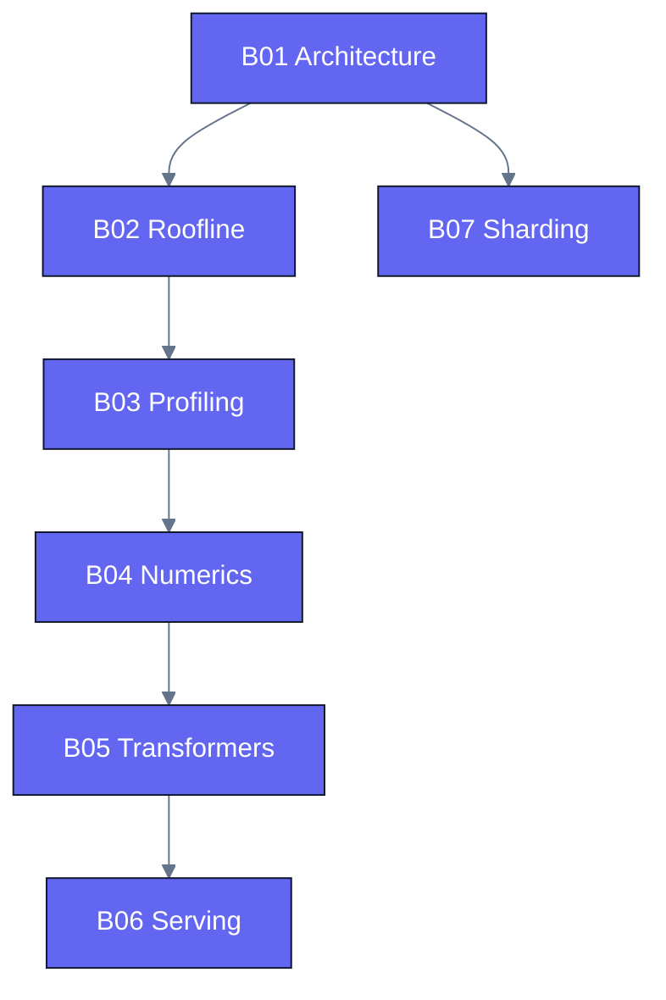

# Track B — GPU Understanding & ML Performance

Learn to **reason about** performance: what makes a kernel or a model fast or slow, and how to
prove it with measurements. This track turns you from someone who writes kernels into someone who
can diagnose and defend performance decisions.

## Modules

| ID | Module | What you build | Status |
|----|--------|----------------|--------|
| [B01](B01.accelerator-architecture/) | Accelerator architecture (CDNA vs Hopper) | Runtime device/topology introspection | **DONE** |
| [B02](B02.roofline-and-arithmetic-intensity/) | Roofline model & arithmetic intensity | An intensity sweep that finds its own ridge point | **DONE** |
| [B03](B03.profiling-and-bottleneck-analysis/) | Profiling & bottleneck analysis | Four unlabelled "mystery" kernels to diagnose | **DONE** |
| [B04](B04.precision-and-quantization/) | Precision & numerics (fp32 → fp8) | Labs that print the hazards; int8 quantization demo | **DONE** |
| [B05](B05.transformer-performance/) | Transformer performance | Model calculator; per-sub-op layer profiling | **DONE** |
| [B06](B06.inference-serving-optimizations/) | Inference serving optimizations | Batching simulator, KV planner, speculation model | **DONE** |
| [B07](B07.distributed-training-and-sharding/) | Distributed training & sharding | Memory planner, collective cost, pipeline bubble | **DONE** |

**Suggested order.** B01 → B02 → B03 is the diagnostic core: know the hardware, classify the kernel,
then confirm with a profiler. B04 covers the numerics you trade for speed. B05 → B06 → B07 apply all of
it to transformers, serving, and multi-GPU scale.

**Prerequisite:** [A01](../A-gpu-programming/A01.foundations-and-programming-model/) for GPU literacy.
B02 is most useful after [A02](../A-gpu-programming/A02.memory-hierarchy-and-coalescing/), and B05
builds on [A07](../A-gpu-programming/A07.softmax-and-fused-kernels/). See
[CURRICULUM.md](../../CURRICULUM.md) for the full dependency graph.

**A note on the tools.** Every analytic tool in this track runs on the Python standard library alone —
no GPU, no `pip install` — and labels its output as a model or a simulation rather than a measurement.
The lab programs that *do* need a GPU compute their own numbers; this track publishes no benchmark
table it cannot reproduce.
