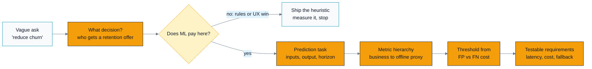
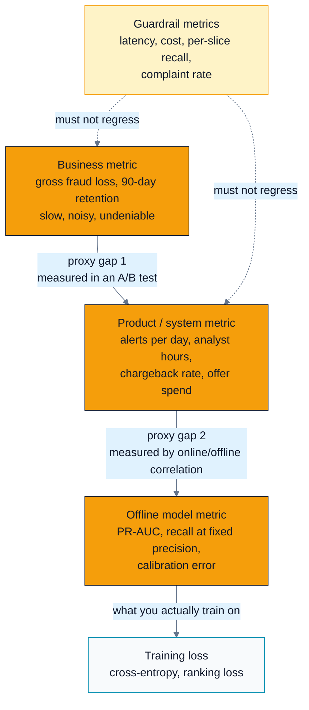
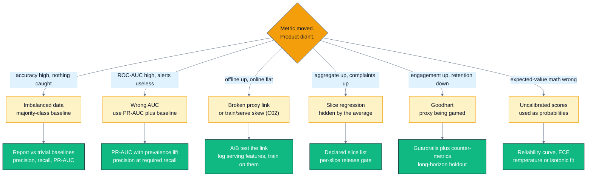

# C01 — Problem Framing & Metrics That Cannot Be Gamed

> Track C · Module 01 · Status: **DONE** · Est. 5 hours · Depth 1/5
>
> Prerequisites: none. No GPU, no framework, no data required.
> Backends: **none — this is a design module.** The only executables are standard-library
> Python 3 tools in [`tools/`](tools/). See [SETUP.md](../../../docs/SETUP.md) if you want the GPU
> tracks instead.
> Terms: [GLOSSARY.md](../../../docs/GLOSSARY.md) · Sources: [REFERENCES.md](../../../docs/REFERENCES.md).

---

## 1. TL;DR + Layman analogy

**TL;DR.** An ML system exists to produce a **decision**, not a prediction. So the first question is
never "what model?" — it is "what action does this system take, and what does a good outcome look
like?" Once you have the decision, you can define the prediction task, then choose metrics that are
*proxies* for the business outcome, and then pick an operating threshold from the **relative cost of
a false positive versus a false negative**. Most failed ML projects are not modelling failures: they
optimized a metric that drifted away from the outcome it was supposed to represent, and nobody
noticed because the aggregate number went up.

**Layman analogy — hiring.** You are hiring one engineer and 500 people applied. Two things can go
wrong: you **hire someone bad** (a false positive) or you **reject someone great** (a false
negative). "Interview more people" raises your chance of finding the great candidate — that is
**recall**. "Only make an offer when you're certain" raises the share of your offers that work out —
that is **precision**. You cannot maximize both with a fixed interviewing budget: loosening your bar
catches more great candidates *and* lets more bad ones through. Which error you'd rather make is not
a statistics question, it is a business question: a bad hire on a two-person team is catastrophic, so
you bias toward precision; filling a large seasonal support team where a bad hire is easily
reassigned biases toward recall. And notice that "accuracy" is a *useless* word here: if only 5 of
the 500 applicants are actually great, a manager who rejects everyone is "99% accurate" and hires
nobody.

**Where the analogy breaks.** Three places, and each one matters:

1. **Capacity, not cost, often sets the real threshold.** A hiring manager has one open role, so the
   bar is set by headcount regardless of how the costs balance. The same is true of a fraud queue
   with 12 analysts. Cost-optimal thresholds assume you can act on every alert; when you can't,
   capacity dominates (§3, §5).
2. **Hiring gets 500 decisions; an ML system gets 500 million.** At that volume, rare failure modes
   stop being anecdotes and become a daily incident, and a 0.1% error rate on a subgroup is a
   headline. Per-slice reporting (§3) has no hiring equivalent.
3. **You can always interview more people; you cannot always "just raise recall."** In hiring,
   effort buys you both precision and recall. In a deployed model, the precision/recall trade at any
   moment is *bounded by the ranking quality the model already has* — moving the threshold only
   slides you along a fixed curve. Improving both at once requires a better model or better data,
   which is a different (and slower) project.



The arrows only run one way: every box downstream is meaningless until the box before it is answered,
which is why "what model should we use?" is the *last* question in this module, not the first.

**By the end of this module you can:** turn a vague stakeholder request into a framed prediction task
with inputs, outputs, and a decision threshold; argue when ML is the wrong tool; build the
business → product → offline metric hierarchy and name the gap between each layer; choose between
precision, recall, F1, PR-AUC, ROC-AUC, NDCG, MAE and RMSE and defend the choice; derive the
cost-optimal threshold from FP/FN costs and explain how it moves with the base rate; and write
requirements — latency, cost, freshness, and failure behaviour — as statements a test could check.

---

## 2. First Principles

### Start from the decision, not the model

A model that outputs a number changes nothing. Value appears only when the number changes an
**action**. So derive the system backwards from the action:

```
action  ->  what must be true to take it  ->  what quantity predicts that  ->  what data exists
```

Work a real example. A stakeholder says: **"reduce churn."** That sentence contains no system. Five
questions turn it into one:

| Question | Bad answer | Framed answer |
|---|---|---|
| What action does the system produce? | "a churn score" | Send a retention offer (discount, outreach call, or nothing) |
| Who or what is the unit of decision? | "users" | One decision per active subscriber, evaluated weekly |
| What exactly are we predicting? | "churn" | P(the subscriber cancels within the next 30 days), given data as of the decision moment |
| When is the outcome known? | "later" | 30 days after the decision — so labels lag by 30 days |
| What does a good outcome look like? | "less churn" | Retained subscribers per dollar of offer spend, over 90 days |

Notice what the framing forced into the open: a **prediction horizon** (30 days), a **decision
cadence** (weekly), a **label delay** (30 days — which constrains how fast you can iterate), and a
**budget** (offer spend). None of that came from a model. All of it constrains the model.

Also notice the trap the framing avoids. "Predict who will churn" and "predict who will *stay
because of an offer*" are different tasks. The first ranks people by risk; the second ranks by
**treatment effect**. Sending offers to your highest-risk subscribers can be strictly wasteful if
those subscribers were leaving regardless — you paid for churn you did not prevent. Getting this
wrong is the most common framing error in retention, pricing, and advertising, and no amount of AUC
fixes it. (Uplift/incrementality modelling is out of scope here; recognizing the mismatch is not.)

### Is ML even the right tool?

Assume ML is wrong until it earns its place. It costs a data pipeline, training infrastructure,
monitoring, on-call, and permanent complexity — the standing bill that
[*Hidden Technical Debt in Machine Learning Systems*](../../../docs/REFERENCES.md#hidden-technical-debt-in-machine-learning-systems-sculley-et-al-2015)
itemizes and that the nine-stage workflow in
[*Software Engineering for Machine Learning*](../../../docs/REFERENCES.md#software-engineering-for-machine-learning-amershi-et-al-2019)
lays out stage by stage. Google's
[*Rules of Machine Learning*](../../../docs/REFERENCES.md#rules-of-machine-learning-zinkevich-google) opens with the
same instruction — Rule #1 is *don't be afraid to launch a product without machine learning* — and
the reason is that a heuristic gives you the pipeline, the logging, and the metric while you learn
whether the problem is even real.

ML pays when **all four** of these hold:

| Condition | Why it matters | If it fails |
|---|---|---|
| The pattern is complex **and** changing | A human can't enumerate the rules, and the rules would rot anyway | Write the rules. Cheaper, auditable, debuggable |
| Labels exist or can be collected | Supervision is the fuel; no labels means no learning | Buy labels, use weak supervision, or don't use ML |
| Errors are tolerable and recoverable | Every model is wrong sometimes | You need a human in the loop, a hard constraint, or a different tool |
| Scale makes per-case human judgement impossible | Automation is the whole benefit | Hire a person; they'll be better and you'll learn faster |

Two extra tests worth applying in an interview:

- **Would a better UI make the problem disappear?** A form that validates an address beats a model
  that guesses at a malformed one. A "was this helpful?" button beats inferring satisfaction.
- **Can you state the rules baseline?** If you cannot describe a heuristic you'd be embarrassed to
  ship, you do not yet understand the problem well enough to model it.

### The naive approach, and where it breaks

The naive framing is: *pick a model, optimize accuracy, ship the highest number.* Here is exactly
where it breaks, with arithmetic you can do on a whiteboard.

You are detecting fraudulent transactions. Out of **10,000** transactions, **100** are fraud (1%
base rate). A model that predicts "never fraud" scores:

```
accuracy = 9900 / 10000 = 99.0%
recall   = 0 / 100      = 0%
```

**99% accurate and completely worthless.** The failure is not the model, it is the metric: accuracy
is dominated by the majority class, so it rewards ignoring the thing you care about. Run it:

```bash
python tools/baseline_check.py --prevalence 0.01 --n 10000
```

That is the first principle of metric choice: **a metric is only useful if a trivial policy scores
badly on it.** Always compute what majority, uniform-random, and stratified-random already achieve
*before* reporting a model number. If your model's F1 is 0.03 at 2% prevalence, stratified random
gets 0.02, and you have shipped almost nothing.

### Baselines and error budgets

Two disciplines follow directly:

1. **Establish a trivial baseline first.** Majority class for classification, last-observed value
   for time series, popularity ranking for recommendation, global mean for regression. This is not
   ceremony: it is the only way to interpret your model number, and it frequently ends the project
   early with "the heuristic is fine."
2. **Define *sufficient*, not maximal, accuracy.** "As accurate as possible" is not a requirement, it
   is an unbounded budget. The right form is an **error budget** derived from the decision: *"we can
   tolerate 200 false alerts per day because 12 analysts can review 250; anything above that and the
   queue backs up and the system fails."* Now you have a testable target, and you can stop
   optimizing when you hit it.

### Requirements as testable statements

Framing is not finished until the non-functional requirements are written as statements a test could
check — the same move
[*The ML Test Score*](../../../docs/REFERENCES.md#the-ml-test-score-breck-et-al-2017) makes when it
turns production readiness into a rubric of individually checkable tests. Every one of these is a
**design requirement**, not an afterthought:

| Requirement | Bad form | Testable form |
|---|---|---|
| Latency | "fast" | p99 end-to-end scoring latency ≤ 150 ms at 2,000 requests/second |
| Throughput | "scales" | Sustains peak 2,000 rps with ≤ 2× the steady-state cost |
| Freshness | "up to date" | Features reflect events no older than 5 minutes; a 30-minute stall pages on-call |
| Cost | "cheap" | ≤ $0.0004 per prediction at forecast volume, including feature retrieval |
| **Failure behaviour** | *unstated* | If the model is unavailable, fall back to the rules baseline and emit `model_unavailable`; never block the transaction |

The last row is the one candidates forget and reviewers always ask about. **What the system does
when the model is down is part of the design.** A fraud scorer that fails closed blocks all payments;
one that fails open waves fraud through. Neither is universally right — you must choose, write it
down, and test it. In an interview, volunteering the fallback path is one of the cheapest ways to
sound senior.

---

## 3. Deep Dive

### The metric hierarchy

There is no such thing as "the metric." There are three layers, and each is a **proxy** for the one
above it. ML projects die in the gaps between layers — the gap between a business objective and the
model metric standing in for it is the framing failure
[*Designing Machine Learning Systems*](../../../docs/REFERENCES.md#designing-machine-learning-systems-huyen-2022)
returns to throughout.



Read the diagram downward for *what you can measure quickly* and upward for *what you actually care
about*: the top is undeniable but arrives in quarters, the bottom is instant but only a rumour about
the top, and the dashed guardrails are the metrics you are forbidden to trade away while chasing
either.

The practical discipline is to **name each layer explicitly and state the assumed link**:

> "We optimize PR-AUC offline (layer 3). We assume PR-AUC improvements raise caught-fraud at fixed
> analyst load (layer 2), which we verify in an A/B test on alert precision. We assume caught-fraud
> reduces net loss (layer 1), which finance reports monthly. If the offline metric moves and layer 2
> doesn't, the assumption is broken and we stop shipping on offline numbers."

That paragraph is the deliverable. Writing it down is what makes the gap visible; it is also almost
verbatim what a strong candidate says in a design interview.

### Classification metrics, properly

Everything starts from the confusion matrix. Fix the vocabulary once:

|  | predicted positive | predicted negative |
|---|---|---|
| **actually positive** | TP | FN (a miss) |
| **actually negative** | FP (a false alarm) | TN |

```
precision   = TP / (TP + FP)      "of what I flagged, how much was right"   -> cost of false alarms
recall      = TP / (TP + FN)      "of what was there, how much I caught"    -> cost of misses
specificity = TN / (TN + FP)      "of the negatives, how many I left alone"
FPR         = FP / (FP + TN)      = 1 - specificity
F1          = 2PR / (P + R)       harmonic mean of precision and recall
```

Two things about **F1** that interviewers probe. First, it is a *harmonic* mean, so it is dragged
down by the smaller of the two — you cannot buy a good F1 with 0.99 precision and 0.01 recall.
Second, **F1 weights precision and recall equally, which is almost never what your business wants.**
If a miss costs 20× a false alarm, F1 is the wrong objective; use F_β (β > 1 favours recall) or,
better, skip F-scores and optimize expected cost directly. F1 is a convenient scalar for model
*selection*, not a statement about your business.

#### PR-AUC vs ROC-AUC, and why ROC-AUC misleads on rare positives

Both summarize a *ranking* across all thresholds, so both are threshold-free. The difference is what
sits in the denominators:

- **ROC** plots TPR = TP/(TP+FN) against FPR = FP/(FP+TN). Both axes are **within-class rates**.
- **PR** plots precision = TP/(TP+**FP**) against recall. Precision's denominator mixes classes.

That single asymmetry is the whole story. Add a million more negatives and the ROC curve barely
moves — the FPR denominator grows along with FP. Precision, however, collapses, because those extra
negatives flow into the FP term without any corresponding growth in TP. Davis & Goadrich (2006)
proved the curves are tied by a one-to-one mapping given fixed class counts; Saito & Rehmsmeier
(2015) show why the PR view is the informative one when positives are rare.

The tool makes it visible. Ranking quality is held *fixed* (same score-generating distributions,
same seed); only the class balance changes:

```bash
python tools/metric_explorer.py imbalance
```

```text
Fixed ranking quality (separation = 2.00 sd), varying only the class balance.
Positives held at 200; negatives added to hit each prevalence.

  prevalence  negatives   ROC-AUC   PR-AUC   PR-AUC baseline   PR-AUC lift
      0.5000        200   0.9129   0.9219   0.5000             1.84
      0.1000       1800   0.9154   0.6842   0.1000             6.84
      0.0100      19800   0.9180   0.2859   0.0100            28.59
      0.0010     199800   0.9180   0.0537   0.0010            53.66
```

ROC-AUC is essentially constant at ~0.92 across a 500× change in prevalence, while PR-AUC falls from
0.92 to 0.05. **A 0.92 ROC-AUC is compatible with a system whose alerts are wrong 95% of the time.**
Report PR-AUC on rare-positive problems, and report it *next to the prevalence baseline*, because
PR-AUC alone is not comparable across datasets with different base rates — the lift column is the
honest comparison.

When is ROC-AUC still the right call? When the classes are roughly balanced, when you genuinely care
about performance across the whole operating range rather than the high-precision head, or when you
must compare a model across populations with different prevalence and want a measure that isn't
confounded by it. "It depends on whether the *decision* lives in the rare-positive head of the
ranking" is the pivot.

#### Calibration — a probability that means what it says

A score is **calibrated** if, among all cases scored 0.30, about 30% are actually positive. Ranking
metrics are blind to this: you can multiply every score by 0.5 and ROC-AUC, PR-AUC, NDCG all stay
identical while every probability becomes a lie.

Calibration is not academic. You need it whenever a score is **combined with a number that has
units**:

- Expected loss = `p × transaction_amount` — only meaningful if `p` is a real probability.
- Thresholding by cost (next subsection) — the analytic optimum is expressed in probability space.
- Ensembling or comparing scores from two models, or feeding a score into a downstream optimizer.

Measure it with a **reliability curve** (bucket predictions, plot mean predicted vs observed rate)
plus a scalar: **expected calibration error** (weighted average gap across buckets) or **Brier
score** (mean squared error of the probability, which decomposes into calibration + refinement).
Guo et al. (2017) showed that modern high-capacity neural networks are systematically
**over-confident** — accuracy improved over older models while calibration got *worse* — and that
cheap post-hoc fixes (temperature scaling, one parameter fit on a validation set) largely repair it.
Platt scaling and isotonic regression are the classical alternatives (Niculescu-Mizil & Caruana,
2005).

One trap worth naming: **class re-balancing destroys calibration.** If you downsample negatives 10×
to train, your model's outputs are calibrated to the *resampled* prior, not the real one, and are
systematically too high. Either don't resample, or correct the prior afterwards and re-check the
reliability curve.

#### Choosing the threshold from costs

This is the part most candidates hand-wave and it is a two-line derivation. For one case with
calibrated probability `p` of being positive, and costs `C_fp` for a false alarm and `C_fn` for a
miss:

```
expected cost if you flag it       = (1 - p) * C_fp      # it's really negative -> FP
expected cost if you don't flag it =      p  * C_fn      # it's really positive -> FN

flag when   (1 - p) * C_fp  <  p * C_fn
        =>  C_fp  <  p * (C_fp + C_fn)
        =>  p  >  C_fp / (C_fp + C_fn)   ==   p*
```

So for a **calibrated** model the optimal threshold is `p* = C_fp / (C_fp + C_fn)` — it depends only
on the **cost ratio**, not on the base rate. If a miss costs 20× a false alarm, `p* = 1/21 ≈ 0.048`:
flag anything above ~5%. This is Elkan's (2001) cost-sensitive result, and it is the cleanest thing
you can put on a whiteboard when asked "how do you pick the threshold?"

Now the follow-up question, which is the one that separates candidates: **what happens when the base
rate changes?**

- **In probability space, nothing.** `p*` is untouched: it is a function of costs only.
- **In score space, plenty.** Write the decision as a likelihood ratio. With prevalence `π` and
  class-conditional densities `f₁`, `f₀`, the same rule becomes
  `f₁(x)/f₀(x) > (C_fp / C_fn) × ((1 - π) / π)`. As `π` falls, `(1-π)/π` grows, so the **evidence
  bar rises**: you need a stronger signal to justify flagging. If you threshold a raw score whose
  calibration was fitted at the old prevalence, that threshold is now wrong and must be re-fitted.
- **The consequences change even when the threshold doesn't.** At a fixed `p*`, halving the
  prevalence roughly halves your true positives while leaving false positives driven by the (larger)
  negative population — precision falls and alert volume per catch rises. The threshold is still
  cost-optimal; the *system* may no longer be worth running.
- **Capacity can override all of it.** With 12 analysts reviewing 250 alerts/day, the operating point
  is whatever threshold yields ≤ 250 alerts, and your real objective becomes "maximize catches within
  a fixed review budget" — which is *precision@k*, not expected cost.

See it end to end:

```bash
python tools/metric_explorer.py sweep --fp-cost 1 --fn-cost 20
```

Real output from that command (seed 7, so it reproduces exactly):

```text
n = 10000  positives = 200  negatives = 9800  prevalence =  0.0200

ranking quality (threshold-free)
  ROC-AUC =  0.9180
  PR-AUC  =  0.4111   (random baseline = prevalence =  0.0200)

  thresh      TP     FP     FN     TN  precision  recall      F1        cost
  0.9037     95    117    105   9683     0.4481  0.4750  0.4612     2217.00 <- max F1
  0.8223    145    625     55   9175     0.1883  0.7250  0.2990     1725.00 <- min cost
  ...

cost-weighted decision (FP=1, FN=20, FN/FP ratio = 20.00)
  empirical best threshold = 0.8223  ->  cost 1725.00 (0.1725 per case)
  F1-optimal threshold     = 0.9037  ->  cost 2217.00
  analytic optimum for a *calibrated* probability p* = C_fp / (C_fp + C_fn) = 0.0476
  flag nothing (reject all) cost = 4000.00 | flag everything cost = 9800.00
```

Three lessons in one screen. **(1)** The F1-optimal threshold costs 2217 while the cost-optimal one
costs 1725 — optimizing the wrong scalar costs you **28% more** for the identical model (equivalently,
the cost-derived operating point is 22% cheaper). **(2)** The empirical
optimum (0.82) and the analytic `p*` (0.048) disagree wildly, and the tool says so, because these
synthetic scores are *not* calibrated probabilities. Applying `p*` to an uncalibrated score is a
real, common production bug. **(3)** Always print the trivial policies: if "flag nothing" had cost
less than your best threshold, the model earns nothing at these costs.

### Ranking metrics

When the output is an ordered list rather than a yes/no, precision and recall at the whole-list level
stop meaning much. Use metrics that respect **position**:

| Metric | What it measures | Use when |
|---|---|---|
| **recall@k** | fraction of all relevant items appearing in the top k | Retrieval/candidate-generation stages: you only need the right items to survive to the next stage |
| **precision@k** | fraction of the top k that are relevant | Fixed-size surfaces: 10 slots on a page, 250 alerts a queue can absorb |
| **MRR** | mean of 1/rank of the *first* relevant item | There is one right answer and users stop at it (a lookup, a "did you mean") |
| **NDCG@k** | position-discounted, graded relevance, normalized by the ideal ordering | Multiple relevant items with *degrees* of relevance (Järvelin & Kekäläinen, 2002) |
| **MAP** | mean average precision across queries | Multiple binary-relevant items, position matters |

Work NDCG once so it stops being a black box. Suppose the top 3 results have graded relevance
`[3, 0, 2]` on a 0–3 scale, using the common `gain = 2^rel - 1` and `discount = 1/log₂(rank + 1)`:

```
DCG  = (2^3 - 1)/log2(2) + (2^0 - 1)/log2(3) + (2^2 - 1)/log2(4)
     = 7/1.000 + 0/1.585 + 3/2.000
     = 7 + 0 + 1.5 = 8.5

ideal ordering is [3, 2, 0]:
IDCG = 7/1.000 + 3/1.585 + 0/2.000 = 7 + 1.893 = 8.893

NDCG@3 = 8.5 / 8.893 = 0.956
```

The normalization by IDCG is what makes NDCG comparable across queries with different numbers of
relevant items — and it is also the reason NDCG can look flattering: a query with one relevant item
you happened to rank first scores 1.0.

Two production caveats. **Implicit feedback is biased**: clicks are contaminated by position bias
(higher slots get clicked because they are higher), so a metric computed on logged clicks rewards
reproducing your current ranker. And **offline ranking metrics ignore the ranker's effect on the
data** — you only observe feedback for items you showed. This is the on-ramp to
[C02](../C02.data-pipelines-and-features/README.md)'s discussion of biased labels and
[C06](../C06.monitoring-drift-and-ethics/README.md)'s feedback loops.

### Regression metrics

| Metric | Formula | Punishes | Choose when |
|---|---|---|---|
| **MAE** | mean of \|error\| | Every unit of error the same | Errors are linearly costly; outliers are data, not disasters |
| **RMSE** | sqrt(mean of error²) | Large errors quadratically | One big miss is much worse than several small ones |
| **MAPE** | mean of \|error\| / actual | Relative error | Scales vary hugely across cases — but undefined at zero and asymmetric |
| **Quantile loss** | asymmetric penalty | Over- vs under-prediction differently | Inventory, capacity, staffing: too little ≠ too much |

The distinction that matters: **RMSE is minimized by predicting the conditional mean, MAE by the
conditional median.** So the metric choice silently changes what the model tries to be. On skewed
data — delivery times, revenue, latency — those are very different predictions, and reporting RMSE
while the business cares about typical error is a quiet mismatch. If over- and under-prediction have
genuinely different costs (running out of stock vs holding it), neither symmetric metric is right;
use quantile loss and let the asymmetry be explicit.

### Goodhart's law: metrics that improve while the product gets worse

> When a measure becomes a target, it ceases to be a good measure.

This is not a proverb, it is the default outcome of optimizing a proxy. Three concrete mechanisms:

1. **Engagement → clickbait.** Optimize watch time or click-through and the system learns that
   outrage, cliffhangers, and misleading thumbnails work. Engagement rises; trust, retention, and
   long-term value fall. The metric is not lying — it is measuring exactly what you asked for, which
   was never what you wanted.
2. **Accuracy → predict the majority.** At 1% prevalence, "never positive" scores 99%. The model has
   found the cheapest way to satisfy your metric.
3. **Latency p50 → starve the tail.** Optimize the median and you can shed the slowest 5% of
   requests. p50 improves; the users who were already suffering suffer more.

The counter-measures are structural, not clever:

| Counter-measure | What it is | Example |
|---|---|---|
| **Guardrail metrics** | Metrics that must not regress, even if the target improves | p99 latency, cost/prediction, complaint rate, per-slice recall |
| **Counter-metrics** | A metric that moves the *opposite* way if the target is being gamed | Alongside CTR: dwell time, "hide this", next-day return rate |
| **Slice-level reporting** | The metric per subgroup, not just in aggregate | Recall per region, per device, per language, per account age |
| **Long-horizon holdouts** | A population deliberately left untreated to measure long-run effect | Retention measured at 90 days, not 7 |
| **Human review sample** | Rated quality on a random sample, independent of the optimized metric | Weekly rater panel scoring result relevance |

Kohavi et al.'s work on trustworthy online experiments is the canonical source for the guardrail
pattern; the practical rule is that **any single-metric optimization target needs at least one
guardrail that would catch its most likely abuse.** If you cannot name how your metric would be
gamed, you have not thought about it hard enough — and that is a question you will be asked.

### Slicing: aggregate metrics hide harm

An aggregate is an average over a population, and averages hide subgroups. A model at 92% overall
recall can be at 55% for one region, one language, one device class, or new accounts — and that
subgroup is where your incidents, complaints, and regulatory exposure come from.

Require, from day one:

- **A declared slice list** — the dimensions you always report: geography, language, platform,
  tenure, and any protected attribute you are permitted to evaluate on. Write it down in the design
  doc so it cannot be quietly dropped.
- **Minimum per-slice sample sizes**, because a slice with 40 examples has a standard error near ±8
  points and will thrash (§5 makes this quantitative).
- **A slice-level gate in the release process**: no launch if any declared slice regresses beyond
  threshold, regardless of the aggregate.

This is cheap to build early (it is a `GROUP BY`) and painful to retrofit, because the historical
metric store won't have the dimensions. Tooling exists — TensorFlow Model Analysis is built around
sliced metrics — but the hard part is the *commitment*, not the code.

---

## 4. Hands-On Labs

**There is no `hip/` or `cuda/` directory in this module, and that is deliberate.** C01's subject is
the decision layer that sits above any implementation; the skill being drilled is framing and
metric arithmetic, which no kernel exercises. The runnable artifacts are two standard-library Python
tools plus three written design drills. Every tool runs on a stock Python 3 with **no `pip install`**
and prints a clear message instead of a traceback when you give it bad input.

```bash
make help              # list targets
make run               # run both tools in demo mode
make run-exercises     # the exact scenarios exercises/03 asks you to compute
make clean

# On Windows, the interpreter is usually `python`:
make run PYTHON=python
```

`make` needs a Unix-like shell (WSL, Git Bash, MSYS). The tools themselves are plain Python and run
anywhere:

```bash
python tools/metric_explorer.py --help
python tools/baseline_check.py  --help
```

### Lab 1 — Find out what "unimpressive" looks like (`baseline_check.py`)

```bash
python tools/baseline_check.py --positives 200 --negatives 9800 --simulate 200
```

```text
label distribution
  n = 10000   positives = 200   negatives = 9800   prevalence =   0.0200

label-blind baselines
  policy                                   accuracy  precision   recall        F1
  always-negative (majority if rare)         0.9800    undef   0.0000    undef
  always-positive                            0.0200   0.0200   1.0000   0.0392
  uniform random (flag 50%)                  0.5000   0.0200   0.5000   0.0385
  stratified random (flag at prevalence)     0.9608   0.0200   0.0200   0.0200

the numbers your model must beat to be interesting
  accuracy  >   0.9800   (majority class; anything below this is worse than a constant)
  precision >   0.0200   (any label-blind policy already gets this)
  F1        >   0.0200   (stratified random)
  PR-AUC    >   0.0200   (random ranking)
```

**What to observe.** Precision is `0.0200` for *every* label-blind policy, no matter what flag rate
it uses. That is not a coincidence — if your flag decision is independent of the label, precision is
pinned to the prevalence. It follows that **precision above the base rate is the only evidence that
your model knows anything**, and that a "97% accurate" claim at this prevalence is worse than a
constant. `--simulate` Monte-Carlos the random policies so you can confirm the closed-form numbers
are not hand-waving.

### Lab 2 — The accuracy trap, quantified (`metric_explorer.py confusion`)

```bash
python tools/metric_explorer.py confusion --tp 40 --fp 10 --fn 60 --tn 9890 \
    --fp-cost 1 --fn-cost 20
```

```text
  prevalence   =  0.0100
  accuracy     =  0.9930
  precision    =  0.8000
  recall       =  0.4000
  F1           =  0.5333

baseline comparison
  always-predict-majority accuracy =  0.9900
  VERDICT: beats majority accuracy by  0.0030

cost at this operating point (FP=1, FN=20)
  total cost   = 1210   (10 FP x 1 + 60 FN x 20)
```

**What to observe.** A headline **99.3% accuracy** that is worth **0.3 points** over predicting the
majority class, while missing 60% of the positives. Then look at the cost line: the 60 misses
contribute 1200 of the 1210 total cost and the 10 false alarms contribute 10. Accuracy weighted those
two error types identically. Your business did not.

### Lab 3 — ROC-AUC vs PR-AUC under imbalance (`metric_explorer.py imbalance`)

```bash
python tools/metric_explorer.py imbalance --prevalences 0.5,0.1,0.01,0.001
```

**What to observe.** Ranking quality is held constant by construction (same distributions, same
seed) — only prevalence changes. ROC-AUC moves in the third decimal place; PR-AUC falls by more than
an order of magnitude (output in §3). Then vary `--separation` from `2.0` down to `0.5` and watch
*both* fall: that is what an actually-worse model looks like, and it is how you distinguish "my model
got worse" from "my population got rarer." Being able to tell those two apart from a dashboard is a
real on-call skill.

### Lab 4 — Cost-optimal threshold (`metric_explorer.py sweep`)

```bash
# a miss costs 20x a false alarm
python tools/metric_explorer.py sweep --fp-cost 1 --fn-cost 20

# now flip the asymmetry: false alarms are what hurt
python tools/metric_explorer.py sweep --fp-cost 20 --fn-cost 1

# your own scores: a CSV of "score,label" rows (header optional), or stdin
python tools/metric_explorer.py sweep --scores my_scores.csv --fp-cost 1 --fn-cost 5
```

**What to observe.** The cost-optimal threshold moves in the direction the costs push it, the
F1-optimal threshold does not move at all (F1 has no idea what your costs are), and the tool warns
you when the empirical optimum and the analytic `p*` diverge — the signature of uncalibrated scores.
Compare `min cost` against the `flag nothing` / `flag everything` lines: if a trivial policy wins,
the model is not earning its keep at these costs.

### Lab 5 — Break the tools on purpose

Failing loudly is a repo-wide principle ([A01 §6](../../A-gpu-programming/A01.foundations-and-programming-model/README.md#6-challenges-drawbacks--tradeoffs)),
and it applies to design tooling too. Confirm each of these prints one clear line and exits with
status 2 — never a traceback:

```bash
python tools/baseline_check.py --prevalence 1.5 --n 100        # prevalence out of range
python tools/baseline_check.py --labels does_not_exist.csv     # unreadable file
python tools/baseline_check.py                                 # no distribution given
python tools/metric_explorer.py confusion --tp 0 --fp 0 --fn 0 --tn 0
python tools/metric_explorer.py sweep --fp-cost 0 --fn-cost 0  # no cost signal at all
```

**What to observe.** Each message names the offending flag and the value it received. That is the bar
for any tool you ship to a teammate: an error a human can act on without reading your source.

### Lab 6 (written) — Frame a real problem

The design drills are the point of this module. Do them in [`exercises/`](exercises/); reference
answers with reasoning in [`solutions/`](solutions/). They are markdown rather than code because the
deliverable of framing is a **document a team can disagree with**, and the interview version of this
skill is a whiteboard, not an editor.

---

## 5. Performance Analysis

**Reframed for a design module.** There is no kernel to profile and no
[roofline](../../../docs/GLOSSARY.md#roofline-model) to plot here — this
module ships no GPU code. The heading is kept because the *discipline* transfers exactly: state the
metric, compute it, identify the binding constraint, and show a before/after delta. For a decision
system the quantities are **cost per prediction, alert volume against review capacity, latency
budget, and metric measurement error**. All of the arithmetic below is reproducible from the stated
assumptions; none of it is a benchmark measurement.

### The binding constraint is the roofline analogue

In [Track A](../../A-gpu-programming/README.md) you ask
"[compute-bound or memory-bound](../../../docs/GLOSSARY.md#memory-bound-compute-bound-and-latency-bound)?"
Here you ask **"which layer of the metric
hierarchy is the bottleneck?"**, because that determines where effort pays:

| Binding constraint | Symptom | Where effort pays |
|---|---|---|
| Ranking quality | Precision at required recall is too low at *every* threshold | Better features/data ([C02](../C02.data-pipelines-and-features/README.md)), better model |
| Threshold choice | The curve is fine; the operating point is wrong | Free: re-threshold from costs (Lab 4) |
| Review capacity | Alerts exceed what humans can process | Precision@k, tiered triage, automate the easy head |
| Label delay | Cannot evaluate fast enough to iterate | Proxy labels, shorter horizon, more holdout |
| Cost per prediction | Unit economics negative | Cheaper features, caching, smaller model (C04) |

Notice the second row. Re-thresholding is the highest-leverage move in ML systems and it costs
nothing: no retraining, no data work, no deployment risk beyond a config change. It is also the one
most often skipped, because "improve the model" sounds like more serious work.

### Measured before/after: the wrong scalar costs 22%

This is the module's before/after delta, and unlike a GPU benchmark it is exactly reproducible —
same seed, same numbers, any machine:

```bash
python tools/metric_explorer.py sweep --fp-cost 1 --fn-cost 20
```

| Operating point | Threshold | TP | FP | FN | Precision | Recall | Total cost |
|---|---:|---:|---:|---:|---:|---:|---:|
| Max-F1 (metric-driven) | 0.9037 | 95 | 117 | 105 | 0.448 | 0.475 | **2217** |
| Min-cost (decision-driven) | 0.8223 | 145 | 625 | 55 | 0.188 | 0.725 | **1725** |
| Flag nothing | — | 0 | 0 | 200 | — | 0.000 | 4000 |
| Flag everything | — | 200 | 9800 | 0 | 0.020 | 1.000 | 9800 |

**Delta: 22% lower cost from moving one number**, with the model completely unchanged. The trade is
explicit — precision drops from 0.45 to 0.19 and false alarms rise 5× — and it is *correct*, because
each miss was declared 20× more expensive than each false alarm. This table is what "optimize the
decision, not the metric" looks like numerically.

### Alert volume against capacity (worked arithmetic, not a measurement)

The operating point above implies a workload. Assume, as a stated hypothetical, 1,000,000
transactions/day at the same 2% base rate and the same ranking quality:

```
positives/day        = 1,000,000 x 0.02             = 20,000
the eval set had 200 positives, so scale its counts by 100x:
  true alerts        = 145 TP x 100                 = 14,500
  false alerts       = 625 FP x 100                 = 62,500
  total alerts/day                                  = 77,000
analyst capacity     = 12 analysts x 250 per day    =  3,000
```

**77,000 alerts against 3,000 of capacity — the cost-optimal threshold is operationally
impossible.** This is the single most important system-design consequence in the module: the
cost-optimal point and the *feasible* point are different, and the design must reconcile them. Real
options, each with a real cost:

1. **Raise the threshold to fit capacity.** Objective silently becomes precision@3000; you accept
   more misses. Honest, and requires re-deriving the value story.
2. **Tier the queue.** Auto-block the very-high-score head, auto-allow the tail, route the ambiguous
   middle to humans. Buys throughput, needs a policy for auto-block errors (and an appeals path).
3. **Raise ranking quality.** The only option that improves both sides — and the slowest and most
   expensive.
4. **Add capacity.** Fine if the loss prevented exceeds the analyst cost; that comparison is now a
   simple arithmetic problem, which is the point of having done this calculation.

Volunteering this reconciliation is a senior signal. Presenting the cost-optimal threshold without
checking it against capacity is the junior version of the same answer.

### Metric measurement error: how much of a delta is real?

Any reported metric is an estimate from a finite sample, and a change smaller than the noise is not
a change. For a rate `p` measured on `n` cases, the standard error is:

```
SE = sqrt( p * (1 - p) / n )

recall measured on 200 positives at p = 0.75:
  SE  = sqrt(0.75 * 0.25 / 200) = 0.0306        -> 95% CI ~ +/- 6.0 points
recall measured on  40 positives at p = 0.75:
  SE  = sqrt(0.75 * 0.25 /  40) = 0.0685        -> 95% CI ~ +/- 13.4 points
```

Two consequences that show up constantly on real teams:

- **The denominator that matters for recall is the number of positives, not the dataset size.** A
  10-million-row evaluation set with 200 positives gives you recall to ±6 points. Reporting
  "recall improved from 0.72 to 0.75" on that set is reporting noise.
- **Slices are noisier than you think.** A slice holding 40 positives cannot support a launch
  decision. Either aggregate slices, extend the evaluation window, or state the interval next to the
  number and act accordingly.

The same reasoning tells you the sample size you need up front: to resolve a 2-point difference near
`p = 0.75` you need roughly `n ≈ p(1-p)(1.96/0.02)² ≈ 1800` positives. Compute it *before* promising
a stakeholder you can detect a 2-point lift. And note that PR-AUC inherits this variance — at low
prevalence it is driven by a handful of positives near the top of the ranking, which is why it can
swing between retrains even when nothing meaningful changed.

### Cost per prediction as a first-class metric

Unit economics is a design constraint, not a finance concern:

```
value per correct catch  V     (stated by the business)
cost per prediction      c     (compute + feature retrieval + storage amortization)
predictions per catch    1 / (prevalence x recall)

the system is worth running only when:   V x prevalence x recall  >  c + review_cost_per_alert x alerts_per_catch
```

At low prevalence the `1/prevalence` factor is brutal: rare events mean many predictions per catch,
so `c` must be tiny. This is precisely why [C04](../C04.production-model-optimization/README.md)
(production optimization) and
[B06](../../B-gpu-ml-performance/B06.inference-serving-optimizations/README.md) (inference serving)
exist as modules — and why "we'll use a large model for everything" fails on arithmetic long before
it fails on quality.

---

## 6. Challenges, Drawbacks & Tradeoffs



Start from the symptom on the left, not from the model: every branch here is a *metric-definition*
failure that no amount of retraining fixes.

### Pitfall 1 — Reporting a metric with no baseline next to it

A number alone is uninterpretable. "PR-AUC 0.28" is excellent at 1% prevalence and embarrassing at
50%. **Every metric in a design doc or dashboard needs the trivial baseline printed beside it.** This
is why `baseline_check.py` exists and why `metric_explorer.py` prints the prevalence baseline under
every PR-AUC.

### Pitfall 2 — Optimizing a proxy without a guardrail

Covered in §3. The reviewable rule: for each optimization target, name **how it would be gamed** and
**which guardrail catches that**. A target with no named abuse and no guardrail is an unbounded
liability.

### Pitfall 3 — Threshold set by tradition

Thresholds default to 0.5 because that is what `predict()` does, and 0.5 is only correct when FP and
FN cost the same *and* the score is calibrated. Neither is usually true. Worse, 0.5 gets frozen into
downstream code and dashboards, and nobody knows why. Write the threshold, its costs, and its
derivation in the design doc, and re-derive it when costs or prevalence change.

### Pitfall 4 — Aggregate-only evaluation

Covered in §3. The failure is asymmetric: the aggregate can only *hide* subgroup harm, never reveal
it. Retrofitting slice metrics is expensive because historical metric stores lack the dimensions.

### Pitfall 5 — Treating uncalibrated scores as probabilities

The tool warns about this in Lab 4 for a reason. If you compute `expected_loss = score × amount`, or
threshold at `p*`, or ensemble two models' scores, you have assumed calibration. Check the
reliability curve; fit temperature scaling if it is off; re-check after any resampling change.

### Pitfall 6 — Choosing a metric you cannot measure in production

An offline metric requiring labels you will only have 60 days later cannot drive a live dashboard.
You need a **fast proxy** you can compute today (alert volume, override rate, score distribution
shift) *plus* the slow ground truth. State which is which;
[C06](../C06.monitoring-drift-and-ethics/README.md) builds this out.

### Pitfall 7 — Framing the task next to the one that matters

The churn example in §2: risk ≠ treatment effect. Also: "predict whether the user clicks" when the
business wants purchases; "predict ticket volume" when the business wants deflection. The offline
metric will be beautiful and the product will not move.

### Tradeoffs to hold in mind

- **Precision vs recall** is not a modelling preference, it is a cost statement. Derive it from
  `C_fp` and `C_fn`; if the business cannot give you the ratio, elicit it as a bound ("is a miss
  worth more or less than 10 false alarms?") — a bound is enough to pick a side.
- **One metric vs many.** A single target metric makes decisions crisp and gets gamed. A basket of
  metrics resists gaming and paralyzes decisions. The standard resolution: **one target, a small set
  of guardrails, everything else is diagnostic.**
- **Offline speed vs online truth.** Offline metrics are cheap, instant, and only a rumour. Online
  [A/B](../../../docs/GLOSSARY.md#ab-testing-and-canary) is authoritative, slow, and expensive.
  Iterate offline; *decide* online; measure the
  correlation between them so you know how much your offline number is worth.
- **Simple metric vs faithful metric.** A composite "quality score" can encode the real objective
  and nobody will trust or debug it. Prefer a simple metric plus explicit guardrails over a weighted
  composite whose weights nobody can defend.
- **Model complexity vs threshold tuning.** Re-thresholding is free and often worth more than a
  quarter of modelling. Do it first; it also tells you whether ranking quality is actually the
  constraint.
- **When *not* to build the model at all.** Tiny volume (a human does it better and teaches you the
  domain), no labels and no path to them, errors that are unrecoverable or unappealable, or an
  outcome you cannot measure within a useful horizon.

---

## 7. Real-World Use Cases

- **Fraud and abuse detection** is the canonical rare-positive, asymmetric-cost problem: PR-AUC over
  ROC-AUC, cost-derived thresholds, precision@capacity because a human queue reviews the alerts, and
  delayed labels (a chargeback can arrive months later —
  [C02](../C02.data-pipelines-and-features/README.md) §"labels in practice"). The threshold is
  almost always capacity-bound in practice, exactly as in §5.
- **Search and recommendation** live on ranking metrics (recall@k for candidate generation, NDCG or
  precision@k for the ranked surface) and are the textbook home of Goodhart's law: engagement targets
  degrade quality unless paired with guardrails and long-horizon holdouts. They also suffer position
  bias in the logged labels, which C02 addresses.
- **Medical triage and clinical decision support** invert the cost asymmetry — a miss can be
  irreversible — so recall at a fixed, high precision floor, explicit calibration (a clinician acts
  on the probability, not the rank), and per-slice performance across demographics are
  non-negotiable. Failure behaviour must be defined because the model is an aide, not the decider.
- **Content moderation** needs per-slice and per-language reporting (aggregate recall hides entire
  markets), an appeals path as a design requirement, and a fallback policy for when the classifier
  is unavailable.
- **Advertising and pricing** require *calibrated* probabilities because the score is multiplied by a
  monetary value in an auction or expected-revenue calculation — a rank-preserving miscalibration
  that is invisible to AUC directly corrupts the bid.

Tooling that embodies this module's ideas: **scikit-learn's `sklearn.metrics`** (precision/recall
curves, average precision, Brier score, calibration curves, and `CalibratedClassifierCV`),
**TensorFlow Model Analysis** for sliced metric evaluation, **Fairlearn** for group-wise metric
disparities, and any experimentation platform that enforces guardrail metrics on a launch decision.
The framing discipline itself is documented most directly in Google's
[*Rules of Machine Learning*](../../../docs/REFERENCES.md#rules-of-machine-learning-zinkevich-google).

**Where to go next.** [C02](../C02.data-pipelines-and-features/README.md) asks where the features and
labels behind a framed task actually come from — the position bias and label delay named above become
pipeline problems there, and the training systems of
[C03](../C03.training-systems/README.md) inherit whatever that pipeline produces.
[C05](../C05.deployment-and-serving-architecture/README.md) is where the latency, cost, and
failure-behaviour requirements you wrote in §2 stop being sentences and become an architecture with a
rollout plan. [C07](../C07.capstone-case-studies/README.md) runs the whole sequence end to end on
case studies, every one of which opens with the framing exercise from this module.

---

## 8. Cited References

Grounding for the claims above. Sources shared with other modules are cited by anchor into the
[master bibliography](../../../docs/REFERENCES.md), where the URL and its retrieval date live;
module-specific sources carry their own URL here.

- [**Google — *Rules of Machine Learning: Best Practices for ML Engineering***](../../../docs/REFERENCES.md#rules-of-machine-learning-zinkevich-google)
  — Rule #1 (launch without ML), heuristics-first, and the metric-before-model discipline §2 argues
  from.
- [**Sculley et al. (2015). *Hidden Technical Debt in Machine Learning Systems***](../../../docs/REFERENCES.md#hidden-technical-debt-in-machine-learning-systems-sculley-et-al-2015)
  — the standing cost §2 weighs ML against: the "model is a small box in a large system" framing, and
  undeclared metric and data dependencies treated as debt.
- [**Amershi et al. (2019). *Software Engineering for Machine Learning***](../../../docs/REFERENCES.md#software-engineering-for-machine-learning-amershi-et-al-2019)
  — the nine-stage workflow that shows how much engineering sits either side of the model, which is
  why §2 makes ML earn its place.
- [**Breck et al. (2017). *The ML Test Score***](../../../docs/REFERENCES.md#the-ml-test-score-breck-et-al-2017)
  — production readiness as a rubric of individually checkable tests; the model for §2's "requirements
  as testable statements", including the per-slice checks §3 demands.
- [**Chip Huyen (2022). *Designing Machine Learning Systems***](../../../docs/REFERENCES.md#designing-machine-learning-systems-huyen-2022)
  — practitioner treatment of framing, the business/ML metric gap that §3's hierarchy makes explicit,
  and requirements as design inputs.
- **Guo, Pleiss, Sun, Weinberger (2017). *On Calibration of Modern Neural Networks*** (ICML).
  Modern networks are over-confident; temperature scaling largely fixes it. Basis for §3 calibration.
  <https://arxiv.org/abs/1706.04599>
- **Niculescu-Mizil & Caruana (2005). *Predicting Good Probabilities With Supervised Learning***
  (ICML). Platt scaling vs isotonic regression — the classical calibration options.
  <https://www.cs.cornell.edu/~alexn/papers/calibration.icml05.crc.rev3.pdf>
- **Elkan (2001). *The Foundations of Cost-Sensitive Learning*** (IJCAI). Source of the
  `p* = C_fp / (C_fp + C_fn)` threshold derived in §3.
  <https://cseweb.ucsd.edu/~elkan/rescale.pdf>
- **Davis & Goadrich (2006). *The Relationship Between Precision-Recall and ROC Curves*** (ICML).
  The formal link between the two curves, and why PR is the discriminating view when positives are
  rare.
  <https://dl.acm.org/doi/10.1145/1143844.1143874>
- **Saito & Rehmsmeier (2015). *The Precision-Recall Plot Is More Informative than the ROC Plot When
  Evaluating Binary Classifiers on Imbalanced Datasets*** (PLOS ONE). Direct support for §3's
  ROC-vs-PR demonstration.
  <https://journals.plos.org/plosone/article?id=10.1371/journal.pone.0118432>
- **Järvelin & Kekäläinen (2002). *Cumulated Gain-Based Evaluation of IR Techniques*** (ACM TOIS).
  The NDCG definition worked through in §3.
  <https://dl.acm.org/doi/10.1145/582415.582418>
- **Kohavi, Tang, Xu (2020). *Trustworthy Online Controlled Experiments*** (Cambridge UP). Guardrail
  metrics, the OEC, and why offline gains need online confirmation.
  <https://experimentguide.com/>
- **Manheim & Garrabrant (2019). *Categorizing Variants of Goodhart's Law*.** A taxonomy of the
  proxy-optimization failures in §3.
  <https://arxiv.org/abs/1803.04585>
- **Barocas, Hardt, Narayanan. *Fairness and Machine Learning*.** Why aggregate metrics conceal
  group-level harm — the argument behind mandatory slicing.
  <https://fairmlbook.org/>
- **TensorFlow Model Analysis** — sliced metric evaluation as a release gate (retrieved 8 Aug 2026).
  <https://www.tensorflow.org/tfx/guide/tfma>
- **scikit-learn — metrics and probability calibration** (`average_precision_score`,
  `precision_recall_curve`, `CalibratedClassifierCV`, `brier_score_loss`) (retrieved 8 Aug 2026).
  <https://scikit-learn.org/stable/modules/model_evaluation.html> ·
  <https://scikit-learn.org/stable/modules/calibration.html>

---

## 9. Self-Assessment & Interview Drills

### Conceptual (answers below)

1. A stakeholder says "our model is 99.5% accurate." What are the first three questions you ask?
2. Your model has ROC-AUC 0.95 and the operations team says the alerts are useless. Both are true.
   Explain how, and name the metric you would have reported instead.
3. A miss costs 50× a false alarm. Where do you set the threshold on a calibrated model, and what
   changes if the positive base rate drops from 2% to 0.2%?
4. Give a concrete example of a metric that improves while the product gets worse, and the guardrail
   that would have caught it.
5. Offline PR-AUC improved from 0.31 to 0.38. Online, the product metric did not move. Give three
   distinct explanations and the check that distinguishes them.
6. Why can ranking metrics (ROC-AUC, NDCG) be blind to a serious calibration bug, and when does that
   bug actually hurt you?
7. You must report recall for a slice containing 40 positives. What do you say?
8. When would you deliberately choose ROC-AUC over PR-AUC?
9. Explain to a non-technical executive, in two sentences, why catching more fraud can make the
   system worse.
10. Your team cannot get a FP/FN cost ratio out of the business. How do you proceed?

<details markdown="1">
<summary>Answers</summary>

1. **(a) What is the base rate?** At 0.5% prevalence, "always negative" is 99.5% accurate, so the
   number may be worth nothing. **(b) What are the precision and recall, and at what threshold?**
   **(c) What decision does this drive, and what do FP and FN cost?** Accuracy is almost never the
   metric that matters; those three answers tell you whether anything has been achieved.
2. ROC-AUC's axes are within-class rates, so adding negatives leaves it nearly unchanged; precision's
   denominator includes FP, so at low prevalence a great-looking ROC-AUC can still mean most alerts
   are false. Report **PR-AUC alongside the prevalence baseline** (or, better, **precision at the
   recall you actually require**, or **precision@k** for a fixed-capacity queue). Lab 3 shows
   ROC-AUC ≈ 0.92 holding steady while PR-AUC falls 0.92 → 0.05 with ranking quality unchanged.
3. `p* = C_fp/(C_fp + C_fn) = 1/51 ≈ 0.0196`, so flag above ~2% predicted probability. When
   prevalence drops 10×: **in probability space the threshold does not change** — it is a function of
   costs only. What changes is (a) the *score-space* threshold if you are thresholding an
   uncalibrated score whose calibration was fitted at the old prevalence (the equivalent
   likelihood-ratio bar rises with `(1-π)/π`, so you need stronger evidence), and (b) the economics:
   true positives roughly halve while false positives track the larger negative pool, so precision
   falls, alerts-per-catch rises, and the system may stop being worth running even though the
   threshold is still optimal. Also flag capacity: if a human queue reviews the alerts, capacity may
   set the operating point regardless of `p*`.
4. **Click-through rate on a content feed.** Optimizing it produces clickbait: CTR rises while trust,
   session depth, and long-term retention fall. Guardrails that catch it: **dwell time / completion
   rate**, **explicit negative feedback ("hide this") rate**, **next-day or next-week return rate**,
   and a **long-horizon holdout** measuring retention at 90 days rather than 7. The general rule:
   pair every engagement target with a counter-metric that moves the other way when the target is
   gamed.
5. **(a) The proxy link is broken** — PR-AUC gains sit in a score region no decision uses (e.g. the
   improvement is below the threshold you actually run at). *Check:* recompute precision/recall **at
   the deployed threshold**, and precision@k at your real capacity.
   **(b) [Training/serving skew](../../../docs/GLOSSARY.md#training-serving-skew) or
   leakage** — the offline gain does not exist in production because serving features differ from
   training features, or a leaky feature inflated the offline number. *Check:* score the same
   requests offline and online and compare distributions; audit feature timestamps
   ([C02](../C02.data-pipelines-and-features/README.md)). **(c) The
   online metric is underpowered or the change was too small to detect** — the A/B test cannot
   resolve the delta. *Check:* the standard-error / minimum-detectable-effect calculation from §5
   before declaring "no effect." A fourth candidate worth naming: the *action* did not change (the
   downstream policy overrides the model, or the surface was capacity-limited anyway).
6. Ranking metrics depend only on the *order* of the scores. Any strictly monotone transform — divide
   every score by two, or apply a sigmoid with the wrong temperature — leaves ROC-AUC and NDCG
   identical while making every probability wrong. It hurts the moment a score is combined with
   something that has units: `p × amount` for expected loss, thresholding at a cost-derived `p*`,
   bidding in an auction, ensembling two models, or handing a clinician "a 30% chance."
7. Say the interval, not the point. At `p ≈ 0.75` with 40 positives, `SE = sqrt(0.75×0.25/40) ≈
   0.069`, so the 95% interval is roughly **±13 points** — the number cannot support a launch
   decision. The options are to aggregate the slice with related slices, extend the evaluation
   window to accumulate positives, or report the metric explicitly as underpowered and gate on
   something else. Reporting `0.75` bare is the wrong answer.
8. When the classes are roughly balanced; when you care about performance across the whole operating
   range rather than the high-precision head; or when you must compare the same model across
   populations with *different* prevalence and want a summary that is not confounded by base rate
   (PR-AUC is not comparable across different base rates without the lift-over-prevalence
   adjustment). ROC-AUC is also a reasonable *diagnostic* for "did ranking quality change?" when
   prevalence is [drifting](../../../docs/GLOSSARY.md#drift) — which is exactly the "model got worse
   vs population got rarer"
   discrimination from Lab 3.
9. "Every extra fraud case we catch means flagging more legitimate customers too, and each of those
   is a blocked payment and a support call. Past a point we lose more in annoyed customers and
   analyst hours than we save in fraud, so the goal is the best *balance*, not the most catches."
10. Do not stall, and do not silently default to 0.5. **(a)** Elicit a *bound* instead of a number:
    "is one miss worse than ten false alarms? than a hundred?" A bracket is enough to pick a side of
    the curve. **(b)** Present the tradeoff table (like §5's) and let the business choose an operating
    point — people who cannot state a ratio can usually choose between two concrete scenarios.
    **(c)** Derive it from observable quantities: a false alarm costs an analyst's review minutes; a
    miss costs the average loss per incident. **(d)** Whatever you pick, write the assumed ratio into
    the design doc as an explicit, reviewable assumption so it can be corrected later.

</details>

### Design & analysis drills

Do these in [`exercises/`](exercises/); reference answers with the reasoning in
[`solutions/`](solutions/). Write them as documents a team could review — the interview version of
this skill is a whiteboard conversation, so practice defending each choice with a tradeoff and an
"it depends on X" pivot.

1. **Frame the problem** ([`exercises/01_frame_the_problem.md`](exercises/01_frame_the_problem.md)) —
   turn a vague stakeholder request into a framed ML problem: decision, unit, inputs, output,
   horizon, metric hierarchy, threshold basis, testable requirements including failure behaviour, and
   a seriously-considered non-ML alternative.
2. **Choose metrics** ([`exercises/02_choose_metrics.md`](exercises/02_choose_metrics.md)) — pick
   target metric, guardrails, and counter-metrics for three scenarios (fraud detection, content
   recommendation, medical triage), justified against imbalance and the error-cost asymmetry, and say
   what you would *not* report.
3. **Threshold from costs** ([`exercises/03_threshold_from_costs.md`](exercises/03_threshold_from_costs.md))
   — compute the cost-optimal threshold from given FP/FN costs and base rate by hand, check it with
   `make run-exercises`, then explain what moves (and what does not) when the base rate changes by
   10×.

### Stretch

- Extend `metric_explorer.py` with a `calibration` subcommand: bucket the scores, print a reliability
  table (mean predicted vs observed rate per bucket) and the expected calibration error, then verify
  that a monotone rescale of the scores leaves ROC-AUC untouched while ECE explodes.
- Add `--beta` to the sweep so it reports F_β alongside F1, and find the β that reproduces the
  cost-optimal threshold for a given FN/FP ratio. Then argue why you would still report expected
  cost rather than F_β.
- Take a metric from a dashboard you actually own. Write down how you would game it in one sprint
  without improving anything, then propose the guardrail that would catch you.
