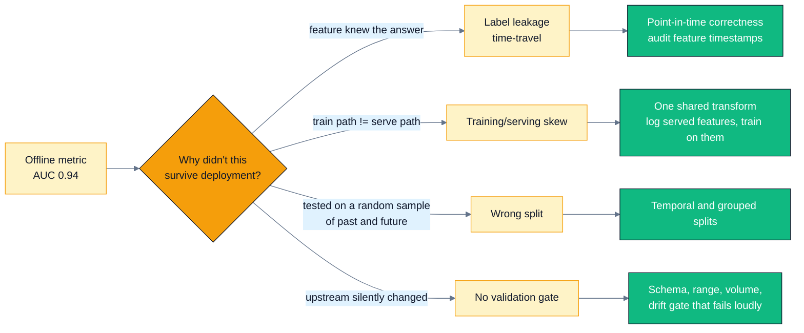
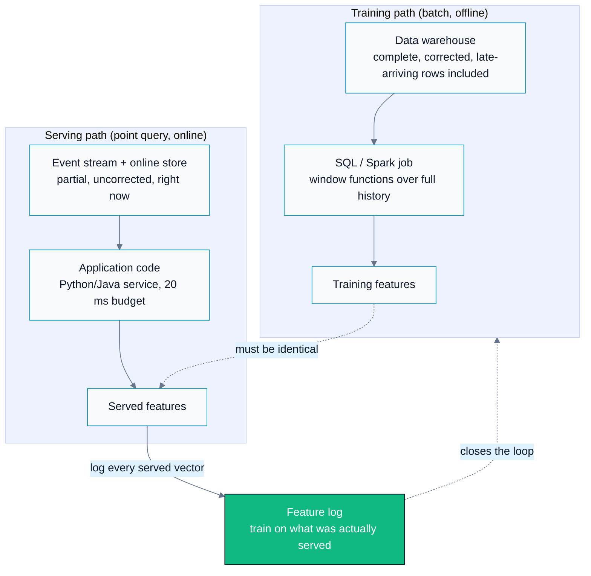
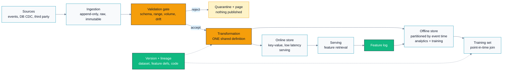
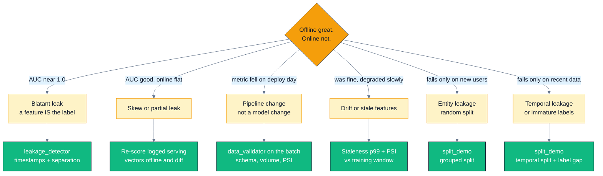

# C02 — Data Pipelines & Features: Where Real ML Systems Break

> Track C · Module 02 · Status: **DONE** · Est. 6 hours · Depth 2/5
>
> Prerequisites: [C01 — Problem framing & metrics](../C01.problem-framing-and-metrics/README.md).
> No GPU, no framework, no data required.
> Backends: **none — this is a design module.** The only executables are standard-library
> Python 3 tools in [`tools/`](tools/).

---

## 1. TL;DR + Layman analogy

**TL;DR.** Model architecture is usually the least leveraged variable in a production ML system; the
**data pipeline is the system**. Two failure modes dominate everything else. **Label leakage** puts
information into training that will not exist at prediction time, so your offline metric is a
fiction. **Training/serving skew** computes features one way for training and another way at serving,
so a model that was genuinely good becomes mediocre the moment it is deployed. Both are silent — they
produce *better* offline numbers, not error messages. The defences are structural: point-in-time
correct feature computation, one shared transformation definition for both paths, splits that match
how the model will actually be used, and a validation gate that refuses to publish bad data.

**Layman analogy — the contaminated practice test.** You are studying for an exam. Your practice test
accidentally has the answer key printed on the back of each page. You score 98%, you feel excellent,
and you have learned nothing — because you were reading answers instead of solving problems. On exam
day you get 61%. Nothing was wrong with your study *technique*; the **material** was contaminated.
That is label leakage exactly: the feature `chargeback_amount` is the answer key stapled to the
question, and a model that reads it will report a spectacular AUC and fail in production.

Two extensions of the same analogy carry the rest of the module. If your practice questions came from
last year's syllabus and the course has since changed, you will also fail — that is **temporal
drift**, and it is why you must test yourself on the *newest* material, not a random sample of all of
it. And if you practised on a calculator you are not allowed to bring into the exam hall, you will
fail even though nothing leaked and nothing drifted — that is **training/serving skew**.

**Where the analogy breaks.** Three places, and each one is why this module needs tools rather than
just advice:

1. **The exam tells you your real score. Production often does not.** You discover the leak because
   61% is unambiguous. Online metrics are noisy, delayed (a fraud label can arrive 60 days later), and
   confounded by a dozen concurrent changes, so a leaked model can survive for months while everyone
   argues about whether the A/B test is underpowered.
2. **Real leakage is rarely a whole answer key.** It is usually a *partial* leak — a feature that is
   3% contaminated, or an aggregate computed over the full dataset before splitting. It lifts your
   metric by 0.04 AUC, which looks like a good week of work rather than a bug. The blatant
   `chargeback_amount` case is the easy one.
3. **The analogy has no equivalent of the same student being two different students.** In
   training/serving skew, nothing leaked and nothing drifted; the training path and the serving path
   simply compute `average_order_value` differently, or read from different tables, or handle a null
   differently. The data was honest and the *system* was not. This is the failure mode most teams
   underestimate and the one §3 spends the most time on.



Every branch of that diagram produces the same symptom — a great offline number that does not survive
contact with production — which is why you diagnose it by elimination rather than by intuition.

**By the end of this module you can:** explain training/serving skew and name its three causes and
the fix for each; identify time-travel and label-leakage features from a feature list and say how each
inflates offline metrics; choose batch, streaming, or on-demand computation per feature with a stated
cost/freshness justification; design a pipeline with validation gates that fail loudly; pick between
random, temporal, and grouped splits and quantify what the wrong choice buys you; and run a structured
postmortem on "offline AUC 0.94, online flat."

---

## 2. First Principles

### Data is the system

Sculley et al.'s *Hidden Technical Debt in Machine Learning Systems* makes the point with a picture:
the box labelled "ML code" is a small fraction of a real ML system, surrounded by configuration, data
collection, feature extraction, verification, serving infrastructure, and monitoring. Everything in
that surrounding area is data plumbing.

The practical consequence is a claim about **leverage**. Given a fixed month of engineering effort on
a mediocre production model, the ordered list of what usually moves the metric is:

1. Fix a leak or a skew bug that was inflating or degrading the current numbers.
2. Fix the label definition, or improve label quality.
3. Add a feature that carries genuinely new information (often: make an existing signal *fresher*).
4. Enlarge or rebalance the training data toward the population you actually serve.
5. Change the model architecture.

That ordering is a widely reported *pattern* among practitioners, not a measurement — but notice that
four of the five items are data work, and that item 1 can *lower* your offline metric while improving
the product. This module exists because item 1 and item 5 look identical on a dashboard.

### Derive training/serving skew from first principles

Nothing about skew requires bad engineering. It arises from a structural fact: **training is a batch
job over history, serving is a point query about now.** Those are different computational problems,
so teams naturally implement them twice.



The dotted "must be identical" edge is the entire problem: it is an *assumption*, enforced by nothing,
across two codebases written by different people in different languages at different times. The solid
green edge is the fix — log what you served and train on that, so the assumption becomes an
observation.

Three concrete causes, each with its own fix:

| Cause | What it looks like | Fix |
|---|---|---|
| **Two code paths** | `AVG(amount) OVER (last 30 days)` in SQL for training; a Python loop over a Redis list at serving. Different null handling, different rounding, different window boundaries | A **shared transformation definition** — a feature store, or at minimum one library called by both paths. Then diff the two outputs on real traffic |
| **Two data sources** | Training reads the warehouse, which has late-arriving corrections and backfills; serving reads the stream, which has neither | Train on the **logged serving features**, not on a warehouse reconstruction of them |
| **Time-travel in the training query** | The training job computes a 30-day average "as of" the label date but accidentally includes rows after the decision moment | **Point-in-time correct joins**: every feature value is fetched as-of the decision timestamp, never later |

The diagnostic that beats all discussion: **log the exact feature vector you served, then re-score a
sample of those logged vectors offline.** If the offline and online scores differ, you have skew, and
you now have a paired example to debug. If they agree, the problem is elsewhere. This one habit
converts an argument into a measurement.

### Derive leakage from first principles

A supervised model learns `P(label | features)` from history and is deployed to predict at a moment
when *only some* of that history exists. **Leakage is any information in the training features that
would not be available at the decision moment.**

The naive approach — "join everything we know about the entity to the label row" — breaks immediately
because a warehouse is organized by *entity*, not by *time*. Consider a fraud claim:

```
decision moment          t0        (we must decide now)
label event              t0 + 30d  (chargeback confirmed)
investigator notes       t0 + 32d  (written after resolution)
chargeback_amount        t0 + 30d  (created BY the label event)
```

A naive `SELECT * FROM claims JOIN investigations USING (claim_id)` attaches both of the last two
columns. The model discovers that `chargeback_amount > 0` implies fraud with certainty, reports AUC
1.000, and predicts nothing at all in production because at `t0` that column is always zero.

The discipline that prevents it is **point-in-time correctness**: every feature carries the timestamp
at which its value became observable, and the training join takes each feature *as of* the decision
time — never later. Concretely, the training query must be able to answer "what did we know at `t0`?"
rather than "what do we know about this entity?"

```
                    what a point-in-time correct join may use
   |<------------------ allowed ------------------>|
---+------------------------------------------------+--------+--------+---->  time
   |                                                |        |        |
 history                                         t0 = decision  t0+30d   t0+32d
                                                 (predict here) label   notes
                                                                 |        |
                                                                 +--------+
                                                                  FORBIDDEN
```

Two leakage shapes that the timestamp rule alone does *not* catch, and which the tools in §4 exist to
find:

- **A global aggregate computed before splitting.** Target-encode `user_id` with the user's label mean
  over the whole dataset, then split. Every row's own label is now inside its own feature. No split
  fixes this — the contamination happened upstream of the split. Lab 3 measures it.
- **A back-filled column.** A `case_status` field stamped with the decision timestamp but whose value
  was overwritten when the case resolved. The timestamps look perfect and the column is pure poison.
  Only a suspiciously-perfect-separation check or a code review finds it.

### The naive split, and where it breaks

`train_test_split(shuffle=True)` is the default in every tutorial, and it is wrong for most production
data. It assumes rows are independent and identically distributed. Two extremely common violations:

- **Time series.** A random split puts future rows in training and past rows in testing. The model
  learns from the future, and any relationship that changes over time is averaged rather than tested.
  You must split by **event time**: train on the earlier period, test on the later one, exactly as
  production will experience it.
- **Multiple rows per entity.** One user contributes 40 sessions. A random split puts 28 in train and
  12 in test, so the model can memorize that user rather than learn a pattern. You must split by
  **entity** (grouped/`GroupKFold`) if you will ever score users you have not seen.

Lab 3 measures both. Under an identical dataset and an identical scoring rule, a corrected per-user
target encoding scores **0.6913 test AUC under a random split and 0.5000 under a grouped split** — a
**0.19 AUC gap that is purely an artifact of the split**. A drifting feature scores **0.5080 under a
random split and 0.3310 under a temporal one**: not merely worse, actively anti-predictive in the
period you would actually deploy into.

---

## 3. Deep Dive

### Pipeline architecture



Three structural features of that diagram are the ones a reviewer looks for: the validation gate can
**reject** and publish nothing, `XFM` is a **single** transformation feeding *both* stores, and the
feature log flows *back* into the offline store so training can use what was actually served.

Properties each stage must have, and why:

- **Ingestion is append-only and immutable.** Raw data is never edited in place. If a transformation
  was wrong you must be able to recompute from raw, and if you mutated raw you cannot. This also makes
  incidents debuggable: the evidence still exists.
- **Jobs are idempotent and replayable.** Re-running a job for 2026-06-01 must produce exactly the
  same output, whether it is the first run or the fifth. Practically this means writing to a
  deterministic partition (`dt=2026-06-01`) with overwrite semantics rather than appending, and no
  dependence on wall-clock `now()` inside the transformation. Non-idempotent pipelines cannot be
  backfilled, and every pipeline eventually needs a backfill.
- **Partition by event time, not ingestion time.** An event that happened on the 1st and arrived on
  the 3rd belongs in the 1st's partition. Partition by arrival and every point-in-time query becomes
  wrong, and every backfill becomes a special case.
- **Handle late-arriving data explicitly.** State a watermark ("we finalize a day's partition after 48
  hours") and a policy for what happens to stragglers. This is a design decision with a metric
  consequence — a shorter watermark means fresher data and more corrections later.

**Schema-on-write vs schema-on-read** is the classic tradeoff at the ingestion boundary:

| | Schema-on-write | Schema-on-read |
|---|---|---|
| When the schema is enforced | At ingestion; bad data is rejected | At query time; anything is stored |
| Failure mode | Ingestion breaks when producers change | Queries break, silently and much later |
| Best for | Curated tables that models train on | Raw landing zones and exploration |
| The usual answer | Schema-on-read at the raw landing zone, **schema-on-write at every curated table a model depends on** | |

The reason for that split: you want to accept whatever producers send (so you never lose data), and
you want a hard boundary before anything a model touches (so you never train on garbage). The
validation gate in the diagram *is* that boundary.

### Batch vs streaming vs on-demand

Every feature is computed in one of three regimes, and the choice is a cost/freshness tradeoff, not a
style preference:

| | **Batch** | **Streaming** | **On-demand** |
|---|---|---|---|
| Computed | Scheduled job (hourly/daily) | Continuously as events arrive | At request time, inside the serving call |
| Freshness | Minutes to a day stale | Seconds | Zero — it is computed from the request |
| Cost | Lowest per value; amortized over huge batches | Highest: always-on infrastructure, state management, out-of-order handling | Cheap per value, but spends your **latency budget** |
| Complexity | Lowest | Highest (watermarks, replay, exactly-once semantics) | Low, unless it needs a remote lookup |
| Fits | `account_age_days`, `orders_last_90d`, embeddings, anything slow-moving | `transactions_last_5_min`, `failed_logins_last_hour`, live session signals | Anything derived purely from the request: `amount / avg_amount`, time-of-day, device parsing, ratios of already-retrieved features |

The engineering rule: **use batch until a metric proves you need fresher, then upgrade only that
feature.** Streaming is genuinely more expensive in infrastructure *and* in on-call burden, and
"everything streaming" is a common and costly over-build. The test is not "would fresher be nicer" but
"does the decision change if this value is an hour old?" For a velocity feature in fraud (five
transactions in two minutes) the answer is obviously yes. For account age it is obviously no.

**Offline store vs online store, and why they must agree.** The offline store is columnar, huge, and
optimized for scans over history (training, analytics). The online store is a key-value store
optimized for a single-digit-millisecond lookup by entity key (serving). They hold *the same feature
definitions* materialized for different access patterns — and the moment they disagree you have skew
by construction. This is precisely the problem a **feature store** (Feast, Uber's Michelangelo, and
their descendants) exists to solve: one declared feature definition, materialized to both stores, with
point-in-time correct retrieval for training and low-latency retrieval for serving.

You do not need a feature-store product to get the benefit — you need the *property*. On a small team,
one shared transformation library plus a feature log gets you most of the way. Adopt the product when
the number of features or the number of consuming teams makes the discipline impossible to maintain by
convention.

### Data validation as a hard gate

> A pipeline that silently writes garbage is worse than one that fails loudly.

This is the same principle Track A applies to `HIP_CHECK` on every runtime call
([A01 §6](../../A-gpu-programming/A01.foundations-and-programming-model/README.md)), and for the same
reason: an unchecked failure surfaces far from its cause. A pipeline that publishes a column of nulls
does not crash — it quietly degrades a model, and you discover it three weeks later in a metric review.

Five check families, in the order they should run:

| Check | Catches | Example |
|---|---|---|
| **Schema** | Producer changed the contract | Column disappeared, type changed, a new undeclared column appeared |
| **Volume** | Upstream job failed or double-ran | 300 rows where 300,000 were expected; 2× the usual row count |
| **Per-value rules** | Corrupt individual records | Negative amount, null in a non-nullable column, an unknown category, a duplicated primary key |
| **Distribution** | Semantic change with a valid schema | Mean amount tripled, one category's share moved 0.41, a numeric column drifted (PSI) |
| **Cross-dataset** | Broken relationships | Foreign keys that do not resolve; a label rate that does not match the reporting system |

The distribution check is the one that catches the failures that matter most, because they are the ones
with *valid* schemas. [`tools/data_validator.py`](tools/data_validator.py) implements all five and
**exits non-zero** so it can sit in a pipeline step.

On PSI (population stability index): it compares a current distribution against a reference over
quantile bins of the reference. The widely used convention is **< 0.1 stable, 0.1–0.25 moderate shift,
> 0.25 significant** — treat those as a convention, not a law, and calibrate the threshold to your own
data's normal week-to-week movement. Two caveats the tool enforces: PSI over 10 quantile bins is noise
on a small reference sample (it warns below 100 reference rows rather than reporting a meaningless
number), and quantile bins are degenerate on a near-binary column, so few-valued numeric columns are
compared as category shares instead.

What to do on failure is a design decision, not an implementation detail. State it explicitly:

- **Reject and page** for a curated table a model trains on. Yesterday's data is better than wrong data.
- **Reject the bad rows, publish the rest, and record the rejection rate as a metric** for
  high-volume ingestion where a small corrupt fraction is expected. The rejection rate itself then
  needs a threshold, or you have merely moved the silence.
- **Never** silently coerce (nulls to zero, unknown category to "other") without recording that you
  did. Coercion is the mechanism by which pipelines lie.

### Labels in practice

Labels are the most expensive and least examined part of most ML systems.

**Human annotation.** Cost scales linearly with volume and with expertise: a radiologist-labelled
dataset and a crowd-labelled one differ by orders of magnitude in unit cost. The quantity that decides
whether your labels are usable at all is **inter-annotator agreement** (Cohen's κ for two raters,
Fleiss' κ or Krippendorff's α for more). Low agreement means one of three things, and you must
distinguish them: an ambiguous *task definition* (fix the guidelines), an ambiguous *item* (route to
adjudication or drop it), or an unreliable *annotator* (retrain or remove). **A model cannot be more
consistent than its labels** — if humans agree only 70% of the time, an offline accuracy of 95% is
measuring conformity to a noisy target, not correctness. Northcutt et al. found pervasive label errors
in widely used benchmark test sets, which is worth remembering the next time a leaderboard delta looks
meaningful.

**Weak and programmatic supervision.** When hand-labelling does not scale, generate labels from
heuristics, existing rules, knowledge bases, or other models, then model the noise across those
sources (the Snorkel line of work). You trade label *accuracy* for label *volume*, which is often the
right trade — but the noise is **correlated**, not random, so it can bake a systematic blind spot into
the model. Keep a small, clean, human-labelled **evaluation** set no matter how you generate training
labels; never evaluate on weak labels.

**Implicit feedback and its biases.** Clicks, purchases, and dwell time are free and enormous, which
is why everyone uses them, and they are systematically biased:

- **Position bias** — items shown higher are clicked because they are higher. A model trained on
  clicks learns to reproduce your current ranker's ordering.
- **Presentation bias** — thumbnail, format, and surface affect engagement independently of relevance.
- **Selection bias / partial feedback** — you observe outcomes only for items you *showed*. Everything
  you did not show has no label at all, so the model cannot learn that it was wrong to exclude it.
- **Feedback loops** — today's model shapes tomorrow's training data, so errors compound. The
  unbiased-learning-to-rank literature (Joachims et al.) attacks this with propensity weighting; the
  cheap practical defence is a small **randomized exploration** slice, which is a deliberate cost you
  pay to keep your data honest. C06 develops this.

**Delayed labels.** A fraud chargeback may be confirmed 60 days after the transaction. Three
consequences, all of which change the design:

1. **Your iteration loop is bounded by the label delay.** You cannot evaluate this week's model on
   this week's outcomes.
2. **Recent data is systematically mislabelled.** A transaction from three days ago has "no
   chargeback" *so far*, which is not the same as "legitimate." Training on the last 60 days without
   accounting for this teaches the model that recent transactions are safe — a real, self-inflicted
   bug. Either exclude the immature window or model the maturation explicitly.
3. **You need a fast proxy metric** to operate day to day (alert volume, override rate, score
   distribution) alongside the slow ground truth. Say which is which, as C01 §6 insists.

### Splitting correctly

| Split | Use when | What it protects against | Failure if you get it wrong |
|---|---|---|---|
| **Random** | Rows are genuinely i.i.d. — one row per entity, no time dependence | Nothing in particular | Leaks across time and across entities |
| **Temporal** | You predict the future (almost always) | Learning from the future; non-stationary relationships | Reports a metric averaged over past and future that production will never see |
| **Grouped / entity** | Multiple rows per user/account/device, and you will score unseen entities | Memorizing entities instead of learning patterns | Reports memorization as generalization |
| **Both (grouped + temporal)** | Multiple rows per entity **and** a time axis — i.e. most real systems | Both of the above | — |
| **Stratified** | Rare positives and a small evaluation set | Wildly variable positive counts across folds | Noisy, incomparable fold metrics |

Two practical points that come up in interviews. **A gap is needed between the temporal train and test
periods** when labels mature slowly: if the label horizon is 30 days, a test period starting the day
after training ends contains rows whose labels were still forming. Leave a gap of at least the label
horizon. And **when the splits disagree, believe the more pessimistic one** — the honest split is
whichever one most closely resembles the deployment condition, and Lab 3 is a measurement of exactly
that disagreement.

### Imbalance and augmentation

At low prevalence (C01's territory), three levers, in the order to try them:

1. **Class weighting in the loss.** Cheapest, keeps every row, and does not fabricate data. Try this
   first.
2. **Downsample the majority.** Faster training, less data. **It breaks calibration** — the model is
   now calibrated to the resampled prior, so its outputs are systematically too high and C01's `p*`
   threshold no longer applies. Either correct the prior afterwards or accept that you must threshold
   empirically.
3. **Synthesize minority examples** (SMOTE and relatives). Sometimes helps on tabular data, and it
   fabricates rows that never happened — which can produce interpolated examples that are not
   physically possible. Use with care and always evaluate on **un-resampled** data.

The non-negotiable rule for all three: **resample the training set only, never the validation or test
set.** The evaluation set must reflect the real prevalence, or every metric you compute is answering a
question about a population you do not serve.

For augmentation generally, the constraint is that **the transformation must preserve label
semantics.** Horizontally flipping a photo of a cat leaves a cat; horizontally flipping a photo of the
letter "b" does not leave a "b". Adding noise to a transaction amount may push it across a business
threshold that defines the label. Every augmentation is an assertion about an invariance in your
problem — write down the assertion, and check it.

### Versioning, lineage, and reproducibility

The question you must be able to answer, quickly, is: **"which data produced this model?"** You will
need it for an incident, an audit, or a regression you cannot reproduce. Four things must be
versioned:

| Artifact | Why | Typical mechanism |
|---|---|---|
| **Dataset** | The same query on a mutable table returns different rows next week | Immutable snapshots or table formats with time travel (Delta Lake, Apache Iceberg); content-addressed data (DVC) |
| **Feature definitions** | A silently changed transformation invalidates comparisons between models | Feature definitions in version control, with a version in the feature name or metadata |
| **Code** | Obvious, and usually the only one teams actually do | Git SHA recorded in model metadata |
| **Label definitions** | "Churn" changing meaning breaks every historical comparison | A documented, versioned definition, treated as an interface |

The lineage requirement is that from a deployed model you can reach the exact dataset version, feature
definition versions, code SHA, and label definition. Sculley et al. name undeclared data dependencies
as a primary source of technical debt for exactly this reason: a feature consumed by four models with
no recorded dependency cannot be changed safely by anyone.

---

## 4. Hands-On Labs

**There is no `hip/` or `cuda/` directory in this module, and that is deliberate.** The subject is the
data layer above any accelerator; a kernel would teach nothing about point-in-time correctness. The
runnable artifacts are three standard-library Python tools plus three written design drills. Every
tool runs on a stock Python 3 with **no `pip install`** and prints a clear message instead of a
traceback on bad input.

```bash
make help              # list targets
make run               # run all three tools in demo mode
make run-exercises     # the evidence the exercises ask you to interpret
make demo-files        # write editable sample CSV/JSON into _demo/
make clean

# On Windows the interpreter is usually `python`:
make run PYTHON=python
```

`make` needs a Unix-like shell (WSL, Git Bash, MSYS). The tools themselves are plain Python and run
anywhere:

```bash
python tools/data_validator.py   --help
python tools/leakage_detector.py --help
python tools/split_demo.py       --help
```

> [!NOTE]
> `data_validator.py` and `leakage_detector.py` **exit 1 when they find violations**, because they are
> designed to be pipeline gates. That is not a crash; it is the whole point. `split_demo.py` is a
> demonstration and always exits 0.

### Lab 1 — A validation gate rejecting a bad batch (`data_validator.py`)

```bash
python tools/data_validator.py --demo
```

The demo compares a 300-row batch against a 300-row reference under a declared JSON schema. Seven
cell-level violations are injected into the first rows, and three whole-column distributions are
shifted. Real output, trimmed:

```text
  [ERROR] allowed-values     country            1 row(s): value outside the declared allowed set ['US', 'GB', 'DE', 'IN']
            example: line 5: 'FR'
  [ERROR] drift              amount             PSI 1.7402 exceeds the declared maximum 0.2500; mean 65.5190 -> 225.7662 (+2.38 reference sd)
  [ERROR] drift              country            2 share(s) moved by more than 0.150
            example: IN: 0.063 -> 0.473 (+0.410)
  [ERROR] drift              label              2 share(s) moved by more than 0.150
            example: 1: 0.110 -> 0.293 (+0.183)
  [ERROR] nullability        amount             1 row(s): empty value in a column declared nullable=false
  [ERROR] type               event_time         1 row(s): value does not parse as declared type 'timestamp'
  [ERROR] uniqueness         txn_id             1 duplicated value(s) in a column declared unique
  [WARN ] unexpected-column  experiment_arm     present in the data but not declared; a silent upstream schema change
  [INFO ] drift              account_age_days   PSI 0.1190 within tolerance; mean 1391.8567 -> 1490.8167 (+0.12 reference sd)

summary: 12 error(s), 1 warning(s)
GATE: REJECT - do not publish this batch downstream
```

**What to observe.** Three different classes of failure, which need three different responses. The
per-value errors (`nullability`, `type`, `uniqueness`) are corrupt *records* — you can often quarantine
those rows. The `drift` errors are a semantic change with a perfectly valid schema: `amount` shifted
2.38 reference standard deviations and the **label rate went from 11% to 29%**, which no per-row check
would ever notice and which would silently poison a retrain. And `account_age_days` reports PSI 0.119
*within* tolerance, which is the control — the gate is not simply flagging everything. Then note the
`unexpected-column` warning: an undeclared column appeared. That is how a producer change enters your
system, and it is a warning rather than an error because rejecting on a *new* column is usually too
strict; run with `--gate-on-warnings` if your table cannot tolerate it.

Write out the fixtures and break them yourself:

```bash
python tools/data_validator.py --write-demo _demo
python tools/data_validator.py --print-schema      # the annotated schema format
python tools/data_validator.py --schema _demo/schema.json --data _demo/batch.csv \
    --reference _demo/reference.csv
```

Now edit `_demo/schema.json` — widen `amount`'s range, drop the `unique` flag on `txn_id`, raise
`drift.max_psi` — and watch findings disappear. **That is the lesson about gates**: the declared
schema *is* the contract, and a gate you loosen until it passes is decoration.

### Lab 2 — Three leaks, three different checks (`leakage_detector.py`)

```bash
python tools/leakage_detector.py --demo
```

```text
  [LEAK   ] time-travel    investigator_notes_len   240 of 240 comparable rows have investigator_notes_len observed at or after the label
               line 2: investigator_notes_len at 2026-05-03T08:00:00 >= label at 2026-05-01T08:00:00
  [SUSPECT] separation     investigator_notes_len   single-feature ROC-AUC 1.0000 (>= 0.99) - one threshold almost perfectly separates the label
  [LEAK   ] time-travel    chargeback_amount        240 of 240 comparable rows have chargeback_amount observed at or after the label
  [SUSPECT] separation     chargeback_amount        single-feature ROC-AUC 1.0000 (>= 0.99) - one threshold almost perfectly separates the label
  [WARN   ] naming         chargeback_amount        name contains 'chargeback' - names like this usually mark a column derived from the outcome
  [SUSPECT] separation     case_status_at_review    category 'open' covers 45.4% of rows and is 100.0% one label

  NOT CHECKED for time travel (no '_ts' companion column): claim_id

summary: 5 leak/suspect finding(s), 1 warning(s) across 8 feature(s)
GATE: REJECT - resolve or drop these features before training
```

**What to observe.** The three planted leaks are each caught by a *different* check, which is why you
need all three:

| Feature | Timestamp check | Separation check | Naming check |
|---|:---:|:---:|:---:|
| `investigator_notes_len` — written after the case resolves | **caught** | caught | missed (innocent name) |
| `chargeback_amount` — created by the label event | **caught** | caught | caught |
| `case_status_at_review` — stamped at decision time, value back-filled later | missed | **caught** | missed |

`case_status_at_review` is the important row. Its timestamp is *correct* — the pipeline stamped it at
the decision moment — and its name trips no keyword. Only the separation check finds it. That is the
realistic case: leakage frequently arrives with perfect metadata.

Note also the `NOT CHECKED` line. `claim_id` has no companion `_ts` column, so it cannot be audited at
all. **A feature with no recorded observability time is not "probably fine," it is unaudited** — and
the fix is to add that timestamp to the pipeline, not to lower the tool's standards. On your own data:

```bash
python tools/leakage_detector.py --write-demo _demo
python tools/leakage_detector.py --data _demo/features.csv --label-col label \
    --label-time-col label_time --ts-suffix _ts --auc-warn 0.97
```

Lower `--auc-warn` to 0.90 and watch legitimate features start appearing. **`SUSPECT` is a screen, not
a verdict** — a genuine hard business rule can separate a label almost perfectly. You resolve it by
asking whether the value existed at the decision moment, not by staring at the AUC.

### Lab 3 — Measure what the wrong split buys you (`split_demo.py`)

```bash
python tools/split_demo.py            # add --verbose for train AUC too
```

One dataset (6,000 rows, 600 users, 10 rows per user), one scoring rule per feature, three splits. The
data never changes, so **every difference is the split**:

```text
  feature                  random   temporal  grouped
  x_signal                 0.7274    0.6976   0.7001
  x_drifting               0.5080    0.3310   0.5207
  x_user_mean_global       0.7879    0.7669   0.7949
  x_user_mean_trainonly    0.6913    0.6589   0.5000
```

**What to observe**, in order of importance:

1. **`x_user_mean_trainonly`: 0.6913 random → 0.5000 grouped.** A **0.19 AUC** difference from nothing
   but the split. The encoding is computed correctly (train rows only), so it is not a leak in the
   feature — it is that a random split lets the model look up users it has already seen. 0.5000 is the
   honest cold-start number for a genuinely new user. Which figure is right depends entirely on
   whether you will have that user's history at serving time: if yes, 0.69 is real and the grouped
   split is too pessimistic; if you score new users, 0.69 is a lie.
2. **`x_drifting`: 0.5080 random → 0.3310 temporal.** Below 0.5, i.e. *actively anti-predictive* in
   the later period, because its relationship to the label reverses across the time axis. The random
   split averaged the two halves and reported ~0.5. If you shipped on the random number you would
   deploy a feature that hurts.
3. **`x_user_mean_global`: high under every split (0.77–0.79).** This is the subtle one and the most
   important. It is a target encoding computed over the *whole* dataset, so each row's own label sits
   inside its own feature value. No partition can remove that — the contamination predates the split.
   **A number that is stable across all three splits is therefore not evidence of validity.** Only
   reading the transformation code or auditing feature timestamps finds this class of bug, which is
   precisely why Labs 1 and 2 exist.
4. **`x_signal` agrees across all three splits** (0.70–0.73, within the ±0.04 noise floor at this test
   size). That is the control: it proves the dataset and the metric are fine and the other three rows
   are real effects.

Then experiment. `--rows-per-user 2` leaves each user the minimum possible history, and the
`x_user_mean_trainonly` grouped gap narrows from 0.191 to **0.092** — less history per entity means less
to memorize, which confirms the mechanism rather than merely the symptom. And `--users 60` shrinks the
test set until the noise floor swamps the small effects, which is a useful lesson in its own right
about how many evaluation rows a claim needs.

### Lab 4 — Break the tools on purpose

Failing loudly applies to design tooling too. Confirm each of these prints one clear line and exits
with status 2 — never a traceback:

```bash
python tools/data_validator.py --data only_data.csv                    # schema missing
python tools/data_validator.py --demo --schema _demo/schema.json       # contradictory flags
python tools/leakage_detector.py --data nope.csv                       # unreadable file
python tools/leakage_detector.py --demo --auc-warn 2                   # out of range
python tools/leakage_detector.py --demo --label-col does_not_exist     # names the real columns
python tools/split_demo.py --users 5                                   # too small to demonstrate
```

**What to observe.** Each message names the offending flag and the value received, and the missing-column
error lists the columns that *do* exist — the difference between an error a teammate can act on and one
that sends them to your source code.

### Lab 5 (written) — The design drills

The written drills are the point of this module: [`exercises/`](exercises/) with reference answers in
[`solutions/`](solutions/). Exercise 3 in particular is the drill most likely to appear verbatim in an
interview.

---

## 5. Performance Analysis

**Reframed for a design module.** There is no kernel to profile and no roofline to plot — this module
ships no GPU code. The heading is kept because the discipline transfers exactly: state the metric,
measure it, find the binding constraint, show a before/after delta. For a data pipeline the metrics are
**data quality, freshness, cost per feature-value, and measurement honesty**. All arithmetic below is
reproducible from stated assumptions or is real tool output; none of it is a benchmark measurement.

### The binding constraint

| Binding constraint | Symptom | Where effort pays |
|---|---|---|
| **Metric honesty** | Offline number does not survive deployment | Fix the split, the leak, or the skew. Until this is fixed, every other measurement is meaningless |
| Label quality | Model plateaus well below human agreement | Better guidelines, adjudication, cleaner evaluation set |
| Freshness | Errors concentrate on recently-changed entities | Upgrade specific features from batch to streaming |
| Coverage | Errors concentrate on a slice | More data for that slice; check the sampling |
| Pipeline cost | Data spend dominates the model's value | Cheaper features, coarser batch cadence, drop unused features |
| Feature-retrieval latency | p99 serving latency blown by feature fetch | Fewer online features, batched lookups, on-demand computation |

The first row is above all the others for a reason: **an inflated metric makes every subsequent
decision wrong**, because you cannot tell whether a change helped. This is why the leak and skew audits
come before any modelling work, and why they are the first thing to check when a number looks
surprisingly good.

### Measured before/after: what an honest split costs you on paper

This is the module's before/after delta, exactly reproducible (`--seed 13`, any machine):

```bash
python tools/split_demo.py
```

| Feature | Random split (optimistic) | Honest split | Gap | What the gap is |
|---|---:|---:|---:|---|
| `x_user_mean_trainonly` | 0.6913 | **0.5000** (grouped) | **0.191** | Entity memorization, not generalization |
| `x_drifting` | 0.5080 | **0.3310** (temporal) | **0.177** | A non-stationary relationship averaged away |
| `x_signal` | 0.7274 | 0.7001 (grouped) | 0.027 | Sampling noise — the control |
| `x_user_mean_global` | 0.7879 | 0.7949 (grouped) | −0.007 | **No split-driven gap, and still leaking** |

Read the last row as the warning it is. The "before/after" that matters here is **not** an
optimization — it is a correction. Switching to an honest split *lowers* your reported number by up to
0.19 AUC, and that is the improvement: you have replaced a fiction with a number that predicts
production. Expect to have to explain this to a stakeholder who watched the dashboard go down.

### Freshness, and the arithmetic that decides batch vs streaming

Freshness has a definition you can measure: **staleness = decision time − the event time of the newest
event reflected in the feature value.** Instrument it as a distribution (p50/p99), not an average,
because the tail is what breaks decisions.

A worked hypothetical, stated as assumptions rather than a measurement. A velocity feature
`txns_last_10_min` for fraud, computed as an hourly batch job:

```
batch cadence                 = 60 min
mean staleness                ~ 30 min      (uniform arrival within the window)
p99 staleness                 ~ 60 min

a card-testing attack runs 40 transactions in 6 minutes.
with 30-60 min staleness the feature reads ~0 for the entire attack
-> the feature contributes nothing exactly when it matters
```

The conclusion is not "use streaming for everything," it is that **this specific feature's value is
concentrated in a window shorter than the batch cadence**, so batch cannot express it at any cadence
you would pay for. Meanwhile `account_age_days` changes by one per day and a 24-hour batch is
perfectly adequate. Same pipeline, different regimes, decided by the shape of each feature's value
over time.

The decision rule to state in a design review: *"upgrade a feature from batch to streaming when the
decision changes within the batch window."* Then price it — streaming means always-on stateful
infrastructure, out-of-order and replay handling, and a new on-call surface. The cost is real and it is
mostly **operational**, not compute.

### Cost per feature-value, and why unused features are expensive

Features have a recurring cost, not a one-time one:

```
per feature, per day:
  compute      (batch job CPU, or streaming task always-on)
+ storage      (offline history + online store footprint)
+ retrieval    (online store reads x request volume)
+ maintenance  (on-call, schema changes, upstream breakage)
```

The last term is the one nobody budgets and the one that dominates over a year. Two consequences that
belong in every design review:

- **An unused feature costs the same as a used one.** Features accumulate: someone adds 200, a model
  uses 40, and the other 160 are computed, stored, monitored, and broken forever. Audit feature usage
  and delete aggressively. Sculley et al. call these *unused data dependencies* and rank them among the
  most expensive forms of ML technical debt.
- **Online features spend your latency budget.** If your p99 serving budget is 150 ms and feature
  retrieval takes 40 ms, you have 110 ms for everything else. Retrieving 300 features from an online
  store is not free, and that budget is a design constraint on the *feature set*, not just on the
  model.

### Data-quality metrics worth a dashboard

Track these per pipeline run and alert on them. They are the metrics that make the failures in §3
visible before a model consumes them:

| Metric | Why | A sane starting alert |
|---|---|---|
| Rows in / rows out / rows rejected | Volume anomalies and silent filtering | Deviation beyond the historical band for that weekday |
| Null rate per column | The most common silent corruption | Any material change from the column's baseline |
| Distinct-count (cardinality) per key column | Catches ID-format changes and joins that fan out | Any material change from baseline |
| PSI per numeric feature vs a reference window | Semantic drift with a valid schema | The 0.1 / 0.25 convention, tuned to your data |
| Unseen-category rate | New enum values from a producer | > 0 on a closed set |
| Staleness p50/p99 per feature | Freshness regressions | Beyond the declared freshness requirement |
| Training/serving skew rate | The headline failure mode | Any non-trivial disagreement between logged-online and recomputed-offline features |
| Label maturity | Guards against training on immature labels | Fraction of rows in the immature window |

The last two are the ones teams skip and the ones that would have caught most of the incidents in §6.

### Measurement honesty: how many rows does a claim need?

The same standard-error reasoning as C01 §5 applies to every number in this module. `split_demo`'s test
sets hold about 1,800 rows, which puts the noise floor on an AUC *difference* at roughly ±0.04 — which
is why `x_signal`'s 0.027 gap is reported as noise while `x_drifting`'s 0.177 is reported as an
artifact. Two habits follow:

- **State the noise floor before interpreting a gap.** A 0.02 AUC "improvement" on a small evaluation
  set is not an improvement.
- **For drift alerts, the same logic prevents alert fatigue.** A PSI threshold tuned tighter than your
  data's normal week-to-week movement produces daily false alarms, everyone mutes the channel, and the
  gate becomes decoration — the exact Goodhart-adjacent failure C01 §3 warned about.

---

## 6. Challenges, Drawbacks & Tradeoffs



Start from the *shape* of the symptom, not from a hypothesis: which population fails, and whether the
failure was sudden or gradual, narrows six causes to one or two before you write any code.

### Pitfall 1 — Training/serving skew (the module's headline)

**Symptom:** solid offline metrics, online performance close to baseline, and no error anywhere.
**Cause:** two code paths, two data sources, or a time-travelling training query (§2).
**Confirmation:** log the served feature vector, re-score a sample offline, and diff feature by
feature. Not "review the code" — *diff the values*.
**Fix:** a shared transformation definition and training on logged serving features. **Prevention:** a
continuous skew-rate metric, so this is a monitored quantity rather than a discovery.

### Pitfall 2 — Silent coercion

The most dangerous line in a data pipeline is `fillna(0)`. A null `account_balance` becoming `0` is not
a missing value, it is a *false* value, and it is indistinguishable downstream from a real zero. Same
for mapping unseen categories to `"other"`, clamping out-of-range values, and parsing failures that
default. **If you must coerce, record that you did** — emit a `<column>_was_null` indicator and a
coercion-rate metric. A missingness indicator is often a genuinely useful feature; a silently coerced
value never is.

### Pitfall 3 — The gate you loosened until it passed

A validation threshold widened to stop a page is a gate that no longer exists. Every loosening should
be a reviewed change to the declared schema with a reason, not an ad-hoc edit during an incident. Lab 1
lets you do this deliberately so you can feel how easy it is.

### Pitfall 4 — Training on immature labels

Covered in §3. Recent rows in a delayed-label system are labelled "negative so far," and training on
them teaches the model that recent events are safe. Exclude the immature window, or model maturation
explicitly. This one is easy to reason about and almost universally missed on a first implementation.

### Pitfall 5 — Resampling the evaluation set

Balancing is a *training* technique. A balanced test set answers a question about a population that
does not exist, and it also silently destroys calibration, which breaks C01's cost-based thresholds.

### Pitfall 6 — Undeclared data dependencies

A feature consumed by four models with no recorded dependency cannot be changed safely by anyone, so
in practice it is never changed and never deleted. The fix is boring and structural: a feature registry
with recorded consumers, and lineage from every deployed model back to its inputs.

### Pitfall 7 — Non-idempotent pipelines

If re-running yesterday's job produces different output, you cannot backfill, you cannot reproduce a
training set, and you cannot recover from an incident by replaying. The usual culprits are `now()`
inside a transformation, append-instead-of-overwrite semantics, and partitioning by ingestion time
rather than event time.

### Pitfall 8 — Trusting implicit feedback as ground truth

Clicks are not relevance. Without exploration data or propensity correction, a model trained on logged
clicks converges toward reproducing the ranker that produced them — the feedback loop from §3.

### Tradeoffs to hold in mind

- **Freshness vs cost and complexity.** Streaming buys seconds of staleness and costs always-on
  infrastructure plus a permanent on-call surface. Upgrade per feature, driven by whether the decision
  changes inside the batch window — never wholesale.
- **Strict gates vs pipeline availability.** A strict gate stops bad data and also stops *all* data.
  For a model's curated training table, reject and page. For high-volume ingestion, reject rows and
  alert on the rejection rate. Choose per table and write it down.
- **Feature richness vs maintenance.** Every feature is a recurring cost and a permanent breakage
  surface. A 40-feature model you can reason about often beats a 400-feature one you cannot.
- **Feature store vs a shared library.** A feature store solves skew and point-in-time correctness
  properly and adds a significant platform dependency. A shared transformation library plus a feature
  log gets most of the benefit for a small team. Adopt the product when feature count or team count
  makes convention unenforceable — the pivot is *organizational*, not technical.
- **Label volume vs label quality.** Weak supervision buys volume with correlated noise; human
  annotation buys quality at linear cost. The usual answer is weak labels for training and a small,
  clean, human-labelled set for evaluation — and never the reverse.
- **Historical depth vs relevance.** Five years of data covers rare events and encodes a world that no
  longer exists. Prefer time-weighted training or an explicitly chosen window, and make the window a
  reviewed decision rather than "all the data we have."
- **When *not* to build the pipeline.** If the decision is made a handful of times a day, a query and a
  human beats a pipeline. If the data does not exist yet, instrument first and model later — a quarter
  of clean logging is worth more than a quarter of modelling on data you do not trust.

---

## 7. Real-World Use Cases

- **Fraud and payments** is where every idea in this module is load-bearing at once: streaming velocity
  features (the value is inside a 10-minute window), delayed chargeback labels that constrain the
  iteration loop and create an immature-label window, and a hard point-in-time requirement because
  investigation artifacts are created *by* the label event. `leakage_detector`'s demo is modelled on
  this shape.
- **Recommendation and search** run on implicit feedback and therefore on biased labels: position bias,
  presentation bias, and a feedback loop where today's ranker shapes tomorrow's training data. These
  systems are also the origin of the entity-split problem — a random split over sessions leaks users
  across the boundary, which is Lab 3's `x_user_mean_trainonly` row.
- **Credit and underwriting** make point-in-time correctness a compliance requirement, not merely good
  practice: a model must be shown to have used only information available at decision time, and the
  lineage from a decision back to its exact inputs must be reproducible for audit. Versioning stops
  being hygiene and becomes a regulatory artifact.
- **Demand forecasting and inventory** are pure temporal-split territory, with seasonality, promotions,
  and regime changes that a random split averages into meaninglessness — the `x_drifting` row of Lab 3.
- **LLM and foundation-model data pipelines** are the same discipline at a different scale:
  deduplication (a near-duplicate between training and evaluation is exactly the contaminated practice
  test), decontamination against benchmark sets, provenance and licensing lineage, and quality
  filtering as a validation gate. The vocabulary changes; the failure modes do not.

Tooling that embodies these ideas: **TensorFlow Data Validation / TFX** (schema inference, anomaly
detection, drift comparison against a reference — the direct ancestor of Lab 1), **Feast** and Uber's
**Michelangelo** lineage of feature stores (one definition, two stores, point-in-time retrieval),
**Great Expectations** for declarative data assertions, **Delta Lake** and **Apache Iceberg** for
versioned, time-travelable tables, and **DVC** for content-addressed dataset versioning.

---

## 8. Cited References

Grounding for the claims above. Full list in [../../../docs/REFERENCES.md](../../../docs/REFERENCES.md).

- **Sculley et al. (2015). *Hidden Technical Debt in Machine Learning Systems*** (NeurIPS). The "ML
  code is a small box" framing, undeclared/unused data dependencies, and pipeline jungles.
  <https://papers.nips.cc/paper/2015/hash/86df7dcfd896fcaf2674f757a2463eba-Abstract.html>
- **Breck, Cai, Nielsen, Salib, Sculley (2017). *The ML Test Score: A Rubric for ML Production
  Readiness and Technical Debt Reduction*** (IEEE Big Data). The source for treating data validation,
  skew detection, and feature-usage audits as *tests* with a score.
  <https://doi.org/10.1109/BigData.2017.8258038>
- **Kaufman, Rosset, Perlich (2012). *Leakage in Data Mining: Formulation, Detection, and
  Avoidance*** (ACM TKDD). The formal treatment of leakage and of point-in-time correctness in §2–3.
  <https://dl.acm.org/doi/10.1145/2382577.2382579>
- **Google — *Rules of Machine Learning***. Rules on keeping the first pipeline simple, testing the
  infrastructure independently of the model, and reusing code between training and serving to avoid
  skew.
  <https://developers.google.com/machine-learning/guides/rules-of-ml>
- **Amershi et al. (2019). *Software Engineering for Machine Learning: A Case Study*** (ICSE-SEIP).
  Data management as the dominant engineering activity, and the practices teams converge on.
  <https://www.microsoft.com/en-us/research/publication/software-engineering-for-machine-learning-a-case-study/>
- **Polyzotis, Roy, Whang, Zinkevich (2017). *Data Management Challenges in Production Machine
  Learning*** (SIGMOD). Validation, versioning, and lineage as first-class data-management problems.
  <https://dl.acm.org/doi/10.1145/3035918.3054782>
- **TensorFlow Data Validation (TFDV) / TFX** — schema inference, anomaly detection, and drift/skew
  comparison against a reference. The model for Lab 1.
  <https://www.tensorflow.org/tfx/guide/tfdv> · <https://www.tensorflow.org/tfx>
- **Feast — feature store documentation.** One feature definition, offline and online stores,
  point-in-time correct historical retrieval.
  <https://docs.feast.dev/>
- **Uber — *Michelangelo: Uber's Machine Learning Platform*.** The engineering account of why a shared
  feature pipeline exists, written from the skew problem.
  <https://www.uber.com/blog/michelangelo-machine-learning-platform/>
- **Joachims, Swaminathan, Schnabel (2017). *Unbiased Learning-to-Rank with Biased Feedback***
  (WSDM). Position bias in implicit feedback and propensity-weighted correction.
  <https://arxiv.org/abs/1608.04468>
- **Ratner et al. (2017). *Snorkel: Rapid Training Data Creation with Weak Supervision*** (VLDB).
  Programmatic labelling and modelling correlated noise across label sources.
  <https://arxiv.org/abs/1711.10160>
- **Northcutt, Athalye, Mueller (2021). *Pervasive Label Errors in Test Sets Destabilize Machine
  Learning Benchmarks*** (NeurIPS Datasets & Benchmarks). Why label quality bounds what a metric can
  mean.
  <https://arxiv.org/abs/2103.14749>
- **Chawla, Bowyer, Hall, Kegelmeyer (2002). *SMOTE: Synthetic Minority Over-sampling Technique***
  (JAIR). The canonical resampling reference for §3's imbalance discussion.
  <https://arxiv.org/abs/1106.1813>
- **Delta Lake** and **DVC** — versioned, time-travelable tables and content-addressed dataset
  versioning, the mechanisms behind §3's reproducibility table.
  <https://delta.io/> · <https://dvc.org/>
- **Chip Huyen (2022). *Designing Machine Learning Systems*** (O'Reilly). Practitioner treatment of
  data pipelines, feature engineering, and train/serve consistency.
  <https://www.oreilly.com/library/view/designing-machine-learning/9781098107956/>

---

## 9. Self-Assessment & Interview Drills

### Conceptual (answers below)

1. Define training/serving skew without using the word "skew," then name its three causes and the fix
   for each.
2. A feature has ROC-AUC 0.998 on its own. Is that leakage? How do you decide?
3. Your dataset has 40 rows per user and you split randomly. Name two distinct problems this creates.
4. What is point-in-time correctness, and what does a violation look like in SQL?
5. Fraud labels arrive 60 days late. Name three design consequences.
6. You are asked to make every feature streaming "so the model is always fresh." Respond.
7. A validation gate would have failed today's batch. Should it block the pipeline? What does it
   depend on?
8. Why must you never resample the test set, and what specifically breaks if you do?
9. A teammate target-encodes `user_id` using the label mean, then splits the data randomly. What is
   wrong, and why does switching to a grouped split *not* fix it?
10. Explain to a non-technical product manager why the model's reported accuracy went *down* after you
    "fixed" the evaluation.

<details markdown="1">
<summary>Answers</summary>

1. **The features a model is trained on differ from the features it receives in production**, so the
   deployed model sees inputs it was never fitted to. Causes and fixes: **(a) two code paths** — the
   training transformation is written in SQL/Spark and the serving one in application code, so nulls,
   rounding, and window boundaries diverge; fix with one shared transformation definition (a feature
   store or a shared library) and diff the two implementations on real traffic. **(b) Two data
   sources** — training reads a warehouse containing late-arriving corrections and backfills while
   serving reads a live stream that has neither; fix by training on the **logged serving features**.
   **(c) Time travel in the training query** — the training job's "as of" window accidentally includes
   post-decision rows; fix with point-in-time correct joins. The confirming diagnostic for all three:
   log served vectors, re-score them offline, diff feature by feature.
2. **Not necessarily, and the AUC cannot tell you.** A legitimate hard business rule can separate a
   label almost perfectly (an amount over a limit always triggers a manual review that always produces
   the label). You decide by asking a *causal/temporal* question: **was this value knowable at the
   decision moment?** Check the feature's observability timestamp against the label timestamp, read the
   transformation code, and ask the domain owner when the field is populated. A near-perfect AUC is a
   screen that tells you *where to look*, not a verdict — which is why the tool labels it `SUSPECT`.
3. **(a) Entity memorization reported as generalization** — 28 of a user's rows land in train and 12 in
   test, so the model can learn "this user" rather than a transferable pattern, and your metric
   overstates performance on any user you have not seen. **(b) Time travel through the entity** — the
   user's *later* rows are in training and their earlier rows in test, so information from the future
   is used to predict the past; any per-user aggregate then inherits that contamination. Lab 3
   measures the first at 0.19 AUC.
4. **Every feature value is taken as of the decision timestamp, never later** — the training row
   answers "what did we know at `t0`?" rather than "what do we know about this entity?" A violation in
   SQL looks like a join with no time predicate, or a window function over the whole partition:
   `AVG(amount) OVER (PARTITION BY user_id)` includes future rows, whereas
   `AVG(amount) OVER (PARTITION BY user_id ORDER BY event_time RANGE BETWEEN INTERVAL '30 days'
   PRECEDING AND CURRENT ROW)` does not. The other classic form is `JOIN investigations USING
   (claim_id)` with no `AND investigation.created_at <= claim.decision_time`.
5. **(a) The iteration loop is bounded by the delay** — you cannot evaluate this week's model on this
   week's outcomes, so you need a fast proxy metric (alert volume, override rate, score distribution)
   alongside the slow truth. **(b) Recent data is systematically mislabelled** — the last 60 days are
   labelled "no chargeback *yet*," so training on them teaches the model that recent transactions are
   safe; exclude the immature window or model maturation explicitly. **(c) Splits need a gap** — a
   temporal test period must start at least one label horizon after training ends, or the test labels
   are still forming. A fourth: the *business* cannot get faster feedback than 60 days either, so any
   promise about detecting a regression quickly has to rest on the proxy.
6. Push back with the decision rule, not with an opinion: **upgrade a feature to streaming when the
   decision changes within the batch window.** `txns_last_10_min` qualifies — a card-testing attack
   completes inside an hourly batch's staleness, so batch cannot express it at any affordable cadence.
   `account_age_days` does not — it changes by one per day. Streaming costs always-on stateful
   infrastructure, out-of-order and replay handling, and a permanent on-call surface, so
   "everything streaming" buys real cost for no decision change on most features. Concretely: measure
   staleness p50/p99 per feature, and upgrade only the features whose value lives inside a window
   shorter than the current cadence.
7. **It depends on what consumes the table.** For a **curated table a model trains on**: reject and
   page — yesterday's data is better than wrong data, and a poisoned retrain is much more expensive
   than a delay. For **high-volume raw ingestion** where a small corrupt fraction is normal: reject the
   bad rows, publish the rest, and alert on the *rejection rate* — but then the rejection rate needs
   its own threshold, or you have only moved the silence. What is never acceptable is silently coercing
   the bad values and publishing. Decide per table and write the policy down next to the schema.
8. Because the test set's job is to **represent the population you will actually serve**. A balanced
   test set at a true 1% prevalence answers a question about a world that does not exist: precision
   and PR-AUC are inflated because the negative pool was artificially shrunk (precision's denominator
   contains FP — C01 §3), so every number that depends on the base rate is wrong. It also **destroys
   calibration**, which breaks the cost-derived threshold `p*` from C01 and any expected-value
   calculation built on the score. Resample training only; evaluate on the real distribution.
9. The target encoding is computed **over the whole dataset before splitting**, so every row's own
   label is inside its own feature value. A grouped split does not fix it because the contamination
   **predates the split** — no partition of the rows can remove information that was already baked
   into the feature column. Lab 3 shows this directly: `x_user_mean_global` scores 0.77–0.79 under all
   three splits, and that stability is what makes it dangerous, because a number that does not move
   across splits looks trustworthy. The fix is in the *computation*: fit the encoding on training rows
   only (ideally out-of-fold), apply it to validation and test, and fall back to a train-set prior for
   unseen entities.
10. "The old number was measured on a test we had accidentally contaminated — a bit like grading a
    student on a practice paper that had the answers printed on the back. It said 94%, but that score
    was partly the answer key, not the student. We rebuilt the test so it only uses information we
    would genuinely have at decision time, and the honest score is 82%. Nothing about the model got
    worse; our *measurement* got truthful. The important part is that 82% is a number we can now
    improve against and trust in production, whereas 94% would have set expectations we could never
    have met."

</details>

### Design & analysis drills

Do these in [`exercises/`](exercises/); reference answers with the reasoning in
[`solutions/`](solutions/). Write them as documents a team could review, and give the tradeoff and the
"it depends on X" pivot for every contested choice.

1. **Find the leak** ([`exercises/01_find_the_leak.md`](exercises/01_find_the_leak.md)) — given a
   feature list with descriptions and timestamps, classify each feature as safe, leaking, or "needs a
   question answered," and explain the mechanism by which each leak would inflate offline metrics.
2. **Design a pipeline** ([`exercises/02_design_a_pipeline.md`](exercises/02_design_a_pipeline.md)) —
   for a stated use case, choose batch/streaming/on-demand per feature with justification, specify the
   validation gates and their failure policy, and define the splits and the versioning story.
3. **Skew postmortem** ([`exercises/03_skew_postmortem.md`](exercises/03_skew_postmortem.md)) — offline
   AUC 0.94, online barely above baseline. Enumerate the likely causes in priority order with the
   specific check that confirms or eliminates each, then write the incident summary.

### Stretch

- Add a `--skew` mode to `data_validator.py` that takes two CSVs of the *same* rows — one of logged
  serving features, one of offline-recomputed features — and reports per-feature disagreement rate and
  the largest absolute differences. That is the single highest-value check in this module and it does
  not exist in the toolkit.
- Extend `leakage_detector.py` to detect leakage through a *pair* of features (neither suspicious
  alone, but their ratio or difference separates the label) and think about why this search is
  combinatorially harder.
- Add a fourth split to `split_demo.py`: grouped **and** temporal simultaneously, with a label-horizon
  gap. Predict which AUC it reports before running it, then explain the result.
