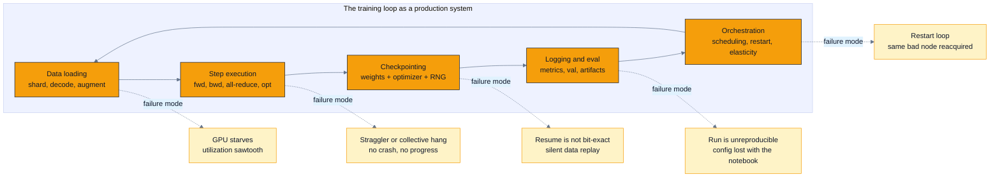
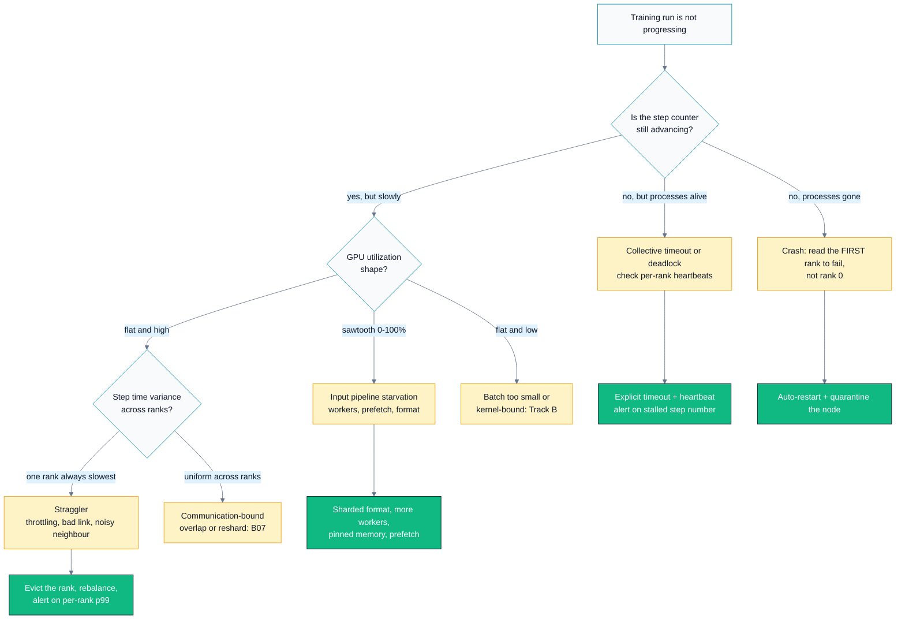
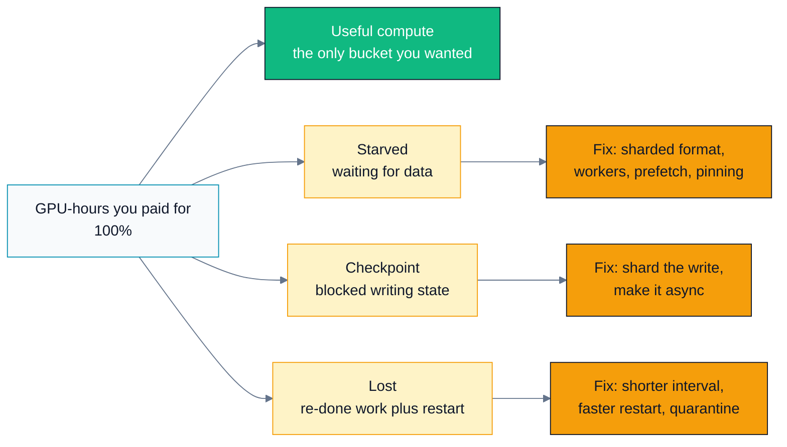

# C03 — Training Systems

> Track C · Module 03 · Status: **DONE** · Est. 7 hours · Depth 3/5
>
> Prerequisites: [C01 Problem framing](../C01.problem-framing-and-metrics/README.md) and
> [C02 Data pipelines](../C02.data-pipelines-and-features/README.md), plus
> [A01 Foundations](../../A-gpu-programming/A01.foundations-and-programming-model/README.md) for
> host↔device literacy.
> Backends: **none — this is a design module.** The only executables are standard-library Python 3
> tools in [`tools/`](tools/). No GPU, no framework, no network required.
> Terms: [GLOSSARY.md](../../../docs/GLOSSARY.md) · Sources: [REFERENCES.md](../../../docs/REFERENCES.md).

---

## 1. TL;DR + Layman analogy

**TL;DR.** A training run at scale is not a script — it is a **distributed system with a loss
function attached**. Its uptime is decided by things that have nothing to do with modelling: whether
the input pipeline can feed the [GPUs](../../../docs/GLOSSARY.md#gpu), whether a checkpoint can be
resumed *bit-exactly*, how quickly a dead rank is detected and replaced, and whether the experiment
can be re-run six months later. The
governing quantity is **goodput** — the fraction of the GPU-hours you paid for that turned into
committed training progress — and almost every engineering decision in this module is a way of
buying goodput back from data stalls, failures, and re-done work.

**Layman analogy — the long road trip with unreliable weather.** You are driving across a continent
in a car that sometimes breaks down. There are towns along the route where you can stop, write down
exactly where you are, and rest. If you only stop once a week, a breakdown on day six costs you six
days of driving. If you stop at *every signpost*, you never actually get anywhere — all your time
goes into stopping and starting. The right answer is neither: it is a stopping frequency you can
*derive* from how often the car breaks down and how long a stop takes. And if a passenger can write
the notes while you keep driving (asynchronous checkpointing), stops get much cheaper and you can
afford more of them.

**Where the analogy breaks — and it breaks in three places worth knowing:**
1. **A synchronous training job has no independent cars.** One rank failing kills all of them, so the
   failure rate scales with the number of GPUs while the useful work per GPU does not. A thousand-car
   convoy that must move in lockstep breaks down a thousand times more often than one car.
2. **You are not driving; you are being *fed*.** The car can be perfectly healthy and still crawl
   because the fuel truck (the input pipeline) cannot keep up. Idle-because-hungry is the most common
   waste in practice, and the analogy does not suggest it at all.
3. **Writing down "exactly where you are" is much harder than it sounds.** Position is not just the
   model weights: it is optimizer state, the LR-scheduler step, every RNG stream, and the data
   loader's position in the shuffle. Miss one and you resume onto a *different* road.

**By the end of this module you can:** derive an optimal checkpoint interval from MTBF and write
cost; diagnose a GPU-starving input pipeline from its symptoms; specify exactly what a bit-exact
resume must persist; argue for statistical over bit-exact reproducibility and say what it costs;
choose a hyperparameter-search strategy under a fixed GPU-hour budget; and defend all of it with
numbers in a design review.

---

## 2. First Principles

### Start from the only thing you are buying: goodput

You rent GPUs by the hour. Every hour falls into exactly one of four buckets:

```
wall_hours = useful_hours          committed forward progress
           + starved_hours         GPU idle, waiting for data
           + checkpoint_hours      GPU blocked, writing state
           + lost_hours            work re-done after a failure, plus restart time
```

**Goodput** is `useful_hours / wall_hours`. That single identity organises the whole module: each
following section attacks one of the three loss terms. It also tells you where *not* to spend
effort — halving a term that is already 2% of the budget cannot buy more than 2%.

Notice what is *not* in that list: making the step itself faster. That is real work, but it belongs
to Track B ([kernels](../../../docs/GLOSSARY.md#kernel),
[precision](../../B-gpu-ml-performance/B04.precision-and-quantization/README.md),
[parallelism strategy](../../B-gpu-ml-performance/B07.distributed-training-and-sharding/README.md)).
This module assumes the step is as fast as it is going to be and asks why you are not getting all
of it.

### Derive the checkpoint interval instead of guessing it

Here is the entire argument, from scratch. Let

- `M` = mean time between job-killing failures (seconds),
- `C` = seconds the training loop is **blocked** while a checkpoint is written,
- `R` = seconds to detect the failure, respawn the job, and reload state,
- `T` = seconds of useful compute between checkpoints — **the knob you control**.

Over one cycle you always pay `C` to write. If a failure strikes, it strikes at a uniformly random
point in the interval, so on average you lose `T/2` of work plus `R` to come back. Failures arrive
at rate `1/M`. So the fraction of wall time that is *not* useful work is:

```
waste(T) = C/T          +  (T/2 + R)/M
           ^ write tax      ^ expected re-done work
```

The two terms pull in opposite directions — that *is* the tradeoff, made arithmetic. Differentiate
and set to zero:

```
d/dT [ C/T + T/(2M) ] = -C/T² + 1/(2M) = 0    =>    T* = sqrt(2 · C · M)
```

This is the classic Young/Daly result ([Young 1974](https://doi.org/10.1145/361147.361115),
[Daly 2006](https://doi.org/10.1016/j.future.2004.11.016)), and it is the single most useful formula
in this module. Two consequences you should be able to state in an interview:

- **The optimum grows as the square root of both inputs.** Halving your checkpoint cost does not
  halve the interval — it divides it by ~1.41. Which is exactly why *reducing `C`* (shard it, make
  it async) beats *tuning `T`*: a 10× cheaper checkpoint lets you checkpoint ~3.2× more often at
  *lower* total overhead.
- **The curve is flat near the optimum.** Being 2× off `T*` costs a few percentage points, not a
  disaster. So a rough MTBF estimate is enough to act on, and you should not spend a week measuring
  it. `tools/checkpoint_planner.py` prints this sensitivity table so you can see the flatness.

Back-of-envelope, with defaults from the tool (`M` = 6 h, `C` = 180 s, `R` = 12 min):
`T* = sqrt(2 · 180 · 21600) ≈ 2,277 s ≈ 38 min`, total overhead ≈ 16%. Shard the write across 8
ranks and async it, and the same job runs at under 5% overhead. **That 11-point swing is a pure
infrastructure win with zero effect on the model** — which is the kind of thing that makes a
training-systems engineer valuable.

### The naive version, and where it breaks

The naive training loop is the one in every tutorial:

```python
for epoch in range(epochs):
    for batch in loader:                 # blocks until data is ready
        loss = step(model, batch)
    torch.save(model.state_dict(), path) # once per epoch, weights only
```

It breaks in four places, and each break names a section below:

| Naive assumption | Reality | Section |
|---|---|---|
| `for batch in loader` is free | the GPU is idle while the CPU decodes and augments | §3.1 |
| weights are the state | resume also needs optimizer, scheduler, RNG, and loader position | §3.2 |
| the job runs to completion | at 512 GPUs, something fails every few hours | §3.3 |
| re-running gives the same answer | it will not, unless you pay for determinism | §3.4 |



*Read the diagram as a checklist: five stages, five distinct failure modes, and none of them is a
modelling bug — which is why "the model isn't learning" is so often the wrong first hypothesis.*

---

## 3. Deep Dive

### 3.1 The input pipeline: why your expensive GPU is hungry

A training step consumes a batch. Producing that batch means: locate the samples, read bytes off
storage or network, decode them (JPEG, audio, tokenizer), augment, collate into a tensor, and move
it [host→device](../../../docs/GLOSSARY.md#pcie-and-host-device-transfer). All of that runs on
**CPU and network**, and none of it is what you bought the GPU for.

**The mechanism.** With prefetch, loading batch `i+1` overlaps compute of batch `i`, so

```
step_time = max(compute_time, data_time)
```

The GPU is fully fed only while `data_time ≤ compute_time`. Without prefetch — one worker, no
double-buffering — the two *serialise*:

```
step_time = compute_time + data_time
```

That single change is why a badly configured loader can halve throughput on a job whose kernels are
perfect. `tools/throughput_budget.py --no-overlap` prints both models side by side.

**Diagnosis, in the order you should actually check it:**

| Symptom | What it means |
|---|---|
| GPU utilization oscillates 0% → 100% → 0% (**sawtooth**) | classic starvation: compute finishes, then everyone waits for the next batch |
| Step time high but *stable*; utilization pinned near 100% | not a data problem — go optimize the step ([Track B](../../B-gpu-ml-performance/README.md)) |
| Step time **variance** high, occasional very slow steps | tail in the loader: a slow shard, a cold cache, a straggling worker, or an epoch-boundary shuffle |
| Utilization drops only at epoch boundaries | the loader is being torn down and rebuilt; use persistent workers |
| Utilization fine on one node, poor at scale | storage or network is the shared bottleneck, not the per-node loader |
| Utilization fine, but communication-bound | not a data problem either — reshard or overlap; see [B07](../../B-gpu-ml-performance/B07.distributed-training-and-sharding/README.md) |

**Fixes, cheapest first** — and notice that most of them cost no accuracy at all:

1. **More loader workers.** The first thing to try and often sufficient. Watch for the point where
   worker processes start contending for CPU with the main process, or for host RAM.
2. **Prefetch depth.** Keep at least one batch ready per device. This is what turns the `+` in the
   step-time equation into a `max`.
3. **Pinned (page-locked) host memory + non-blocking transfers.** Pinned memory lets the DMA engine
   copy without staging through pageable memory, and `non_blocking=True` lets that copy overlap with
   compute on another [stream](../../../docs/GLOSSARY.md#stream). This is *exactly* the host↔device
   transfer cost measured in
   [A01 Lab 4](../../A-gpu-programming/A01.foundations-and-programming-model/README.md#lab-4-optional--profile-it),
   where the PCIe copies dwarfed the kernel — the same physics, one level up the stack.
4. **Precompute what does not need to be fresh.** Resizing and tokenizing every epoch burns CPU to
   produce identical bytes. Do it once, offline. Keep on-the-fly only the augmentation whose
   *randomness* is the point (crops, flips, mixup) — precomputing those destroys the regularisation
   you wanted.
5. **Change the storage format.** Millions of small files is the worst possible layout: you pay a
   metadata round-trip per sample. Sharded sequential formats —
   [WebDataset](https://github.com/webdataset/webdataset) tar shards,
   [TFRecord](https://www.tensorflow.org/tutorials/load_data/tfrecord),
   [MosaicML Streaming](https://github.com/mosaicml/streaming) — turn random small reads into large
   sequential ones and stream from object storage. This is usually the biggest single win, and also
   the biggest change.
6. **Cache.** If the working set fits in host RAM or local NVMe, the second epoch should never touch
   the network.

> **The "it depends on X" pivot.** X is *where the bytes are and how big a sample is*. Small samples
> from object storage → you are metadata- and latency-bound, so shard aggressively. Large samples
> with heavy decode → you are CPU-bound, so precompute or add workers. If a single sample is bigger
> than a batch of activations, you may be [bandwidth](../../../docs/GLOSSARY.md#bandwidth)-bound and
> no amount of workers will help.

### 3.2 Checkpointing: what a bit-exact resume actually requires

The most common production bug in this area is a checkpoint that *loads* successfully and *resumes
wrong*. Nothing crashes. The loss curve just has a small discontinuity that everyone rationalises.

A resume is bit-exact only if you persist **all** of:

| Component | Why it is required | What breaks if you skip it |
|---|---|---|
| Model weights | obvious | — |
| **Optimizer state** | Adam's first/second moments are as large as the weights and carry the whole adaptation history | LR effectively resets; a visible loss spike at resume |
| **LR scheduler state** | the schedule is a function of step count, not of wall time | resumes at the wrong learning rate, silently |
| **RNG states** (Python, NumPy, framework CPU *and* per-device) | dropout masks, augmentation, and any stochastic layer draw from them | different noise stream — statistically fine, not reproducible |
| **Data loader position** | which samples have been seen this epoch, and the shuffle permutation | you re-train on the first N samples and never see the tail; a real, silent quality bug |
| **Step / epoch counters** | everything above is indexed by them | off-by-one in logging, scheduling, and eval |
| **Config + code version** | the checkpoint is meaningless without the code that reads it | cannot reload the run six months later |

Two of those — RNG state and loader position — are the ones teams routinely omit, and both fail
*silently*. That is the point worth remembering.

**Making it cheap.** A full checkpoint of a large model is many gigabytes. Three techniques, which
compose:

- **Sharded checkpointing.** Each rank writes only the shard of state it owns, in parallel, to
  distinct files. Wall-clock write time drops roughly by the number of parallel writers until you
  saturate the filesystem. PyTorch's
  [Distributed Checkpoint (DCP)](https://docs.pytorch.org/docs/stable/distributed.checkpoint.html)
  does this and — importantly — can *reshard* on load, so you can resume a 64-GPU run on 32 GPUs.
- **Asynchronous checkpointing.** Snapshot the state to host memory (fast), then let a background
  thread write it to storage while training continues. The loop only blocks for the snapshot, so the
  *blocking* cost `C` in the Young/Daly formula collapses. The constraint: the background write must
  finish before the next checkpoint starts, or writes queue and you are back to synchronous.
  `checkpoint_planner.py` warns you when your configured interval violates that.
- **Tiered retention.** Frequent checkpoints to fast local storage for crash recovery; infrequent
  copies to durable object storage for the ones you might want in a month. Do not pay durable-write
  latency every 15 minutes for state you will delete in an hour.

> **The "it depends on X" pivot.** X is *what the checkpoint is for*. Crash recovery wants frequent,
> cheap, local, short-lived. Model provenance wants rare, durable, immutable, and tagged with the
> exact config and code commit. Conflating the two gives you something both expensive and
> untrustworthy.

### 3.3 Fault tolerance: at scale, failure is the steady state

At hundreds or thousands of GPUs, hardware failure is not an incident — it is a **background rate**.
Meta's published account of Llama 3 405B pre-training is the best public data point:
during a **54-day** snapshot on **16,384 H100s** the run hit **466 job interruptions**, of which
**419 were unexpected**; roughly **78%** traced to confirmed or suspected hardware issues, and GPU
issues alone were **58.7%** of the unexpected total. Despite that, they sustained **>90% effective
training time**, and significant manual intervention was needed only **three** times — the recovery
was automated ([Llama 3 Herd of Models, §3.3.4](../../../docs/REFERENCES.md#the-llama-3-herd-of-models-grattafiori-et-al-2024)).

Read those numbers as an engineering brief rather than trivia:

- **~1 unexpected interruption every ~3 hours** at that scale. Your MTBF input to the checkpoint
  planner is not hypothetical; it is a measurable property of your cluster and it *shrinks as you
  add GPUs*.
- **>90% effective time was achieved anyway.** Reliability at scale is an automation problem, not a
  hardware-perfection problem.
- **Three manual interventions in 54 days** is the bar. If your run needs a human every night, the
  problem is your tooling.

**What the machinery looks like:**

- **Automatic restart from the last checkpoint.** The job supervisor detects the death, requeues,
  and every rank reloads. `torchrun` / [TorchElastic](https://docs.pytorch.org/docs/stable/elastic/run.html)
  implements this; the supervisor must also **quarantine the bad node**, or the scheduler cheerfully
  hands it back and you loop.
- **Elastic training** — continue with fewer ranks rather than waiting for a replacement. The catch
  nobody mentions: changing the world size changes the **global batch size**, which changes the
  effective learning rate and therefore the *science*. Either hold global batch constant by adjusting
  gradient accumulation, or accept that the run's hyperparameters drifted mid-flight. Say which one
  you chose.
- **Straggler detection.** A synchronous step runs at the pace of the **slowest rank** — the
  all-reduce is a [barrier](../../../docs/GLOSSARY.md#barrier). One GPU thermally throttling to 70%
  slows the entire job to 70%, and
  average-utilization dashboards will look *fine* because every rank is busy waiting. Detect it with
  per-rank step-time distributions, not means: the signal is one rank consistently at the top of the
  distribution.
- **The collective timeout that presents as a hang.** This is the classic production symptom worth
  memorising. When one rank dies or diverges in control flow, the others sit inside a blocking
  collective waiting for a peer that will never arrive. There is no crash and no error — GPUs show
  high utilization (spinning in the collective), the loss stops advancing, and the job burns money
  until a watchdog fires. Note that in the Llama 3 table, "NCCL Watchdog Timeouts" appear as their
  own category with **unknown** root cause — even with excellent tooling, some of these are only
  ever diagnosed as "the collective timed out". Mitigations: set an explicit collective timeout,
  emit a per-rank heartbeat with the step number, and alert on *step-number stalled* rather than on
  process death.



*This is the triage order to run in an on-call incident: liveness first (is the step number moving),
then shape (utilization pattern), then distribution (which rank) — never start by rereading the model
code.*

**Where the parallelism math lives.** How you shard the model across those GPUs —
[data, tensor, pipeline](../../../docs/GLOSSARY.md#data-tensor-pipeline-and-expert-parallelism)
(the tensor axis is [Megatron-LM](../../../docs/REFERENCES.md#megatron-lm-shoeybi-et-al-2019)),
and ZeRO-style optimizer-state sharding
([Rajbhandari et al., ZeRO](../../../docs/REFERENCES.md#zero-rajbhandari-et-al-2020)) — is the subject of
[**B07 Distributed training & sharding**](../../B-gpu-ml-performance/B07.distributed-training-and-sharding/README.md#3-deep-dive).
This module deliberately does not re-derive it. What matters *here* is only the consequence: the sharding
strategy determines what a checkpoint contains, how many writers there are, and how big the blast
radius of a single failed rank is.

### 3.4 Reproducibility, honestly

Ask for "reproducible training" and you will get a shrug, because the word hides two very different
requests.

**Bit-exact reproducibility** — the same run produces byte-identical weights. It is achievable, and
here is the full bill:

- Seed everything: Python `random`, NumPy, the framework's CPU and per-device generators, and the
  data loader's per-worker seeds (each worker needs a *distinct, derived* seed, or your workers
  augment identically).
- Force deterministic kernel selection. Many fast kernels are non-deterministic by design — they use
  atomics, or pick an algorithm by autotuning, or split reductions across blocks in a
  hardware-scheduled order. Forcing determinism disables those. PyTorch's
  [reproducibility notes](https://docs.pytorch.org/docs/stable/notes/randomness.html) document both
  the switches and the fact that some operations simply have no deterministic implementation.
- Accept the **non-deterministic [reduction](../../../docs/GLOSSARY.md#reduction) order** problem in
  collectives and atomics. Floating-point addition **is not associative**: `(a+b)+c ≠ a+(b+c)` in
  general
  ([Goldberg 1991](../../../docs/REFERENCES.md#what-every-computer-scientist-should-know-about-floating-point-arithmetic-goldberg-1991)).
  This is the exact point made in
  [A04 Parallel Reduction](../../A-gpu-programming/A04.parallel-reduction/README.md) — a tree
  reduction's result depends on the tree shape. An all-reduce across ranks, or a kernel using
  atomics, can legally combine partial sums in a different order on every run and produce a slightly
  different number. Multiply that by 100,000 steps of a chaotic optimisation and two runs diverge
  visibly. Fixing it means pinning the reduction order, which costs performance.
- Pin the environment: framework version, communication library, compiler, **driver**, and container
  image. A driver upgrade can change kernel selection.

**Statistical reproducibility** — re-running with a different seed lands within the noise band of
your metric. This is almost always the right target, and you should say so explicitly rather than
letting a reviewer assume you meant the other one. The professional version of the claim is: *"our
result is reproducible to ±0.2 points on the eval metric across 3 seeds; we do not guarantee
bit-exactness because we use non-deterministic reductions for throughput."* That sentence is both
honest and defensible, and it forces you to have actually run three seeds.

> **The "it depends on X" pivot.** X is *why you need it*. Debugging a divergence, or a regulated
> audit trail → pay for bit-exactness, temporarily. Comparing two model variants → statistical
> reproducibility with seed replicates is not a compromise, it is the *correct* methodology, because
> a difference smaller than seed variance was never a real difference.

### 3.5 Experiment tracking and hyperparameter search

**What to log, every run, automatically:**

| Category | Contents | Why |
|---|---|---|
| Config | every hyperparameter, resolved (not defaults-by-omission) | the run is the config |
| Code version | commit SHA **and** a dirty-working-tree flag | "it worked last Tuesday" |
| Data version | dataset snapshot ID, filters, preprocessing version | data changes silently more often than code |
| Environment | framework, comm library, driver, container digest, GPU model | explains the unexplainable diff |
| Metrics | train/val loss, task metrics, throughput, grad norm, LR | the actual result |
| Artifacts | checkpoint URIs, eval outputs | provenance |

**Config-as-code beats notebook state** for one structural reason: a notebook's state is the *cell
execution order*, which is not recorded anywhere and cannot be diffed, reviewed, or replayed. A
committed config file can be diffed against the last run — and "what changed since the good run" is
the single most useful question in ML debugging. Notebooks are excellent for looking at data and
terrible as a system of record.

**Search strategies and their cost profiles:**

| Strategy | Cost profile | Use when |
|---|---|---|
| Grid | `k^d` runs; cost explodes with dimensions and it re-tries the same value of the important hyperparameter `k^(d-1)` times | ≤2 dimensions, or you must show exhaustive coverage |
| Random | any budget, all draws distinct in every dimension | the default; strictly better than grid when only a few dimensions matter ([Bergstra & Bengio 2012](https://jmlr.org/papers/v13/bergstra12a.html)) |
| Bayesian | sequential, sample-efficient, hard to parallelise (each suggestion wants the previous result) | few, expensive evaluations; low parallelism ([Snoek et al. 2012](https://arxiv.org/abs/1206.2944)) |
| Successive halving / Hyperband / ASHA | evaluates many configs cheaply, promotes survivors; massively parallel and asynchronous | large budgets, many workers, when short runs predict long runs ([Li et al., Hyperband](https://arxiv.org/abs/1603.06560); [Li et al., ASHA](https://arxiv.org/abs/1810.05934)) |

The failure mode of successive halving is worth stating because it is the question you will be
asked: **it assumes early performance ranks configurations correctly.** When it does not — a config
with a warmup schedule that looks terrible for the first 5% and wins at the end — halving kills the
winner. `tools/hpo_budget.py --early-noise` makes this concrete: crank the noise and halving's
advantage evaporates back to random search.

### 3.6 Cost engineering

**GPU-hours per experiment is the unit of account.** Before a large run, three practices separate
teams that ship from teams that burn budget:

- **Small-scale proxy experiments.** Establish the trend on 1–10% of the compute, then extrapolate.
  Scaling-law work ([Kaplan et al. 2020](../../../docs/REFERENCES.md#scaling-laws-for-neural-language-models-kaplan-et-al-2020);
  [Hoffmann et al., Chinchilla, 2022](../../../docs/REFERENCES.md#training-compute-optimal-large-language-models-hoffmann-et-al-2022)) exists precisely because
  the alternative — guessing at full scale — is unaffordable. The caveat that separates a careful
  engineer from a careless one: **extrapolation is only valid within the regime you fitted**, and
  effects that appear at scale (instabilities, data exhaustion) are invisible in the proxy.
- **Spot / preemptible instances.** Often a large discount, at the price of being killed with little
  warning. Spot capacity is *purchasable only if your checkpointing is good* — it converts a
  reliability property into a discount. Note the interaction with the Young/Daly formula: spot
  interruption slashes your effective `M`, which shrinks `T*`, which means you need cheap
  (async + sharded) checkpoints to make it pay. The two decisions are not independent.
- **Knowing when to stop.** Define the kill criterion *before* launching — a target loss by step N,
  or divergence from the reference curve beyond a band. A run that has clearly lost is spending real
  money to confirm what you already know. This is also the honest defence against sunk cost: the
  GPU-hours already spent are irrelevant to whether the *next* hour is worth spending.

### 3.7 Monitoring a training run

| Signal | Healthy | Diagnostic meaning when it is not |
|---|---|---|
| Train loss | decreasing, noisy | flat from step 0 → LR far too low, frozen params, or the data is not what you think |
| **Loss spike** | occasional, recovers within tens of steps | a persistent spike means a bad batch, LR too high, or an optimizer-state problem. If it appears exactly at a resume, your checkpoint is incomplete (§3.2) |
| **NaN / Inf** | never | overflow, division by zero, or a bad reduction. In low precision it is usually **range**, not rounding — the precision hazards owned by [B04 Precision & quantization](../../B-gpu-ml-performance/B04.precision-and-quantization/README.md#2-first-principles) |
| Gradient norm | stable, slowly declining | sudden spike precedes a loss spike; a collapse to ~0 means dead units or a detached graph |
| Learning rate | matches the intended schedule | if it does not, your scheduler state did not restore |
| Throughput (samples or tokens/s) | flat | a step change means hardware degradation or a straggler; slow decay means a leak or growing sequence lengths |
| GPU utilization | high and flat | sawtooth = data starvation (§3.1); high-but-no-progress = collective hang (§3.3) |
| GPU memory | flat after warmup | monotonic growth is a leak — usually retaining graph references in a logging path |

The subtle point: **utilization is not goodput.** A GPU spinning inside a hung all-reduce reports
high utilization. Always pair a utilization metric with a *progress* metric — the step counter — and
alert on the progress one.

---

## 4. Hands-On Labs

This is a **design track**: there is no `hip/` or `cuda/` code, because nothing in this module is a
kernel problem. Instead you get three runnable analytic tools and three design drills. Everything
below is **pure Python 3.8+ standard library** — no `pip install`, no GPU, no network.

```bash
make help            # list targets
make run             # run all three tools with their default scenarios
make run-exercises   # run the exact scenarios the drills reference
make clean           # remove __pycache__
```

On Windows PowerShell, if `python3` is not on your PATH: `make run PYTHON=python`, or invoke the
tools directly as shown in each lab.

> Every number these tools print is **derived from a model you can read in the source**, not measured
> on hardware. That is deliberate: the goal is to make you fluent in the *shape* of the tradeoff so
> you can plug in your own measurements. Never quote a tool output as an empirical result.

### Lab 1 — Derive your checkpoint interval (`tools/checkpoint_planner.py`)

```bash
python tools/checkpoint_planner.py
python tools/checkpoint_planner.py --mtbf-hours 1.5 --checkpoint-seconds 300 --shards 1
python tools/checkpoint_planner.py --mtbf-hours 0.5 --checkpoint-seconds 60   # spot-like
```

**What to observe.** Three things, in order of how often they surprise people:

1. In the default scenario the synchronous strategy costs **~16%** total overhead at its optimum;
   sharding across 8 writers takes it to **~8%**; adding async takes it under **5%**. The interval
   moved from ~47 min to ~5 min *while overhead fell* — because reducing `C` improves both terms at
   once.
2. The sensitivity table is nearly flat: **2× off the optimum costs about 3 percentage points.**
   Stop agonising over the interval; go make the checkpoint cheaper.
3. Drop the MTBF to 30 minutes (the spot-instance case) and watch the optimum collapse toward the
   write cost. There is a regime where the arithmetic tells you that this workload cannot run on
   this infrastructure — and the tool will say so rather than printing a fake answer.

### Lab 2 — Price the starving GPU (`tools/throughput_budget.py`)

```bash
python tools/throughput_budget.py
python tools/throughput_budget.py --loader-samples-per-second 0        # perfect loader
python tools/throughput_budget.py --no-overlap                          # prefetch disabled
```

**What to observe.** The default configuration runs at **~72% GPU utilization** purely because the
input pipeline delivers 5,000 samples/s against a compute capacity of 6,912 — and that shortfall
converts directly into extra dollars for the identical finished model. Then note the *asymmetry* in
the sweep: a loader at 125% or 200% of compute capacity buys **exactly nothing**, while a loader at
50% doubles the bill. The penalty is one-sided, which is the whole argument for provisioning the
input pipeline with headroom. Finally, `--no-overlap` removes the flat region entirely: without
prefetch, utilization never reaches 100% no matter how fast the loader gets, because loading and
compute take turns.

### Lab 3 — Spend a search budget well (`tools/hpo_budget.py`)

```bash
python tools/hpo_budget.py
python tools/hpo_budget.py --dimensions 6          # grid gets worse
python tools/hpo_budget.py --early-noise 2.0       # halving loses its edge
```

**What to observe.** With the defaults, all three strategies spend the same 2,048 GPU-hours. Grid and
random both complete 32 full runs — but grid samples only **2 distinct values** of the dimension that
matters (32^(1/4) ≈ 2.4), while random samples 32. Successive halving *explores 216 configurations*
for the same money by completing only 8 of them. Then set `--early-noise 2.0` and watch halving fall
back to roughly random-search performance: the entire advantage was the assumption that short runs
rank configs correctly. That is the tradeoff to articulate in an interview, not the leaderboard.

### Design drills

The real work of this module is in [`exercises/`](exercises/) — three written design problems with
reference answers in [`solutions/`](solutions/). They are markdown, not code, because the skill being
tested is judgement under stated constraints, and that is what a design interview measures.

| # | Drill | Skill |
|---|---|---|
| 1 | [`01_diagnose_slow_training.md`](exercises/01_diagnose_slow_training.md) | Ordered triage from symptoms to root cause |
| 2 | [`02_checkpoint_strategy.md`](exercises/02_checkpoint_strategy.md) | Quantitative checkpoint design under MTBF, cost, and spot interruption |
| 3 | [`03_repro_audit.md`](exercises/03_repro_audit.md) | Reproducibility audit; bit-exact vs statistical |

---

## 5. Performance Analysis

**This section is reframed for a design track.** There is no kernel to profile and no
[roofline](../../../docs/GLOSSARY.md#roofline-model) to place. The equivalent rigor at the system
level is **goodput accounting**: decompose the wall-clock
and the dollars into buckets, attack the largest one, and re-measure. The discipline is identical to
[Track B](../../B-gpu-ml-performance/README.md) — numbers, not adjectives — but the unit is
GPU-hours and dollars instead of GB/s.

### The system-level roofline: what caps this run?

| Bucket | How you measure it in production | Typical fix |
|---|---|---|
| Useful compute | steps/s × step cost, or tokens/s | Track B (kernels, precision, parallelism) |
| Starved | GPU utilization gap, data-wait time in the [step trace](../../B-gpu-ml-performance/B03.profiling-and-bottleneck-analysis/README.md#3-deep-dive) | §3.1 input pipeline |
| Checkpoint | blocking write time × checkpoints taken | shard + async (§3.2) |
| Lost to failures | restarts × (steps re-done + restart time) | shorter interval, faster restart, node quarantine (§3.3) |

Each row has a *ceiling on how much it can possibly help you* — its current share. Compute the shares
first; that is the system-level equivalent of asking whether a kernel is
[memory- or compute-bound](../../../docs/GLOSSARY.md#memory-bound-compute-bound-and-latency-bound).



*Goodput accounting is this module's roofline: measure the four shares before choosing what to fix,
because each loss bucket's current share is a hard ceiling on what fixing it can ever return.*

### Worked before/after (analytic model, from the tools)

Take the tools' default scenario — a 64-GPU job needing 336 GPU-hours of useful compute at
$2.50/GPU-hour, MTBF 6 h, a 180 s full checkpoint, and an input pipeline delivering 72% of what the
GPUs can eat. Applying the model in each tool:

| Configuration | Checkpoint overhead | Starvation | Effective goodput | Wall time | Cost |
|---|---:|---:|---:|---:|---:|
| Naive: sync single-writer checkpoint at a guessed interval, starving loader | ~16% at best (worse if mistuned) | ~28% | ~60% | ~560 h | ~$89,600 |
| Tuned: sharded + async checkpoint at `T*`, loader sized with headroom | ~5% | ~0% | ~95% | ~353 h | ~$56,500 |

**Delta: roughly a third of the bill, with no change whatsoever to the model, the data, or the
kernels.** Reproduce the two halves with:

```bash
python tools/checkpoint_planner.py                                   # rows 2 and 3 of section 2
python tools/throughput_budget.py                                    # the starvation tax
python tools/throughput_budget.py --loader-samples-per-second 0      # the fixed pipeline
```

> These are **model outputs composed by hand**, not a measured end-to-end run. They are here to show
> the arithmetic of goodput composition. On a real system you would populate the same table from
> your job's telemetry — and the interesting part is always which bucket turns out to be biggest,
> because it is rarely the one the team assumed.

### Cost per experiment, and the metric that actually matters

Time-to-train and cost-per-run are the operational numbers, but the number that should govern
planning is **cost per useful conclusion**: total GPU-hours divided by the number of decisions the
experiments let you make. It is what makes proxy experiments and early stopping rational — a search
that explores 216 configurations for 2,048 GPU-hours (Lab 3) produces far more conclusions per dollar
than 32 full runs, even though each individual result is less precise.

---

## 6. Challenges, Drawbacks & Tradeoffs

### Where this breaks

- **Checkpointing too often on shared storage.** The Young/Daly optimum assumes `C` is a property of
  your job. On a shared parallel filesystem it is a property of *everyone's* jobs — 200 jobs all
  checkpointing every 10 minutes turn a 30-second write into a 5-minute one, and every job's model
  says "checkpoint more often". Stagger the phase, or you have built a synchronised thundering herd.
- **Async checkpointing hides a correctness hazard.** If the background write is still in flight when
  training mutates the tensors it is reading, you persist a torn checkpoint that loads fine and is
  subtly wrong. The snapshot must be a genuine copy (or copy-on-write), and the implementation must
  guarantee it. This is a bug you find months later.
- **Elastic training silently changes your experiment.** Losing 8 of 64 ranks changes the global
  batch size by 12.5%, which changes the effective learning rate. The run continues, the loss curve
  looks plausible, and the hyperparameters in your config file are now a lie.
- **Determinism switches can be a large slowdown, and are not free to keep on.** Turning them on for
  a debugging session is correct; leaving them on in production because "reproducibility is good"
  costs throughput on every run forever.
- **Restart loops.** Auto-restart without node quarantine reacquires the failed node and dies again.
  Cap the restart count and alert on the *rate*, not just the event.
- **Metrics that lie.** Mean GPU utilization across ranks hides a straggler. Mean step time hides the
  tail that dominates the wall clock. Always look at per-rank distributions.

### When *not* to do this

- **Small runs.** If the job finishes in under an hour and the cluster is reliable, elaborate
  checkpointing and elastic orchestration are pure complexity. Checkpoint at the end and move on.
  The Young/Daly formula itself tells you this: when `T*` exceeds the run length, checkpoint once.
- **Single-node jobs.** Most of §3.3 exists because of the synchronous-collective failure model. One
  node, one process — restart it.
- **Exploratory work.** A notebook is the right tool for the first day. The mistake is not using a
  notebook; it is letting one become the system of record for a run you will need to defend.

### The tradeoffs to hold in mind

| Decision | You gain | You pay |
|---|---|---|
| More frequent checkpoints | less lost work per failure | write overhead, storage, filesystem contention |
| Async + sharded checkpointing | far cheaper writes | implementation complexity, torn-snapshot risk, harder debugging |
| Elastic training | keeps running through failures | mutated global batch size; a moving experimental target |
| Bit-exact determinism | perfect reproducibility | measurable throughput loss; some ops have no deterministic kernel |
| Spot instances | large discount | frequent interruption; only viable with excellent checkpointing |
| Precomputed augmentation | CPU relief, higher GPU utilization | less augmentation diversity, storage cost, a new pipeline to version |
| Successive halving | many more configs per dollar | discards slow starters; needs early signal to rank correctly |

### Failure modes a reviewer should look for

1. Checkpoint saves weights only — no optimizer, scheduler, RNG, or loader position.
2. No explicit collective timeout, and alerting on process liveness rather than step progress.
3. Auto-restart with no node quarantine and no restart-rate cap.
4. Loader worker seeds all identical, so every worker produces the same augmentation.
5. "Reproducible" claimed with no statement of which kind, and no seed replicates run.
6. Checkpoint interval chosen as a round number with no reference to MTBF.
7. Spot instances in the plan, with a synchronous 10-minute checkpoint.

---

## 7. Real-World Use Cases

- **Frontier-scale pre-training.** The Llama 3 405B report ([§3.3.4](../../../docs/REFERENCES.md#the-llama-3-herd-of-models-grattafiori-et-al-2024))
  is the canonical public example of every mechanism in §3.3: automated failure handling on 16K GPUs,
  >90% effective training time, NCCL watchdog timeouts as their own failure category.
- **PyTorch Distributed Checkpoint (DCP)** implements the sharded, resharding-capable, optionally
  asynchronous checkpointing described in §3.2 —
  [docs](https://docs.pytorch.org/docs/stable/distributed.checkpoint.html).
- **TorchElastic / `torchrun`** provides the restart-and-rendezvous machinery for elastic and
  fault-tolerant jobs — [docs](https://docs.pytorch.org/docs/stable/elastic/run.html).
- **ZeRO / DeepSpeed and FSDP** shard optimizer state, gradients, and parameters; that sharding is
  what makes a sharded checkpoint natural in the first place
  ([ZeRO](../../../docs/REFERENCES.md#zero-rajbhandari-et-al-2020),
  [FSDP](../../../docs/REFERENCES.md#pytorch-fsdp-pytorch)).
- **Streaming data formats** — WebDataset, TFRecord, MosaicML Streaming — exist because of §3.1: they
  convert millions of small random reads into large sequential ones from object storage.
- **Ray Tune / Optuna** implement ASHA and Bayesian search as production services, which is the
  §3.5 discussion turned into infrastructure.
- **Experiment trackers** (MLflow, Weights & Biases, TensorBoard) are the concrete answer to the
  §3.5 logging table; the important part is not which one, but that the config and code version are
  captured automatically rather than by discipline.

**Where to go next.**
[B07](../../B-gpu-ml-performance/B07.distributed-training-and-sharding/README.md) supplies the
sharding arithmetic this module deliberately skipped, and it is the module that decides what a
checkpoint actually contains and how many ranks can write it in parallel.
[B03](../../B-gpu-ml-performance/B03.profiling-and-bottleneck-analysis/README.md) is where the §3.1
triage stops being a utilization graph and becomes a counter that names the cause.
[C04](../C04.production-model-optimization/README.md) picks the model up where this module drops
it — trained, and now expensive to serve.

---

## 8. Cited References

Grounding for the claims above. Sources shared with other modules are cited by anchor into the
[master bibliography](../../../docs/REFERENCES.md), where the URL and its retrieval date live;
the ones only this module uses keep their URL here.

**Reliability and checkpointing**
- [Grattafiori et al. (2024). *The Llama 3 Herd of Models*](../../../docs/REFERENCES.md#the-llama-3-herd-of-models-grattafiori-et-al-2024),
  §3.3.4 — the 54-day / 466-interruption / >90% effective-training-time figures quoted in §3.3, and
  the failure taxonomy that makes the MTBF input to §2's formula an estimate rather than a guess.
- Young, J. W. (1974). *A first order approximation to the optimum checkpoint interval.* CACM —
  origin of `T* = sqrt(2·C·M)`, the result §2 derives and `checkpoint_planner.py` implements.
  <https://doi.org/10.1145/361147.361115>
- Daly, J. T. (2006). *A higher order estimate of the optimum checkpoint interval for restart dumps.*
  FGCS — the refinement, and the bounds on when the first-order form is valid.
  <https://doi.org/10.1016/j.future.2004.11.016>
- **PyTorch Distributed Checkpoint** — sharded and asynchronous checkpointing, resharding on load:
  the production implementation of the two cheap-write techniques in §3.2.
  <https://docs.pytorch.org/docs/stable/distributed.checkpoint.html> (retrieved 8 Aug 2026)
- **TorchElastic / `torchrun`** — restart, rendezvous, elastic world size; the machinery §3.3 assumes
  is already in place before it discusses quarantine and restart caps.
  <https://docs.pytorch.org/docs/stable/elastic/run.html> (retrieved 8 Aug 2026)

**Scale and sharding**
- [Rajbhandari et al. (2020). *ZeRO: Memory Optimizations Toward Training Trillion Parameter Models.*](../../../docs/REFERENCES.md#zero-rajbhandari-et-al-2020)
  — the optimizer-state sharding §3.3 names, and the reason a checkpoint has many writers instead of
  one.
- [**PyTorch FSDP**](../../../docs/REFERENCES.md#pytorch-fsdp-pytorch) — fully sharded data parallel:
  the framework-level form of the same idea, and why §3.2's sharded checkpoint is the natural one.
- [Shoeybi et al. (2019). *Megatron-LM*](../../../docs/REFERENCES.md#megatron-lm-shoeybi-et-al-2019)
  — the tensor-parallel axis of the taxonomy §3.3 defers to B07; it changes what each rank owns and
  therefore what each rank must persist.

**Reproducibility**
- **PyTorch reproducibility notes** — seeding, deterministic algorithms, and the operations that have
  no deterministic implementation: the itemised bill §3.4 asks you to price before promising
  bit-exactness. <https://docs.pytorch.org/docs/stable/notes/randomness.html> (retrieved 8 Aug 2026)
- [Goldberg, D. (1991). *What Every Computer Scientist Should Know About Floating-Point Arithmetic*](../../../docs/REFERENCES.md#what-every-computer-scientist-should-know-about-floating-point-arithmetic-goldberg-1991)
  — non-associativity, the root cause behind the reduction-order variance §3.4 tells you to accept.

**Experiments and search**
- Bergstra & Bengio (2012). *Random Search for Hyper-Parameter Optimization.* JMLR — why grid wastes
  budget on unimportant dimensions; the argument modelled in `hpo_budget.py`.
  <https://jmlr.org/papers/v13/bergstra12a.html>
- Li et al. (2018). *Hyperband: A Novel Bandit-Based Approach to Hyperparameter Optimization.* JMLR.
  <https://arxiv.org/abs/1603.06560>
- Li et al. (2020). *A System for Massively Parallel Hyperparameter Tuning* (ASHA).
  <https://arxiv.org/abs/1810.05934>
- Snoek, Larochelle, Adams (2012). *Practical Bayesian Optimization of Machine Learning Algorithms.*
  <https://arxiv.org/abs/1206.2944>
- [Kaplan et al. (2020). *Scaling Laws for Neural Language Models.*](../../../docs/REFERENCES.md#scaling-laws-for-neural-language-models-kaplan-et-al-2020)
  — the justification for §3.6's small-scale proxy experiments.
- [Hoffmann et al. (2022). *Training Compute-Optimal Large Language Models* (Chinchilla).](../../../docs/REFERENCES.md#training-compute-optimal-large-language-models-hoffmann-et-al-2022)
  — the compute-optimal re-fit, and why §3.6 insists extrapolation is only valid inside the regime
  you fitted.

**Production ML practice**
- [Breck, Cai, Nielsen, Salib, Sculley (2017). *The ML Test Score: A Rubric for ML Production
  Readiness and Technical Debt Reduction.* IEEE Big Data](../../../docs/REFERENCES.md#the-ml-test-score-breck-et-al-2017)
  — the reproducibility and monitoring tests behind §3.4 and §3.7.
- [Sculley et al. (2015). *Hidden Technical Debt in Machine Learning Systems.* NeurIPS](../../../docs/REFERENCES.md#hidden-technical-debt-in-machine-learning-systems-sculley-et-al-2015)
  — configuration debt and pipeline jungles, the framing behind §3.5.

**Data pipelines**
- **WebDataset** — sharded tar format for streaming training data.
  <https://github.com/webdataset/webdataset>
- **TFRecord** — TensorFlow's sequential record format.
  <https://www.tensorflow.org/tutorials/load_data/tfrecord> (retrieved 8 Aug 2026)
- **MosaicML Streaming** — streaming datasets from object storage with resumable, deterministic
  sample ordering. <https://github.com/mosaicml/streaming>

---

## 9. Self-Assessment & Interview Drills

### Conceptual (answers below)

1. Your checkpoint takes 200 s and your cluster's MTBF is 4 hours. What interval should you use, and
   what happens to that interval if you make the checkpoint 4× cheaper?
2. A colleague reports "GPU utilization is 95%, so we're compute-bound." Give two distinct situations
   where that conclusion is wrong.
3. Name the two pieces of checkpoint state that teams most often omit, and describe the *silent*
   symptom each one produces on resume.
4. Your 512-GPU job stops making progress. The processes are alive and `nvidia-smi`/`amd-smi` shows
   high utilization. What is your first hypothesis, and what single metric would confirm it?
5. Your manager asks for "reproducible training." What do you ask back, and what are the two answers
   you might get?
6. You are offered spot instances at a 70% discount. Under what condition is that a good deal, and
   what single number decides it?
7. Explain to a non-engineer why adding more GPUs can make a training job *less* reliable.

<details markdown="1">
<summary>Answers</summary>

1. `T* = sqrt(2 · 200 · 14400) ≈ 2,400 s ≈ 40 minutes`. Making the checkpoint 4× cheaper (50 s)
   gives `T* = sqrt(2 · 50 · 14400) ≈ 1,200 s ≈ 20 minutes` — the interval halves (√4 = 2), *and*
   total overhead falls, because both the write tax and the expected lost work shrink. The lesson:
   reducing `C` is worth more than tuning `T`, because `T*` only moves as the square root.

2. (a) **A hung collective.** Ranks spinning inside a blocking all-reduce report high utilization
   while the step counter is frozen — utilization measures "kernels resident", not progress.
   (b) **A straggler.** Every rank is busy, but the fast ones are busy *waiting* at the barrier for
   the slow one; the mean looks healthy and the job runs at the slowest rank's pace. In both cases
   the correct instrument is the step counter (and per-rank step-time distribution), not utilization.

3. **RNG states** and **data-loader position**. Omitting RNG state means the noise stream (dropout,
   augmentation) differs after resume — statistically harmless but silently non-reproducible.
   Omitting loader position means the epoch restarts from sample 0, so you re-train on the head of
   the dataset and may never see the tail. Both load without error, which is what makes them
   dangerous. A third, nearly as common: the LR-scheduler state, which resumes at the wrong learning
   rate and shows up as a loss discontinuity at the resume point.

4. **A collective timeout / deadlock**: one rank died or diverged in control flow, and the rest are
   blocked in a collective waiting for it. Confirm with a **per-rank heartbeat reporting the current
   step number** — if step numbers are frozen while processes are alive, it is a hang, not slowness.
   (Secondary confirmation: find the *first* rank to stop reporting; that is where the root cause is,
   not on rank 0, which merely reported the timeout.)

5. Ask: *"bit-exact, or statistical?"* Bit-exact means byte-identical weights and requires full
   seeding, deterministic kernels, pinned reduction order, and a pinned software/driver stack — it
   costs throughput and some operations have no deterministic implementation. Statistical means
   re-running lands within the noise band of the metric, which you demonstrate with seed replicates.
   Statistical is usually the right target; say which one you are claiming, and quote the band.

6. It is a good deal **if your checkpointing is cheap enough that the interruption rate does not eat
   the discount.** The deciding number is the resulting **goodput**: spot slashes effective MTBF,
   which shrinks `T*` and raises the write tax; if goodput × 0.30 (the spot price) still beats
   on-demand goodput × 1.0, take it. Run `checkpoint_planner.py --mtbf-hours 0.5` and compare.

7. Because the machine only works if *every* part works at once. One thousand GPUs that must stay in
   lockstep means a thousand chances for something to break, and any single break stops all of them —
   so the time between failures shrinks roughly in proportion to the size of the machine, while each
   individual GPU is no less reliable than before.

</details>

### Design drills

Do these in [`exercises/`](exercises/); reference answers with the reasoning in
[`solutions/`](solutions/). Write them as you would write a design doc: state assumptions, show the
arithmetic, and give the "it depends on X" pivot.

1. **Diagnose a slow training run** (`exercises/01_diagnose_slow_training.md`) — from a symptom list,
   produce an *ordered* set of checks with the reasoning for the order, and the fix for each branch.
2. **Design a checkpoint strategy** (`exercises/02_checkpoint_strategy.md`) — compute `T*` for a
   stated MTBF and write cost, then redo it for spot instances, and decide whether spot is worth it.
3. **Reproducibility audit** (`exercises/03_repro_audit.md`) — given a training setup, list every
   obstacle to an exact re-run, classify each as bit-exact or statistical, and recommend what to
   change and what to leave alone.

### Stretch

- Extend `checkpoint_planner.py` with a **second failure class** (frequent, cheap preemptions plus
  rare, expensive hardware failures) and re-derive the optimum. Does a single interval still make
  sense, or do you want tiered checkpoints?
- Add a **straggler model** to `throughput_budget.py`: sample per-rank step times from a distribution
  and make the job run at the max. Show how the throughput loss grows with rank count even when the
  per-rank distribution is unchanged — the reason tail latency matters more as you scale.
- Take a real training job you have access to and fill in the §5 goodput table from its telemetry.
  Whichever bucket is biggest is your next quarter's work.
