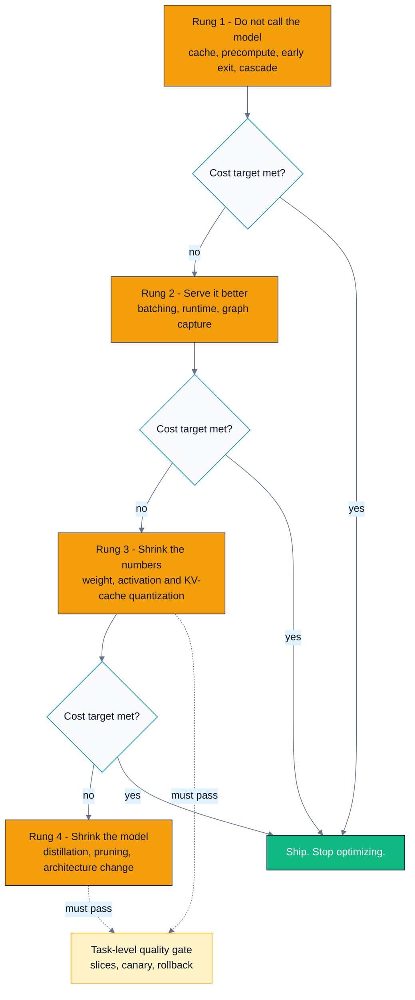
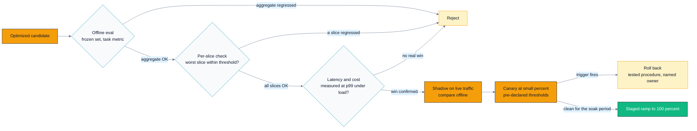
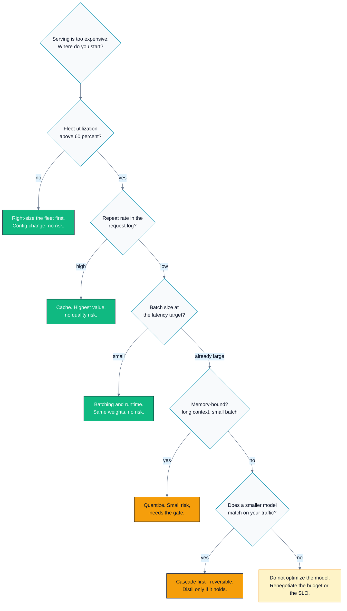

# C04 — Production Model Optimization

> Track C · Module 04 · Status: **DONE** · Est. 7 hours · Depth 3/5
>
> Prerequisites: [C03 Training systems](../C03.training-systems/README.md), and
> [C01 Problem framing](../C01.problem-framing-and-metrics/README.md) for the metric discipline this
> module's quality gate depends on. Cross-references
> [B04 Precision & quantization](../../B-gpu-ml-performance/B04.precision-and-quantization/) and
> [B06 Inference serving optimizations](../../B-gpu-ml-performance/B06.inference-serving-optimizations/).
> Backends: **none — this is a design module.** The only executables are standard-library Python 3
> tools in [`tools/`](tools/). No GPU, no framework, no network required.

---

## 1. TL;DR + Layman analogy

**TL;DR.** You have a trained model that is too slow or too expensive to ship. There is an ordering
to the fixes, and it is **cheapest-and-least-risky first**: don't call the model at all (caching,
cascades, early exit) → serve it better (batching, runtime, graph capture) → shrink the numbers
(quantization) → shrink the model (distillation, pruning, architecture change). Engineers habitually
invert this ordering, because the bottom rung is the interesting research problem and the top rung is
plumbing. Every rung below the second changes the model's outputs, which means **every one of them
must pass a task-level evaluation before it ships** — and "the loss looked fine" is not that
evaluation. The unit of decision throughout is **cost per 1,000 requests**, compared against the
engineering weeks it takes to get there.

**Layman analogy — cutting a household energy bill.** You turn off the lights in rooms nobody is in.
Then you fix the door that doesn't seal. Then you swap the bulbs for LEDs. *Only then* do you consider
tearing out the walls to add insulation. The ordering is not about how much each saves — insulation
may well save the most — it is about **cost, risk, and reversibility**. Switching off a light is free
and undoable in a second. Ripping out a wall is expensive, takes weeks, and if you get it wrong you
are living in a construction site. So you take the cheap reversible wins first, measure what is left,
and only then decide whether the wall is worth it.

**Where the analogy breaks — three places worth knowing:**
1. **A light switch can't damage the house; a model change can damage the product.** Every rung below
   "serve it better" alters what the model *outputs*. There is no equivalent in the bill analogy of
   "the lights are now 30% cheaper but occasionally illuminate the wrong room." That asymmetry is
   why this module spends as much time on the quality gate as on the optimizations.
2. **Your bill doesn't fight back.** Serving cost depends on *traffic*, which changes daily, and on
   cache hit rates that decay as your users' behaviour shifts. Optimizations that depend on traffic
   shape (caching, cascades) need monitoring, because they silently stop working.
3. **The house doesn't get rebuilt every six weeks.** Model versions turn over fast. An optimization
   that took a quarter and is coupled to one specific checkpoint may be obsolete before it lands —
   which is itself an argument for the cheap, model-agnostic rungs.

**By the end of this module you can:** order the optimization ladder for a *specific* situation and
justify the ordering; explain why compression ratio is not speedup; design a quality gate with slices,
thresholds, canary, and rollback trigger; compute expected cost and quality for a cascade; and build
the business case — including the case where the correct answer is "don't do it."

---

## 2. First Principles

### The quantity you are actually minimising

```
monthly_cost = requests_per_month × cost_per_request
cost_per_request = (compute_per_request) / (throughput_per_dollar)
```

Three separate levers hide in that identity, and they are not equally easy:

| Lever | Mechanism | Changes model outputs? |
|---|---|---|
| Fewer requests reach the model | cache, cascade, early exit, precompute | **no** (cache) or **yes, controllably** (cascade) |
| Less compute per request | shorter context, smaller model, fewer tokens | yes |
| More throughput per dollar | batching, better kernels, quantization, cheaper hardware | no (batching) or yes (quantization) |

The first row is the one people skip. It is also the only one that can deliver an *unbounded* win:
a 90% cache hit rate removes 90% of the work no matter how well-optimised the remaining 10% is. You
cannot get a 10× speedup out of a kernel; you can get it out of not running the kernel.

### Derive the ladder from cost × risk × reversibility

Rank every optimization on three axes, and the ordering falls out on its own:

| Rung | Engineering cost | Quality risk | Reversible? | Coupled to the model? |
|---|---|---|---|---|
| **1. Don't call the model** | low | none (exact cache) to low (cascade) | yes — flip a flag | no |
| **2. Serve it better** | low–medium | **none** — same weights, same outputs | yes — redeploy | mostly no |
| **3. Shrink the numbers** | medium | small, measurable | yes — ship the fp16 weights | yes |
| **4. Shrink the model** | **high** | **real** — needs retraining + full eval | **no** — the old model is a rollback, the work is not | entirely |

The ordering is not "biggest win first". It is **best expected value per unit of risk-adjusted
effort**, and that is a defensible principle in a design review even when the interviewer pushes
back with "but distillation gives 3×". The reply: *"It might. It also costs a quarter, needs a full
eval, and is dead the next time we change the base model. Show me the cache hit rate first — if it's
40%, I get most of that win in two weeks with no quality risk at all."*



*The load-bearing part of this diagram is the `Ship. Stop optimizing.` node: at every rung the
default is to stop, and the burden of proof is on continuing — which is the opposite of how these
projects usually run.*

### The naive version, and where it breaks

The naive approach is "the model is too slow, so make the model smaller." It breaks in four ways,
each of which names a section below:

| Naive assumption | Reality | Section |
|---|---|---|
| every request needs the model | traffic is skewed; a cache serves the head | §3.1 |
| the model is the cost | often the runtime, batching, or padding is | §3.2 |
| smaller means faster | 90% unstructured sparsity can be **no faster at all** | §3.4 |
| the loss confirms it still works | loss is not the task; harm hides in slices | §3.7 |

---

## 3. Deep Dive

### 3.1 Rung 1 — Don't call the model

**Exact-match caching.** Hash the request (prompt, parameters, model version) and return the stored
response. Costs a lookup; saves the entire inference. Its effectiveness is decided by one property of
your traffic: **skew**. If request popularity follows something Zipf-like, a cache holding a tiny
fraction of the key space captures a large fraction of traffic. `tools/cache_simulator.py` makes this
concrete: on a seeded Zipf trace with exponent 1.0 over 20,000 distinct keys, a 2,000-entry cache
(10% of the key space) serves about 70% of requests, while the same cache on *uniform* traffic serves
about 10%. **Same cache, same size — the entire difference is the skew.** Measure the exponent of
your real request log before you build anything.

What breaks it: personalisation (per-user keys destroy skew), staleness (the right answer changes),
sampling parameters that vary per request (temperature > 0 means the "same" request has many valid
answers), and cold start after every deploy. And one security property to state explicitly in a
design review: **a shared cache keyed carelessly can return one user's answer to another.** Key on
everything that affects the output, including tenant and permission scope.

**Semantic caching** — embed the request, return a stored answer for a *near* match. Higher hit
rate, and a genuinely different risk class: a false hit returns a plausible but wrong answer, and
nothing in your latency or cost metrics will tell you. It needs the same quality gate as a model
change (§3.7). Related and lower-risk: **prefix caching** in LLM serving, where the shared prefix of
many requests is computed once — that is a *serving* mechanism owned by
[B06](../../B-gpu-ml-performance/B06.inference-serving-optimizations/), and it is exact rather than
approximate.

**Precomputation.** If the input space is small and known — the top 10,000 products, the standard
report queries — compute offline and serve from a table. Latency becomes a database read. The cost is
freshness and storage.

**Early exit and cheap filters.** Many requests do not need the model at all: a regex, a lookup, a
business rule, or a confidence threshold on a tiny classifier can answer them. This is the cheapest
possible optimization and the one most often overlooked, because it feels like it is not ML.

### 3.2 Rung 2 — Serve it better

The distinguishing property of this rung: **the weights do not change, so the outputs do not change,
so there is no quality risk.** That makes it the highest-value-per-unit-risk work in the module.

- **Batching.** GPU inference at batch size 1 leaves most of the hardware idle. Continuous /
  in-flight batching keeps the device fed. The mechanics, the latency-throughput tradeoff, and KV
  cache paging belong to [B06](../../B-gpu-ml-performance/B06.inference-serving-optimizations/) —
  this module only cares that batching is a throughput multiplier you can *measure* and feed into
  `tools/cost_model.py`.
- **A better runtime.** Optimized kernels, fused attention, better memory layout. Same idea: measure
  the multiplier, don't assume it.
- **Graph capture and operator fusion.** Capture the execution graph once and replay it, removing
  per-op launch overhead. This matters most exactly where you would least expect — **small models
  and small batches**, where launch overhead is a large fraction of the step. For a big model at a
  big batch it may do nothing.
- **Right-sizing the fleet.** Before optimizing anything, check utilization. If your servers run at
  40% because of rounding and headroom, you are paying for idle capacity, not for an inefficient
  model, and consolidation is a config change. `cost_model.py` prints baseline utilization for
  exactly this reason.

### 3.3 Rung 3 — Shrink the numbers

Quantization reduces the precision of weights, activations, and (for LLMs) the KV cache. It reduces
memory footprint, memory bandwidth, and — **if the hardware has fast paths for the target format** —
compute time.

**The numerics belong to [B04](../../B-gpu-ml-performance/B04.precision-and-quantization/):** formats,
scaling, outlier handling, calibration, and the algorithms (LLM.int8(), GPTQ, AWQ). This module owns
three decisions that sit *above* the numerics:

1. **What to quantize, in order of risk.** Weights only is the safest and gives the memory win.
   Weights + activations gives more compute benefit and more risk. KV-cache quantization is often the
   highest-leverage choice for long-context LLM serving because the KV cache dominates memory — and
   it is the one whose quality effect is hardest to see in aggregate metrics, because it degrades
   *long* conversations specifically.
2. **Post-training quantization vs quantization-aware training.** PTQ is hours and needs a
   calibration set; QAT is a training run and a full eval. Start with PTQ; escalate only if the gate
   fails.
3. **Whether the speedup is real on *your* hardware.** A format with no hardware fast path gives you
   the memory saving and none of the compute saving. Verify on the accelerator you will deploy on —
   this is a place where AMD and NVIDIA support genuinely differ by generation, and where a number
   from a blog post about someone else's GPU will mislead you.

> **The "it depends on X" pivot.** X is *what is scarce*. Memory-bound serving (large model, small
> batch, long context) → quantization helps a lot, because you are moving fewer bytes.
> Compute-bound serving (large batch, short context) → it helps only if the hardware has a fast path
> for the target format. Say which regime you are in before quoting an expected win.

### 3.4 Rung 4a — Distillation

Train a small **student** to reproduce a large **teacher's** behaviour, using the teacher's *soft*
output distribution rather than only the hard labels
([Hinton, Vinyals, Dean 2015](https://arxiv.org/abs/1503.02531)).

**Why soft targets carry more information.** A hard label says "this is a 7". The teacher's full
distribution says "this is a 7, and it is somewhat 1-like, and not at all 8-like." That relative
structure — Hinton's *dark knowledge* — is a much richer training signal per example than a one-hot
vector, which is why a student can reach accuracy it could not reach training on the labels alone.
The temperature parameter softens the distribution to expose more of that structure.

**Task-specific distillation is the usual production win.** A student that must match the teacher on
*everything* is a hard problem and generally needs to be nearly as large. A student that must match
the teacher **on your traffic distribution** can be dramatically smaller, because it only has to
cover the part of the input space you actually serve. Which gives you the practical recipe: log real
production traffic, score it with the teacher, and train the student on that — the distillation set
is a dataset you already own.

The costs, which must appear in your proposal: a training pipeline, teacher inference over the
distillation set (not free), a full task evaluation, and a **new model to maintain, monitor, and
re-distil every time the teacher changes.** That last one is the recurring cost teams forget, and it
is what makes distillation a poor fit for a fast-moving base model.

### 3.5 Rung 4b — Pruning and sparsity, and why compression ≠ speedup

**This is the single most important lesson in the module, and the one most often gotten wrong.**

- **Unstructured pruning** zeroes individual weights wherever they are smallest. It achieves
  impressive sparsity ratios and shrinks the model *on disk* beautifully. On a GPU it typically buys
  **little or no speedup**, because dense matrix units do not care that some of the numbers are zero
  — they multiply them anyway. You changed the model and paid a quality risk for a storage win.
- **Structured pruning** removes whole units the hardware and the kernel can actually skip: entire
  channels, attention heads, layers, or blocks. Smaller dense matrices mean genuinely less work.
  This is where real latency wins come from.
- **Hardware-supported patterns.** NVIDIA's **2:4 structured sparsity** (2 of every 4 contiguous
  weights are zero) exists precisely because it is a compromise the *silicon* can exploit — the
  Sparse Tensor Cores skip the zeros. Support and the achievable benefit vary by architecture and by
  operator, so verify against
  [NVIDIA's documentation](https://developer.nvidia.com/blog/accelerating-inference-with-sparsity-using-ampere-and-tensorrt/)
  and, more importantly, against a measurement on your own model.

**The rule: only patterns the hardware exploits reduce latency.** When someone reports "we pruned 90%
of the weights", the correct next question is not "what happened to accuracy" — it is **"what
happened to latency?"** Very often the answer is "nothing."

The [Lottery Ticket Hypothesis](https://arxiv.org/abs/1803.03635) is the reason this area stays
interesting: sparse subnetworks that train to full accuracy demonstrably exist. But finding one
requires the full training run you were trying to avoid, and the result is unstructured — so it is a
statement about what is *possible*, not a production recipe.

### 3.6 Cascades and routing

A small model handles most traffic; only the cases it is uncertain about escalate to the large one.
Expected cost is straightforward, because the small model runs on everything:

```
cost(e)     = small_cost + e × large_cost
accuracy(e) = 1 − [ E_small × (1 − capture(e)) + e × (1 − large_accuracy) ]
```

where `e` is the escalation rate and `capture(e)` is the fraction of the small model's *errors* that
land inside the escalated slice. `tools/cascade_analyzer.py` models `capture(e) = 1 − (1−e)^g`, where
`g = 1` means escalating at random and `g > 1` means the confidence signal genuinely finds the small
model's mistakes.

Three results from that model worth carrying into an interview:

1. **The cascade's value is entirely in the confidence signal, not in the models.** With `g = 1`
   (random escalation) the tool's default scenario cannot beat simply serving the large model — the
   cheapest way to hit the quality floor is to escalate everything, which costs *more* than
   large-only because you also paid for the small model on every request. With `g = 3` the same two
   models hit a 95% quality floor at **~27% escalation for about a third of the large-only cost.**
   Same models. The difference is knowing *which* requests to escalate.
2. **Blended accuracy can exceed the large model's own accuracy** — and then decline. In the default
   scenario it peaks around 65% escalation, above `large_accuracy`. Past the peak you are escalating
   requests the small model already had right, and the large model gets some of them wrong. A good
   router beats a bigger model.
3. **The cost is tail latency.** Escalated requests pay *both* models. Your p99 is now
   `small_latency + large_latency`, and your escalation rate drifts with traffic — so it must be
   monitored, not configured once. A cascade tuned in March quietly becomes a different system by
   September.

### 3.7 The quality gate — the heart of this module

Every optimization from rung 3 downward changes the model's outputs. The gate is what stands between
that change and your users. **A loss check is not a gate.** Loss is a training-time proxy; it can
move by an amount that looks negligible while a specific, important behaviour breaks.

A gate has five parts, and missing any one of them makes it decorative:

| Part | Requirement | Why |
|---|---|---|
| **Fixed eval set** | frozen, content-hashed, versioned; both variants scored on the *same* one | otherwise you are comparing eval sets, not models (see [C03 exercise 3](../C03.training-systems/exercises/03_repro_audit.md)) |
| **Task-level metrics** | the metric the product is judged on, not loss or perplexity | the thing you optimise is the thing you get |
| **Per-slice metrics** | by language, user segment, input length, device, rare-but-critical categories | an aggregate that moves −0.2 can be −8 on one slice and +0.5 elsewhere |
| **Latency and cost measurement** | measured at the target percentile under realistic load | the entire point of the change; if you didn't measure it, you don't have it |
| **Rollback plan** | a named trigger, a tested procedure, and an owner | a rollback you have never executed is a hope |

**Why slices are non-negotiable.** Aggregate metrics average harm away. Quantization error is not
uniform — it concentrates where activations have unusual dynamic range, which often means unusual
inputs, which often means an under-represented group of users. A −0.2 aggregate is a *pass* on a
dashboard and a serious regression for the people it lands on. This is the point of the ML Test Score
rubric ([Breck et al. 2017](https://research.google/pubs/the-ml-test-score-a-rubric-for-ml-production-readiness-and-technical-debt-reduction/)),
and it is the question a good interviewer will ask.

**The rollout.** Offline eval is necessary and not sufficient — it cannot see production traffic
shift, real latency under load, or interactions with the rest of the system. So: shadow (serve both,
compare offline, no user impact) → canary at a small traffic percentage with **pre-declared** metric
thresholds → staged ramp → full. And define the rollback trigger *before* the canary starts, because
after it starts everyone will be motivated to interpret an ambiguous number favourably.



*Read this as a set of gates that can only reject: nothing here proves the candidate is good, it only
gives increasingly expensive chances to discover that it is bad — which is the correct posture for a
change whose upside is already known and whose downside is not.*

### 3.8 Compilation and runtime — with the honest costs

Ahead-of-time compilation and graph capture (export to a serving runtime, kernel fusion, static
shapes) can be a genuine win, particularly for small models where per-operator overhead dominates.
The costs that get left out of the proposal:

- **Compile time** in the deploy path — minutes per shape bucket, and it multiplies by the number of
  buckets.
- **Dynamic shapes.** Variable sequence lengths force either recompilation, bucketing with padding
  (you now pay compute for padding), or falling back to eager. Any of the three can erase the win.
- **Debuggability.** A fused graph is much harder to inspect than eager execution. When a numerical
  problem appears in production, you will want the eager path back — keep it runnable.
- **Version pinning.** Compiled artifacts couple you to a runtime version, which couples you to a
  driver version, which slows your ability to take security updates.

None of these makes compilation wrong. They make it a *rung 2* decision with real operational cost,
which should be stated rather than discovered.

---

## 4. Hands-On Labs

This is a **design track**: there is no `hip/` or `cuda/` code, because every decision in this module
is an economic one. The kernels live in Track B. Everything below is **pure Python 3.8+ standard
library** — no `pip install`, no GPU, no network.

```bash
make help            # list targets
make run             # run all three tools with their default scenarios
make run-exercises   # run the exact scenarios the drills reference
make clean           # remove __pycache__
```

On Windows PowerShell, if `python3` is not on your PATH: `make run PYTHON=python`, or invoke the
tools directly.

> The tools are **analytic models**. Their multipliers are *placeholders you must replace with your
> own measurements* — the tools say so on every run. Never carry a number out of this module and into
> a design doc as though it were measured.

### Lab 1 — Price the ladder (`tools/cost_model.py`)

```bash
python tools/cost_model.py
python tools/cost_model.py --qps 5                      # a small service
python tools/cost_model.py --cache-hit-rate 0.0 --quantize-multiplier 1.2
```

**What to observe.** At the default 120 qps, every rung pays back in under two months, so the ladder
ordering looks like a formality. Now run `--qps 5`. The traffic is 24× smaller, the *savings* shrink
with it, but the **engineering cost does not** — and distillation stops making sense entirely. Same
technology, opposite decision, and the only thing that changed was traffic volume. That is the
argument for computing break-even before choosing an optimization, and it is the point of exercise 3.

Also watch the **GPU-count rounding**. Savings arrive in steps, not smoothly: a 15% throughput
improvement that does not remove a whole GPU saves exactly nothing. Real fleets are lumpy.

### Lab 2 — Find the cascade's operating point (`tools/cascade_analyzer.py`)

```bash
python tools/cascade_analyzer.py
python tools/cascade_analyzer.py --confidence-gain 1.0      # escalate at random
python tools/cascade_analyzer.py --large-hardness 1.8       # hard cases really are harder
```

**What to observe.** With a good confidence signal (`g = 3`) the default cascade clears a 95% quality
floor at ~27% escalation for about a third of the large-only cost. Set `--confidence-gain 1.0` and
the whole structure collapses: the tool tells you to escalate everything, which costs *more* than
just serving the large model, and it says so explicitly. **The cascade was never about the models; it
was about the router.** Then set `--large-hardness 1.8` to relax the optimistic assumption that the
big model is equally good on the hard slice, and watch the achievable quality ceiling drop — that is
the assumption a sharp reviewer will attack, so attack it yourself first.

### Lab 3 — Measure the value of skew (`tools/cache_simulator.py`)

```bash
python tools/cache_simulator.py
python tools/cache_simulator.py --zipf 0                    # uniform traffic
python tools/cache_simulator.py --zipf 1.4 --cache-size 500 # heavier skew, tiny cache
```

**What to observe.** At `--zipf 1.0`, a cache holding 10% of the key space serves ~70% of requests.
At `--zipf 0` the same cache serves ~10% — exactly its share of the key space, which is what "no
skew" means. The hit rate is a property of **your traffic**, not of your cache. This is why the first
question about a caching proposal is always "what does the request-frequency distribution of the
production log look like?" and never "how big should the cache be?"

### Design drills

The real work is in [`exercises/`](exercises/) — three written design problems with reference answers
in [`solutions/`](solutions/).

| # | Drill | Skill |
|---|---|---|
| 1 | [`01_optimization_order.md`](exercises/01_optimization_order.md) | Order the ladder for a specific situation; justify not starting with distillation |
| 2 | [`02_quality_gate.md`](exercises/02_quality_gate.md) | Design a quantization rollout gate: eval set, slices, thresholds, canary, rollback |
| 3 | [`03_build_the_cost_case.md`](exercises/03_build_the_cost_case.md) | Break-even analysis, including when the answer is "don't do it" |

---

## 5. Performance Analysis

**This section is reframed for a design track.** There is no kernel to profile. The system-level
equivalent of the roofline question ("compute-bound or memory-bound?") is: **which term of the cost
identity binds, and what is the ceiling on fixing it?** The discipline is unchanged — measure, find
the binding constraint, compute the ceiling before doing the work — only the units differ.

### The binding-constraint table

| Binding constraint | How you see it | Ceiling on the fix | Where to work |
|---|---|---|---|
| Requests that need not reach the model | high repeat rate in the request log | the repeat rate itself | §3.1 caching, cascades |
| Fleet utilization | servers below ~60% busy | the idle fraction | §3.2 right-sizing (a config change) |
| Throughput per GPU | utilization high, batch sizes small | measured batching/runtime multiplier | §3.2, and [B06](../../B-gpu-ml-performance/B06.inference-serving-optimizations/) |
| Memory bandwidth / model size | large model, small batch, long context | the byte reduction from quantization | §3.3, and [B04](../../B-gpu-ml-performance/B04.precision-and-quantization/) |
| Model capacity you do not need | small model matches on most traffic | the gap between the two models | §3.4 distillation, §3.6 cascade |

**Compute the ceiling first.** If 30% of your cost is idle capacity from over-provisioning, no model
optimization can beat 30%, and the config change is a day's work. This is the same instinct as
checking arithmetic intensity before optimising a kernel: know the bound before you do the work.

### Worked example: cost per 1,000 requests (analytic model)

From `tools/cost_model.py` defaults — 120 qps, 600 tokens/request, 2,200 tokens/s per GPU at 70%
usable headroom, $3.20/GPU-hour. The placeholder multipliers are illustrative, **not** published
speedups:

| Configuration | GPUs | $/1k requests | $/month | Saving | Eng weeks | Break-even |
|---|---:|---:|---:|---:|---:|---:|
| Baseline | 47 | 0.3481 | 109,792 | — | — | — |
| Cache (30% hit) | 33 | 0.2444 | 77,088 | 32,704 | 2 | 0.4 mo |
| Batching/runtime (×1.6) | 30 | 0.2222 | 70,080 | 39,712 | 3 | 0.5 mo |
| Quantization (×1.8) | 26 | 0.1926 | 60,736 | 49,056 | 6 | 0.7 mo |
| Distilled student (×3.0) | 16 | 0.1185 | 37,376 | 72,416 | 20 | 1.7 mo |
| Cache + batching + quantization | 12 | 0.0889 | 28,032 | 81,760 | 11 | 0.8 mo |

**The before/after delta to internalise:** the combination of the three *low-risk* rungs
(cache + batching + quantization) reaches **$0.0889 per 1k requests against the distilled student's
$0.1185** — cheaper than the highest-risk single option, for half the engineering time and without
retraining anything. That is the ladder's whole argument, in one row.

The second observation is subtler and matters more in a real review: **the rungs compose
multiplicatively, and the risky one is on the wrong side of the multiplication.** If you do
distillation *first*, you still want caching and batching afterwards — so the question was never
"which one", it was "which one first", and the answer is the one that is cheap, safe, and does not
have to be redone when the base model changes.

> Reproduce with `python tools/cost_model.py`. These are **model outputs from stated assumptions**,
> not measurements. On a real system every multiplier in that table is something you benchmark.

### What you must measure, not model

| Quantity | Why a model will not do |
|---|---|
| Throughput multiplier from batching, quantization, compilation | entirely hardware- and shape-dependent |
| Cache hit rate | a property of your traffic; simulate the *shape*, measure the value |
| Quality delta per slice | the only number that decides whether you can ship |
| p99 latency under realistic load | means hide the tail that users experience |
| Escalation rate drift | it moves with traffic and will not tell you |

---

## 6. Challenges, Drawbacks & Tradeoffs



*Note the terminal node on the right: "do not optimize the model" is a legitimate, and sometimes
correct, output of this decision tree — a design review should be as willing to reach it as any
other.*

### Where this breaks

- **Compression ratio quoted as speedup.** 90% unstructured sparsity, no latency change. The most
  common false claim in this area (§3.5).
- **A quality gate that only checks the aggregate.** Harm concentrated in a slice passes cleanly and
  reaches exactly the users least able to complain about it.
- **Caching a non-deterministic endpoint.** With temperature > 0, "the same request" has many valid
  answers; caching one of them silently removes the diversity your product may depend on.
- **A cascade whose escalation rate drifts.** Tuned once at 27%, drifts to 60% as traffic shifts, and
  now costs more than the large model alone — while every dashboard says "the cascade is working."
- **Semantic cache false hits.** A plausible wrong answer, invisible to every latency and cost
  metric. Needs the full quality gate; it is a model change wearing an infrastructure costume.
- **Compiled artifacts pinning your stack.** You cannot take a driver security patch without
  re-validating the whole serving path.
- **Optimizing a model that is about to be replaced.** A quarter of distillation work delivered the
  week the base model is deprecated is a total loss. Weigh the model's expected remaining lifetime.
- **The optimization that saves money and loses revenue.** A 5% cost saving that costs 0.5% of
  conversions is usually a large net loss. If you cannot measure the product-side effect, you have
  not finished the analysis.

### When *not* to optimize

- **The bill is small relative to engineering cost.** `cost_model.py` prints the whole serving bill
  in engineer-weeks per month for exactly this reason. If the entire bill is 3 engineer-weeks per
  month, a 6-week project cannot pay back inside a year even if it makes serving free.
- **Traffic is about to change by more than the optimization.** Optimize after the launch, not
  before it.
- **The model will be replaced this quarter.** Do rung 1 and 2 (model-agnostic); skip 3 and 4.
- **You are pre-product-market-fit.** Cost per request is not your binding constraint; finding out
  whether anyone wants the product is.

### Tradeoffs to hold in mind

| Decision | You gain | You pay |
|---|---|---|
| Exact-match cache | large win on skewed traffic, no quality risk | staleness, key-design and tenancy hazards, cold start |
| Semantic cache | higher hit rate | false hits — a real quality risk, invisible to cost metrics |
| Larger batches | throughput | latency, especially p99 (see B06) |
| Quantization | memory, bandwidth, sometimes compute | quality risk concentrated in unusual inputs; hardware-dependent benefit |
| Unstructured pruning | model size on disk | usually **no** latency win on GPUs |
| Structured / 2:4 sparsity | real latency win | a larger accuracy cost for the same nominal sparsity; hardware- and operator-dependent |
| Distillation | large, durable cost reduction | a quarter of work, a full eval, and a permanent re-distillation treadmill |
| Cascade | most of the large model's quality at a fraction of the cost | worse tail latency, two models to maintain, a drifting operating point |
| Graph capture / compilation | latency, especially for small models | compile time, dynamic-shape pain, debuggability, version pinning |

---

## 7. Real-World Use Cases

- **Prefix / prompt caching in LLM serving.** vLLM's
  [automatic prefix caching](https://docs.vllm.ai/en/latest/features/automatic_prefix_caching.html)
  and SGLang's RadixAttention ([Zheng et al. 2023](https://arxiv.org/abs/2312.07104)) reuse the
  computed KV cache for shared prefixes — rung 1 applied inside the serving engine, and exact rather
  than approximate.
- **DistilBERT** ([Sanh et al. 2019](https://arxiv.org/abs/1910.01108)) is the canonical published
  distillation result and the standard reference when proposing a student model.
- **Post-training quantization for LLM serving** — LLM.int8()
  ([Dettmers et al. 2022](https://arxiv.org/abs/2208.07339)), GPTQ
  ([Frantar et al. 2022](https://arxiv.org/abs/2210.17323)), AWQ
  ([Lin et al. 2023](https://arxiv.org/abs/2306.00978)). The numerics are
  [B04](../../B-gpu-ml-performance/B04.precision-and-quantization/)'s; the decision to adopt one is
  this module's.
- **2:4 structured sparsity** on NVIDIA Ampere and later — the industrial example of "only patterns
  the hardware exploits reduce latency"
  ([NVIDIA developer blog](https://developer.nvidia.com/blog/accelerating-inference-with-sparsity-using-ampere-and-tensorrt/)).
- **Cascades and routing** — the pattern predates deep learning (Viola–Jones detectors used a
  cascade of cheap classifiers) and has returned for LLM serving as model routing;
  [FrugalGPT](https://arxiv.org/abs/2305.05176) is a published treatment of the cost/quality tradeoff.
- **Speculative decoding** ([Leviathan et al. 2023](https://arxiv.org/abs/2211.17192)) is the
  cascade idea moved inside the decode loop: a small draft model proposes, the large model verifies.
  It is *exactness-preserving*, which makes it unusual — a rung-4-shaped mechanism with rung-2 risk.
- **Quality gates in practice** — the ML Test Score rubric
  ([Breck et al. 2017](https://research.google/pubs/the-ml-test-score-a-rubric-for-ml-production-readiness-and-technical-debt-reduction/))
  formalises the slice, staleness, and rollback tests in §3.7.

---

## 8. Cited References

Grounding for the claims above. Repo-wide list in
[../../../docs/REFERENCES.md](../../../docs/REFERENCES.md).

**Distillation**
- Hinton, Vinyals, Dean (2015). *Distilling the Knowledge in a Neural Network* — soft targets and
  temperature; the origin of §3.4. <https://arxiv.org/abs/1503.02531>
- Sanh, Debut, Chaumond, Wolf (2019). *DistilBERT, a distilled version of BERT.*
  <https://arxiv.org/abs/1910.01108>

**Pruning and sparsity**
- Frankle & Carbin (2019). *The Lottery Ticket Hypothesis.* <https://arxiv.org/abs/1803.03635>
- Han, Pool, Tran, Dally (2015). *Learning both Weights and Connections for Efficient Neural
  Networks* — the foundational unstructured-pruning result. <https://arxiv.org/abs/1506.02626>
- Gale, Elsen, Hooker (2019). *The State of Sparsity in Deep Neural Networks* — a careful account of
  what sparsity does and does not deliver. <https://arxiv.org/abs/1902.09574>
- **NVIDIA — Accelerating Inference with Sparsity Using Ampere and TensorRT** — 2:4 structured
  sparsity, the hardware-supported pattern.
  <https://developer.nvidia.com/blog/accelerating-inference-with-sparsity-using-ampere-and-tensorrt/>

**Quantization** (cross-reference to [B04](../../B-gpu-ml-performance/B04.precision-and-quantization/))
- Dettmers, Lewis, Belkada, Zettlemoyer (2022). *LLM.int8().* <https://arxiv.org/abs/2208.07339>
- Frantar, Ashkboos, Hoefler, Alistarh (2022). *GPTQ.* <https://arxiv.org/abs/2210.17323>
- Lin et al. (2023). *AWQ: Activation-aware Weight Quantization.* <https://arxiv.org/abs/2306.00978>

**Caching, cascades, routing** (cross-reference to [B06](../../B-gpu-ml-performance/B06.inference-serving-optimizations/))
- **vLLM — Automatic Prefix Caching.**
  <https://docs.vllm.ai/en/latest/features/automatic_prefix_caching.html>
- Zheng et al. (2023). *SGLang / RadixAttention — Efficiently Programming Large Language Models.*
  <https://arxiv.org/abs/2312.07104>
- Chen, Zaharia, Zou (2023). *FrugalGPT: How to Use Large Language Models While Reducing Cost and
  Improving Performance.* <https://arxiv.org/abs/2305.05176>
- Leviathan, Kalman, Matias (2023). *Fast Inference from Transformers via Speculative Decoding.*
  <https://arxiv.org/abs/2211.17192>

**Quality gates and production practice**
- Breck, Cai, Nielsen, Salib, Sculley (2017). *The ML Test Score: A Rubric for ML Production
  Readiness and Technical Debt Reduction.* IEEE Big Data.
  <https://research.google/pubs/the-ml-test-score-a-rubric-for-ml-production-readiness-and-technical-debt-reduction/>
- Sculley et al. (2015). *Hidden Technical Debt in Machine Learning Systems.* NeurIPS.
  <https://papers.nips.cc/paper_files/paper/2015/hash/86df7dcfd896fcaf2674f757a2463eba-Abstract.html>
- Ribeiro, Wu, Guestrin, Singh (2020). *Beyond Accuracy: Behavioral Testing of NLP Models with
  CheckList* — behavioural, slice-like testing beyond an aggregate score.
  <https://arxiv.org/abs/2005.04118>

---

## 9. Self-Assessment & Interview Drills

### Conceptual (answers below)

1. A colleague proposes distillation as the first response to a serving cost problem. Give the
   three-sentence reply you would make in the design review.
2. Your team pruned 90% of the weights and the model is the same speed. Explain why, and say what
   they should have done instead.
3. Quantization moved your aggregate eval metric by −0.2 points. Ship it or not? What do you need to
   know?
4. A cascade escalates 25% of traffic to the large model. Write the expressions for expected cost and
   expected accuracy, and name the parameter that decides whether the cascade is worth building.
5. Your cache hit rate is 8%. Give two distinct explanations, and the measurement that distinguishes
   them.
6. Under what conditions is the correct answer to "should we optimize this model?" simply *no*?
7. Explain to a product manager why "the loss barely changed" is not evidence that a quantized model
   is safe to ship.

<details>
<summary>Answers</summary>

1. *"Distillation is the most expensive and riskiest option on the ladder — a quarter of work, a full
   retraining, a complete eval, and a new model to maintain and re-distil every time the base model
   changes. Before we commit to that, show me fleet utilization, the repeat rate in the request log,
   and the batch size we run at the latency target; those three numbers usually contain most of the
   win for a fraction of the cost and zero quality risk. If we still have a gap after that, I'll
   support distillation — and it will be a better-scoped project because we'll know exactly how big
   the gap is."*

2. Unstructured pruning zeroes scattered individual weights. Dense matrix hardware multiplies them
   anyway — the zeros are not skipped — so you get a smaller file and the same latency. Instead:
   **structured** pruning (remove whole channels, heads, or layers, which genuinely shrinks the
   matrices) or a **hardware-supported pattern** such as 2:4 sparsity on capable NVIDIA parts. Rule:
   compression ratio is not speedup; only patterns the hardware exploits reduce latency.

3. Not enough information — and that is the correct answer, not a dodge. I need: (a) the **per-slice**
   deltas, because −0.2 aggregate can be −8 on one slice; (b) whether the eval set is the frozen one
   both variants were scored on; (c) the measured latency/cost win, so I know what I am buying; and
   (d) the pre-declared threshold — if we said in advance that −0.2 is acceptable, this is a pass;
   if we are deciding now, we are rationalising. Also confirm the worst-affected slice is not a
   user group we have a duty of care to.

4. `cost(e) = small_cost + e × large_cost` (the small model runs on everything), and
   `accuracy(e) = 1 − [E_small × (1 − capture(e)) + e × (1 − large_accuracy)]`, where `capture(e)` is
   the fraction of the small model's *errors* falling inside the escalated slice. The deciding
   parameter is **the quality of the confidence signal** — how much better `capture(e)` is than `e`.
   If escalation is random, `capture(e) = e` and the cascade is worse than just serving the large
   model, because you pay for the small one on every request too.

5. (a) **Traffic is not skewed** — requests are near-unique, so there is nothing to reuse.
   (b) **The cache key is too specific** — a timestamp, request ID, or session token in the key makes
   genuinely repeated requests look distinct. Distinguish them by computing the **repeat rate of the
   normalised request in the raw log**: if the log shows 60% repeats but the cache sees 8%, the key
   is the bug; if the log also shows 8%, the traffic is simply not cacheable and you should stop.

6. When the total serving bill is small relative to the engineering cost (compute break-even; if it
   is beyond your planning horizon, it is a no); when the model will be replaced before the work
   lands; when traffic is about to change by more than the optimization would save; when the fleet is
   under-utilised (fix that first — it is a config change); and when the quality risk threatens
   revenue worth more than the saving. Say the number, not the instinct: "this saves $4k/month and
   costs 8 engineer-weeks, so it pays back in a year — that is a no this quarter."

7. Loss is a training-time average over a training-like distribution. It is not the task, and it is
   not your traffic. A change can leave average loss almost untouched while breaking one specific
   behaviour that matters commercially — long documents, a particular language, a rare-but-critical
   category. The evidence we need is the **task metric on a frozen eval set, broken out by slice**,
   plus a canary on real traffic with a pre-declared rollback trigger. In one line for the PM: *loss
   tells us the model is still roughly the same on average; it cannot tell us whether it still works
   for a specific group of our users.*

</details>

### Design drills

Do these in [`exercises/`](exercises/); reference answers with the reasoning in
[`solutions/`](solutions/). Write them as design docs: assumptions stated, arithmetic shown, tradeoff
named, "it depends on X" pivot given.

1. **Order the ladder** (`exercises/01_optimization_order.md`) — for a specific latency/cost problem,
   produce the ordering *for that situation*, and justify why you would not start with distillation.
2. **Design the quality gate** (`exercises/02_quality_gate.md`) — for a quantization rollout: eval
   set, slices, thresholds, canary plan, rollback trigger, and who decides.
3. **Build the cost case** (`exercises/03_build_the_cost_case.md`) — compute break-even given
   engineering cost and monthly saving, and state clearly when the answer is "don't do it."

### Stretch

- Extend `cascade_analyzer.py` to **three tiers** and find the cost-optimal pair of thresholds. Does
  the third tier earn its complexity? (Usually not — show why with numbers.)
- Add **TTL and staleness** to `cache_simulator.py`: entries expire after `k` seconds and a stale hit
  counts as an error. Find the TTL that maximises saving subject to a staleness budget.
- Take a real serving workload you have access to, measure the repeat rate of normalised requests in
  the log, and compare it against the hit rate your cache actually achieves. The gap between the two
  is a bug in your cache key, and it is one query to find.
