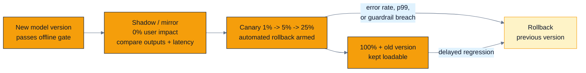
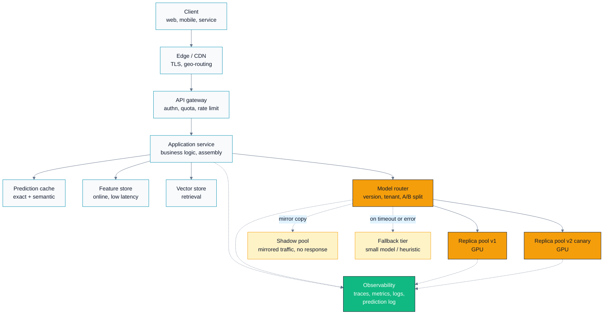
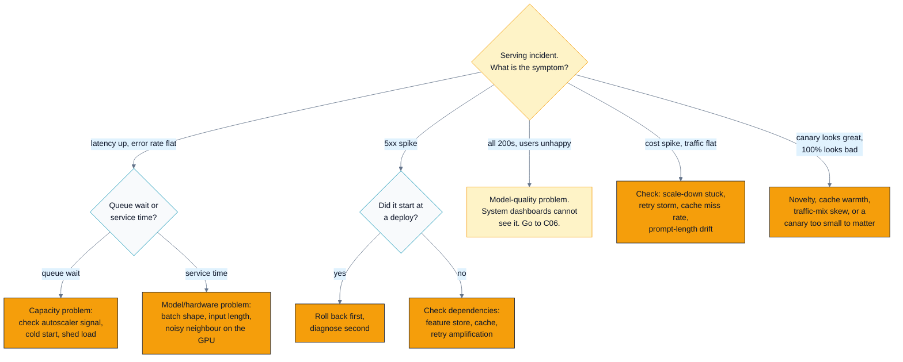

# C05 — Deployment & Serving Architecture

> Track C · Module 05 · Status: **DRAFT** · Est. 7 hours · Depth 4/5
>
> Prerequisites: [C01](../C01.problem-framing-and-metrics/README.md) (metrics and guardrails),
> [C02](../C02.data-pipelines-and-features/README.md)
> ([training/serving skew](../../../docs/GLOSSARY.md#training-serving-skew)),
> [C04](../C04.production-model-optimization/README.md) (making one replica fast).
> Useful but not required: Track B for the GPU-performance vocabulary.
> Terms: [GLOSSARY.md](../../../docs/GLOSSARY.md) · Sources: [REFERENCES.md](../../../docs/REFERENCES.md).
>
> **This is a design module.** There is no `hip/` or `cuda/` code — the artefacts are three
> pure-standard-library Python tools in [`tools/`](tools/) and paper design drills in
> [`exercises/`](exercises/). See §4 for why, and what is deliberately *not* here.
>
> **Scope boundary.** Everything *inside* one replica — [continuous batching](../../../docs/GLOSSARY.md#continuous-batching),
> paged [KV cache](../../../docs/GLOSSARY.md#kv-cache),
> [speculative decoding](../../../docs/GLOSSARY.md#speculative-decoding),
> [quantized](../../../docs/GLOSSARY.md#quantization) kernels — belongs to Track B
> ([B04](../../B-gpu-ml-performance/B04.precision-and-quantization/README.md) and the planned
> [`B06.inference-serving-optimizations`](../../B-gpu-ml-performance/B06.inference-serving-optimizations/README.md))
> and to [C04](../C04.production-model-optimization/README.md).
> This module owns everything *around* the replica: the architecture it sits in, how it scales,
> how a new version reaches users, and how the system behaves when it breaks.

---

## 1. TL;DR + Layman analogy

**TL;DR.** Getting a model into production is not "deploy the artefact". It is choosing a serving
pattern (online, async, streaming, batch, edge) from the latency, cost, freshness, connectivity and
privacy requirements; putting the model behind its own service so it can scale and ship
independently; scaling that service on **queue depth**, not CPU or GPU utilization, because a GPU
replica takes *minutes* to load its weights while traffic doubles in *seconds*; releasing the new
version through **shadow → canary → full** with automated rollback triggers wired to error rate,
p99 latency and a quality guardrail; measuring the change with an
[A/B test](../../../docs/GLOSSARY.md#ab-testing-and-canary) that randomizes on
**users** and does not peek; and designing every failure path to degrade to *something* — a cached
prediction, a smaller model, a heuristic — rather than a 500.

**Layman analogy — opening a new bridge.** You have built a second bridge across the river. You do
not divert the morning rush onto it on day one. First you drive **test trucks** across it while the
old bridge carries all real traffic: nobody is inconvenienced if the trucks find a problem — that is
**shadow traffic**. Then you open **one lane to a small fraction** of cars, with engineers watching
the strain gauges and a barrier crew standing by to close it in seconds — that is a **canary with
automated rollback**. Only when the gauges stay flat across a full weekday cycle, including rush
hour, do you move everyone over. And you keep the old bridge standing and maintained for a while,
because the fastest fix for a bad new bridge is the old one — that is **keeping the previous model
version loadable**.

**Where the analogy breaks — and it breaks in four places that matter:**

1. **A bridge does not learn from its own traffic.** Your model's outputs shape the data that trains
   its successor. A bridge that made the next bridge's blueprint worse every time a car crossed it
   would be a better analogy, and it is the subject of
   [C06](../C06.monitoring-drift-and-ethics/README.md).
2. **Bridge capacity is fixed and instant.** A lane is either open or closed. A GPU replica takes
   two to ten minutes to become useful because it must pull and load tens of gigabytes of weights.
   There is no "open one more lane right now."
3. **Strain gauges measure the thing you care about.** Your dashboard does not. A model can return
   HTTP 200 in 40 ms with a perfectly healthy GPU and be confidently, quietly wrong. Bridges fail
   loudly; models fail silently.
4. **Bridge users are interchangeable.** Your users are not: measuring per-*car* when the metric you
   care about is per-*commuter* is exactly the randomization-unit error that invalidates most
   badly-run A/B tests (§3.6).



*Read the two arrows into `Rollback`: a release process without an automatic path back is not a
release process, it is an announcement. The second arrow matters as much as the first — regressions
that only appear at 100% traffic or after a day of cache warming are common.*

**By the end of this module you can:** pick a serving pattern from stated requirements and defend
it; draw the serving architecture with a per-hop latency budget that adds up; choose an autoscaling
signal and justify a warm-pool size in dollars; write a rollout plan with numeric automated
rollback triggers; size an A/B test, compute its result, and find the three classic errors in
someone else's test; and compute what a fallback chain is actually worth in nines and in quality.

---

## 2. First Principles

### 2.1 Start from the question, not the framework

Every serving decision falls out of five requirements. Write them down *before* you name a
technology, because the technology choices are downstream and mostly interchangeable.

| Requirement | The question | What it decides |
|---|---|---|
| **Latency** | Is a human waiting, and for how long? | online vs async vs batch |
| **Freshness** | How stale may the prediction be? | precompute vs compute-on-request |
| **Cost** | What is a prediction allowed to cost? | batch size, hardware, cache aggression |
| **Connectivity** | Can the client reach a server, always? | edge/on-device vs server-side |
| **Privacy** | May the raw input leave the device or region? | on-device, regional pinning, redaction |

### 2.2 Derive the five serving patterns

Take the naive answer first — *one HTTP endpoint that runs the model* — and push on it.

**Pattern 1 — Online / synchronous request-response.** Client sends a request, blocks, gets a
prediction. Correct when a human or a downstream synchronous system is waiting and the work fits in
the latency budget. Breaks when: the work takes longer than the caller will wait, or the caller
disconnects and you have wasted a GPU-second.

**Pattern 2 — Asynchronous queue + worker.** Client submits, receives a job ID, polls or gets a
webhook. Correct when the work is long (document analysis, video, large batch generation) or bursty.
The queue is not a detail, it is the *point*: it decouples arrival rate from service rate, so a
traffic spike becomes a longer wait instead of an outage. Breaks when: users actually needed a
synchronous answer and you have handed them a polling loop, or the queue silently grows for an hour
because nothing alerts on its depth.

**Pattern 3 — Streaming (token-by-token via SSE or WebSocket).** The response is emitted
incrementally. This exists because for generative models, **time-to-first-token is the latency the
user perceives** and total generation time is not. A 20-token/s stream that starts in 300 ms feels
faster than a 4-second blocking response of the same length. Breaks when: your load balancer,
gateway or corporate proxy buffers the response — you get all the complexity of streaming and none
of the perceived latency benefit. Test this end-to-end through the real ingress path, not against
the pod.

**Pattern 4 — Batch / offline scoring.** Score everything on a schedule, write to a store, serve
lookups. Correct when the input space is enumerable and predictions stay valid for hours: nightly
recommendations, risk scores, embeddings for a catalogue. It is dramatically cheaper — huge batches,
spot/preemptible GPUs, no tail-latency engineering — and the serving path becomes a key-value read
with single-digit-millisecond latency. Breaks when: the prediction depends on in-session context,
the entity set is unbounded, or "hours stale" is wrong for the domain.

**Pattern 5 — Edge / on-device.** The model runs on the client. Correct when connectivity is
unreliable, the input is sensitive, latency must be tens of milliseconds, or per-request server cost
is prohibitive at your scale. Breaks when: you need to roll back — you cannot, because the model is
on a hundred million devices behind app-store review, so **your release process is now app
release-management**, not deployment. Also: fleet heterogeneity means your accelerator budget is
whatever the worst supported device has.

**These compose.** A production system usually runs three of them at once: batch-precompute the
candidate set overnight, online-rerank the top 500 at request time, and stream the generated
explanation. Ask the five questions *per stage*, not per system.

### 2.3 Why the model gets its own service — and what that costs

The naive design puts the model inside the application process. It is simpler, has no network hop,
and is the right answer for a small scikit-learn model on a CPU. It breaks for GPU models on four
axes:

1. **Independent scaling.** Application traffic and inference load are not proportional. Fusing them
   means scaling web servers to buy GPU capacity, or the reverse.
2. **Independent deploys.** Model versions ship on a different cadence, with a different validation
   gate and different owners. Coupling them means every model rollback is an application rollback.
3. **Different hardware.** Your app tier wants many cheap CPU cores. Your model wants a $30k
   accelerator that must stay busy to be worth its price. Bin-packing those into one deployable is
   how you end up paying for idle GPUs attached to web servers.
4. **Batching across callers.** A dedicated model service can batch requests from *different*
   application instances into one GPU launch. In-process cannot — this is often the single largest
   throughput factor and it is structurally unavailable to the fused design.

The cost of the split is real and you should say it out loud in a design review:

- **An extra network hop.** 1–5 ms same-zone, ~10 ms cross-zone, ~50 ms+ cross-region. On a 40 ms
  budget that is not a rounding error.
- **A serialization boundary.** Tensors become protobuf or JSON and back. For large embedding
  payloads this can exceed the inference time itself.
- **More operational surface.** Another deployment, another set of dashboards, another on-call
  runbook, another authentication boundary, another thing that can be misconfigured.
- **Harder debugging.** A request now spans two services, so you need distributed tracing with a
  propagated request ID before you need it, not after.

**Decision rule.** Split when the model needs different hardware, a different release cadence, or
cross-caller batching. Otherwise embed it and enjoy the simplicity. "Everyone uses microservices" is
not a reason.

### 2.4 The latency budget is arithmetic, and it must close

The single most common design-interview failure is quoting a p99 target and never decomposing it.
Do the arithmetic. Here is a search-reranking example with a **250 ms p99 end-to-end** budget:

```
  client -> edge                       15 ms   (TLS, geography; measure, don't guess)
  edge -> gateway (authn, rate limit)   5 ms
  gateway -> app service                2 ms
  app -> feature store (p99!)          25 ms   <- p99, not mean: you are budgeting the tail
  app -> model service (network)        3 ms
  model service: queue wait            20 ms   <- this is what the autoscaler controls
  model service: batch formation        8 ms   <- the batching latency/throughput knob
  model service: GPU forward pass      60 ms
  model service: post-process           5 ms
  app: assemble response               10 ms
  network back to client               15 ms
  ------------------------------------------
  total                               168 ms
  budget                              250 ms
  headroom                             82 ms   (33%)
```

Three rules this exposes:

1. **Sum p99s, not means.** Tail latencies do not average out; a request that is slow at one hop is
   not compensated by being fast at another. Summing p99s is itself conservative (the true p99 of a
   sum is lower unless hops are perfectly correlated), but conservative in the safe direction.
2. **Keep 30–40% headroom.** The budget must survive a partially degraded day, a retry, and a GC
   pause. A budget with 2% headroom is already violated.
3. **Every hop you cannot name is a hop you cannot fix.** If the numbers do not add up to the
   observed p99, you have an unmeasured hop. Find it before optimizing the GPU.

### 2.5 The one number that makes GPU serving different

A stateless web server cold-starts in ~1 second. A GPU model replica must:

| Stage | Typical order of magnitude |
|---|---|
| Pod scheduled, GPU attached | 5–30 s |
| Container image pulled (if not cached) | 30 s – 5 min for multi-GB CUDA/ROCm images |
| Weights read from object store or NVMe | tens of GB — **this dominates** |
| Weights copied [host → device](../../../docs/GLOSSARY.md#host-and-device) over [PCIe](../../../docs/GLOSSARY.md#pcie-and-host-device-transfer) | seconds to tens of seconds |
| Runtime warm-up: kernel autotune, graph capture, first-token JIT | 10–60 s |

Order of magnitude: **2–10 minutes** for a large model from a cold node, versus **1 second** for a
web server. Now the back-of-envelope that decides your entire scaling strategy:

```
  traffic doubles in                    ~30 s   (a push notification, a link on social media)
  a new replica becomes useful in      ~300 s   (cold start)
  ratio                                   10x
```

**You cannot react your way out of this.** By the time reactive capacity arrives, the spike is over
and you have both violated the SLO *and* paid for capacity you no longer need. Every viable strategy
therefore does one of three things: keep spare capacity ready (costs money), make the cold start
shorter (engineering), or make the queue absorb the burst (costs latency). [Lab 2](#lab-2--make-the-cold-start-tradeoff-measurable-toolscapacity_autoscalepy)
measures all three.

---

## 3. Deep Dive

### 3.1 The reference architecture



*The load-bearing detail is the **router**: version routing, tenant routing, canary splitting,
shadow mirroring and fallback all live at one layer, which is why that layer must be simple,
extremely reliable, and separately deployable from the models it routes to. Note also that the
shadow pool's responses go nowhere — mirroring is only safe if the mirrored path has no side
effects.*

**What each hop earns its place with:**

| Hop | Why it exists | What it costs | Failure mode to design for |
|---|---|---|---|
| Edge/CDN | TLS termination near the user, static assets, DDoS absorption | a hop; cache invalidation complexity | serving a stale cached prediction after a model rollback |
| Gateway | authn, per-tenant quota, rate limiting, request ID minting | 2–10 ms; a single choke point | becomes the SPOF; quota misconfig locks out a whole tenant |
| Prediction cache | huge cost saving on repeated inputs | staleness; **must be keyed by model version** | forgetting the version in the cache key, so a rollback keeps serving the bad model's answers |
| Feature store | consistent features between training and serving | p99 tail risk on the critical path | the skew problem from [C02](../C02.data-pipelines-and-features/README.md); a slow feature lookup eats the whole budget |
| Router | version/tenant/experiment routing in one place | a hop; config complexity | config error routes 100% to the canary |
| Replica pool | the actual inference | the money | cold start, OOM on long inputs, queue collapse |
| Fallback tier | turns an outage into a degradation | extra system to maintain and *test* | never exercised, so it is broken when needed |
| Observability | everything in [C06](../C06.monitoring-drift-and-ethics/README.md) | storage and sampling cost | prediction log missing the inputs you need to debug |

> **The cache key trap, stated plainly.** A prediction cache keyed only on the input is a landmine.
> You roll back a bad model; the cache keeps serving its outputs until the TTL expires. Key on
> `(input_hash, model_version, feature_schema_version)` and your rollback is instant. This is a
> two-line fix that is almost always made after the incident rather than before it.

### 3.2 Autoscaling GPUs: pick the right signal

**Why CPU utilization is wrong.** In a GPU inference service the CPU mostly marshals bytes. It can
sit at 15% while the GPU is saturated and the queue is 40 requests deep. Scaling on CPU means never
scaling.

**Why raw GPU utilization is also wrong** — and this one catches experienced people. The
`utilization.gpu` counter reported by `nvidia-smi` / `amd-smi` means *"a kernel was resident during
the sampling interval"*, not *"the device was doing useful work at capacity"*. A serving loop that
runs one small kernel continuously reports ~100% at 5 requests/second and at 50. The signal
saturates far below saturation, so it cannot tell you *how far behind you are*.

**Why queue depth is right.** [Little's law](../../../docs/REFERENCES.md#littles-law-little-1961)
makes the connection exact:

```
  L = λ · W        L = requests in system, λ = arrival rate, W = time in system
```

You have an SLO on `W`. You control `λ` only by shedding. So the only lever is capacity, and
`L` — the queue — is the directly observable, immediately actionable proxy for `W`. Queue depth
rises the instant demand exceeds capacity and falls the instant it does not. That is exactly the
property a control signal needs.

**Practical scaling signals, best first:**

| Signal | Good | Bad |
|---|---|---|
| **Queue depth / pending requests per replica** | direct, leads latency, actionable | needs the server to export it |
| **Batch fullness** (avg batch size ÷ max batch size) | for continuous-batching servers, tells you if you have headroom *within* a replica | server-specific |
| **Concurrency per replica** (in-flight requests) | what KServe/Knative use; easy to get at the proxy | less direct than queue depth under variable request sizes |
| **p95 latency** | it is the SLO | *lagging* — by the time it moves, users are already hurt; use as a guardrail, not the primary signal |
| **Token throughput vs known ceiling** | good for LLMs where request cost varies wildly | requires a calibrated ceiling per model+hardware |
| GPU utilization | — | saturates; nearly uninformative |
| CPU utilization | — | measures the wrong device |

**Also scale on the right unit.** For LLMs, one request is not one unit of work: a 200-token prompt
and a 30k-token prompt differ by orders of magnitude. Scale on tokens (or a cost estimate per
request), not request count, or your autoscaler will be systematically wrong whenever the prompt-mix
shifts.

**The four levers against cold start:**

1. **Pre-warmed pool.** Keep *N* extra loaded replicas parked. Simple, effective, and the cost is
   explicit and easy to put in a budget line. Size it from the observed ramp rate, not from a
   feeling: if traffic can rise by *R* rps/minute and a replica takes *T* minutes and serves *C* rps,
   you need roughly `R · T / C` warm replicas to absorb the ramp without queueing.
2. **Model caching on local NVMe.** The dominant cold-start term is usually pulling tens of GB from
   object storage. A node-local cache (a DaemonSet that pre-pulls, `hostPath`, or an image with the
   weights baked in) turns a network fetch into a local read and can cut the cold start by more than
   half. This is the highest-leverage engineering fix available.
3. **Over-provision explicitly.** Run at 60% target utilization instead of 85%. Say the number out
   loud in the design doc — an implicit over-provision is a cost nobody owns.
4. **Absorb in the queue.** Let latency rise briefly instead of dropping requests, with load
   shedding as the hard backstop. Cheapest, and correct when the SLO has slack.

**On scale-to-zero.** It is genuinely correct for internal tools, batch endpoints and dev
environments where nobody is waiting. It is almost always wrong for a user-facing path, because the
first request after an idle gap pays the entire cold start. [Lab 2](#lab-2--make-the-cold-start-tradeoff-measurable-toolscapacity_autoscalepy)
puts a number on that: in the shipped simulation, scale-to-zero on a sparse workload saves \$65/day
and moves SLO violations from 0% to 53%. If you cannot accept that, do not scale to zero — or make
the cold start small enough that you can.

### 3.3 Progressive delivery: four mechanisms, one purpose

The purpose is **bounding blast radius**. Each mechanism trades exposure against cost and signal
quality.

| Mechanism | User impact if bad | Cost | Signal you get | Best for |
|---|---|---|---|---|
| **Shadow / mirror** | none | 2× inference cost for mirrored traffic | latency, error rate, output *divergence* vs current — but **no** business metric, because nobody sees the output | infra changes, new serving stack, big refactors |
| **Canary** | limited to the exposed % | small | everything, including business metrics | model version changes |
| **Blue-green** | none until switch, then all users | **2× capacity during the overlap** — brutal on GPUs | pre-switch smoke test only | stateful migrations, when instant full rollback matters more than cost |
| **Feature flag** | limited, and controlled by product | negligible | per-cohort behaviour | product-level gating, kill switches |

**Shadow traffic has three traps.** (1) **Side effects**: if the mirrored path writes to a database,
sends an email, or increments a counter, you have just doubled your writes — mirroring is only safe
against a read-only path. (2) **Cost**: you are paying twice for inference; mirror a sample, not
everything. (3) **What it cannot tell you**: shadow mode measures whether the new model *runs*, not
whether it is *better*, because no user ever sees its output. Shadow is a safety check, not an
experiment.

**Canary is where the real decision is made.** A defensible canary specifies, in advance:

```
  stages           : 1% -> 5% -> 25% -> 50% -> 100%
  bake time        : >= 1 full business cycle per stage; >= 24 h before 100%
  sample size      : each stage must reach enough traffic for the guardrail to
                     have power (see tools/ab_calculator.py size)
  rollback triggers: numeric, automated, evaluated continuously
```

**Automated rollback triggers — always these three families:**

| Trigger | Example threshold | Why |
|---|---|---|
| **Error rate** | 5xx rate on canary > 1.5× baseline, sustained 5 min | the system is broken |
| **Latency** | canary p99 > 1.2× baseline p99, sustained 10 min | the system is too slow, and it will cascade |
| **Quality guardrail** | a business or proxy quality metric down > *X*% with the agreed confidence | **the system is healthy and the model is wrong** — the failure mode nothing else catches |

Notes that separate a real plan from a plausible one:

- Compare canary against **concurrently running baseline traffic**, never against yesterday. Traffic
  mix, cache warmth and weekday effects will otherwise dominate the comparison.
- Give thresholds a **sustain window**. A 30-second spike is noise; auto-rollback on noise trains
  the team to disable auto-rollback.
- **Stopping early for harm is legitimate; stopping early for a win is not** (§3.6). Guardrails are
  asymmetric on purpose.
- Rollback must be **rehearsed**. An untested rollback path is a hypothesis, not a control.

**Model rollback is a first-class operation.** That means, concretely: the previous version's
weights stay resident or immediately loadable (not "re-pull 40 GB from object storage"); the model
version is an explicit, immutable, logged identifier; the prediction cache is keyed by it; and
rolling back is a config change, not a rebuild. If your rollback requires a CI pipeline run, your
mean-time-to-recovery is your CI duration.

### 3.4 The offline–online gap

An offline metric win frequently fails to reproduce online. This is normal, and the reasons are
enumerable:

| Cause | Mechanism | Reference |
|---|---|---|
| **Training/serving skew** | features computed differently in the two paths | [C02](../C02.data-pipelines-and-features/README.md) |
| **Selection bias** | your offline set contains only items the *old* system chose to show | Bottou et al. 2013 |
| **Feedback loops** | logged labels were generated under the old policy | [C06](../C06.monitoring-drift-and-ethics/README.md) |
| **Metric mismatch** | offline AUC ≠ online revenue; the proxy was never validated against the target | Kohavi et al. |
| **Position/presentation effects** | offline evaluation ignores where and how the prediction is rendered | — |
| **Latency** | the better model is slower, and the added latency costs more than the accuracy gains | measurable, and often decisive |
| **Novelty/primacy** | the online effect is real but transient | §3.6 |

The practical stance: treat the offline metric as a **gate**, not a decision. It answers "is this bad
enough to not be worth an experiment?" The online experiment answers "is this better?" A team that
ships on offline metrics alone is guessing with extra steps.

### 3.5 Reliability engineering for ML

**Graceful degradation — never return a 500.** Design the fallback chain explicitly, in order, with
a stated quality for each level:

```
  1. primary model                      quality 1.00
  2. cached prediction for this key     quality ~0.7   (state the max age)
  3. smaller/faster model               quality ~0.65
  4. non-ML heuristic or popularity     quality ~0.4
  5. static safe default + retry hint   quality ~0.2   (never a 500)
```

Two rules. **Every fallback must be exercised in production**, on a schedule or by a random small
percentage of traffic — an untested fallback is broken, always, and you will discover it during the
incident. And **the response must say which level served it** (a header or a logged field), or your
metrics will show a healthy system quietly serving level-4 answers.

[Lab 3](#lab-3--price-the-fallback-chain-toolsdegradation_plannerpy) computes what the chain is
worth. Two results from it are worth internalizing now: a fallback chain quickly makes the *serial*
path (gateway, router) the binding constraint, so that is where the next nine comes from; and the
honest number to publish is **quality-weighted** availability, not "we returned 200".

**Timeouts, retries, backoff, jitter.**

- **Every** network call gets a timeout, set from the downstream p99 plus headroom — not a default.
  A missing timeout turns a slow dependency into a thread-pool exhaustion outage.
- Retry **only idempotent, non-degenerate** failures: connection errors, 503, 429-with-retry-after.
  Never retry a 400. Never retry a request that already burned 30 seconds of GPU.
- **Exponential backoff with full jitter.** Without jitter, all clients retry at the same instant and
  you have built a synchronized thundering herd that keeps the service down after the original cause
  is gone. AWS's *Timeouts, retries and backoff with jitter* is the canonical short read.
- **Cap total retries and add a retry budget** (e.g. retries ≤ 10% of requests). Uncapped retries
  amplify load exactly when the system is least able to take it — the classic cascading failure.
- Retries are **expensive on GPUs**. Retrying a long generation doubles the most costly resource you
  have. Prefer failing over to the fallback tier rather than retrying the primary.

**Circuit breakers.** After *N* consecutive failures, stop calling the dependency, fail fast to the
fallback, and probe periodically (half-open) to see if it recovered. This protects *you* from a slow
dependency and protects *it* from your retries. Tune the thresholds; a breaker that opens on noise is
worse than none.

**Load shedding.** When overloaded you must drop work — the only choice is whether you do it
deliberately. Reject early and cheaply at the gateway (before you have spent GPU time), shed the
lowest-value traffic first (free tier before paid, prefetch before interactive), and return 429 with
`Retry-After` rather than timing out. The SRE book's *Handling Overload* and *Addressing Cascading
Failures* chapters are the reference; the failure they describe — a system that stays down after the
cause is removed, kept there by its own retries — is common and specific to systems without shedding.

**Idempotency.** Give every request a client-supplied idempotency key. With retries, duplicate
delivery is certain, and for anything that costs money or has side effects, "exactly once" is
implemented as "at least once plus idempotency", never assumed.

### 3.6 A/B testing, done correctly

This is the part most teams get subtly and expensively wrong.

**Randomization unit: the user, not the request.** Suppose you randomize per request. A single user
now sees model A on some requests and B on others. Three things break at once:

1. **Contamination.** The user's experience is a blend, so you are measuring neither arm.
2. **Metric mismatch.** Your business metric ("did this user convert this session?") is defined at
   user level. There is no coherent way to attribute a user-level outcome to a request-level
   assignment.
3. **Understated variance.** Requests from the same user are correlated. Treating *n* requests as
   *n* independent samples inflates your effective sample size, shrinks your standard error, and
   produces confident nonsense. (If you genuinely must analyse a request-level metric with
   user-level assignment, use a cluster-robust variance estimator or the delta method — do not just
   count requests.)

Randomize on a **stable, hashed** identifier: `hash(user_id + experiment_salt) % 100`. Stable so a
user does not flip arms on re-login; salted per-experiment so concurrent experiments do not
correlate. When the treatment affects a shared entity (a marketplace seller, a social graph), the
unit may need to be a cluster or a region instead — see interference below.

**Sample size, power, and MDE.** Three quantities are locked together with the significance level:

- **α** — false-positive rate, conventionally 0.05.
- **Power (1 − β)** — probability of detecting a true effect of the assumed size, conventionally
  0.80. Underpowered tests are the silent majority failure: they mostly return "no significant
  difference", and teams read that as "no effect", which is a different claim entirely.
- **MDE** — the smallest effect you care to detect. Set it from *business value*, not statistics: if
  a 0.5% lift is not worth shipping, do not size a test to find it.

The relationship, for a two-sided two-proportion test:

```
  n_per_arm ≈ ( z_{1-α/2}·sqrt(2·p̄·(1-p̄)) + z_{power}·sqrt(p₁(1-p₁) + p₂(1-p₂)) )² / (p₂-p₁)²
```

The load-bearing consequence: **n scales as 1/MDE²**. Halving the effect you want to detect
*quadruples* the traffic and the duration. [Lab 1](#lab-1--size-evaluate-and-break-an-ab-test-toolsab_calculatorpy)
prints that sensitivity table so the shape is unmistakable.

**The peeking problem.** Each significance test has an α chance of a false positive. Test repeatedly
on accumulating data and stop the moment you see p < 0.05, and the *overall* false-positive rate is
far above α — you are running a multiple-comparisons procedure and reporting it as a single test.
The shipped simulation (A/A, so every "win" is false by construction) measures it:

| Looks before deciding | False-positive rate (simulated) |
|---:|---:|
| 1 | 5.1% |
| 2 | 8.5% |
| 5 | 13.5% |
| 10 | 18.1% |
| 20 | 24.9% |

*Simulated, seed 20240729, 4000 trials, 40 000 users/arm, true rate 0.12 in both arms.* At twenty
looks, one in four "significant wins" is pure noise. Fixes: fix the sample size in advance;
or use group-sequential boundaries (O'Brien–Fleming, Pocock) if you need pre-planned interim looks;
or use always-valid/sequential inference (Johari et al.) if you truly need a continuously-monitored
dashboard. And note the asymmetry: **stopping early for harm is always allowed** — guardrails exist
precisely to be watched continuously.

**Novelty and primacy effects.** Novelty: users engage with a change because it is *new*, and the
effect decays. Primacy: users are temporarily *worse off* because they knew the old flow, and the
effect improves. Both mean a short test measures a transient. Detect them by plotting the treatment
effect over time and by segmenting new versus existing users; the honest fix is to run long enough
for the curve to flatten.

**Interference / network effects.** The stable-unit-treatment-value assumption says one user's
treatment does not affect another user's outcome. It is false in exactly the settings where
experiments matter most:

- **Marketplaces**: a treatment that helps arm B buyers win auctions *hurts* arm A buyers. The
  measured lift is partly cannibalization, and the global effect on rollout is smaller — sometimes
  zero.
- **Social products**: content shown to a treated user reaches untreated friends.
- **Shared resources**: a treatment that uses more GPU capacity slows the control arm down.

Mitigations: cluster randomization (randomize communities, geographies, or graph clusters rather
than individuals), time-slice/switchback designs, and budget-split designs in marketplaces. Full
treatment in Kohavi, Tang and Xu; graph cluster randomization in Ugander et al.

**A correct experiment plan, in one block:**

```
  hypothesis        : the specific, falsifiable claim
  primary metric    : ONE metric, decided before launch
  guardrail metrics : latency p99, error rate, cost/request, a quality/safety metric
  randomization unit: user (hashed, salted, stable)
  MDE               : from business value
  sample size       : computed from MDE, alpha, power -- BEFORE launch
  duration          : >= 1 week (weekday/weekend), >= sample size, >= novelty decay
  analysis plan     : the test, the segments, the corrections -- written down first
  stopping rule     : fixed-n, or a pre-registered sequential boundary
  SRM check         : verify the actual traffic split matches the intended one
```

> **Sample ratio mismatch (SRM) is the cheapest bug-detector you will ever deploy.** If you assigned
> 50/50 and observe 50.4/49.6 on ten million users, something is broken — a redirect that drops
> users, a bot filter that hits one arm harder, a logging bug. A significant SRM invalidates the
> experiment; do not analyse the result, fix the pipeline. Check it automatically on every test.

### 3.7 Multi-model and multi-tenant serving

**Routing by version** is the foundation: an immutable version identifier travels with the request,
is logged with the prediction, and is part of every cache key. Without it, canaries, rollbacks and
post-hoc debugging are all guesswork.

**Packing several models onto one GPU** versus **dedicating hardware**:

| | Packed (multi-model per GPU) | Dedicated |
|---|---|---|
| Utilization | high — the point | low for spiky per-model traffic |
| Isolation | weak: one model's long request adds latency to another's | strong |
| Blast radius | an OOM takes down every model on the device | one model |
| Memory | must fit *all* resident weights + peak KV/activation | simple |
| Right for | many small/medium models, long tail, low per-model QPS | a few large, high-QPS, latency-critical models |

Middle grounds worth knowing: MIG (NVIDIA) and SR-IOV/partitioning (AMD) give hardware-enforced
slices with real isolation at the cost of fixed granularity; LoRA-style adapter serving keeps one
base model resident and swaps small per-tenant adapters, which is dramatically more efficient than
one full model per tenant when the tenants share a base; and on-demand model swapping (load-on-first
-request with an LRU cache of resident models) works when per-model traffic is sparse and the
load time is acceptable.

**Multi-tenant isolation** needs, at minimum: per-tenant rate limits and concurrency caps enforced
at the gateway (so one tenant cannot starve the rest — the noisy-neighbour problem is *guaranteed*,
not hypothetical, on shared GPUs); per-tenant cost attribution (in tokens or GPU-seconds, not
requests); separate queues or weighted fair queueing rather than one FIFO; and a clear data-isolation
story — at minimum tenant-scoped cache keys, so a semantic cache can never serve tenant A's
prediction to tenant B. That last one is a security bug, not a performance detail.

---

## 4. Hands-On Labs

**Why there is no `hip/` or `cuda/` code in this module.** The subject is the architecture around
the model, the release process, and the statistics of deciding whether a change helped. None of
those are kernel-level concerns, and writing a HIP kernel here would teach nothing about them. Kernel
work lives in Track A; single-replica inference performance lives in Track B
([B06](../../B-gpu-ml-performance/B06.inference-serving-optimizations/README.md)) and
[C04](../C04.production-model-optimization/README.md). What *is* runnable here are three tools that turn this
module's arguments into numbers you can put in a design doc.

All three are **pure standard library** — no numpy, no scipy, no pandas — so they run on any Python
3.8+ with nothing installed. Verify that claim yourself:

```bash
make check          # byte-compiles each tool and runs it under `python -S` (no site-packages)
```

```bash
make help           # list every target
make run            # run all three tools with their demo settings
make run-ab         # just the A/B calculator
make run-capacity   # just the autoscaling simulation
make run-degrade    # just the availability planner
make run-exercises  # list the design drills and verify each has a reference solution
make clean
```

On Windows PowerShell, either use WSL/Git Bash or run the scripts directly:
`python tools/ab_calculator.py -h`. (`make run PYTHON=python` also works if you have GNU make.)

> **Every number these tools print is simulated or computed from parameters you supply.** They are
> not measurements of any real system. Their value is that they make a tradeoff *arithmetic* instead
> of rhetorical — you can change an assumption and watch the conclusion move.

### Lab 1 — Size, evaluate, and break an A/B test (`tools/ab_calculator.py`)

```bash
python tools/ab_calculator.py                       # demo: all three sub-commands
python tools/ab_calculator.py size --baseline 0.12 --mde-rel 0.02 --daily-users 500000 \
                                   --traffic-fraction 0.2
python tools/ab_calculator.py evaluate --n-control 120000 --c-control 14320 \
                                       --n-treatment 120000 --c-treatment 14690
python tools/ab_calculator.py peeking --trials 4000 --look-counts 1 5 20
```

The normal CDF is built on `math.erfc` (accurate deep in the tail, unlike `1 - erf`) and the inverse
CDF is Acklam's rational approximation refined by one Halley step against that CDF — implemented in
the file rather than imported.

**What to observe:**

1. **`size`** — the sensitivity table at the bottom. Detecting a 1% relative lift instead of a 2%
   one takes **4×** the users. This is the single most useful fact to have at hand when a
   stakeholder asks for a two-day test on a 0.3% effect.
2. **`evaluate`** — the confidence interval, not the p-value. In the demo the p-value is 0.021
   (significant) but the interval on absolute lift is `[+0.00048, +0.00569]`: the effect could be
   almost twelve times smaller than the point estimate. "Significant" and "big enough to ship" are
   different questions.
3. **`peeking`** — the false-positive rate climbing from 5.1% to 24.9% as looks go 1 → 20, while the
   fixed-n column stays near α. Run it with `--seed` changed; the numbers move a little, the shape
   does not.

### Lab 2 — Make the cold-start tradeoff measurable (`tools/capacity_autoscale.py`)

```bash
python tools/capacity_autoscale.py                        # three panels, default parameters
python tools/capacity_autoscale.py --cold-start-s 30      # what a local NVMe weight cache buys
python tools/capacity_autoscale.py --slo-ms 500           # a tighter SLO changes every conclusion
python tools/capacity_autoscale.py --spike-factor 5       # a bigger flash crowd
python tools/capacity_autoscale.py -h                     # every knob
```

A day of diurnal traffic (15-second ticks, seeded lognormal noise, one 15-minute flash spike) is run
against several policies. The model includes admission control — the queue is capped at a few
seconds of work and excess is shed — because without it the simulation reports minute-long latencies
no real system would permit.

**What to observe:**

1. **Panel 1** — static-at-peak has zero violations at ~14% utilization and 3.6× the cost of
   reactive autoscaling. Note also the *honest negative result*: a warm pool of 2 barely moves SLO
   violations against a 2.5× flash spike, because two replicas cannot absorb a spike that needs
   thirty. Warm pools protect against *ramps*, not against *step changes*. Sizing one requires
   knowing which you are defending against.
2. **Panel 2** — the cleanest result in the module. Same policy, same traffic, same seed; only the
   weight-load time changes:

   | Cold start | SLO violations (simulated) | p99.9 latency |
   |---:|---:|---:|
   | 15 s | 0.11% | 1 501 ms |
   | 30 s | 0.17% | 1 874 ms |
   | 60 s | 0.30% | 5 400 ms |
   | 180 s | 0.79% | 5 400 ms |
   | 300 s | 1.42% | 5 400 ms |
   | 600 s | 2.48% | 5 400 ms |

   Cost is flat across the whole sweep (±1%). **Shrinking the cold start improves reliability at
   effectively zero cost, while every capacity lever trades one for the other.** That is why weight
   caching is the highest-leverage item on the list in §3.2 — and it is an argument you can now make
   with a table instead of an assertion.
3. **Panel 3** — scale-to-zero on a sparse workload: \$15/day instead of \$79/day, and 52.8% of
   requests violating the SLO instead of 0%. The cost saving is real; so is the fact that it is
   funded entirely by the users who arrive first after an idle gap.

### Lab 3 — Price the fallback chain (`tools/degradation_planner.py`)

```bash
python tools/degradation_planner.py                          # built-in LLM serving stack
python tools/degradation_planner.py --shared-fate 0.5        # fallbacks that share a dependency
python tools/degradation_planner.py --print-example > mystack.json
python tools/degradation_planner.py --config mystack.json    # your own architecture
```

**What to observe:**

1. **The fallback chain is worth about a nine** on the default stack (2.25 → 3.21), which is roughly
   1.8 days of annual downtime.
2. **But the with-fallback number equals the serial subtotal exactly.** Once the fallback chain is
   good, the gateway and router — the components with *no* alternative — become the binding
   constraint. The sensitivity table says the same thing: the top three improvements are all on the
   serial path. This is the correct place to spend the next engineering week, and it is not obvious
   before you do the arithmetic.
3. **Quality-weighted availability is materially lower** (2.70 nines vs 3.21). Reporting the
   any-response number while serving hour-old cached predictions is how an SLO stops meaning
   anything. Publish the quality-weighted row.
4. **`--shared-fate 0.5` erases most of the benefit.** Independence is an assumption, and it is
   usually wrong: a cache in the same cluster, a small model behind the same router, and a heuristic
   reading the same feature store all fail with the primary. Verify by actually failing the primary
   in a game day.

### Lab 4 — The design drills

[`exercises/`](exercises/) holds three written drills, with reference answers in
[`solutions/`](solutions/): design a serving stack with a closing latency budget, write a rollout
plan with numeric rollback triggers, and critique a flawed A/B test. These are the artefacts a
system-design interview actually asks for. Write yours before reading the solution — the value is in
producing the document, not in recognising a good one.

---

## 5. Performance Analysis

> **This section is deliberately reframed for Track C.** In Tracks A and B, "performance analysis"
> means kernel time, achieved bandwidth and roofline placement. Here the system under analysis is
> not a kernel — it is a deployment. The quantities that decide whether it is any good are
> **end-to-end latency budget, availability, cost per prediction, and the statistical power of the
> decision process**. Kernel-level analysis has not been dropped; it lives in Track B and
> [C04](../C04.production-model-optimization/README.md) and is
> a *component* of the first row below.

### 5.1 The four system-level quantities

| Quantity | Unit | How you compute it | Where it is analysed |
|---|---|---|---|
| **Latency** | ms, per hop, at p50/p95/p99 | sum the per-hop p99 budget (§2.4), then verify against traces | §2.4, Lab 2 |
| **Availability** | nines, and downtime/year | serial product × fallback chain, quality-weighted | Lab 3 |
| **Cost** | \$ per 1 000 predictions | GPU-hours × price ÷ predictions served | Lab 2, §5.3 |
| **Decision power** | MDE detectable in *T* days | sample size from α, power, baseline rate | Lab 1 |

### 5.2 Latency: where the time actually goes

The §2.4 budget is the design artefact; the profile below is what you check it against in production.
Two things distinguish a real analysis from a plausible one:

- **Separate queue wait from service time.** They have completely different fixes. Rising queue wait
  means add capacity or shed load. Rising service time means the model, the batch shape, or the
  hardware. A single "latency" number conflates them and sends you optimizing the wrong thing.
- **For generative models, report time-to-first-token and inter-token latency separately.** A single
  end-to-end number is close to meaningless: TTFT is dominated by
  [prefill](../../../docs/GLOSSARY.md#prefill-and-decode) and queueing, inter-token
  latency by decode throughput and batch pressure. They move independently and users perceive them
  differently.

Useful decomposition to keep in your head:

```
  total = queue_wait + batch_formation + prefill + decode + network + serialization
          \__________________________/   \_______________/
           the autoscaler's problem       Track B / C04's problem
```

### 5.3 Cost: the number that actually gets budgeted

```
  cost_per_1k = (GPU_hours_consumed × price_per_GPU_hour) / (predictions_served / 1000)
```

From the shipped simulation (**simulated**, default parameters, \$3.00/GPU-hour):

| Policy | GPU-h/day | \$/day | SLO violations | Utilization |
|---|---:|---:|---:|---:|
| static @ peak (48 replicas) | 1 152.0 | 3 456 | 0.00% | 14% |
| reactive autoscale (floor 1) | 316.6 | 950 | 0.79% | 52% |
| reactive + warm pool 2 | 364.8 | 1 095 | 0.79% | 45% |
| reactive + warm pool 5 | 436.8 | 1 310 | 0.76% | 38% |
| reactive + warm pool 10 | 557.0 | 1 671 | 0.48% | 30% |

Three readings, and the third is the interesting one:

1. **Utilization is the cost story.** 14% versus 52% is the entire 3.6× difference. On GPUs,
   utilization *is* the budget.
2. **The warm pool is priced insurance.** Going from no pool to ten costs \$721/day and buys 0.31
   percentage points of SLO violations. Whether that is a good trade is a question for whoever owns
   the SLO and the budget — your job is to hand them this table, not to decide unilaterally.
3. **The intermediate warm pools are nearly worthless here** (0.79% → 0.76%) while costing real
   money. Do not assume a lever is monotone-useful because it is directionally right; measure it.
   Against this particular threat — a 2.5× step spike — the choice is a pool big enough to matter or
   no pool at all.

Also track **cost per *successful* prediction** and **cost per unit of business value**. A policy
that is cheap per request but sheds 5% of traffic is not cheap; it has moved the cost off your
invoice and onto your users.

### 5.4 Decision power: the statistics are part of the system

A deployment process that cannot tell a 1% improvement from noise will ship regressions and reject
wins, regardless of how good the infrastructure is. From Lab 1, at a 12% baseline, α = 0.05,
power = 0.80:

| Relative MDE | Users per arm | Days at 100k eligible users/day |
|---:|---:|---:|
| 4% | 73 186 | 1.5 |
| 2% | 290 273 | 5.8 |
| 1% | 1 156 135 | 23.1 |
| 0.5% | 4 614 613 | 92.3 |

**This table is a capacity plan for your decision-making.** If your product cannot reach a million
users per arm in a reasonable window, you cannot detect a 1% effect — and the correct response is to
change what you measure (a more sensitive metric, variance reduction such as CUPED, a
higher-frequency surrogate) rather than to run an underpowered test and interpret its silence as
evidence of no effect.

### 5.5 A worked before/after

The Track-C analogue of "we optimized the kernel and measured the delta". Same traffic, same seed,
same policy; the only change is engineering effort spent on the cold start:

| | Before (300 s cold start) | After (30 s, weights on local NVMe) | Delta |
|---|---:|---:|---|
| SLO violations | 1.42% | 0.17% | **−88%** |
| p99.9 latency | 5 400 ms | 1 874 ms | **−65%** |
| GPU-hours/day | 314.8 | 315.4 | +0.2% (noise) |
| Cost/day | \$944 | \$946 | flat |

*Simulated; reproduce with `python tools/capacity_autoscale.py --cold-start-s 300` and
`--cold-start-s 30`.* An 88% reduction in SLO violations for no additional infrastructure cost is
the kind of result that justifies the engineering week — and the reason to run the simulation before
asking for it, not after.

---

## 6. Challenges, Drawbacks & Tradeoffs



*The branch worth memorizing is the middle one: **all 200s and users unhappy**. Every other branch
is visible on a standard service dashboard; that one is invisible by construction, which is the
entire reason [C06](../C06.monitoring-drift-and-ethics/README.md) exists.*

### The failure modes a reviewer should look for

| # | Failure mode | Why it happens | What to check in review |
|---|---|---|---|
| 1 | **Autoscaling on GPU utilization** | it is the obvious metric and it is on the default dashboard | what is the HPA/KEDA metric? if it is `DCGM_FI_DEV_GPU_UTIL` or CPU, push back |
| 2 | **Scale-to-zero on a user-facing path** | the cost dashboard is very persuasive | what does the first request after an idle gap experience? |
| 3 | **No warm pool and no cold-start budget** | nobody owns the ramp | how fast can traffic rise, and how fast can capacity? |
| 4 | **Prediction cache not keyed by model version** | the key was written before versioning existed | read the cache key. Literally read it. |
| 5 | **Untested fallback path** | it is only needed during an incident | when was it last exercised, and how? |
| 6 | **Retry without jitter or budget** | the client library default | look at the retry config; unbounded retries turn a blip into an outage |
| 7 | **Rollback requires a rebuild** | the previous artefact was not kept loadable | time a rollback in staging. If it exceeds MTTR targets, it is not a rollback |
| 8 | **Request-level randomization** | it is easier to implement | what is the hash input? |
| 9 | **Peeking / stopping on a win** | the dashboard updates continuously and humans are impatient | was the sample size fixed in advance? is there an SRM check? |
| 10 | **No guardrail metric on the canary** | error rate and latency feel sufficient | which metric catches "healthy but wrong"? |
| 11 | **Shadow traffic with side effects** | the mirrored path was assumed read-only | trace the writes |
| 12 | **Blue-green on GPUs without a capacity plan** | the pattern is copied from web services | do you have 2× GPU quota during the overlap? |
| 13 | **Offline win shipped without an online test** | the offline number was impressive | which of the seven causes in §3.4 have been ruled out? |
| 14 | **Semantic cache shared across tenants** | the cache was built before multi-tenancy | is the tenant in the cache key? this is a data-leak bug |

### Honest tradeoffs

- **Availability vs correctness.** Graceful degradation means sometimes returning a worse answer.
  For a recommendation, obviously right. For a medical triage or a credit decision, a wrong answer
  may be far worse than no answer — some systems *should* fail closed. Decide deliberately, document
  it, and get sign-off from whoever owns the risk.
- **Cost vs latency.** Every latency improvement past a point is bought with idle capacity. There is
  no configuration that is simultaneously cheapest and fastest; there is only a curve and a choice
  of point on it.
- **Velocity vs safety.** A five-stage canary with 24-hour bakes is safe and slow. For a low-risk
  change it is bureaucracy. Tier your release process by blast radius — not every change deserves
  the same ceremony.
- **Simplicity vs capability.** Every box in the §3.1 diagram is a real thing to operate. A team of
  three should not run all of them. Start with gateway → model service → observability and add a box
  only when a specific, observed problem demands it.
- **Statistical rigour vs speed.** Correct experiments are slow. The answer is usually a more
  sensitive metric or variance reduction, not abandoning rigour — but sometimes, for a genuinely
  reversible low-risk change, "ship it and watch the guardrails" is the right call. Say which mode
  you are in.

### When *not* to use this machinery

If you serve 10 requests per second from one CPU model, you do not need a router, a canary
controller, a feature store, or a fallback tier. You need a health check, a way to roll back, and an
alert. Premature architecture has a cost, and on a small team that cost is usually the feature you
did not ship.

---

## 7. Real-World Use Cases

- **LLM assistants** are the reference case for this whole module: streaming responses over SSE,
  continuous batching inside each replica ([vLLM](../../../docs/REFERENCES.md#vllm-project),
  [SGLang](../../../docs/REFERENCES.md#sglang-project)), TTFT as the user-facing latency metric, semantic caching,
  cold starts measured in minutes because the weights are hundreds of gigabytes, and a fallback to a
  smaller model when the primary pool is saturated. [KServe](https://kserve.github.io/website/) and
  [NVIDIA Triton Inference Server](https://docs.nvidia.com/deeplearning/triton-inference-server/user-guide/docs/index.html)
  are the two most widely documented open serving stacks; both expose exactly the version routing,
  canary weighting and metrics-based autoscaling described in §3.
- **Recommendation systems** are the canonical hybrid: nightly batch scoring for candidate
  generation, online reranking under a tens-of-milliseconds budget, and a popularity-based heuristic
  as the level-4 fallback. Also the canonical setting for interference in experiments, since users
  compete for the same inventory.
- **Fraud and abuse detection** is where the fallback design gets hard: the fallback must be *safe*,
  not merely available, so "allow everything" is not an option and the degraded path is usually a
  conservative rules engine plus a manual review queue.
- **Search ranking** is where the offline–online gap and the peeking problem were most publicly
  studied — the Kohavi et al. papers below are largely built on Bing's experimentation platform, and
  the "five puzzling outcomes" paper is the best short read on results that look wrong and are not.
- **On-device models** (keyboard prediction, photo classification, on-device speech) are the pattern
  where deployment *is* app release management: staged rollout through the app store, no instant
  rollback, and a server-side kill switch as the only fast lever. Design the kill switch first.
- **Progressive delivery tooling** in the wild:
  [Argo Rollouts](https://argo-rollouts.readthedocs.io/en/stable/) and
  [Flagger](https://docs.flagger.app/) both implement canary analysis with automated rollback against
  metric queries — a useful concrete grounding for §3.3, and worth reading even if you do not use
  Kubernetes.

**Where to go next.**
[C06](../C06.monitoring-drift-and-ethics/README.md) picks up the one failure this module can only
point at — the deployment that returns 200s and wrong answers — and turns it into monitoring you can
alert on.
[B06](../../B-gpu-ml-performance/B06.inference-serving-optimizations/README.md) is the
inside-the-replica counterpart to everything here: the batching, caching and scheduling that decide
how much traffic each of these GPUs can actually take, which is the input to every capacity number
in §5.
[C07](../C07.capstone-case-studies/README.md) is where the architecture, the rollout plan and the
experiment design stop being separate exercises and have to hold together in one system.

---

## 8. Cited References

Grounding for the claims above. Sources shared with other modules are cited by anchor into the
[master bibliography](../../../docs/REFERENCES.md), where the URL and its retrieval date live; the
rest are specific to this module and carry their own link.

**Production ML systems**

- [**Hidden Technical Debt in Machine Learning Systems** (Sculley et al., 2015)](../../../docs/REFERENCES.md#hidden-technical-debt-in-machine-learning-systems-sculley-et-al-2015)
  — the origin of "ML systems are mostly not the model"; source for the feedback loops, entanglement
  and configuration debt behind §3.4's offline–online gap.
- [**The ML Test Score** (Breck et al., 2017)](../../../docs/REFERENCES.md#the-ml-test-score-breck-et-al-2017)
  — the production-readiness rubric behind the release-gate and rollback requirements in §3.3.
- [**Rules of Machine Learning** (Zinkevich, Google)](../../../docs/REFERENCES.md#rules-of-machine-learning-zinkevich-google)
  — practical rules on serving/training skew, launching, and metric choice; the closest thing to a
  checklist for §2's requirement-first framing.
- [**Software Engineering for Machine Learning** (Amershi et al., 2019)](../../../docs/REFERENCES.md#software-engineering-for-machine-learning-amershi-et-al-2019)
  — how ML release processes differ from software release processes in practice, which is the
  premise of §3.3.

**Reliability engineering**

- [**Little's Law** (Little, 1961)](../../../docs/REFERENCES.md#littles-law-little-1961) — the
  `L = λ·W` identity §3.2 uses to argue that queue depth, not utilization, is the autoscaling signal.
- Beyer, Jones, Petoff, Murphy, eds. (2016). *Site Reliability Engineering*, O'Reilly / Google —
  free online. Chapters used here: *Embracing Risk* (error budgets),
  *Handling Overload* (load shedding), *Addressing Cascading Failures* (retry amplification),
  *Monitoring Distributed Systems*. <https://sre.google/sre-book/table-of-contents/>
- AWS Builders' Library. *Timeouts, retries, and backoff with jitter* — the canonical short treatment
  of the retry-storm failure mode. <https://aws.amazon.com/builders-library/timeouts-retries-and-backoff-with-jitter/>
- Brooker (2015). *Exponential Backoff and Jitter*, AWS Architecture Blog — the measurements behind
  "full jitter". <https://aws.amazon.com/blogs/architecture/exponential-backoff-and-jitter/>
- Fowler. *CircuitBreaker* — the pattern, concisely. <https://martinfowler.com/bliki/CircuitBreaker.html>
- Fowler. *BlueGreenDeployment* and *CanaryRelease* — the deployment patterns in §3.3.
  <https://martinfowler.com/bliki/BlueGreenDeployment.html> ·
  <https://martinfowler.com/bliki/CanaryRelease.html>

**Online controlled experiments**

- Kohavi, Tang, Xu (2020). *Trustworthy Online Controlled Experiments: A Practical Guide to A/B
  Testing*, Cambridge University Press — the standard reference for randomization units, SRM,
  guardrails, novelty/primacy, and interference. <https://experimentguide.com/>
- Kohavi, Deng, Frasca, Longbotham, Walker, Xu (2012). *Trustworthy Online Controlled Experiments:
  Five Puzzling Outcomes Explained*, KDD — primacy/novelty and results that look wrong but are not.
  <https://dl.acm.org/doi/10.1145/2339530.2339653>
- Kohavi et al. (2013). *Online Controlled Experiments at Large Scale*, KDD — platform-level
  practice, including SRM detection. <https://dl.acm.org/doi/10.1145/2487575.2488217>
- Johari, Pekelis, Walsh (2015). *Always Valid Inference: Continuous Monitoring of A/B Tests* —
  the peeking problem stated formally, and one principled fix. <https://arxiv.org/abs/1512.04922>
- Miller. *How Not To Run an A/B Test* — the shortest correct explanation of peeking, with the same
  simulation this module's `peeking` sub-command reproduces.
  <https://www.evanmiller.org/how-not-to-run-an-ab-test.html>
- Deng, Xu, Kohavi, Walker (2013). *Improving the Sensitivity of Online Controlled Experiments by
  Utilizing Pre-Experiment Data* (CUPED), WSDM — variance reduction when you cannot get more traffic.
  <https://dl.acm.org/doi/10.1145/2433396.2433413>
- Ugander, Karrer, Backstrom, Kleinberg (2013). *Graph Cluster Randomization: Network Exposure to
  Multiple Universes*, KDD — the standard treatment of interference. <https://dl.acm.org/doi/10.1145/2487575.2487695>
- Bottou et al. (2013). *Counterfactual Reasoning and Learning Systems*, JMLR — why logged data from
  the deployed policy is biased, which is the mechanism behind most offline–online gaps.
  <https://jmlr.org/papers/v14/bottou13a.html>

**Serving systems**

- [**vLLM**](../../../docs/REFERENCES.md#vllm-project) and
  [**SGLang**](../../../docs/REFERENCES.md#sglang-project) — the two open runtimes that implement the
  inside-the-replica behaviour §7 attributes to LLM assistants; read them for what a replica in the
  §3.1 diagram is actually doing between the router and the GPU.
- KServe documentation — model serving on Kubernetes: canary rollout by traffic percentage,
  concurrency-based autoscaling, scale-to-zero and its caveats (retrieved 8 Aug 2026).
  <https://kserve.github.io/website/>
- NVIDIA Triton Inference Server documentation — multi-model serving, model repository versioning,
  dynamic batching, per-model metrics (retrieved 8 Aug 2026).
  <https://docs.nvidia.com/deeplearning/triton-inference-server/user-guide/docs/index.html>
- Argo Rollouts documentation — progressive delivery with automated metric-driven analysis and
  rollback (retrieved 8 Aug 2026). <https://argo-rollouts.readthedocs.io/en/stable/>
- Ray Serve documentation — model composition, autoscaling and multi-model deployment patterns
  (retrieved 8 Aug 2026). <https://docs.ray.io/en/latest/serve/index.html>

*Note on statistics:* the sample-size and two-proportion z-test formulae in `tools/ab_calculator.py`
are the standard normal-approximation forms found in any biostatistics text; Acklam's inverse-normal
rational approximation is a widely-used published algorithm. Neither is novel to this module.

---

## 9. Self-Assessment & Interview Drills

### Conceptual (answers below)

1. Your GPU inference service autoscales on GPU utilization and never scales up, even though p99
   latency is five times the SLO. Explain precisely why, and state what you would scale on instead.
2. A teammate proposes scale-to-zero for a user-facing chat assistant to cut cost, noting that
   traffic is near zero from 02:00 to 06:00. What is the specific failure, and what would you propose
   instead?
3. A model is rolled back after a bad canary, but users keep reporting the bad behaviour for another
   forty minutes. The rollback definitely completed. What is the most likely cause?
4. An A/B test randomizes on `request_id`. The primary metric is "fraction of *users* who completed
   checkout". Name the three distinct problems this creates.
5. A test was sized for 300 000 users per arm. At 60 000 users the dashboard shows p = 0.03 and the
   PM wants to ship. What do you say, and what is the one situation in which stopping early *is*
   correct?
6. Your offline evaluation shows a 3% AUC improvement. The online A/B test shows no significant
   change in any metric. Give four distinct explanations that do not involve anyone making a mistake.
7. You add a cached-prediction fallback in front of a model with 99.5% availability. The cache is
   98% available. Your availability calculation says the pair is 99.99%. Why is the real number
   likely lower, and how would you find out?
8. Explain to a non-technical executive, in three sentences, why shipping a new model to 100% of
   users on Monday morning is riskier than it sounds — without using the words "canary", "shadow" or
   "rollback".

<details markdown="1">
<summary>Answers</summary>

1. The GPU utilization counter reports whether a kernel was resident during the sampling window, not
   whether the device is at capacity. A serving loop running back-to-back kernels reads ~100% at any
   request rate, so the signal saturates and never crosses a scale-up threshold. Scale on **queue
   depth or pending requests per replica** (or batch fullness / concurrency), which rises the moment
   demand exceeds capacity. Keep p95 latency as a guardrail, not as the primary signal, because it
   lags.
2. Cost is not the issue; the **first request after the idle gap** is. It pays the full cold start —
   minutes for a large model — so the 06:00 user, and everyone queued behind them, experiences an
   outage. Instead: keep a floor of one or two warm replicas (small absolute cost overnight, when
   capacity is cheapest), and if the cost genuinely matters, attack the cold start with local NVMe
   weight caching. Simulation in Lab 2, panel 3: \$65/day saved, 53% of requests violating the SLO.
3. The **prediction cache is not keyed by model version**, so it is still serving the bad model's
   cached outputs until they expire. Related possibilities worth checking: a CDN caching responses,
   or a downstream store holding materialized predictions written by the bad version. The fix is to
   put the model version in every cache key and to invalidate on rollback.
4. (a) **Contamination** — one user is served by both arms, so neither arm's experience is measured.
   (b) **Unit mismatch** — a user-level outcome cannot be coherently attributed to a request-level
   assignment. (c) **Understated variance** — requests from one user are correlated, so treating them
   as independent inflates the effective sample size, shrinks the standard error, and produces
   spurious significance.
5. Stopping at the first look that crosses α is peeking: the false-positive rate is far above the
   nominal 5% (the shipped A/A simulation measures 18% at ten looks). Either run to the planned
   sample size, or use a pre-registered sequential/group-sequential boundary. Also check for SRM
   before believing any interim number. The legitimate exception is **stopping early for harm** — a
   guardrail breach is a reason to stop immediately, and that asymmetry is intentional.
6. Any four of: **training/serving skew** (features differ between the two paths); **selection bias**
   in the offline set (it only contains items the old system chose to show); **metric mismatch** (AUC
   was never validated as a proxy for the business metric); **the added latency of the better model
   cancels its accuracy gain**; **the test is underpowered** for the true effect size; **position or
   presentation effects** the offline evaluation cannot see; **feedback loops** — the offline labels
   were generated under the old policy.
7. The calculation assumes **independent failures**. If the cache and the model sit in the same
   cluster, behind the same router, or depend on the same config service, a large share of the
   primary's failure modes take the fallback down too. Find out by running a **game day**: actually
   fail the primary in production (or a production-like environment) and measure what the fallback
   does. `degradation_planner.py --shared-fate 0.5` shows the arithmetic cost of the assumption.
8. "We would be changing the system for everyone at once, at the busiest hour, with no way to tell
   quickly whether it made things worse. If it is worse, everyone experiences that until we notice
   and undo it — and problems with these systems are often invisible in our standard health
   dashboards, because the service keeps responding normally while giving worse answers. Moving a
   small fraction of traffic first, at a quiet hour, costs us a day and removes almost all of that
   exposure."

</details>

### Design drills

Do these in [`exercises/`](exercises/); reference answers with reasoning in
[`solutions/`](solutions/). These are written artefacts — produce the document, then compare.

1. **Design the serving stack** (`exercises/01_design_the_serving_stack.md`) — for a stated product,
   choose the serving pattern, the scaling signal, the caching strategy and the failure behaviour,
   and produce a per-hop latency budget that adds up to the stated SLO with headroom.
2. **Write the rollout plan** (`exercises/02_rollout_plan.md`) — shadow → canary → full for a new
   model version, with numeric automated rollback triggers, bake times, and the sample size each
   stage needs for its guardrail to have power.
3. **Critique the A/B test** (`exercises/03_ab_test_critique.md`) — a flawed test description with a
   randomization-unit error, peeking, and a missing guardrail. Find all three (there are more), then
   write the correct design.

### Stretch

- Re-run `capacity_autoscale.py` with your own service's parameters (measure your real cold start
  with a stopwatch and `kubectl get pods -w`, or the equivalent) and produce the cost-versus-SLO
  table for *your* system. Take it to your next capacity review.
- Extend `degradation_planner.py` to model *partial* degradation — a fallback that serves only a
  subset of request types — and see how much of the headline availability number survives.
- Take the `peeking` simulation and add a Pocock or O'Brien–Fleming boundary. Verify that the
  false-positive rate returns to ~α, and note what you paid for it in required sample size.
