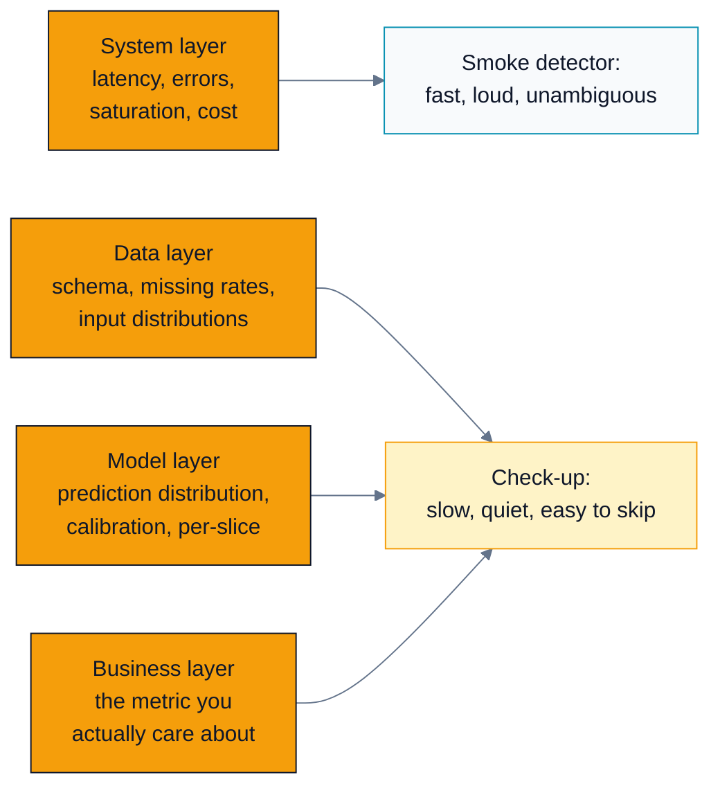
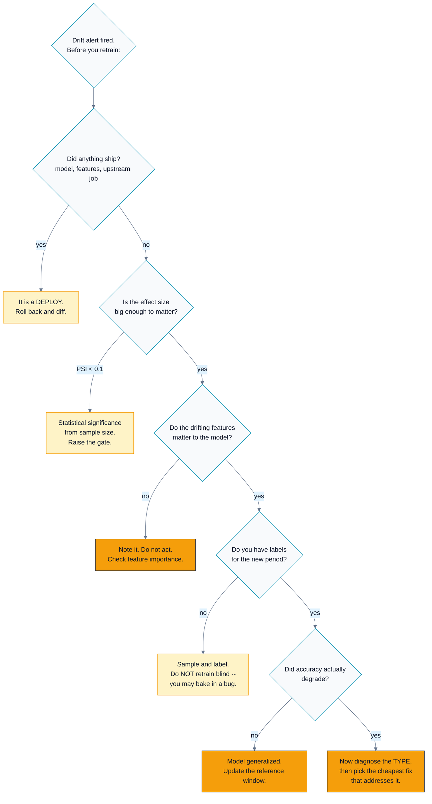

# C06 — Monitoring, Drift, Feedback Loops & Ethics

> Track C · Module 06 · Status: **DRAFT** · Est. 7 hours · Depth 4/5
>
> Prerequisites: [C01](../C01.problem-framing-and-metrics/README.md) (metrics and guardrails),
> [C02](../C02.data-pipelines-and-features/README.md)
> ([skew](../../../docs/GLOSSARY.md#training-serving-skew) and lineage),
> [C05](../C05.deployment-and-serving-architecture/README.md) (the system this module watches).
>
> **This is a design module.** There is no `hip/` or `cuda/` code — the artefacts are three
> pure-standard-library Python tools in [`tools/`](tools/) and paper design drills in
> [`exercises/`](exercises/). See §4 for why.
>
> **On the fairness and privacy material (§3.7–3.8):** it is presented as engineering — criteria,
> theorems, measurable tradeoffs, and the requirement to *justify a choice*. It is not a moral
> lecture, and it does not state legal requirements as fact. Where the law is the binding
> constraint, this module says "involve counsel", because that is the correct engineering answer.
>
> Terms: [GLOSSARY.md](../../../docs/GLOSSARY.md) · Sources: [REFERENCES.md](../../../docs/REFERENCES.md).

---

## 1. TL;DR + Layman analogy

**TL;DR.** A deployed model can be **perfectly healthy and quietly wrong**: 200s, low latency, GPU
warm, and predictions that stopped being right three weeks ago. So you monitor four layers — system,
data, model, business — and alert on very few of them. You distinguish **covariate shift**
(*P(x)* moved), **prior/label shift** (*P(y)* moved) and
**[concept drift](../../../docs/GLOSSARY.md#drift)** (*P(y|x)* moved), because
only the last one *necessarily* requires retraining. You accept that labels arrive days or months
late, so real accuracy is unknown in the moment and you must monitor proxies. You take seriously the
fact that **the model's own predictions generate the data that trains its successor**, and you buy
your way out with exploration, logged propensities and an unaffected control population. And you
treat fairness as a **choice between criteria that provably cannot all hold at once** — a choice you
must make, justify, and write down — rather than a box to tick.

**Layman analogy — a smoke detector versus a health check-up.** Your service dashboard is a **smoke
detector**. It is loud, fast, and unambiguous: the building is on fire, get out. It answers one
question well and instantly. Model monitoring is the **annual check-up**. You walk in feeling fine.
You look fine. Nothing hurts. And the blood test comes back with a number that has been drifting for
two years, that you could not have felt, and that will matter enormously in five. The smoke detector
cannot find that, no matter how good a smoke detector it is — they are answering different
questions.

**Where the analogy breaks — in four places that matter:**

1. **A check-up has a reference range.** Your model does not. "Is a prediction distribution mean of
   0.31 healthy?" has no universal answer; it depends on last month's 0.28 and on whether the world
   changed in between. Choosing that reference window is a design decision, and §3.4 argues it is one
   people make by accident.
2. **Blood tests come back in a week.** Your labels may come back in six months, or never. That is
   the delayed-label problem (§3.5), and it is the single biggest practical obstacle in this module.
3. **Your body does not change because you measured it.** Your model does. The predictions it makes
   today become the training data for its successor, which is a mechanism a check-up has no analogue
   for and which is the most dangerous dynamic here (§3.6).
4. **A check-up has one patient.** Your model has population subgroups whose results differ, and
   aggregate health can look fine while one group's results are terrible. Per-slice evaluation is
   not optional (§3.7).



*Three of the four layers feed the check-up, and the check-up is the one nobody is paged for — which
is exactly why teams build the system layer well and the other three badly.*

**By the end of this module you can:** design a four-layer monitoring plan and say which signals
alert versus dashboard; name a drift type from evidence and choose the cheapest fix that addresses
it; explain why delayed labels make accuracy unobservable and what to do instead; recognise and
measure a feedback loop before it closes; and state which fairness criterion a system should satisfy,
what enforcing it costs, and how you would justify that choice to a non-technical stakeholder.

---

## 2. First Principles

### 2.1 Why software monitoring is insufficient, derived

A conventional service is monitored on the assumption that **correct behaviour is defined by the
code**. If the code is running, the requests are succeeding, and the latency is acceptable, the
service is doing what it was built to do. Bugs are deviations from a specification you wrote.

A model has no specification of that kind. Its correct behaviour is defined by a **relationship
between inputs and outcomes in the world** — and the world is not under version control. So:

```
  software failure : the code stopped matching its specification
                     -> visible as an error, a crash, a timeout
  model failure    : the world stopped matching the training data
                     -> visible as NOTHING, until you measure outcomes
```

This is the entire justification for the module. A model that has silently become 12 points less
accurate emits no error, no exception, no latency change and no log line. It emits **confident
predictions that are wrong**, at the usual rate, in the usual time. The failure is invisible by
construction, so the monitoring must be *constructed on purpose* rather than inherited from your
service template.

### 2.2 Derive the four layers

Ask what could be wrong, from the outside in. Each question that the previous layer cannot answer
creates a new layer.

| Layer | The question it answers | What the previous layer misses |
|---|---|---|
| **1. System** | Is it running and fast? | — |
| **2. Data** | Is it receiving what it expects? | A healthy service fed garbage returns garbage on time |
| **3. Model** | Is it producing sensible outputs? | Valid inputs can still produce a collapsed or miscalibrated output distribution |
| **4. Business** | Is it producing *value*? | A sensible-looking prediction distribution can still be worthless or harmful |

Each layer is strictly more informative and strictly harder to measure, harder to attribute and
slower to respond. That gradient is why teams stop at layer 1, and why the systems that fail
silently are the ones that stopped there.

### 2.3 Derive the drift taxonomy from the joint distribution

A supervised model learns from samples of a joint distribution `P(x, y)`. Factor it two ways:

```
  P(x, y) = P(y | x) · P(x)          the discriminative view
          = P(x | y) · P(y)          the generative view
```

Anything that can change must be one of those factors. That gives you the taxonomy — it is not a
list someone made up, it is exhaustive by construction — and the names below are the standard ones,
from [*Dataset Shift in Machine Learning*](../../../docs/REFERENCES.md#dataset-shift-in-machine-learning-2009)
(Quiñonero-Candela et al., 2009):

| Name | What moves | Concrete example | Does it need a retrain? |
|---|---|---|---|
| **Covariate shift** | `P(x)` changes, `P(y\|x)` fixed | A marketing campaign brings a younger cohort. Age distribution moves; the relationship between age and churn does not. | **Not necessarily.** If the model generalizes to the new region, nothing is wrong. If it does not, importance weighting or targeted data collection may fix it. |
| **Prior / label shift** | `P(y)` changes, `P(x\|y)` fixed | Fraud attempts rise from 0.4% to 1.1% of transactions. Fraudulent transactions still *look* the same; there are simply more of them. | **Usually not.** Adjust the threshold or reweight to the new prior. Cheap, fast, reversible. |
| **Concept drift** | `P(y\|x)` changes | A competitor launches. The same customer, with the same features, now churns where they previously would not. **The target function itself moved.** | **Yes, necessarily.** No reweighting fixes a changed relationship, because the function you are approximating is different. |

**The one sentence to remember:** *only concept drift necessarily requires retraining, and it is the
only one you cannot detect by watching the inputs.* Every other kind announces itself in a
distribution you can monitor cheaply. Concept drift is silent, needs labels, and is the expensive
one. Naturally.

### 2.4 The measurement that is missing

Take the obvious monitoring design — "alert when accuracy drops" — and push on it.

```
  t = 0      prediction made: "this loan will not default"
  t = 0      user sees the decision
  t = ?      the loan defaults, or does not, over 36 months
```

**You cannot compute accuracy today.** The label does not exist yet. For fraud you may wait 30–90
days for a chargeback; for churn, one churn window; for medical outcomes, years. For a large share
of production ML the honest statement is: *we will know whether today's model is good in six
months.*

Everything in §3.5 follows from that single fact. It is also why input and prediction monitoring
matter so much: they are the only signals available **now**.

### 2.5 The dynamic that has no analogue in software

```
  model_v1 -> predictions -> user behaviour -> logs -> training data -> model_v2
      ^                                                                    |
      +--------------------------------------------------------------------+
```

That arrow closing the loop is the whole problem — it is the *feedback loop* that
[*Hidden Technical Debt in Machine Learning Systems*](../../../docs/REFERENCES.md#hidden-technical-debt-in-machine-learning-systems-sculley-et-al-2015)
(Sculley et al., 2015) names as a defining cost of production ML, and it lives in the data rather
than in any line of code. A recommender that shows only popular items
observes clicks only on popular items and concludes that only popular items are wanted. A fraud
model that blocks a transaction **never observes whether it would have been fraudulent** — the
counterfactual is destroyed by the action. A hiring model trained on past hiring decisions learns to
reproduce them, including the ones that were wrong.

Note the crucial property: **nothing drifts**. The world can be perfectly stationary and the loop
still closes, purely because the model's actions determine what it gets to see next.
[Lab 2](#lab-2--watch-a-feedback-loop-close-toolsfeedback_loop_simpy) demonstrates exactly this:
in the shipped simulation, item quality never changes, and the greedy recommender still ends up
having never shown 240 of 400 items and having found only 3 of the true top 10.

---

## 3. Deep Dive

### 3.1 The four layers, concretely: what alerts, what dashboards

**Alert fatigue is a real failure mode, and it is terminal.** A pager that fires on noise gets
muted, and then the one real page is missed. So the discipline is: **alert only on things that are
(a) actionable now, (b) urgent, and (c) reliably detectable.** Everything else goes on a dashboard
with a weekly review, or into an automated report. The rubric behind the table below is
[*The ML Test Score*](../../../docs/REFERENCES.md#the-ml-test-score-breck-et-al-2017)
(Breck et al., 2017), which scores a production system on the tests and monitors it has in place
rather than on how well its model scores offline.

| Layer | Signal | Alert? | Threshold shape |
|---|---|---|---|
| **System** | error rate (5xx) | **page** | > 1% for 5 min |
| | p99 latency | **page** | > SLO for 10 min |
| | queue depth / saturation | **page** | > 2× target for 10 min |
| | GPU cost per hour | ticket | > 1.3× 7-day median for 1 h |
| **Data** | schema violation / unparseable input | **page** | any sustained rate > 0.1% |
| | missing-feature rate, per feature | **page** if a top-10-importance feature; else ticket | > training rate + 5 pp for 30 min |
| | new categorical value never seen in training | ticket | > 1% of requests |
| | input drift (PSI) per feature | **dashboard** | review weekly; alert only on top-importance features at PSI > 0.25 |
| **Model** | prediction distribution mean/quantiles | **page** if it collapses (e.g. all predictions in one bin) | ± 3σ of the 30-day band |
| | confidence / calibration (ECE) | dashboard + weekly | ECE > 1.5× baseline |
| | per-slice performance (delayed) | ticket when labels land | any slice > 2× the aggregate degradation |
| | fallback-tier rate | **page** | > 5% of requests |
| **Business** | the primary metric | **page** only for a large, fast move | > 5% below the seasonal-adjusted band for 2 h |
| | guardrail metrics | ticket | pre-agreed thresholds |
| | user complaints / reports | ticket, and read them | any statistically unusual increase |

Three rules that keep this survivable:

1. **Alert on symptoms, not causes.** "p99 latency exceeded the SLO" is actionable. "Feature 47's
   PSI is 0.13" is not — it is a clue, and clues belong on dashboards.
2. **Never alert per-feature on drift.** With 200 features at α = 0.05 you get ten "drifted"
   features every day by construction. §3.4 expands on this; it is the single most common way a
   drift dashboard becomes ignored.
3. **Every alert has a runbook** with the first three things to check. An alert with no runbook is a
   notification, and notifications get muted.

### 3.2 What to log, and why it is the highest-leverage decision

You cannot debug a model failure without the evidence, and the evidence must have been captured
*before* the failure. Log, per prediction, with sampling if volume demands it:

```
  request_id, timestamp, tenant/user_id (hashed)
  model_version, feature_schema_version, prompt/template version
  the FEATURE VALUES as the model saw them   <- not the raw request: the post-transform values
  the prediction, and the score/probability, not just the decision
  the propensity, if any randomization was involved   <- see 3.6; this is the expensive one to add later
  which fallback tier served it
  latency, and downstream outcome id (to join labels when they arrive)
```

**The feature values as the model saw them** is the line people regret. Logging the raw request and
recomputing features later gives you the *training* pipeline's view, not the *serving* pipeline's —
which is precisely the difference you are trying to detect. Log post-transform.

**The propensity** is the other one. If you did not log it at the time, no amount of later
cleverness recovers it, and every off-policy estimate you want to compute becomes impossible
(§3.6).

### 3.3 Detecting drift: the three tests and what they actually tell you

```mermaid
%%{init: {
  'theme': 'base',
  'themeVariables': {
    'primaryColor': '#F8FAFC',
    'primaryTextColor': '#0F172A',
    'primaryBorderColor': '#0891B2',
    'lineColor': '#64748B',
    'secondaryColor': '#E0F2FE',
    'tertiaryColor': '#EEF2FF',
    'fontFamily': 'Inter, Segoe UI, sans-serif'
  }
}}%%
flowchart TD
  START{"Model performance<br/>looks degraded"}
  Q1{"Did the input<br/>distribution move?"}
  Q2{"Did the prediction<br/>distribution move?"}
  Q3{"Did the prediction<br/>distribution move?"}
  Q4{"Did the label<br/>prior move?"}

  START --> Q1
  Q1 -->|yes| Q2
  Q1 -->|no| Q3
  Q2 -->|yes| COV["COVARIATE SHIFT<br/>reweight, collect data<br/>in the new region"]
  Q2 -->|no| UNUSED["Drifting features are<br/>ones the model ignores.<br/>Check feature importance"]
  Q3 -->|yes| BUG["SERVING-PATH INCIDENT<br/>not drift. Check deploys,<br/>encodings, upstream joins"]
  Q3 -->|no| Q4
  Q4 -->|yes| PRIOR["PRIOR SHIFT<br/>adjust threshold or<br/>reweight to new prior"]
  Q4 -->|no| CONCEPT["CONCEPT DRIFT<br/>retrain. Nothing else<br/>fixes a moved P&#40;y&#124;x&#41;"]

  classDef trackC fill:#F59E0B,stroke:#0F172A,color:#0F172A
  classDef neutral fill:#F8FAFC,stroke:#0891B2,color:#0F172A
  classDef warn fill:#FEF3C7,stroke:#F59E0B,color:#0F172A
  class START,Q1,Q2,Q3,Q4 neutral
  class COV,PRIOR,CONCEPT trackC
  class BUG,UNUSED warn
```



*The branch worth memorizing: **inputs stable, predictions moved** is almost never drift. It is a
deploy, an encoding change, or an upstream join failing to a default — an incident, and retraining
would bake the bug into the next model.*
[Lab 1](#lab-1--tell-four-kinds-of-degradation-apart-toolsdrift_detectorpy) reproduces all four
branches on seeded data.

| Test | What it measures | Good for | The catch |
|---|---|---|---|
| **PSI** (population stability index) | binned distribution divergence, an *effect size* | numeric features, the industry default in credit risk | thresholds (0.1 / 0.25) are **rules of thumb from practice, not derived**. Calibrate them against your own retraining history |
| **KS statistic** | max gap between empirical CDFs | numeric features, distribution-free, no binning choice | at production sample sizes p is always tiny; use **D** (the effect size), not p |
| **Chi-square** | categorical homogeneity | categorical features | invalid when expected cell counts are small; merge rare categories. Use **Cramér's V** as the effect size |
| **Embedding / representation drift** | distance between embedding distributions (MMD, or a domain classifier's AUC) | text, images, audio — anything with no meaningful "features" | expensive, and hard to attribute: it tells you *that* something moved, rarely *what* |

The **domain-classifier trick** deserves a mention because it is so cheap: train a small classifier
to distinguish reference-window samples from current-window samples. If it cannot beat chance, the
distributions are indistinguishable. If it gets AUC 0.85, they are not, and its feature importances
tell you *which* features carry the difference. That last property is what the distance metrics lack.

**Three practical warnings, all of which the shipped tool prints:**

1. **High-dimensional drift tests fire constantly.** 200 features at α = 0.05 gives you ten
   "significant" drifts a day from chance alone. Correct for multiplicity, or threshold on effect
   size, or restrict testing to the features the model actually depends on. Do at least one.
2. **Statistical significance is not practical significance.** With ten million rows, a shift too
   small to change a single decision is detected at p < 10⁻¹². The p-value is measuring your sample
   size. Report and threshold on PSI, KS D, or Cramér's V.
3. **The reference window is a decision, not a default.** A **fixed baseline** (the training set)
   detects total accumulated change but eventually flags everything, because the world genuinely
   moved and you accepted it. A **rolling window** (last 30 days) detects sudden change but is blind
   to slow drift — the boiling-frog failure, where every day looks like yesterday and the year looks
   nothing like the year before. **Run both.** Fixed against training for "how far have we come",
   rolling for "what changed this week".

### 3.4 The delayed-label problem

Real accuracy is unavailable in the moment. Everything below is a way to make decisions without it.

| Mitigation | What it gives you | What it costs / where it lies to you |
|---|---|---|
| **Proxy metrics** — clicks, dwell time, task completion, user edits of the output | available immediately, correlated with quality | correlation is not identity; optimizing a proxy is how you get a model that games it |
| **Prediction-distribution monitoring** | catches collapse, miscalibration, and serving bugs *today* | blind to concept drift (see the Lab 1 scenario where nothing observable moves) |
| **Targeted labelling of a sample** | genuine, unbiased accuracy on a small sample | costs money and time; the sample must be **random**, not the confusing cases someone escalated |
| **Human review queues** | ground truth on the cases that matter most | reviewers are biased toward what the model already flagged — an instance of the §3.6 loop |
| **Earlier surrogate labels** | e.g. 7-day repayment as a surrogate for 36-month default | the surrogate relationship can itself drift, and you will not notice |
| **Back-testing when labels arrive** | the honest number, eventually | it is a *post-mortem*, not a control. Use it to calibrate your proxies |
| **Shadow labelling with a stronger model** | a cheap approximate signal at scale | inherits the stronger model's biases; useful for triage, never for evaluation |

The design pattern that ties these together: **use immediate signals to detect *change*, and delayed
labels to detect *degradation*.** They answer different questions and you need both. And when the
labels do arrive, go back and check whether your proxies moved when they should have — that is how a
proxy earns the right to be trusted.

### 3.5 Feedback loops: the most dangerous dynamic in the module

The mechanism is §2.5. Here is what it does in practice.

| System | The loop | Consequence |
|---|---|---|
| **Recommender** | Only recommended items get impressions, so only they get clicks, so only they look good | Catalogue collapse, popularity concentration, and an inability to *ever* discover a better item. Homogenization across users (Chaney et al. 2018) |
| **Fraud / abuse** | Blocked transactions have no observed outcome | The model never learns whether it was right. The training set contains only transactions the *previous* model allowed — a censored sample |
| **Credit / hiring** | Rejected applicants have no observed outcome | Same censoring, with a fairness dimension: if the model under-approves a group, it also stops learning about that group |
| **Search ranking** | Position bias: rank-1 gets clicked because it is rank 1 | The model learns that its own ranking is correct. Self-confirming |
| **Content generation** | Model outputs are published, scraped, and become training data | Distribution collapse over generations (Shumailov et al. 2023) |

**Countermeasures, in order of how much they buy you:**

1. **Exploration.** Show a fraction of traffic something the model did not pick. ε-greedy is the
   clearest to reason about; Thompson sampling explores far more efficiently for the same regret.
   Even 1–2% changes the outcome dramatically — Lab 2 measures 40% catalogue coverage at ε = 0
   versus 99.2% at ε = 0.02.
2. **Log the propensity of every action.** The probability with which the deployed policy chose what
   it chose. This is *the* enabling data for off-policy estimation, it costs one column, and it
   **cannot be reconstructed later**. If you take one operational thing from this module, take this.
3. **Off-policy correction.** With propensities logged you can compute inverse-propensity-weighted
   or doubly-robust estimates of how a *different* policy would have performed, from logs alone
   (Bottou et al. 2013; Joachims et al. 2017). Without them, you cannot.
4. **An unaffected control population.** A small holdout that never receives model-driven treatment.
   Expensive — you are knowingly giving some users a worse experience — and it is the only clean
   measurement of what the model is doing to the system over the long run. Many mature
   experimentation programmes maintain one permanently.
5. **Monitor the loop directly.** Catalogue coverage, long-tail impression share, and diversity are
   the metrics that move when a loop closes. They are not on any default dashboard. Put them on
   yours.

### 3.6 Retraining strategy

**Scheduled versus triggered:**

| | Scheduled (e.g. weekly) | Triggered (on a drift or performance signal) |
|---|---|---|
| Predictable | yes — capacity, review, on-call all plannable | no |
| Responsive | up to one period late | fast |
| Failure mode | retrains when nothing changed, burning compute and adding release risk for no gain | the trigger is noisy, so it fires on nothing, or is tuned so high it never fires |
| Verdict | the sane default for most systems | add it as an *additional* trigger, not a replacement |

Most mature systems run **scheduled retraining with a triggered override**, and — importantly —
scheduled retraining that produces a model which does **not** pass the gate simply does not ship.
Retraining is not deployment.

**"Retrain on what data?" is the question people skip.** Options and their traps:

- **All history** — maximum data, but the old regime dilutes the new one. Wrong after concept drift.
- **A recent window** — adapts fast, forgets seasonality, and shrinks your rare-class examples to
  nothing. A fraud model on 30 days of data may have seen very little fraud.
- **Time-decayed weighting** — usually the right compromise; the decay constant is a real
  hyperparameter that deserves tuning, not a default.
- **Only data from after a known regime change** — correct after a genuine concept drift, and
  requires you to know the change point.

**Guard against training on your own outputs.** Concretely: exclude model-generated content from
training corpora where you can identify it; do not treat "the user accepted the suggestion" as an
unqualified positive label (they may have accepted the least-bad of three bad options); and prefer
labels from the unaffected control population when you have one. The generational-collapse result
(Shumailov et al.) is the extreme version, but the mild version is present in every system with a
loop.

**Every automatically retrained model still passes the full gate.** Same offline evaluation, same
per-slice checks, same fairness checks, same shadow and
[canary](../../../docs/GLOSSARY.md#ab-testing-and-canary) stages as a human-authored model —
[C05 §3.3](../C05.deployment-and-serving-architecture/README.md#33-progressive-delivery-four-mechanisms-one-purpose).
An automated pipeline that ships to production without a gate is an automated way to deploy a
regression at 03:00 on a Sunday. Automate the *training*; keep the *promotion* gated.

### 3.7 Fairness, technically

**The criteria.** Let *Ŷ* be the prediction, *Y* the outcome, *A* the group attribute, *S* the score.

| Criterion | Formal statement | Plain reading | Natural fit |
|---|---|---|---|
| **Demographic parity** | `P(Ŷ=1 \| A=a)` equal for all *a* | The same share of each group is selected | When the outcome variable is itself suspect, or parity is externally mandated |
| **Equal opportunity** | `P(Ŷ=1 \| Y=1, A=a)` equal | Among those who *truly* qualify, the same share are selected | Opportunity-allocating decisions: loans, interviews, treatment |
| **Equalized odds** | `P(Ŷ=1 \| Y=y, A=a)` equal for *y* ∈ {0,1} | Equal TPR **and** equal FPR | When both error types carry real cost |
| **Calibration within groups** | `P(Y=1 \| S=s, A=a)` equal | A score of 0.7 means 70% in every group | Risk scores consumed by a human decision-maker |
| **Predictive parity** | `P(Y=1 \| Ŷ=1, A=a)` equal | Equal precision across groups | When a positive prediction triggers a costly action |

**The impossibility result.** When base rates differ between groups and the classifier is imperfect,
**calibration and equalized odds cannot both hold** (Chouldechova 2017; Kleinberg, Mullainathan &
Raghavan 2016). This is a theorem. It is not a limitation of your model, your data, or your effort.
Similarly, predictive parity and equal FPR/FNR cannot generally coexist under different base rates.

The consequence is the load-bearing one for an engineer: **"is this model fair?" has no answer until
someone states which criterion applies and why.** That choice determines *who bears the cost of the
model's errors*. It belongs to the people accountable for the domain, with legal input where the
decision is regulated. Your job is to make the tradeoff surface visible and precise, not to pick a
metric that passes. Choosing the criterion after seeing which one passes is the fairness equivalent
of peeking.

[Lab 3](#lab-3--measure-the-fairness-tradeoff-toolsfairness_metricspy) makes this concrete on
seeded data with base rates of 0.41 and 0.25:

| Criterion enforced | DP diff | EO diff | FPR diff | PPV diff | Accuracy |
|---|---:|---:|---:|---:|---:|
| Shared threshold | 0.2087 | 0.2067 | 0.1098 | 0.0470 | 0.7698 |
| Equal opportunity | 0.0707 | **0.0017** | 0.0050 | 0.1476 | 0.7611 |
| Demographic parity | **0.0000** | 0.1071 | 0.0493 | 0.1968 | 0.7538 |

*Simulated. Read the diagonal: each row zeroes one column and moves the others. No row zeroes them
all, and no amount of engineering effort would produce one.*

**Sources of bias, because the fix depends on the source:**

| Source | Mechanism | Where the fix lives |
|---|---|---|
| **Historical** | The data faithfully records a biased world | Not in the model. Question the target variable itself |
| **Representation** | A group is under-sampled | Data collection; reweighting is a patch, not a fix |
| **Measurement** | The feature or the label means something different across groups (e.g. "arrests" as a proxy for "crime") | Feature and label definition. This is the most common and the most overlooked |
| **Aggregation** | One model for groups that need different ones | Model architecture; per-group models or group-aware features |
| **Deployment** | The model is used on a population or for a purpose it was not built for | Governance and documentation |

**Per-slice evaluation is not optional.** Aggregate metrics hide subgroup failures by construction:
a group that is 4% of your data can be catastrophically mis-served while moving the aggregate by
half a point. Evaluate on every slice you can define — demographic where lawful and appropriate,
plus geography, device, tenure, language, and the intersections. Watch for slices where the sample
is too small for the metric to mean anything, and say so rather than reporting a number from 40 rows.

**Documentation practice.** [Model cards](https://arxiv.org/abs/1810.03993) (Mitchell et al. 2019)
document intended use, out-of-scope use, per-slice performance, and the fairness criterion chosen
*with its justification*. [Datasheets for datasets](https://arxiv.org/abs/1803.09010) (Gebru et al.
2021) document provenance, collection process, and known limitations. Both are cheap, both are
mostly ignored, and both are the artefact you desperately want to exist when someone asks, two years
later, why the threshold is what it is.

### 3.8 Privacy and governance

Practical, not legalistic. **This module does not state legal requirements as fact** — jurisdictions
differ, they change, and the consequences of getting it wrong are not yours to absorb alone. Where a
decision is legally constrained, the correct engineering action is to involve counsel and to build
the *capability* to comply.

**PII minimization.** Collect what you need; do not collect what you might need. Every field you
store is a field you must protect, audit, delete on request, and explain. Hash or tokenize
identifiers, keep raw PII out of feature stores and prediction logs, and set retention deliberately
rather than by the storage default.

**Memorization and extraction.** Large models memorize training data, and memorized data can be
extracted (Carlini et al. 2019, 2021, 2022). Memorization increases with model size, with duplicate
examples, and with how unusual the example is — which is exactly the profile of a credit-card number
or a private message. Practical mitigations: deduplicate the training corpus (this is the single
most effective and cheapest lever), scan and filter for secrets and PII before training, test for
extraction with known canaries, and filter at output where the risk is high.

**Differential privacy.** A formal guarantee: the presence or absence of any single record changes
the output distribution by a bounded factor ε (Dwork et al. 2006; Abadi et al. 2016 for DP-SGD).
Real, and **it costs utility** — noise is added, and the cost falls hardest on exactly the rare
subgroups whose representation you were worried about in §3.7. It is a legitimate tool for specific
threat models, not a default setting, and "we use DP" without a stated ε and a stated adjacency
definition is not a claim about anything.

**The right to deletion, and what it means for a trained model.** Deleting a user's rows from your
database is straightforward. Removing their *influence* from a model trained on those rows is not:
strictly, it requires retraining without them. That is the problem machine unlearning addresses
(Bourtoule et al. 2021; SISA-style sharded training makes it tractable). Practical positions
organizations take include periodic retraining on a compliant corpus, sharded training to bound the
retraining cost, and documenting the deletion latency explicitly. **What is required of you is a
legal question**; what is *achievable*, and at what cost, is the engineering question this paragraph
answers. Know the difference and do not answer the first one yourself.

**Audit and lineage.** For any prediction you should be able to answer: which model version, trained
on which data snapshot, with which code commit, evaluated by which report, approved by whom, and
what did it output for this request. That chain is boring to build and impossible to reconstruct
after the fact. Build it before you need it, because the day you need it is a day when nobody has
time to build it.

---

## 4. Hands-On Labs

**Why there is no `hip/` or `cuda/` code here.** The subject is statistical detection, system
dynamics and decision criteria. A [kernel](../../../docs/GLOSSARY.md#kernel) would teach none of it.
What is runnable are three tools
that turn this module's three most abstract claims — *drift types are distinguishable*, *feedback
loops collapse coverage*, *fairness criteria conflict* — into numbers you can reproduce and argue
with.

All three are **pure standard library** — no numpy, no scipy, no pandas. Verify it:

```bash
make check          # byte-compiles each tool and runs it under `python -S` (no site-packages)
```

```bash
make help           # list every target
make run            # run all three tools with their demo settings
make run-drift      # PSI / KS / chi-square + drift classification
make run-feedback   # the recommender feedback loop
make run-fairness   # per-group metrics and the tradeoff table
make run-exercises  # list the design drills and verify each has a reference solution
make clean
```

On Windows PowerShell, use WSL/Git Bash or run the scripts directly:
`python tools/drift_detector.py -h`.

> **Every number these tools print is simulated or computed from data you supply.** They are not
> measurements of any production system. They exist so that "feedback loops are dangerous" becomes
> "the greedy policy never showed 240 of 400 items", which is an argument you can put in a design
> review.

### Lab 1 — Tell four kinds of degradation apart (`tools/drift_detector.py`)

```bash
python tools/drift_detector.py                        # four seeded scenarios
python tools/drift_detector.py --n 150                # watch the small-sample guards fire
python tools/drift_detector.py --print-example > drift.json
python tools/drift_detector.py --config drift.json    # your own data
```

The chi-square p-value comes from a locally-implemented regularized incomplete gamma function
(series below the mean, continued fraction above it) and the KS p-value from the Kolmogorov
distribution series — no scipy.

**What to observe:**

1. **Scenario 2 (covariate shift)** — PSI 0.36 on the input, and the prediction distribution moves
   with it. That is a *well-behaved* model responding to new inputs, and it may need no action at
   all.
2. **Scenario 3 (concept drift) is the important one.** Input PSI 0.008. Prediction PSI 0.004. KS p
   = 0.27. **Every input-monitoring signal says the system is fine**, and accuracy has fallen. This
   is the case that makes input-only drift monitoring insufficient, and you can see it in the output
   rather than take it on faith.
3. **Scenario 4 is not drift at all.** Inputs stable, prediction PSI 6.9 — an upstream join failing
   to a default. The classifier says "serving-path incident"; retraining would bake the bug in.
4. **Run every scenario twice**, once with labels and once without. The classification changes,
   because without labels you cannot distinguish "concept drift" from "no drift". That is the
   delayed-label problem showing up as a concrete limitation of your tooling.
5. **`--n 150`** makes every test report INCONCLUSIVE instead of a number. That is deliberate: a
   drift tool that emits confident numbers from 150 samples is how a dashboard loses its credibility.

### Lab 2 — Watch a feedback loop close (`tools/feedback_loop_sim.py`)

```bash
python tools/feedback_loop_sim.py                            # epsilon = 0, 2%, 10%
python tools/feedback_loop_sim.py --rounds 200 --slots 3     # a longer, narrower slate
python tools/feedback_loop_sim.py --epsilons 0.0 0.005 0.05  # how little exploration is enough?
```

**Item quality never changes in this simulation.** Nothing drifts. Every effect is caused by the
model training on data its own choices produced.

**What to observe:**

| ε | Final CTR | Catalogue coverage | Items never shown | True top-10 found |
|---:|---:|---:|---:|---:|
| 0% | 0.576 | 40.0% | 240 / 400 | **3 / 10** |
| 2% | 0.557 | 99.2% | 3 / 400 | 10 / 10 |
| 10% | 0.579 | 100.0% | 0 / 400 | 10 / 10 |

*Simulated, seed 20240729.*

1. **The greedy loop found 3 of the 10 best items** and never showed 240 of 400. Its estimate for
   the items it never showed sits at the prior (0.500) while their true rate averages 0.210 — the
   model is not *wrong* about them, it is **uninformed, with no mechanism to become informed.**
2. **CTR does not warn you.** It rises steadily in the greedy run, because it is measured only on
   the items the model chose. A narrowing model looks like an improving one. This is why CTR alone is
   a dangerous production metric for a recommender.
3. **2% exploration is nearly free and changes everything** — coverage 40% → 99%, and all ten of the
   best items found. In this particular run exploration did not even cost CTR, because the greedy
   policy had locked onto a suboptimal set. Do not generalize the *sign* of that result across seeds;
   do generalize the mechanism.
4. **Gini is not a coverage proxy.** Exploration can *raise* it, because one impression each across
   hundreds of tail items is itself an unequal distribution. Coverage and long-tail share answer the
   question you care about. The tool says this in its output because it is a genuinely confusing
   result the first time you see it.

### Lab 3 — Measure the fairness tradeoff (`tools/fairness_metrics.py`)

```bash
python tools/fairness_metrics.py                                  # seeded two-group demo
python tools/fairness_metrics.py --base-rate-a 0.3 --base-rate-b 0.3   # equal base rates
python tools/fairness_metrics.py --data mydata.csv                # columns: score,label,group
```

The tool searches for the per-group thresholds that equalize each criterion in turn, then reports
what that did to the others.

**What to observe:**

1. **The tradeoff table** (reproduced in §3.7). Each row zeroes one column and moves the rest.
2. **Precision parity is the quiet casualty.** It is the *best* under a shared threshold (0.047) and
   the *worst* under demographic parity (0.197). If your downstream consumer is a human who trusts
   "flagged" to mean the same thing regardless of group, enforcing demographic parity has broken
   something they depend on — and nobody will tell you.
3. **Run `--base-rate-a 0.3 --base-rate-b 0.3`.** With equal base rates the conflict largely
   disappears. That is the impossibility result's escape clause, and it is why the *first* question
   about a fairness gap should be "why do the base rates differ?" — often the answer is measurement
   or representation bias upstream, and fixing that beats any threshold adjustment.
4. **Accuracy falls in both interventions** (0.770 → 0.761 → 0.754). Small here, real, and it must be
   in the write-up. Presenting a fairness intervention without its cost is not honesty, and a
   stakeholder who discovers the cost later will discount everything else you told them.

### Lab 4 — The design drills

[`exercises/`](exercises/) holds three written drills with reference answers in
[`solutions/`](solutions/): design a four-layer monitoring plan with runbooks, diagnose a
degradation from evidence, and work a fairness tradeoff end to end including the stakeholder
conversation. Write yours first.

---

## 5. Performance Analysis

> **This section is deliberately reframed for Track C.** In Tracks A and B, "performance analysis"
> means kernel time and achieved bandwidth. Here the system under analysis is a *monitoring and
> governance system*, and its performance is measured by whether it **detects real problems, how
> fast, and at what false-alarm cost**. A monitoring system has a precision/recall tradeoff exactly
> like a classifier, and analysing it is the same discipline applied to a different object.

### 5.1 The four quantities that decide whether monitoring is any good

| Quantity | Unit | Why it decides everything |
|---|---|---|
| **Detection latency** | hours from onset to alert | The cost of a silent failure is roughly (impact rate × detection latency) |
| **False-alarm rate** | pages per week that led to no action | Above roughly one per week per person, alerts get muted, and your recall becomes zero |
| **Statistical power** | smallest degradation detectable in window *W* | A monitor that cannot see a 3% drop is not monitoring for a 3% drop |
| **Cost** | \$/month of logging, storage and compute | Prediction logs at full fidelity are frequently larger than the training set |

**Detection latency has a floor set by your label delay** (§3.4). If labels take 30 days, no amount
of engineering detects a concept drift in accuracy faster than 30 days. Everything faster is a
proxy, and the value of a proxy is precisely how much it shortens this number.

### 5.2 The monitoring precision/recall tradeoff, quantified

A drift test with 200 features, tested daily:

```
  alpha = 0.05, no correction   ->  0.05 × 200 = 10 false alarms/day   (dashboard is noise)
  alpha = 0.001, no correction  ->  0.2 false alarms/day               (~1 per week: tolerable)
  Bonferroni at family alpha=0.05 -> per-test alpha = 0.00025          (~1 per 20 days)
  Effect-size gate: PSI > 0.25 only, on top-20 features by importance
                                -> a handful per month, all worth reading
```

**The last row is what mature teams actually do**, and it is a design choice with a cost: gating on
effect size means a genuinely important small shift is not alerted. That is accepted deliberately,
because the alternative — a dashboard nobody reads — has recall zero for *everything*.

### 5.3 Detection power, worked

From the sample-size arithmetic in
[C05 §5.4](../C05.deployment-and-serving-architecture/README.md#54-decision-power-the-statistics-are-part-of-the-system):
detecting a small change requires a lot of data, and *n* scales as 1/MDE². Applied to monitoring
rather than experimentation, at a 12% baseline conversion rate with α = 0.05 and 80% power:

| Degradation to detect | Labelled samples needed | Days at 20 000 labels/day |
|---|---:|---:|
| 10% relative (12% → 10.8%) | ~11 600 | 0.6 |
| 5% relative | ~46 500 | 2.3 |
| 2% relative | ~290 000 | 14.5 |
| 1% relative | ~1 156 000 | 58 |

*Computed with `python ../C05.deployment-and-serving-architecture/tools/ab_calculator.py size`.*

**Read this as your monitoring specification.** If a 2% degradation matters to the business, your
monitor cannot confirm it in less than two weeks at this label volume. Options: get more labels
(targeted labelling), use a more sensitive metric, or accept the latency **explicitly** — but do not
put "detect quality regressions" on a slide without saying how small and how fast.

### 5.4 The cost of monitoring

Prediction logging at 1 000 rps, ~2 KB per record:

```
  1000 × 2 KB × 86 400 = ~173 GB/day = ~63 TB/year, uncompressed
```

That is not free, and it is the reason people sample. Sample deliberately:

- **100% of errors and fallback-served requests** — they are rare and maximally informative.
- **100% of a stratified sample by slice**, so small groups remain measurable. Uniform sampling makes
  your smallest and most vulnerable slices statistically invisible, which quietly defeats §3.7.
- **1–10% of the rest**, with the sampling rate recorded so you can reweight.
- **Tiered retention**: full fidelity for 7–30 days, aggregates for a year, and a small random
  archival sample for long-horizon label joins.

### 5.5 A worked before/after

The Track-C analogue of an optimization delta. Same system, same incident class; the change is what
was monitored.

| | Before | After | Delta |
|---|---|---|---|
| Signals monitored | system layer only | four layers, effect-size-gated | — |
| Detection latency for a serving-path bug (Lab 1 scenario 4) | 9 days, via a customer complaint | **~15 minutes**, prediction-distribution alert | **−99.9%** |
| Detection latency for concept drift (scenario 3) | 34 days, when labels landed | 34 days — **unchanged** | none |
| Pages per week | 0.4 | 0.9 | +0.5 |

Two honest readings. Prediction-distribution monitoring is enormously effective against the *serving
bug* class and does essentially nothing for *concept drift* — that floor is set by the label delay
and only faster labels move it. And the improvement is not free: half a page per week is a real cost
that must stay inside the budget from §5.2, or the whole system degrades to muted.

---

## 6. Challenges, Drawbacks & Tradeoffs



*Five of the seven branches end in "do not retrain". Retraining is the expensive, slow, risky
response, and it is the reflex. Diagnose first.*

### The failure modes a reviewer should look for

| # | Failure mode | Why it happens | What to check |
|---|---|---|---|
| 1 | **System monitoring only** | it comes free with the service template | which dashboard would show "the model got worse"? |
| 2 | **Alerting per-feature on drift** | it seems thorough | count the alerts fired last month and how many led to action |
| 3 | **p-value thresholds at production volume** | the test is the default | is the threshold on p or on an effect size? |
| 4 | **Reference window chosen by accident** | it was whatever was convenient | fixed or rolling? both? who decided? |
| 5 | **Retraining on a drift signal without labels** | drift alert → retrain feels causal | you may be retraining on data produced by a bug |
| 6 | **No propensity logging** | nobody needed it on day one | it is unrecoverable later. Check now |
| 7 | **CTR/engagement as the only recommender metric** | it is the easiest to measure | is coverage or diversity monitored at all? |
| 8 | **Automated retraining that auto-deploys** | the pipeline was the deliverable | is there a gate between training and promotion? |
| 9 | **Aggregate metrics only** | slices multiply the dashboard | which slices are evaluated, and are any too small to be meaningful? |
| 10 | **Fairness criterion chosen after measurement** | one of them passed | is the criterion documented *and dated* before the evaluation? |
| 11 | **Model card absent or stale** | it was written for the launch review | when was it last updated, and does it match the deployed version? |
| 12 | **Raw PII in the prediction log** | logging was added under time pressure | read the log schema |
| 13 | **Human review queue treated as ground truth** | reviewers are humans, so it feels unbiased | reviewers see what the model flagged — it is a biased sample, not ground truth |
| 14 | **Surrogate label never re-validated** | it worked at launch | when was the surrogate last checked against real outcomes? |

### Honest tradeoffs

- **Sensitivity vs alert fatigue.** These trade directly. Every threshold you tighten buys detection
  and spends attention, and attention is a hard-capped budget. Spend it deliberately.
- **Exploration vs short-term metrics.** Exploration usually costs a little CTR now and buys the
  ability to be right later. It is a real cost that someone must approve, not a technical detail to
  slip in.
- **Fairness interventions vs aggregate accuracy.** Lab 3 measures 1.6 points. There is no
  intervention that is free, and pretending otherwise damages your credibility when someone finds
  the cost.
- **Privacy vs utility.** Differential privacy has a real accuracy cost that falls hardest on rare
  subgroups. Data minimization costs you features. Both can be correct; neither is free.
- **Monitoring cost vs coverage.** Full-fidelity logs are frequently larger than the training set.
  Sample, but sample *stratified*, or you will lose exactly the slices you most need.
- **Fast retraining vs stability.** Retraining weekly adapts quickly and multiplies your release
  risk by 52. Every retrain is a deploy, and deploys are the leading cause of incidents.

### When *not* to build this machinery

A model that runs monthly, on a stable process, with a human reviewing the output before it is used,
does not need drift dashboards and propensity logging. It needs a per-slice evaluation report on the
day it runs, and someone who reads it. Build monitoring proportional to how *automatic* and how
*consequential* the decision is — a fully-automated consequential decision needs all of this, and a
human-in-the-loop advisory one needs much less.

---

## 7. Real-World Use Cases

- **Recommender systems** are the canonical feedback-loop case. Chaney, Stewart and Engelhardt
  (RecSys 2018) show simulated algorithmic confounding driving homogenization and *reducing* utility
  — the effect Lab 2 reproduces in miniature. Production teams counter it with exploration budgets,
  diversity constraints and permanent randomized holdouts.
- **Credit scoring** is where PSI comes from — the metric is standard practice in credit-risk model
  monitoring, and the 0.1/0.25 thresholds are industry convention rather than derived results
  (Yurdakul 2018 examines their statistical properties). It is also the domain where the fairness
  criteria are legally constrained and where "involve counsel" is not a hedge but the process.
- **Fraud detection** is the delayed-label problem in its purest form: chargebacks arrive 30–90 days
  later, blocked transactions have no observable outcome, and adversaries adapt to your model, which
  is concept drift with an intelligent driver. Standard practice includes a small random-approval
  holdout purely to observe the counterfactual — expensive, and the only way to know.
- **Content moderation** combines all of it: severe class imbalance, delayed and contested labels,
  active adversaries, a feedback loop through what reviewers are shown, and fairness requirements
  across languages and cultures where the base rates genuinely differ.
- **Clinical prediction models** are where the deployment-bias source in §3.7 bites hardest — models
  are routinely applied to populations and care settings different from where they were trained, and
  the resulting degradation is a documented, recurring pattern rather than an exotic risk.
- **Large language models** brought §3.8 from theory to practice: Carlini et al. demonstrated
  extraction of verbatim training data from production-scale models, which is why deduplication and
  PII filtering became standard corpus-preparation steps rather than optional hygiene.

**Where to go next.** [C07](../C07.capstone-case-studies/README.md) is where this module stops being
a checklist and becomes a design decision you have to defend under time pressure; its
[recommendation case study](../C07.capstone-case-studies/README.md#32-case-study-2--a-large-scale-recommendation-system)
is §3.5's feedback loop at production scale.
[C02 §3](../C02.data-pipelines-and-features/README.md#data-validation-as-a-hard-gate) is where most
data-layer alerts are actually *fixed* — a drift signal you can act on is usually a validation gate
you never built. And [C05 §3.6](../C05.deployment-and-serving-architecture/README.md#36-ab-testing-done-correctly)
supplies the experiment discipline behind the exploration traffic and the permanent holdout that
§3.5 asks you to pay for.

---

## 8. Cited References

Grounding for the claims above. Sources shared with other modules are cited by anchor into the
[master bibliography](../../../docs/REFERENCES.md), where the URL and its retrieval date live; the
rest carry their link here.

**Production ML and monitoring**

- [**Hidden Technical Debt in Machine Learning Systems** (Sculley et al., 2015)](../../../docs/REFERENCES.md#hidden-technical-debt-in-machine-learning-systems-sculley-et-al-2015),
  NeurIPS — the source for feedback loops, entanglement, and "the model is 5% of the system", and
  the citation behind §2.5's closing arrow.
- [**The ML Test Score** (Breck et al., 2017)](../../../docs/REFERENCES.md#the-ml-test-score-breck-et-al-2017),
  IEEE Big Data — the monitoring rubric behind §3.1's four-layer table, and a ready-made way to
  score your own system's readiness rather than argue about it.
- [**Rules of Machine Learning** (Zinkevich, Google)](../../../docs/REFERENCES.md#rules-of-machine-learning-zinkevich-google)
  — practical rules on monitoring, staleness, and metric choice; the closest thing to a checklist
  for the operational habits §3.1–3.6 assume.
- Beyer et al., eds. (2016). *Site Reliability Engineering* — *Monitoring Distributed Systems* for
  the symptoms-not-causes rule and alert-fatigue discipline in §3.1.
  <https://sre.google/sre-book/monitoring-distributed-systems/>
- [**Software Engineering for Machine Learning** (Amershi et al., 2019)](../../../docs/REFERENCES.md#software-engineering-for-machine-learning-amershi-et-al-2019),
  ICSE — the field study behind Track C's nine-stage workflow, in which monitoring is a stage of the
  job rather than something that happens after it.

**Drift**

- [**Dataset Shift in Machine Learning** (Quiñonero-Candela, Sugiyama, Schwaighofer, Lawrence, eds., 2009)](../../../docs/REFERENCES.md#dataset-shift-in-machine-learning-2009),
  MIT Press — the standard reference for the covariate/prior/concept taxonomy, and the source of the
  vocabulary §2.3 derives and the rest of the module uses.
- Moreno-Torres, Raeder, Alaiz-Rodríguez, Chawla, Herrera (2012). *A unifying view on dataset shift
  in classification*, Pattern Recognition — the taxonomy stated precisely.
  <https://doi.org/10.1016/j.patcog.2011.06.019>
- Rabanser, Günnemann, Lipton (2019). *Failing Loudly: An Empirical Study of Methods for Detecting
  Dataset Shift*, NeurIPS — an empirical comparison of shift detectors, including the
  domain-classifier approach in §3.3. <https://arxiv.org/abs/1810.11953>
- Yurdakul (2018). *Statistical Properties of Population Stability Index*, dissertation, Western
  Michigan University — what PSI's conventional thresholds do and do not mean.
  <https://scholarworks.wmich.edu/dissertations/3208/>

**Feedback loops and off-policy correction**

- Bottou, Peters, Quiñonero-Candela, Charles, Chickering, Portugaly, Ray, Simard, Snelson (2013).
  *Counterfactual Reasoning and Learning Systems*, JMLR — propensity logging and off-policy
  estimation, from a production ad system. <https://jmlr.org/papers/v14/bottou13a.html>
- Chaney, Stewart, Engelhardt (2018). *How Algorithmic Confounding in Recommendation Systems
  Increases Homogeneity and Decreases Utility*, RecSys — the effect Lab 2 reproduces.
  <https://arxiv.org/abs/1710.11214>
- Joachims, Swaminathan, Schnabel (2017). *Unbiased Learning-to-Rank with Biased Feedback*, WSDM —
  position bias and propensity-weighted correction. <https://arxiv.org/abs/1608.04468>
- Shumailov, Shumaylov, Zhao, Gal, Papernot, Anderson (2023). *The Curse of Recursion: Training on
  Generated Data Makes Models Forget* — generational collapse when models train on model output.
  <https://arxiv.org/abs/2305.17493>

**Fairness**

- Chouldechova (2017). *Fair Prediction with Disparate Impact: A Study of Bias in Recidivism
  Prediction Instruments*, Big Data — the impossibility result for calibration and equal error rates
  under different base rates. <https://arxiv.org/abs/1703.00056>
- Kleinberg, Mullainathan, Raghavan (2016). *Inherent Trade-Offs in the Fair Determination of Risk
  Scores*, ITCS 2017 — the independent, more general statement of the same result.
  <https://arxiv.org/abs/1609.05807>
- Hardt, Price, Srebro (2016). *Equality of Opportunity in Supervised Learning*, NeurIPS — the
  equal-opportunity and equalized-odds criteria, and post-processing to achieve them.
  <https://arxiv.org/abs/1610.02413>
- Barocas, Hardt, Narayanan. *Fairness and Machine Learning: Limitations and Opportunities* — the
  free textbook; the best single source on bias taxonomies and criterion selection.
  <https://fairmlbook.org/>
- Mitchell et al. (2019). *Model Cards for Model Reporting*, FAT* — the documentation practice in
  §3.7. <https://arxiv.org/abs/1810.03993>
- Gebru et al. (2021). *Datasheets for Datasets*, CACM — dataset documentation.
  <https://arxiv.org/abs/1803.09010>

**Privacy**

- Dwork, McSherry, Nissim, Smith (2006). *Calibrating Noise to Sensitivity in Private Data
  Analysis*, TCC — the original differential-privacy definition.
  <https://link.springer.com/chapter/10.1007/11681878_14>
- Dwork, Roth (2014). *The Algorithmic Foundations of Differential Privacy* — the standard monograph,
  free. <https://www.cis.upenn.edu/~aaroth/Papers/privacybook.pdf>
- Abadi, Chu, Goodfellow, McMahan, Mironov, Talwar, Zhang (2016). *Deep Learning with Differential
  Privacy*, CCS — DP-SGD and its measured utility cost. <https://arxiv.org/abs/1607.00133>
- Carlini, Liu, Erlingsson, Kos, Song (2019). *The Secret Sharer: Evaluating and Testing Unintended
  Memorization in Neural Networks*, USENIX Security — the canary methodology.
  <https://arxiv.org/abs/1802.08232>
- Carlini et al. (2021). *Extracting Training Data from Large Language Models*, USENIX Security.
  <https://arxiv.org/abs/2012.07805>
- Carlini, Ippolito, Jagielski, Lee, Tramèr, Zhang (2022). *Quantifying Memorization Across Neural
  Language Models* — memorization scales with model size and example duplication.
  <https://arxiv.org/abs/2202.07646>
- Bourtoule, Chandrasekaran, Choquette-Choo, Jia, Travers, Zhang, Lie, Papernot (2021). *Machine
  Unlearning*, IEEE S&P — what removing a record's influence from a trained model actually requires.
  <https://arxiv.org/abs/1912.03817>

*Note:* the PSI thresholds (0.1 / 0.25) used in `tools/drift_detector.py` are widely-used industry
conventions from credit-risk practice, not results derived from first principles; the tool says so
in its output. The KS asymptotic p-value and the regularized incomplete gamma implementation are
standard numerical algorithms, not novel to this module. **Nothing in §3.8 is legal advice.**

---

## 9. Self-Assessment & Interview Drills

### Conceptual (answers below)

1. Your service dashboard is entirely green — 200s, p99 well inside the SLO, GPU utilization normal
   — and the model has been making materially worse predictions for three weeks. Explain how that is
   possible, and name the specific signal that would have caught it.
2. Input distributions are stable. The prediction distribution is stable. Accuracy, when the labels
   arrive, is down 8 points. Name the drift type and justify it, then say why retraining is the only
   fix.
3. Input distributions are stable and the prediction distribution has shifted dramatically. What is
   your first hypothesis, and why is "retrain the model" the wrong first action?
4. Your drift dashboard covers 200 features at α = 0.05, tested daily. Roughly how many features
   will it flag on a day when nothing has changed? Give two different ways to fix it and the cost of
   each.
5. A fraud model blocks 2% of transactions. Explain precisely why next quarter's training data is
   biased, and describe the cheapest intervention that fixes it.
6. Your model is well calibrated within both groups, and group A's base rate is 0.4 while group B's
   is 0.2. A stakeholder asks you to also equalize false-positive and false-negative rates. What do
   you tell them?
7. Legal asks you to delete a user's data. You delete their rows. Are you done? Explain what is and
   is not true about the trained model.
8. Explain to a non-technical executive, in three sentences, why "the system is up and running fine"
   is not evidence that the model is working.

<details markdown="1">
<summary>Answers</summary>

1. Service monitoring checks whether the *code* is behaving; the model's correctness is defined by a
   relationship between inputs and outcomes in the *world*, which is not under version control. A
   model whose accuracy has collapsed still returns well-formed predictions at the usual rate and
   latency, so it emits no error signal at all. The signals that would catch it: the **prediction
   distribution** compared against a rolling reference (catches collapse and miscalibration
   immediately), **input drift** on the model's important features, and — the definitive one, but
   delayed — **per-slice accuracy when labels arrive**.
2. **Concept drift**: *P(y|x)* moved. Inputs unchanged rules out covariate shift; unchanged
   predictions with unchanged inputs is just the model being deterministic; the only factor left that
   can have moved is the relationship itself. Retraining is the only fix because reweighting,
   recalibration and threshold adjustment all assume the target function is unchanged and merely
   sampled differently. Here the function you are approximating is a different function, so you must
   fit a new one on data from the new regime.
3. **A serving-path incident, not drift.** The world did not change, so something in your pipeline
   did: a model version rollout, a feature-encoding or preprocessing change, an upstream join failing
   silently to a default value, or a schema change. Retraining is wrong because you would be training
   on the corrupted feature values and baking the bug into the next model — turning a reversible
   incident into a permanent one.
4. About **ten** (0.05 × 200) on a day when nothing changed. Fixes: (a) **multiplicity correction** —
   Bonferroni or Benjamini–Hochberg — which costs sensitivity to genuine small shifts; (b)
   **threshold on effect size** (PSI > 0.25) and restrict testing to the top features by importance,
   which costs you visibility into small shifts and into features you have mis-ranked. Both are
   acceptable; doing neither is not, because a dashboard with ten daily false alarms has recall zero.
5. Blocked transactions **have no observed outcome** — you never learn whether they would have been
   fraudulent, because the action destroyed the counterfactual. Next quarter's training data
   therefore contains only transactions the *current* model allowed, a censored sample that
   systematically excludes the region the model is most confident about. The cheapest fix: **approve
   a small random sample** of transactions the model would have blocked (with a value cap to bound
   the loss), log the propensity, and use those observations to estimate performance in the blocked
   region.
6. That it is **provably impossible**, not merely difficult. With unequal base rates and an imperfect
   classifier, calibration within groups and equalized odds cannot both hold (Chouldechova;
   Kleinberg, Mullainathan & Raghavan). So the decision is *which* to satisfy, and that decision is
   about who bears the cost of each error type — a domain and policy question, not a technical one.
   Offer the tradeoff table (Lab 3), state the cost of each option in accuracy and in who is
   affected, ask which error is worse *in this domain*, and get the choice and its reasoning written
   into the model card. Also ask why the base rates differ — that is often measurement or
   representation bias upstream, and fixing it dissolves the tradeoff rather than trading it.
7. No. Deleting the rows removes the data; it does not remove that data's **influence on the model
   weights**, which were fitted using it. Strictly, removing the influence requires retraining
   without those records; machine unlearning (Bourtoule et al.) makes that tractable via sharded
   training. Practically, organizations retrain periodically on a compliant corpus and document the
   deletion latency. **What is legally required is a question for counsel** — the engineering answer
   is what is achievable and at what cost, and those are different questions.
8. "Our monitoring tells us the software is running — the same way a smoke detector tells you the
   building isn't on fire. It can't tell us whether the predictions are still right, because a wrong
   prediction looks exactly like a right one from the outside: same speed, same format, no error. To
   know whether the model is still working we have to compare its predictions against what actually
   happened, and for our product that outcome takes about six weeks to arrive."

</details>

### Design drills

Do these in [`exercises/`](exercises/); reference answers with reasoning in
[`solutions/`](solutions/).

1. **Design the monitoring plan** (`exercises/01_design_monitoring.md`) — four layers for a stated
   system: what alerts, what dashboards, what thresholds, and a runbook per alert.
2. **Diagnose the drift** (`exercises/02_diagnose_the_drift.md`) — degradation from evidence. Name
   the type, justify it from the evidence, and pick the cheapest fix that addresses it.
3. **The fairness drill** (`exercises/03_fairness_tradeoff.md`) — given per-group metrics, state
   which criterion is violated, what intervention would address it, what it costs elsewhere, and how
   you would justify the choice to a non-technical stakeholder.

### Stretch

- Add a **domain classifier** to `drift_detector.py`: train a small logistic model to separate the
  reference window from the current one, and report its AUC and top features. Compare its
  sensitivity to PSI on the four demo scenarios.
- Extend `feedback_loop_sim.py` with **Thompson sampling** and measure how much less regret it pays
  than ε-greedy for the same catalogue coverage. Then add an **inverse-propensity-weighted**
  estimator and check how close it gets to the true item qualities.
- Run `fairness_metrics.py` on a real dataset you have access to, with your real group definitions.
  Write the model-card fairness section — criterion, justification, per-slice numbers, and stated
  cost — and have someone who was not involved read it and tell you what it does not answer.
