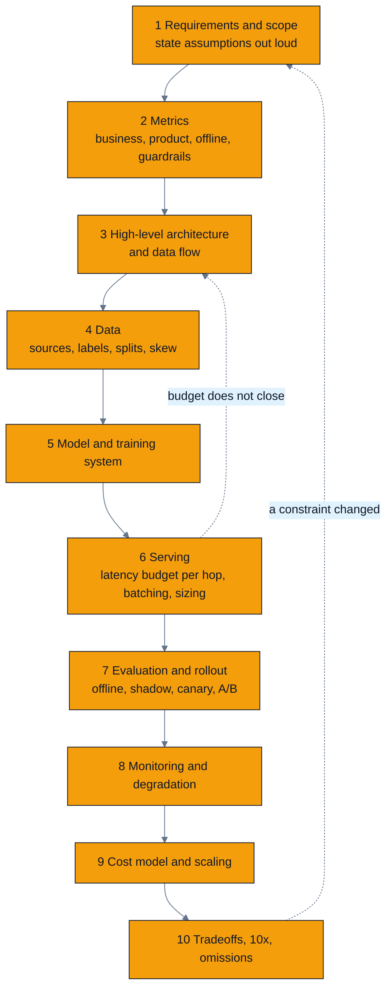
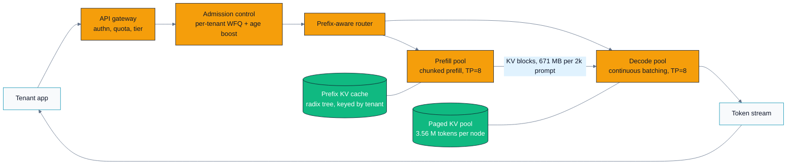
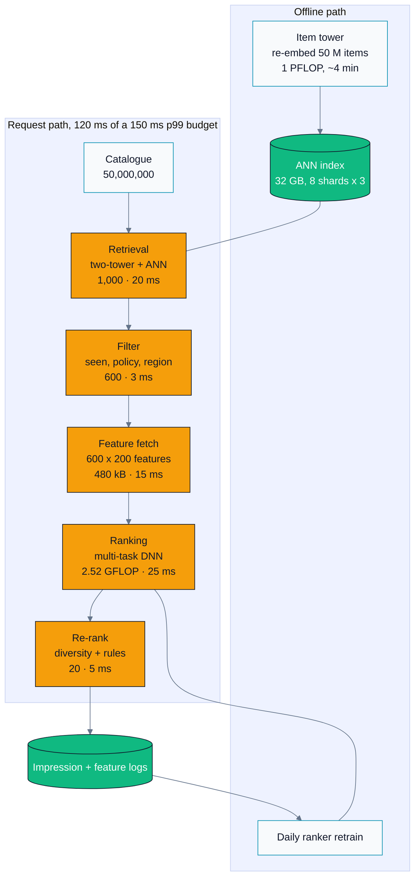
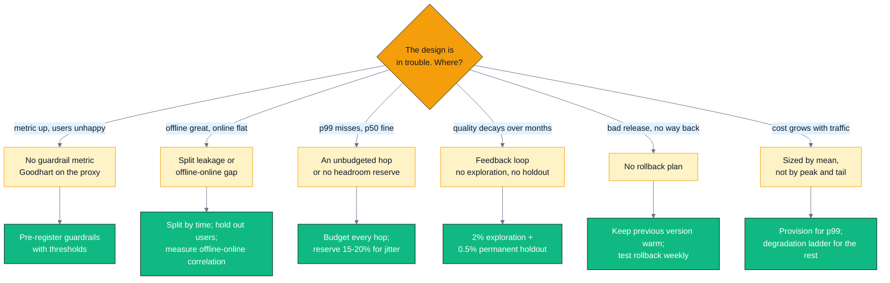

# C07 — Capstone Case Studies: LLM Serving & Recommendations

> Track C · Module 07 · Status: **DONE** · Est. 10 hours · Depth 4/5
>
> Prerequisites: [C01](../C01.problem-framing-and-metrics/README.md)–[C06](../C06.monitoring-drift-and-ethics/README.md)
> for the design vocabulary,
> [B05](../../B-gpu-ml-performance/B05.transformer-performance/README.md)/[B06](../../B-gpu-ml-performance/B06.inference-serving-optimizations/README.md)
> for transformer and serving performance,
> [B02](../../B-gpu-ml-performance/B02.roofline-and-arithmetic-intensity/README.md) for the
> roofline, [B04](../../B-gpu-ml-performance/B04.precision-and-quantization/README.md) for
> precision, [B07](../../B-gpu-ml-performance/B07.distributed-training-and-sharding/README.md) for
> sharding. [A01](../../A-gpu-programming/A01.foundations-and-programming-model/README.md) once,
> for GPU literacy. You do not need to have written a kernel to work this module, but you
> do need to know why a memory-bound kernel is memory-bound.
>
> Code: Python 3.9+ standard library only. No GPU required — see §4 for why.
>
> Terms: [GLOSSARY.md](../../../docs/GLOSSARY.md) · Sources: [REFERENCES.md](../../../docs/REFERENCES.md).

---

This is the capstone. Its job is not to teach you a new technique; it is to make you **use the
whole curriculum at once**. Two complete systems, designed the way you would design them in a
45-minute interview or a real design doc, with the reasoning visible — including the places
where a different choice would also have been right.

The two case studies live as standalone documents you can read on their own:

| Document | System | Companion tool |
|---|---|---|
| [`designs/llm_serving.md`](designs/llm_serving.md) | Multi-tenant LLM inference platform | [`tools/llm_sizing.py`](tools/llm_sizing.py) |
| [`designs/recommender.md`](designs/recommender.md) | Large-scale recommendation system | [`tools/funnel_budget.py`](tools/funnel_budget.py) |

---

## 1. TL;DR + Layman analogy

**TL;DR.** ML system design is not model selection; it is **constraint arithmetic**. You are
given a business goal, a latency budget, a traffic forecast, and a hardware price list, and
your job is to find an architecture where all four are simultaneously satisfiable — then to say
honestly which one you would break first if you had to. This module gives you an ordered
framework, applies it end to end to two systems, and gives you two calculators so that every
sizing, latency, and cost claim you make is a number you derived rather than a number you felt.

**Layman analogy — designing a hospital's emergency department.** You cannot give every
arriving patient a full-body MRI. There are 300 arrivals a shift, one MRI machine, and a
patient in cardiac arrest who needs to be seen in four minutes. So you build a funnel: a
**triage nurse** spends 90 seconds on everyone and sorts them; **cheap tests** (temperature,
blood pressure, a blood panel) go to a wide group; the **expensive scan** goes to the handful
where it will change the decision. You staff for **the bad Saturday night, not the average
Tuesday**, because the cost of being wrong is not symmetric. You keep a **crash team** idle
most of the time, and that idleness is the product, not waste. And you track **outcomes**, not
throughput — a department optimized for patients-processed-per-hour will discharge people who
should have been admitted, and the numbers will look excellent right up until they don't.

Every one of those maps onto a decision in this module:

| Emergency department | ML system |
|---|---|
| Triage nurse, 90 seconds on everyone | Retrieval / candidate generation — cheap, wide, high recall |
| Cheap tests on a wide group | Filtering and a light first-pass ranker |
| Expensive scan on a chosen few | The heavy ranking model on 600 candidates, not 50 million |
| Staffing for the bad Saturday | Provisioning for p99 traffic, not mean traffic |
| The idle crash team | Latency headroom and the degradation ladder |
| Outcomes, not patients-per-hour | Guardrail metrics, not just the headline metric |
| Ambulance diversion when full | Load shedding and graceful degradation |

**Where the analogy breaks — and it breaks in three places that matter.** First, an emergency
department's triage nurse does not get *better at triage because of who she admitted last
week*; an ML system trains on its own outputs, so it has a **feedback loop** that a hospital
does not (§3.2, and [C06 §3](../C06.monitoring-drift-and-ethics/README.md#3-deep-dive)). Second,
hospital capacity is roughly linear — two MRI machines do
twice the scans — while GPU capacity is **non-linear and non-obvious**: batching more requests
can raise throughput and destroy latency at the same time, and the crossover is a number you
have to compute (§5.1). Third, a hospital's demand is exogenous; a recommender **creates its
own demand**, because what it shows changes what people want next. Analogies that don't break
somewhere aren't teaching you the hard part.



The two dashed edges are the whole point: the framework is ordered, but it is **not a
one-way pipeline**. When the latency budget in step 6 refuses to close, you go back to step 3
and change the architecture — you do not quietly relax the SLO.

**By the end of this module you can:** run an unfamiliar design prompt through an ordered
framework under a 45-minute clock; size an LLM serving fleet from model shape and hardware
specs with explicit arithmetic; explain why a recommender must be a funnel by costing the
alternative; build a per-hop latency budget that adds up; identify a feedback loop and price
the exploration budget that breaks it; and review someone else's design document and find the
missing guardrail, the leaking split, and the unbudgeted hop.

---

## 2. First Principles

### Why a framework at all?

Because the failure mode of an unstructured design answer is always the same, and it is not
ignorance. Watch a strong engineer fail a design interview and this is what happened: they
heard "design a recommendation system," and thirty seconds later they were discussing
two-tower embeddings. Everything they said was correct. They failed anyway, because they never
established what the system was *for*, and so nothing they proposed could be justified.

An ordered framework is a **forcing function for justification**. It guarantees that by the
time you propose a model, you have already established the numbers that make the model
proposal defensible or not.

### Derive the framework from what a design has to survive

A design is a set of claims. Each claim can be wrong in a specific way, and the framework is
just those failure modes in dependency order:

| A design can fail because… | So the framework must first establish… |
|---|---|
| It solved the wrong problem | Requirements, scope, and stated assumptions |
| It optimized the wrong thing | The metric chain and the guardrails |
| The pieces don't compose | Architecture and data flow |
| The data can't support the model | Sources, labels, splits, skew risks |
| The model can't be trained affordably | Model choice and the training system |
| It can't meet latency at load | A per-hop latency budget and hardware sizing |
| It can't be shipped safely | Offline eval, shadow, canary, A/B, rollback |
| It fails silently in production | Monitoring, failure modes, degradation |
| It's unaffordable | A cost model |
| It's brittle to change | Tradeoffs, 10× scale, deliberate omissions |

Steps 4 and 5 sit *after* the architecture because you cannot say what data you need until you
have said what components exist; and *before* serving because the model's shape determines the
serving cost. Nothing in this order is arbitrary.

### The framework, with a 45-minute time-box

The times below are for a 45-minute interview with a 5-minute intro. In a real design doc the
proportions hold even though the clock does not: **you will always be tempted to spend the
time on steps 5 and 6, and the interview is usually decided in steps 1, 2, and 10.**

| # | Step | Minutes | Say out loud |
|---|---|---:|---|
| 1 | **Clarify requirements and scope** — functional, scale, latency, cost. State assumptions explicitly | 5 | "I'm going to assume 20,000 requests/s peak and a 150 ms p99 budget. Tell me if that's off by an order of magnitude." |
| 2 | **Define metrics** — business → product → offline proxy, plus guardrails | 4 | "The business metric is 30-day retention. I can't train on that, so the offline proxy is NDCG@20 on a time-based split — and here are the guardrails that stop us optimizing into clickbait." |
| 3 | **High-level architecture and data flow** | 5 | Draw the boxes. Trace one request end to end, then trace one training example end to end. |
| 4 | **Data** — sources, labels, splits, features, skew risks | 5 | "Labels are implicit and biased by position. Split by time, never randomly." |
| 5 | **Model choice and training system** | 5 | Justify from the constraints in 1–4, not from familiarity. |
| 6 | **Serving** — latency budget per hop, batching, caching, hardware sizing | 8 | This is where you show arithmetic. Budget every hop; make the numbers add up to less than the SLO. |
| 7 | **Evaluation and rollout** — offline, shadow, canary, A/B | 4 | "Canary at 1% with automatic rollback on these four metrics." |
| 8 | **Monitoring, failure modes, degradation** | 4 | "When we're over capacity, here is the ordered ladder of what we give up." |
| 9 | **Cost model and scaling** | 3 | One number per million tokens or per thousand requests, and the levers. |
| 10 | **Tradeoffs, 10×, and what you left out** | 2 | "I deliberately skipped X because Y. At 10× the thing that breaks first is Z." |

Two rules about the clock. **Announce your plan at minute five** ("I'll spend ten minutes on
requirements and metrics, then architecture, then I want to spend real time on the serving
budget") — it converts a rambling answer into a managed one and lets the interviewer redirect
you cheaply. And **hard-stop step 6 at your budget** even if it is unfinished; arriving at
step 10 with a rough answer beats a beautiful serving design and no tradeoff discussion.

### The one habit that carries the whole thing: back-of-envelope arithmetic

The difference between a senior and a staff-level design answer is usually not architecture.
It is that the staff answer contains numbers, and the numbers came from somewhere.

Worked example, done in about forty seconds on a whiteboard. *Can we score all 50 million
catalogue items for every one of 20,000 requests per second?*

```
Ranker cost per item      ~4 MFLOP           (a 1400 -> 1024 -> 512 -> 256 MLP)
Items per request          50,000,000
FLOPs per request          2 x 10^14         = 200 TFLOP
Requests per second        20,000
Fleet demand               4 x 10^18 FLOP/s  = 4 EFLOP/s
One GPU, realistically     ~500 TFLOP/s
GPUs required              8,000
```

You do not need the exact answer. You need to know it is **8,000 GPUs and not 8**, which tells
you immediately that the architecture must be a funnel, and it tells you before you have said
a word about embeddings. That is the move. Everything else in this module is that move applied
repeatedly.

The two tools in [`tools/`](tools/) are this habit, mechanized — so that you can check your
whiteboard arithmetic afterwards, and so that when someone asks "what if the context length
doubles?" you can answer in one command instead of one afternoon.

---

## 3. Deep Dive

Full documents in [`designs/`](designs/). This section carries the load-bearing arithmetic and
the decisions that arithmetic forces.

### 3.1 Case study 1 — a multi-tenant LLM inference platform

**Prompt.** Serve a 70B-class model to multiple internal product teams. TTFT p95 ≤ 400 ms for
prompts under 4k, TPOT p95 ≤ 30 ms, 32k max context, 300 requests/s peak, 99.9% availability,
and no tenant may starve another.



Admission control sits *before* routing so that back-pressure is applied while we still know
which tenant to shed; [prefill and decode](../../../docs/GLOSSARY.md#prefill-and-decode) are
separate pools so that one 32k prompt cannot stall two hundred people's token streams.

#### The four numbers everything else hangs off

Assumptions (labelled, and the full register is in the design doc): 70B params, 80 layers,
`d_model` 8192, **8 KV heads × 128 head_dim** (GQA), bf16; an 8-GPU node with 192 GB HBM and
5.3 TB/s peak per GPU; 70% of peak bandwidth achievable on decode, 40% of peak FLOP/s on
prefill, and 60% end-to-end efficiency against the roofline.

**(1) Weight bytes.**

```
70e9 params x 2 B = 140 GB
```

**(2) [KV-cache](../../../docs/GLOSSARY.md#kv-cache) bytes per token.** This one formula decides
the design:

```
d_kv               = kv_heads x head_dim = 8 x 128 = 1024
kv_bytes_per_token = 2 x layers x d_kv x dtype_bytes
                   = 2 x 80 x 1024 x 2 B
                   = 327,680 B  =  320 KiB per token
```

The leading `2` is K and V. Notice what
[grouped-query attention](../../../docs/REFERENCES.md#multi-query-and-grouped-query-attention-ainslie-et-al-2023)
bought: with 64 KV heads this
would be **2.5 MiB per token** and nothing below would fit. GQA is a systems decision wearing a
modelling costume — worth saying in an interview, because it shows you can see across the
boundary.

**(3) Max concurrency from HBM.**

```
node HBM  8 x 192 GB                                       = 1,536.0 GB
- weights                                                  =   140.0 GB
- runtime reserve (15%: activations, workspace, comms,
  allocator fragmentation)                                 =   230.4 GB
                                                             ----------
KV pool                                                    = 1,165.6 GB
capacity  = 1,165.6e9 / 327,680                            = 3,557,129 tokens
          = 1,737 concurrent streams at 2k average context
```

**Finding worth stating out loud:** HBM capacity is *not* the binding constraint here. The
reflexive answer ("we're KV-bound, quantize the cache") would be wrong. Latency binds first.

**(4) Bandwidth-bound decode throughput.** Decode reads every weight and every cached K/V once
per step and does almost no arithmetic per byte — the
[memory-bound](../../../docs/GLOSSARY.md#memory-bound-compute-bound-and-latency-bound) corner of
the [roofline](../../../docs/GLOSSARY.md#roofline-model)
([B02 §2](../../B-gpu-ml-performance/B02.roofline-and-arithmetic-intensity/README.md#2-first-principles)),
applied to the transformer
([B05 §3](../../B-gpu-ml-performance/B05.transformer-performance/README.md#3-deep-dive)):

```
tokens/s ~= memory_bandwidth / bytes_read_per_token
```

Spelled out per replica per step at TP=8, batch 192, context 2,048:

```
weights read / GPU  = 140 GB / 8                           = 17.50 GB
KV read / GPU       = 192 x 2,048 x 327,680 / 8            = 16.11 GB
                                                             --------
                                                             33.61 GB
achievable BW       = 5.3 TB/s x 0.70                      =  3.71 TB/s
t_memory            = 33.61 / 3,710                        =  9.06 ms
```

Now the two checks that separate a real estimate from a plausible-sounding one:

```
t_compute   = 2 x 70e9 x 192 / (8 x 1300e12 x 0.40)        =  6.46 ms   (memory still wins)
t_allreduce = 160 collectives, TP=8 (derived in 3.1.2)     =  4.22 ms
t_fixed     = schedule + sample + detokenize               =  1.50 ms
                                                             --------
roofline step                                              = 14.77 ms
TPOT at 60% end-to-end efficiency                          = 24.62 ms   <- inside the 30 ms SLO
node throughput = 192 / 0.02462                            = 7,797 output tokens/s
```

Reproduce all of it with `python tools/llm_sizing.py`.

**The compute cross-check is not optional.** The `tokens/s ≈ bandwidth / bytes` formula is only
valid while memory is the larger term. Quantize to fp8 and `t_memory` halves to 4.53 ms while
`t_compute` stays at 6.46 ms — decode becomes **compute-bound**, and further KV quantization
buys exactly nothing. Knowing which roof you are on before you optimize is the entire lesson of
B02, and this is what it looks like in a design review.

#### 3.1.1 The knee, and the scheduler rule that falls out of it

Weight traffic per step is fixed; KV traffic grows linearly with batch. They cross at:

```
batch* = (weight_bytes / TP) / (context x kv_bytes_per_token / TP)
       = 17.5e9 / (2,048 x 327,680 / 8)
       = 209 streams at 2k context      (52 at 8k context)
```

Below the knee, batching is nearly free — the fixed weight read is amortized over more tokens.
Above it, throughput gains flatten while TPOT keeps climbing. This is the honest answer to "why
not just batch harder," and it is a number, not an opinion.

Inverting the step-time model against the 30 ms SLO gives the operating ceiling: **277 streams,
567,296 KV tokens** at 2k context. Which yields the rule:

> Cap the scheduler on **KV tokens in flight**, not on request count — one 32k request costs
> the same decode bandwidth as sixteen 2k requests. Then add a **second cap on stream count**,
> because the all-reduce cost scales with streams rather than tokens.

Two caps, both derived, both re-derivable for any context distribution with one command. A
scheduler with a single `max_num_seqs` knob will either waste capacity or blow the SLO
depending on which way the traffic mix drifts.

#### 3.1.2 Parallelism: the interconnect picks, not the vendor

A TP transformer layer needs two all-reduces, so 160 per decode step at 80 layers. Ring
all-reduce moves `2(n-1)/n × message` bytes per GPU:

```
message               = batch x d_model x 2 B = 192 x 8192 x 2   = 3.15 MB
per-GPU volume (n=8)  = 1.75 x 3.15 MB                           = 5.51 MB
per step              = 160 x 5.51 MB                            = 881 MB
bandwidth term        = 881 MB / 300 GB/s                        = 2.94 ms
latency term          = 160 x 8 us                               = 1.28 ms
                                                                   -------
t_allreduce                                                      = 4.22 ms   (29% of the step)
```

| Config | Weights on node | KV pool | Batch at 30 ms TPOT | Node throughput |
|---|---:|---:|---:|---:|
| **TP=8, 1 replica** | 140 GB | 1,165.6 GB | 277 | **7,797 tok/s** |
| TP=4, 2 replicas | 280 GB | 1,025.6 GB | ~100/replica | ~6,600 tok/s |

TP=4 halves the communication but doubles the per-GPU weight read *and* stores two copies of
the weights, costing 140 GB of KV pool. Under a 30 ms SLO, TP=8 wins. **Relax the SLO to 40 ms
and TP=4 wins**, because it can then run the larger batches that amortize its weight read. The
SLO picks the parallelism — that is the answer to give, not "TP=8."

And the constraint that ends the discussion about spanning nodes: substitute a 25 GB/s
scale-out NIC and 30 µs latency into the same formula and you get `881 MB / 25 GB/s = 35.2 ms`
plus `160 × 30 µs = 4.8 ms` — roughly **40 ms of communication on a step whose compute is
9 ms**. TPOT goes from 25 ms to ~84 ms. Scale *up* inside the coherent fabric; scale *out* with
independent replicas
([B07 §3](../../B-gpu-ml-performance/B07.distributed-training-and-sharding/README.md#3-deep-dive)).

#### 3.1.3 Serving mechanisms, each with the problem it solves

A mechanism named without its problem is cargo cult. Each of these earns its place:

| Mechanism | Problem it solves | Quantified |
|---|---|---|
| **Continuous batching** ([Orca](../../../docs/REFERENCES.md#orca-continuous-batching-yu-et-al-2022)) | A 20-token answer batched with a 2,000-token answer waits for all 2,000 steps; freed slots idle | Schedules per *iteration*, not per request |
| **Paged KV cache** ([vLLM](../../../docs/REFERENCES.md#pagedattention-and-vllm-kwon-et-al-2023)) | Reserving 32k of contiguous KV per request wastes 99% of it and fragments the pool | 108 sequences/node reserved vs **1,737** paged — a 16× capacity difference from an allocator |
| **Prefix caching** ([RadixAttention](https://arxiv.org/abs/2312.07104)) | 60% of input tokens repeat: shared system prompts, few-shot blocks, growing conversation history | Prefill demand 450,000 → **180,000 tokens/s** |
| **Chunked prefill** ([Sarathi](https://arxiv.org/abs/2308.16369)) | A 32k prefill occupies the GPU for 1.8 s; every co-resident stream stalls for 1.8 s | Worst-case stall becomes one chunk, ~119 ms |
| **Prefill/decode disaggregation** ([DistServe](https://arxiv.org/abs/2401.09670)) | Compute-bound and bandwidth-bound workloads want opposite shapes and different fleet sizes | 10.5 prefill vs 9.6 decode node-equivalents — sizes that cannot be tuned independently if colocated |

Disaggregation is the one to be honest about, because it is not free: the KV blocks must cross
the fabric. For a 2k prompt that is `2,048 × 327,680 B = 671 MB`, which at 25 GB/s adds **27 ms
to TTFT** — more than half our headroom. **At a 1:1 input:output ratio I would not
disaggregate**; chunked prefill in one pool would be simpler and the transfer would not be
worth paying for. It earns its complexity here only because this workload is 6:1 and
prefill-dominated.

#### 3.1.4 The quantization decision, and its gate

`--weight-dtype fp8 --kv-dtype fp8` predicts 3,557,129 → **7,541,504** tokens of KV capacity
and 7,797 → **9,460** tok/s. Attractive. It ships only behind a gate
([B04](../../B-gpu-ml-performance/B04.precision-and-quantization/README.md),
[C04](../C04.production-model-optimization/README.md)):

1. Per-task accuracy within **0.5 points** of bf16, **per tenant-facing task** — not in
   aggregate, because aggregate hides the one task that broke.
2. Perplexity delta on held-out *production* prompts, not WikiText.
   [Quantization](../../../docs/GLOSSARY.md#quantization) error
   concentrates in the tails, and the tail is somebody's use case.
3. **Long context re-tested separately.** [fp8](../../../docs/GLOSSARY.md#fp8-and-the-fnuzocp-split)
   KV error accumulates along the sequence, so a 32k
   conversation is the worst case and a 2k eval will never find it.
4. One week of shadow traffic with automated output-divergence tracking.

#### 3.1.5 Multi-tenancy, including the bit people miss

Quotas on **tokens/minute**, not requests/minute (a request is not a unit of cost). Weighted
fair queueing across per-tenant queues at admission, with an **age-based priority boost** so
that pure WFQ cannot starve a low-weight tenant indefinitely. Three tiers, of which `batch` is
preemptible. Per-tenant KV quota so nobody can consume the whole pool.

And the one that gets missed: **prefix caching is a cross-tenant timing side channel.** If
tenant B gets a cache hit on tenant A's cached prefix, B learns something about A's traffic
from the TTFT. Key the cache by `(tenant, prefix)`, never by prefix alone. It costs hit rate.
Pay it.

### 3.2 Case study 2 — a large-scale recommendation system

**Prompt.** 50 million items, 200 million monthly users, 20,000 requests/s peak, 20 items
returned, 150 ms p99. Optimize for long-term retention.

#### Why the funnel exists — by costing the alternative

```
FLOPs per request  = 50,000,000 items x 4.2 MFLOP  = 210 TFLOP
Fleet at 20k req/s = 210e12 x 20,000               = 4.20 EFLOP/s
GPUs required      = 4.20e18 / 520e12              = 8,077 GPUs (1,010 nodes)
Latency alone      = 210e12 / 4.16e15              = 50.5 ms on one whole idle 8-GPU node
Embedding bytes    = 50e6 x 128 x 4 B              = 25.6 GB per request  -> 512 TB/s fleet-wide
```

Batching across requests amortizes the embedding reads, so memory is the softer wall. **The
compute wall is irreducible** — every (user, item) pair still has to be scored. Off by three
orders of magnitude. Hence the funnel: spend a lot of compute per item on very few items, and
almost none on the rest.



Each stage spends roughly 100× more compute per item on roughly 100× fewer items, so every
stage costs about the same — the property a balanced funnel has. Note the cycle at the bottom:
the system's own output becomes its training data, which is §3.2.3.

#### 3.2.1 The budget, and what widening costs

`python tools/funnel_budget.py`:

| Stage | Items in | GFLOP | p99 ms |
|---|---:|---:|---:|
| Retrieval (two-tower + ANN) | 50,000,000 | 0.006 | 20.0 |
| Filtering (seen / policy / eligibility) | 1,000 | 0.000 | 3.0 |
| Item feature fetch | 600 | 0.000 | 15.0 |
| Ranking (multi-task DNN) | 600 | 2.520 | 25.0 |
| Re-ranking (diversity + rules) | 600 | 0.003 | 5.0 |
| Edge / user features / user tower / response | — | — | 29.0 |
| Reserve for jitter, GC, retry | — | — | 23.0 |
| **Total** | | **2.529** | **120.0** |
| Budget | | | 150.0 |
| **Headroom** | | | **30.0** |

Funnel reduction: **210,000 GFLOP → 2.529 GFLOP = 83,042×**.

The reserve row is not padding. A design that spends 100% of its budget on the happy path has a
p99 worse than its arithmetic says.

`python tools/funnel_budget.py --widen rank=2000` — the most common instinct when quality
plateaus:

| | 600 | 2,000 | Change |
|---|---:|---:|---:|
| GFLOP per request | 2.529 | 8.416 | 3.33× |
| p99 latency | 120.0 ms | **210.0 ms** | 1.75× |
| Feature-store egress | 1.9 GB/s | 6.4 GB/s | 3.33× |

60 ms over a 150 ms budget. Recall improves sub-linearly; latency and cost grow linearly. If
you want to rank more, first buy the time back — a cheap first-pass ranker over the wide set,
parallel feature fetch, or a smaller final set.

#### 3.2.2 Retrieval, and the operational trap

Two towers into a shared 128-d space; relevance is a dot product, so retrieval is
maximum-inner-product search. The **item tower runs offline** (once per item per tower
version); the **user tower runs online** (state changes per request). That asymmetry is the
entire reason the architecture works at scale.

Train with in-batch negatives plus the **sampling-bias correction** of
[Yi et al. (2019)](https://doi.org/10.1145/3298689.3346996) — without it, popular items appear
as negatives in proportion to their frequency and the model learns to suppress precisely the
items it should retrieve.

```
vectors   50e6 x 128 x 4 B                = 25.6 GB
HNSW graph 50e6 x 32 neighbours x 4 B     =  6.4 GB
index total                               = 32.0 GB -> 8 shards x 3 replicas = 24 hosts
```

ANN latency is dominated by pointer-chasing, not arithmetic: 3,000 probes × 128 dims × 2 =
0.77 MFLOP inside a 20 ms hop. **This is the first place the answer to "should it be on a GPU?"
is no.** A CPU host with a lot of RAM is cheaper per QPS.

**The trap that silently destroys recall.** Query and index embeddings must come from the
*same tower version*. Ship a new user tower without re-indexing and every dot product is
computed in a space the index was not built in. Nothing errors. Recall degrades, engagement
drifts down over days, and no model metric moves. Fix: stamp `tower_version` on the index and
on every query, and make the search service **refuse** a mismatch. Fail closed. It also means
the two towers are one deployable unit.

#### 3.2.3 Feedback loops, and why exploration is mandatory

The loop is closed: the model chooses what is shown → what is shown determines what is labelled
→ the labels train the model. Three failure modes follow directly.

**Popularity bias.** Popular items get impressions, impressions produce data, data produces
confidence, confidence produces impressions. The catalogue collapses onto a head the model
itself created. Symptom: coverage falls while every model metric improves.

**Item cold start.** A new item has no history → scores low → never shown → never acquires
history. This happens 500,000 times a day.

**User cold start.** Nothing to personalize on. Falls back to popularity + context. Measure
this cohort separately, because aggregate metrics are dominated by established users and will
hide a bad new-user experience entirely.

**The exploration budget.** On 2% of requests, one slot in the top 10 is filled by sampling
from the eligible pool with a boost for under-exposed items, logged with its selection
probability. It is mandatory for three independently sufficient reasons: it is the **only
unbiased data** in the system (everything else is conditioned on what the model chose); it is
the **only path to exposure** for new items; and it **breaks the rich-get-richer loop at the
source**.

Price it before the meeting, because somebody will ask:

```
Assume an explored slot performs 40% worse than the ranked slot it replaced.
loss = 2% of traffic x 1 of 10 slots x 40% worse = 0.02 x 0.10 x 0.40 = 0.08% of engagement
```

0.08% — about one week of ordinary model improvement, spent once, permanently, to keep the data
honest and the catalogue alive. Framed as arithmetic it is an easy sell; framed as "we want to
show users worse content" it is impossible. **Plus a permanent 0.5% holdout** with no
personalization: A/B tests compare model A to model B and structurally cannot see the system
drifting in a direction both share.

#### 3.2.4 Where GPUs are needed, and where they are not

| Component | GPU? | Why |
|---|---|---|
| Ranker training | **Yes** | 25.6 GB item + 51.2 GB user embedding tables; data-parallel MLP, model-parallel embeddings (the DLRM pattern) |
| Item-tower batch embedding | **Yes** | 1 PFLOP per full re-embed; 4 minutes on a node vs hours on CPU |
| Ranking inference | **Marginal** | 50 TFLOP/s fleet-wide is a fraction of one GPU. Sized by p99 latency and feature I/O, **not** FLOPs. Becomes a clear yes when the ranker grows a sequence encoder over user history |
| ANN retrieval | **No** | Memory-latency bound pointer chasing |
| Feature store | **No** | It is a key-value store |
| Filtering, re-ranking, rules | **No** | Set operations |

Being able to say "no" here is the point. The reflexive "put it all on GPUs" answer costs money
*and* fails to notice that the real bottleneck is a KV store shipping 9.6 GB/s.

---

## 4. Hands-On Labs

**There is no `cuda/`, `hip/`, or `triton/` directory in this module, and that is deliberate.**
C07 synthesizes; the kernels it reasons about were built in
[A04](../../A-gpu-programming/A04.parallel-reduction/README.md),
[A06](../../A-gpu-programming/A06.tiled-matrix-multiply/README.md),
[A07](../../A-gpu-programming/A07.softmax-and-fused-kernels/README.md) and profiled in
[B03](../../B-gpu-ml-performance/B03.profiling-and-bottleneck-analysis/README.md).
Adding a kernel here would dilute the one thing this module is for. What it ships instead is
two calculators, because the skill being trained is *arithmetic under constraints*, and that
skill needs a tool you can interrogate.

```bash
make help            # list targets
make run             # run both calculators with the case-study defaults
make run-exercises   # the what-if scenarios from the drills
make clean
```

Or directly (Python 3.9+, standard library only, no install step):

```bash
python tools/llm_sizing.py --help
python tools/funnel_budget.py --help
```

### Lab 1 — Reproduce the LLM sizing

```bash
python tools/llm_sizing.py
```

**What to observe.** Every number in §3.1 appears in the output, and the assumptions that
produced them are printed above the results — that ordering is the point. Check three things:
that `t_memory` (9.06 ms) exceeds `t_compute` (6.46 ms), which is what makes the
bandwidth-bound formula legitimate; that `t_allreduce` is 4.22 ms, i.e. 29% of the step, which
is why parallelism is a serving decision and not a deployment detail; and that max concurrency
(1,737 streams) is far above the SLO-limited batch (277), which is how you know this design is
latency-bound rather than capacity-bound.

### Lab 2 — Find the roof you're on

```bash
python tools/llm_sizing.py --weight-dtype fp8 --kv-dtype fp8
```

**What to observe.** `t_memory` halves to 4.53 ms, `t_compute` is unchanged at 6.46 ms, and the
step is now labelled **compute-bound**. The lesson is not "fp8 is 1.21× faster." It is that
quantization **moved you to a different roof**, and every subsequent optimization you were
planning (quantize KV further, widen the batch) now targets a constraint that is no longer
binding. Re-run with `--tflops 2600` to model a part that doubles FLOP/s at fp8 and watch the
picture change again.

### Lab 3 — Sweep context length and watch the knee move

```bash
python tools/llm_sizing.py --avg-ctx 8192 --batch 64
python tools/llm_sizing.py --avg-ctx 32768 --batch 16
```

**What to observe.** The knee falls from 209 streams at 2k to 52 at 8k to 13 at 32k. Long
context is not "the same workload but bigger" — it is a workload where batching stops helping
almost immediately, and where a fixed `max_num_seqs` will either waste capacity or blow the
SLO depending on the traffic mix. This is the arithmetic behind the two-dimensional scheduler
cap in §3.1.1.

### Lab 4 — Reproduce the funnel budget

```bash
python tools/funnel_budget.py
```

**What to observe.** The strawman costs 8,077 GPUs and the funnel costs 2.529 GFLOP per
request — 83,042× — and the total latency (120 ms) has exactly 30 ms of headroom against the
budget. Notice that the largest single line in the cost section is *not* the GPUs.

### Lab 5 — Break the budget on purpose

```bash
python tools/funnel_budget.py --widen rank=2000
python tools/funnel_budget.py --widen retrieve=3000
python tools/funnel_budget.py --widen rank=2000 --budget-ms 250
```

**What to observe.** Widening the *ranker* 3.33× (600 → 2,000) costs **90 ms** and puts you
60 ms over budget, and it triples feature-store egress. Widening *retrieval* by a comparable
3× (1,000 → 3,000) costs **12 ms** and stays inside the budget with 18 ms to spare — because
the expensive stages all sit downstream of the filter, so generosity is cheap early in the
funnel and ruinous late in it. That asymmetry is the single most useful thing to know when
someone asks for better recall. The third command shows the other lever: if the product can
afford 250 ms, the wide ranker fits after all. **Latency budget and model capacity are the
same resource**, and the tool makes the exchange rate explicit.

### Lab 6 — Work the drills

[`exercises/`](exercises/) has two fresh design prompts (video moderation, semantic search) and
a review drill against a deliberately flawed design document. Do the review drill last: it is
the closest thing here to what a senior engineer actually spends their time on.

---

## 5. Performance Analysis

The template asks for numbers rather than adjectives, and for a before/after with a measured
delta. In a design module the "measurement" is the derived model, and the honest thing to do is
be explicit about which parts are derived, which are assumed, and how far off reality is likely
to be.

### 5.1 The decode step, term by term

| Term | Value at batch 192, ctx 2,048 | Scales with | Why it matters |
|---|---:|---|---|
| `t_memory` (weights) | 4.72 ms | 1/TP | Fixed per step — amortized by batching |
| `t_memory` (KV) | 4.34 ms | batch × context / TP | Linear in batch — this is the knee |
| `t_compute` | 6.46 ms | batch / TP | Becomes the roof once you quantize |
| `t_allreduce` | 4.22 ms | batch, and TP topology | 29% of the step; explodes across nodes |
| `t_fixed` | 1.50 ms | — | Scheduler, sampling, detokenize |
| **Roofline step** | **14.77 ms** | | |
| **TPOT at 60% efficiency** | **24.62 ms** | | The number the SLO is checked against |

**The 60% is the honesty knob.** A pure roofline model will over-promise by 1.5–2× in a first
deployment because of scheduler gaps, ragged batches, preemption, and sampling overhead. Ship
the model, measure, and replace 0.60 with your measured ratio — at which point the tool becomes
a capacity planner rather than an estimator. A design doc that quotes the roofline number as
the expected number is not wrong about physics; it is wrong about engineering.

### 5.2 Batch size versus latency — the actual tradeoff

Derived from the same model at 2k context (`python tools/llm_sizing.py --batch N`):

| Batch | `t_memory` | `t_allreduce` | TPOT | Node tok/s | Verdict |
|---:|---:|---:|---:|---:|---|
| 32 | 5.44 ms | 1.77 ms | 14.52 ms | 2,204 | Latency-optimal, poor economics |
| 96 | 6.89 ms | 2.75 ms | 18.56 ms | 5,173 | |
| 192 | 9.06 ms | 4.22 ms | 24.62 ms | 7,797 | **Chosen** — SLO with headroom |
| 277 | 10.98 ms | 5.52 ms | 29.99 ms | 9,235 | At the SLO edge; no p99 room |
| 512 | 16.29 ms | 9.11 ms | 46.40 ms | 11,034 | SLO blown; also now compute-bound |

Throughput rises sub-linearly — batch 32 → 512 is **16× the batch for 5.0× the tokens** — while
TPOT rises roughly linearly, 3.2× over the same range. Choosing 192 over 277 gives up 16% of
throughput to buy p99 headroom. That is a business decision presented as a number, which is
what a design doc is for.

Note the last row flips to compute-bound (`t_compute` = 17.23 ms exceeds `t_memory` =
16.29 ms). Past that point even the memory-side optimizations stop helping, which is the
clearest possible signal that you have batched past the useful range.

### 5.3 Before/after: what each optimization is actually worth

| Change | Before | After | Delta | Cost of getting it |
|---|---:|---:|---:|---|
| Reserved → **paged** KV cache | 108 seq/node | 1,737 seq/node | **16×** capacity | A block allocator |
| No cache → **60% prefix cache** | 450k prefill tok/s | 180k prefill tok/s | **−60%** prefill fleet | Prefix-aware routing; a cross-tenant side channel to close |
| bf16 → **fp8 weights + KV** | 7,797 tok/s | 9,460 tok/s | **+21%**, 2.1× KV capacity | The quality gate in §3.1.4 |
| Naive scan → **funnel** | 210,000 GFLOP/req | 2.529 GFLOP/req | **83,042×** | Two extra models and an index to operate |
| No cache → **80% feature cache** | 9.6 GB/s egress | 1.9 GB/s egress | **5×** | 800 MB of RAM per replica |

The 16× from paging is the one to internalize: it comes from a *memory allocator*, not a model,
not a kernel, and not a bigger GPU. The largest wins in serving systems are usually structural.

### 5.4 Latency budgets that add up

**LLM TTFT, 2k prompt** (assumptions except the prefill row, which is derived):

| Hop | p50 | p95 |
|---|---:|---:|
| TLS + edge routing | 5 ms | 15 ms |
| Gateway: authn, quota, tenant lookup | 3 ms | 10 ms |
| Tokenize + validate | 2 ms | 6 ms |
| Admission queue wait | 15 ms | 140 ms |
| Prefill compute (derived) | 119 ms | 175 ms |
| First-token sample + stream frame | 3 ms | 8 ms |
| **Total** | **147 ms** | **354 ms** |
| SLO | | 400 ms |

46 ms of headroom, essentially all of it consumable by queue wait. That is why the design sheds
load rather than queueing it (§6).

**Recommender p99:** 120 ms of 150 ms, with a 23 ms reserve already inside the 120. See §3.2.1.

Both budgets share one discipline: **every hop has a number, and the numbers sum to less than
the SLO with room left over.** A budget that sums to exactly the SLO is a budget that fails.

### 5.5 Cost, and the levers that move it

| System | Derived cost | Largest lever |
|---|---|---|
| LLM serving | **$2.45 / 1M output tokens**, **$0.45 / 1M input tokens**, 26 nodes / 208 GPUs, $449k/month | Prefix-cache hit rate: 60% → 80% cuts the fleet from 26 to 19 nodes, **−27%** |
| Recommender | **$0.0051 / 1,000 requests**, ~$133k/month serving | Feature-store egress, not the GPUs — the GPUs are $84/hour of a $185/hour bill |

Input tokens land ~5× cheaper than output tokens because prefill runs at 2.2× the token rate of
decode *and* the prefix cache bills 2.5× more input tokens than it computes. Commercial APIs
price input and output separately because the arithmetic says so, not because of marketing.

The three LLM levers, ranked: **prefix-cache hit rate** (−27%), **fp8** (−20% to −35%), and
**utilization** (45% → 65% average load is −31% on $/token, and involves no ML at all). The
third is the one teams skip, and it is frequently the largest.

---

## 6. Challenges, Drawbacks & Tradeoffs



The six symptoms on the left are the ones that actually show up in production; the drill in
`exercises/03_review_a_design.md` plants five of them in a plausible-looking document.

### The failure modes that cost the most

**Optimizing a proxy without a guardrail.** The proxy is a proxy because the real thing is
unmeasurable in the loop. The system will find the gap. A recommender optimizing CTR discovers
clickbait; an LLM platform optimizing throughput discovers that starving a few p99.9 requests
raises the mean. *Guard:* pre-register guardrail thresholds **before** the experiment, and give
them veto power over the headline metric.

**Random splits on temporal data.** Splitting user interactions randomly lets tomorrow's
behaviour predict today's, both through the label and through aggregate features computed over
the full period. Offline AUC goes up, online does not move, and the cause is invisible because
the code is correct. *Guard:* split by time; hold out entire users for cold-start; enforce
point-in-time-correct feature joins.

**A latency budget that does not add up.** The classic is a hop nobody costed — an enrichment
call, a policy lookup, a logging write on the critical path. It is invisible at p50 and it owns
p99. *Guard:* every hop gets a number, the numbers sum, and 15–20% stays in reserve.

**[Training/serving skew](../../../docs/GLOSSARY.md#training-serving-skew).** Features computed
one way in the warehouse and another way in the serving path. *Guard:* log the served feature
vector and train on it. Monitoring skew is the backstop; making it impossible is the plan.

**The KV thrash spiral** (LLM-specific). Admission over-commits → sequences get preempted →
preempted sequences recompute their prefill → recompute consumes the capacity that would have
drained the queue. *Guard:* reserve KV blocks for the expected full sequence length at
admission, and alert on preemption rate — it moves *before* latency does.

**Tower version skew** (recommender-specific). Query embeddings from a different tower version
than the index. Nothing errors; recall silently degrades. *Guard:* stamp the version and fail
closed.

### Graceful degradation, as an ordered ladder

Each rung is automatic and **load-tested** — an untested degradation path fails at exactly the
moment you need it.

| # | LLM platform | Recommender |
|---|---|---|
| 1 | Cap `max_tokens` for the standard tier | Serve from the response cache with a slightly stale feed |
| 2 | Reduce max running batch to protect TPOT | Skip the re-ranking stage; serve ranked order |
| 3 | Shed the preemptible `batch` tier (429 + `Retry-After`) | Shrink the candidate set 600 → 200 |
| 4 | Route standard tier to a smaller **already-warm** model | Fall back to a light linear ranker |
| 5 | Shed by tenant priority at admission | Serve a popularity + freshness baseline |
| 6 | Reject fast with queue-full | Serve an editorially curated fallback feed |

Rung 4 has a trap in both columns: the fallback must be **already warm**. Spinning up a smaller
model under load is not degradation, it is a second outage.

### Tradeoffs worth defending out loud

| Choice | Bought | Paid |
|---|---|---|
| TP=8 in-node | Lowest TPOT, one weight copy, largest KV pool | 29% of the step in all-reduce; the node is the blast radius |
| Disaggregated prefill/decode | Independently scalable fleets for two workload shapes | 27 ms of KV transfer on TTFT; a second scheduler to operate |
| Batch 192 instead of 277 | p99 headroom | 18% less throughput |
| Multi-stage funnel | 83,042× less compute | Two extra models, an index, and a recall ceiling set by retrieval |
| 2% exploration | Unbiased data, new-item exposure, loop broken | 0.08% of engagement, permanently |
| Multi-tenant platform | Utilization pooling; one team operates it | Noisy neighbours, quota engineering, a cache side channel |

### When *not* to build these systems

Do not build the multi-stage funnel if your catalogue is 10,000 items — score them all, skip
retrieval, and delete an entire subsystem along with its index-refresh operations. Do not build
the multi-tenant LLM platform for one tenant at 5 requests/s — buy an API. **The single most
common architectural error in ML systems is building the 10× design at 1× scale**, and then
spending the team's time operating complexity that no traffic justifies. The right move is to
know the 10× design (so the 1× design does not paint you into a corner) and to build the 1×
one. Sculley et al.'s
[*Hidden Technical Debt*](../../../docs/REFERENCES.md#hidden-technical-debt-in-machine-learning-systems-sculley-et-al-2015)
is about exactly this bill coming due.

---

## 7. Real-World Use Cases

**LLM serving.** The mechanisms in §3.1 are not hypothetical — they are what the open-source
serving stacks implement, and reading their code is the fastest way to make this concrete.
[vLLM](../../../docs/REFERENCES.md#vllm-project) ships paged attention,
[continuous batching](../../../docs/GLOSSARY.md#continuous-batching),
chunked prefill, prefix caching, and prefill/decode disaggregation;
[SGLang](../../../docs/REFERENCES.md#sglang-project) ships RadixAttention prefix caching and a
cache-aware scheduler; [TensorRT-LLM](https://github.com/NVIDIA/TensorRT-LLM) and
[Text Generation Inference](https://github.com/huggingface/text-generation-inference) cover
similar ground. On AMD hardware the same designs run on ROCm through vLLM and SGLang, with the
attention kernels backed by Composable Kernel / hipBLASLt; the arithmetic in §3.1 is
vendor-neutral because it depends only on HBM bytes, fabric bandwidth, and FLOP/s.

**Recommendation.** The two-stage funnel is the published architecture of large-scale
production recommenders — [Covington et al.
(2016)](https://dl.acm.org/doi/10.1145/2959100.2959190) for the candidate-generation/ranking
split, [Zhao et al. (2019)](https://doi.org/10.1145/3298689.3346997) for multi-task ranking and
the position-bias shallow tower, and [Yi et al.
(2019)](https://doi.org/10.1145/3298689.3346996) for sampling-bias-corrected two-tower
retrieval. [DLRM](https://github.com/facebookresearch/dlrm) is the reference open
implementation of the embedding-heavy ranking model and is also an MLPerf training benchmark,
which makes it a good target for the GPU work in
[Track A](../../A-gpu-programming/README.md) and [B](../../B-gpu-ml-performance/README.md). ANN
retrieval in practice means
[FAISS](https://github.com/facebookresearch/faiss),
[ScaNN](https://github.com/google-research/google-research/tree/master/scann), or
[hnswlib](https://github.com/nmslib/hnswlib).

**Where the two converge.** Retrieval-augmented generation is exactly case study 2's retrieval
stage feeding case study 1's prefill stage — which is why the prefix-cache design matters so
much there: a RAG prompt is a large, partially-shared prefix. The `exercises/02` semantic
search drill is the bridge between them.

**Beyond ML.** The funnel is a general pattern for expensive predicates: query planners push
cheap selective filters before expensive joins, and CPU branch predictors are a cheap model
gating an expensive pipeline. The latency-budget discipline is standard SRE practice, and the
guardrail-metric discipline comes from controlled experimentation (Kohavi et al.) rather than
from ML.

**Where to go next.** Not to another module — C07 is the last one, and what is left is to
produce a document of your own. Take a fresh prompt from [`exercises/`](exercises/) under the
clock from §2 and score the result with the rubric in §9.4; the gap it finds is worth more than
further reading. Then aim the framework at a system you already operate: name the hop nobody has
costed, derive its number, and see whether the budget you have been living with actually closes.
When the arithmetic says a component needs work the design cannot fix, the
[curriculum index](../../../CURRICULUM.md) and the [repository README](../../../README.md) say
which module to go back to.

---

## 8. Cited References

Every non-obvious claim above traces to one of these or to
[`../../../docs/REFERENCES.md`](../../../docs/REFERENCES.md). Derived numbers are labelled as
estimates from stated assumptions and are not attributed to any of these sources. Sources shared
with the rest of the curriculum are cited by anchor into that
[master bibliography](../../../docs/REFERENCES.md), where the URL and its retrieval date live;
the ones specific to this module carry their URL here.

### LLM inference and serving

- Pope et al. (2022). [*Efficiently Scaling Transformer Inference.*](../../../docs/REFERENCES.md#efficiently-scaling-transformer-inference-pope-et-al-2022)
  — the partitioning and latency/throughput analysis this module's §3.1 arithmetic follows.
- Kwon et al. (2023). [*Efficient Memory Management for LLM Serving with PagedAttention (vLLM).*](../../../docs/REFERENCES.md#pagedattention-and-vllm-kwon-et-al-2023)
  — paged KV cache: the source of the 16× capacity line in §3.1.3 and of §5.3's point that the
  largest win in the design comes from an allocator.
- Yu et al. (2022). [*Orca: A Distributed Serving System for Transformer-Based Generative
  Models.*](../../../docs/REFERENCES.md#orca-continuous-batching-yu-et-al-2022) OSDI '22 —
  iteration-level (continuous) batching, the scheduling model the two caps in §3.1.1 sit on top
  of.
- Agrawal et al. (2023). *SARATHI: Efficient LLM Inference by Piggybacking Decodes with Chunked
  Prefills.* <https://arxiv.org/abs/2308.16369>
- Zhong et al. (2024). *DistServe: Disaggregating Prefill and Decoding for Goodput-optimized
  LLM Serving.* <https://arxiv.org/abs/2401.09670>
- Zheng et al. (2023). *SGLang: Efficient Execution of Structured Language Model Programs* —
  RadixAttention prefix caching. <https://arxiv.org/abs/2312.07104>
- Ainslie et al. (2023). [*GQA: Training Generalized Multi-Query Transformer Models from
  Multi-Head Checkpoints.*](../../../docs/REFERENCES.md#multi-query-and-grouped-query-attention-ainslie-et-al-2023)
  — the grouped-query attention that makes §3.1's KV cost 320 KiB per token instead of 2.5 MiB,
  which is the assumption the whole sizing rests on.
- Dao et al. (2022). [*FlashAttention: Fast and Memory-Efficient Exact Attention with
  IO-Awareness.*](../../../docs/REFERENCES.md#flashattention-dao-et-al-2022) — background for the
  attention term in the prefill arithmetic; the kernel itself is built in
  [A09](../../A-gpu-programming/A09.advanced-triton-flash-attention/README.md).
- Micikevicius et al. (2022). [*FP8 Formats for Deep Learning.*](../../../docs/REFERENCES.md#fp8-formats-for-deep-learning-micikevicius-et-al-2022)
  — the format definitions behind the fp8 option in §3.1.4 and the gate it ships behind.

### Recommendation systems

- Covington, Adams, Sargin (2016). *Deep Neural Networks for YouTube Recommendations.*
  RecSys '16 — the candidate-generation/ranking funnel.
  <https://dl.acm.org/doi/10.1145/2959100.2959190>
- Yi et al. (2019). *Sampling-Bias-Corrected Neural Modeling for Large Corpus Item
  Recommendations.* RecSys '19 — two-tower retrieval with in-batch negative correction.
  <https://doi.org/10.1145/3298689.3346996>
- Zhao et al. (2019). *Recommending What Video to Watch Next: A Multitask Ranking System.*
  RecSys '19 — MMoE multi-task ranking and the position-bias shallow tower.
  <https://doi.org/10.1145/3298689.3346997>
- Cheng et al. (2016). *Wide & Deep Learning for Recommender Systems.*
  <https://arxiv.org/abs/1606.07792>
- Naumov et al. (2019). *Deep Learning Recommendation Model for Personalization and
  Recommendation Systems (DLRM).* <https://arxiv.org/abs/1906.00091>

### Production ML practice

- Sculley et al. (2015). [*Hidden Technical Debt in Machine Learning Systems.*](../../../docs/REFERENCES.md#hidden-technical-debt-in-machine-learning-systems-sculley-et-al-2015)
  NeurIPS — why the model is the small part, and the bill that §6's "when *not* to build these
  systems" is trying not to run up.
- Kohavi, Tang, Xu (2020). *Trustworthy Online Controlled Experiments: A Practical Guide to A/B
  Testing.* Cambridge University Press — A/B methodology, guardrails, sample-ratio mismatch.
  <https://www.cambridge.org/core/books/trustworthy-online-controlled-experiments/D97B26382EB0EB2DC2019A7A7B518F59>
- Zinkevich, M. [*Rules of Machine Learning: Best Practices for ML Engineering.*](../../../docs/REFERENCES.md#rules-of-machine-learning-zinkevich-google)
  Google — the practitioner's statement of §2's ordering: metrics and infrastructure before
  models.
- Breck et al. (2017). [*The ML Test Score: A Rubric for ML Production Readiness.*](../../../docs/REFERENCES.md#the-ml-test-score-breck-et-al-2017)
  — a production-readiness rubric to read alongside the self-review rubric in §9.4.

---

## 9. Self-Assessment & Interview Drills

### 9.1 Conceptual

1. A 70B model has 80 layers, `d_model` 8192, 8 KV heads of dimension 128, and serves in bf16.
   How many bytes of KV cache does one 8k-token conversation hold, and how many such
   conversations fit in 1 TB of KV pool?
2. Your decode step is memory-bound. You quantize weights and KV to fp8, halving every byte
   read. Why might throughput improve by much less than 2×?
3. Why must an LLM scheduler cap on KV tokens rather than on concurrent requests — and why is
   that cap alone still insufficient?
4. A colleague proposes tensor parallelism across two nodes to serve a model that already fits
   in one. Give the arithmetic that kills the idea.
5. A recommender's offline NDCG@20 improves 4%; the A/B shows no change in engagement. Give
   three distinct explanations, ordered by how likely they are.
6. Why is an exploration budget mandatory rather than nice-to-have? Give three independent
   reasons and the arithmetic for what it costs.
7. You are told CTR rose 8% after a launch. What do you ask for before congratulating anyone?
8. Explain to a non-technical product manager, in three sentences, why the system cannot just
   score every item for every user.
9. Both case studies use caching, but for opposite reasons. What is each cache actually buying,
   and what does each one risk?
10. Your recommender's engagement metrics are flat but catalogue coverage has fallen 30% over
    six months. What is happening, and which instrument would have caught it earlier?

<details markdown="1">
<summary>Answers</summary>

1. `kv_bytes_per_token = 2 × 80 × (8 × 128) × 2 B = 327,680 B` (320 KiB). An 8,192-token
   conversation holds `8,192 × 327,680 = 2.684e9 B ≈ 2.68 GB`. In 1 TB (10¹² B) of pool:
   `1e12 / 2.684e9 ≈ 372 conversations`. The useful habit is quoting the per-token number
   (320 KiB) — every capacity question then becomes one multiplication.

2. Because you may have left the memory roof. Halving bytes read halves `t_memory` only; if
   `t_compute` was 6.46 ms and `t_memory` drops from 9.06 to 4.53 ms, the step is now
   compute-bound at 6.46 ms and the *step time* barely improves. Two other terms also do not
   halve: the all-reduce (activations are still bf16) and the fixed per-step overhead. Plus
   dequantization costs real cycles. Measured gains of 1.2–1.6× are typical where the naive
   model predicts 2×.

3. KV bytes read per step scale with **total tokens across the batch**, so one 32k request
   costs the same decode bandwidth as sixteen 2k requests — a `max_num_seqs` cap prices those
   identically and is therefore wrong in both directions depending on traffic mix. It is
   insufficient alone because the tensor-parallel all-reduce scales with the **number of
   streams** (message size is `batch × d_model`), not with context length. A batch of 2,000
   tiny requests and a batch of 60 long ones can have identical KV tokens and very different
   step times. You need both caps.

4. Two all-reduces per layer × 80 layers = 160 collectives per step, each moving
   `1.75 × batch × d_model × 2 B` per GPU. At batch 192 that is 881 MB per GPU per step. Over a
   25 GB/s scale-out link: `881 MB / 25 GB/s = 35.2 ms` plus `160 × 30 µs = 4.8 ms` ≈ 40 ms of
   communication on a step whose compute is ~9 ms. TPOT goes from ~25 ms to ~84 ms. In-node at
   300 GB/s the same collectives cost 4.22 ms. Scale up inside the fabric, out across it.

5. In rough order of likelihood: **(a)** the offline evaluation is computed on the logged
   distribution, which was produced by the *old* policy — the new model would show different
   items and you have no labels for those; **(b)** position bias in the evaluation data rewards
   agreement with the old ranking, so a genuinely different-but-better model scores worse
   offline; **(c)** NDCG is not the thing users respond to — the win landed on items that were
   already going to be engaged with, or it was offset by a guardrail (diversity, freshness) the
   offline metric does not measure. Novelty effects and insufficient test power are also common.
   The durable fix is to measure your offline–online correlation across your last 20
   experiments and stop trusting the offline metric beyond what that correlation supports.

6. **(a)** It is the only unbiased data in the system; every other observation is conditioned on
   what the model chose to show, which makes propensity estimation and off-policy evaluation
   impossible. **(b)** It is the only exposure path for a new item that does not require the
   model to already know the item is good — and there are 500,000 new items a day. **(c)** It
   breaks the rich-get-richer loop at its source rather than patching symptoms downstream.
   Cost: `2% of traffic × 1 of 10 slots × 40% worse performance = 0.08% of engagement`, i.e.
   roughly one week of ordinary model improvement, spent once.

7. Which population and over what window (novelty effects decay); whether it was randomized by
   user and whether the A/A test and sample-ratio-mismatch check passed; **what happened to
   every guardrail** — completion-rate-given-click, hide/report rate, next-day return,
   diversity, per-cohort parity; and whether the primary metric was pre-registered or chosen
   after seeing results. An 8% CTR rise with a falling completion rate is a clickbait
   regression wearing a win's clothing.

8. "Each item takes a small amount of computer work to score, but there are fifty million items
   and twenty thousand people asking every second — multiply those together and you need about
   eight thousand of our most expensive machines just to answer one feed. So we do what an
   emergency room does: a very cheap check narrows fifty million down to about a thousand, and
   only then do we spend the expensive model on those. We get almost all the quality for about
   one eighty-thousandth of the cost."

9. The **prefix cache** buys *compute* — it avoids recomputing prefill for repeated prompt
   prefixes, cutting prefill demand 60%. Its risk is a cross-tenant timing side channel, so it
   must be keyed by `(tenant, prefix)`. The **feature cache** buys *I/O* — it keeps 800 MB of
   hot item features local, cutting feature-store egress from 9.6 to 1.9 GB/s. Its risk is
   staleness: a cached feature that has moved makes the model score on data that no longer
   describes the item, and unlike the prefix cache there is no correctness check that will
   catch it. One caches a deterministic computation; the other caches mutable state, and that
   is the difference that matters.

10. A popularity feedback loop. The model concentrates impressions on a head it created;
    engagement stays flat because established users are still served well, while the long tail
    and new items are starved and the supply side quietly deteriorates. The instrument that
    catches it early is **catalogue coverage plus the fraction of impressions going to items
    under seven days old**, tracked as pre-registered guardrails; the instrument that measures
    the true damage is the **permanent no-personalization holdout**, because an A/B between two
    models that share the bias cannot see it.

</details>

### 9.2 How to answer a design question in an interview

**Time-box out loud.** At minute five, say your plan: *"I'll take five minutes on requirements
and metrics, five on architecture, then I want to spend real time on the serving budget, and
I'll leave three minutes for tradeoffs."* This converts a rambling answer into a managed one
and — more importantly — gives the interviewer a cheap way to redirect you: *"skip the data
section, I want to go deep on serving."* They cannot do that if they do not know your plan.

**Narrate the decision, not just the conclusion.** "Two-tower with an ANN index" is an answer.
"Scoring all 50 million items costs 8,000 GPUs, so we need something sub-linear, which means
retrieval over an index, which means the scoring function has to factorize into a dot product —
hence two towers" is a *derivation*. The interviewer is hiring the derivation.

**Say the assumption before the number.** *"I'm going to assume 20,000 requests per second at
peak — tell me if that's off by an order of magnitude, because it changes the architecture."*
This is the single highest-value sentence in the interview: it is cheap, it makes your
arithmetic auditable, and it invites the correction that saves you fifteen wasted minutes.

**Say what you are *not* doing, and why.** "I'm not going to design the moderation pipeline; I'm
treating it as an eligibility input with its own latency budget." Scoping is a senior signal.
Silently omitting is not.

**When the constraint changes mid-interview** — and it will, because that is the actual test —
do not restart. Do this instead:

1. **Name the constraint that moved.** *"So latency drops from 150 ms to 50 ms."*
2. **Say which number breaks first**, from the budget you already built. *"Ranking is 25 ms and
   feature fetch is 15 ms; those two alone nearly consume the new budget."*
3. **Give the option set with its price**, not one answer. *"Three options: shrink the candidate
   set from 600 to 150, which costs recall; precompute the top-N per user offline and serve from
   a cache, which costs freshness; or split into a cheap first-pass ranker over 600 plus an
   expensive one over 50, which costs a model to maintain."*
4. **Pick one and justify it against the stated goal.** *"Given the goal is retention rather
   than immediate engagement, I'd take the freshness hit and precompute, and refresh the cache
   on session start."*

That sequence is the whole skill. It works because you built the per-hop budget in step 6 —
without it you have nothing to reason from and you will guess.

**The most common failure, by a wide margin: proposing a model before establishing requirements
and metrics.** It is not a knowledge gap; it is a reflex, and strong candidates fail on it
constantly. The tell is that thirty seconds in you are discussing architecture, and nothing you
say afterwards can be justified because there is no goal to justify it against. If you catch
yourself doing it, the recovery is one sentence: *"Actually, before I go further — let me
establish what we're optimizing for, because it changes this."* Interviewers respond well to
that; it is exactly the correction a senior colleague would make in a real review.

Four smaller failures, in descending order of frequency:

| Failure | Looks like | Fix |
|---|---|---|
| Adjectives instead of arithmetic | "This will be fast" / "That won't scale" | Every claim gets a number, however rough |
| Listing mechanisms without their problems | "We'll use caching, batching, and quantization" | Name the problem each one solves, and its cost |
| Designing the 10× system at 1× scale | Six services for 5 requests/s | Design for the stated scale; *mention* the 10× plan |
| No failure story | Only the happy path | Volunteer the degradation ladder before you are asked |

### 9.3 Design drills

Full prompts in [`exercises/`](exercises/); reference designs in [`solutions/`](solutions/).
Give yourself the clock — the point is working under the constraint, not producing the best
possible document.

1. **[`01_design_video_moderation.md`](exercises/01_design_video_moderation.md)** (45 min) —
   design an end-to-end video content-moderation system. A fresh prompt for the framework, with
   two dimensions the case studies do not have: a **human-in-the-loop** review queue that is
   part of the system rather than a fallback, and **fairness** requirements where the cost of a
   false positive is not symmetric across groups.
2. **[`02_design_semantic_search.md`](exercises/02_design_semantic_search.md)** (45 min) —
   semantic search over a large document corpus: embedding strategy, ANN index, hybrid
   lexical + dense retrieval with reranking, and freshness. This is the bridge between the two
   case studies and the foundation of any RAG system.
3. **[`03_review_a_design.md`](exercises/03_review_a_design.md)** (30 min) — a review drill. A
   plausible, competently-written design document is provided; it contains **five** serious
   problems. Find them and propose fixes. This is the closest exercise here to what a senior
   engineer actually does with their week, and it is the one to do last.

### 9.4 Self-review rubric

Score your own design out of 40. Be harsh — the point is to find the gap, not the score. Below
28 usually means one whole section was skipped; the rubric will tell you which.

| # | Dimension | 0 — missing | 1 — mentioned | 2 — specified | 3 — quantified and justified | 4 — plus the alternative it beat |
|---|---|---|---|---|---|---|
| 1 | **Requirements & assumptions** | Jumped straight in | "It should be fast" | Numeric scale and latency targets | Targets justified from product need | Assumptions labelled as assumptions, with what changes if wrong |
| 2 | **Metric chain** | None | "Optimize engagement" | Business → product → offline named | Offline proxy justified as a proxy | Offline–online gap acknowledged and measured |
| 3 | **Guardrails** | None | "We'd monitor quality" | Guardrails named | Thresholds pre-registered | Each guardrail traced to the specific gaming it prevents |
| 4 | **Architecture** | Vague | Boxes, no flow | A request traced end to end | Training *and* serving paths traced | Component boundaries justified by a constraint |
| 5 | **Data & labels** | Ignored | "We need training data" | Sources and labels named | Bias sources named and handled | Split strategy defended; leakage vectors enumerated |
| 6 | **Latency budget** | None | "Should fit in 150 ms" | Per-stage estimates | Per-hop numbers that sum below the SLO | Explicit reserve for jitter, plus what to cut first |
| 7 | **Hardware sizing** | None | "Some GPUs" | An instance count | Derived from bytes, FLOPs, and bandwidth | Sensitivity shown — what moves if an assumption moves |
| 8 | **Rollout & rollback** | None | "We'd A/B it" | Canary described | Automatic rollback triggers named | Rollback tested on a schedule; shadow stage included |
| 9 | **Monitoring & degradation** | None | "We'd have dashboards" | Key metrics listed | Alert thresholds and a degradation ladder | Leading indicators identified (preemption rate, cache hit rate) |
| 10 | **Cost & tradeoffs** | None | "It'll be expensive" | A total cost figure | Cost per unit, with the top levers | 10× story and deliberate omissions stated |

**Score bands.** 34–40: a design doc you could circulate for review. 28–33: solid; find the two
lowest rows and fix those first. 20–27: the skeleton is right but the arithmetic is missing —
re-do it with the tools open. Below 20: you almost certainly skipped requirements and metrics
and started at the architecture. Go back to minute zero.

**Three questions the rubric cannot ask, which you should ask yourself anyway:**

- Where in this design am I *most likely to be wrong*, and how would I find out cheaply?
- Which single assumption, if it moved by 2×, would force a different architecture?
- What is the first thing that breaks at 10×, and does today's design make that fix harder?

### 9.5 Stretch

- Take the LLM design and re-do it for an **MoE** model. The memory model changes completely:
  bytes read per token depend on expert routing, an
  [expert-parallel](../../../docs/GLOSSARY.md#data-tensor-pipeline-and-expert-parallelism)
  all-to-all replaces the TP
  all-reduce, and expert load imbalance becomes a first-class scheduling problem. Which of §5.1's
  five terms survive unchanged?
- Extend `llm_sizing.py` to model
  **[speculative decoding](../../../docs/GLOSSARY.md#speculative-decoding)**: add a draft-model
  cost and an
  acceptance rate, and find the batch size below which speculation wins. Explain why the answer
  depends on which roof you are on.
- Extend `funnel_budget.py` to model **two retrieval sources** with separate quotas into the
  candidate pool, and compute the marginal recall per millisecond of each. That ratio is how
  you decide which source to widen.
- Take the flawed document from exercise 3 and rewrite it properly. Reviewing is easier than
  writing; do both and notice the difference.
