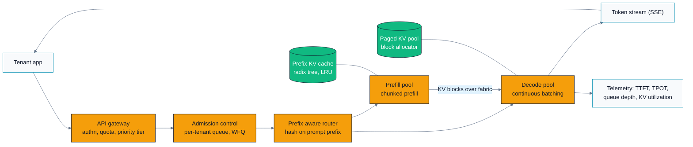

# Design doc — Multi-tenant LLM inference platform

> C07 case study 1 · standalone design document · companion tool:
> [`../tools/llm_sizing.py`](../tools/llm_sizing.py)
>
> Read this the way you would read a real design doc under review. Every number is
> **derived from a labelled assumption**, and every choice states the alternative it beat.
> Where the theory lives elsewhere in the curriculum, this doc references the module rather
> than re-deriving it: **B05** (transformer performance), **B06** (inference serving),
> **B07** (sharding), **B04** (precision), **B02** (roofline), **A07** (fused softmax /
> attention kernels), **C04** (production optimization), **C05** (deployment),
> **C06** (monitoring).

---

## 0. Assumptions register

Nothing below is measured. This table is the contract: change a row, re-run
`llm_sizing.py`, and every downstream number changes with it.

| # | Assumption | Value | Where it came from | If wrong |
|---|---|---|---|---|
| A1 | Model shape | 70B dense decoder, 80 layers, `d_model` 8192, 64 query heads, **8 KV heads** (GQA), head_dim 128 | Chosen as a representative open-weights class | Everything |
| A2 | Weight dtype | bf16 (2 B) at launch | Quality gate not yet passed for fp8 | Memory, throughput |
| A3 | Node | 8 GPUs, 192 GB HBM each, 5.3 TB/s peak, 1300 TFLOP/s dense bf16 | Data-center GPU class datasheet figures | Capacity |
| A4 | Achievable HBM bandwidth | 70% of peak on decode | Typical for a well-tuned paged-attention kernel; **measure it** | Decode rate |
| A5 | Achievable FLOP/s | 40% of peak on prefill GEMMs | Typical MFU for large-batch prefill; **measure it** | TTFT |
| A6 | End-to-end efficiency vs roofline | 60% | Scheduler gaps, ragged batches, preemption, sampling. This is the honesty knob | All latency |
| A7 | Fabric | 300 GB/s achievable per-GPU all-reduce in-node, 8 µs per collective | In-node scale-up fabric; **measure with a collectives benchmark** | Parallelism choice |
| A8 | Traffic | 300 req/s peak, 1,500 input tokens, 250 output tokens average | Product forecast; the number most likely to be wrong | Fleet size |
| A9 | Average live context | 2,048 tokens | Derived from A8 plus multi-turn history | Batch size |
| A10 | Prefix-cache hit rate | 60% of input tokens | Shared system prompts + multi-turn conversation reuse | Prefill fleet |
| A11 | Average load | 45% of provisioned peak | Diurnal traffic with a global user base | $/token |
| A12 | Fully-loaded cost | $3.00 per GPU-hour | Amortization + power + facility + ops | $/token |

---

## 1. Requirements

### Functional

Serve chat and completion requests from multiple internal product teams behind one API:
streaming token output, a system-prompt mechanism, structured (JSON) output, per-tenant
model selection across a small catalogue, and request cancellation.

### Non-functional (the SLOs we are designing against)

| Metric | Target | Why this number |
|---|---|---|
| **TTFT** p95 | ≤ 400 ms for prompts ≤ 4k | Below ~500 ms a streaming UI reads as instant |
| **TTFT** p95 | ≤ 2.5 s for prompts ≤ 32k | Long-context is a different product promise; see §4 |
| **TPOT** p95 | ≤ 30 ms (≈ 33 tokens/s per stream) | Comfortably faster than reading speed (~15 tokens/s) |
| Max context | 32,768 tokens | Product requirement |
| Peak throughput | 300 req/s | A8 |
| Availability | 99.9% monthly for the API | ≈ 43 min/month error budget |
| Isolation | No tenant can starve another | Multi-tenancy is a hard requirement, not a feature |

### Explicitly out of scope

Training and fine-tuning, the RAG retrieval layer, the safety-classifier models (treated as
an upstream dependency with its own budget), and the model catalogue's evaluation pipeline.

### What I would ask the interviewer / the product owner

1. **Is TTFT or throughput the priority?** They trade off directly, and the answer changes
   the batch size, the parallelism, and the fleet size. I am assuming latency-first.
2. **What is the input:output token ratio?** At 6:1 (A8) this is a *prefill-dominated*
   workload, which is an unusual and load-bearing finding. At 1:1 the design changes.
3. **How much prompt sharing is there across requests?** This sets the prefix-cache hit
   rate, which is the single biggest cost lever (§8).
4. **What quality regression is acceptable for a 2× cost reduction?** Without a number,
   the quantization decision cannot be made.

---

## 2. Metrics

Following the business → product → offline chain from **C01**:

| Layer | Metric | Notes |
|---|---|---|
| Business | Cost per served request; product teams retained on the platform | The platform is a cost centre; its job is to be cheaper and more reliable than each team rolling their own |
| Product | TTFT p95, TPOT p95, request success rate, tokens served | The SLO table above *is* the product metric set |
| Offline | Task-suite accuracy per model version; per-quantization quality delta | Gate for any change to weights, dtype, or kernels |
| **Guardrails** | Refusal rate, safety-classifier trigger rate, p99.9 TTFT, per-tenant error rate, KV-cache eviction/recompute rate, cost per million tokens | Any of these regressing blocks a release even if the headline metric improved |

The guardrail that matters most and gets forgotten most: **p99.9 TTFT**. Continuous batching
optimizes mean throughput and can quietly starve a small number of unlucky requests. Watching
p95 alone hides this completely.

---

## 3. Architecture



The load-bearing structure: **admission control sits before routing**, so back-pressure is
applied at a point where we still know which tenant to shed; and **prefill and decode are
separate pools**, so a 32k prompt cannot stall 200 people's token streams.

---

## 4. Hardware sizing, derived

All of this is reproducible with:

```bash
python ../tools/llm_sizing.py
```

### 4.1 Weight bytes

```
weight_bytes = params x dtype_bytes = 70e9 x 2 B = 140 GB          (A1, A2)
```

### 4.2 KV-cache bytes per token

This is the formula that decides the whole design:

```
d_kv                 = kv_heads x head_dim = 8 x 128 = 1024
kv_bytes_per_token   = 2 x layers x d_kv x dtype_bytes
                     = 2 x 80 x 1024 x 2 B
                     = 327,680 B  =  320 KiB per token
```

The leading `2` is K and V. Note what GQA bought: with 64 KV heads instead of 8 this would be
**2.5 MiB per token**, 8× worse, and the design below would not fit. GQA is a *systems*
decision disguised as a modelling one.

Per sequence at the 32k maximum context: `32,768 x 327,680 B = 10.7 GB` for **one** request.

### 4.3 Max concurrency from HBM

```
node HBM         = 8 x 192 GB                        = 1,536.0 GB
- weights                                            =   140.0 GB
- runtime reserve (15%: activations, workspace,
  comms buffers, allocator fragmentation)            =   230.4 GB
                                                       ----------
KV pool                                              = 1,165.6 GB

KV pool capacity = 1,165.6e9 / 327,680  = 3,557,129 tokens
max sequences    = 3,557,129 / 2,048    = 1,737 concurrent streams   (A9)
```

**Finding:** HBM capacity is *not* the binding constraint at our request shape. 1,737 streams
per node is far more than latency will allow. That is worth saying out loud, because the
reflexive answer ("we're KV-capacity bound, quantize the cache") would be wrong here.

### 4.4 Decode throughput, bandwidth-bound

Decode reads every weight and every cached K/V once per step and does almost no arithmetic per
byte — the memory-bound regime from **B02**, applied to the transformer in **B05**. Per replica
per step:

```
bytes_read_per_step = weight_bytes/TP + batch x context x kv_per_token/TP
```

At TP=8, batch 192, context 2,048:

```
weights   = 140 GB / 8                                     = 17.50 GB
KV        = 192 x 2,048 x 327,680 B / 8                    = 16.11 GB
                                                             --------
total                                                      = 33.61 GB

achievable BW = 5.3 TB/s x 0.70                            = 3.71 TB/s   (A4)
t_memory      = 33.61 / 3,710                              =  9.06 ms
```

Cross-check against the compute roof, because the bandwidth model is only valid while it is
the larger term:

```
t_compute = 2 x 70e9 x 192 / (8 x 1300e12 x 0.40)          =  6.46 ms   (A5)
```

Memory wins, so decode is memory-bound **at this batch size**. Then add the terms the naive
roofline ignores:

```
t_allreduce (TP=8, 2 collectives x 80 layers)              =  4.22 ms   (derived in §5)
t_fixed (schedule, sample, detokenize)                     =  1.50 ms
                                                             --------
roofline step                                              = 14.77 ms
TPOT at 60% end-to-end efficiency (A6)                     = 24.62 ms   <- meets the 30 ms SLO

node decode throughput = 192 / 0.02462                     = 7,797 output tokens/s
```

### 4.5 Two numbers worth memorizing

**The knee.** Weight traffic is fixed; KV traffic grows with the batch. They cross at:

```
batch* = (weight_bytes/TP) / (context x kv_per_token/TP)
       = 17.5e9 / (2,048 x 327,680 / 8)
       = 209        at 2k context     (52 at 8k context)
```

Below the knee, batching is nearly free — you amortize the weight read over more tokens. Above
it, you are paying linearly for KV reads and throughput gains flatten. This is the honest answer
to "why not just batch harder?"

**The scheduler's token budget.** Inverting the step-time model against the 30 ms SLO gives
**277 streams / 567,296 KV tokens** at 2k context. So the scheduler must cap on *KV tokens in
flight*, not on request count: one 32k request costs the same decode bandwidth as sixteen 2k
requests. It needs a second cap on stream count too, because the all-reduce scales with streams
rather than tokens.

### 4.6 Prefill and TTFT

```
linear FLOPs    = 2 x P x N
attention FLOPs = 4 x L x N^2 x d_model
```

| Prompt | Linear | Attention | Attention share | Time at 60% eff. |
|---:|---:|---:|---:|---:|
| 2,048 | 286.7 TFLOP | 11.0 TFLOP | 3.7% | 119 ms |
| 32,768 | 4,587.5 TFLOP | 2,814.7 TFLOP | **38.0%** | 1,779 ms |

The quadratic term is a rounding error at 2k and more than a third of the work at 32k. That
single row is why long-context needs its own SLO and its own scheduling treatment.

TTFT budget for the 2k case, per hop (all figures assumptions except the prefill row):

| Hop | p50 | p95 |
|---|---:|---:|
| TLS + edge routing | 5 ms | 15 ms |
| Gateway: authn, quota, tenant lookup | 3 ms | 10 ms |
| Tokenize + validate | 2 ms | 6 ms |
| Admission queue wait | 15 ms | 140 ms |
| Prefill compute (derived, §4.6) | 119 ms | 175 ms |
| First-token sample + stream frame | 3 ms | 8 ms |
| **Total** | **147 ms** | **354 ms** |

354 ms against a 400 ms SLO: 46 ms of headroom, essentially all of it consumed by queue wait
at load. That is the number to watch, and it is why §7 sheds load rather than queueing it.

---

## 5. Parallelism: the interconnect decides

**Decision: TP=8 within the node, replicas across nodes, never TP across nodes.**

Derivation. A tensor-parallel transformer layer needs two all-reduces (after attention, after
the MLP), so 160 collectives per decode step at 80 layers. Ring all-reduce moves
`2(n-1)/n x message` bytes per GPU:

```
message per collective   = batch x d_model x 2 B = 192 x 8192 x 2 = 3.15 MB
per-GPU volume (n=8)     = 1.75 x 3.15 MB                         = 5.51 MB
total per step           = 160 x 5.51 MB                          = 881 MB
bandwidth term           = 881 MB / 300 GB/s                      = 2.94 ms   (A7)
latency term             = 160 x 8 us                             = 1.28 ms
                                                                    -------
t_allreduce                                                       = 4.22 ms
```

That is 29% of the 14.77 ms roofline step. Non-trivial, and it grows linearly with batch.

**Why not TP=4 with two replicas per node?** Halving TP halves the comm but doubles the
weight bytes each GPU must read, *and* stores two copies of the weights (280 GB instead of
140 GB), costing 140 GB of KV pool. Running the same model:

| Config | Weights on node | KV pool | Batch at 30 ms TPOT | Node throughput |
|---|---:|---:|---:|---:|
| **TP=8, 1 replica** | 140 GB | 1,165.6 GB | 277 | **7,797 tok/s** at batch 192 |
| TP=4, 2 replicas | 280 GB | 1,025.6 GB | ~100 per replica | ~6,600 tok/s |

TP=8 wins *under a 30 ms TPOT SLO*. Relax the SLO to 40 ms and TP=4 wins on throughput,
because it can then run the larger batches that amortize its higher per-GPU weight read.
**The SLO, not the hardware, picks the parallelism.** Say that in the interview.

**Why never TP across nodes.** Substitute a 25 GB/s scale-out NIC and 30 µs latency into the
same formula: `881 MB / 25 GB/s = 35.2 ms` plus `160 x 30 µs = 4.8 ms`, so ~40 ms of
communication on a step whose compute is 9 ms. TPOT goes from 25 ms to roughly 84 ms — a 3.4×
regression, SLO blown. Scale *out* with independent replicas behind the router; scale *up*
only inside the coherent fabric. This is **B07**'s rule, arrived at numerically.

Pipeline parallelism is deliberately not used: it adds bubbles that hurt the latency-sensitive
decode phase, and we do not need it for capacity since the model fits in one node.

---

## 6. Serving design

Each mechanism below is listed with the specific problem it solves. A mechanism without a
named problem is cargo cult.

### Continuous batching (iteration-level scheduling)

**Problem it solves:** with request-level batching, a batch runs until its *longest* member
finishes. A 20-token answer sharing a batch with a 2,000-token answer waits for all 2,000
steps, and the freed slots sit idle. **Fix:** schedule at the granularity of one decode
iteration; requests join and leave the running batch between steps
([Orca, OSDI '22](https://www.usenix.org/conference/osdi22/presentation/yu)). This is the
single highest-leverage serving change and it is why it comes first.

### Paged KV cache

**Problem it solves:** reserving `max_context` of contiguous KV per request wastes most of it
— a request that generates 250 tokens of a 32k budget uses 0.8% of its reservation, and the
allocator fragments. **Fix:** allocate KV in fixed-size blocks with a page table per sequence
([PagedAttention / vLLM](https://arxiv.org/abs/2309.06180)). Concretely: our reserved-cache
alternative would fit `1,165.6 GB / 10.7 GB = 108` sequences per node against the 1,737 that
paging gives at the actual average context — a **16× capacity difference** from a memory
allocator.

### Prefix / prompt caching

**Problem it solves:** A10 says 60% of input tokens repeat — shared system prompts, few-shot
blocks, and the growing history of a multi-turn conversation. Recomputing them is pure waste.
**Fix:** keep prompt KV in a radix tree keyed by token prefix with LRU eviction
([RadixAttention / SGLang](https://arxiv.org/abs/2312.07104)), and make the router
**prefix-aware** so requests sharing a system prompt land on the node that already holds it.
Effect on the fleet: prefill demand drops from 450,000 to 180,000 tokens/s (§8). This is the
biggest cost lever in the design and it is a *routing* change as much as a caching one.

### Chunked prefill

**Problem it solves:** a 32k prefill occupies the GPU for ~1.8 s (§4.6). Every stream decoding
on that GPU stalls for 1.8 s — a catastrophic TPOT outlier that never shows up in a mean.
**Fix:** split the prefill into chunks (say 2,048 tokens) and interleave decode steps between
them ([Sarathi](https://arxiv.org/abs/2308.16369)). Worst-case decode stall becomes one chunk,
~119 ms, at the cost of slightly worse prefill efficiency and 16 scheduler round trips.

### Disaggregating prefill from decode

**Decision: yes, disaggregate — but only because our workload is prefill-heavy.**

Prefill is compute-bound and wants large tiles at high MFU; decode is memory-bandwidth-bound
and wants large batches. Colocating them means one scheduler serving two workloads with
opposite ideal shapes, and forces the same parallelism on both
([DistServe](https://arxiv.org/abs/2401.09670)). With A8's 6:1 input:output ratio, our prefill
and decode fleets need genuinely different sizes (§8: 10.5 vs 9.6 node-equivalents), which we
could not tune independently if they shared nodes.

**The cost, stated honestly:** the KV blocks produced by prefill must cross the fabric to the
decode node. For a 2k prompt that is `2,048 x 327,680 B = 671 MB`; at 25 GB/s scale-out that
is **27 ms added to TTFT**, which eats over half our 46 ms of budget headroom. Mitigations:
place prefill/decode pairs on the same rack, overlap the transfer with the last prefill chunk,
and send KV layer-by-layer as it is produced. **If the workload were 1:1 input:output, I would
not disaggregate** — chunked prefill in a single pool would be simpler and the transfer cost
would not be worth paying.

### Quantization

**Decision: launch bf16, ship fp8 weights + fp8 KV behind a quality gate.** (See **B04** for
the numerics and **C04** for the production-optimization workflow.)

Modelled effect (`llm_sizing.py --weight-dtype fp8 --kv-dtype fp8`):

| | bf16 | fp8 weights + KV |
|---|---:|---:|
| Weights | 140.0 GB | 70.0 GB |
| KV per token | 327,680 B | 163,840 B |
| KV pool capacity | 3,557,129 tokens | 7,541,504 tokens |
| `t_memory` at batch 192 | 9.06 ms | 4.53 ms |
| `t_compute` at batch 192 | 6.46 ms | 6.46 ms |
| Roofline step | 14.77 ms | **12.18 ms (compute-bound)** |
| Node decode throughput | 7,797 tok/s | 9,460 tok/s |

The interesting result is not the 1.21× throughput gain — it is that **fp8 moves decode off the
memory roof and onto the compute roof**. Once there, further KV quantization buys nothing;
the next lever is fp8 *matmul* throughput (rerun with `--tflops 2600` if your part doubles
FLOP/s at fp8) or a smaller TP degree. Knowing which roof you are on before optimizing is the
whole point of **B02**.

**The quality gate (non-negotiable, and the answer to "why not just ship fp8 today?"):**

1. Per-task accuracy on the internal eval suite within **0.5 points** of bf16, per tenant-facing
   task, not just in aggregate.
2. Perplexity delta on a held-out sample of *production* prompt distributions — not WikiText.
   Quantization error concentrates in the tails, and the tail is somebody's use case.
3. Long-context specifically re-tested: fp8 KV error accumulates over the sequence, so a 32k
   conversation is the worst case, and a 2k eval will not find it.
4. Shadow traffic for one week with automated output-divergence tracking against bf16.

Weight-only schemes (GPTQ, AWQ) are the fallback if fp8 KV fails the long-context gate:
they keep the KV cache in bf16 and still halve the weight read.

### Speculative decoding — considered and deferred

A draft model can cut TPOT when the batch is small and the GPU is bandwidth-starved. At our
operating batch of 192 the GPU is already saturated, so speculation adds verification compute
without reducing the bottleneck, and its acceptance rate is workload-dependent. Revisit for a
low-latency premium tier where batches are deliberately small.

---

## 7. Multi-tenancy

The hard problem: one tenant submitting 32k-context batch jobs must not degrade another
tenant's interactive chat.

| Concern | Mechanism | Why this one |
|---|---|---|
| Quotas | Per-tenant token-bucket on **tokens/minute**, not requests/minute | A request is not a unit of cost; a 32k request costs 16× a 2k one |
| Fairness | Weighted fair queueing across per-tenant queues at admission, weight = paid tier | Prevents one tenant's burst from monopolizing the running batch |
| Starvation | Age-based priority boost; a request queued > 2 s jumps the queue | Pure WFQ can starve a low-weight tenant indefinitely under sustained load |
| Priority tiers | `interactive` / `standard` / `batch`. Batch is preemptible and may only run when interactive queue depth is zero | Gives the cheap tier somewhere to live without a separate fleet |
| Isolation | Per-tenant KV-pool quota so no tenant can consume the whole cache; separate node pools for tenants with a compliance requirement | Shared KV is a noisy-neighbour vector and, with prefix caching, a **cross-tenant information-leak vector** |
| Blast radius | Per-tenant circuit breaker; a tenant exceeding its error budget is shed first | Availability is per-tenant, not fleet-average |

**The security point that gets missed:** prefix caching creates a *timing side channel*. If
tenant B's prompt gets a cache hit on tenant A's cached prefix, B learns something about A's
traffic from the TTFT. **Key the prefix cache by (tenant, prefix), never by prefix alone.**
Cross-tenant sharing is only acceptable for platform-owned system prompts that are public by
construction. This costs cache hit rate and it is worth it.

---

## 8. Cost model

Sizing the fleet from A8:

```
Decode demand   = 300 req/s x 250 output tokens          =  75,000 tok/s
Node decode rate                                          =   7,797 tok/s
                                                          -> 9.6 nodes

Prefill demand  = 300 req/s x 1,500 input tokens         = 450,000 tok/s
  x (1 - 0.60 prefix-cache hit rate)                     = 180,000 tok/s   (A10)
Node prefill rate                                         =  17,170 tok/s
                                                          -> 10.5 nodes

Capacity total                                            -> 20.1 nodes
+ burst headroom and N+1 across two availability zones    -> 26 nodes (208 GPUs)
```

**Note the finding:** prefill needs *more* hardware than decode. That is a direct consequence
of the 6:1 input:output ratio in A8, and it is the reason disaggregation earns its complexity
here. If someone quotes you a serving design where decode dominates, ask about their token
ratio before believing it.

```
Fleet cost = 26 nodes x 8 GPUs x $3.00/GPU-hour           = $624/hour
                                                          = $449,280/month (30 d)

At 45% average load (A11):
  output tokens/hour = 75,000 x 0.45 x 3,600              = 121.5 M
  input tokens/hour  = 450,000 x 0.45 x 3,600             = 729.0 M   (billed, pre-cache)

Attribute cost by node share:
  decode  9.6/20.1 = 47.8% -> $298/hour / 121.5 M         = $2.45 per 1M output tokens
  prefill 10.5/20.1 = 52.2% -> $326/hour / 729.0 M        = $0.45 per 1M input tokens
```

Input tokens come out ~5× cheaper than output tokens for two compounding reasons: prefill runs
at 2.2× the token rate of decode, and the prefix cache means we bill 2.5× more input tokens
than we compute. That asymmetry is why commercial APIs price input and output separately —
it falls out of the arithmetic, not out of marketing.

### The three levers that actually move the number

| Lever | Mechanism | Modelled effect | Cost to get it |
|---|---|---|---|
| **1. Prefix-cache hit rate** | 60% → 80% halves prefill demand to 90,000 tok/s → 5.3 prefill nodes → fleet 19 instead of 26 | **−27% fleet cost** | Prefix-aware routing, bigger cache reservation, encouraging tenants to put stable content first in the prompt |
| **2. fp8 weights + KV** | Decode 7,797 → 9,460 tok/s; prefill also faster if the part doubles fp8 FLOP/s | **−20% to −35%** | Engineering + the quality gate in §6; risk of a silent long-context regression |
| **3. Utilization** | 45% → 65% average load by autoscaling and draining the `batch` tier into overnight troughs | **−31% $/token** | Autoscaling that is fast enough (model load time is minutes), and a batch tier with real demand |

Lever 3 is the one people skip because it involves no interesting ML, and it is frequently the
largest. Note also what is *not* on this list: a bigger batch size. Above the knee (batch 209)
batching buys throughput sub-linearly while spending TPOT budget linearly.

---

## 9. Evaluation and rollout

| Stage | Gate |
|---|---|
| Offline | Task-suite accuracy within 0.5 pt; long-context suite specifically; latency micro-benchmarks per kernel |
| Load test | Replay a captured production trace (real prompt-length distribution, real arrival burstiness) — synthetic uniform load will not find the p99.9 problems |
| Shadow | Mirror 5% of live traffic to the new version, compare outputs and latencies, serve nothing from it. Catches numerical regressions with zero user risk |
| Canary | 1% of traffic, one AZ, automatic rollback on TTFT p95, TPOT p95, error rate, or refusal-rate breach. Bake ≥ 24 h to cover a full diurnal cycle |
| A/B | Only where output *quality* changes (a new model version). Pure infrastructure changes get canary + guardrails; a full A/B on a kernel rewrite is wasted calendar time |
| Rollback | Previous version stays warm on standby for 48 h. Rollback is a router weight change, ≤ 60 s, and it is **tested weekly** — an untested rollback path is not a rollback plan |

---

## 10. Monitoring, failure modes, degradation

### Signals (see **C06**)

| Signal | Alert on | Diagnoses |
|---|---|---|
| TTFT p50/p95/**p99.9** | p95 > 400 ms for 5 min | Queue saturation, prefill contention |
| TPOT p50/p95/**p99.9** | p95 > 30 ms for 5 min | Batch too large, KV pressure, a long-context request starving neighbours |
| Admission queue depth + age | Oldest request > 2 s | Under-provisioned or a hot tenant |
| KV-pool utilization | > 85% | Preemption and recompute imminent |
| **Preemption / recompute rate** | > 1% of steps | The leading indicator of a thrash spiral — this fires *before* latency moves |
| Prefix-cache hit rate | Drop > 10 pts day-over-day | Router regression, cache too small, or a tenant changed their prompt template |
| Tokens/s per node | Drop > 15% | Kernel regression, thermal throttling, a bad node |
| Refusal + safety-trigger rate | Sudden change | Model regression or a prompt-injection campaign |
| Output-length distribution | Distribution shift | A tenant changed behaviour; capacity plan is now stale |

### Failure modes and the degradation ladder

The ladder is ordered by user-visible harm. Each rung is automatic, and each is **load-tested**
— an untested degradation path fails when you finally need it.

1. **Cap `max_tokens`** to 512 for the `standard` tier. Nearly invisible; immediately relieves
   both KV pressure and decode bandwidth.
2. **Reduce the max running batch** to protect TPOT for admitted requests, accepting a longer
   queue. Trading TTFT for TPOT.
3. **Shed the `batch` tier** with HTTP 429 and a `Retry-After`. Preemptible work is preemptible.
4. **Route the `standard` tier to a smaller model.** Quality drop, but a fast, correct-ish answer
   beats a timeout. Requires the small model to be *already warm* — spinning one up under load
   is not degradation, it is a second outage.
5. **Shed by tenant priority** at admission, cheapest tier first, with a clear error body.
6. **Reject with a queue-full error.** Fast failure is better than a 60 s timeout that also ties
   up the client's connection pool.

Specific failure modes to design against:

- **KV thrash spiral.** Admission over-commits, sequences get preempted, preempted sequences
  recompute their prefill, recompute consumes the capacity that would have drained the queue.
  *Fix:* admission control reserves KV blocks for the sequence's *expected* full length before
  admitting, and the preemption rate is a first-class alert.
- **Head-of-line blocking from long context.** One 32k prefill stalls the node. *Fix:* chunked
  prefill plus a separate queue for long-context requests with its own SLO.
- **Cache stampede on deploy.** A rolling restart empties every prefix cache at once; TTFT
  spikes fleet-wide. *Fix:* drain and warm one node at a time; replay the top-N system prompts
  into the cache before the node takes traffic.
- **Silent quality regression.** A kernel or quantization change alters outputs without moving
  any latency metric. *Fix:* the shadow-comparison stage, and output-divergence as a release gate.

---

## 11. Tradeoffs, 10× scale, and what I left out

### Tradeoffs I made and would defend

| Choice | Bought | Paid |
|---|---|---|
| TP=8 in-node | Lowest TPOT, one weight copy, biggest KV pool | 29% of step time in all-reduce; whole node is the blast radius |
| Disaggregated prefill/decode | Independent scaling of two differently-shaped workloads | 27 ms of KV transfer on TTFT; a second scheduler to operate |
| bf16 at launch | No quality risk on day one | ~25% more hardware than fp8 would need |
| Latency-first batch sizing (192, not 277) | p99 headroom | 18% less throughput than the SLO edge allows |
| Shared platform | Utilization pooling across tenants; one team operates it | Noisy neighbours, quota engineering, a cross-tenant cache side channel |

### At 10× (3,000 req/s)

- **Multi-region becomes mandatory**, and the interesting problem moves from GPUs to routing:
  prefix-cache locality is per-region, so a naive geo-router destroys hit rate.
- **A model catalogue, not a model.** Route by task difficulty — a classifier sends easy
  requests to an 8B model. This is a bigger lever than any kernel optimization, and it needs a
  quality model to decide routing, which is its own ML system with its own feedback loop.
- **Disaggregation gets a third pool**: a dedicated long-context prefill pool, since its
  hardware profile (compute-heavy, quadratic) differs from short prefill.
- **KV offload to host memory or NVMe** for paused conversations, trading fabric bandwidth for
  HBM. Worth it only once conversation-resume rate is measured and high.
- **Fleet-level scheduling becomes the bottleneck**, not any single node. Expect to build a
  global admission controller and to care about the tail of the *router*, not the model.

### Deliberately left out

- **Speculative decoding** (§6 — deferred, not rejected).
- **MoE models**, which change the memory model completely: weights read per token depends on
  routing, expert-parallel all-to-all replaces the TP all-reduce, and load imbalance across
  experts becomes a first-class problem.
- **LoRA multi-tenancy** (many fine-tunes over one base model) — a strong fit for a platform
  like this and a natural follow-up design.
- **The safety-classifier pipeline**, treated as an upstream dependency with its own latency
  budget carved out of the gateway hop.
- **Cross-region failover semantics** for in-flight streams, which is a genuinely hard problem
  I would not attempt to solve on a whiteboard.

---

## 12. References

- Pope et al. (2022). *Efficiently Scaling Transformer Inference.* <https://arxiv.org/abs/2211.05102>
- Kwon et al. (2023). *Efficient Memory Management for LLM Serving with PagedAttention (vLLM).* <https://arxiv.org/abs/2309.06180>
- Yu et al. (2022). *Orca: A Distributed Serving System for Transformer-Based Generative Models.* OSDI '22. <https://www.usenix.org/conference/osdi22/presentation/yu>
- Agrawal et al. (2023). *SARATHI: Efficient LLM Inference by Piggybacking Decodes with Chunked Prefills.* <https://arxiv.org/abs/2308.16369>
- Zhong et al. (2024). *DistServe: Disaggregating Prefill and Decoding for Goodput-optimized LLM Serving.* <https://arxiv.org/abs/2401.09670>
- Zheng et al. (2023). *SGLang: Efficient Execution of Structured Language Model Programs* (RadixAttention). <https://arxiv.org/abs/2312.07104>
- Ainslie et al. (2023). *GQA: Training Generalized Multi-Query Transformer Models from Multi-Head Checkpoints.* <https://arxiv.org/abs/2305.13245>
- Dao et al. (2022). *FlashAttention.* <https://arxiv.org/abs/2205.14135>
- Micikevicius et al. (2022). *FP8 Formats for Deep Learning.* <https://arxiv.org/abs/2209.05433>
- Sculley et al. (2015). *Hidden Technical Debt in Machine Learning Systems.* <https://papers.nips.cc/paper/2015/hash/86df7dcfd896fcaf2674f757a2463eba-Abstract.html>
