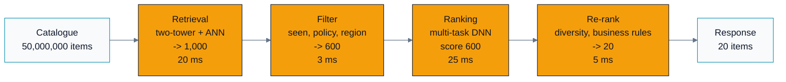
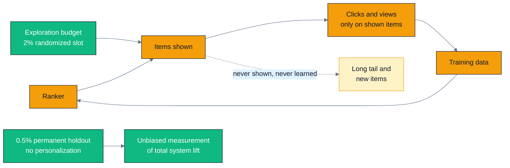

# Design doc — Large-scale recommendation system

> C07 case study 2 · standalone design document · companion tool:
> [`../tools/funnel_budget.py`](../tools/funnel_budget.py)
>
> Same rules as case study 1: every number derives from a labelled assumption, and every
> choice names the alternative it beat. Theory lives in the modules it belongs to —
> [C01](../../C01.problem-framing-and-metrics/README.md) (framing, metrics, Goodhart),
> [C02](../../C02.data-pipelines-and-features/README.md) (data pipelines, feature stores, labels),
> [C03](../../C03.training-systems/README.md) (training systems),
> [C05](../../C05.deployment-and-serving-architecture/README.md) (deployment),
> [C06](../../C06.monitoring-drift-and-ethics/README.md) (monitoring, feedback loops, ethics),
> [A04](../../../A-gpu-programming/A04.parallel-reduction/README.md) (reduction — the top-k
> primitive),
> [B02](../../../B-gpu-ml-performance/B02.roofline-and-arithmetic-intensity/README.md) (roofline).
>
> Terms: [GLOSSARY.md](../../../../docs/GLOSSARY.md) ·
> Sources: [REFERENCES.md](../../../../docs/REFERENCES.md).

---

## 0. Assumptions register

| # | Assumption | Value | Where it came from | If wrong |
|---|---|---|---|---|
| A1 | Catalogue | 50 M eligible items | Product scale | Retrieval design |
| A2 | Users | 200 M monthly active | Product scale | Embedding table size |
| A3 | Traffic | 20,000 recommendation requests/s peak | Product forecast | Everything |
| A4 | Latency | 150 ms p99 end-to-end for the recommendation call | Feed must render inside a 300 ms budget | Funnel widths |
| A5 | Response | 20 items per request | UI design | Re-ranking stage |
| A6 | Ranker cost | 4.2 MFLOP per (user, item) pair | Derived: 1400→1024→512→256→4 MLP = 2.09 M MAC | Fleet size |
| A7 | Features | 200 fp32 features fetched per candidate | Feature-store schema | Feature I/O |
| A8 | Retrieval embeddings | 128-d, ~3,000 ANN probes per query at target recall | HNSW `efSearch` tuning | Index size, recall |
| A9 | New items | 500,000/day (≈ 5.8/s) | Content-ingestion rate | Index refresh cadence |
| A10 | Local feature-cache hit rate | 80% on the head of the catalogue | Power-law popularity | Feature-store cost |
| A11 | Average load | 50% of provisioned peak | Diurnal traffic | $/request |
| A12 | Cost | $3.00/GPU-hour, $1.20/CPU-host-hour | Fully loaded | $/request |

---

## 1. Requirements

### Functional

Given a user and a context (surface, device, time, session history), return 20 ranked items
in 150 ms. Respect eligibility rules (region, licensing, age rating, blocked creators), never
show an item the user has already consumed, and give new items a path to exposure.

### Non-functional

| Requirement | Target |
|---|---|
| Latency | 150 ms p99 for the recommendation call |
| Throughput | 20,000 req/s peak |
| Availability | 99.95% — the feed must always render, even if degraded |
| Freshness | An item uploaded now must be recommendable within 1 hour |
| Model refresh | Ranker retrained daily; retrieval towers weekly |

### Out of scope

The content-ingestion pipeline, the safety/moderation classifiers (an upstream dependency
that determines eligibility), ads auction mechanics, and notification ranking.

### What I would ask

1. **What does the business actually want to maximize?** "Engagement" is not an answer.
   If it is 30-day retention, that changes the objective, the guardrails, and the experiment
   duration. I assume retention below.
2. **What is the cold-start volume?** A9 (500k new items/day) drives the entire
   exploration budget. If it were 500/day this is a much easier system.
3. **Is there an existing feed the users are habituated to?** Replacing a system users have
   trained themselves on produces a short-term metric dip that is not a model regression.
4. **What is the current offline–online correlation?** If nobody has measured it, the offline
   eval is decoration and the first project is to establish it.

---

## 2. Metrics

### The chain (C01)

| Layer | Metric |
|---|---|
| **Business** | 30-day retention; subscription renewal rate; long-run sessions per user per week |
| **Product** | Daily sessions per user; long-view rate (>30 s or >70% completion); save/share rate; next-day return rate |
| **Offline proxy** | Retrieval: recall@1000 against the ranker's top items. Ranking: AUC and log-loss per task, NDCG@20, and **calibration error** |
| **Guardrails** | See below — these have veto power over a launch |

### Guardrails, and why each one exists

This is the section that separates a design from a demo. The recommender's objective is a
*proxy*, and Goodhart's law
([C01 §6](../../C01.problem-framing-and-metrics/README.md#6-challenges-drawbacks--tradeoffs)) says
the system will find the gap between the proxy and the goal. Each guardrail closes one known gap:

| Guardrail | Closes the gap where… |
|---|---|
| **Completion rate conditional on click** | …the model learns clickbait: high CTR, immediate abandonment. This is the single most important guardrail in a click-optimized system |
| **Hide / report / "not interested" rate** | …engagement rises because the content is enraging rather than good |
| **Catalogue coverage** (distinct items in the top-20 across all users) and **creator Gini** | …the system collapses onto a small popular head and starves the supply side |
| **Fraction of impressions to items < 7 days old** | …the feedback loop freezes the catalogue; a direct measure of whether new content can break in |
| **Session-length distribution, not mean** | …the mean rises because a small group of heavy users got more compulsive |
| **Next-day return rate** | …today's engagement was borrowed from tomorrow |
| **Per-cohort parity** on the above (new users, low-activity users, small creators) | …aggregate metrics improve while a subgroup gets worse. Aggregates hide this by construction |
| Latency p99, error rate, cost per request | …a quality win was actually bought with a system regression |

**A guardrail without a pre-registered threshold is a dashboard, not a guardrail.** Each of
the above gets a number before the experiment starts, not after the results come in.

### The multi-task objective

A single "will they click" head produces clickbait. Instead, predict several outcomes and
combine them explicitly ([Zhao et al., RecSys 2019](https://doi.org/10.1145/3298689.3346997)):

```
score = w_click     x p(click)
      + w_complete  x p(long_view | click)
      + w_share     x p(share)
      - w_negative  x p(hide or report)
```

Two things to say out loud about this:

1. **The weights are a product decision, not a training outcome.** No loss function tells you
   how many clicks a "hide" is worth. Set the weights, run the A/B, read retention, adjust.
2. **The heads must be calibrated**, because you are adding probabilities from different tasks.
   An uncalibrated `p(share)` silently re-weights the whole objective. Fit isotonic
   regression per head on held-out data and monitor expected calibration error in production —
   miscalibration drifts even when AUC does not move.

---

## 3. Why the funnel exists — the arithmetic

Reproduce with:

```bash
python ../tools/funnel_budget.py
```

The strawman is "score every item for every user." Cost it:

```
FLOPs per request      = 50,000,000 items x 4.2 MFLOP        = 210 TFLOP
Fleet at 20,000 req/s  = 210e12 x 20,000                     = 4.20 EFLOP/s
GPUs required          = 4.20e18 / 520e12                    = 8,077 GPUs (1,010 nodes)
Latency, one request alone on one whole idle 8-GPU node
                       = 210e12 / 4.16e15                    = 50.5 ms
Item-embedding bytes   = 50e6 x 128 x 4 B                    = 25.6 GB per request
Fleet memory traffic   = 25.6 GB x 20,000                    = 512 TB/s
```

Batching across requests amortizes the 25.6 GB of embedding reads — read the table once, score
many users against it — so memory is the softer wall. **The compute wall is the irreducible
one**: every (user, item) pair must still be scored, and 8,077 GPUs to serve one feed is off
by three orders of magnitude from anything defensible.

So: spend a lot of compute per item on a few items, and almost none on the rest. That is the
funnel, and it is a direct consequence of the arithmetic above rather than a convention
inherited from [Covington et al. (2016)](https://dl.acm.org/doi/10.1145/2959100.2959190) —
though that is where the two-stage pattern was first written down clearly.

### The funnel, costed



Each stage spends roughly 100× more compute per item than the one before it, on roughly 100×
fewer items — so every stage costs about the same, which is the property a well-balanced funnel
has.

| Stage | Items in | GFLOP | p99 ms |
|---|---:|---:|---:|
| Retrieval (two-tower + ANN) | 50,000,000 | 0.006 | 20.0 |
| Filtering (seen / policy / eligibility) | 1,000 | 0.000 | 3.0 |
| Item feature fetch | 600 | 0.000 | 15.0 |
| Ranking (multi-task DNN) | 600 | 2.520 | 25.0 |
| Re-ranking (diversity + rules) | 600 | 0.003 | 5.0 |
| Edge, auth, routing | — | — | 10.0 |
| User feature fetch | — | — | 12.0 |
| User tower forward | — | — | 2.0 |
| Response assembly | — | — | 5.0 |
| Reserve (jitter, GC, retry) | — | — | 23.0 |
| **Total** | | **2.529** | **120.0** |
| Budget (A4) | | | 150.0 |
| **Headroom** | | | **30.0** |

```
Funnel reduction = 210,000 GFLOP / 2.529 GFLOP = 83,042x
```

**The reserve row is not padding.** 23 ms of the budget is explicitly held for jitter, GC
pauses, and one retry. A design that spends 100% of its budget on the happy path has a p99
that is worse than its arithmetic.

### What breaks if you widen a stage

```bash
python ../tools/funnel_budget.py --widen rank=2000
```

| Quantity | 600 candidates | 2,000 candidates | Change |
|---|---:|---:|---:|
| GFLOP per request | 2.529 | 8.416 | 3.33× |
| p99 latency | 120.0 ms | 210.0 ms | 1.75× |
| Feature bytes per request | 480 kB | 1,600 kB | 3.33× |
| Feature-store egress | 1.9 GB/s | 6.4 GB/s | 3.33× |

210 ms against a 150 ms budget: **60 ms over**. Widening the ranker is the most common
instinct when quality plateaus, and it is usually the wrong lever — you buy a sub-linear
recall improvement with a linear latency and cost increase. If you want to rank more
candidates, first buy the time back: a cheap first-pass ranker over the wide set, parallel
feature fetch, or a smaller final set.

---

## 4. Retrieval

### Two-tower embeddings

A user tower and an item tower map into a shared 128-d space; relevance is a dot product, so
retrieval becomes maximum-inner-product search over a precomputed index.

- **Item tower:** content features, creator, topic, age, historical statistics. Computed
  **offline**, once per item per tower version.
- **User tower:** long-term profile plus in-session behaviour. Computed **online**, because
  the user's state changes between requests. This asymmetry is the whole reason the two-tower
  architecture works at this scale.

**Training:** in-batch negatives with the **sampling-bias correction** of
[Yi et al. (RecSys 2019)](https://doi.org/10.1145/3298689.3346996). Without the correction,
popular items appear as negatives in proportion to their frequency and the model learns to
suppress exactly the items it should retrieve; the fix is a logit correction by estimated
item sampling probability. Mix in-batch negatives with uniformly sampled negatives from the
full catalogue, because in-batch negatives alone are drawn from the *impressed* distribution
and teach the model nothing about the 99.9% of the catalogue it never shows.

### The ANN index, and its operational realities

```
vectors        50e6 x 128 x 4 B                       = 25.6 GB (fp32)
HNSW graph     50e6 x 32 neighbours x 4 B             =  6.4 GB
                                                        --------
index total                                           = 32.0 GB
8 shards                                              =  4.0 GB per shard
x 3 replicas (tail latency + AZ redundancy)           = 24 hosts
```

Product quantization to 32 B/vector would shrink the vectors to 1.6 GB, but at 4 GB/shard the
index already fits comfortably in host RAM, so PQ would trade recall for memory we do not need
to save. **Skip it and say why** — that is the design judgement, not the compression trick.

Note the honest bit: ANN latency is dominated by pointer-chasing through the graph, which is
*memory-latency* bound, not FLOP bound. 3,000 probes × 128 dims × 2 = 0.77 MFLOP of actual
arithmetic in a 20 ms hop. Throwing a GPU at it does not obviously help; a CPU host with a lot
of RAM and good cache behaviour is usually cheaper per QPS. **This is the first place where the
answer to "should this be on a GPU?" is no.**

#### Build and refresh — the part that gets skipped in interviews

| Operation | Cadence | Cost |
|---|---|---|
| Embed new items (item tower forward) | Continuous | 5.8 items/s — negligible |
| Delta index (append-only, searched alongside the main index) | Every 15 min (≈5,200 items) | Minutes |
| Merge delta into the main index, atomic swap | Nightly | Graph rebuild, ~1 h per shard, shards in parallel |
| **Full re-embed of all 50 M items** | **On every item-tower change** | 50e6 × 20 MFLOP = 1 PFLOP ≈ **4 min of GPU time** on one 8-GPU node, then a full graph rebuild |

**The trap that silently destroys recall:** the query embedding and the index embeddings must
come from the *same tower version*. Ship a new user tower without re-indexing, and every dot
product is computed in a space the index was not built in. Nothing errors. Recall degrades,
engagement drifts down over days, and the cause is invisible in every model metric.

*Mitigation, and it is cheap:* stamp `tower_version` on the index and on every query
embedding; the search service **refuses** a mismatched query rather than serving degraded
results. Fail closed. This also means the two towers are a single deployable unit — they
cannot be released independently, which is a constraint worth writing into the runbook.

---

## 5. Ranking

### Features

| Family | Examples | Freshness |
|---|---|---|
| User | Long-term topic affinities, tenure, activity level, device, language | Daily batch |
| Item | Creator, topic, duration, age, aggregated CTR/completion, quality score | Hourly |
| Context | Time of day, day of week, surface, session position, network quality | Request time |
| **Cross** | User×topic affinity, user×creator history, similarity between the candidate and the last 10 consumed items, "seen but not clicked" count | Request time |

Cross features carry most of the signal and are the most expensive to compute, because they
cannot be precomputed per item or per user alone. This is exactly the tension
[Wide & Deep](https://arxiv.org/abs/1606.07792) addresses: memorize the sparse cross features
that matter, generalize with the deep component over embeddings. For the sparse-embedding
scaling problem itself, [DLRM](https://arxiv.org/abs/1906.00091) is the reference architecture.

### Position bias, and why it is not optional

Implicit feedback is generated *by the system being trained*. An item shown at position 1 gets
clicked more than the same item at position 10, regardless of relevance. Train naively and the
model learns "items I put first get clicked" — it learns its own past policy.

The fix used in production ([Zhao et al. 2019](https://doi.org/10.1145/3298689.3346997)) is a
**shallow tower**: a small side-model that predicts click probability from position and device
alone, added to the main logit at training time and **set to a constant at serving time**. The
main tower is then forced to explain the residual — the part of the click that was not
position. Alternatives: inverse-propensity weighting (needs propensities, which needs the
randomized traffic in §7), or training only on comparisons within the same position.

### Calibration

The score feeds business logic (ads blending, thresholds, the multi-task combination), so the
predicted probabilities must mean something. Train with log-loss, calibrate with isotonic
regression on held-out data, monitor expected calibration error per segment. **Ranking-only
metrics like NDCG will not catch a calibration failure**, because a monotone transform of the
scores leaves the ranking unchanged and destroys the probabilities.

---

## 6. Training data

See [C02 §3](../../C02.data-pipelines-and-features/README.md#3-deep-dive) for the pipeline
mechanics; the parts specific to recommendation:

| Issue | Detail | Handling |
|---|---|---|
| **Implicit feedback only** | No one labels "was this a good recommendation." Clicks are a noisy, biased proxy | Multi-task heads over several observable outcomes; never a single click head |
| **Position and presentation bias** | The label depends on where and how the item was shown | Shallow position tower (§5); log the *full* presentation context with every impression |
| **Selection bias** | You only observe outcomes for items the system chose to show | The exploration budget (§7) is the only source of unbiased data |
| **Negative sampling** | 99.99% of (user, item) pairs are unobserved, not negative | Retrieval: in-batch + uniform negatives with sampling-bias correction. Ranking: impressed-not-clicked as hard negatives, plus a small uniform sample so the model sees the tail |
| **Delayed labels** | A "long view" resolves in seconds, a subscription in days | Two label streams: fast labels for the hourly incremental update, slow labels for the daily full retrain. **Never** wait for the slow label to start training |
| **Label leakage** | A feature computed after the label event (e.g. the item's same-day CTR) leaks the future | Point-in-time correct feature joins; every feature carries the timestamp at which it was known |
| **Splitting** | The data is temporal and the deployment is temporal | **Split by time, never randomly.** A random split lets tomorrow's interactions predict today's and inflates offline metrics without bound. Also hold out entire *users* to measure cold-start honestly |

The single most valuable data-engineering decision: **log the exact feature vector that was
served, keyed by request ID, and train on those logged vectors.** This makes training/serving
skew structurally impossible instead of something you monitor and hope about. The alternative —
recomputing features from raw logs at training time — guarantees a slow drift between the two
code paths that nobody notices until a launch mysteriously underperforms its offline numbers.

---

## 7. Feedback loops and exploration

This is the section that distinguishes a recommender design from a ranking-model design.



The loop is closed: the model chooses what is shown, what is shown determines what is
labelled, and the labels train the model. Left alone it has three failure modes.

**Popularity bias / rich-get-richer.** Popular items get more impressions, more impressions
produce more engagement data, better data produces higher confidence, higher confidence
produces more impressions. The catalogue collapses toward a head that the model itself created.
Symptom: catalogue coverage falls while every model metric improves.

**Item cold start.** A new item has no interaction history, so the ranker scores it low, so it
is never shown, so it never acquires history. A9 says this happens 500,000 times a day. Content
features in the item tower help the model make a *prior* guess, but a prior is not evidence.

**User cold start.** A new user has no history; personalization has nothing to personalize.
Fall back to a popularity-and-context baseline, then switch to the personalized path once the
session yields a few interactions. Measure this cohort separately — aggregate metrics are
dominated by established users and will hide a bad new-user experience completely.

### The exploration budget, and its price

**Mechanism:** on 2% of requests, one slot in the top 10 is filled by sampling from the
eligible candidate pool with a boost for under-exposed items, and the substitution is logged
with its selection probability.

**Why it is mandatory, not a nice-to-have** (all three reasons independently sufficient):

1. It is the **only unbiased data** in the system. Everything else is conditioned on what the
   model chose. Without it, off-policy evaluation and propensity estimation are impossible —
   you cannot even estimate how wrong you are.
2. It is the **only path to exposure for new items** that does not require the model to already
   know they are good.
3. It **breaks the rich-get-richer loop** at the source rather than patching it downstream.

**What it costs — do this arithmetic before the meeting, because someone will ask:**

```
Assume an explored slot performs 40% worse than the ranked slot it replaced.
Expected engagement loss = 2% of traffic x 1 of 10 slots x 40% worse
                         = 0.02 x 0.10 x 0.40
                         = 0.08% of total engagement
```

0.08% is roughly one week of ordinary model improvement, spent once, permanently, to keep the
data honest and the catalogue alive. Framed that way it is an easy sell. Framed as "we want to
show users worse content" it is an impossible one.

**Plus a permanent 0.5% holdout** receiving no personalization at all. A/B tests compare model
A to model B and therefore cannot see the system slowly degrading in a direction both models
share. The holdout measures the total lift of personalization against nothing, and it is the
only instrument that catches a multi-quarter [drift](../../../../docs/GLOSSARY.md#drift).

---

## 8. Serving

### Feature store: the online/offline consistency problem

Two stores, one definition:

- **Offline** (columnar warehouse) for training, with point-in-time-correct joins.
- **Online** (low-latency KV store) for serving, holding the current value.

The failure mode is that the two drift — the offline pipeline and the online pipeline are
different code, so "days since last login" gets computed one way in Spark and another way in
the serving path. The model trains on one distribution and serves against another, and the
symptom is a launch that underperforms its offline numbers with no obvious cause.

**Three defences, in order of strength:**

1. **Log what you served.** The served feature vector, keyed by request ID, becomes the
   training row. Skew becomes impossible rather than monitored. Do this one.
2. **One transformation definition** compiled to both paths, so there is one place to change.
3. **Continuous [skew](../../../../docs/GLOSSARY.md#training-serving-skew) monitoring:** recompute
   a sample of online features offline and alert on
   distribution divergence. This is the backstop, not the plan.

### Caching

| Cache | Contents | Hit rate | Effect |
|---|---|---|---|
| Item features, local to each ranking replica | Top 1 M items × 200 features × 4 B = **800 MB** | 80% (A10) | Feature-store egress 9.6 GB/s → **1.9 GB/s** |
| User embedding, per session | The user-tower output | High within a session | Saves the tower forward on subsequent requests |
| Full response | Discouraged | — | A cached feed is a stale feed; cache the *inputs*, not the *decision* |

800 MB of RAM per replica for a 5× reduction in feature-store traffic is the best
price-performance trade in the design.

### Where GPUs are actually needed

| Component | GPU? | Reasoning |
|---|---|---|
| Ranking model training | **Yes** | Large embedding tables (item 25.6 GB + user 51.2 GB) with data-parallel MLP and model-parallel embeddings — the DLRM pattern |
| Item-tower batch embedding | **Yes** | 1 PFLOP per full re-embed; 4 minutes on a node versus hours on CPU |
| Ranking inference | **Marginal today** | 2.52 GFLOP/request; at 20,000 req/s that is 50 TFLOP/s, which is a fraction of one GPU's throughput. The fleet is sized by p99 latency and feature I/O, **not** by FLOPs. It becomes a clear yes when the ranker grows a sequence encoder over user history |
| ANN retrieval | **No** | Memory-latency bound pointer chasing; CPU hosts with large RAM are cheaper per QPS |
| Feature store | **No** | It is a KV store |
| Filtering, re-ranking, business logic | **No** | Set operations and rules |

Being able to say "no" here is the point. The reflexive "put it all on GPUs" answer costs money
and fails to identify that the actual bottleneck is a key-value store.

---

## 9. Evaluation

### Offline

| Stage | Metric | Caveat |
|---|---|---|
| Retrieval | recall@1000 against the ranker's top items | Measures whether the funnel is leaking, not whether users like the result |
| Ranking | AUC / log-loss per task, NDCG@20 | AUC is dominated by easy pairs; NDCG hides calibration failures |
| Both | Calibration error per segment | The metric people forget until the business logic breaks |
| Both | Metrics **sliced** by cohort: new users, new items, low-activity users, small creators | Aggregates hide subgroup regressions by construction |

**Time-based splits only.** Train on days 1–28, validate on 29, test on 30 — matching how the
model will actually be used. A random split leaks the future into the past through both the
label and the aggregate features, and it inflates every metric.

### Online

[A/B tests](../../../../docs/GLOSSARY.md#ab-testing-and-canary) are the ground truth
([Kohavi, Tang & Xu, *Trustworthy Online Controlled
Experiments*, Cambridge, 2020](https://www.cambridge.org/core/books/trustworthy-online-controlled-experiments/D97B26382EB0EB2DC2019A7A7B518F59)).
Practical requirements: randomize by user, not by request (or a user sees inconsistent feeds
and the units are not independent); run at least one full week to cover weekly seasonality and
novelty effects; pre-register the primary metric and the guardrail thresholds; run an A/A test
first to validate the pipeline; and check for sample-ratio mismatch before reading any result —
an SRM means the assignment is broken and the result is meaningless.

### The offline–online gap

Offline metrics improve and online metrics do not, routinely. Known causes, roughly in order
of frequency:

1. **Offline evaluation is on the logged (biased) distribution.** The new model would show
   different items, and you have no labels for those.
2. **Position bias in the evaluation data** rewards models that agree with the old policy.
3. **Feedback delay** — offline uses fully-resolved labels; online reads a partial signal.
4. **Novelty and primacy effects** — users react to change itself for the first few days.
5. **Guardrails not in the offline metric.** Offline NDCG has no opinion about diversity.

Manage it rather than pretending it does not exist: **measure the correlation** between your
offline metric and the online outcome across your last 20 experiments. If the correlation is
weak, the offline metric is a filter for obviously-broken models and nothing more — which is
still useful, but should not be used to pick between two good models. This number is one of
the most valuable things an established recommender team owns.

---

## 10. Cost and scaling

```
Ranking GPUs      13.3 for capacity -> 28 with p99 headroom + 2 AZ, x $3.00   = $ 84.00/h
ANN fleet         8 shards x 3 replicas = 24 hosts x $1.20                    = $ 28.80/h
Feature store     40 hosts x $1.20                                            = $ 48.00/h
Orchestration     40 hosts x $0.60                                            = $ 24.00/h
                                                                                ----------
Serving total                                                                 = $184.80/h
                                                                              = $133,056/month

At 50% average load (A11): 10,000 req/s x 3,600 = 36 M requests/hour
Cost per 1,000 requests = $184.80 / 3,600 / 10,000 x 1,000                    = $0.0051

Training: nightly ranker retrain, 8 GPUs x 6 h x $3.00 = $144/day             = $4,320/month
Daily item re-embed + index rebuild                                           ≈ $  300/month
```

**Sanity check against revenue** (illustrative, with made-up monetization assumptions): if
1,000 requests produce 20,000 impressions of which 10% are monetized at a $5 CPM, that is $10
of revenue against $0.005 of serving cost — about 0.05%. Serving infrastructure is not the
constraint on this system. **Engineering time and the offline–online gap are.** Say this
explicitly; it redirects the conversation from micro-optimizing the ranker to the things that
actually limit the team.

Note which line is largest: the feature store and the ANN fleet together cost more than the
GPUs. Optimizing the model to be 2× cheaper saves $42/hour. Raising the local feature-cache hit
rate from 80% to 90% halves the feature-store egress. The second one is easier.

### At 10× (200,000 req/s, 500 M items)

- **The index no longer fits the shard layout.** 500 M × 128-d needs product quantization,
  and now the recall/memory trade is real rather than avoidable. Expect a two-stage retrieval:
  coarse PQ search, then exact re-scoring of the top few thousand.
- **Multiple retrieval sources**, not one. Two-tower embeddings plus a co-visitation source,
  a fresh-content source, and a followed-creator source, each with its own quota into the
  candidate pool. This is also the cleanest place to inject exploration.
- **Feature I/O becomes the dominant cost** — at 10× it is 19 GB/s cached. Push more
  precomputation into the item embedding rather than fetching raw features.
- **Retraining cadence becomes the bottleneck**, not model quality: continuous/online learning
  with a streaming feature pipeline, which brings its own failure mode (a bad hour of data can
  poison the live model within minutes, so you need automatic rollback on the *training* path
  too).
- **Regionalization** — different catalogues, different eligibility, different cultural
  priors. One global model with region features is simpler and usually good enough; per-region
  models multiply the operational surface by the number of regions.

### Deliberately left out

- **Sequence models over user history** (transformer over the last 512 interactions). A clear
  quality win and the strongest argument for GPUs in the ranker; deferred because it changes
  the serving profile substantially and should be its own design.
- **Bandits / RL for slate optimization.** The exploration budget in §7 is a deliberately
  simple placeholder for a contextual bandit; the full treatment needs off-policy evaluation
  infrastructure that this design does not yet have.
- **Ads and organic blending**, which is an auction-design problem with different mathematics.
- **The moderation pipeline**, treated as an eligibility input.

---

## 11. References

- Covington, Adams, Sargin (2016). *Deep Neural Networks for YouTube Recommendations.* RecSys '16. <https://dl.acm.org/doi/10.1145/2959100.2959190>
- Yi et al. (2019). *Sampling-Bias-Corrected Neural Modeling for Large Corpus Item Recommendations.* RecSys '19. <https://doi.org/10.1145/3298689.3346996>
- Zhao et al. (2019). *Recommending What Video to Watch Next: A Multitask Ranking System.* RecSys '19. <https://doi.org/10.1145/3298689.3346997>
- Cheng et al. (2016). *Wide & Deep Learning for Recommender Systems.* <https://arxiv.org/abs/1606.07792>
- Naumov et al. (2019). *Deep Learning Recommendation Model for Personalization and Recommendation Systems (DLRM).* <https://arxiv.org/abs/1906.00091>
- Sculley et al. (2015). [*Hidden Technical Debt in Machine Learning Systems.*](../../../../docs/REFERENCES.md#hidden-technical-debt-in-machine-learning-systems-sculley-et-al-2015)
  — the maintenance bill behind §10's cost breakdown and §11's omissions.
- Kohavi, Tang, Xu (2020). *Trustworthy Online Controlled Experiments: A Practical Guide to A/B Testing.* Cambridge University Press. <https://www.cambridge.org/core/books/trustworthy-online-controlled-experiments/D97B26382EB0EB2DC2019A7A7B518F59>
- Zinkevich, M. [*Rules of Machine Learning: Best Practices for ML Engineering.*](../../../../docs/REFERENCES.md#rules-of-machine-learning-zinkevich-google)
  Google — the practitioner's case for §2's ordering: metrics and infrastructure before models.
