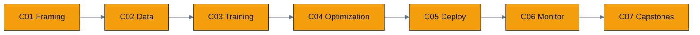

# Track C — ML System Design

Learn to **architect** real, end-to-end ML systems that survive production: framing the problem,
building data pipelines, training at scale, optimizing for serving, deploying safely, and
monitoring for drift and fairness. Emphasis on tradeoffs, scalability, and clear communication.

## Modules

| ID | Module | What you build | Status |
|----|--------|----------------|--------|
| [C01](C01.problem-framing-and-metrics/) | Problem framing, metrics & decomposition | Threshold-from-costs explorer, baseline checker | **DONE** |
| [C02](C02.data-pipelines-and-features/) | Data pipelines & feature engineering | Schema validator, leakage detector, split demo | **DONE** |
| [C03](C03.training-systems/) | Training systems (fault tolerance, cost) | Checkpoint planner, throughput/cost budget, HPO budget | **DONE** |
| [C04](C04.production-model-optimization/) | Production model optimization | Cost model, cascade analyzer, cache simulator | **DONE** |
| [C05](C05.deployment-and-serving-architecture/) | Deployment & serving architecture | A/B calculator, autoscaling sim, degradation planner | **DONE** |
| [C06](C06.monitoring-drift-and-ethics/) | Monitoring, drift, feedback loops & ethics | Drift detector, feedback-loop sim, fairness metrics | **DONE** |
| [C07](C07.capstone-case-studies/) | Capstone case studies | Two full designs + their sizing calculators | **DONE** |

**Suggested order.** C01 → C07 in sequence: the track is deliberately built as one arc from framing a
problem to running the deployed system. If you are short on time, C01 → C04 → C07 covers the highest
interview signal.

## These modules have no GPU code — and that is the point

Track C ships **no `hip/` or `cuda/` directories**. The decisions here are not kernel decisions.
But design material drifts easily into unfalsifiable advice, so every module is anchored by
**runnable, standard-library-only Python tools** whose output does the teaching:

- a random split that *looks* fine because the leak is baked into the feature (C02)
- a cost-derived threshold that beats an F1-derived one on an unchanged model (C01)
- peeking at an A/B test 20 times taking the false-positive rate from 5% to 25% (C05)
- a recommender that raises CTR while quietly burying 60% of its catalogue (C06)

Section 5 of each module is reframed from kernel timing to system-level analysis — cost per request,
latency budgets, statistical power, data quality. See [CURRICULUM.md](../../CURRICULUM.md) for the
interview-skill mapping.
