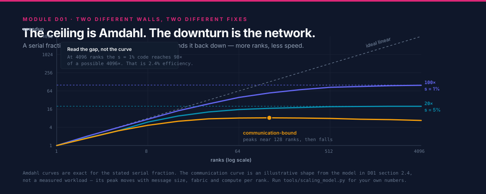
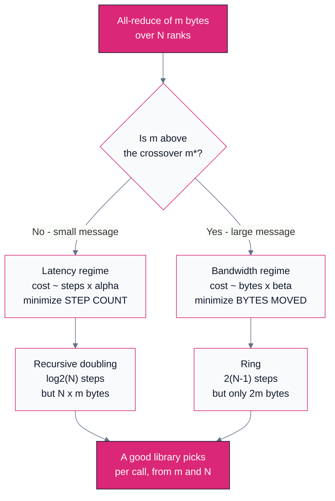

# D01 — Scaling Limits & the Cost of Talking

> Track D · Module 01 · Status: **DONE** · Est. 6 hours · Depth 2/5
>
> Prerequisites: [A01](../../A-gpu-programming/A01.foundations-and-programming-model/README.md)
> for GPU literacy. Nothing else — this module is the theory spine of Track D and
> derives what it needs. Helpful but not required:
> [B03](../../B-gpu-ml-performance/B03.profiling-and-bottleneck-analysis/README.md), which applies
> Amdahl's law *inside* a single kernel; this module applies it across a cluster.
>
> **Backends: none.** The tools in [`tools/`](tools/) are pure-Python analytic models — no GPU, no
> `torch`, no `numpy`. That is deliberate: the entire point of this module is to let you predict a
> scaling curve *before* you request 512 GPUs, and to recognize the shape of one when you see it.
> Setup: [SETUP.md](../../../docs/SETUP.md) ·
> Terms: [GLOSSARY.md](../../../docs/GLOSSARY.md) · Sources: [REFERENCES.md](../../../docs/REFERENCES.md).

---

## 1. TL;DR + Layman analogy

**TL;DR.** Adding processors does not add speed; it adds *capacity*, and you only convert capacity
into speed to the extent the work is independent. Two laws bound this from opposite ends:
[Amdahl](../../../docs/GLOSSARY.md#amdahls-law-and-gustafsons-law) says a fixed problem with a
serial fraction `s` can never exceed `1/s` speedup no matter how many processors you throw at it,
and Gustafson says that if you grow the problem with the machine, `s` shrinks and the ceiling lifts.
Both laws share a fatal omission: **they assume communication is free.** It is not. Every message
costs `alpha + m*beta` — a fixed latency plus a per-byte transfer term — and the collectives that
keep distributed work consistent get *more* expensive as you add ranks. So the real scaling curve is
not Amdahl's gentle asymptote; it is a curve that rises, bends, and in many real systems turns
*downward*, because past some rank count you are adding more communication than compute. Finding
that turning point, before you pay for the hardware, is what this module teaches.

**Layman analogy — painting a very long fence.**

One painter takes 100 hours. Two painters take about 50. Ten take about 10. So far, so obvious.

Now notice three things that the naive picture misses, each of which is a real effect with a real
name:

- **There is a gate in the middle that only one person can hang.** It takes an hour, and no amount
  of extra painters makes it faster. Even with a thousand painters, you cannot finish in under an
  hour. That hour is the **serial fraction**, and the wall it creates is
  [Amdahl's law](../../../docs/GLOSSARY.md#amdahls-law-and-gustafsons-law).
- **The paint must match.** Every painter mixes their own batch, and shades drift, so once an hour
  everybody stops, passes samples around, and agrees on one corrected shade before continuing. That
  stop-and-agree is a **collective operation** — specifically an
  [all-reduce](../../../docs/GLOSSARY.md#all-reduce) — and here is the part that surprises people:
  it does not get cheaper with more painters. It gets *worse*, because more people have to be
  reached before everyone agrees.
- **Somebody is always slow.** One painter has a stiff brush, and since nobody can start the next
  section until the shade meeting completes, everyone waits for them. Every hour. That is a
  [straggler](../../../docs/GLOSSARY.md#straggler), and with enough painters, the odds that *someone*
  is having a bad hour approach certainty.

The analogy also predicts the fix. If instead of painting the *same* fence faster, you take on a
*longer* fence for every painter you hire, the gate is still one hour but it is now one hour out of
a much bigger job — its share shrinks toward nothing. That is **weak scaling**, and it is why
supercomputers are useful despite Amdahl.

**Where the analogy breaks.** Passing paint samples is `O(1)` work per painter, so the meeting cost
looks purely like a headcount problem. A real all-reduce is not: it moves a *fixed volume* of data
(your gradient buffer) regardless of rank count, and the good algorithms move roughly that volume no
matter how many ranks participate. The thing that grows with rank count is the number of **steps**
(latency), not the number of bytes. Getting this distinction right is the whole content of section 3
— and confusing the two is the single most common error in capacity planning.

**By the end of this module you can** take a workload, a rank count and a fabric, and predict where
its scaling curve bends — then name which of the four mechanisms (serial fraction, latency,
bandwidth, or variance) is doing the bending.

---

## 2. First Principles

### 2.1 Start from the only thing that is actually true

Parallelism does not make work disappear. It only lets work happen at the same time. So the honest
starting equation is not about speedup at all — it is about *time*:

```
T(N) = T_serial + T_parallel/N + T_communication(N)
```

Everything in this track is an argument about the third term. Amdahl's law is what you get when you
pretend it is zero and hold the problem fixed. Gustafson's law is what you get when you pretend it
is zero and let the problem grow. Neither is wrong; both are incomplete in the same place.

### 2.2 Amdahl: the fixed-problem ceiling

Let `s` be the fraction of the run that is inherently serial and `p = 1 - s` the fraction that
parallelizes. With `N` workers and free communication:

```
Speedup(N) = 1 / (s + p/N)      ->      1/s   as N -> infinity
```

Put numbers on it, because the numbers are more alarming than the formula. A workload that is
**95% parallel** — which sounds excellent — caps out at **20x**. Not 20x at some large N: 20x
*ever*. At 1,000 ranks it has already reached 19.6x, so ranks 100 through 1,000 bought you 4% more
speed for 10x the machine.

| Serial fraction `s` | Ceiling `1/s` | Speedup at N=64 | Speedup at N=1024 | Efficiency at N=1024 |
|---|---:|---:|---:|---:|
| 10% | 10x | 8.8x | 9.9x | 1.0% |
| 5% | 20x | 15.4x | 19.6x | 1.9% |
| 1% | 100x | 39.3x | 91.2x | 8.9% |
| 0.1% | 1000x | 60.5x | 506x | 49.4% |

Read the last column, not the third. **Efficiency**, not speedup, is what you are actually buying,
and at 1,024 ranks a 99%-parallel code is wasting 91% of the machine. This is the number that should
appear in a capacity request, and almost never does.

### 2.3 Gustafson: the ceiling moves if the problem does

[Gustafson](../../../docs/REFERENCES.md#reevaluating-amdahls-law-gustafson-1988) observed something
from real 1,024-processor runs at Sandia: nobody buys a bigger machine to run the same problem
faster. They buy it to run a *bigger* problem. And when the problem grows, the serial part —
startup, loading, I/O setup — largely does not.

Hold *time* fixed instead of problem size, and the same algebra gives:

```
ScaledSpeedup(N) = s + p*N = N - s*(N - 1)
```

which is **linear in N**, not asymptotic. With `s = 5%` and `N = 1024`, Amdahl says 19.6x and
Gustafson says 973x. Both are correct arithmetic; they are answers to different questions.

> [!IMPORTANT]
> The two laws are not rivals, and treating them as a debate is a tell that someone has not used
> either. They are the two ends of one question: **does your problem size grow with your machine?**
> If it cannot — you have one fixed simulation, one fixed batch to score — you live under Amdahl and
> should size the cluster accordingly. If it can — bigger models, more tokens, finer meshes — you
> live under Gustafson and the question becomes bandwidth, not serial fraction. This is what
> [strong vs weak scaling](../../../docs/GLOSSARY.md#strong-scaling-and-weak-scaling) means when a
> benchmark report uses the terms.

### 2.4 Now put the communication term back

Here is where both classical laws stop helping. Consider the simplest possible distributed workload:
data-parallel training. Each rank computes gradients on its own micro-batch, then all ranks average
their gradients. The averaging is an all-reduce over a buffer of `m` bytes.

The compute term shrinks as you add ranks. The communication term does not — the gradient buffer is
the same size whether you have 8 ranks or 8,000, because it is the size of the *model*, not the
batch. So:

```
T(N) = T_compute/N + T_allreduce(N, m)
```

The first term goes to zero. The second does not. **Their crossover is the scaling wall**, and it
has nothing to do with the serial fraction. A perfectly parallel code with `s = 0` still hits it.

Worked example, all arithmetic you can check. Take a 7-billion-parameter model, bf16 gradients, so
`m = 14 GB`. Suppose one rank's forward-backward pass on its micro-batch takes 300 ms, and the
fabric sustains 50 GB/s of effective all-reduce bus bandwidth.

A ring all-reduce moves `2(N-1)/N * m` bytes per rank — which for any `N` above a handful is very
close to `2m`. So the all-reduce costs roughly `2 * 14 GB / 50 GB/s = 560 ms`, essentially
independent of `N`.

| Ranks | Compute per step | All-reduce | Total | Efficiency vs. perfect |
|---:|---:|---:|---:|---:|
| 8 | 300 ms | 560 ms | 860 ms | 35% |
| 64 | 37.5 ms | 560 ms | 598 ms | 6% |
| 512 | 4.7 ms | 560 ms | 565 ms | 0.8% |

The compute collapsed by 64x and the step time barely moved. This cluster is not computing; it is
communicating with a GPU attached. And notice that **no amount of extra ranks fixes it** — the fix
is to make the communication cheaper (faster fabric), smaller (gradient compression, lower
precision), or overlapped (start reducing layer *k* while still computing layer *k-1*, which is
exactly what [B07](../../B-gpu-ml-performance/B07.distributed-training-and-sharding/README.md)
covers as bucketing).

### 2.5 The three regimes, and why you must know which you are in



Every distributed workload sits in one of three regimes, and the correct optimization is different —
often *opposite* — in each:

| Regime | Symptom | What binds | The fix |
|---|---|---|---|
| **Serial-bound** | Speedup flattens early and stays flat regardless of fabric | Amdahl's `s` | Attack the serial section; more ranks are wasted money |
| **Latency-bound** | Small messages, many of them; scaling degrades as `log N` or worse | `alpha`, step count | Fuse messages, choose a lower-step algorithm |
| **Bandwidth-bound** | Large messages; scaling flat then falls off a cliff | `beta`, link rate, bisection | Faster fabric, compression, overlap, or fewer participants |

Optimizing for the wrong regime is the classic expensive mistake: buying InfiniBand for a
serial-bound code, or restructuring an algorithm to send fewer messages when each one is already
14 GB.

---

## 3. Deep Dive

### 3.1 The alpha-beta model, and the message size that decides everything

The standard cost model for a single point-to-point message comes from
[Hockney](../../../docs/REFERENCES.md#the-hockney-alpha-beta-model-hockney-1994):

```
T(m) = alpha + m * beta
```

- `alpha` — **startup latency**, in seconds. Software stack, protocol handshake, wire flight time.
  Independent of message size.
- `beta` — **inverse bandwidth**, in seconds per byte. `beta = 1 / bandwidth`.

The important consequence is not the formula but its **crossover point**. Set the two terms equal:

```
m* = alpha / beta = alpha * bandwidth
```

Below `m*`, you are paying mostly for the privilege of sending *at all*, and the payload is nearly
free. Above `m*`, latency is a rounding error and only bandwidth matters.

Put representative order-of-magnitude numbers on it — these are illustrative, not a datasheet quote
for any specific part, and the lab in section 4 measures your own:

| Link class | `alpha` (order of) | Bandwidth (order of) | `m*` (order of) |
|---|---:|---:|---:|
| Intra-node GPU-GPU link | ~1-2 us | ~100s of GB/s | ~100s of KB |
| Inter-node RDMA fabric | ~2-5 us | ~10s of GB/s | ~100s of KB |
| Conventional datacenter Ethernet, TCP | ~10s-100s of us | ~GB/s | ~MB |

The engineering rule falls straight out: **a 4 KB message is latency-bound on every fabric ever
built.** If your algorithm sends many small messages, no amount of bandwidth purchase will help you;
you must send *fewer, bigger* messages. This is the entire justification for gradient bucketing, for
message aggregation in graph workloads, and for why "just add more NICs" so often changes nothing.

### 3.2 What alpha-beta leaves out: overhead and gap

The alpha-beta model treats the sender as free once the message is launched. Real hardware is not so
kind, which is why [Culler et al.](../../../docs/REFERENCES.md#logp-culler-et-al-1993) proposed
**LogP**, adding two parameters that matter at scale:

- **`o` (overhead)** — CPU time the sender and receiver each burn *doing* the send. Unlike latency,
  this cannot be overlapped with anything, because the processor is busy.
- **`g` (gap)** — the minimum interval between consecutive message injections. Its reciprocal is the
  per-node **injection rate**, and it, not link bandwidth, is often the real ceiling.

The practical lesson: a node with one NIC and eight GPUs has an injection ceiling that eight GPUs
must share. You can have a magnificent fabric and still be gap-bound at the node boundary. This is
precisely why large training clusters are built with **one NIC per GPU** — a design covered in
[D05](../D05.topology-and-scale-boundaries/README.md#3-deep-dive).

### 3.3 Collective cost: steps versus bytes

Now the piece the analogy got wrong. A collective's cost has two independently-scaling parts, and
conflating them causes most bad predictions.



For an all-reduce over `N` ranks with `m` bytes, the two classic algorithm families sit at opposite
corners of that tradeoff:

| Algorithm | Steps (latency term) | Bytes per rank (bandwidth term) | Best when |
|---|---|---|---|
| **Recursive doubling** | `log2(N)` | `~m * log2(N)` | Small `m`, any `N` |
| **Ring** (reduce-scatter + all-gather) | `2(N-1)` | `2m(N-1)/N` -> `~2m` | Large `m` |

The ring's bandwidth term is **optimal** — [Patarasuk and
Yuan](../../../docs/REFERENCES.md#bandwidth-optimal-all-reduce-patarasuk-and-yuan-2009) proved
`2m(N-1)/N` is a lower bound on data any rank must move — but its step count is `O(N)`, so on
small messages it is catastrophic. Recursive doubling is the mirror image. This is exactly why
production collective libraries do not have "an all-reduce implementation"; they have a **decision
tree**, documented for MPICH by [Thakur, Rabenseifner and
Gropp](../../../docs/REFERENCES.md#collective-algorithms-in-mpich-thakur-rabenseifner-and-gropp-2005),
and picked per call from `m` and `N`.

[D02](../D02.message-passing-and-mpi/README.md) walks the algorithms themselves;
[D03](../D03.gpu-collectives-nccl-and-rccl/README.md) shows how NCCL and RCCL make the same choice
with GPU-specific constraints.

### 3.4 The fourth mechanism: variance amplification

Serial fraction, latency and bandwidth are the three everyone models. The fourth is the one that
actually ruins production runs, and it is statistical rather than architectural.

A collective is a **barrier**. Every rank leaves it at the speed of the slowest arriving rank. So the
step time is not the *mean* per-rank time — it is the **maximum over N samples**. And the maximum of
N draws grows with N even if the distribution never changes.

Suppose each rank's step time is normally distributed with a 2% standard deviation — an unremarkable
amount of jitter from clock throttling, ECC scrubbing, an OS timer, or a neighbour's traffic. The
expected maximum over `N` ranks grows roughly with the upper tail of the distribution:

| Ranks | Expected slowest rank (relative to mean) | Throughput lost to jitter |
|---:|---:|---:|
| 8 | ~1.03x | ~3% |
| 64 | ~1.05x | ~5% |
| 1,024 | ~1.07x | ~6% |
| 16,384 | ~1.08x | ~7% |

These are illustrative figures from a Gaussian model, not measurements — the straggler drill in
[`exercises/`](exercises/) reproduces this table from a seeded simulation and says so in its banner. The shape is the lesson: **jitter that is invisible on one
node is a permanent tax at scale**, it grows without bound (slowly, as the tail of the distribution),
and it cannot be fixed by a faster fabric. It is fixed by making ranks *uniform* — pinning clocks,
isolating cores, draining sick nodes — which is why large clusters run health checks before every
job. [C03](../../C-ml-system-design/C03.training-systems/README.md) covers the operational side;
here the point is only that variance is a *scaling term*, not an annoyance.

### 3.5 Assembling the scale-boundary picture

Put the four mechanisms on one axis of rank count and you get the spine of this track. Each regime
has a different binding constraint, and moving up a regime means solving a *different* problem:

| Ranks | Typically binds first | What breaks | Mitigation |
|---:|---|---|---|
| 1-8 (one node) | Intra-node link bandwidth | Tensor-parallel all-reduce saturates the GPU-GPU links | Keep TP inside the node; raise arithmetic intensity |
| 8-64 | Inter-node bandwidth, injection gap | All-reduce no longer hides behind compute | Overlap, bucket, one NIC per GPU |
| 64-1k | Topology and oversubscription | Uplinks saturate; placement starts to matter | Rail-optimized fabric, topology-aware rank ordering |
| 1k-10k | Latency term, `O(N)` step counts; variance | Small collectives degrade; stragglers become permanent | Hierarchical collectives, health-gated scheduling |
| 10k+ | Failure rate; bisection bandwidth | MTBF drops below job length; all-to-all patterns collapse | Async checkpointing, avoid global collectives entirely |

Every later module in Track D fills in one row of this table with real mechanism and real citations,
and [D06](../D06.real-systems-at-scale/README.md) consolidates it against systems that were actually
built.

---

## 4. Hands-On Labs

All three labs run on a laptop with the Python standard library. They print a banner marking their
output as a **model, not a measurement** — this repo publishes no number it cannot reproduce, and a
scaling prediction is a prediction.

```bash
cd tracks/D-distributed-computing/D01.scaling-limits-and-communication-cost
make run          # all three, with default scenarios
```

### Lab 1 — Find your own scaling wall

**Goal:** stop reasoning about scaling qualitatively.

```bash
python3 tools/scaling_model.py --serial-fraction 0.02 --ranks 1024
```

Prints the Amdahl and Gustafson curves side by side, the efficiency column, and the rank count at
which efficiency drops below 50%.

**What to observe:** the efficiency column falls off a cliff long before the speedup curve looks
troubled. Speedup is the number people quote; efficiency is the number that gets budgeted. Try
`--serial-fraction 0.001` and note that even a 99.9%-parallel code is under 50% efficient at 1,024
ranks.

### Lab 2 — Where the message-size crossover sits

**Goal:** internalize `m* = alpha * bandwidth`.

```bash
python3 tools/message_cost.py --alpha-us 2.5 --bandwidth-gbs 25
```

Sweeps message size across nine decades and marks the crossover.

**What to observe:** the cost curve is *flat* below the crossover — a 1 KB message and a 64 KB
message cost nearly the same. That flatness is why batching small messages is nearly free upside,
and it is the quantitative form of the advice "send fewer, bigger messages". Then re-run with
`--alpha-us 30 --bandwidth-gbs 0.125`, a 1 GbE-class link, and watch `m*` move *down* by more than
an order of magnitude: because `m*` is a *product*, a slow link has a **smaller** crossover, so on
it even a 64 KB message is bandwidth-bound. High latency raises `m*`; low bandwidth lowers it, and
the two partly cancel on a slow, high-latency fabric.

### Lab 3 — Collective algorithm selection

**Goal:** reproduce the decision a collective library makes on your behalf.

```bash
python3 tools/collective_choice.py --ranks 64 --bytes 4096
python3 tools/collective_choice.py --ranks 64 --bytes 1073741824
```

Costs recursive doubling against ring under the alpha-beta model and names the winner.

**What to observe:** the winner flips between the two invocations. Then find the `--bytes` value
where they tie at `--ranks 64`, and again at `--ranks 512`, and notice the tie point *moves with
rank count* — which is why the choice cannot be a compile-time constant.

---

## 5. Performance Analysis

> [!NOTE]
> Every figure in this section is **analytic**. No cluster was measured to produce it. The tools
> print the same warning. Where this track does have real transcripts — single-node collective runs
> — they live under [`outputs/`](../../../outputs/README.md) and are labelled with the hardware.

### 5.1 The shape you should expect

Plot step time against rank count for a fixed problem and the curve has three visible parts:

1. **A near-linear region** where compute dominates and doubling ranks nearly halves time.
2. **A knee** where `T_communication` becomes comparable to `T_compute/N`.
3. **A flat or rising tail** where adding ranks changes nothing, or makes things worse.

The location of the knee is the number worth predicting, and it follows from section 2.4: it is where
`T_compute/N` crosses `T_allreduce`. Everything past the knee is capacity you are paying for and not
using.

### 5.2 Reading a real scaling report

Given a published scaling table, three questions separate a meaningful result from a marketing one:

- **Strong or weak?** If the problem grew with the machine, near-linear speedup is expected and
  unremarkable. A weak-scaling plot presented without saying so is the most common way scaling
  results mislead.
- **Efficiency at the largest N, not speedup.** 500x on 1,024 ranks is 49% efficiency — half the
  machine idle.
- **What is the baseline?** Speedup against a *deliberately bad* single-rank implementation inflates
  every number in the table. The honest baseline is the best known single-device implementation.

### 5.3 Tying it to the roofline

[B02](../../B-gpu-ml-performance/B02.roofline-and-arithmetic-intensity/README.md) classifies a kernel
by arithmetic intensity — FLOPs per byte from HBM. Distributed scaling is the same question one level
out: **FLOPs per byte across the network.** A workload with high per-rank compute and a small
gradient scales well; one with little compute per byte communicated does not, no matter how good the
fabric is. The roofline intuition transfers directly; only the bandwidth number changes, and it
changes by two to three orders of magnitude.

---

## 6. Challenges, Drawbacks & Tradeoffs

### 6.1 Where the models mislead

| Model | What it assumes | Where it breaks |
|---|---|---|
| Amdahl | Fixed problem, free communication | Almost no real workload has a fixed problem *and* free communication |
| Gustafson | Problem scales perfectly with N | Memory per node, batch-size limits on convergence, and Amdahl's `s` in the *setup* phase all cap growth |
| alpha-beta | One message, no contention | Says nothing about congestion; two ranks sharing a link each see half `beta`, and neither model knows |
| LogP | Point-to-point, uniform network | Topology-blind: a torus and a fat-tree get identical predictions |
| Ring cost `2m` | No contention, uniform links | On an oversubscribed or heterogeneous fabric the slowest link sets the ring's pace |

The honest summary: these models are for **ruling things out and finding the regime**, not for
predicting a number to three significant figures. Use them to decide whether to build the thing at
all, then measure.

### 6.2 The failure modes to look for in review

- **Speedup quoted without efficiency.** The single most common way a scaling claim hides a bad
  result.
- **Strong and weak scaling silently mixed** within one table or one chart.
- **A crossover treated as a constant.** "We fuse messages under 1 MB" is only right for the fabric
  it was tuned on.
- **Communication modelled as `O(N)` when it is `O(1)` in bytes**, or vice versa. Section 3.3 exists
  entirely to prevent this.
- **Jitter dismissed as noise.** At 1,000 ranks it is a structural tax, not noise.
- **Optimizing the fabric for a serial-bound code.** Expensive, and buys exactly nothing.

### 6.3 When *not* to scale out at all

Scaling out is not free even when it works. It costs a fabric, a scheduler, checkpointing, failure
handling and debugging complexity that single-node work simply does not have. Prefer one node when:

- The problem fits in one node's memory and finishes in an acceptable time.
- The workload is [latency-bound](../../../docs/GLOSSARY.md#the-alpha-beta-model) with small
  messages — distribution will make it slower, not faster.
- Runs are short relative to job startup and scheduling latency.
- You have not yet profiled. Distributing an unprofiled workload usually distributes a bug.

### 6.4 The scale-boundary table

The consolidated form of section 3.5, which every Track D module extends:

| Regime | Binding constraint | First symptom | Mitigation | Where it is covered |
|---|---|---|---|---|
| 1 node | Intra-node links | TP all-reduce stalls | Raise intensity; keep TP in-node | [D04](../D04.interconnects-and-rdma/README.md) |
| 8-64 ranks | Inter-node bandwidth | Comm no longer hides | Overlap, bucket | [D03](../D03.gpu-collectives-nccl-and-rccl/README.md) |
| 64-1k | Topology, oversubscription | Placement changes results | Rail design, topology-aware ranks | [D05](../D05.topology-and-scale-boundaries/README.md) |
| 1k-10k | Latency, variance | Small collectives degrade | Hierarchical collectives | [D05](../D05.topology-and-scale-boundaries/README.md) |
| 10k+ | Failures, bisection | MTBF < job length | Async checkpoint, avoid global ops | [D06](../D06.real-systems-at-scale/README.md) |

---

## 7. Real-World Use Cases

**Deep learning training.** Data-parallel training is the worked example in section 2.4, and its
scaling wall is why every production framework overlaps gradient reduction with the backward pass
rather than reducing at the end. [Horovod](../../../docs/REFERENCES.md#horovod-sergeev-and-del-balso-2018)
introduced ring all-reduce to mainstream deep learning for exactly this reason: the previous
parameter-server design had a bandwidth term that grew with worker count, and the ring's does not.

**Classical HPC.** Weather, CFD and molecular dynamics are the workloads Gustafson was describing:
the mesh gets finer as the machine gets bigger, so weak scaling is the relevant measure. Their
communication is nearest-neighbour halo exchange rather than global all-reduce, which is why they
tolerate — and even prefer — torus topologies that would be poor for deep learning.

**Inference serving.** Mostly the *opposite* problem. Serving is throughput-oriented and
embarrassingly parallel across requests, so it scales almost trivially — right up until a model
needs tensor parallelism to fit, at which point a latency-critical collective lands on the critical
path of every single token.
[B06](../../B-gpu-ml-performance/B06.inference-serving-optimizations/README.md) covers that tradeoff.

**Capacity planning.** The most valuable use of this module is defensive. When someone requests
1,024 GPUs, the questions are: what is the efficiency at that count, is the problem strong- or
weak-scaling, and where is the predicted knee? A request that cannot answer those is a request for
capacity, not for speed.

**Where to go next.** [D02](../D02.message-passing-and-mpi/README.md) makes the collectives concrete
— you will implement the ring by hand and race it against a library.
[D03](../D03.gpu-collectives-nccl-and-rccl/README.md) is where the same math meets GPU hardware and
the `busbw` convention. If you would rather see the ML-specific consequences first,
[B07](../../B-gpu-ml-performance/B07.distributed-training-and-sharding/README.md) applies this
module's communication term to the four sharding axes.

---

## 8. Cited References

Shared sources, linked by anchor from [REFERENCES.md](../../../docs/REFERENCES.md):

- [Amdahl 1967](../../../docs/REFERENCES.md#amdahls-law-amdahl-1967) — the fixed-problem ceiling
  derived in section 2.2.
- [Gustafson 1988](../../../docs/REFERENCES.md#reevaluating-amdahls-law-gustafson-1988) — the
  weak-scaling rebuttal in section 2.3, and the source of the observation that real users grow the
  problem.
- [Hockney 1994](../../../docs/REFERENCES.md#the-hockney-alpha-beta-model-hockney-1994) — the
  alpha-beta model and the crossover point in section 3.1.
- [LogP (Culler et al., 1993)](../../../docs/REFERENCES.md#logp-culler-et-al-1993) — overhead and
  gap, section 3.2.
- [Thakur, Rabenseifner and Gropp 2005](../../../docs/REFERENCES.md#collective-algorithms-in-mpich-thakur-rabenseifner-and-gropp-2005)
  — why a collective library selects algorithms per call, section 3.3.
- [Patarasuk and Yuan 2009](../../../docs/REFERENCES.md#bandwidth-optimal-all-reduce-patarasuk-and-yuan-2009)
  — the `2m(N-1)/N` lower bound quoted in section 3.3.
- [Horovod](../../../docs/REFERENCES.md#horovod-sergeev-and-del-balso-2018) — the ring's arrival in
  deep learning, section 7.

Module-specific note on figures: the latency and bandwidth ranges in section 3.1 and the variance
table in section 3.4 are **illustrative orders of magnitude**, not vendor specifications. Section 3.1
is calibrated by the lab in section 4 against whatever link you actually have; section 3.4 is output
from a Gaussian model that labels itself as such. Concrete per-fabric figures, with sources and
retrieval dates, are given in [D04](../D04.interconnects-and-rdma/README.md).

---

## 9. Self-Assessment & Interview Drills

### Conceptual

1. A colleague reports 950x speedup on 1,024 ranks and calls it near-linear. What single question
   tells you whether this is excellent or meaningless?
2. Your all-reduce takes the same wall-clock time at 64 ranks as at 512. Is something broken?
3. Why can a faster network fail to improve a workload that is provably communication-bound?
4. You halve the message size in a latency-bound regime. What happens to the time, and why?
5. A job runs at 94% efficiency on 128 ranks and 61% on 1,024, with no code changes and the same
   problem size. Name three distinct mechanisms that could each fully explain this, and the
   measurement that would distinguish them.
6. Why do HPC codes tolerate torus topologies that would be a poor choice for data-parallel deep
   learning?

<details markdown="1">
<summary>Answers</summary>

1. **"Strong or weak scaling?"** Under weak scaling, near-linear speedup is the *expected* result and
   says almost nothing — the problem grew 1,024x too. Under strong scaling, 950x on 1,024 ranks is
   93% efficiency, which is genuinely excellent and implies a serial fraction under 0.01%. The same
   number is either unremarkable or outstanding depending entirely on which question was asked.

2. **No — that is the expected behaviour, and it is the point of section 2.4.** A ring all-reduce
   moves `2m(N-1)/N` bytes per rank, which converges to `2m` almost immediately. The gradient buffer
   is the size of the model, not the batch, so it does not shrink as you add ranks. Constant
   all-reduce time across rank counts is the signature of a correctly-behaving bandwidth-bound
   collective. What *should* worry you is the ratio: your compute per step fell by 8x over that
   range while communication did not, so efficiency collapsed.

3. Two independent reasons. First, "communication-bound" may mean **latency**-bound rather than
   bandwidth-bound; a fabric upgrade usually improves `beta` far more than `alpha`, and if your
   messages are below `m*` you have bought nothing. Second, the bottleneck may not be the link at
   all but the **injection rate** — LogP's `g` — where one NIC is shared by many GPUs, or the
   software stack's per-message overhead `o`, neither of which a faster wire fixes.

4. **Almost nothing happens to the time.** In the latency regime the cost is dominated by `alpha`,
   which is independent of size, so halving `m` halves a term that was already negligible. This is
   the actionable content of the flat region in Lab 2: below the crossover, size is nearly free,
   which is why aggregating many small messages into one is close to pure profit — and why
   *compressing* small messages is wasted effort.

5. Three mechanisms, all consistent with the data:
   - **Bandwidth**: communication time is constant while compute per rank fell 8x, so the
     communication share grew. Distinguish by measuring collective time in isolation and comparing
     against `2m/busbw`.
   - **Latency / step count**: if the collective uses an `O(N)`-step algorithm, its latency term grew
     8x with rank count. Distinguish by checking whether the library switched algorithm at that size,
     or by timing a zero-byte collective, which isolates pure latency.
   - **Variance**: the barrier now waits on the max of 1,024 samples instead of 128. Distinguish by
     instrumenting per-rank arrival times at the collective and looking at the spread, not the mean.

   The general lesson is that "it stopped scaling" is never a diagnosis. A zero-byte collective plus
   per-rank arrival timing separates all three in one run.

6. Because their communication is **nearest-neighbour**, not global. A halo exchange only ever talks
   to adjacent ranks in the mesh, and a torus wires exactly those neighbours directly — so the
   topology matches the traffic and the cheap network is also the right one. Data-parallel deep
   learning does a **global** all-reduce every step, where a torus's diameter (`O(N^(1/d))` hops)
   becomes the cost. Same fabric, opposite verdict, because topology is only good or bad relative to
   a traffic pattern.

</details>

### Coding & Algorithms

1. **Efficiency, not speedup.** Write `parallel_efficiency(serial_fraction, ranks)` returning
   Amdahl speedup and efficiency. Handle `ranks < 1` and `serial_fraction` outside `[0, 1]` by
   raising `ValueError` with a one-line message. Then find, by bisection, the largest rank count that
   holds efficiency at or above a given target.

2. **Crossover finder.** Given `alpha` and `beta`, write a function returning the message size at
   which latency and bandwidth terms are equal, and a second that classifies a given message as
   `"latency-bound"`, `"balanced"` (within 2x of the crossover) or `"bandwidth-bound"`.

3. **Algorithm selection.** Implement `ring_cost(n, m, alpha, beta)` and
   `recursive_doubling_cost(n, m, alpha, beta)` from the table in section 3.3, then a `choose(...)`
   that returns the cheaper. Verify that the winner flips as `m` grows with `n` held fixed, and that
   the tie point moves when `n` changes. Watch the edge case `n == 1` — both costs must be zero, not
   negative.

4. **Straggler simulation.** Given per-rank step times, compute the barrier-synchronized step time
   (the max) and the fraction of aggregate rank-time spent waiting. Feed it normally-distributed
   samples and confirm the loss grows with rank count even though the distribution is unchanged.

Starter files with TODOs are in [`exercises/`](exercises/); worked solutions with commentary are in
[`solutions/`](solutions/).
