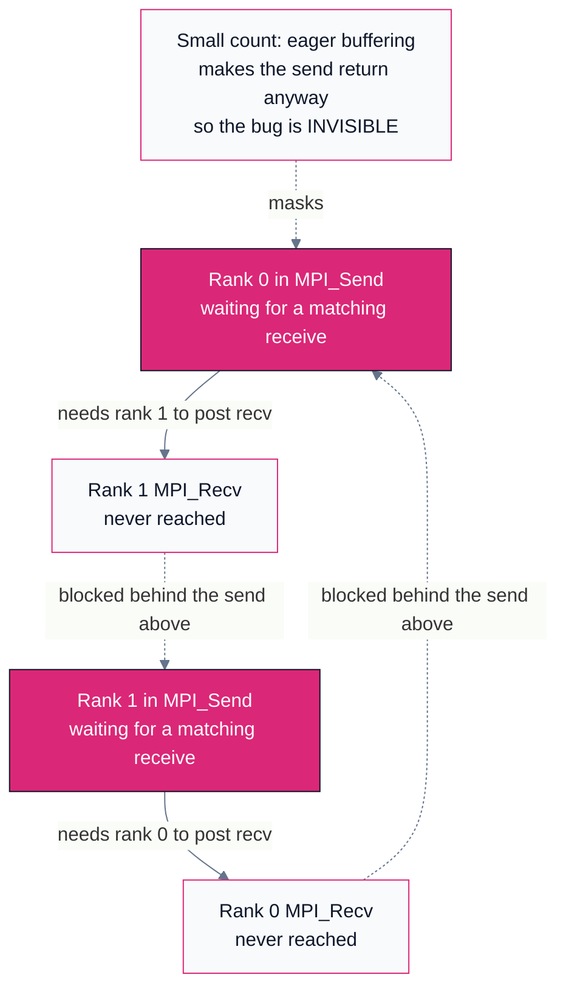
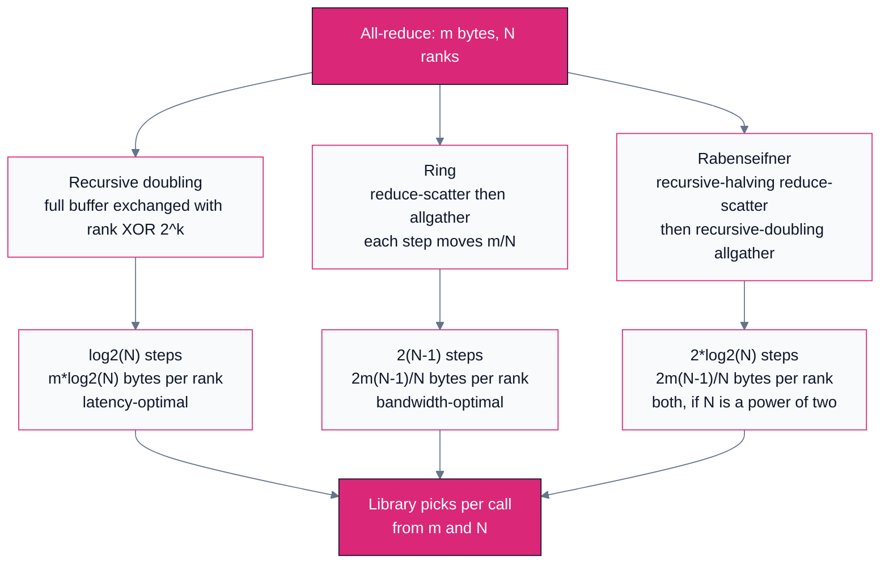
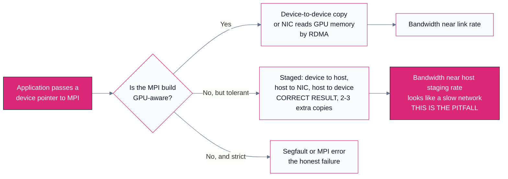

# D02 — Message Passing with MPI

> Track D · Module 02 · Status: **DONE** · Est. 7 hours · Depth 3/5
>
> Prerequisites: [D01](../D01.scaling-limits-and-communication-cost/README.md) for the alpha-beta
> model and collective cost. [A01](../../A-gpu-programming/A01.foundations-and-programming-model/README.md)
> for GPU literacy.
>
> **Backends: Open MPI (C).** The single-node multi-process labs in [`mpi/`](mpi/) run anywhere an
> `mpicc` exists — a laptop with four cores is enough to see every effect in this module, including
> deadlock. The multi-node figures are **analytic models** from the tools in [`tools/`](tools/),
> which are pure-Python standard library and say so in their own output banners.
> Setup: [SETUP.md](../../../docs/SETUP.md) ·
> Terms: [GLOSSARY.md](../../../docs/GLOSSARY.md) · Sources: [REFERENCES.md](../../../docs/REFERENCES.md).

---

## 1. TL;DR + Layman analogy

**TL;DR.** [MPI](../../../docs/GLOSSARY.md#mpi-message-passing-interface) is the model you get when
you accept that there is no shared memory. Every process has its own private address space, knows
only its own [rank](../../../docs/GLOSSARY.md#rank-and-communicator) and the size of its group, and
can affect another process only by sending it a message that the other process explicitly agrees to
receive. That single constraint generates everything else in this module: why a send must be matched
by a receive, why two well-meaning processes can wedge forever, why "the send completed" does not
mean "it arrived", and why a
[collective operation](../../../docs/GLOSSARY.md#collective-operation) like
[all-reduce](../../../docs/GLOSSARY.md#all-reduce) is a *library algorithm* rather than a hardware
feature — one with a step count and a byte count you can derive on paper and then measure. D01 gave
you the cost model. This module gives you the machinery the cost model was describing, and you will
write a ring all-reduce by hand and race it against the one Open MPI ships.

**Layman analogy — researchers in sealed offices.**

Picture a team of researchers, each in a separate sealed office. There is no shared whiteboard, no
shared filing cabinet, no window between rooms. The *only* way to communicate is to write a note and
push it through a slot in the door, and the only way to read one is to deliberately go to your slot
and take a note out.

Four things follow immediately, and each is a real mechanism with a real name.

- **There is no shared state, ever.** If researcher 3 computes a number, researcher 7 does not know
  it. Not "knows it late" — does not know it at all, and never will unless someone writes it down and
  pushes it through a door. Every fact that must become common knowledge has to be *transported*, and
  transport costs time. That is why a distributed program has no equivalent of a global variable, and
  why the cost of agreement dominates D01's model.
- **A note must be picked up by someone who is looking for it.** Push a note under a door while its
  occupant is deep in calculation and never checks the slot, and the note just sits there. A **send
  must be matched by a receive**; half a conversation is a leak, not a conversation.
- **Deadlock is a scheduling accident, not a bug in anyone's arithmetic.** Suppose the team's rule is
  "deliver your note in person and wait at the door until it is taken, before collecting anything from
  your own slot." Now researcher 3 waits at researcher 7's door while researcher 7 waits at
  researcher 3's. Each is waiting for the other to do the thing they are both refusing to do. Both are
  following the rules; both wait forever. Nothing crashes, and the team is simply finished making
  progress. That is **deadlock**, derived in code in section 2.4.
- **"I handed it off" is weaker than "they read it."** With an outbox tray in the corridor, a
  researcher can drop a note and get back to work. They know it left their desk — so their notepad is
  free to reuse — but not that anyone read it. Two different guarantees, and MPI's completion
  semantics turn on exactly that distinction.

**Where the analogy breaks.** In three places, all of them load-bearing.

First, the corridor outbox is optional and invisible. Real implementations buffer small messages
internally — the **eager** protocol — so a send of 100 bytes usually returns immediately even with
nobody receiving, while a send of 100 MB blocks until the receiver engages (the **rendezvous**
protocol). So the deadlock above *does not reproduce at small message sizes*: the bug is present, the
schedule hides it, and it surfaces in production when a buffer grows. No office analogy predicts a
failure that depends on payload size.

Second, the analogy makes every exchange look like two people talking. The operations that dominate
real cost are **collective**: all N researchers agree on a sum at once. That is not N conversations
but a choreographed algorithm over a group, and its cost depends on *which* choreography the library
picked — the content of section 3.3.

Third, offices are symmetric and the corridor is uniform. Real ranks sit on a topology where some
pairs share a socket, some share a node, and some are three switch hops apart, so the same message
can cost two orders of magnitude more depending on who sends it.
[D04](../D04.interconnects-and-rdma/README.md) and
[D05](../D05.topology-and-scale-boundaries/README.md) are about that asymmetry.

**By the end of this module you can** write correct point-to-point and collective MPI code, explain
what each completion guarantee does and does not promise, derive the step and byte counts of the
three all-reduce algorithm families, measure your own `alpha` and `beta` and feed them back into
D01's model, and recognize the four ways an MPI program breaks at scale.

---

## 2. First Principles

### 2.1 Why separate address spaces at all

Start with the honest question: shared memory is *easier*, so why give it up? Two independent walls.

**Memory does not scale with the socket.** A node's capacity and its aggregate memory bandwidth are
both bounded by physical packaging — DIMM slots, HBM stacks, pin count. If your problem needs ten
times the memory of the largest node you can buy, no programming model rescues you; the only move left
is to put the problem in many nodes' memories and accept that they are separate.

**Cache coherence does not scale either, and this is the deeper reason.** A coherent system must make
every write visible to every reader, so the hardware must track who might hold a copy of each line.
That bookkeeping traffic grows superlinearly with participant count, and a coherence transaction's
latency is bounded below by the physical distance between participants. Coherence across a rack would
mean a cache miss serviced over a cable — and worse, it would mean the *programmer cannot see the
cost*, because a coherent load looks exactly like a cheap one. Message passing takes the opposite bet:
it makes remote access **syntactically visible**. You cannot accidentally touch another rank's memory,
because no expression does it. Every remote interaction is a function call you had to write, and
therefore a cost you had to think about.

That property — cost visible in the source — is why MPI survived thirty years of alternatives and
still underpins the largest machines ever built.

### 2.2 SPMD, rank, size, communicator

MPI's execution model is **SPMD**: Single Program, Multiple Data. You launch *the same executable* N
times, and the processes differ only in the value each one reads back from `MPI_Comm_rank`. There is
no master program orchestrating workers; branching on rank is how you build asymmetry.

```c
int rank = 0, size = 0;
MPI_CHECK(MPI_Comm_rank(MPI_COMM_WORLD, &rank));
MPI_CHECK(MPI_Comm_size(MPI_COMM_WORLD, &size));
if (rank == 0) { /* the "root" behaviour is just a branch */ }
```

Three terms carry the model, and the third is the one people under-appreciate:

- **rank** — this process's integer index in a group, `0` to `size - 1`. It is an identity, not an
  address; it says nothing about which node you are on. Mapping ranks to hardware is the scheduler's
  job and the subject of [D05](../D05.topology-and-scale-boundaries/README.md).
- **size** — how many processes are in the group. Fixed at launch. That immutability is a design
  choice with consequences, revisited in section 6.5.
- **communicator** — a group of ranks *plus a communication context*. `MPI_COMM_WORLD` is the
  all-inclusive one you get at startup. The context half is what makes a communicator more than a
  list, and section 3.1 is about why.

An important consequence of SPMD: **every rank executes the collective calls.** A collective is not
something the root does to the others; it is a statement that all ranks in the communicator make
together. Omitting the call on one rank does not skip it — it hangs the other N-1.

### 2.3 Point-to-point: the two-sided contract

The primitive is a matched pair. A send names a destination, and a receive names a source; the
implementation pairs them up using the tuple `(communicator, source rank, tag)`.

```c
/* rank 0 sends one double to rank 1, tag 7 */
if (rank == 0) {
  double value = 3.5;
  MPI_CHECK(MPI_Send(&value, 1, MPI_DOUBLE, 1, 7, MPI_COMM_WORLD));
} else if (rank == 1) {
  double value = 0.0;
  MPI_CHECK(MPI_Recv(&value, 1, MPI_DOUBLE, 0, 7, MPI_COMM_WORLD, MPI_STATUS_IGNORE));
}
```

This is **two-sided** communication: the receiver participates. That is what the analogy's door slot
captured, and it distinguishes MPI from [RDMA](../../../docs/GLOSSARY.md#rdma-and-gpudirect) one-sided
put/get, where the target CPU is not involved at all. MPI has one-sided operations too (`MPI_Put`,
`MPI_Get`, the RMA interface); this module stays two-sided because that is where the interesting
failure modes live and what the collectives are built from.

The `tag` is a user-chosen integer that distinguishes two logically separate exchanges between the same
pair of ranks. It is also a trap, for reasons section 6.4 gets to.

### 2.4 Deriving deadlock

Now the important derivation. Take the most natural thing anyone writes on their first day — two
ranks exchanging data, each sending first because sending first feels like making progress:

```c
/* BOTH ranks run this. It is a latent deadlock. */
const int peer = 1 - rank;
MPI_CHECK(MPI_Send(out, count, MPI_DOUBLE, peer, 0, MPI_COMM_WORLD));
MPI_CHECK(MPI_Recv(in,  count, MPI_DOUBLE, peer, 0, MPI_COMM_WORLD, MPI_STATUS_IGNORE));
```

Read the standard, not the intuition. `MPI_Send` is a **blocking** send, and blocking means only
that it does not return until the send buffer is safe to reuse. Crucially, the standard does **not**
promise that the implementation buffers the message. It is free to wait for the matching receive. So
if both ranks enter `MPI_Send` and the implementation chooses to wait, then:

- Rank 0 is inside `MPI_Send`, waiting for rank 1 to post a receive.
- Rank 1 is inside `MPI_Send`, waiting for rank 0 to post a receive.
- Neither will reach its `MPI_Recv`, because reaching it requires the `MPI_Send` above to return.



The cycle in that diagram is the definition of deadlock: a circular wait where every participant holds
what another needs. Note the dashed node. Below the implementation's **eager threshold** the send is
copied into an internal buffer and returns immediately, so the program works — on your laptop, at your
test size, every time. Above it the implementation switches to **rendezvous** and waits for the
receiver, and the same source hangs. Lab 4 makes you find your own threshold, because that number is
neither a constant nor portable.

There are exactly three structural fixes, and they are not interchangeable.

**Fix 1 — break the symmetry by ordering.** Make somebody receive first.

```c
if (rank == 0) {
  MPI_CHECK(MPI_Send(out, count, MPI_DOUBLE, peer, 0, MPI_COMM_WORLD));
  MPI_CHECK(MPI_Recv(in,  count, MPI_DOUBLE, peer, 0, MPI_COMM_WORLD, MPI_STATUS_IGNORE));
} else {
  MPI_CHECK(MPI_Recv(in,  count, MPI_DOUBLE, peer, 0, MPI_COMM_WORLD, MPI_STATUS_IGNORE));
  MPI_CHECK(MPI_Send(out, count, MPI_DOUBLE, peer, 0, MPI_COMM_WORLD));
}
```

Correct, and free. But it **serializes** the exchange — the two transfers no longer overlap — and it
generalizes badly: odd/even colouring works for a ring, but for an arbitrary neighbour graph finding a
deadlock-free ordering is a graph-colouring problem you do not want in your application.

**Fix 2 — `MPI_Sendrecv`, one call that cannot deadlock against itself.**

```c
MPI_CHECK(MPI_Sendrecv(out, count, MPI_DOUBLE, peer, 0,
                       in,  count, MPI_DOUBLE, peer, 0,
                       MPI_COMM_WORLD, MPI_STATUS_IGNORE));
```

The implementation may order or overlap the two halves however it likes, and it guarantees the pairwise
exchange completes. One line, and the right default for symmetric neighbour exchange — it is what the
ring all-reduce in Lab 3 uses.

**Fix 3 — nonblocking, which is the only fix that also buys you overlap.**

```c
MPI_Request req[2];
MPI_CHECK(MPI_Irecv(in,  count, MPI_DOUBLE, peer, 0, MPI_COMM_WORLD, &req[0]));
MPI_CHECK(MPI_Isend(out, count, MPI_DOUBLE, peer, 0, MPI_COMM_WORLD, &req[1]));
/* ... independent local work happens here, genuinely concurrently ... */
MPI_CHECK(MPI_Waitall(2, req, MPI_STATUSES_IGNORE));
```

Both calls return immediately, having only *posted* the operation. Deadlock is impossible because
nothing blocks until `MPI_Waitall`, and by then both receives are posted. Post the receive **before**
the send as a habit: it gives the implementation somewhere to put the data and can avoid an internal
copy.

This third fix is the one that matters for performance, because the gap between posting and waiting is
where communication hides behind computation — the overlap D01 describes and that
[B07](../../B-gpu-ml-performance/B07.distributed-training-and-sharding/README.md) applies to gradient
buckets. It also introduces the bug class of section 6.2.

### 2.5 What "completion" actually guarantees

This is the single most misunderstood part of MPI, so state it flatly.

**Completion of a send means the send buffer is safe to reuse. It does not mean the message was
delivered, and it certainly does not mean the receiver has looked at it.**

| Call | Returns when | Guarantees on return | Does *not* guarantee |
|---|---|---|---|
| `MPI_Send` | Implementation's choice: buffer copied, or receiver engaged | Send buffer reusable | Delivery; receiver progress; that it will ever return without a matching receive |
| `MPI_Ssend` | Receiver has posted a matching receive | Buffer reusable **and** the receive was posted | That the receive has finished copying |
| `MPI_Bsend` | Message copied into your attached buffer | Buffer reusable, always returns | Anything about the receiver; also can fail if your buffer is full |
| `MPI_Rsend` | As `MPI_Send`, but you assert the receive is already posted | Buffer reusable | Nothing, if your assertion was wrong — that is undefined behaviour |
| `MPI_Isend` | Immediately | Only that the request exists | **Nothing about the buffer.** Touching it before `MPI_Wait` is a race |
| `MPI_Recv` | Data is in your receive buffer | Data present and complete | Nothing about the sender's state |
| `MPI_Irecv` | Immediately | Request exists | **Nothing.** Reading the buffer before `MPI_Wait` reads garbage |

Two operational consequences worth memorizing.

**`MPI_Ssend` is a debugging tool, not just a semantic.** Because a synchronous send never completes
without a matching receive, it removes the eager buffer's ability to hide a deadlock. Convert your sends
to `MPI_Ssend`; if the program hangs at *any* size, the logic is wrong, not the tuning. This is the
fastest way to find a latent deadlock before it finds production.

**A nonblocking request is a promise you must collect.** Every `MPI_Isend`/`MPI_Irecv` must be completed
by a `Wait` or `Test` call. Dropping the request leaks internal resources and, on a long run, exhausts
them. There is no garbage collector.

---

## 3. Deep Dive

### 3.1 Communicators: why the context, not the group, is the point

A communicator is a group of ranks **and a communication context**, and engineers routinely treat it as
just the group. The context is what prevents a class of bug that is otherwise unfindable.

Consider a numerical library — a linear solver, say — that internally exchanges messages with tag `0` on
`MPI_COMM_WORLD`. Your application also uses tag `0` on `MPI_COMM_WORLD`, because `0` is what everyone
types first. Now suppose the application somewhere posts a receive with wildcards:

```c
MPI_CHECK(MPI_Recv(buf, n, MPI_DOUBLE, MPI_ANY_SOURCE, MPI_ANY_TAG,
                   MPI_COMM_WORLD, &status));
```

That receive will happily match the solver's internal message. Your data goes missing, the solver hangs
or returns nonsense, and nothing in either body of code is wrong in isolation. The failure is
timing-dependent, so it reproduces about once a week.

The fix is structural: **a library must duplicate the communicator it is handed.**

```c
/* Called once at library init. The dup'd communicator carries a fresh context. */
MPI_Comm lib_comm = MPI_COMM_NULL;
MPI_CHECK(MPI_Comm_dup(app_comm, &lib_comm));
/* ... all internal messaging uses lib_comm ... */
MPI_CHECK(MPI_Comm_free(&lib_comm));   /* at library teardown */
```

`MPI_Comm_dup` produces a communicator with the *same* ranks in the *same* order but a distinct context,
and the [MPI standard](../../../docs/REFERENCES.md#mpi-standard-mpi-forum) guarantees a message sent on
one context can never be matched by a receive on another. Tags become private. This is why every serious
MPI library takes a communicator and immediately dups it, and it is the answer to "why does a
communicator exist when you already have ranks and tags?"

The other use of communicators is **partitioning**, which is how hierarchical collectives are built:

```c
/* Split MPI_COMM_WORLD into one communicator per node. */
MPI_Comm node_comm = MPI_COMM_NULL;
MPI_CHECK(MPI_Comm_split_type(MPI_COMM_WORLD, MPI_COMM_TYPE_SHARED, rank,
                              MPI_INFO_NULL, &node_comm));
```

With a node-local communicator and a communicator of one leader per node, a global all-reduce becomes
reduce-within-node, all-reduce-across-leaders, broadcast-within-node — replacing N participants in the
expensive inter-node collective with N/ppn of them. That is the single most effective structural
optimization for large-scale collectives, and it is the same idea NCCL and RCCL implement internally;
[D03](../D03.gpu-collectives-nccl-and-rccl/README.md) shows their version and
[D05](../D05.topology-and-scale-boundaries/README.md#3-deep-dive) shows why the topology forces it.

### 3.2 The collective catalogue, with costs

Every collective in MPI is a *library algorithm* over point-to-point messages (or a hardware
offload that emulates one). The costs below use D01's
[alpha-beta model](../../../docs/GLOSSARY.md#the-alpha-beta-model) extended with one more term, which
is standard in the collective literature:

- `alpha` — per-message startup latency, seconds.
- `beta` — inverse bandwidth, seconds per byte.
- `gamma` — per-byte cost of the local reduction arithmetic, seconds per byte. Only reduction-bearing
  collectives pay it, and it is the reason a reduce is not simply a gather.

**Convention, stated once because mixing it up invalidates every formula.** For `MPI_Bcast`,
`MPI_Reduce`, `MPI_Allreduce` and `MPI_Scan`, `m` is the size of the operand buffer, identical on
every rank. For `MPI_Allgather`, `m` is the size of the *assembled result* (so each rank contributes
`m/N`). For `MPI_Reduce_scatter`, `m` is the input size and each rank keeps `m/N`. For `MPI_Alltoall`,
`m` is the total each rank sends.

| Operation | Semantics | Typical small-`m` cost | Typical large-`m` cost |
|---|---|---|---|
| `MPI_Barrier` | No data. No rank leaves until all arrive | `ceil(log2 N) * alpha` | Same — there is no data term |
| `MPI_Bcast` | Root's buffer replicated to all ranks | `log2(N) * (alpha + m*beta)` (binomial tree) | `(log2(N) + N - 1)*alpha + 2*m*beta*(N-1)/N` (scatter then ring allgather) |
| `MPI_Reduce` | Elementwise op across ranks, result on root only | `log2(N) * (alpha + m*beta + m*gamma)` | `(log2(N) + N - 1)*alpha + 2*m*beta*(N-1)/N + m*gamma*(N-1)/N` |
| `MPI_Allreduce` | Reduce, result on **every** rank | `log2(N) * (alpha + m*beta + m*gamma)` (recursive doubling) | `2*log2(N)*alpha + 2*m*beta*(N-1)/N + m*gamma*(N-1)/N` (Rabenseifner) |
| `MPI_Allgather` | Every rank's contribution concatenated on every rank | `log2(N)*alpha + m*beta*(N-1)/N` (recursive doubling) | `(N-1)*alpha + m*beta*(N-1)/N` (ring) |
| `MPI_Reduce_scatter` | Reduce, then rank `i` keeps only block `i` | `log2(N)*alpha + m*beta*(N-1)/N + m*gamma*(N-1)/N` | `(N-1)*(alpha) + m*beta*(N-1)/N + m*gamma*(N-1)/N` (ring) |
| `MPI_Alltoall` | Full transpose: distinct data from every rank to every rank | `log2(N)*alpha + (m/2)*log2(N)*beta` (Bruck) | `(N-1)*alpha + m*beta` (pairwise exchange) |
| `MPI_Scan` / `MPI_Exscan` | Prefix reduction: rank `i` gets the op over ranks `0..i` | `log2(N)*(alpha + m*beta + m*gamma)` | Same shape; rarely bandwidth-critical |

These are the formulas derived for MPICH by
[Thakur, Rabenseifner and Gropp](../../../docs/REFERENCES.md#collective-algorithms-in-mpich-thakur-rabenseifner-and-gropp-2005),
and they assume **power-of-two `N`** and a contention-free network. Both assumptions matter: a
non-power-of-two rank count forces extra steps in the halving and doubling algorithms, and a loaded
fabric does not deliver a constant `beta`. Treat them as the right *shape*, calibrated by measurement.

Two structural observations pay for the whole table.

**`MPI_Allreduce` is `MPI_Reduce_scatter` followed by `MPI_Allgather`.** That factorization is how the
bandwidth-optimal algorithms are constructed and why those two collectives share a cost structure. It is
also why [B07](../../B-gpu-ml-performance/B07.distributed-training-and-sharding/README.md)'s sharded
optimizers are cheap: if you were going to reduce-scatter anyway, keeping the scattered result instead of
gathering it is *half* the traffic, free.

**`MPI_Alltoall` is the one that cannot be made cheap.** Every rank sends distinct data to every other
rank, so its aggregate byte count is genuinely `O(N)` per rank and it is bounded by the network's
bisection bandwidth rather than by any algorithmic cleverness. That is why mixture-of-experts routing and
distributed FFTs stress fabrics hardest, and why
[D05](../D05.topology-and-scale-boundaries/README.md) treats bisection as a first-class number.

### 3.3 The three all-reduce algorithm families, derived

All-reduce deserves its own section: it dominates deep learning, and its three implementations sit at
genuinely different points on the latency-bandwidth tradeoff. Deriving the counts is what lets you
predict which one your library will pick, and notice when it picks wrong.



**Recursive doubling.** In step `k` (for `k = 0` to `log2(N) - 1`), rank `r` exchanges its entire
`m`-byte buffer with rank `r XOR 2^k` and both ranks reduce locally. After the first step every rank
holds the reduction over a pair, after the second over a group of four, after `log2(N)` steps over all N.
That step count is the information-theoretic minimum — a rank cannot learn about N others in fewer than
`log2(N)` rounds of pairwise exchange. But every step moves the *whole* buffer, so bytes per rank are
`m * log2(N)`: latency-optimal, and wasteful in bandwidth by `log2(N)/2` against the lower bound.

**Ring.** Divide the buffer into `N` segments of `m/N` bytes. Phase one, reduce-scatter: for `N-1` steps
each rank sends one segment to its right neighbour and accumulates the segment arriving from its left,
with indices chosen so that after `N-1` steps each rank holds one *fully reduced* segment. Phase two,
allgather: for another `N-1` steps each rank forwards the segment it owns around the same ring until
everyone has all N. Steps: `2(N-1)`. Bytes per rank: `(N-1) * m/N` in each phase, so `2m(N-1)/N`, which
tends to `2m`.
[Patarasuk and Yuan](../../../docs/REFERENCES.md#bandwidth-optimal-all-reduce-patarasuk-and-yuan-2009)
proved `2m(N-1)/N` is a lower bound on the data any rank must move, so the ring's bandwidth term is
**optimal and cannot be beaten**. Its `O(N)` step count is the price, and at 1,024 ranks that price is
2,046 latencies.

**Rabenseifner's algorithm** takes the better half of each. Replace the ring's reduce-scatter with
**recursive halving**: in step `k`, exchange half of the remaining active buffer with the partner at
distance `N/2^(k+1)`. The bytes sent are `m/2, m/4, ..., m/N`, a geometric series summing to

```
m * (1/2 + 1/4 + ... + 1/N) = m * (1 - 1/N) = m*(N-1)/N
```

in only `log2(N)` steps. Then run the allgather as **recursive doubling**, whose per-step sizes are the
same series reversed — `m/N, 2m/N, ..., m/2` — summing to the same `m*(N-1)/N` in `log2(N)` steps. Total:
`2*log2(N)` steps and `2m(N-1)/N` bytes, hitting the bandwidth lower bound with a logarithmic step count.
This is the large-message all-reduce described in the Thakur, Rabenseifner and Gropp paper above.

| Algorithm | Steps | Bytes moved per rank | Latency term | Bandwidth term | Chosen when |
|---|---|---|---|---|---|
| Recursive doubling | `log2(N)` | `m * log2(N)` | Optimal | `log2(N)/2` x worse than optimal | Small `m` |
| Ring | `2(N-1)` | `2m(N-1)/N` | `O(N)`, poor | Optimal | Large `m`; fabric physically a ring |
| Rabenseifner | `2*log2(N)` | `2m(N-1)/N` | 2x optimal | Optimal | Large `m`, general fabric, `N` a power of two |

Put D01's illustrative numbers through it — `alpha = 2.5 us`, 25 GB/s so `beta = 0.04 ns/byte`,
`N = 64`, ignoring `gamma`. These are **model outputs**, not measurements, and they are exactly
what [`tools/allreduce_algorithms.py`](tools/allreduce_algorithms.py) prints with no arguments —
those are its defaults, so the table is reproducible rather than asserted:

| `m` | Recursive doubling | Ring | Rabenseifner |
|---:|---:|---:|---:|
| 4 KiB | **~16 us** | ~315 us | ~30 us |
| 256 MiB | ~64 ms | ~21.4 ms | **~21.2 ms** |

The winner flips. The gap is roughly `log2(N)/2 = 3x` in the large-message regime and roughly
`2(N-1)/log2(N) = 21x` in the small-message one, and *neither* algorithm is acceptable in the other's
regime. That is why a production collective library is a decision tree, and why "we use ring all-reduce"
is an incomplete description of any real system.

If the ring's `O(N)` step count looks fatal, note that it is exactly the algorithm NCCL and RCCL lean on
hardest — because inside a node the ranks are few, the messages are large, and the ring maps onto
physical links where every hop is a distinct full-bandwidth wire.
[D03](../D03.gpu-collectives-nccl-and-rccl/README.md) is where that argument lives.

### 3.4 GPU-aware MPI, and the pitfall that looks like success

A **GPU-aware** MPI build (called CUDA-aware on NVIDIA, ROCm-aware on AMD) accepts a *device* pointer
where the standard would suggest a host pointer:

```c
float *d_buf = NULL;                       /* device allocation, from hipMalloc/cudaMalloc */
MPI_CHECK(MPI_Allreduce(MPI_IN_PLACE, d_buf, count, MPI_FLOAT, MPI_SUM, MPI_COMM_WORLD));
```

What the implementation does with that pointer is the whole story. A GPU-aware build queries the pointer's
memory type and then either issues a device-to-device copy for an intra-node peer, or hands the device
address to the network stack so the NIC reads GPU memory directly by
[RDMA](../../../docs/GLOSSARY.md#rdma-and-gpudirect) with no host bounce. A non-GPU-aware build can do
neither.



The pitfall is the middle branch. A build without GPU support may still **produce the right answer**, by
staging every transfer through a host buffer. Nothing warns you: the program is correct, the tests pass,
and you have quietly added a device-to-host copy, a host-to-host copy and a host-to-device copy to every
message — paying two to three times the traffic on the slowest link in the chain. The symptom is
indistinguishable from "the network is disappointing", which is why teams spend weeks on the fabric before
checking the build.

How to detect it, in order of reliability:

1. **Ask the build.** `ompi_info` reports which accelerator support was compiled in. The parameter and
   framework names changed across Open MPI major versions, so grep your own build's output for `cuda`,
   `rocm` or `accelerator` rather than copying a flag from a blog post — see the
   [Open MPI project](../../../docs/REFERENCES.md#open-mpi-project) documentation for your version.
2. **Measure the ratio.** Run the same bandwidth test with host buffers and with device buffers. On a
   GPU-aware build the device number should be at least comparable; if it is materially *worse*, you are
   staging.
3. **Profile for copies you did not write.** A trace showing `hipMemcpy`/`cudaMemcpy` inside what you
   believe is a pure network operation is conclusive.

Two honest limits. GPU-aware MPI being *available* does not make it *fast*: its collectives frequently
lose to RCCL and NCCL on device buffers, because those libraries do the reduction arithmetic in a GPU
kernel and build topology-aware multi-ring or tree schedules while a general MPI may reduce on the host or
use a single ring — section 6.6 and [D03](../D03.gpu-collectives-nccl-and-rccl/README.md) take that
comparison seriously. And whether the direct-RDMA path is actually taken depends on kernel drivers and
peer-memory support being present on the node, not only on the MPI build, so a correctly built MPI on a
misconfigured node silently falls back too.

### 3.5 Threading levels, and the one line everyone forgets

MPI does not assume your process is single-threaded, but it does not assume the opposite either. You
must *request* a threading level and then **check what you were given**:

```c
int provided = MPI_THREAD_SINGLE;
if (MPI_Init_thread(&argc, &argv, MPI_THREAD_MULTIPLE, &provided) != MPI_SUCCESS) {
  fprintf(stderr, "MPI_Init_thread failed\n");
  return EXIT_FAILURE;
}
if (provided < MPI_THREAD_MULTIPLE) {
  fprintf(stderr, "need MPI_THREAD_MULTIPLE, got %d\n", provided);
  MPI_Abort(MPI_COMM_WORLD, EXIT_FAILURE);
}
```

The four levels, from cheapest to most permissive:

| Level | What you promise | Typical user |
|---|---|---|
| `MPI_THREAD_SINGLE` | One thread, period | Classic SPMD code |
| `MPI_THREAD_FUNNELED` | Many threads, but only the one that called `MPI_Init_thread` calls MPI | OpenMP compute with communication outside the parallel region |
| `MPI_THREAD_SERIALIZED` | Any thread may call MPI, but you guarantee never concurrently | Code with its own comm mutex |
| `MPI_THREAD_MULTIPLE` | Any thread, any time, concurrently | Frameworks with per-device communication threads |

Three things make this matter more than it looks.

**The level cannot be raised later.** It is fixed by `MPI_Init_thread` with no upgrade path; getting it
wrong means relinking or restarting.

**Requesting `MULTIPLE` and not checking `provided` is a real, shipped bug.** An implementation may
provide less than you asked for. If it gives you `SERIALIZED` and you proceed to call MPI from two
threads, the failure is memory corruption or a matching-queue race — nondeterministic, rare, and
extremely expensive to diagnose. The three lines above eliminate the class for free.

**`MULTIPLE` is not free.** The implementation must serialize access to internal state — historically a
coarse lock around the progress engine — so per-message overhead rises and, worse, threads can contend for
one progress engine and *lose* throughput against a single thread. The magnitude is entirely
implementation- and version-dependent, so do not quote a number: measure it on your build with the
threaded variants of the
[OSU Micro-Benchmarks](../../../docs/REFERENCES.md#osu-micro-benchmarks-ohio-state-university). The design
implication is stable even though the number is not: **prefer one rank per GPU with `FUNNELED`** over one
rank per node with a thread per GPU, because it sidesteps the locking question and gives the runtime a
natural unit of placement.

---

## 4. Hands-On Labs

Everything here runs on **one machine**. You do not need a cluster to learn message passing, or even to
reproduce deadlock — you need two processes and a message larger than the eager threshold. There is no
`cuda/`, `hip/` or `triton/` directory in this module on purpose: the subject is the message-passing model
itself, and a GPU kernel would obscure it. Device buffers arrive in
[D03](../D03.gpu-collectives-nccl-and-rccl/README.md).

```bash
cd tracks/D-distributed-computing/D02.message-passing-and-mpi
make                 # builds every target in mpi/ with mpicc
make run             # labs 1-3 with default sizes
make deadlock        # lab 4, under a timeout so a hang is bounded
```

Every sample uses one error-checking macro. MPI's default error handler aborts the job, which is
usually what you want in production but tells you nothing about *where*; setting
`MPI_ERRORS_RETURN` and checking every call gives you a file and a line.

```c
/* mpi/mpi_check.h - included by every sample in this module. */
#ifndef MPI_CHECK_H
#define MPI_CHECK_H

#include <mpi.h>
#include <stdio.h>
#include <stdlib.h>

/* Use after MPI_Init has succeeded. Requires MPI_ERRORS_RETURN to be set on the
   communicator, otherwise the default handler aborts before we can report. */
#define MPI_CHECK(call)                                                       \
  do {                                                                        \
    const int err_ = (call);                                                   \
    if (err_ != MPI_SUCCESS) {                                                \
      char msg_[MPI_MAX_ERROR_STRING];                                        \
      int len_ = 0;                                                            \
      MPI_Error_string(err_, msg_, &len_);                                     \
      fprintf(stderr, "MPI error at %s:%d: %s\n", __FILE__, __LINE__, msg_);   \
      MPI_Abort(MPI_COMM_WORLD, err_);                                         \
    }                                                                          \
  } while (0)

#endif /* MPI_CHECK_H */
```

`MPI_Init` itself is checked with a plain `if`, because `MPI_Abort` before initialization is not
defined.

### Lab 1 — Ranks, sizes and the layout you actually got

**Goal:** confirm the SPMD model with your own eyes, and see that a rank number tells you nothing
about placement until you ask.

```c
/* mpi/hello_ranks.c */
#include "mpi_check.h"

int main(int argc, char **argv) {
  if (MPI_Init(&argc, &argv) != MPI_SUCCESS) {
    fprintf(stderr, "MPI_Init failed\n");
    return EXIT_FAILURE;
  }
  MPI_CHECK(MPI_Comm_set_errhandler(MPI_COMM_WORLD, MPI_ERRORS_RETURN));

  int world_rank = 0, world_size = 0;
  MPI_CHECK(MPI_Comm_rank(MPI_COMM_WORLD, &world_rank));
  MPI_CHECK(MPI_Comm_size(MPI_COMM_WORLD, &world_size));

  char node_name[MPI_MAX_PROCESSOR_NAME];
  int name_len = 0;
  MPI_CHECK(MPI_Get_processor_name(node_name, &name_len));

  /* Section 3.1: split into one communicator per shared-memory domain. */
  MPI_Comm node_comm = MPI_COMM_NULL;
  MPI_CHECK(MPI_Comm_split_type(MPI_COMM_WORLD, MPI_COMM_TYPE_SHARED, world_rank,
                                MPI_INFO_NULL, &node_comm));
  int node_rank = 0, node_size = 0;
  MPI_CHECK(MPI_Comm_rank(node_comm, &node_rank));
  MPI_CHECK(MPI_Comm_size(node_comm, &node_size));

  /* A dup'd communicator: same ranks, different context (section 3.1). */
  MPI_Comm private_comm = MPI_COMM_NULL;
  MPI_CHECK(MPI_Comm_dup(MPI_COMM_WORLD, &private_comm));
  int dup_size = 0;
  MPI_CHECK(MPI_Comm_size(private_comm, &dup_size));

  printf("world %d/%d | node-local %d/%d | dup size %d | node %.*s\n",
         world_rank, world_size, node_rank, node_size, dup_size, name_len, node_name);
  fflush(stdout);

  MPI_CHECK(MPI_Comm_free(&private_comm));
  MPI_CHECK(MPI_Comm_free(&node_comm));
  MPI_CHECK(MPI_Finalize());
  return EXIT_SUCCESS;
}
```

```bash
mpicc -O2 -Wall -Wextra -o hello_ranks mpi/hello_ranks.c
mpirun -np 4 ./hello_ranks
```

**What to observe.** Three things, none of which are the greeting.

First, **the output lines arrive in an arbitrary order** that differs between runs. There is no global
ordering of independent events; imposing one requires a collective, which is a real cost rather than a
formatting nicety.

Second, on a single machine `node-local` matches `world` exactly — every rank shares one memory domain.
Run the same binary on two nodes and the node-local size drops to the per-node process count. That
difference is the hook every hierarchical collective hangs on.

Third, the dup'd communicator reports the same size as `MPI_COMM_WORLD`. Identical group, different
context: what makes it useful is invisible in every observable property except message matching.

### Lab 2 — Measure your own alpha and beta

**Goal:** stop using D01's illustrative numbers and start using yours. This lab produces the two
parameters that every model in Track D consumes.

```c
/* mpi/ping_pong.c - half round-trip latency across a size sweep. */
#include "mpi_check.h"
#include <string.h>

#define MAX_BYTES (1 << 22)   /* 4 MiB */

int main(int argc, char **argv) {
  if (MPI_Init(&argc, &argv) != MPI_SUCCESS) {
    fprintf(stderr, "MPI_Init failed\n");
    return EXIT_FAILURE;
  }
  MPI_CHECK(MPI_Comm_set_errhandler(MPI_COMM_WORLD, MPI_ERRORS_RETURN));

  int rank = 0, size = 0;
  MPI_CHECK(MPI_Comm_rank(MPI_COMM_WORLD, &rank));
  MPI_CHECK(MPI_Comm_size(MPI_COMM_WORLD, &size));
  if (size != 2) {
    if (rank == 0) fprintf(stderr, "ping_pong requires exactly 2 ranks, got %d\n", size);
    MPI_Abort(MPI_COMM_WORLD, EXIT_FAILURE);
  }

  char *buf = (char *)malloc(MAX_BYTES);
  if (buf == NULL) {
    fprintf(stderr, "rank %d: allocation of %d bytes failed\n", rank, MAX_BYTES);
    MPI_Abort(MPI_COMM_WORLD, EXIT_FAILURE);
  }
  memset(buf, 0, MAX_BYTES);

  const int peer = 1 - rank;
  const int tag = 0;
  if (rank == 0) printf("bytes,iters,half_roundtrip_us\n");

  for (int bytes = 0; bytes <= MAX_BYTES; bytes = (bytes == 0) ? 1 : bytes * 2) {
    const int iters = (bytes < (1 << 16)) ? 1000 : 100;
    const int warmup = iters / 10 + 1;
    double t0 = 0.0;

    for (int i = 0; i < warmup + iters; ++i) {
      if (i == warmup) {
        MPI_CHECK(MPI_Barrier(MPI_COMM_WORLD));
        t0 = MPI_Wtime();
      }
      /* Ordered exchange (fix 1): safe at every size, including above the
         eager threshold, which is exactly why lab 4 is a separate program. */
      if (rank == 0) {
        MPI_CHECK(MPI_Send(buf, bytes, MPI_BYTE, peer, tag, MPI_COMM_WORLD));
        MPI_CHECK(MPI_Recv(buf, bytes, MPI_BYTE, peer, tag, MPI_COMM_WORLD, MPI_STATUS_IGNORE));
      } else {
        MPI_CHECK(MPI_Recv(buf, bytes, MPI_BYTE, peer, tag, MPI_COMM_WORLD, MPI_STATUS_IGNORE));
        MPI_CHECK(MPI_Send(buf, bytes, MPI_BYTE, peer, tag, MPI_COMM_WORLD));
      }
    }

    const double elapsed = MPI_Wtime() - t0;
    if (rank == 0) {
      printf("%d,%d,%.3f\n", bytes, iters, 0.5 * elapsed / (double)iters * 1e6);
      fflush(stdout);
    }
  }

  free(buf);
  MPI_CHECK(MPI_Finalize());
  return EXIT_SUCCESS;
}
```

```bash
mpicc -O2 -Wall -Wextra -o ping_pong mpi/ping_pong.c
mpirun -np 2 ./ping_pong | tee pingpong.csv
python3 tools/fit_alpha_beta.py --input pingpong.csv
```

**What to observe.** The zero-byte row is your `alpha` almost directly — no payload, so the whole time is
startup. Then the interesting part: **the next several rows cost essentially the same as the zero-byte
row.** One byte, sixteen bytes, a kilobyte: flat. That flat region is D01's latency regime made real on
your own hardware, and its width is `m* = alpha * bandwidth`. Somewhere above it the curve leaves the
floor and becomes a straight line whose slope is `beta`. `fit_alpha_beta.py` fits both regimes and prints
`alpha`, `beta`, the implied bandwidth and the crossover — feed those into D01's
`tools/collective_choice.py` and its predictions become predictions about *your* machine.

Look also for a **discontinuity**, a step in the curve, which is the eager-to-rendezvous protocol switch
that lab 4 exploits. Note the honest limits: this reports half a round trip and so assumes the directions
are symmetric (the same assumption `osu_latency` makes), two ranks see no contention, and on one machine
you are measuring a shared-memory transport rather than a network.

### Lab 3 — Write the ring all-reduce, then race the library

**Goal:** the centrepiece. Implement the two-phase
[ring all-reduce](../../../docs/GLOSSARY.md#ring-all-reduce) from section 3.3 and discover empirically
that beating a tuned library is harder than the byte count suggests.

```c
/* mpi/ring_allreduce.c - hand-written ring all-reduce vs MPI_Allreduce. */
#include "mpi_check.h"
#include <string.h>

/* Ring all-reduce (MPI_SUM over floats): reduce-scatter then allgather.
   Handles any count and any rank count, including count < size. */
static void ring_allreduce_float(const float *sendbuf, float *recvbuf, int count,
                                 MPI_Comm comm) {
  int rank = 0, size = 0;
  MPI_CHECK(MPI_Comm_rank(comm, &rank));
  MPI_CHECK(MPI_Comm_size(comm, &size));

  memcpy(recvbuf, sendbuf, (size_t)count * sizeof(float));
  if (size == 1) return;

  /* Segment boundaries. The first (count % size) segments carry one extra
     element, so the segments cover count exactly for any count. */
  const int base = count / size, rem = count % size;
  int *starts = (int *)malloc((size_t)size * sizeof(int));
  int *counts = (int *)malloc((size_t)size * sizeof(int));
  float *inbox = (float *)malloc((size_t)(base + 1) * sizeof(float));
  if (starts == NULL || counts == NULL || inbox == NULL) {
    fprintf(stderr, "rank %d: ring_allreduce allocation failed\n", rank);
    MPI_Abort(comm, EXIT_FAILURE);
  }
  int offset = 0;
  for (int i = 0; i < size; ++i) {
    counts[i] = base + ((i < rem) ? 1 : 0);
    starts[i] = offset;
    offset += counts[i];
  }

  const int next = (rank + 1) % size;
  const int prev = (rank - 1 + size) % size;

  /* Phase 1: reduce-scatter, size-1 steps, m/N bytes per step.
     After the loop, rank r holds the fully reduced segment (r + 1) % size. */
  for (int step = 0; step < size - 1; ++step) {
    const int send_seg = (rank - step + size) % size;
    const int recv_seg = (rank - step - 1 + size) % size;
    MPI_CHECK(MPI_Sendrecv(recvbuf + starts[send_seg], counts[send_seg], MPI_FLOAT, next, 0,
                           inbox, counts[recv_seg], MPI_FLOAT, prev, 0,
                           comm, MPI_STATUS_IGNORE));
    for (int i = 0; i < counts[recv_seg]; ++i) {
      recvbuf[starts[recv_seg] + i] += inbox[i];
    }
  }

  /* Phase 2: allgather, size-1 steps, m/N bytes per step. */
  for (int step = 0; step < size - 1; ++step) {
    const int send_seg = (rank - step + 1 + size) % size;
    const int recv_seg = (rank - step + size) % size;
    MPI_CHECK(MPI_Sendrecv(recvbuf + starts[send_seg], counts[send_seg], MPI_FLOAT, next, 1,
                           recvbuf + starts[recv_seg], counts[recv_seg], MPI_FLOAT, prev, 1,
                           comm, MPI_STATUS_IGNORE));
  }

  free(inbox);
  free(counts);
  free(starts);
}

static double time_reps(void (*fn)(const float *, float *, int, MPI_Comm),
                        const float *in, float *out, int count, int reps) {
  MPI_CHECK(MPI_Barrier(MPI_COMM_WORLD));
  const double t0 = MPI_Wtime();
  for (int r = 0; r < reps; ++r) fn(in, out, count, MPI_COMM_WORLD);
  MPI_CHECK(MPI_Barrier(MPI_COMM_WORLD));
  return (MPI_Wtime() - t0) / (double)reps;
}

static void library_allreduce_float(const float *sendbuf, float *recvbuf, int count,
                                    MPI_Comm comm) {
  MPI_CHECK(MPI_Allreduce(sendbuf, recvbuf, count, MPI_FLOAT, MPI_SUM, comm));
}

int main(int argc, char **argv) {
  if (MPI_Init(&argc, &argv) != MPI_SUCCESS) {
    fprintf(stderr, "MPI_Init failed\n");
    return EXIT_FAILURE;
  }
  MPI_CHECK(MPI_Comm_set_errhandler(MPI_COMM_WORLD, MPI_ERRORS_RETURN));

  int rank = 0, size = 0;
  MPI_CHECK(MPI_Comm_rank(MPI_COMM_WORLD, &rank));
  MPI_CHECK(MPI_Comm_size(MPI_COMM_WORLD, &size));

  const int count = (argc > 1) ? atoi(argv[1]) : (1 << 20);
  const int reps = (argc > 2) ? atoi(argv[2]) : 20;
  float *in = (count > 0) ? (float *)malloc((size_t)count * sizeof(float)) : NULL;
  float *mine = (count > 0) ? (float *)malloc((size_t)count * sizeof(float)) : NULL;
  float *theirs = (count > 0) ? (float *)malloc((size_t)count * sizeof(float)) : NULL;
  if (count <= 0 || reps <= 0 || in == NULL || mine == NULL || theirs == NULL) {
    if (rank == 0) fprintf(stderr, "usage: ring_allreduce [count>0] [reps>0]\n");
    MPI_Abort(MPI_COMM_WORLD, EXIT_FAILURE);
  }

  /* Small exact integers: the sum is representable in float regardless of the
     order of accumulation, so an exact comparison tests the algorithm and not
     the floating-point model. */
  for (int i = 0; i < count; ++i) in[i] = (float)(rank + 1);
  const float expected = (float)(size * (size + 1) / 2);

  const double t_mine = time_reps(ring_allreduce_float, in, mine, count, reps);
  const double t_lib = time_reps(library_allreduce_float, in, theirs, count, reps);

  int bad = 0, any_bad = 0;
  for (int i = 0; i < count; ++i) {
    if (mine[i] != expected || theirs[i] != expected) { bad = 1; break; }
  }
  MPI_CHECK(MPI_Allreduce(&bad, &any_bad, 1, MPI_INT, MPI_MAX, MPI_COMM_WORLD));

  if (rank == 0) {
    const double mib = (double)count * sizeof(float) / (1024.0 * 1024.0);
    printf("ranks=%d count=%d (%.1f MiB)  verify=%s\n", size, count, mib,
           any_bad ? "FAIL" : "ok");
    printf("  hand-written ring : %8.3f ms   modelled bytes/rank = %.1f MiB\n",
           t_mine * 1e3, 2.0 * mib * (size - 1) / size);
    printf("  MPI_Allreduce     : %8.3f ms\n", t_lib * 1e3);
  }

  free(theirs);
  free(mine);
  free(in);
  MPI_CHECK(MPI_Finalize());
  return any_bad ? EXIT_FAILURE : EXIT_SUCCESS;
}
```

```bash
mpicc -O2 -Wall -Wextra -o ring_allreduce mpi/ring_allreduce.c
mpirun -np 4 ./ring_allreduce 1024        # 4 KiB: small-message regime
mpirun -np 4 ./ring_allreduce 16777216    # 64 MiB: large-message regime
```

**What to observe.** Run the small size first. Your ring will lose, probably badly, for the reason in
section 3.3: at `N=4` and 4 KiB the library uses a logarithmic-step algorithm while you pay `2(N-1) = 6`
latencies to move a payload that is nearly free. Now run the large size. The gap narrows sharply and may
even reverse on a shared-memory-only run, because your ring now moves the same `2m(N-1)/N` bytes the
library does and its fixed advantage has amortized away. Then vary rank count and watch the crossover
*move*, exactly as D01's Lab 3 predicted.

Three further checks, because they are where the learning is:

- Try a `count` **not divisible** by rank count, and a `count` **smaller** than rank count. Both work here
  because segment sizes are computed rather than assumed, and both are where hand-rolled ring
  implementations usually break.
- Switch the verification data to random floats and a tolerance comparison. Your result and the library's
  will now differ in the last bits because they accumulate in different orders. Non-associativity of
  floating-point addition makes a collective's result **algorithm-dependent** — which is why changing rank
  count can shift a training loss curve slightly, and why bitwise reproducibility across rank counts is a
  feature you must ask for rather than a default.
- Substitute `MPI_Iallreduce` plus `MPI_Wait` with artificial work between them. That is overlap, the only
  technique here that reduces total time without reducing traffic.

### Lab 4 — Deadlock on purpose, then fix it three ways

**Goal:** experience the failure whose defining feature is that it does not reproduce at small sizes.

```c
/* mpi/deadlock.c - one program, five exchange patterns, two ranks. */
#include "mpi_check.h"
#include <string.h>

enum pattern { PAT_DEADLOCK, PAT_SSEND, PAT_ORDERED, PAT_SENDRECV, PAT_NONBLOCKING, PAT_INVALID };

static const char *const kPatternNames[] = {
    "deadlock", "ssend", "ordered", "sendrecv", "nonblocking", NULL};

static enum pattern parse_pattern(const char *name) {
  for (int i = 0; kPatternNames[i] != NULL; ++i) {
    if (strcmp(name, kPatternNames[i]) == 0) return (enum pattern)i;
  }
  return PAT_INVALID;
}

int main(int argc, char **argv) {
  if (MPI_Init(&argc, &argv) != MPI_SUCCESS) {
    fprintf(stderr, "MPI_Init failed\n");
    return EXIT_FAILURE;
  }
  MPI_CHECK(MPI_Comm_set_errhandler(MPI_COMM_WORLD, MPI_ERRORS_RETURN));

  int rank = 0, size = 0;
  MPI_CHECK(MPI_Comm_rank(MPI_COMM_WORLD, &rank));
  MPI_CHECK(MPI_Comm_size(MPI_COMM_WORLD, &size));
  if (size != 2) {
    if (rank == 0) fprintf(stderr, "deadlock requires exactly 2 ranks, got %d\n", size);
    MPI_Abort(MPI_COMM_WORLD, EXIT_FAILURE);
  }

  const enum pattern pat = (argc < 3) ? PAT_INVALID : parse_pattern(argv[1]);
  const long bytes = (argc < 3) ? -1 : atol(argv[2]);
  if (pat == PAT_INVALID || bytes < 0 || bytes > (1L << 30)) {
    if (rank == 0) {
      fprintf(stderr, "usage: deadlock "
                      "<deadlock|ssend|ordered|sendrecv|nonblocking> <bytes in [0, 2^30]>\n");
    }
    MPI_Abort(MPI_COMM_WORLD, EXIT_FAILURE);
  }

  char *out = (char *)malloc((size_t)bytes + 1);
  char *in = (char *)malloc((size_t)bytes + 1);
  if (out == NULL || in == NULL) {
    fprintf(stderr, "rank %d: allocation of %ld bytes failed\n", rank, bytes);
    MPI_Abort(MPI_COMM_WORLD, EXIT_FAILURE);
  }
  memset(out, rank + 1, (size_t)bytes + 1);
  memset(in, 0, (size_t)bytes + 1);

  const int peer = 1 - rank;
  const int tag = 0;
  const int n = (int)bytes;

  printf("rank %d: entering pattern %s with %ld bytes\n", rank, argv[1], bytes);
  fflush(stdout);

  switch (pat) {
    case PAT_DEADLOCK:
      /* Both ranks send first. Works below the eager threshold, hangs above it. */
      MPI_CHECK(MPI_Send(out, n, MPI_BYTE, peer, tag, MPI_COMM_WORLD));
      MPI_CHECK(MPI_Recv(in, n, MPI_BYTE, peer, tag, MPI_COMM_WORLD, MPI_STATUS_IGNORE));
      break;

    case PAT_SSEND:
      /* Synchronous send: no eager buffer can hide the bug. Hangs at any size. */
      MPI_CHECK(MPI_Ssend(out, n, MPI_BYTE, peer, tag, MPI_COMM_WORLD));
      MPI_CHECK(MPI_Recv(in, n, MPI_BYTE, peer, tag, MPI_COMM_WORLD, MPI_STATUS_IGNORE));
      break;

    case PAT_ORDERED:                              /* Fix 1 */
      if (rank == 0) {
        MPI_CHECK(MPI_Send(out, n, MPI_BYTE, peer, tag, MPI_COMM_WORLD));
        MPI_CHECK(MPI_Recv(in, n, MPI_BYTE, peer, tag, MPI_COMM_WORLD, MPI_STATUS_IGNORE));
      } else {
        MPI_CHECK(MPI_Recv(in, n, MPI_BYTE, peer, tag, MPI_COMM_WORLD, MPI_STATUS_IGNORE));
        MPI_CHECK(MPI_Send(out, n, MPI_BYTE, peer, tag, MPI_COMM_WORLD));
      }
      break;

    case PAT_SENDRECV:                             /* Fix 2 */
      MPI_CHECK(MPI_Sendrecv(out, n, MPI_BYTE, peer, tag,
                             in, n, MPI_BYTE, peer, tag,
                             MPI_COMM_WORLD, MPI_STATUS_IGNORE));
      break;

    case PAT_NONBLOCKING: {                        /* Fix 3 */
      MPI_Request req[2];
      MPI_CHECK(MPI_Irecv(in, n, MPI_BYTE, peer, tag, MPI_COMM_WORLD, &req[0]));
      MPI_CHECK(MPI_Isend(out, n, MPI_BYTE, peer, tag, MPI_COMM_WORLD, &req[1]));
      MPI_CHECK(MPI_Waitall(2, req, MPI_STATUSES_IGNORE));
      break;
    }

    case PAT_INVALID:                              /* rejected above; keeps -Wswitch quiet */
      break;
  }

  const int ok = (n == 0) || (in[0] == (char)(peer + 1));
  printf("rank %d: completed, payload %s\n", rank, ok ? "correct" : "WRONG");
  fflush(stdout);

  free(in);
  free(out);
  MPI_CHECK(MPI_Finalize());
  return ok ? EXIT_SUCCESS : EXIT_FAILURE;
}
```

```bash
mpicc -O2 -Wall -Wextra -o deadlock mpi/deadlock.c

timeout 10 mpirun -np 2 ./deadlock deadlock 1024        # completes: eager
timeout 10 mpirun -np 2 ./deadlock deadlock 16777216    # hangs: rendezvous
timeout 10 mpirun -np 2 ./deadlock ssend 1024           # hangs even at 1 KiB
timeout 10 mpirun -np 2 ./deadlock ordered 16777216     # fix 1
timeout 10 mpirun -np 2 ./deadlock sendrecv 16777216    # fix 2
timeout 10 mpirun -np 2 ./deadlock nonblocking 16777216 # fix 3
```

**What to observe.** Bisect the size in the `deadlock` pattern until you find the boundary between
"completes" and "hangs". That boundary is your implementation's eager threshold, and finding it is the point
of the lab: **the same source code is correct below it and broken above it.** The consequence is what
matters — a test suite that exercises only small messages provides no evidence at all about this bug class.

Then run `ssend` at 1 KiB and watch it hang where identical logic with `MPI_Send` succeeded. That is
section 2.5's diagnostic in action: `MPI_Ssend` removes the eager buffer's ability to mask a logic error,
converting a size-dependent production failure into a deterministic test failure. It belongs in a debug
build.

Finally, note what the three fixes cost. `ordered` serializes the exchange. `sendrecv` is one line and lets
the implementation overlap internally. `nonblocking` is the only one where you could have done useful work
between the post and the wait — and the only one where forgetting the `Waitall`, or touching `out` before
it, is a silent corruption rather than a compile error.

---

## 5. Performance Analysis

> [!NOTE]
> The only **measured** numbers in this module are the ones you produce yourself in labs 2 and 3, on
> one machine, over a shared-memory transport. Every multi-node figure and every table entry derived
> from `alpha`, `beta` and `gamma` is an **analytic model**; the tools in [`tools/`](tools/) print that
> disclaimer in their own banner. Single-node transcripts, where this repo has collected them, live
> under [`outputs/`](../../../outputs/README.md) with their hardware named. **No multi-node MPI run
> exists in this repository**, so no multi-node number is asserted anywhere in it.

### 5.1 What the ping-pong lab actually measures

Lab 2 gives you a table of half round-trip times against message size. Reading it correctly means
knowing what each region is.

| Region | What dominates | What you extract |
|---|---|---|
| Zero bytes | Software stack plus wire flight | `alpha` directly, to within timer resolution |
| Flat region above zero | Still `alpha` | The *width* of the region, which is roughly `m*` |
| The step or kink | Protocol switch, eager to rendezvous | The eager threshold, which is a tuning knob, not a constant |
| Straight-line region | Payload transfer | `beta` as the slope; `1/beta` is achieved bandwidth |
| Any late flattening | Cache or memory-bandwidth effects in the copy | A reminder that on one node you are measuring memory, not a network |

Three caveats separate a usable measurement from a misleading one:

- **Half round-trip is a convention, not a truth.** It assumes symmetry. `osu_latency` reports the same
  thing, so you are at least comparable with everyone else, but on an asymmetric path it hides the
  asymmetry.
- **Two ranks see no contention**, so the number is a best case. The moment eight ranks share a NIC, the
  effective per-rank `beta` degrades and LogP's injection gap `g` becomes the binding term. A single-pair
  measurement cannot see this by construction.
- **On one node you are measuring the shared-memory transport.** Your `beta` will look excellent and your
  `alpha` small — a real number for intra-node message passing, and a useless proxy for inter-node. Label
  your data with where it came from.

### 5.2 Use the standard harness for anything you intend to quote

Hand-rolled timing loops are fine for learning, but a number you plan to put in a document should come from
the harness everyone else uses: the
[OSU Micro-Benchmarks](../../../docs/REFERENCES.md#osu-micro-benchmarks-ohio-state-university), the de
facto standard for MPI point-to-point and collective performance.

- `osu_latency` and `osu_bw` for the two parameters lab 2 estimates, with warmup, window sizes and size
  sweeps already argued over by other people.
- `osu_bibw` for bidirectional bandwidth, the number that exposes a half-duplex path.
- `osu_allreduce`, `osu_alltoall` and friends to check whether your library's algorithm selection is sane
  at your sizes.
- Device-buffer variants for GPU-aware builds. The flag spelling for selecting device memory has changed
  across OMB versions, so read `--help` on your build rather than copying an invocation.

For collective *libraries* on GPU buffers the equivalent harness is
[`nccl-tests` / `rccl-tests`](../../../docs/REFERENCES.md#nccl-tests-and-rccl-tests-nvidia-amd), and the
`algbw` versus [`busbw`](../../../docs/GLOSSARY.md#algbw-and-busbw) distinction they report is the subject
of [D03](../D03.gpu-collectives-nccl-and-rccl/README.md#5-performance-analysis). Comparing an MPI
collective number against a `busbw` number without converting between the conventions is one of the most
common apples-to-oranges errors in this area.

### 5.3 Predicting a collective before you run it

The workflow this module is built to enable, in four steps:

1. Measure `alpha` and `beta` for the *relevant* link class with lab 2 or `osu_latency`/`osu_bw`.
2. Compute `m* = alpha / beta`. Every message in your program is now classifiable as latency- or
   bandwidth-bound, which decides whether to attack step count or byte count.
3. Evaluate the section 3.3 formulas at your `N` and `m` with `tools/allreduce_algorithms.py`, and the
   rest of the catalogue with `tools/collective_cost.py`. You now have a predicted time.
4. Measure the real collective. **If the measurement is far worse than the model, the model is probably not
   the thing that is wrong.** The usual suspects, in the order worth checking: the library picked an
   algorithm tuned for a different fabric, the transport is staging through host memory (section 3.4), rank
   placement is fighting the topology, or one rank is a
   [straggler](../../../docs/GLOSSARY.md#straggler) and you are measuring variance rather than bandwidth.

That last step is the point of having a model at all. A prediction you cannot be surprised by teaches you
nothing; one that is wrong by 3x tells you exactly where to look.

---

## 6. Challenges, Drawbacks & Tradeoffs

### 6.1 Deadlock is a property of your communication *pattern*

Section 2.4 covered the two-rank case. The general statement is less comfortable: any cycle of ranks in
which every rank blocks on a send before posting the matching receive is a deadlock, and the cycle can be
spread across functions, libraries and files that no one person has read. A ring shift where every rank
sends to `rank+1` then receives from `rank-1` is deadlock-prone at every rank count, and the naive fix —
odd ranks receive first — works for a ring but does not generalize to an arbitrary neighbour graph.

The engineering conclusion is not "be careful", it is **structural**: use `MPI_Sendrecv` for symmetric
exchange and nonblocking with `MPI_Waitall` for everything else, treat a bare blocking `MPI_Send` followed
later by a blocking `MPI_Recv` on the same pair as a review smell, and keep an `MPI_Ssend` debug build to
convert latent size-dependent hangs into deterministic ones.

### 6.2 The nonblocking buffer-reuse bug

This is the bug the third fix buys you, and it is worse than deadlock because it is *silent*.

```c
/* WRONG. Two independent defects. */
MPI_CHECK(MPI_Isend(buf, n, MPI_DOUBLE, peer, 0, MPI_COMM_WORLD, &req));
buf[0] = 42.0;                 /* Defect 1: the send may not have read buf yet. */
compute_next_step(buf);        /* Same defect, harder to see. */
MPI_CHECK(MPI_Wait(&req, MPI_STATUS_IGNORE));
```

Between `MPI_Isend` and `MPI_Wait` the buffer belongs to MPI, not to you. Writing it is a data race whose
outcome depends on whether the implementation already copied the data — which depends on message size and
protocol, so it *works below the eager threshold*. The same size-dependence as deadlock, except instead of
a hang you get wrong numbers in some fraction of runs.

The receive-side twin is reading an `MPI_Irecv` buffer before its `Wait`, which yields stale data rather
than a crash. The resource-side twin is never waiting at all: an abandoned request leaks internal state,
and a loop that abandons one per iteration eventually exhausts the implementation, usually as a confusing
allocation failure hours into a run.

Review rules that catch all three: every `MPI_I*` call has a visible matching completion in the same
function or a documented owner; no buffer passed to an `MPI_I*` call is touched between post and
completion; loops that post requests track them in an array and complete them with `MPI_Waitall`.

### 6.3 MPI has no fault tolerance, and this is the hard limit

In the standard model, **if one rank dies, the job dies.** The default error handler is
`MPI_ERRORS_ARE_FATAL`, and even with `MPI_ERRORS_RETURN` the state of a communicator after a peer's death
is not something the classic standard defines usefully — an in-flight collective cannot complete, and there
is no portable way to rebuild the group and carry on. Fault tolerance has been the subject of the User Level
Failure Mitigation proposal for many years and some implementations offer it in some form; whether *your*
build and *your* version of the standard support anything usable is a question for your implementation's
documentation and the version of the
[MPI standard](../../../docs/REFERENCES.md#mpi-standard-mpi-forum) it targets, not for assumption.

The consequence sets a scale ceiling directly. If each node has a mean time between failures of `M` and you
use `N` nodes, expected time to first failure falls roughly as `M/N`. At enough nodes that drops below the
length of the job, at which point **the job can never complete without checkpointing**, however good the
code is. This is why every large training run checkpoints, why the checkpoint interval is a calculation
rather than a habit, and why elastic frameworks that survive losing a worker exist at all.
[D06](../D06.real-systems-at-scale/README.md) works the arithmetic at real system scales.

### 6.4 Tags are a global namespace with no enforcement

Tags are just integers, and nothing stops two subsystems from choosing the same one. The failure modes
compound:

- **A wildcard receive is a promiscuous receive.** `MPI_ANY_TAG` with `MPI_ANY_SOURCE` matches anything on
  that communicator, including a message meant for somebody else. Prefer explicit source and tag; if you
  must use wildcards, use them on a private communicator.
- **Tag collisions are timing-dependent**, so they manifest as a rare hang or a rare wrong answer — the
  most expensive bug shape there is.
- **The upper bound is not what you think.** The standard guarantees tags only up to `MPI_TAG_UB`, an
  implementation-defined attribute. Encoding structured information into high tag bits is a portability
  trap; query the attribute rather than assuming 32 bits.
- **Wildcard matching costs performance too**, not just correctness: it can force the implementation to
  search a longer unexpected-message queue, and that cost grows with rank count.

The structural fix is section 3.1's: a private communicator per subsystem, obtained with `MPI_Comm_dup`,
makes tags local and the whole class unrepresentable.

### 6.5 Why MPI fits clusters and not clouds

`MPI_Comm_size` is fixed when the job launches. That single fact makes MPI a poor fit for elastic
workloads:

- **No rescaling.** You cannot add a rank to a running job to absorb load, or drop one to release capacity.
  `MPI_Comm_spawn` exists and is rarely used successfully in production; the ecosystem, the schedulers and
  the collective algorithms all assume a fixed world.
- **Gang scheduling is required.** All N processes must run simultaneously for any collective to complete,
  so the scheduler must allocate all N at once. A queue that can give you 900 of 1,000 requested nodes gives
  you nothing.
- **Preemption is fatal.** On spot capacity, losing one instance kills the job (section 6.3). The economics
  that make spot capacity attractive are exactly the economics MPI cannot use.
- **Failure recovery is the application's problem**, implemented as checkpoint and full restart, costing both
  the checkpoint writes and the recomputation since the last one.

None of this is a design error. It is the right tradeoff for a dedicated machine with a batch scheduler and
low failure rates, which is what MPI was designed for and what most HPC still is — and the wrong tradeoff
for a fleet of interruptible cloud instances, which is why elastic training systems either wrap MPI in a
supervisor that restarts the world, or drop it for a rendezvous mechanism that tolerates membership changes.

### 6.6 MPI versus NCCL and RCCL for GPU buffers

Both move data between GPUs. They are not substitutes, and the choice is usually not close.

| Dimension | MPI (GPU-aware) | [NCCL](../../../docs/REFERENCES.md#nccl-nvidia) / [RCCL](../../../docs/REFERENCES.md#rccl-amd) |
|---|---|---|
| Scope | General: point-to-point, collectives, one-sided, I/O, any datatype | Collectives and point-to-point on GPU buffers only |
| Reduction arithmetic | Often on the host, or a generic device path | In a GPU kernel, fused with the transfer |
| Topology awareness | Limited; depends on the build and on rank placement | Discovers intra-node links and builds multi-ring or tree schedules over them |
| Stream integration | Foreign concept; needs explicit synchronization | Operations enqueue on a GPU stream and compose with compute |
| Datatypes | Rich, including derived types | Small fixed set matching ML needs |
| Portability | Any interconnect, any vendor, CPU-only clusters included | Vendor-specific, GPU-only |
| Fault tolerance | None (section 6.3) | None either |

The division of labour in production deep learning is therefore not "one or the other": MPI launches and
bootstraps the job, NCCL or RCCL moves the tensors, and section 7 describes that arrangement. Reach for MPI
on GPU buffers when you need something the collective library does not offer — an unusual pattern, a derived
datatype, a CPU-side participant — and expect to pay for it.

### 6.7 The scale-boundary table for message passing

The MPI-specific form of D01 section 6.4. Each row is a different binding constraint, so each row needs
a different fix:

| Ranks | Binding constraint | First symptom | Mitigation | Where it is covered |
|---|---|---|---|---|
| 2-8, one node | Shared-memory transport and the eager threshold; one progress engine per rank | Small-message rate below expectation; deadlock appears only above the eager limit | One rank per NUMA domain, nonblocking exchange, `MPI_Ssend` debug build | [D04](../D04.interconnects-and-rdma/README.md) |
| 8-64 | Inter-node bandwidth and injection gap; blocking sends serializing exchange | All-reduce stops hiding behind compute | Nonblocking collectives (`MPI_Iallreduce`), message aggregation, one NIC per GPU | [D03](../D03.gpu-collectives-nccl-and-rccl/README.md) |
| 64-1k | Connection state and startup: per-peer memory, all-pairs wire-up; algorithm thresholds tuned for another fabric | Job launch takes minutes; small collectives regress after a cluster change | Hierarchical collectives via `MPI_Comm_split`, on-demand connections, retune collective thresholds | [D05](../D05.topology-and-scale-boundaries/README.md) |
| 1k-10k | Latency term of `O(N)`-step algorithms; variance at every collective's implicit barrier; unexpected-message queue length | All-reduce time grows with `N` at fixed `m`; stragglers become permanent | Avoid `O(N)` algorithms and `MPI_ANY_SOURCE`, hierarchical collectives, health-gated scheduling | [D05](../D05.topology-and-scale-boundaries/README.md) |
| 10k+ | Fault intolerance: MTBF below job length; global synchronization of any kind | One rank dies and the whole job dies; restart cost dominates useful work | Frequent asynchronous checkpointing, avoid global collectives, move elastic parts off MPI entirely | [D06](../D06.real-systems-at-scale/README.md) |

---

## 7. Real-World Use Cases

**Classical HPC: halo exchange.** Weather models, computational fluid dynamics and molecular dynamics all
decompose a physical domain across ranks, and each rank needs a one- or two-cell border — the *halo* — from
each neighbour every timestep. The pattern is nearest-neighbour rather than global, symmetric, and identical
for the life of the run: precisely the shape `MPI_Sendrecv` and nonblocking exchange with `MPI_Waitall` were
designed for. It is also why these codes weak-scale well. Refine the mesh and per-rank compute grows with the
*volume* of a subdomain while halo traffic grows with its *surface area*, so the communication-to-compute
ratio improves with problem size. That same locality is why they tolerate torus topologies that would be a
poor choice for data-parallel training, an argument D01 makes in its own section 7.

**Multi-node deep learning launchers.** MPI's most common role in modern ML is not moving tensors; it is
**process launch and bootstrap**. `mpirun` starts one process per GPU across many nodes, and MPI then supplies
the two things every distributed framework needs before it can do anything: a consistent rank and world size,
and a communication channel that works before any GPU library is initialized. That channel carries the small
piece of state which lets the GPU collective library form its own communicator, after which the GPU library
moves all the real data. MPI is the bootstrap; NCCL or RCCL is the data path. It is also why a job can fail
with an MPI error before a single tensor has moved, and why "is this an MPI problem or a NCCL problem?" is the
first triage question in a multi-node training failure.

**Horovod.** [Horovod](../../../docs/REFERENCES.md#horovod-sergeev-and-del-balso-2018) is the clearest public
example of the split. It brought ring all-reduce into mainstream deep learning, is frequently launched with
`mpirun`, and uses MPI for exactly the bootstrap role above — rank discovery and the initial handshake — while
delegating the gradient all-reduce itself to NCCL on NVIDIA hardware, where a GPU-kernel reduction over
topology-aware rings beats a general-purpose MPI collective. The lesson generalizes: the *cost model* in D01
and section 3.3 applies to both libraries identically, because it is a property of the algorithm and the
fabric rather than of the API. Which library you call changes the constant factor, not the shape of the curve.

**Where MPI is the whole answer.** Plenty of production work is CPU-only, irregular, or built on decades of
Fortran and C that already speaks MPI: seismic processing, finite-element analysis, computational chemistry,
large graph and sparse-linear-algebra codes. There is no GPU collective library to defer to, the datatype and
one-sided facilities are genuinely used, and MPI is not a bootstrap layer but the entire programming model.

**Where to go next.** [D03](../D03.gpu-collectives-nccl-and-rccl/README.md) is the direct sequel: it
takes the same collectives to GPU buffers, explains why NCCL and RCCL beat GPU-aware MPI on the data
path, and introduces the `busbw` convention you need to read any published collective number.
[D04](../D04.interconnects-and-rdma/README.md) goes underneath both by replacing `alpha` and `beta` with
the real mechanisms — RDMA, zero-copy, and the specific link tiers — which is what turns this module's
measured two numbers into a model of a whole fabric. If you would rather see the ML consequences first,
[B07](../../B-gpu-ml-performance/B07.distributed-training-and-sharding/README.md) applies these
collectives to the four sharding axes and owns that question, which is why this module deliberately does
not.

---

## 8. Cited References

Shared sources, linked by anchor from [REFERENCES.md](../../../docs/REFERENCES.md):

- [MPI Standard (MPI Forum)](../../../docs/REFERENCES.md#mpi-standard-mpi-forum) — the normative source
  for everything in sections 2.5 and 3.1: completion semantics, what a blocking send does and does not
  promise, communicator contexts, threading levels, and the error-handling model in section 6.3.
- [Open MPI project](../../../docs/REFERENCES.md#open-mpi-project) — the implementation the labs target,
  and the place to check what accelerator support your build actually has (section 3.4).
- [Thakur, Rabenseifner and Gropp 2005](../../../docs/REFERENCES.md#collective-algorithms-in-mpich-thakur-rabenseifner-and-gropp-2005)
  — the source of the collective cost formulas in section 3.2, of Rabenseifner's
  reduce-scatter-plus-allgather all-reduce in section 3.3, and of the observation that a library selects
  algorithms per call rather than shipping one.
- [Patarasuk and Yuan 2009](../../../docs/REFERENCES.md#bandwidth-optimal-all-reduce-patarasuk-and-yuan-2009)
  — the `2m(N-1)/N` lower bound that makes the ring's bandwidth term optimal, section 3.3.
- [Hockney 1994](../../../docs/REFERENCES.md#the-hockney-alpha-beta-model-hockney-1994) — the
  `alpha + m*beta` model that sections 3.2, 3.3 and 5 are built on, derived in D01.
- [LogP (Culler et al., 1993)](../../../docs/REFERENCES.md#logp-culler-et-al-1993) — overhead and
  injection gap, which is why the two-rank measurement in section 5.1 is a best case.
- [OSU Micro-Benchmarks](../../../docs/REFERENCES.md#osu-micro-benchmarks-ohio-state-university) — the
  standard harness for any MPI latency, bandwidth or collective number you intend to quote, section 5.2.
- [nccl-tests / rccl-tests](../../../docs/REFERENCES.md#nccl-tests-and-rccl-tests-nvidia-amd) — the
  equivalent harness for GPU collective libraries, and the source of the `busbw` convention referenced
  in section 5.2.
- [NCCL](../../../docs/REFERENCES.md#nccl-nvidia) and
  [RCCL](../../../docs/REFERENCES.md#rccl-amd) — the vendor collective libraries compared against
  GPU-aware MPI in section 6.6.
- [Horovod (Sergeev and Del Balso, 2018)](../../../docs/REFERENCES.md#horovod-sergeev-and-del-balso-2018)
  — the bootstrap-versus-data-path split described in section 7.
- [Amdahl 1967](../../../docs/REFERENCES.md#amdahls-law-amdahl-1967) and
  [Gustafson 1988](../../../docs/REFERENCES.md#reevaluating-amdahls-law-gustafson-1988) — the
  strong- and weak-scaling framing that section 7's halo-exchange argument rests on, derived in D01.

**Module-specific note on figures.** Every number in section 3.3's comparison table is **model output**
from `tools/allreduce_algorithms.py` under the illustrative parameters stated inline, not a measurement
of any machine. The cost formulas in section 3.2 assume power-of-two rank counts and a contention-free
network, as their source does. Eager thresholds, `MPI_TAG_UB`, threading-level costs and the exact
`ompi_info` parameter names are all **implementation- and version-dependent**, so this module tells you
how to query your own build rather than quoting values that would be wrong somewhere. The only measured
numbers here are the ones you generate in labs 2 and 3.

---

## 9. Self-Assessment & Interview Drills

### Conceptual

1. Your two-rank exchange has run correctly in CI for a year. You increase the per-rank problem size
   and it hangs immediately. Nothing in the communication code changed. What happened, and why did CI
   never catch it?
2. `MPI_Send` returned. Name everything you may now safely conclude, and everything you may not.
3. A library and the application both use tag `0` on `MPI_COMM_WORLD`. Describe a concrete failure, and
   give the one-line structural fix.
4. At `N = 1024`, a ring all-reduce and a recursive-doubling all-reduce move very different amounts of
   data and take very different numbers of steps. For a 1 KB gradient buffer, which is faster and by
   roughly what factor? For a 1 GB buffer? Show the reasoning, not just the answer.
5. You port a working CPU MPI program to GPU buffers by passing device pointers directly. It produces
   correct results but the network appears three times slower than the vendor's specification. Give the
   most likely cause and the two measurements that would confirm it.
6. Your job requests `MPI_THREAD_MULTIPLE` and runs fine for months, then starts corrupting data after a
   cluster software upgrade. What is the most likely mechanism, and what three lines of code would have
   turned this into a startup error instead?

<details markdown="1">
<summary>Answers</summary>

1. The code contains a **latent deadlock** — almost certainly both ranks calling a blocking `MPI_Send`
   before either posts a receive — and the larger message crossed the implementation's **eager
   threshold**. Below that threshold the implementation buffers the message internally and the send
   returns without a matching receive, so the cycle never forms; above it the implementation switches to
   a rendezvous protocol and waits for the receiver, closing the cycle. CI never caught it because CI
   used small test problems, and **this bug class is invisible below the threshold by construction**. The
   defence is not a bigger test: it is an `MPI_Ssend` debug build, which never completes without a
   matching receive and therefore fails deterministically at any size.

2. You may conclude exactly one thing: **the send buffer is safe to reuse.** You may not conclude that
   the message has been delivered, that the receiver has posted a matching receive, that the receiver
   has made any progress at all, or that it is on the wire. You also may not conclude anything about the
   *mechanism* — whether the return happened because the data was copied into an internal buffer or
   because the receiver engaged is the implementation's choice and may differ between two calls in the
   same program at different sizes. That last point is why `MPI_Send` returning tells you nothing useful
   about whether your program is deadlock-free.

3. Concrete failure: the application posts `MPI_Recv(..., MPI_ANY_SOURCE, MPI_ANY_TAG, MPI_COMM_WORLD,
   ...)` and it matches the library's internal message. The application gets the library's data in its
   buffer, and the library's own receive later matches a different message or never matches at all — so
   you see a hang, a wrong answer, or both, timing-dependent and therefore rare. Neither body of code is
   wrong in isolation. Fix: **the library calls `MPI_Comm_dup` on the communicator it was handed and uses
   the duplicate for all internal messaging.** The duplicate has the same ranks but a distinct
   communication context, and the standard guarantees messages cannot cross contexts, so tags become
   private and the collision is unrepresentable.

4. Use the section 3.3 counts with `log2(1024) = 10`.
   - **1 KB.** Both bandwidth terms are negligible, so this is a pure step-count comparison: recursive
     doubling needs 10 steps, the ring needs `2(N-1) = 2046`. Recursive doubling wins by about
     `2046/10 = 200x`. The ring is not merely slower here, it is unusable.
   - **1 GB.** Both step counts are now negligible against the payload, so compare bytes: recursive
     doubling moves `m*log2(N) = 10 GB` per rank, the ring moves `2m(N-1)/N` which is essentially
     `2 GB`. The ring wins by `log2(N)/2 = 5x`.
   The reasoning is the point: identify the regime from `m` against `m*` first, then compare only the
   term that dominates in that regime. And note that Rabenseifner's algorithm gets the ring's 2 GB with
   only `2*log2(N) = 20` steps, which is why it, not the ring, is the usual large-message default in
   MPI implementations.

5. Most likely cause: **the MPI build is not GPU-aware, and it is silently staging every transfer
   through host memory** — device to host, host to NIC, then host to device on the far side. This
   produces correct results, which is exactly what makes it dangerous; the symptom is indistinguishable
   from a disappointing network. Two confirming measurements: (a) run the same bandwidth benchmark with
   host buffers and with device buffers, and if the device path is no better — or worse — than the host
   path, you are staging; (b) profile the region and look for `hipMemcpy`/`cudaMemcpy` calls inside what
   you believe is a pure network operation. Also query the build directly with `ompi_info`, remembering
   that the parameter name has changed across major versions. A secondary possibility with the same
   symptom is that the build *is* GPU-aware but the node lacks the driver-level peer-memory support for
   the direct RDMA path, so it falls back — same fix path, different place to look.

6. The program requested `MPI_THREAD_MULTIPLE` but **never checked the `provided` value**, and the
   upgrade changed the implementation or its configuration so that it now provides only
   `MPI_THREAD_SERIALIZED`. The application keeps calling MPI concurrently from several threads, which is
   now a violation of what the implementation guarantees, so internal matching state is mutated
   concurrently and you get corruption or a matching race — nondeterministic and rare, the worst possible
   shape. The three lines: capture `provided` from `MPI_Init_thread`, compare it against
   `MPI_THREAD_MULTIPLE`, and `MPI_Abort` with a message if it is lower. Note also that the level cannot
   be raised after initialization, so discovering this at startup is the only cheap moment to discover
   it.

</details>

### Coding & Algorithms

1. **Deadlock-free ring shift.** Write a periodic shift in which every rank sends its block to
   `rank+1 (mod N)` and receives from `rank-1 (mod N)`, using `MPI_Sendrecv`. Verify correctness by
   shifting a rank-stamped buffer `N` times and asserting it returns to its origin. Handle `N == 1`
   (where source and destination are the rank itself) and confirm the program is correct at a message
   size well above your eager threshold, which the naive send-then-receive version is not.

2. **Reduce-scatter plus allgather, by hand.** Implement `MPI_Allreduce` for `MPI_SUM` over floats as an
   explicit reduce-scatter followed by an allgather, and make it correct for a count that is **not**
   divisible by the rank count and for a count **smaller** than the rank count. Compare against
   `MPI_Allreduce` for exactness using small integer-valued floats, then again with random floats and a
   relative tolerance — and explain in a comment why the second comparison needs a tolerance and the
   first does not.

3. **Nonblocking halo exchange, with the bug.** Implement a 1D halo exchange over `N` ranks using
   `MPI_Irecv` and `MPI_Isend` for both neighbours and a single `MPI_Waitall(4, ...)`. Then
   *deliberately* introduce the section 6.2 defect by writing to the send buffer before the wait, run it
   at a size below and above your eager threshold, and record which one exposes the bug. Fix it, and
   state the review rule that would have caught it.

4. **Fit `alpha` and `beta` from measured data.** In Python, standard library only, read the CSV that
   lab 2 emits and return fitted `alpha` (seconds) and `beta` (seconds per byte) by separating the flat
   latency region from the linear bandwidth region, plus the crossover `m*` and a classifier that labels
   a given message size `"latency-bound"`, `"balanced"` (within 2x of `m*`) or `"bandwidth-bound"`. Exit
   non-zero with a one-line message on a malformed file, a file with fewer than three usable rows, or a
   non-monotonic size column — never a traceback.

Starter files with TODOs are in [`exercises/`](exercises/); worked solutions with commentary are in
[`solutions/`](solutions/).
