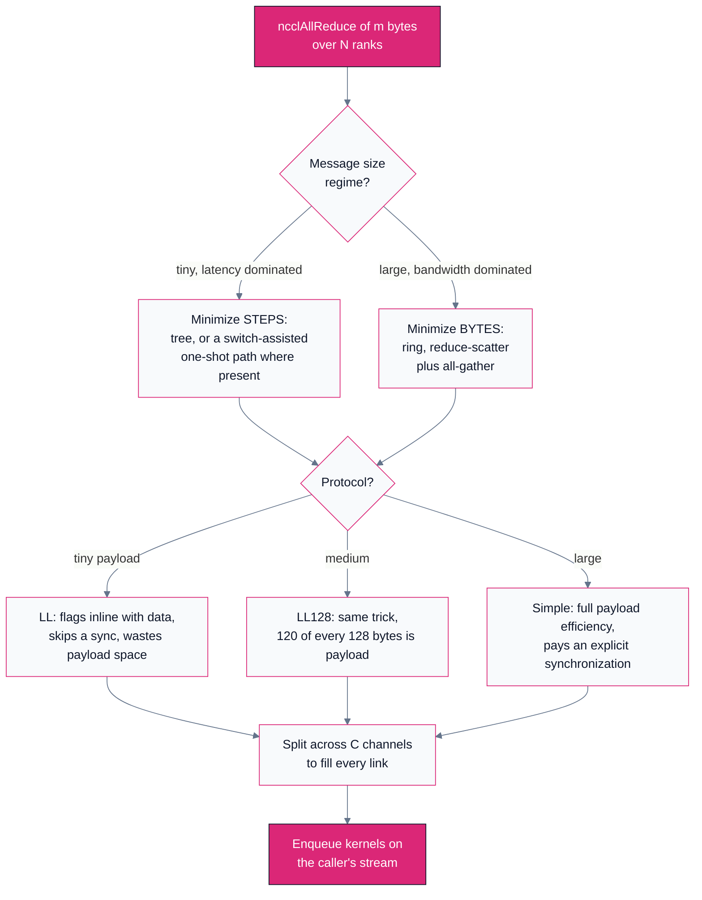
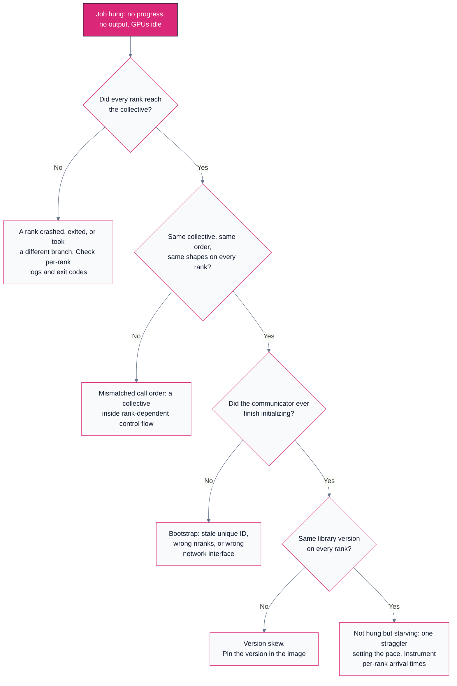

# D03 — GPU Collectives: NCCL & RCCL

> Track D · Module 03 · Status: **DONE** · Est. 7 hours · Depth 3/5
>
> Prerequisites: [D01](../D01.scaling-limits-and-communication-cost/README.md) for the alpha-beta
> model and the steps-versus-bytes distinction, [D02](../D02.message-passing-and-mpi/README.md) for
> collective semantics — what an all-reduce *means*, and why every rank must call it.
>
> **Backends: RCCL (AMD) and NCCL (NVIDIA), dual-vendor throughout.** The two libraries share an API,
> so every listing here compiles against either with a header and a link flag changed. Single-node
> multi-GPU labs produce **real numbers** on whatever machine you have; multi-node figures are
> **analytic models** and say so in their own output banners.
> Setup: [SETUP.md](../../../docs/SETUP.md) ·
> Terms: [GLOSSARY.md](../../../docs/GLOSSARY.md) · Sources: [REFERENCES.md](../../../docs/REFERENCES.md).

---

## 1. TL;DR + Layman analogy

**TL;DR.** A collectives library is the software that turns "every GPU has a different gradient" into
"every GPU has the same averaged gradient", as fast as the wires physically allow. NCCL and RCCL are
that library for NVIDIA and AMD, and they are API-compatible siblings: same call sequence, same
environment variables, largely the same algorithms. What they add over a general message-passing layer
is not new semantics but **topology awareness** — they discover the link graph at startup, note that
these eight GPUs share fast intra-node links while those sixteen are a network hop away, and build a
schedule that respects the hierarchy. The core algorithm for large messages is the
[ring all-reduce](../../../docs/GLOSSARY.md#ring-all-reduce), which is provably bandwidth-optimal and,
for exactly the same reason, latency-poor: it moves the theoretical minimum number of bytes by taking
`2(N-1)` sequential steps to do it. Everything else is consequence — why there is also a tree, why one
collective is split across parallel channels, why there are three wire protocols, why the number you
must quote is `busbw` and not `algbw`, and why the characteristic production failure is not slowness
but a **hang**.

**Layman analogy — the relay of runners with batons.**

Twenty-four people stand in a circle. Each holds a ledger of a thousand numbers, and the goal is for
everyone to end up holding the element-wise *sum* of all twenty-four ledgers.

The obvious scheme is that everybody shouts their numbers at everybody else, with the air in the
middle — the shared medium — as the bottleneck and the cost growing quadratically with the circle.

The relay scheme is different. Split each ledger into twenty-four **pages**. On each tick, every
runner hands one page to the neighbour on their left and adds the page arriving from their right into
their own copy. After twenty-three ticks each runner holds one page that is the *complete* sum of that
page across all ledgers, and no two runners hold the same completed page: the **reduce-scatter** half.
Twenty-three more ticks of pure passing circulate every completed page to everybody: the
**all-gather** half. Forty-six ticks, one page carried per person per tick.

Three predictions fall out, and all three hold for the real thing:

- **Nobody is idle and no link is oversubscribed.** Every runner passes and receives simultaneously,
  on their own two arms. That is why the ring is bandwidth-optimal: it uses every link, all the time,
  and moves each byte the fewest possible times.
- **Work per person barely depends on headcount.** Each runner carries `2 x 23/24` of a ledger; with a
  thousand people it is `2 x 999/1000`. It converges to "two ledgers" and stops — which is why
  doubling your cluster does not double your communication time.
- **The number of *ticks* grows linearly with the circle.** Forty-six for twenty-four people, two
  thousand for a thousand. If a tick has any fixed cost — a whistle, a glance — then for a *tiny*
  ledger the whistles are the entire cost and the relay is the worst available scheme. There you want
  a tournament bracket: pair up, sum, pair up the winners, finish in ten rounds. That bracket is the
  **tree**, and a real library switches to it below a size threshold.

**Where the analogy breaks**, in three places that matter:

1. **The circle is not a circle.** Inside one server, GPUs are joined by links an order of magnitude
   faster than the network between servers, so some hand-offs are nearly free. A real library
   therefore *orders* its ring to cross expensive hops as rarely as possible, and often reduces inside
   each node first, then across nodes, then broadcasts back down.
2. **A runner can hand off several pages at once.** GPUs have many links, not two arms, so the library
   runs several rings in parallel — channels. One ring on eight links leaves seven idle.
3. **Addition is not really addition.** Floating-point addition is not associative, so the answer
   depends on the order pages were summed — which depends on rank count, algorithm and channel count.
   The runners get *an* answer, not *the* answer. Section 3.8 makes this precise;
   [A04](../../A-gpu-programming/A04.parallel-reduction/README.md) covers the numerics.

**By the end of this module you can** write a verified multi-GPU all-reduce with full error checking,
read an `rccl-tests` report without being misled by the bandwidth column, predict which algorithm and
protocol the library will pick for a given message size, and diagnose a collective hang from first
principles instead of by restarting the job.

---

## 2. First Principles

### 2.1 Why MPI was not enough

[D02](../D02.message-passing-and-mpi/README.md) establishes that collective *semantics* were solved
decades ago: [the MPI standard](../../../docs/REFERENCES.md#mpi-standard-mpi-forum) defines
`MPI_Allreduce` precisely, and MPI implementations already contain sophisticated algorithm selection,
documented by [Thakur, Rabenseifner and Gropp](../../../docs/REFERENCES.md#collective-algorithms-in-mpich-thakur-rabenseifner-and-gropp-2005).
So why a second library? Three reasons, each a property of GPUs rather than of MPI.

**The data is in the wrong memory.** A gradient buffer lives in device memory, produced by a kernel
and consumed by a kernel. A host-centric collective must stage it through system memory — device to
host, reduce, host to device — three traversals of a link you did not want to cross once, serialized
against the compute stream. A GPU-native collective reads and writes device memory directly and, where
the hardware allows, moves bytes between two GPUs' memories with the host off the path entirely. See
[RDMA and GPUDirect](../../../docs/GLOSSARY.md#rdma-and-gpudirect) and
[D04](../D04.interconnects-and-rdma/README.md).

**The topology is violently heterogeneous.** A classical MPI job on a homogeneous cluster can treat
ranks as equidistant and be roughly right. A GPU job cannot: links inside a chassis
([NVLink, xGMI and Infinity Fabric](../../../docs/GLOSSARY.md#nvlink-xgmi-and-infinity-fabric)) are
typically an order of magnitude faster than the network between chassis, and even inside a chassis the
connectivity is often not all-to-all. An algorithm blind to that crosses the slow link `N` times when
once would do, so the library must **discover** the link graph and **plan** against it.

**The launch cost is on the critical path.** A collective in a training step sits between the backward
pass and the optimizer step, so it must enqueue on a stream, overlap with compute, and cost almost no
host time. That is a GPU programming-model concern, not a message-passing one.

> [!IMPORTANT]
> A collectives library is best understood as a **compiler for communication**. You hand it a semantic
> request ("sum this buffer across these ranks"); it inspects the machine, selects an algorithm, a
> protocol and a degree of parallelism, and emits a schedule of transfers. As with any compiler, your
> leverage is in the input — big enough buffers, correct topology information, matching calls on every
> rank — and your confusion will come from assuming you know what it emitted.

### 2.2 Deriving the ring all-reduce

An all-reduce is two primitives back to back, and seeing the decomposition is the derivation.

Let `N` be the rank count and `m` the buffer size in bytes. Divide each rank's buffer into `N` chunks
of `m/N` bytes, and arrange ranks in a logical ring where rank `i` sends to `i+1 mod N`.

**Phase 1, reduce-scatter, `N-1` steps.** On each step, rank `i` sends the chunk it most recently
accumulated to its successor and adds the chunk arriving from its predecessor into its own copy. The
indices are chosen so that after `N-1` steps rank `i` holds the fully reduced chunk `i` — the sum of
that chunk over all ranks — and no other rank holds a completed copy of it. Each step moved `m/N`
bytes per rank.

**Phase 2, all-gather, `N-1` steps.** Every rank now owns one distinct completed chunk, so circulate
them: each step, pass the most recently received chunk along. After `N-1` steps every rank holds all
`N` completed chunks, which is the reduced buffer. Again `m/N` bytes per step per rank.



```
steps  = 2(N - 1)
bytes  = 2(N - 1) * (m / N)  =  2m(N-1)/N   sent per rank (and the same received)
```

Two properties of that expression must be kept separate, because conflating them is the error
[D01 §3.3](../D01.scaling-limits-and-communication-cost/README.md#3-deep-dive) exists to prevent:

- The **byte count converges.** `2m(N-1)/N` is `1.75m` at `N=8`, `1.97m` at `N=64`, `1.998m` at
  `N=1024`. For any practical rank count it is "about `2m`" and never exceeds it. Volume per rank is
  therefore essentially **independent of scale**.
- The **step count is linear.** `2(N-1)` is 14 steps at `N=8` and 2,046 at `N=1024`. Each step costs
  at least one `alpha`, so the ring's latency floor grows without bound.

Under [the alpha-beta model](../../../docs/GLOSSARY.md#the-alpha-beta-model):

```
T_ring(N, m) = 2(N - 1) * alpha  +  2m(N-1)/N * beta
```

The first term is why nobody rings a 4 KB buffer. The second is why everybody rings a 4 GB one.

### 2.3 Why the ring is bandwidth-optimal

The bandwidth term is not merely good, it is the best achievable.
[Patarasuk and Yuan](../../../docs/REFERENCES.md#bandwidth-optimal-all-reduce-patarasuk-and-yuan-2009)
proved `2m(N-1)/N` bytes per rank is a **lower bound** for all-reduce in this network model, and the
ring attains it. The argument is short enough to reconstruct: in the reduce-scatter half, a rank's own
data cannot teach it anything about other ranks' data, so it must receive at least the information
content of the `m(N-1)/N` of the result that depends on data it never had — and by symmetry send that
much, since its own data must reach whoever reduces it. The all-gather half is the same bound again.
Add the halves.

The result is strong and narrow, and both properties matter. Strong: a large-message all-reduce slower
than `2m(N-1)/N / link_bandwidth` is losing to implementation, not to algorithm. Narrow: it says
nothing about latency, assumes uniform links, and does not model in-network reduction — a switch that
sums packets in flight changes the accounting, which is why hardware with that capability can appear
to violate the bound (section 3.3).

### 2.4 algbw and busbw: the number that misleads everyone

You have measured an all-reduce: `m` bytes in `t` seconds. What bandwidth do you report?

The naive answer is **algorithm bandwidth**, `algbw = m / t`. It is a meaningful figure of merit —
application-visible throughput, "how fast did my buffer get reduced" — but it is *not* comparable to a
link rate, because a ring moved roughly `2m` bytes over the wire to reduce `m` bytes of buffer.
Compare it to a link specification and a healthy fabric looks like it is running at half speed.

**Bus bandwidth** corrects for the algorithm's unavoidable traffic: `busbw = algbw * f(N)`, where `f`
is the collective's traffic factor. For all-reduce, `f(N) = 2(N-1)/N`, straight out of section 2.2.
The factors differ per collective, and knowing them is the difference between reading a benchmark and
guessing at it:

| Collective | Bytes each rank must move (ring) | Traffic factor `f(N)` | Factor at `N=8` |
|---|---|---|---:|
| All-reduce | `2m(N-1)/N` | `2(N-1)/N` | 1.75 |
| Reduce-scatter | `m(N-1)/N` | `(N-1)/N` | 0.875 |
| All-gather | `m(N-1)/N` | `(N-1)/N` | 0.875 |
| All-to-all | `m(N-1)/N` | `(N-1)/N` | 0.875 |
| Broadcast, reduce | `m` | `1` | 1.0 |

Read the table twice. For all-reduce, `busbw` is *larger* than `algbw`, because more bytes crossed the
wire than the buffer contains. For reduce-scatter it is *smaller*, because each rank keeps only a
slice. For broadcast the two are identical — which is why a broadcast benchmark is the one place the
distinction is invisible and therefore never learned.

> [!IMPORTANT]
> **`busbw` is the number to compare against hardware. `algbw` is the number to compare against your
> application's needs.** Quoting one where the other is meant is the most common way collective
> benchmarks mislead, and for all-reduce the error direction is flattering to the reader's suspicion
> that something is broken — which is exactly why it survives review. If a report claims a bandwidth
> near the link specification, check which column it came from and at what rank count, because `f(N)`
> moves with `N`. [`nccl-tests` and `rccl-tests`](../../../docs/REFERENCES.md#nccl-tests-and-rccl-tests-nvidia-amd)
> print both columns side by side precisely so this cannot be hidden. Terms:
> [algbw and busbw](../../../docs/GLOSSARY.md#algbw-and-busbw).

A worked check with round invented inputs, to fix the mechanics: 8 GPUs, a 1 GiB buffer, all-reduce in
40 ms. `algbw` is about 26.8 GB/s; `busbw` is `26.8 * 1.75`, about 46.9 GB/s. If those links are
specified near 50 GB/s per direction, the collective is at roughly 94% of the wire and there is
nothing left to win. Report the 26.8 and someone opens a performance bug.

---

## 3. Deep Dive

### 3.1 NCCL and RCCL as API-compatible siblings

[NCCL](../../../docs/REFERENCES.md#nccl-nvidia) is NVIDIA's collectives library.
[RCCL](../../../docs/REFERENCES.md#rccl-amd) is AMD's ROCm implementation, and it deliberately exposes
an **NCCL-compatible API**: entry points, enums, error codes and semantics correspond, so
`ncclAllReduce` and `rcclAllReduce` map one-to-one and RCCL's header provides both spellings.

| Concern | NVIDIA | AMD |
|---|---|---|
| Header | `#include <nccl.h>` | `#include <rccl/rccl.h>` |
| Link flag | `-lnccl` | `-lrccl` |
| Compiler | `nvcc` | `hipcc` |
| Symbols | `nccl*` | `nccl*` and `rccl*` aliases both present |
| Types | `ncclComm_t`, `ncclResult_t`, `ncclDataType_t` | identical names |
| Tuning env vars | `NCCL_*` | `NCCL_*` (RCCL honours the same names), plus AMD-specific knobs |
| Benchmark suite | `nccl-tests` | `rccl-tests`, a port with the same CLI |

Two caveats that portability claims usually omit. **API compatibility is not behavioural identity**:
algorithm availability differs (section 3.3), tuning thresholds differ, and features depending on
vendor-specific hardware — in-network reduction, switch-assisted collectives — exist on one side and
not the other. And **version skew is a per-cluster hazard**: all ranks in a communicator must run
compatible library versions, and a mismatch usually manifests as a hang rather than a clean refusal.

So the strategy that works is to write against the `nccl*` names, isolate the header and link flag in
the build system, and keep environment tuning in a launch script rather than in source. Frameworks do
exactly this: PyTorch's distributed backend is named `nccl` on both vendors and dispatches to RCCL on
ROCm builds, which is why ROCm training code often reads as CUDA code.

### 3.2 Communicator setup and the unique-ID bootstrap

A [communicator](../../../docs/GLOSSARY.md#rank-and-communicator) is the library's handle for "this
set of ranks, in this order, over this discovered topology". Creating one is the most common place a
distributed job hangs, so it is worth understanding rather than copying.

The bootstrap has a chicken-and-egg problem — the ranks cannot use the library to agree on how to use
the library — so the library defines an opaque **unique ID** and requires you to distribute it out of
band:

1. One rank calls `ncclGetUniqueId`, producing an opaque blob encoding rendezvous information.
2. That blob reaches every participating rank by some mechanism the library does not provide: in
   practice `MPI_Bcast`, a filesystem rendezvous, or the key-value store behind PyTorch's
   `init_process_group`.
3. Every rank calls `ncclCommInitRank(&comm, nranks, id, rank)` with the *same* ID, the *same*
   `nranks`, and a distinct `rank` in `[0, nranks)`. This call is collective and blocking: it does not
   return until all `nranks` ranks have arrived.

For the single-process, multi-GPU case there is a shortcut, `ncclCommInitAll`, which creates every
communicator at once and skips the ID dance. Section 4's labs use it; multi-process code cannot.

Three things can go wrong here, none of which produces a useful error message by default: a rank that
never calls init, leaving everyone blocked in a collective that cannot complete; inconsistent
arguments, such as a stale unique ID or a rank count disagreeing with the launcher's, which fail at
rendezvous rather than at the call site that is wrong; and interface selection, where a host with
management, storage, fabric and container-bridge interfaces leads the library to a connection attempt
that never completes, which is what `NCCL_SOCKET_IFNAME` exists to pin. Section 6.1 turns these into a
diagnosis procedure.

The diagnostic that makes all of it readable is `NCCL_DEBUG=INFO`, plus
`NCCL_DEBUG_SUBSYS=INIT,GRAPH` for topology decisions: it prints the discovered topology, the ring
orderings, the channel count, and the chosen algorithm and protocol. Capturing it on the first run of
any new cluster configuration saves more time than any other practice in this module.

### 3.3 Algorithm selection: ring, tree, and switch-assisted paths

Neither library has "an all-reduce implementation". Each has several, plus a tuning model that picks
one per call from message size, rank count and discovered topology — the same structural decision
MPICH makes, under GPU-specific constraints.

**Ring** is section 2.2: `2(N-1)` steps, optimal bytes, the large-message default everywhere.

**Tree** reverses the tradeoff. Reduce up a tree to a root, then broadcast back down: depth
`O(log N)`, so the latency term collapses from thousands of steps to tens at large `N`. A naive single
tree has a defect — the root's inbound links are a hotspot and interior ranks do more work than leaves
— so NCCL uses a **double binary tree**, overlaying two trees such that a rank interior in one is a
leaf in the other. That balances link load and lets the tree keep respectable bandwidth at log depth;
the construction is described in [NCCL's own documentation](../../../docs/REFERENCES.md#nccl-nvidia).
It still cannot beat the `2m(N-1)/N` information bound, so the ring wins on very large messages, but
the crossover sits far higher than a naive analysis suggests.

**Switch-assisted and in-network reduction** is the third family, and where the vendors genuinely
diverge. NVIDIA exposes `NVLS`, which performs the reduction *inside* NVLink Switch hardware rather
than at the endpoints, plus one-shot and two-shot small-message paths over the same fabric. Because
the switch does arithmetic, the endpoint traffic accounting changes and the endpoint-to-endpoint lower
bound no longer applies — not a violation of Patarasuk and Yuan but a different machine model. **This
family is NVIDIA-specific and is optional material**: the AMD counterpart for intra-node work is ring
or tree over xGMI and Infinity Fabric, and portable code must not assume in-network reduction exists.

You can inspect and override the choice: `NCCL_ALGO` and `NCCL_PROTO` take algorithm and protocol
names, and both libraries honour them. Overriding is a **diagnostic, not a tuning strategy**. Forcing
`NCCL_ALGO=Ring` to test whether the tuner made a bad call is good practice; shipping that override is
how a cluster becomes mysteriously slow on small collectives two upgrades later.



### 3.4 Channels: why one ring is not enough

A GPU is not joined to its neighbours by one wire. It has several independent links, and a single
logical ring traverses exactly one link per hop, so one ring leaves most of the hardware idle no matter
how large the message. The fix is concurrency: split the buffer into `C` parts and run `C` independent
**channels**, each with its own ring ordering over a different set of physical links, each backed by
its own GPU thread blocks. Aggregate bandwidth is then roughly the sum over channels, until saturation.

Channel count is therefore a resource decision with three constraints pulling against each other.
**More channels use more links**, which is the point, up to the number of independent paths the
topology provides. **More channels consume more GPU resources**, because channels are thread blocks
resident alongside your compute kernels; past a point they compete with the very work they were meant
to overlap with, which is why "just raise the channel count" backfires. And **more channels mean
smaller per-channel messages** — splitting 1 MB eight ways gives each channel 128 KB, possibly pushing
each into the latency-bound regime. Channels help large messages and hurt small ones.

For inter-node traffic the binding constraint is usually the **NIC count**: channels crossing the
network share the host's adapters, so a node with fewer NICs than GPUs has an injection ceiling no
channel count can raise. That is LogP's gap parameter from
[D01 §3.2](../D01.scaling-limits-and-communication-cost/README.md#3-deep-dive) and the architectural
reason large training clusters are built with one NIC per GPU;
[D05](../D05.topology-and-scale-boundaries/README.md) works through the consequences.
`NCCL_MIN_NCHANNELS` and `NCCL_MAX_NCHANNELS` bound the library's choice and `NCCL_DEBUG=INFO` reports
what it used, so confirming the channel count against the link count you believe you have is one of
the highest-value five-minute checks on a new machine.

### 3.5 Protocols: Simple, LL and LL128

Underneath the algorithm is a wire protocol, and its distinction is about **synchronization**, not
routing. The problem it solves is that a receiver must know when data has arrived.

**Simple** writes the payload, issues a memory fence, then sets a flag the receiver polls. Correct,
full payload efficiency, and it costs an ordered synchronization per transfer whose latency is
irreducible.

**LL** (low latency) removes that synchronization by making the flag part of the data: payload is
written in small units each carrying its own validity marker, so the receiver polls the marker and
consumes the data in one read, with no separate fence. As documented in NCCL's protocol description,
the LL unit pairs 4 bytes of payload with a 4-byte flag, so **half the wire carries flags** — a
catastrophic trade for a large buffer, an excellent one for 256 bytes where only latency matters.

**LL128** is the compromise that does most of the real work: the same inline-flag trick at 128-byte
granularity, carrying 120 bytes of payload plus 8 bytes of flag per line, for roughly 94% payload
efficiency — nearly Simple's efficiency at nearly LL's latency. The catch is that it depends on the
interconnect guaranteeing 128-byte writes land atomically, so the library enables it only on links
where it knows that holds. A path where you expected LL128 and did not get it is usually this.

| Protocol | Payload efficiency | Synchronization cost | Where the library uses it |
|---|---|---|---|
| **LL** | ~50% (4 of every 8 bytes) | none, flags are inline | Smallest, latency-critical messages |
| **LL128** | ~94% (120 of every 128 bytes) | none, flags are inline | Small to medium, on links with the required atomicity |
| **Simple** | ~100% | explicit fence plus flag per transfer | Large messages, where latency amortizes |

Why this matters to a reader rather than a library author: the payload-efficiency column explains
benchmark shapes that otherwise look like defects. A `busbw` curve that sits near half the link rate
at small sizes and climbs toward the link rate at large ones is not a broken fabric — it is LL doing
its job, and the climb is the library crossing to LL128 and then Simple. Lab 3 measures that curve.

### 3.6 Topology detection and ring ordering

Before any of the above, the library must know what machine it is on. At communicator creation it
enumerates devices, their interconnects, the host's PCIe and NUMA structure, and the network adapters
with their affinity to particular GPUs, assembling a graph annotated with link types and speeds. It
then searches that graph for **ring orderings** that visit every rank while crossing the slowest links
as few times as possible, once per channel, so different channels use different links.

Two consequences, both frequently surprising. **Rank ordering is a performance decision**: the library
builds rings over the ranks you gave it, so a launcher assigning logically-adjacent ranks to
physically distant GPUs leaves it optimizing inside a bad constraint — which is why large clusters bind
ranks to GPUs and network rails deliberately, and why "we changed nothing but the placement and it got
20% faster" is a plausible sentence. **Anything that hides the topology hurts**: a container not
exposing the interconnect devices, a virtualization layer flattening the PCIe hierarchy, a permissions
problem failing the peer-to-peer capability query — each makes the library fall back to a slower but
always-valid path, silently, with the only evidence in `NCCL_DEBUG=INFO`.

### 3.7 Stream semantics, and the two rules that follow

This is the most common *correctness* bug in code using these libraries, and it follows from a design
choice that is reasonable once seen. `ncclAllReduce(sendbuf, recvbuf, count, datatype, op, comm,
stream)` takes a stream. It **enqueues** work and returns, typically long before any bytes have moved.
When it returns, the result is **not** in `recvbuf`, `sendbuf` is **not** safe to overwrite or free,
and no synchronization with any other rank has occurred. All three become true only after the stream is
synchronized or an event ordered after the collective has fired. The natural but wrong reading — "the
function returned, so the collective is done" — produces a bug with the worst possible signature: it
*usually works*, because small collectives often finish before the host reads the buffer, and it fails
under load, at scale, or after an unrelated timing change. Lab 4 makes it fail deliberately.

Two rules come from the same asynchrony:

- **Ordering across ranks must match.** Collectives on a communicator are matched in program order
  across ranks. If rank 0 enqueues an all-reduce then a broadcast while rank 1 enqueues a broadcast
  then an all-reduce, the library pairs the all-reduce with the broadcast, and the job deadlocks or
  corrupts data — with no diagnostic at the point of the mistake, because enqueue is asynchronous.
- **One process driving several GPUs must group its calls.** Issuing a collective for device 0 and
  then device 1 from one thread can deadlock, because the first cannot complete until the second is
  enqueued. `ncclGroupStart` and `ncclGroupEnd` bracket the set so the library defers launching until
  all members are known. Lab 1 shows the pattern.

### 3.8 The correctness trap: all-reduce is not reproducible

Floating-point addition is not associative: `(a + b) + c` and `a + (b + c)` can differ in the last
bits, and the discrepancy compounds. A distributed sum therefore depends on **the order partial sums
were formed**, which depends on rank count, algorithm, channel count, the protocol's chunking and the
topology-derived ring ordering. So changing the rank count changes the numerical result: 8 GPUs and 16
GPUs will not agree bit for bit with identical data, seeds and code. Changing *nothing but the machine*
can change it, because the library may discover a different topology and pick a different ring order.
Forcing `NCCL_ALGO` changes it too, which makes "reproduce it with the ring to compare" a less clean
experiment than it looks. Neither library promises bitwise reproducibility across these variations, and
no fully general implementation could without giving up either performance or topology adaptivity.

None of this is a bug, and treating it as one wastes time. What it demands is that verification use
tolerances rather than equality, and that any claim of identical results name the rank count and
library version it holds for. The same non-associativity inside a single GPU's reduction tree is
derived in [A04](../../A-gpu-programming/A04.parallel-reduction/README.md) — identical mechanism,
different scale. Where bitwise reproducibility is a hard requirement, the routes are a fixed
deterministic reduction order at a performance cost, or a higher-precision or compensated accumulator
so ordering differences fall below the tolerance you care about;
[B04](../../B-gpu-ml-performance/B04.precision-and-quantization/README.md) covers the precision side.

---

## 4. Hands-On Labs

Labs 1, 3 and 4 need **one node with at least two GPUs** — no network, no scheduler. Lab 2 needs the
vendor benchmark suite. Everything runs on either vendor; the AMD form is shown in full and the NVIDIA
diff is given, because the diff is genuinely mechanical.

```bash
cd tracks/D-distributed-computing/D03.gpu-collectives-nccl-and-rccl
make            # builds the hip/ targets with hipcc
make cuda       # builds the cuda/ targets with nvcc
make run        # lab 1, then the sweep in lab 3
```

### Lab 1 — A verified all-reduce across the GPUs in one node

**Goal:** get a correct collective running with every call checked, and verify the answer against a
CPU reference rather than trusting it.

`hip/allreduce_min.cpp`:

```cpp
// Single-process, multi-GPU all-reduce with RCCL, verified against a CPU reference.
// Build: hipcc -O2 hip/allreduce_min.cpp -lrccl -o allreduce_min
#include <hip/hip_runtime.h>
#include <rccl/rccl.h>

#include <cmath>
#include <cstdio>
#include <cstdlib>
#include <vector>

#define HIP_CHECK(cmd)                                                       \
  do {                                                                       \
    hipError_t e_ = (cmd);                                                   \
    if (e_ != hipSuccess) {                                                  \
      std::fprintf(stderr, "HIP %s:%d '%s': %s\n", __FILE__, __LINE__, #cmd, \
                   hipGetErrorString(e_));                                   \
      std::exit(EXIT_FAILURE);                                               \
    }                                                                        \
  } while (0)

#define RCCL_CHECK(cmd)                                                       \
  do {                                                                        \
    ncclResult_t r_ = (cmd);                                                  \
    if (r_ != ncclSuccess) {                                                  \
      std::fprintf(stderr, "RCCL %s:%d '%s': %s\n", __FILE__, __LINE__, #cmd, \
                   ncclGetErrorString(r_));                                   \
      std::exit(EXIT_FAILURE);                                                \
    }                                                                         \
  } while (0)

// Each device fills its buffer with a rank-dependent value, so the expected
// all-reduce result is exactly sum_{r=0}^{N-1} (r + 1) = N(N+1)/2.
__global__ void fill_with_rank(float* buf, int n, float value) {
  int idx = blockIdx.x * blockDim.x + threadIdx.x;
  if (idx < n) {
    buf[idx] = value;
  }
}

int main(int argc, char** argv) {
  const int count = (argc > 1) ? std::atoi(argv[1]) : (1 << 20);
  if (count <= 0) {
    std::fprintf(stderr, "element count must be positive\n");
    return EXIT_FAILURE;
  }
  int ndev = 0;
  HIP_CHECK(hipGetDeviceCount(&ndev));
  if (ndev < 2) {
    std::fprintf(stderr, "need at least 2 GPUs, found %d\n", ndev);
    return EXIT_FAILURE;
  }
  const size_t bytes = (size_t)count * sizeof(float);
  std::printf("all-reduce over %d devices, %d floats (%.1f MiB)\n", ndev, count,
              (double)bytes / (1024.0 * 1024.0));

  std::vector<ncclComm_t> comms(ndev);
  std::vector<hipStream_t> streams(ndev);
  std::vector<float*> sendbuf(ndev, nullptr);
  std::vector<float*> recvbuf(ndev, nullptr);

  // This shortcut exists only for the single-process case; multi-process uses
  // ncclCommInitRank with a broadcast unique ID (section 3.2).
  RCCL_CHECK(ncclCommInitAll(comms.data(), ndev, /*devlist=*/nullptr));

  const int threads = 256;
  const int blocks = (count + threads - 1) / threads;
  for (int dev = 0; dev < ndev; ++dev) {
    HIP_CHECK(hipSetDevice(dev));
    HIP_CHECK(hipStreamCreate(&streams[dev]));
    HIP_CHECK(hipMalloc(&sendbuf[dev], bytes));
    HIP_CHECK(hipMalloc(&recvbuf[dev], bytes));
    fill_with_rank<<<blocks, threads, 0, streams[dev]>>>(
        sendbuf[dev], count, (float)(dev + 1));
    HIP_CHECK(hipGetLastError());  // launch errors surface here, not later
  }

  // Without the group, device 0's collective cannot complete before device 1's
  // call is enqueued, and one thread issuing them serially deadlocks (3.7).
  RCCL_CHECK(ncclGroupStart());
  for (int dev = 0; dev < ndev; ++dev) {
    RCCL_CHECK(ncclAllReduce(sendbuf[dev], recvbuf[dev], (size_t)count,
                             ncclFloat, ncclSum, comms[dev], streams[dev]));
  }
  RCCL_CHECK(ncclGroupEnd());

  // Nothing above has necessarily executed yet. This is where it completes.
  for (int dev = 0; dev < ndev; ++dev) {
    HIP_CHECK(hipSetDevice(dev));
    HIP_CHECK(hipStreamSynchronize(streams[dev]));
  }

  const double expected = (double)ndev * (ndev + 1) / 2.0;
  int failures = 0;
  std::vector<float> host((size_t)count);
  for (int dev = 0; dev < ndev; ++dev) {
    HIP_CHECK(hipSetDevice(dev));
    HIP_CHECK(hipMemcpy(host.data(), recvbuf[dev], bytes,
                        hipMemcpyDeviceToHost));
    for (int i = 0; i < count; ++i) {
      // Tolerance, not equality: the reduction order is not guaranteed and
      // floating-point addition is not associative (section 3.8).
      if (std::fabs((double)host[i] - expected) > 1e-5 * expected &&
          ++failures <= 5) {
        std::fprintf(stderr, "dev %d elem %d: got %.9g want %.9g\n", dev, i,
                     (double)host[i], expected);
      }
    }
  }

  for (int dev = 0; dev < ndev; ++dev) {
    HIP_CHECK(hipSetDevice(dev));
    HIP_CHECK(hipFree(sendbuf[dev]));
    HIP_CHECK(hipFree(recvbuf[dev]));
    HIP_CHECK(hipStreamDestroy(streams[dev]));
    RCCL_CHECK(ncclCommDestroy(comms[dev]));
  }

  std::printf("%s (expected %.1f on every element of every device)\n",
              failures == 0 ? "PASS" : "FAIL", expected);
  return failures == 0 ? EXIT_SUCCESS : EXIT_FAILURE;
}
```

**The NVIDIA version, `cuda/allreduce_min.cu`, is the same file with a mechanical substitution:**

| AMD | NVIDIA |
|---|---|
| `#include <hip/hip_runtime.h>`, `#include <rccl/rccl.h>` | `#include <cuda_runtime.h>`, `#include <nccl.h>` |
| `hipError_t`, `hipSuccess`, `hipGetErrorString` | `cudaError_t`, `cudaSuccess`, `cudaGetErrorString` |
| `hipMalloc`, `hipFree`, `hipMemcpy` | `cudaMalloc`, `cudaFree`, `cudaMemcpy` |
| `hipStream_t`, `hipStreamCreate`, `hipStreamSynchronize` | `cudaStream_t`, `cudaStreamCreate`, `cudaStreamSynchronize` |
| `hipSetDevice`, `hipGetDeviceCount`, `hipGetLastError` | `cudaSetDevice`, `cudaGetDeviceCount`, `cudaGetLastError` |
| `hipEventCreate`, `hipEventRecord`, `hipEventElapsedTime` (Lab 3) | `cudaEventCreate`, `cudaEventRecord`, `cudaEventElapsedTime` |
| `hipcc -O2 ... -lrccl` | `nvcc -O2 ... -lnccl` |

Every `nccl*` call in the body is unchanged. That is section 3.1's portability claim made concrete:
the collective code is identical, only the runtime wrapper differs.

**What to observe.** Three things, in order. That it prints `PASS` — with `hipGetLastError` after the
launch and `RCCL_CHECK` on every library call, a misconfiguration fails loudly instead of producing
plausible garbage. Then run it under `NCCL_DEBUG=INFO` and read the topology section: ring orderings,
channel count, chosen algorithm and protocol. Then delete the `ncclGroupStart`/`ncclGroupEnd` pair and
re-run: on most configurations it hangs, which is section 3.7's deadlock reproduced in one edit.

### Lab 2 — Run the vendor benchmark and read the columns

**Goal:** learn to read `algbw` and `busbw` from the tool everyone quotes.

```bash
# AMD: https://github.com/ROCm/rccl-tests   NVIDIA: https://github.com/NVIDIA/nccl-tests
git clone <suite> && cd rccl-tests && make
./build/all_reduce_perf -b 8 -e 1G -f 2 -g 4 -c 1 | tee allreduce.log

# then audit the report rather than eyeballing it
python3 tools/parse_collective_report.py --input allreduce.log \
        --collective allreduce --ranks 4
```

The flags match on both suites because `rccl-tests` is a port: `-b` smallest size, `-e` largest, `-f`
the multiplicative step between sizes, `-g` GPUs in one process, and `-c 1` to enable correctness
checking, which populates the `#wrong` column.

**What to observe.** One row per size, with in-place and out-of-place timings, and an `algbw` and a
`busbw` column for each. Confirm on any row that `busbw / algbw` equals `2(N-1)/N` for your `-g`
value — 1.5 at 4 GPUs, 1.75 at 8 — because once you have seen that ratio in real output, section 2.4
stops being abstract. Then check that `#wrong` is 0 on every row; a nonzero entry is a hardware or
configuration defect, and it is the column people skip.

### Lab 3 — The bandwidth sweep and the crossover

**Goal:** find, on your own hardware, the message size where a collective stops being latency-bound.

The timed region for one message size, from `hip/busbw_sweep.cpp`, using the same macros as Lab 1.
The same loop runs `warmup` times first: the initial calls include connection setup and buffer
registration, which are real costs but not steady state, so they must land outside the timed window.

```cpp
  hipEvent_t t0, t1;
  HIP_CHECK(hipSetDevice(0));
  HIP_CHECK(hipEventCreate(&t0));
  HIP_CHECK(hipEventCreate(&t1));
  HIP_CHECK(hipEventRecord(t0, streams[0]));
  for (int it = 0; it < iters; ++it) {
    RCCL_CHECK(ncclGroupStart());
    for (int dev = 0; dev < ndev; ++dev) {
      RCCL_CHECK(ncclAllReduce(send[dev], recv[dev], count, ncclFloat, ncclSum,
                               comms[dev], streams[dev]));
    }
    RCCL_CHECK(ncclGroupEnd());
  }
  HIP_CHECK(hipEventRecord(t1, streams[0]));
  for (int dev = 0; dev < ndev; ++dev) {
    HIP_CHECK(hipSetDevice(dev));
    HIP_CHECK(hipStreamSynchronize(streams[dev]));
  }
  float ms = 0.0f;
  HIP_CHECK(hipSetDevice(0));
  HIP_CHECK(hipEventElapsedTime(&ms, t0, t1));
  HIP_CHECK(hipEventDestroy(t0));
  HIP_CHECK(hipEventDestroy(t1));

  const double secs = (double)ms / 1000.0 / (double)iters;
  const double algbw = (double)bytes / secs;              // section 2.4
  const double busbw = algbw * 2.0 * (ndev - 1) / ndev;   // f(N) for all-reduce
```

```bash
./busbw_sweep --min-bytes 8 --max-bytes 1073741824 --factor 2 --iters 20
python3 tools/busbw.py --collective allreduce --ranks 4 \
        --bytes 1073741824 --time-ms 40
```

**What to observe.** Read down the `busbw` column. It is low and nearly flat at small sizes — you are
paying `2(N-1)*alpha` and the payload is free — then rises steeply through a transition, then
plateaus. The plateau is your fabric's effective all-reduce bandwidth; the size that reaches, say, 90%
of it is the practical crossover, and it is the number that should decide your gradient bucket size.
Compare it against `m* = alpha * bandwidth` from
[D01 §3.1](../D01.scaling-limits-and-communication-cost/README.md#3-deep-dive) and note that the
collective's crossover sits *higher*, because the ring pays `2(N-1)` latencies rather than one. Then
re-run with `NCCL_PROTO=Simple` forced and watch the small-message end get worse: that is the LL
protocol you just disabled.

### Lab 4 — Break it on purpose: the asynchrony trap

**Goal:** experience the bug from section 3.7 rather than reading about it. `hip/stream_trap.cpp`
contains both the wrong and the right version, selected by a flag:

```cpp
  RCCL_CHECK(ncclGroupStart());
  for (int dev = 0; dev < ndev; ++dev) {
    RCCL_CHECK(ncclAllReduce(sendbuf[dev], recvbuf[dev], (size_t)count,
                             ncclFloat, ncclSum, comms[dev], streams[dev]));
  }
  RCCL_CHECK(ncclGroupEnd());

  if (synchronize) {
    for (int dev = 0; dev < ndev; ++dev) {
      HIP_CHECK(hipSetDevice(dev));
      HIP_CHECK(hipStreamSynchronize(streams[dev]));
    }
  }

  // With `synchronize == false` this reads a buffer whose contents are
  // undefined: the collective was enqueued, not completed. The copy is ordered
  // on a different stream, which is why the bug is intermittent rather than
  // deterministic -- the worst possible failure signature.
  HIP_CHECK(hipSetDevice(0));
  HIP_CHECK(hipMemcpy(host.data(), recvbuf[0], (size_t)count * sizeof(float),
                      hipMemcpyDeviceToHost));
```

```bash
./stream_trap --no-sync --count 268435456    # large buffer: expect FAIL
./stream_trap --no-sync --count 1024         # small buffer: often PASSES
./stream_trap --sync    --count 268435456    # correct: PASS
```

**What to observe.** The middle invocation is the lesson. A small collective frequently completes
before the host reads the buffer, so the incorrect code passes — which is precisely why this bug
reaches production and surfaces months later when a model grows or a cluster gets busier. Also try
freeing `sendbuf` immediately after `ncclGroupEnd` without synchronizing: the library may still be
reading it, and that failure mode is worse than a wrong answer.

---

## 5. Performance Analysis

> [!NOTE]
> Single-node collective bandwidth in this module is **measurable**, and the labs above measure it on
> whatever hardware you have. Every **multi-node** figure in Track D is an **analytic model** and its
> tool says so in a banner. Sanitized reference transcripts from single-node runs live under
> [`outputs/`](../../../outputs/README.md), labelled with the hardware they came from. No number in
> this repository is published that the repository cannot reproduce.

### 5.1 Reading an `rccl-tests` or `nccl-tests` report

Both suites print the same columns, and each answers a different question:

| Column | What it is | What to do with it |
|---|---|---|
| `size` / `count` / `type` | Buffer bytes, element count, element type | Confirm the sweep covered your production message size |
| `redop` / `root` | Reduction operator, root rank for rooted collectives | Sanity check: an all-reduce has no root |
| `time` | Per-iteration wall time, microseconds | The only raw measurement; everything else is derived |
| `algbw` | `size / time` | Application-visible throughput. Compare against your step budget |
| `busbw` | `algbw * f(N)` | Compare against the link rate. The hardware-efficiency number |
| `#wrong` | Elements failing the check under `-c 1` | Must be 0. Anything else is a defect, not a result |

Three habits separate a useful reading from a misleading one. **Read both the in-place and out-of-place
rows**, because in-place all-reduce is the common case in training frameworks and can perform
differently. **Note the rank count with every bandwidth figure**, since `f(N)` moves with `N` and a
`busbw` value without its rank count is uninterpretable. And **treat the smallest size as the latency
floor**: multiplying that `time` by your collectives-per-step count gives the tax your training step
pays regardless of message size.

### 5.2 The shape to expect, and what each region means

A `busbw` versus size curve on a healthy single node has three regions, each with a distinct cause and
a distinct fix:

| Region | Observed shape | Cause | What actually helps |
|---|---|---|---|
| Small (bytes to tens of KB) | `busbw` low and roughly flat | `2(N-1)*alpha` dominates; LL spends half the wire on flags | Fewer, larger collectives. Fusion and bucketing. Nothing about the fabric |
| Transition (tens of KB to a few MB) | Steep rise | Latency amortizing; library crossing LL to LL128 to Simple, and tree to ring | Land your message sizes above this region, not inside it |
| Large (tens of MB and up) | Plateau near the link rate | Bandwidth-bound, algorithm at its information bound | Faster links, fewer participants, compression, or overlap with compute |

The two numbers worth extracting are the **plateau height**, your effective fabric bandwidth and the
input to every capacity model in
[D01](../D01.scaling-limits-and-communication-cost/README.md), and the **knee position**, the minimum
message size worth sending and therefore the correct gradient bucket size.

### 5.3 Multi-node, and why it is modelled here

Extending the sweep across nodes changes the binding constraint from intra-node links to the network,
and introduces two terms a single-node measurement cannot show: the injection ceiling imposed by the
node's network adapters, and the topology's oversubscription. Both are properties of a cluster this
repository does not have, so Track D **models** them and labels the output as a model:

```bash
python3 tools/multinode_allreduce_model.py --gpus-per-node 8 --nodes 16 \
        --intra-gbs 50 --inter-gbs 25 --nics-per-node 8 --bytes 1073741824
```

It prints a banner marking its output as a model rather than a measurement, then the predicted step and
byte terms for a flat ring against a hierarchical reduce-then-broadcast schedule.
[D04](../D04.interconnects-and-rdma/README.md) supplies per-fabric figures with sources and retrieval
dates and [D05](../D05.topology-and-scale-boundaries/README.md) the topology cost model. The boundary
is worth restating: everything in 5.1 and 5.2 you can verify yourself in an afternoon, and everything
about 64 GPUs in this track is arithmetic.

### 5.4 Tying it to the roofline

[B02](../../B-gpu-ml-performance/B02.roofline-and-arithmetic-intensity/README.md) classifies a kernel
by arithmetic intensity: FLOPs per byte moved from HBM. A collective is the same question with the
network in place of HBM, and the conclusion carries across. A collective has, by construction, an
arithmetic intensity near zero — one add per element per step and nothing else — so it is always on
the bandwidth-bound side of any roofline. There is therefore no such thing as "optimize the
collective's compute", and the only levers are the ones the roofline already names for a memory-bound
kernel: move fewer bytes (lower precision, compression, sharding so less needs reducing), move them
faster (better links, more channels), or move them at the same time as something else (overlap with
the backward pass). Every real optimization in distributed training is one of those three.

---

## 6. Challenges, Drawbacks & Tradeoffs

### 6.1 Hangs: the dominant failure mode

A collective library's characteristic failure is not a wrong answer or a crash. It is a job that sits
there using no GPU and printing nothing until the scheduler's wall clock kills it. Every case has the
same cause — a collective some rank will never complete — so the diagnosis is always: find the rank
that is not where the others are.



The toolkit, in the order it pays off: set a collective timeout so the job fails instead of hanging
(framework-level in PyTorch, and both libraries expose timeout and async-error-handling controls);
capture `NCCL_DEBUG=INFO` from *every* rank, since the interesting rank is never rank 0; and log a
rank-tagged marker before and after every collective, because the last marker each rank printed tells
you immediately which rank is somewhere else.

### 6.2 The tradeoffs a reviewer should look for

| Concern | Why it bites | What to do about it |
|---|---|---|
| **Mismatched collective order** | Collectives match in program order across ranks; a collective inside rank-dependent control flow deadlocks | Never branch around a collective on a condition that can differ by rank. If it must be conditional, all-reduce the condition first |
| **A missing rank hangs forever** | There is no quorum mechanism; a collective waits indefinitely by design | Set an explicit timeout. A failed job beats a hung one holding an allocation |
| **Non-associativity** | Results depend on rank count, algorithm and channel count (3.8) | Verify with tolerances. Never claim bitwise reproducibility across rank counts |
| **Small collectives** | Cost is `2(N-1)*alpha` with a nearly free payload; thousands of tiny all-reduces is the classic scaling failure | Fuse. Bucketing in [B07](../../B-gpu-ml-performance/B07.distributed-training-and-sharding/README.md) exists for this |
| **Memory registration overhead** | Buffers must be registered with the fabric before zero-copy transfer; per-call registration is pure overhead | Reuse persistent buffers, register hot ones once, and warm up before timing |
| **Version skew across ranks** | Ranks need compatible library versions; mismatch surfaces as a hang, not a clear error | Pin the version in the container image and assert it at startup |
| **A collective is a barrier** | Every rank leaves at the speed of the slowest arriver, so one throttling GPU paces the whole job | Health-gate nodes before scheduling; instrument per-rank arrival, not just step time. See [straggler](../../../docs/GLOSSARY.md#straggler) |
| **Channel count raised blindly** | Channels are thread blocks competing with your compute kernels | Change it only with a measurement, and only after confirming the link count |
| **Env overrides shipped to production** | `NCCL_ALGO` or `NCCL_PROTO` pinned for one experiment outlives the hardware it was tuned on | Overrides are diagnostics. Remove them, or comment them with the date and machine |

### 6.3 When not to reach for a collective at all

- **When the reduction is not global.** Nearest-neighbour exchange is point-to-point traffic; forcing
  it through an all-reduce pays `O(N)` steps for `O(1)` communication.
- **When the message is tiny and frequent.** Below the knee from 5.2, fuse first. A collective on
  4 KB is almost pure latency at any rank count.
- **When the participants are a subset.** Create a sub-communicator over just those ranks instead of
  an all-reduce over everybody with zeros elsewhere. A global collective over 1,024 ranks to combine 8
  of them is a barrier disguised as arithmetic.
- **When you have not measured.** The plateau height and knee position from Lab 3 take an afternoon
  and inform every later decision. Tuning environment variables before that is guessing.

### 6.4 The scale-boundary table for GPU collectives

The same shape as [D01 §6.4](../D01.scaling-limits-and-communication-cost/README.md#6-challenges-drawbacks--tradeoffs),
specialized to the collectives layer:

| Regime | Binding constraint | First symptom | Mitigation | Where it is covered |
|---|---|---|---|---|
| 2-8 GPUs, one node | Intra-node link bandwidth and channel count | `busbw` plateaus below the link rate; more channels change nothing | Confirm peer-to-peer and topology detection; check channel count against link count | This module, 3.4 and 3.6 |
| 8-64 ranks | Network injection: NICs per node | Intra-node sweep looks healthy, multi-node `busbw` is a fraction of it | One NIC per GPU; rail-aware placement; overlap and bucketing | [D04](../D04.interconnects-and-rdma/README.md) |
| 64-1k ranks | Ring ordering versus physical topology | Same job, different placement, materially different time | Topology-aware rank assignment; hierarchical collectives that reduce in-node first | [D05](../D05.topology-and-scale-boundaries/README.md) |
| 1k-10k ranks | Latency term `2(N-1)*alpha`; straggler variance | Small collectives degrade superlinearly; step time tracks the slowest rank | Tree or switch-assisted algorithms for small sizes; health-gated scheduling | [D05](../D05.topology-and-scale-boundaries/README.md) |
| 10k+ ranks | Failure probability during a single collective | A hang every few hours; MTBF below the checkpoint interval | Timeouts everywhere, sub-communicators, no global collectives on the critical path | [D06](../D06.real-systems-at-scale/README.md) |

---

## 7. Real-World Use Cases

**Gradient all-reduce in data-parallel training.** This is the collective that pays for the libraries'
existence. [Horovod](../../../docs/REFERENCES.md#horovod-sergeev-and-del-balso-2018) brought the ring
into mainstream deep learning precisely because the previous parameter-server design had a bandwidth
term that grew with worker count while the ring's does not. PyTorch's `DistributedDataParallel` uses
the same primitive under a `nccl` backend that dispatches to RCCL on ROCm, and it does the one
optimization that matters: it **buckets** gradients so reduction of early layers overlaps with the
backward pass of later ones, turning a serial tax into hidden latency.
[ZeRO](../../../docs/REFERENCES.md#zero-rajbhandari-et-al-2020) and
[PyTorch FSDP](../../../docs/REFERENCES.md#pytorch-fsdp-pytorch) change *which* collectives run —
reduce-scatter for gradients and all-gather for parameters instead of one all-reduce — which is also
why their traffic factors differ from all-reduce's in section 2.4's table.
[B07](../../B-gpu-ml-performance/B07.distributed-training-and-sharding/README.md) owns that sharding
question; this module owns the library underneath it.

**Tensor-parallel all-reduce on the critical path of every token.** Tensor parallelism, introduced in
[Megatron-LM](../../../docs/REFERENCES.md#megatron-lm-shoeybi-et-al-2019), splits individual matrix
multiplications across GPUs, requiring an all-reduce after each — twice per transformer layer. That is
a completely different collective workload from gradient reduction: the messages are *small* (one
activation tensor, not the whole model), *frequent* (dozens per forward pass), and during
autoregressive decoding they sit on the critical path of every single token. So it lives at the latency
end of section 5.2, where step count and protocol choice dominate and bandwidth is nearly irrelevant —
the technical reason tensor parallelism is kept **inside a node** on the fast links, and why inference
servers such as vLLM default to TP within a node and pipeline or replicate across nodes.
[B06](../../B-gpu-ml-performance/B06.inference-serving-optimizations/README.md) covers the serving side.

**Mixture-of-experts all-to-all.** MoE routing sends each token to a subset of experts living on
different GPUs, which is an **all-to-all** rather than an all-reduce: every rank sends a different
payload to every other rank. Its traffic factor is `(N-1)/N`, but its real difficulty is that payload
sizes are *data-dependent* — how much each rank sends depends on how the router assigned tokens — so
the collective is irregular, load-imbalanced by construction, and hard to overlap. That is why MoE
systems invest so heavily in capacity factors and token-dropping policies: they are making an
unpredictable collective predictable.

**Frameworks worth knowing by name**, because their documentation is where the practical tuning
knowledge lives: PyTorch DDP and FSDP for data parallelism and sharding, Megatron-LM for tensor and
pipeline parallelism, DeepSpeed for the ZeRO family, and vLLM for tensor-parallel inference. All four
use NCCL on NVIDIA and RCCL on AMD through the same code path, which is the strongest available
evidence that section 3.1's compatibility claim is real rather than aspirational. Published accounts
of frontier-scale training, such as
[the Llama 3 report](../../../docs/REFERENCES.md#the-llama-3-herd-of-models-grattafiori-et-al-2024),
are worth reading for their operational sections: what consumed effort at scale was network
configuration, stragglers and failure handling — the same list as section 6.

**Where to go next.** [D04](../D04.interconnects-and-rdma/README.md) goes one layer down, to the wires
this module's ring runs over: RDMA, GPUDirect, and the per-fabric latency and bandwidth figures with
sources and retrieval dates that section 2.4's worked example deliberately left generic. Read it next
if your Lab 3 plateau came out lower than expected, because the explanation is almost always in the
link tier or the staging path. [D05](../D05.topology-and-scale-boundaries/README.md) then explains why
the ring ordering the library chose matters — how a fat-tree, a dragonfly and a torus each change the
cost of the same collective, and why rank placement can be worth double-digit percentages at a
thousand ranks.

---

## 8. Cited References

Shared sources, linked by anchor from [REFERENCES.md](../../../docs/REFERENCES.md):

- [Patarasuk and Yuan 2009](../../../docs/REFERENCES.md#bandwidth-optimal-all-reduce-patarasuk-and-yuan-2009)
  — the `2m(N-1)/N` lower bound and the proof sketch reconstructed in section 2.3.
- [Hockney 1994](../../../docs/REFERENCES.md#the-hockney-alpha-beta-model-hockney-1994) and
  [LogP (Culler et al., 1993)](../../../docs/REFERENCES.md#logp-culler-et-al-1993) — the alpha-beta
  split of ring cost into step and byte terms (2.2), and the gap parameter behind the NIC-count
  ceiling on channels (3.4).
- [Thakur, Rabenseifner and Gropp 2005](../../../docs/REFERENCES.md#collective-algorithms-in-mpich-thakur-rabenseifner-and-gropp-2005)
  — algorithm selection as a per-call decision, the structure NCCL and RCCL inherit, section 3.3.
- [MPI Standard](../../../docs/REFERENCES.md#mpi-standard-mpi-forum) — the collective semantics these
  libraries implement, and the baseline section 2.1 argues was insufficient for GPUs.
- [NCCL (NVIDIA)](../../../docs/REFERENCES.md#nccl-nvidia) — the API, the double binary tree, the
  algorithm and protocol environment variables, and the channel controls, sections 3.1 to 3.5.
- [RCCL (AMD)](../../../docs/REFERENCES.md#rccl-amd) and
  [the ROCm documentation portal](../../../docs/REFERENCES.md#rocm-documentation-portal-amd) — the
  ROCm implementation, its NCCL-compatible API surface, its AMD-specific tuning knobs, and the entry
  point for installation and supported-configuration questions.
- [nccl-tests and rccl-tests](../../../docs/REFERENCES.md#nccl-tests-and-rccl-tests-nvidia-amd) — the
  `algbw` and `busbw` definitions and the column layout read in sections 2.4 and 5.1.
- [GPUDirect RDMA](../../../docs/REFERENCES.md#gpudirect-rdma-nvidia) — the mechanism behind "device
  memory to device memory with the host off the path", section 2.1.
- [Horovod (Sergeev and Del Balso, 2018)](../../../docs/REFERENCES.md#horovod-sergeev-and-del-balso-2018)
  and [Megatron-LM (Shoeybi et al., 2019)](../../../docs/REFERENCES.md#megatron-lm-shoeybi-et-al-2019)
  — the ring's arrival in deep learning, and the tensor parallelism that puts a latency-critical
  all-reduce on the decode critical path, section 7.
- [ZeRO (Rajbhandari et al., 2020)](../../../docs/REFERENCES.md#zero-rajbhandari-et-al-2020) and
  [PyTorch FSDP](../../../docs/REFERENCES.md#pytorch-fsdp-pytorch) — the reduce-scatter plus
  all-gather decomposition that replaces a single all-reduce, section 7.
- [The Llama 3 herd of models (Grattafiori et al., 2024)](../../../docs/REFERENCES.md#the-llama-3-herd-of-models-grattafiori-et-al-2024)
  — a published account of what actually consumed effort at frontier scale, section 7.

**On numbers in this module.** No product bandwidth or latency specification is quoted anywhere above.
The `f(N)` factors in section 2.4 and the step and byte counts in section 2.2 are *derived* arithmetic
you can check on paper; the 8-GPU worked example at the end of section 2.4 uses round invented inputs
to demonstrate a conversion, not measurements; and the protocol payload efficiencies in section 3.5
follow from the line formats documented by NCCL, not from a benchmark. Section 5.2 is deliberately
qualitative because the actual plateau height is a property of your machine, which is why there is a
lab that measures it. Per-fabric figures with sources and retrieval dates are in
[D04](../D04.interconnects-and-rdma/README.md).

---

## 9. Self-Assessment & Interview Drills

### Conceptual

1. Your all-reduce over 8 GPUs reports 30 GB/s `algbw` on a 1 GiB buffer. A colleague says this is
   terrible because the links are specified far higher. What do you compute before agreeing, and what
   does it give you?
2. Ring all-reduce is proven bandwidth-optimal. Why does every production library also implement a
   tree, and what does the tree give up?
3. A job runs correctly on 4 GPUs and hangs on 8, with no error output and no GPU utilization. Give
   the three most likely causes and the single piece of evidence that distinguishes them.
4. Your loss curve differs in the fifth decimal place between an 8-GPU and a 16-GPU run, same data,
   same seed, same code. Is this a bug?
5. You double the channel count and throughput gets worse. Give two independent mechanisms that would
   each fully explain it.
6. Tensor-parallel all-reduce and data-parallel gradient all-reduce are the same API call. Why does
   almost every tuning decision differ between them?

<details markdown="1">
<summary>Answers</summary>

1. **Convert to `busbw` first.** For all-reduce the factor is `2(N-1)/N`, which at `N=8` is 1.75, so
   30 GB/s of `algbw` is 52.5 GB/s of `busbw`. That is the number comparable to a per-direction link
   rate, because the ring moved roughly `2m` bytes over the wire to reduce `m` bytes of buffer. If the
   link tier is near 50 GB/s, the collective is at essentially full wire speed and there is nothing to
   fix. This is the most common false performance bug in distributed training, and its direction is
   always the same: `algbw` understates fabric utilization for all-reduce, so a healthy system looks
   broken.

2. **The ring is optimal in *bytes* and terrible in *steps*.** Its cost is
   `2(N-1)*alpha + 2m(N-1)/N * beta`. The second term is at the information-theoretic lower bound; the
   first grows linearly — 2,046 sequential steps at 1,024 ranks. For a small buffer that latency term
   is the entire cost, and a tree's `O(log N)` depth is dramatically better: tens of steps instead of
   thousands. What the tree gives up is bandwidth efficiency — a naive tree makes the root a hotspot,
   and even the double-binary-tree construction that balances interior and leaf roles cannot beat the
   ring's byte count. So the library keeps both and switches on size. The underlying principle from
   [D01](../D01.scaling-limits-and-communication-cost/README.md) is that steps and bytes scale
   independently, and no single algorithm optimizes both.

3. Three causes, in decreasing likelihood. **A rank never arrived** — crashed, hit a different branch,
   or its GPU was unavailable — leaving the others blocked in a collective that cannot complete.
   **Mismatched collective order or shape**, where something in the step is conditional on
   rank-dependent state, so rank 3 is in an all-reduce while rank 5 is in a broadcast; this often only
   appears past a certain rank count, because that is when the differing branch first gets taken. **A
   bootstrap or interface problem**: at 8 GPUs the job may span a second node or a path needing
   network setup, and a wrong interface selection produces a connection that never completes. The
   distinguishing evidence is a **per-rank record of the last collective each rank entered**, from
   `NCCL_DEBUG=INFO` captured from every rank plus rank-tagged markers around each collective.
   Whichever rank's last marker differs is the answer, and that one practice converts a multi-hour
   bisect into a one-minute read.

4. **No, and expecting otherwise is the bug.** Floating-point addition is not associative, so a sum
   reduction's result depends on the order partial sums were formed — which depends on rank count,
   algorithm, channel count, chunking and the topology-derived ring ordering. Neither library promises
   bitwise reproducibility across those variations, and none could without giving up either
   performance or topology adaptivity; the same effect inside a single GPU's reduction tree is derived
   in [A04](../../A-gpu-programming/A04.parallel-reduction/README.md). What you *should* check is that
   the divergence stays at the level of numerical noise rather than growing: a fifth-decimal
   difference is expected, and a diverging loss curve is a real bug wearing this excuse as a disguise.

5. Two mechanisms, both real. **Resource contention on the GPU**: channels are thread blocks resident
   alongside your compute kernels, so more channels means communication competing with the very
   compute it was meant to overlap with, and the step slows even as the isolated collective speeds up.
   **Per-channel message size falling below the crossover**: doubling channels halves each channel's
   payload, and if that pushes each into the latency-bound regime you have converted one
   bandwidth-bound transfer into many latency-bound ones. Timing the collective in isolation versus
   inside the training step separates them, because contention shows up only in the latter. A third,
   ceiling case is worth naming: if the topology offers no additional independent paths, the extra
   channels contend for the same links and you pay overhead for no benefit.

6. Because they sit at **opposite ends of the message-size axis**, and every tuning decision here is a
   function of message size. Gradient all-reduce moves the whole model's gradients: large,
   bandwidth-bound, once per step, overlappable with the backward pass — so the right moves are
   bucketing, ring, Simple protocol, enough channels to fill the links, and overlap. Tensor
   parallelism all-reduces one activation tensor: small, latency-bound, dozens of times per forward
   pass, on the critical path of every decoded token with nothing to overlap against — so the right
   moves are minimizing step count, keeping participants on the fastest links inside one node, and
   accepting an LL-class protocol's payload waste to save the synchronization. Same API call, opposite
   regime, opposite tuning, which is why "we tuned NCCL for our training job" does not transfer to the
   inference deployment.

</details>

### Coding & Algorithms

1. **Bus bandwidth converter** (`exercises/ex1_busbw_convert.py`). Write
   `busbw(collective, ranks, nbytes, seconds)` returning both `algbw` and `busbw` for `allreduce`,
   `allgather`, `reducescatter`, `alltoall`, `broadcast` and `reduce`, using the factors from section
   2.4. Raise `ValueError` with a one-line message for an unknown collective, `ranks < 1`, or a
   non-positive time. Note that `ranks == 1` gives an all-reduce factor of 0 — decide whether that is
   an error or the correct answer, and defend the choice in a comment.

2. **Verified all-reduce from scratch** (`exercises/ex2_allreduce_verify.cpp`, plus
   `exercises/ex2_allreduce_verify.cu` for NVIDIA). Write the Lab 1 program without looking at it:
   allocate on every visible device, fill with a rank-dependent value, all-reduce, verify against the
   closed-form CPU reference with a *tolerance*, and free everything. Every runtime and library call
   must be wrapped in a checking macro, and there must be a launch-error check after the kernel
   launch. Then remove the group calls and the stream synchronization, one at a time, and record what
   each omission actually does on your machine.

3. **Crossover finder** (`exercises/ex3_crossover_sweep.cpp`). Extend the sweep to report, per size,
   `time`, `algbw`, `busbw` and the percentage of the observed plateau reached, then print the
   smallest size reaching 90% of the plateau. Predict that size from the alpha-beta model — estimate
   `alpha` from the smallest-size timing and `beta` from the plateau — and explain any discrepancy in
   terms of the protocol transitions in section 3.5.

4. **Benchmark-report auditor** (`exercises/ex4_report_auditor.py`). Parse `rccl-tests` and
   `nccl-tests` output, recompute `busbw` from `size` and `time` with the correct factor for the
   collective, and flag any row where the reported and recomputed values disagree beyond a rounding
   tolerance, or where `#wrong` is nonzero. Then handle the case that motivates the tool: a report
   with only *one* bandwidth column that does not say which it is. Infer the likely answer from the
   rank count and collective, and make the tool state that it is inferring.

Starter files with TODOs are in [`exercises/`](exercises/); worked solutions with commentary are in
[`solutions/`](solutions/).
