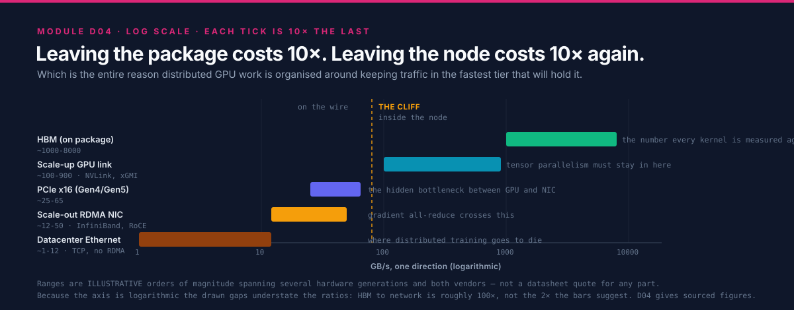
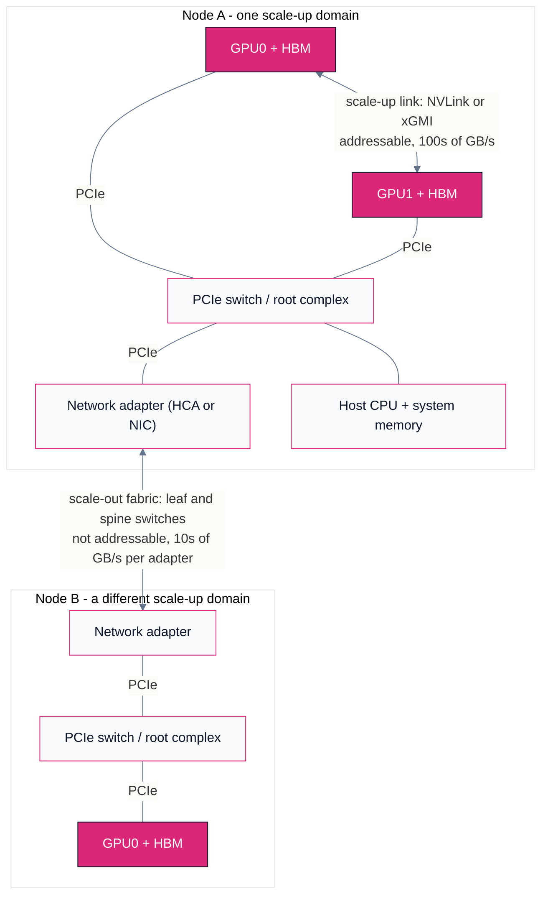
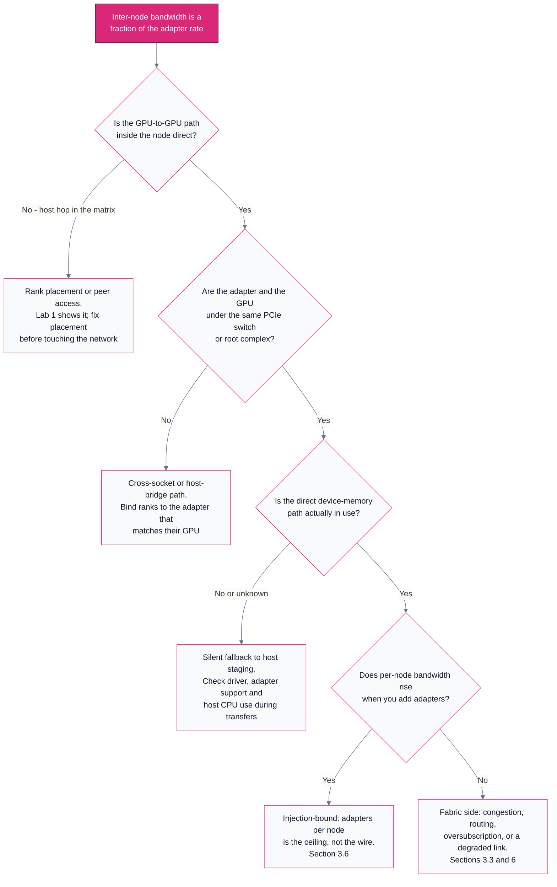

# D04 — The Wire: RDMA, NVLink, xGMI & InfiniBand

> Track D · Module 04 · Status: **DONE** · Est. 6 hours · Depth 3/5
>
> Prerequisites: [D03](../D03.gpu-collectives-nccl-and-rccl/README.md) for what a collective needs
> from the fabric, and [B01](../../B-gpu-ml-performance/B01.accelerator-architecture/README.md) whose
> section 3.5 measures the intra-node links this module extends across the network.
>
> **Backends: topology introspection labs run on any multi-GPU node.** Fabric figures are public
> vendor specifications with retrieval dates, or clearly-labelled illustrative orders of magnitude.
> The RDMA labs need an RDMA-capable fabric and will say so rather than pretend; where you do not
> have one, the analytic tools in [`tools/`](tools/) stand in and label their output as a model.
> Setup: [SETUP.md](../../../docs/SETUP.md) ·
> Terms: [GLOSSARY.md](../../../docs/GLOSSARY.md) · Sources: [REFERENCES.md](../../../docs/REFERENCES.md).

---

## 1. TL;DR + Layman analogy

**TL;DR.** Every byte your distributed job moves travels in one of a handful of **tiers**, and the
tiers are separated by roughly an order of magnitude each: on-package memory, then the scale-up links
that join GPUs inside a node, then PCIe, then the scale-out network between nodes, then storage. That
ladder is the whole subject. It explains why tensor parallelism is confined to one node, why a
gradient all-reduce is a network problem and an activation all-reduce is not, and why the single most
valuable optimization in distributed computing is not making a tier faster but **keeping traffic in
the fastest tier that can hold it**.

Layered on top of the ladder is one mechanism that decides how much of a tier's advertised bandwidth
you actually get: [RDMA](../../../docs/GLOSSARY.md#rdma-and-gpudirect). RDMA lets a network adapter
read and write a remote machine's memory directly, with the remote CPU uninvolved and no intermediate
copies. Extended to GPU memory — GPUDirect RDMA on NVIDIA, and the equivalent peer-to-peer DMA path
on ROCm — it means a gradient can leave one GPU's HBM and arrive in another's without ever being
staged in host RAM. The staged alternative is not slightly worse; it crosses PCIe twice per side,
burns host memory bandwidth and a CPU core doing work with no semantic content, and adds two
store-and-forward hops of latency in each direction.

**Layman analogy — the office building and the courier.**

Think of a large firm spread across several buildings.

- **Same desk cluster.** Two people at adjacent desks hand documents to each other directly. No
  packaging, no addressing, no waiting. This is a thread reading its own registers or the shared
  memory in its own compute unit, and it is so fast it barely registers as movement at all.
- **Same floor.** You walk a folder ten metres to a colleague. Still trivial. This is HBM: your own
  GPU's memory, on the same package.
- **Another floor, same building.** There is a **pneumatic tube** between floors. It is fast and
  purpose-built, and you can send a lot through it, but you have to load a canister, and the tube is
  shared with everyone else on your floor. This is the scale-up link — NVLink or xGMI — between GPUs
  in one node.
- **Another building.** Now you need a **courier**. There is a loading dock, a van, traffic, another
  loading dock. It works, it is reliable, and it is one to two orders of magnitude slower per document
  than the tube. This is the scale-out network.
- **The off-site records warehouse.** Slower again, and you plan around it rather than reacting to it.
  This is storage.

Two predictions follow, and both are load-bearing for the rest of the module.

**The cliff is multiplicative, not additive.** Each step down is not "a bit slower"; it is a factor.
So a design decision that moves a hot data flow from the tube to the courier does not cost you 20%,
it costs you most of your machine. This is why "which tier does this traffic live in" is a more
consequential question than any amount of kernel tuning, and why the answer is usually decided by
where you *placed* the work, not by how you wrote it.

**Staging through an intermediary costs more than it looks like it should.** Suppose the courier is
not allowed into your building. Instead you hand every document to a **receptionist** in the lobby,
who photocopies it into a standard envelope, files a record, and hands it to the courier; and on the
far side another receptionist opens the envelope, re-files the contents into the recipient's cabinet,
and only then tells them it arrived. Notice what that costs. The document crosses the lobby twice on
each side rather than once. Both receptionists are fully occupied doing clerical work that adds
nothing to the document. And the recipient learns about it later than they had to. Now let the courier
walk straight to the recipient's filing cabinet, with a key that was cut in advance, and put the pages
directly into the correct drawer without waking anybody. That is **RDMA**, and "zero-copy" means
precisely this: no intermediate buffer, no receptionist, no photocopy. The wire time did not change at
all — what disappeared is everything that was not wire time.

**Where the analogy breaks**, in four places that all matter later:

1. **The tiers differ in kind, not only in speed.** A peer GPU's memory in the scale-up domain is
   *addressable*: a kernel can issue an ordinary load or store against it, the same instruction it
   would use for its own HBM. Nothing across the network is addressable in that sense. Crossing it
   always means posting a descriptor to a queue and waiting for a completion — an I/O operation, not
   an instruction. There is no analogy for that in a building; it is closer to the difference between
   reaching for a folder and filing a request.
2. **The courier cannot go anywhere they like.** RDMA into a remote process's memory only works on
   regions that were **registered** in advance, pinned so the operating system cannot move them, and
   whose keys were exchanged. The key is cut per drawer, and cutting keys is expensive — which is why
   real systems cache registrations aggressively and reuse buffers rather than allocating fresh ones.
3. **There is a limit on how fast you can hand things to the courier**, independent of how fast the
   van drives. A node's network adapters set an **injection rate**. Eight GPUs sharing one adapter
   share one loading dock, and a wider motorway does not help. This is LogP's gap parameter from
   [D01 §3.2](../D01.scaling-limits-and-communication-cost/README.md#3-deep-dive), and section 3.6
   makes it quantitative.
4. **The roads are shared and they push back.** One congested intersection in a lossless network can
   propagate backwards and stall traffic that was never going anywhere near it. That failure mode —
   congestion spreading — has no counterpart in a courier network and is the single hardest thing
   about running RDMA over Ethernet. Section 3.3 explains the mechanism.

**By the end of this module you can** read a topology matrix on either vendor and say, for any pair of
GPUs, whether they have a direct link or a host hop; explain what a copy actually costs when it stages
through host memory and what GPUDirect removes; describe the RDMA data path in terms of queue pairs,
registrations and completions; name the specific mistake that makes lossless Ethernet worse than lossy
Ethernet; and compute the injection ceiling of a node before you buy it.

---

## 2. First Principles

### 2.1 The bandwidth tier ladder



Every performance argument in distributed GPU computing is a statement about this ladder. The figures
below are **illustrative orders of magnitude**, not a datasheet quote for any specific part. They are
deliberately imprecise, because the point is the *ratio between rows* — which is stable across
generations — and not any row's value, which is not. They extend
[D01 §3.1](../D01.scaling-limits-and-communication-cost/README.md#3-deep-dive)'s table downward into
memory and upward into storage. Verified per-part numbers for the two middle rows, with sources and
retrieval dates, are in
[B01 §3.5](../../B-gpu-ml-performance/B01.accelerator-architecture/README.md#3-deep-dive); this module
does not reprint them.

| Tier | Where it physically is | Bandwidth, order of | Latency, order of | How software reaches it |
|---|---|---:|---:|---|
| Register file, shared memory / LDS | inside the compute unit | 10s of TB/s | ~ns | an instruction |
| Last-level or Infinity Cache | on package | ~TB/s | 10s of ns | implicit, on a miss |
| HBM | on package | ~TB/s | 100s of ns | load and store |
| Scale-up GPU-GPU link | inside one node | 100s of GB/s | ~1-2 us for a small transfer | load and store, or a DMA copy |
| PCIe, GPU to host or to NIC | inside one node | 10s of GB/s | ~1-2 us | DMA |
| Scale-out RDMA fabric, per adapter | between nodes | 10s of GB/s | ~2-5 us | DMA, posted through verbs |
| Datacenter Ethernet over TCP | between nodes | ~GB/s | 10s-100s of us | kernel sockets |
| Networked or parallel storage, per client | rack and beyond | 100s of MB/s to GB/s | 100s of us to ms | filesystem calls |

Read the table as a staircase with roughly a decade per step, and note two structural facts that the
bandwidth column alone hides.

**The latency column falls apart faster than the bandwidth column.** From HBM to the network,
bandwidth drops by about two orders of magnitude but latency rises by about *four*. That asymmetry is
why small messages are so much worse across the network than a bandwidth ratio suggests, and it is the
mechanical reason [D01](../D01.scaling-limits-and-communication-cost/README.md)'s crossover point `m*`
moves the way it does.

**Addressability stops partway down.** Everything at or above the scale-up row can be reached with a
load or a store. Everything below it requires an explicit transfer, posted somewhere, completed later.
That boundary — not a bandwidth number — is the real reason tensor parallelism and data parallelism
have such different fabric requirements, and section 3.1 makes it the organizing distinction of the
module.

### 2.2 The one organizing rule

If a tier moves `B` bytes per second and your working traffic is `m` bytes, that traffic costs `m/B`
seconds in whichever tier it lands. Nothing about that is subtle. What makes it the central rule of
distributed computing is that `B` varies by four orders of magnitude across the ladder while `m` is
usually fixed by the algorithm:

```
cost of a data flow = m / B(tier it was placed in)
```

So **the tier assignment dominates every other decision about that flow.** Moving a flow one step
down the ladder costs you roughly a factor of ten; no amount of kernel optimization recovers a factor
of ten. Hence the rule, which is worth stating in the imperative because every later section is an
application of it:

> [!IMPORTANT]
> **Keep each flow in the fastest tier that can hold it, and make the flows that must cross a tier
> boundary as few and as large as possible.**
>
> This one sentence generates: keep tensor parallelism inside the scale-up domain; bucket gradients
> before crossing the network; shard so that what must be all-reduced is small; put the KV cache in
> HBM and not across PCIe; and overlap what you cannot avoid. Every one of those is the same rule
> applied to a different flow.

The corollary is the diagnostic habit. When something is slower than expected, the first question is
never "how do I make this faster" — it is **"which tier is this actually running in, and did I think
it was running in a faster one?"** Most large distributed-performance surprises are a flow that
quietly fell one tier down the ladder: peer access not enabled, GPUDirect not on the fast path, a NIC
on the wrong PCIe root, a rank placed on the wrong GPU.

### 2.3 What a copy costs when it is staged through the host

Now derive the concrete case. A rank on node A wants `m` bytes of GPU memory to arrive in a GPU on
node B. Compare two paths segment by segment.

**Staged through host memory** — the path you get if nothing has been arranged:

| Step | What moves | Resource consumed |
|---|---|---|
| 1 | GPU HBM to host buffer | PCIe (GPU to host), host memory write bandwidth |
| 2 | host buffer to a *pinned, registered* buffer, if step 1 did not land in one | host memory read plus write, and a CPU core |
| 3 | pinned buffer to the network adapter | PCIe again (host to NIC), host memory read bandwidth |
| 4 | the wire | the fabric |
| 5 | adapter to a pinned host buffer on node B | PCIe, host memory write |
| 6 | pinned buffer to GPU HBM | PCIe again, host memory read |

**Direct, with GPUDirect RDMA or the equivalent peer-to-peer DMA path:**

| Step | What moves | Resource consumed |
|---|---|---|
| 1 | the adapter reads GPU HBM directly, through the GPU's PCIe BAR | PCIe (GPU to NIC), once |
| 2 | the wire | the fabric |
| 3 | the remote adapter writes the destination GPU's HBM directly | PCIe, once |

Count the differences rather than guessing at a speedup:

- **PCIe traversals: four versus two.** The staged path crosses the local PCIe complex twice on each
  side. Whether that costs you wall time depends on whether PCIe is comfortably wider than the wire.
  When it is, the penalty is modest. When it is not — a narrow slot, a link trained down, or several
  GPUs sharing one switch uplink — the staged path is *directly* half throughput, because you doubled
  demand on the narrowest link in the path. Section 3.7 is about how often this is the case.
- **Host memory traffic: roughly `4m` versus zero.** The staged path pushes four times the message
  size through the host memory system, and that bandwidth is not free — it is shared with your data
  loader, your tokenizer, and every other rank on the node.
- **Latency: two extra store-and-forward hops per side.** Each staging step must complete before the
  next begins for a given chunk. Pipelining into chunks hides most of this for large messages and
  almost none of it for small ones, which is why the staged path degrades hardest exactly where the
  latency term already dominates.
- **A CPU core, and synchronization.** Someone has to issue the copies and know when they finished.
  That is host work interleaved with the compute stream, and it is the mechanism behind the "GPU
  utilization drops during communication" symptom.

Round invented numbers, purely to see the shape and not a measurement of anything: take a PCIe path
that sustains 20 GB/s and a network path that sustains 10 GB/s, with `m = 1 GB`. Serially, the staged
path is `0.05 + 0.05 + 0.10 + 0.05 + 0.05 = 0.30 s` and the direct path is `0.05 + 0.10 + 0.05 =
0.20 s`. Perfectly pipelined, both are bounded by their busiest resource and the gap narrows sharply.
The honest conclusion is therefore *not* "staging is always 1.5x slower" — it is:

> Staging costs bandwidth only when PCIe is the narrow link, but it always costs latency, host memory
> bandwidth, and CPU time. Which of those hurts depends on your message size distribution, and that is
> a thing you can measure.

That nuance matters, because the confident claim "GPUDirect gives you 2x" is usually wrong, while the
claim "GPUDirect removes a class of interference and a chunk of fixed latency, and protects you when
PCIe is tight" is defensible. Section 4's lab measures your own case; the tool in
[`tools/staging_cost.py`](tools/staging_cost.py) prints both the serial and the pipelined bound and
labels itself a model.

---

## 3. Deep Dive

### 3.1 Scale-up and scale-out: the distinction everything hangs on

The single most useful way to organize interconnect knowledge is not by vendor and not by generation.
It is by which of two jobs the link is doing.



*The two GPUs in node A can reach each other's memory with a load or a store. Reaching GPU0 of node B
requires leaving the addressable world: a descriptor posted to the adapter, a DMA, a wire, another
DMA, a completion. That change of kind, not the change in bandwidth, is why the two halves of this
diagram need entirely different software.*

| | Scale-up | Scale-out |
|---|---|---|
| Joins | GPUs within a node or a tightly-coupled group | nodes to each other |
| Examples | NVIDIA NVLink and NVSwitch; AMD xGMI, part of the Infinity Fabric family | InfiniBand, RoCEv2, AWS EFA, HPE Slingshot |
| Access model | peer memory is addressable; load, store, or DMA | DMA only, posted through a queue |
| Coherence | coherent or near-coherent within the domain | none |
| Bandwidth per GPU | 100s of GB/s (order of) | 10s of GB/s per adapter (order of) |
| Latency for a small transfer | ~1-2 us (order of) | ~2-5 us (order of) |
| Scales to | a node, or a small number of tightly-coupled nodes | thousands of nodes |
| What must stay inside | tensor parallelism; any collective on the token critical path | nothing has to; everything can |

The terms are in the glossary as
[NVLink, xGMI and Infinity Fabric](../../../docs/GLOSSARY.md#nvlink-xgmi-and-infinity-fabric) and
[InfiniBand, RoCE and Slingshot](../../../docs/GLOSSARY.md#infiniband-roce-and-slingshot). Keeping
them straight is worth the effort, because almost every confused fabric conversation is two people
talking about different halves of that table.

### 3.2 The scale-up domain, and why tensor parallelism lives in it

[B01 §3.5](../../B-gpu-ml-performance/B01.accelerator-architecture/README.md#3-deep-dive) covers the
scale-up tier in measured detail — per-link rates, links per GPU, aggregate peer-to-peer bandwidth,
and the structural difference between AMD's direct full mesh and NVIDIA's switched NVSwitch fabric,
each with a source and a retrieval date. Read it rather than a summary; this module does not restate
those numbers and deliberately does not paraphrase them, because a paraphrased specification is how
folklore starts.

What this module adds is the *consequence* for the network, which is threefold.

**The scale-up domain is a boundary, and boundaries are where designs are decided.** Inside it, an
all-reduce runs at hundreds of GB/s over addressable links. One step outside, the same all-reduce runs
at tens of GB/s per adapter over a fabric that is not addressable. The ratio is roughly an order of
magnitude, and it lands entirely on whichever parallelism axis you chose to place across the boundary.
Since tensor parallelism issues a collective **twice per transformer layer** with a small payload, and
during autoregressive decode those collectives are on the critical path of every token, tensor
parallelism is the axis that cannot cross. Data parallelism, whose collective is large and once per
step and overlappable with the backward pass, is the axis that can.
[B07](../../B-gpu-ml-performance/B07.distributed-training-and-sharding/README.md) owns the sharding
decision; this section supplies the physical reason it comes out the way it does.

**Coherence is a spectrum, and it matters for programming model rather than for bandwidth.** Some
members of these link families extend hardware cache coherence across the link, up to full CPU-GPU
coherence in an APU package — [B01 §3.6](../../B-gpu-ml-performance/B01.accelerator-architecture/README.md#3-deep-dive)
covers the MI300A case, where host and device share one address space. The practical consequence is
that in a coherent scale-up domain, "communication" can be a load; across scale-out it is always an
operation. Never assume a specific coherence guarantee from a marketing name; check the architecture
document for the part you have.

**Topology within the domain is not uniform, and the shape changes what a collective should do.** A
direct mesh gives a *pair* one link's worth of bandwidth and its aggregate only when every GPU is
participating; a switched fabric lets a pair use a GPU's whole link budget. This is why the same
collective on the same rank count can behave differently on the two vendors, and why
[D03 §3.6](../D03.gpu-collectives-nccl-and-rccl/README.md#3-deep-dive)'s topology detection exists.
Lab 1 makes your own node's shape visible.

### 3.3 The scale-out fabrics, and what is actually public about them

Four families are worth knowing by mechanism. Where this curriculum has an anchored source, it is
cited; where it does not, the text says so instead of asserting.

**InfiniBand.** The traditional HPC choice, and the reference implementation of the ideas the others
borrow. Three properties define it:

- **Verbs as the programming interface.** Applications post work requests to queues rather than
  calling `send()`. Section 3.4 covers the mechanics; the important point here is that the interface
  is *asynchronous and descriptor-based by design*, not as an optimization.
- **A lossless link layer via credit-based flow control.** A sender may only transmit when it holds
  credits proving the receiver has buffer space. Packets are therefore not dropped for congestion at
  all, which is what lets the transport layer be simple and the latency low. This is a genuinely
  different design point from Ethernet, which historically drops and retransmits.
- **Reliable Connection and Unreliable Datagram transports.** RC gives a reliable, ordered,
  connection-oriented channel that supports one-sided RDMA READ and WRITE — and requires **per-peer
  connection state**. UD is connectionless, carries no RDMA operations, and needs far less state. The
  scaling consequence is important and often missed: a job where every rank keeps an RC queue pair to
  every other rank holds `O(N^2)` connections in aggregate, and the per-rank state grows with `N`.
  This is one of the real reasons very large jobs prefer hierarchical communication patterns and
  transports designed to avoid per-peer state.

**RoCEv2 — the same verbs over Ethernet.** RoCEv2 encapsulates InfiniBand transport in UDP over IP,
so the application-facing verbs are unchanged and the fabric is standard Ethernet switching. That is
an enormous operational advantage and it comes with one large catch: the verbs assume a nearly
lossless link layer, and Ethernet does not provide one by default. So RoCE deployments configure
**Priority Flow Control** (PFC), which lets a congested port pause its upstream neighbour, plus
**ECN**-based end-to-end congestion control so senders slow down before pausing becomes necessary.

The failure mode is worth understanding in detail, because it is the most common way an expensive
network underperforms a cheap one:

> **Congestion spreading.** PFC operates hop by hop. A hot receiver pauses the switch port feeding it;
> that switch's buffers fill; it pauses *its* upstream; and the pause propagates backwards through the
> fabric. The traffic that gets stalled includes flows that were never going anywhere near the
> congested destination — they are simply queued behind a paused flow on a shared port. That is
> **head-of-line blocking**, and its effect is that one badly-behaved destination degrades unrelated
> jobs. In the worst case a cyclic buffer dependency produces a PFC deadlock, where a region of the
> fabric stops entirely.

The tuning principle that follows is simple to state and hard to execute: **ECN must fire before PFC
does.** ECN marking thresholds should be low enough that senders back off while buffers are still
draining, leaving PFC as a last-resort safety net rather than the primary mechanism. Getting those
thresholds right is fabric-specific, traffic-specific and genuinely difficult, which is why RoCE is
described as fragile in section 6 despite being technically capable of matching InfiniBand.

**AWS EFA with SRD.** The cloud instance of the same problem, solved differently. The Elastic Fabric
Adapter exposes an RDMA-style interface over AWS's network, and its Scalable Reliable Datagram
transport is designed around **spraying packets across many paths** and providing reliability in the
adapter, while explicitly *not* guaranteeing ordering. That trade is deliberate: multipath spraying
avoids the hot spots that single-path routing creates, and dropping the ordering guarantee avoids both
the head-of-line blocking of an ordered stream and the per-peer connection state of RC. The cost is
that the layer above must tolerate reordering, which is why applications reach it through libfabric
and a collectives plugin rather than raw verbs. **This curriculum carries no anchored source for EFA
or SRD**, so treat this paragraph as orientation and verify against AWS's current documentation before
designing against it.

**HPE Slingshot.** Ethernet-compatible at the edge, with a
[dragonfly](../../../docs/REFERENCES.md#dragonfly-topology-kim-et-al-2008) topology, adaptive routing
and fine-grained congestion control inside. It is the fabric under several of the largest public
systems, and unusually for a production interconnect there is an independent measurement study:
[De Sensi et al.](../../../docs/REFERENCES.md#slingshot-interconnect-analysis-de-sensi-et-al-2020)
analyze it in depth including its congestion behaviour, which makes it the best available public
worked example of "what does congestion control actually buy". Three design choices are worth carrying
forward: **Ethernet compatibility** so standard NICs and storage can attach, **adaptive routing** so a
packet can be steered away from a congested global channel rather than queueing behind it, and
**congestion control aware of individual flows** rather than only of link occupancy. The topology
itself is [D05](../D05.topology-and-scale-boundaries/README.md)'s subject; the reason it needs
adaptive routing — a minimally-routed dragonfly packet crosses at most one global channel, so a hot
global channel is unavoidable without non-minimal paths — is
[Kim et al.](../../../docs/REFERENCES.md#dragonfly-topology-kim-et-al-2008)'s, and the alternative
shape, the [fat-tree](../../../docs/REFERENCES.md#fat-trees-leiserson-1985), is what most AI clusters
build instead.

| Family | Link layer | Transport model | Distinguishing mechanism | Main operational risk |
|---|---|---|---|---|
| InfiniBand | lossless, credit-based | RC and UD verbs | simple transport because the link does not drop | per-peer RC state at very large `N` |
| RoCEv2 | Ethernet, made near-lossless with PFC | same verbs over UDP/IP | reuses commodity Ethernet switching | congestion spreading and PFC misconfiguration |
| EFA with SRD | Ethernet-based, multipath | reliable but unordered datagrams | packet spraying, no ordering guarantee | upper layer must handle reordering |
| Slingshot | Ethernet-compatible | Ethernet plus fabric-internal control | adaptive routing and flow-aware congestion control | dragonfly needs its routing to work correctly |

### 3.4 RDMA mechanics: queues, registrations, and what zero-copy means

RDMA's data path has four objects and one habit of mind. The habit of mind is that **nothing is a
function call that returns when the work is done**; everything is a descriptor you post and a
completion you later observe.


**Queue pairs.** A QP is a send queue plus a receive queue, and it is the RDMA analogue of a socket.
On a reliable connected transport it is bound to exactly one remote QP, which is where the per-peer
state cost in section 3.3 comes from.

**Work requests and completion queues.** You post a **work request** describing an operation — an
opcode, a scatter-gather list of local buffers, and for one-sided operations a remote address and key.
The adapter executes it asynchronously and posts a **completion** to a completion queue. Your code
either polls that queue (lowest latency, burns a core) or waits on an event (higher latency, frees the
core). This split is not an implementation detail; it is the latency-versus-efficiency knob that every
RDMA-based library exposes in some form.

**Memory registration, and why it is expensive.** Before the adapter can touch a buffer it must be
**registered**: the pages are pinned so the kernel cannot move or swap them, the physical translations
are programmed into the adapter, and a pair of keys is produced — a local key for your own operations
and a remote key that you hand to a peer to authorize its access. Registration is a kernel operation
that walks and pins pages, so its cost scales with the size of the region and it is orders of
magnitude more expensive than the transfer it enables. Three consequences follow, and all three show
up in real systems:

- **Registration is cached, not repeated.** Every serious RDMA-based library keeps a registration
  cache keyed by address range, so a hot buffer is registered once and reused for the life of the job.
  This is why the first collective in a run is dramatically slower than the steady state, and why
  warm-up iterations must sit outside a timed window — the point
  [D03 §4](../D03.gpu-collectives-nccl-and-rccl/README.md#4-hands-on-labs) makes about its sweep.
- **Pinned memory is a global resource.** Pinned pages cannot be reclaimed under pressure, so a
  process that registers aggressively reduces what the kernel can do for everybody else on the node.
  Registration caches must therefore have eviction policies, and those policies have to interact
  correctly with an allocator that may hand the same virtual address to a different buffer later.
- **Buffer churn is the anti-pattern.** Allocating a fresh communication buffer per iteration
  converts a cached registration into a fresh one every time. The fix is a persistent buffer pool, and
  it is one of the highest-yield changes available in a hand-written RDMA application.

**One-sided versus two-sided.** A **two-sided** operation (`SEND` matched by a pre-posted `RECV`)
requires the receiver to participate: it must have posted a receive buffer, and it learns about the
arrival through its own completion queue. A **one-sided** operation (`RDMA WRITE`, `RDMA READ`) names
the remote address directly and completes without the remote CPU doing anything at all — the remote
side is not notified unless you arrange notification separately, for instance with a write to a flag
after the payload, or a `WRITE_WITH_IMM`. One-sided operations are what make RDMA qualitatively
different from fast messaging, and they are also where the hard bugs live, because you have taken
responsibility for ordering and for telling the peer that its memory changed.

**Kernel bypass.** After setup, the data path does not enter the kernel. The doorbell is a write to a
memory-mapped adapter register, and completions are read from a buffer the adapter writes. This is
what removes tens of microseconds of system-call and protocol-stack cost from every message, and it is
the other half of why RDMA latency is measured in single-digit microseconds.

**So what does "zero-copy" actually mean?** Precisely this: **no CPU-executed copy between the
application's buffer and the wire.** The adapter's DMA engine reads the bytes from the buffer your
application already had, and on the far side writes them into the buffer the peer already had. It does
*not* mean no data movement — the bytes still cross PCIe and the wire, and those traversals are the
irreducible cost. It also does not mean free: registration was the price, paid earlier. A useful way
to say it in review is that zero-copy removes the copies that carry no information, and leaves exactly
the ones that do.

### 3.5 GPUDirect RDMA and peer-to-peer DMA: taking the host off the path

Everything in 3.4 describes an adapter reading host memory. The extension that matters for GPUs is an
adapter reading and writing **device** memory directly.

The mechanism is peer-to-peer DMA over PCIe. The GPU exposes a region of its device memory through a
PCIe **base address register** (BAR), which makes that memory addressable to other PCIe devices. The
network adapter, which is also a PCIe device, can then DMA to and from those addresses. Combined with
registration of the device buffer, the result is a path from one GPU's HBM to a remote GPU's HBM with
no host buffer anywhere in it. NVIDIA documents this as
[GPUDirect RDMA](../../../docs/REFERENCES.md#gpudirect-rdma-nvidia); ROCm exposes an equivalent
peer-to-peer path, and because the supported combinations of kernel, driver and adapter change between
releases, the authoritative statement of what works on your stack is the
[ROCm documentation portal](../../../docs/REFERENCES.md#rocm-documentation-portal-amd) for the version
you have installed rather than any summary here.

Two practical facts do the most damage when they are not known.

**The fast path has a topology requirement.** Peer-to-peer DMA between an adapter and a GPU works best
— and on some platforms only works at all — when the two devices sit **under the same PCIe switch or
at least the same root complex**. A transfer that has to traverse the inter-socket link between two
root complexes, or be routed by the host bridge, is a different and slower path. This is why cluster
node designs pair each adapter with specific GPUs on a shared switch, and why
[AMD's cluster design reference](../../../docs/REFERENCES.md#amd-instinct-cluster-design-reference-amd)
is a document about *topology* as much as about bandwidth.

**A mismatch usually degrades silently.** This is the part worth internalizing. If the fast path is
unavailable, the software stack will very often fall back to staging through host memory and **still
work correctly**. There is no error, no warning in the common case, and no incorrect result — only a
number that is two to five times worse than you expected, on a system you have already paid for. The
same is true one level up: a peer-to-peer GPU-to-GPU copy on a pair with no direct link falls back to
a host-staged copy and returns success. Silent correctness with quiet degradation is the defining
hazard of this layer, and it is the reason section 4 spends its first lab on making the topology
visible and its second on measuring a pair rather than assuming it.



### 3.6 Injection bandwidth: why one adapter for eight GPUs is a ceiling

[D01 §3.2](../D01.scaling-limits-and-communication-cost/README.md#3-deep-dive) introduced LogP's gap
parameter `g` — the minimum interval between consecutive message injections, whose reciprocal is the
injection rate. The parameter looks abstract in the model and is completely concrete in a node:
**injection rate is a property of the node's network adapters, not of its GPUs.**

Write it out. With `n_nic` adapters each sustaining `B_nic` bytes per second, and `n_gpu` GPUs sharing
them:

```
node injection bandwidth   = n_nic * B_nic
per-GPU share              = n_nic * B_nic / n_gpu
```

Now compare that per-GPU share against the scale-up link bandwidth from the ladder in section 2.1. A
node with eight GPUs and **one** adapter gives each GPU one eighth of one adapter — roughly two orders
of magnitude below what the same GPU sees to its in-node neighbours. That is the cliff, and it is why:

- **Adding GPUs to a node does not add network bandwidth.** Demand scales with GPU count; supply does
  not. Efficiency per GPU falls with every GPU you add, which is the opposite of the intuition that
  denser nodes are better.
- **`busbw` measured within a node tells you nothing about multi-node `busbw`.** The intra-node number
  is bounded by scale-up links; the multi-node number is bounded by injection. A healthy single-node
  sweep followed by disappointing multi-node numbers is not a mystery, it is arithmetic — the case
  [D03 §6.4](../D03.gpu-collectives-nccl-and-rccl/README.md#6-challenges-drawbacks--tradeoffs) hands
  to this module.
- **One adapter per GPU is the design that makes injection scale**, and wiring the *n*-th GPU of every
  node onto the same switch makes a collective step stay within one
  [rail](../../../docs/GLOSSARY.md#rail-optimized-network) instead of contending for a shared uplink.
  That is the [rail-optimized](../../../docs/GLOSSARY.md#rail-optimized-network) design, and
  [D05](../D05.topology-and-scale-boundaries/README.md) derives it properly.

[`tools/injection_model.py`](tools/injection_model.py) computes the ceiling and the per-GPU share for
a configuration you describe, and prints the ratio against a scale-up bandwidth you supply, so you can
see the cliff for the node you are actually considering. It is a model and says so.

The reason this deserves its own section rather than a footnote is that injection is the most common
place where a purchasing decision and a performance decision collide. Adapters cost money and switch
ports; the temptation to fit fewer is real; and the resulting ceiling is invisible in every
single-node benchmark anyone will run during evaluation.

### 3.7 PCIe: the hidden bottleneck in the middle

Both fast tiers in this module talk to each other through PCIe, and PCIe is where the surprises are.
The GPU-to-adapter hop is PCIe. The GPU-to-host hop is PCIe. In the staged path from section 2.3, PCIe
is traversed twice per side. So even a design with a superb scale-up fabric and a superb network can
be limited by the link in between, and that link is the one nobody puts on a slide.

Five specific things go wrong, all of them checkable in minutes:

- **Fewer lanes than expected.** A device in a physically-x16 slot may be electrically narrower, or
  the platform may have bifurcated the lanes. Half the lanes is half the bandwidth.
- **A link trained to a lower generation.** Signal integrity problems, a riser, or a cable can cause a
  link to negotiate a slower rate than both ends support. It works perfectly and it is slow.
- **A shared switch uplink.** Several GPUs and an adapter under one switch may share an uplink whose
  bandwidth is less than the sum of theirs. Contention then depends on which devices are busy
  simultaneously — so the same code is fast alone and slow under load.
- **The wrong root complex.** An adapter attached to socket 0 serving a GPU attached to socket 1 sends
  every byte across the inter-socket link, and pays for a host-bridge or cross-socket traversal that
  the topology matrix will show you if you look.
- **NUMA affinity ignored.** Host staging buffers allocated on the far NUMA node add a cross-socket
  memory traversal to every transfer, and the process's CPU threads may be scheduled on the wrong
  socket entirely. This one is free to fix and routinely left broken.

The practical instruction is to treat PCIe as a first-class part of the fabric rather than as
plumbing. Read the topology matrix (Lab 1), confirm negotiated link width and speed, and place ranks
and buffers with the topology in mind. Every item on that list is a configuration change, not a
purchase, which makes this the highest return-per-hour section of the module.

---

## 4. Hands-On Labs

Labs 1 and 2 run on **any node with at least two GPUs** and produce real, reproducible output. Lab 3
needs an **RDMA-capable fabric** with the userspace verbs tools installed, and will simply not exist
on a laptop or on most cloud instances — that is expected, and the lab says what to do instead. Lab 4
is analytic and runs anywhere with the Python standard library.

```bash
cd tracks/D-distributed-computing/D04.interconnects-and-rdma
make            # builds hip/peer_copy_bw.cpp with hipcc
make cuda       # builds cuda/peer_copy_bw.cu with nvcc
make report     # lab 1's topology capture plus the lab 4 models
```

Vendor command-line tools change flags between releases. Every invocation below is written for the
current tools at the time of writing; if one is rejected, check `--help` rather than assuming the lab
is wrong.

### Lab 1 — Read your node's topology matrix

**Goal:** for every pair of GPUs in your node, be able to say whether they have a direct link or a
host hop — and to say the same for each GPU-to-adapter pair. This is the single most useful skill in
the module, and it takes ten minutes.

```bash
# AMD / ROCm
rocm-smi --showtopo                 # link type, hop count, and NUMA node per pair
rocm-smi --showtopo | tee topo.txt
amd-smi topology                    # newer ROCm; same information, different layout

# NVIDIA / CUDA
nvidia-smi topo -m                  # the pair matrix, including NIC rows and NUMA affinity
nvidia-smi topo -m | tee topo.txt
nvidia-smi topo -p2p r              # peer-to-peer read capability, pair by pair

# normalize either vendor's output into one comparable table
python3 tools/topology_report.py --input topo.txt --vendor auto
```

**What to observe**, in this order:

1. **The legend, before the matrix.** NVIDIA's classes run from `X` (self) and `NV#` (a direct
   scale-up link, with the number of links) down through `PIX`, `PXB`, `PHB`, `NODE` and `SYS` — a
   ladder of increasingly distant PCIe paths, ending with a traversal between sockets. ROCm reports
   link type, hop count and a NUMA distance per pair. **The class, not the number of hops, is what
   tells you which tier of section 2.1 a pair is in.**
2. **Find the pairs with no direct link.** In a full-mesh or fully-switched node there are none. In
   many real machines there are some, and if your tensor-parallel group happens to span such a pair,
   that group's collective runs one tier down for no reason. This is a placement bug and it is free to
   fix.
3. **Read the adapter rows.** For each network adapter, note which GPUs share its PCIe switch. Those
   are the GPUs with a fast path to it; the others do not have one. Compare against which GPU your
   rank actually uses, and against the NUMA column.
4. **Note the NUMA affinity column and believe it.** If your process is pinned to the wrong socket for
   its GPU, every host-staged transfer pays a cross-socket traversal, and section 3.7's list tells you
   what that costs.

Save the output. It is the input to Lab 2's interpretation and to the exercises, and a captured
topology matrix is the single most useful artifact to attach to a performance bug report.

### Lab 2 — Measure a GPU pair, do not assume it

**Goal:** get real bandwidth for one GPU pair, and see for yourself what happens on a pair with no
direct link.

The vendor tools first, because they are the fastest route to a number:

```bash
# AMD: unidirectional and bidirectional copy bandwidth for every device pair
rocm-bandwidth-test

# NVIDIA: from the CUDA samples, builds standalone
./p2pBandwidthLatencyTest
```

Then the minimal program, so that nothing is hidden. Every runtime call is checked, the result is
verified byte for byte, and warm-up sits outside the timed region because the first copy pays path
setup. `hip/peer_copy_bw.cpp`:

```cpp
// Unidirectional peer-to-peer copy bandwidth between two GPUs, verified.
// Build: hipcc -O2 hip/peer_copy_bw.cpp -o peer_copy_bw
// Run:   ./peer_copy_bw [src_dev] [dst_dev] [bytes]
#include <hip/hip_runtime.h>

#include <cstdio>
#include <cstdlib>
#include <vector>

#define HIP_CHECK(cmd)                                                       \
  do {                                                                       \
    hipError_t e_ = (cmd);                                                   \
    if (e_ != hipSuccess) {                                                  \
      std::fprintf(stderr, "HIP %s:%d '%s': %s\n", __FILE__, __LINE__, #cmd, \
                   hipGetErrorString(e_));                                   \
      std::exit(EXIT_FAILURE);                                               \
    }                                                                        \
  } while (0)

int main(int argc, char** argv) {
  const int src_dev = (argc > 1) ? std::atoi(argv[1]) : 1;
  const int dst_dev = (argc > 2) ? std::atoi(argv[2]) : 0;
  const size_t bytes =
      (argc > 3) ? (size_t)std::strtoull(argv[3], nullptr, 10)
                 : ((size_t)256 << 20);
  const int iters = 20;

  int ndev = 0;
  HIP_CHECK(hipGetDeviceCount(&ndev));
  if (ndev < 2 || src_dev < 0 || dst_dev < 0 || src_dev >= ndev ||
      dst_dev >= ndev || src_dev == dst_dev) {
    std::fprintf(stderr, "need two distinct valid device ids; found %d\n", ndev);
    return EXIT_FAILURE;
  }
  if (bytes == 0) {
    std::fprintf(stderr, "byte count must be positive\n");
    return EXIT_FAILURE;
  }

  // The teaching point of this lab: when this is 0, the copy below still
  // succeeds -- it silently stages through host memory (section 3.5).
  int can_access = 0;
  HIP_CHECK(hipDeviceCanAccessPeer(&can_access, dst_dev, src_dev));
  std::printf("device %d reading device %d: %s\n", dst_dev, src_dev,
              can_access ? "direct peer path" : "NO direct path, will stage");

  HIP_CHECK(hipSetDevice(dst_dev));
  if (can_access) {
    hipError_t e = hipDeviceEnablePeerAccess(src_dev, 0);
    if (e != hipSuccess && e != hipErrorPeerAccessAlreadyEnabled) {
      std::fprintf(stderr, "hipDeviceEnablePeerAccess: %s\n",
                   hipGetErrorString(e));
      return EXIT_FAILURE;
    }
    (void)hipGetLastError();  // clear the recorded already-enabled error
  }

  unsigned char* src = nullptr;
  unsigned char* dst = nullptr;
  HIP_CHECK(hipSetDevice(src_dev));
  HIP_CHECK(hipMalloc(&src, bytes));
  HIP_CHECK(hipMemset(src, 0xAB, bytes));
  HIP_CHECK(hipDeviceSynchronize());

  HIP_CHECK(hipSetDevice(dst_dev));
  HIP_CHECK(hipMalloc(&dst, bytes));
  HIP_CHECK(hipMemset(dst, 0x00, bytes));

  hipStream_t stream;
  hipEvent_t t0, t1;
  HIP_CHECK(hipStreamCreate(&stream));
  HIP_CHECK(hipEventCreate(&t0));
  HIP_CHECK(hipEventCreate(&t1));

  for (int i = 0; i < 3; ++i) {  // warm-up: first copy pays path setup
    HIP_CHECK(hipMemcpyPeerAsync(dst, dst_dev, src, src_dev, bytes, stream));
  }
  HIP_CHECK(hipStreamSynchronize(stream));

  HIP_CHECK(hipEventRecord(t0, stream));
  for (int i = 0; i < iters; ++i) {
    HIP_CHECK(hipMemcpyPeerAsync(dst, dst_dev, src, src_dev, bytes, stream));
  }
  HIP_CHECK(hipEventRecord(t1, stream));
  HIP_CHECK(hipStreamSynchronize(stream));

  float ms = 0.0f;
  HIP_CHECK(hipEventElapsedTime(&ms, t0, t1));
  const double secs = (double)ms / 1000.0;
  const double gbs = (double)bytes * (double)iters / secs / 1e9;

  // A fast wrong answer is the worst outcome, so check every byte.
  std::vector<unsigned char> host(bytes);
  HIP_CHECK(hipMemcpy(host.data(), dst, bytes, hipMemcpyDeviceToHost));
  size_t wrong = 0;
  for (size_t i = 0; i < bytes; ++i) {
    if (host[i] != 0xAB) {
      ++wrong;
    }
  }

  std::printf("%zu MiB x %d iters: %.1f GB/s unidirectional, %zu wrong bytes\n",
              (size_t)(bytes >> 20), iters, gbs, wrong);

  HIP_CHECK(hipEventDestroy(t0));
  HIP_CHECK(hipEventDestroy(t1));
  HIP_CHECK(hipStreamDestroy(stream));
  HIP_CHECK(hipFree(dst));
  if (can_access) {
    HIP_CHECK(hipDeviceDisablePeerAccess(src_dev));
  }
  HIP_CHECK(hipSetDevice(src_dev));
  HIP_CHECK(hipFree(src));

  return wrong == 0 ? EXIT_SUCCESS : EXIT_FAILURE;
}
```

The NVIDIA version, `cuda/peer_copy_bw.cu`, is the same file with the mechanical substitution
[D03 §4](../D03.gpu-collectives-nccl-and-rccl/README.md#4-hands-on-labs) tabulates: `hip` becomes
`cuda` throughout, `hipErrorPeerAccessAlreadyEnabled` becomes `cudaErrorPeerAccessAlreadyEnabled`, and
`hipcc` becomes `nvcc`. Nothing about the logic changes.

**What to observe.** Four things:

1. **`0 wrong bytes`, always.** If the verification fails, stop and fix that before looking at a
   bandwidth number.
2. **The reported bandwidth for a pair that Lab 1 said has a direct link**, compared against the link
   rate for your hardware from
   [B01 §3.5](../../B-gpu-ml-performance/B01.accelerator-architecture/README.md#3-deep-dive). Expect a
   fraction of the specified figure, and expect roughly half if you compare a *unidirectional* copy
   against a *bidirectional* specification — the factor-of-two trap B01 warns about.
3. **The same measurement on a pair Lab 1 said has no direct link.** It still prints a number, and the
   number is much lower. That is the silent fallback of section 3.5, reproduced in one command, and it
   is the shape of the bug you will meet in production.
4. **Host CPU utilization during the run**, in another terminal. The direct path barely touches it; a
   staged path does not.

### Lab 3 — RDMA device discovery and a two-node bandwidth test

**Goal:** see the verbs layer as a real thing with real properties, and get one honest inter-node
number.

> [!NOTE]
> This lab requires an RDMA-capable adapter, its kernel modules loaded, and the userspace tools
> (`rdma-core` and `perftest`, packaged under various names). On a machine without RDMA these commands
> do not exist or report no devices. **That is a correct result, not a failed lab.** If it is your
> situation, read the cached transcripts under [`outputs/`](../../../outputs/README.md), then go to
> Lab 4 which models what you cannot measure.

```bash
# What adapters exist, and what do they claim?
ibv_devices                      # list device names
ibv_devinfo -v                   # per-device: ports, state, MTU, rates, capabilities
ibstat                           # link state and physical state per port

# Bandwidth between two hosts. Run the server on one, the client on the other.
# host A:
ib_write_bw -d mlx5_0 --report_gbits
# host B:
ib_write_bw -d mlx5_0 --report_gbits <hostA>

# Latency, which is a different question and a different tool:
ib_write_lat -d mlx5_0 <hostA>

# Error counters -- read these before and after, not only after:
cat /sys/class/infiniband/mlx5_0/ports/1/counters/*
```

If your `perftest` build supports GPU buffers, the same tool can drive the device-memory path directly
(`--use_rocm=<device>` on ROCm builds, `--use_cuda=<device>` on CUDA builds). When it does, run it both
ways: the difference between a host-buffer and a device-buffer transfer on the same pair of hosts is
the most direct measurement of section 3.5 available to you. Check `ib_write_bw --help` first, because
these flags depend on how the package was compiled.

```bash
python3 tools/parse_ib_bw.py --input ib_write_bw.log --report gbits
```

**What to observe:**

1. **Port state must be `Active` and physical state `LinkUp`** before any number means anything. A
   port in `Init` or `Down` is a cabling or subnet-manager problem, not a performance problem.
2. **The negotiated rate and MTU from `ibv_devinfo`**, and whether they are what you were sold. A port
   running below its capable rate is the fabric equivalent of section 3.7's trained-down PCIe link.
3. **The units.** `--report_gbits` reports gigabits per second; the rest of this curriculum works in
   gigabytes per second. The factor is eight, and mixing the two is the most common arithmetic error in
   fabric discussions. `tools/parse_ib_bw.py` prints both and labels them.
4. **The small-message rows versus the large-message rows.** The small end is your `alpha`, the large
   end is your `beta`, and the crossover between them is
   [D01 §3.1](../D01.scaling-limits-and-communication-cost/README.md#3-deep-dive)'s `m*` measured on
   your own fabric rather than assumed.
5. **The error counters, as a delta.** Counters are cumulative since boot, so an absolute value tells
   you almost nothing. A counter that *increments during your run* is a degraded link, and section 6
   explains why that is worse than a link that fails outright.

### Lab 4 — Model what you cannot measure

**Goal:** put numbers on the staged-versus-direct comparison and on the injection ceiling for a node
you are considering, before anybody buys it.

```bash
python3 tools/staging_cost.py --bytes 1073741824 --pcie-gbs 20 --net-gbs 10
python3 tools/injection_model.py --gpus-per-node 8 --nics-per-node 1 \
        --nic-gbs 25 --scaleup-gbs 400
python3 tools/injection_model.py --gpus-per-node 8 --nics-per-node 8 \
        --nic-gbs 25 --scaleup-gbs 400
```

Both tools print a banner marking their output as a **model, not a measurement**, exactly as the rest
of Track D does.

**What to observe.** In `staging_cost.py`, the gap between the serial bound and the pipelined bound —
and that the pipelined bound becomes indistinguishable from the direct path once PCIe is comfortably
wider than the wire. That is section 2.3's honest conclusion, and it should make you suspicious of any
blanket claim that the direct path is `k` times faster. In `injection_model.py`, run the two
invocations back to back and read the per-GPU share and the ratio against the scale-up tier. One
adapter for eight GPUs puts each GPU roughly two orders of magnitude below its in-node bandwidth; eight
adapters restore the ratio to roughly one. Then sweep `--nics-per-node` and note that the curve is
linear with no diminishing returns until it hits `--nic-gbs` times the count, which is precisely why
the rail-optimized design in [D05](../D05.topology-and-scale-boundaries/README.md) exists.

---

## 5. Performance Analysis

> [!NOTE]
> **Single-node topology output and single-node pair bandwidth are real and reproducible** — Labs 1
> and 2 measure them on whatever hardware you have, and sanitized reference transcripts live under
> [`outputs/`](../../../outputs/README.md), labelled with the hardware they came from. Everything in
> this module about **multi-node** behaviour is either a cited public figure or an analytic model that
> announces itself as one. No number here is published that this repository cannot reproduce or
> attribute.

### 5.1 How to read a topology matrix

A topology matrix looks like a table of codes and is actually a map of section 2.1's ladder. Read it in
four passes, in this order, because each pass can make the next unnecessary:

| Pass | What you are looking for | What a bad answer means |
|---|---|---|
| 1. Legend | Which codes mean a direct scale-up link, and which mean a PCIe or host path | You cannot interpret anything until you have this; the codes differ by vendor and by tool version |
| 2. GPU-to-GPU pairs | Whether every pair in each parallelism group has a direct link | A group spanning a host hop runs its collective one tier down. Fix by placement, not by tuning |
| 3. GPU-to-adapter rows | Which GPUs share a PCIe switch with each adapter | A rank using an adapter on a different switch or socket has no fast device-memory path |
| 4. NUMA column | Whether the process's CPU and memory affinity match its GPU | Every host-staged byte pays a cross-socket traversal, and the fix is free |

The habit to build is to capture this matrix **as part of every performance investigation**, alongside
the software versions. Roughly, a distributed performance problem is either a placement problem, an
injection problem or a fabric problem, and pass 2 and pass 3 rule out the first one in under a minute.

### 5.2 How to read a bandwidth-test result

Whether the number came from a peer-copy test, `rocm-bandwidth-test`, `p2pBandwidthLatencyTest`,
`ib_write_bw`, the [OSU micro-benchmarks](../../../docs/REFERENCES.md#osu-micro-benchmarks-ohio-state-university)
or [nccl-tests / rccl-tests](../../../docs/REFERENCES.md#nccl-tests-and-rccl-tests-nvidia-amd), the
same seven questions decide whether it means anything:

1. **Bytes or bits?** Gigabits per second is eight times gigabytes per second. Convert once, at the
   start, and label the unit everywhere.
2. **Unidirectional or bidirectional?** A bidirectional specification compared against a
   unidirectional measurement produces an apparent 50% efficiency that is entirely an accounting
   error. B01 §3.5 flags this as a factor-of-two trap for exactly this reason.
3. **What message size?** A single bandwidth number without its message size is uninterpretable. The
   small end measures `alpha`, the large end measures `beta`, and quoting only one of them hides half
   the fabric's behaviour.
4. **Was it warmed up?** The first transfer pays connection setup and memory registration (section
   3.4). Including it in an average understates steady-state bandwidth; reporting it separately is a
   legitimate and useful measurement of setup cost.
5. **How many outstanding operations?** A single in-flight transfer measures the latency-bandwidth
   product, not the link. Depth is a parameter of the measurement, and a low number at depth one is
   not a broken link.
6. **Which path did it actually take?** This is the question section 3.5 exists for. A number produced
   by a silent host-staged fallback is a correct measurement of the wrong thing.
7. **Was anything else running?** Shared PCIe switches, shared uplinks and other tenants all make
   bandwidth a function of the neighbourhood. A number without its context is not reproducible.

### 5.3 What is measurable here and what is modelled

The boundary is worth restating plainly, because it is the difference between this module and a vendor
deck. **You can measure**: your topology matrix, negotiated PCIe and port rates, peer-to-peer
bandwidth and latency for every GPU pair in your node, the staged-versus-direct difference on your own
machine if your `perftest` build supports device buffers, and error-counter deltas. **You cannot
measure here, and this module therefore models or cites**: anything about a multi-node fabric at scale,
congestion behaviour under load from other tenants, and the effect of topology — for which the honest
sources are the cited studies and the specifications, not an extrapolation. Per-part scale-up figures
with retrieval dates are in
[B01 §3.5](../../B-gpu-ml-performance/B01.accelerator-architecture/README.md#3-deep-dive); the fabric
specifications belong to their vendors and should be quoted with the date you retrieved them, because
they are revised.

### 5.4 Tying it to the roofline

[B02](../../B-gpu-ml-performance/B02.roofline-and-arithmetic-intensity/README.md) classifies a kernel
by arithmetic intensity: FLOPs per byte moved from HBM. This module is the same framework with the
denominator replaced, one tier at a time. A flow's intensity is FLOPs per byte moved *in the tier it
was placed in*, so **moving a flow one tier down the ladder divides its effective intensity by roughly
ten** without changing a line of code. Two consequences follow directly:

- A workload that is comfortably compute-bound within a node can be firmly bandwidth-bound the moment
  the same traffic crosses to the network tier. The roofline did not change; the flow moved to a
  different roofline.
- The three levers the roofline names for a bandwidth-bound kernel are the only three available here
  too: move fewer bytes, move them in a faster tier, or move them at the same time as something else.
  "Buy a faster fabric" is only the second of those, and it is usually the most expensive one.

That is why section 2.2's rule is stated in terms of tier placement rather than in terms of bandwidth
procurement. Placement is the lever with the best ratio of leverage to cost, and it is available
today on hardware you already own.

---

## 6. Challenges, Drawbacks & Tradeoffs

### 6.1 Lossless Ethernet, and the congestion that spreads

RoCEv2's appeal is that it delivers RDMA semantics on commodity Ethernet. Its risk is that those
semantics assume a link layer that does not drop, and making Ethernet behave that way requires
configuring PFC and ECN correctly across every switch in the path. When that configuration is wrong,
the result is not "slightly worse than InfiniBand" — it is a network that is *worse than the lossy
Ethernet it replaced*, for the reason in section 3.3: PFC pauses propagate backwards hop by hop, so
congestion at one destination stalls flows that never touched it, and head-of-line blocking spreads
the damage to unrelated jobs. In the pathological case a cyclic buffer dependency produces a PFC
deadlock and a region of the fabric stops.

Three review questions catch most of it. **Does ECN fire before PFC?** If PFC is doing the primary
work, the design is inverted. **Is the configuration consistent on every hop?** A single switch with
different thresholds is enough to create a hot spot that appears intermittently. **Is anyone watching
pause frames?** Pause counters are the leading indicator of this entire failure class, and they are
usually unmonitored until an incident.

The honest tradeoff is organizational as much as technical: InfiniBand moves this complexity into a
purpose-built fabric with a subnet manager and a smaller configuration surface, at the price of a
separate network to operate and a narrower supplier base. RoCE keeps one network and one operational
model, and asks your network team for tuning that is genuinely difficult. Either can be right; what is
never right is choosing RoCE for its simplicity and then not doing the tuning.

### 6.2 The costs that a bandwidth number does not show

| Concern | Why it bites | What to do about it |
|---|---|---|
| **Memory registration cost** | Registration pins pages and programs the adapter; it is orders of magnitude more expensive than the transfer it enables, so per-iteration buffers turn a cached registration into a fresh one every step | Persistent buffer pools; register hot buffers once; keep warm-up outside timed regions |
| **Pinning pressure** | Pinned pages cannot be reclaimed, so aggressive registration takes memory away from everything else on the node, including other ranks | Bound the registration cache; monitor pinned totals; treat it as a shared resource |
| **Silent GPUDirect fallback** | The staged path is *correct*, so a missing fast path produces no error and no wrong answer — just a number two to five times worse | Verify the path explicitly (Lab 2 and Lab 3); watch host CPU use during transfers; assert the expected bandwidth in a startup check |
| **PCIe topology mistakes** | Lane count, negotiated generation, a shared switch uplink, or an adapter on the wrong root complex each silently divide your bandwidth | Read the topology matrix at deployment; confirm negotiated width and speed; pair adapters with the GPUs on their switch |
| **NUMA affinity** | A process pinned to the far socket adds a cross-socket traversal to every staged byte and to every host buffer | Bind ranks to the NUMA node of their GPU and their adapter; it is a configuration change with no downside |
| **Cable and link flap** | A degraded link that retrains or corrects errors is *worse* than a dead one: the job keeps running and one rank paces everybody, since a collective is a barrier | Monitor error-counter deltas, not absolutes; health-gate before scheduling; drain suspicious links |
| **One-sided operation hazards** | `RDMA WRITE` completes without notifying the peer, so ordering and notification are now your responsibility | Use an explicit flag or an immediate-data variant; never infer arrival from a local completion |
| **Vendor lock-in** | Scale-up fabrics are vendor-specific by construction, and tuning, plugins and operational knowledge do not transfer | Keep the portable layer portable: program collectives through the library API, not the fabric; keep fabric-specific settings in configuration with dates and rationale |
| **Cost** | Adapters, cables, optics and switch ports are a large fraction of cluster capital cost, and one adapter per GPU multiplies all four | Size injection against the actual traffic pattern (section 3.6), and decide it explicitly rather than by default |

### 6.3 When not to reach for the fast path

- **When the traffic is small and rare.** Registration, pinning and topology work have a fixed
  engineering cost. A flow that moves a few megabytes at startup does not justify any of it.
- **When you have not confirmed which tier the traffic is in.** Optimizing a transfer that is already
  in the scale-up domain by making it RDMA-aware is effort spent in the wrong tier.
- **When correctness is not yet established.** One-sided RDMA moves ordering and notification into
  your code. Do not take that on until a working two-sided or library-mediated version exists to
  compare against.
- **When a library already does it.** A collectives library, an MPI implementation or a storage client
  already implements registration caching, path selection and completion handling, and has been
  debugged at scale. Hand-written verbs code is justified by a measured gap, not by principle.

### 6.4 The scale-boundary table for the fabric

The same shape as
[D01 §6.4](../D01.scaling-limits-and-communication-cost/README.md#6-challenges-drawbacks--tradeoffs),
specialized to the wire:

| Regime | Binding constraint | First symptom | Mitigation | Where it is covered |
|---|---|---|---|---|
| 2-8 GPUs, one node | Scale-up topology, and whether peer access is actually in use | A pair in your parallelism group shows a host hop; measured pair bandwidth is a small fraction of the link rate | Place ranks on directly-linked GPUs; verify peer access; keep tensor parallelism inside the domain | This module, 3.2 and Labs 1-2 |
| GPU to adapter, one node | The PCIe path between GPU and adapter | Inter-node bandwidth is a fraction of the adapter rate; host CPU is busy during collectives | Fast device-memory path; adapter and GPU on the same switch; confirm negotiated width and speed | This module, 3.5 and 3.7 |
| 8-64 ranks | Injection: adapters per node, LogP's `g` | Multi-node bandwidth scales with node count but not with GPU count | One adapter per GPU; rail-aware placement; bucket and overlap | This module, 3.6, then [D05](../D05.topology-and-scale-boundaries/README.md) |
| 64-1k ranks | Fabric congestion control and oversubscription | Run-to-run variance; your time depends on other tenants' traffic | ECN before PFC; adaptive routing; [rail-optimized](../../../docs/GLOSSARY.md#rail-optimized-network) design; audit [oversubscription](../../../docs/GLOSSARY.md#oversubscription) | [D05](../D05.topology-and-scale-boundaries/README.md) |
| 1k-10k ranks | Link errors and flaps across a large cable plant | One degraded link paces an entire job, because a collective is a barrier | Error-counter delta monitoring; health-gated scheduling; drain and replace | [D06](../D06.real-systems-at-scale/README.md) |
| 10k+ ranks | Cost and blast radius of the fabric itself; [bisection bandwidth](../../../docs/GLOSSARY.md#bisection-bandwidth) | The network dominates capital cost; a switch failure removes a whole slice; all-to-all patterns collapse | Topology choice; sub-communicators; keep global collectives off the critical path | [D06](../D06.real-systems-at-scale/README.md) |

---

## 7. Real-World Use Cases

**Tensor parallelism confined to the scale-up domain.** This is the most consequential design rule
that follows from the whole module, and it is entirely a fabric argument. Tensor parallelism issues a
[collective](../../../docs/GLOSSARY.md#collective-operation) twice per transformer layer, the payload
is one activation tensor rather than a whole model, and during decode every one of those collectives
is on the critical path of every token. Small, frequent, latency-critical traffic is exactly what the
scale-out tier is worst at — recall from section 2.1 that latency degrades by about four orders of
magnitude across the ladder while bandwidth degrades by two. So tensor parallelism stays inside the
scale-up domain, and the width of that domain becomes a hard limit on how far a single model instance
can shard before another axis has to take over. When you see a serving stack default to tensor
parallelism within a node and pipeline or replication across nodes, this is the reason.

**Gradient all-reduce over the scale-out fabric.** The mirror image, and the traffic the scale-out
tier is genuinely good at. The [all-reduce](../../../docs/GLOSSARY.md#all-reduce) payload is the size
of the model, it happens once per step, and it can be bucketed so that reduction of early layers
overlaps the backward pass of later ones. Large, infrequent, overlappable traffic tolerates a tier
with high latency and adequate bandwidth. The constraint that actually binds is the injection ceiling
from section 3.6 rather than the wire: this is the specific case where a node with eight GPUs and one
adapter shows healthy single-node numbers and disappointing multi-node ones, and where
[D03](../D03.gpu-collectives-nccl-and-rccl/README.md)'s `busbw` plateau turns out to be a property of
the adapter count rather than of the collective.

**Storage and checkpoint traffic competing with collective traffic.** Easy to forget, because it lives
in a different part of the org chart. A checkpoint write, a dataset read and a container image pull all
traverse the same PCIe complex and often the same fabric as your collectives, and they are bursty.
Writing a large checkpoint synchronously in the middle of a step therefore does not merely add its own
time; it steals bandwidth from the collective on the critical path, and the visible symptom is a step
that is intermittently slow with no change in the model code. The mitigations are all forms of section
2.2's rule: make checkpoints asynchronous, stage them to local storage first, keep storage traffic on
a different rail or adapter where the topology allows, and schedule bulk transfers away from collective
phases. The failure-driven reason large systems checkpoint asynchronously belongs to
[D06](../D06.real-systems-at-scale/README.md); the bandwidth-contention reason belongs here.

**Disaggregated inference.** A newer pattern that is fabric-limited by construction: run the
prefill phase on one pool of GPUs and the decode phase on another, because the two have very different
arithmetic intensity and very different latency requirements. That split only works if the KV cache
produced by prefill can reach the decode workers fast enough not to erase the benefit, which makes the
transfer a first-class design constraint rather than plumbing. It is the clearest current example of a
system design whose viability is decided by which tier of section 2.1 a single data flow lands in, and
of why zero-copy device-to-device paths are worth their operational cost.

**Where to go next.** [D05](../D05.topology-and-scale-boundaries/README.md) takes the adapters this
module put in a node and asks how to wire thousands of them together: fat-tree against dragonfly
against torus, [bisection bandwidth](../../../docs/GLOSSARY.md#bisection-bandwidth),
[oversubscription](../../../docs/GLOSSARY.md#oversubscription), and the
[rail-optimized](../../../docs/GLOSSARY.md#rail-optimized-network) design that section 3.6's injection
argument implies. Read it next if your multi-node numbers depend on *placement* — that is a topology
symptom, not a wire symptom. [D06](../D06.real-systems-at-scale/README.md) then consolidates every
Track D scale-boundary table against systems that were actually built, including the fabrics named in
section 3.3 and the failure behaviour that section 6.2's error counters are trying to catch; the
system specifications themselves change with each
[TOP500](../../../docs/REFERENCES.md#top500-and-green500) list edition, which is why that module cites
the edition rather than a static number.

---

## 8. Cited References

Shared sources, linked by anchor from [REFERENCES.md](../../../docs/REFERENCES.md):

- [GPUDirect RDMA (NVIDIA)](../../../docs/REFERENCES.md#gpudirect-rdma-nvidia) — the documented
  zero-copy path in which the adapter reads and writes GPU memory without host staging, and the
  authority for the PCIe topology requirement in section 3.5.
- [ROCm documentation portal (AMD)](../../../docs/REFERENCES.md#rocm-documentation-portal-amd) — the
  version-specific statement of which peer-to-peer and device-memory paths are supported on a given
  ROCm release, and the entry point for the tooling in section 4.
- [AMD Instinct cluster design reference (AMD)](../../../docs/REFERENCES.md#amd-instinct-cluster-design-reference-amd)
  — node and rack topology, and the reason adapter-to-GPU placement is a design document rather than a
  deployment detail, sections 3.5 and 3.7.
- [AMD CDNA 3 whitepaper (AMD)](../../../docs/REFERENCES.md#amd-cdna-3-whitepaper-amd) and
  [AMD GPU architecture specifications (AMD)](../../../docs/REFERENCES.md#amd-gpu-architecture-specifications-amd)
  — the architecture-level sources behind the AMD scale-up figures, which
  [B01 §3.5](../../B-gpu-ml-performance/B01.accelerator-architecture/README.md#3-deep-dive) quotes with
  retrieval dates and this module deliberately does not restate.
- [NVIDIA Hopper architecture whitepaper (NVIDIA)](../../../docs/REFERENCES.md#nvidia-hopper-architecture-whitepaper-nvidia)
  — the corresponding NVIDIA source for the NVLink and NVSwitch side of section 3.2.
- [Slingshot interconnect analysis (De Sensi et al., 2020)](../../../docs/REFERENCES.md#slingshot-interconnect-analysis-de-sensi-et-al-2020)
  — the independent measurement study of an Ethernet-compatible dragonfly fabric, including its
  congestion behaviour, section 3.3.
- [Dragonfly topology (Kim et al., 2008)](../../../docs/REFERENCES.md#dragonfly-topology-kim-et-al-2008)
  — why a minimally-routed dragonfly needs adaptive routing, section 3.3.
- [Fat-trees (Leiserson, 1985)](../../../docs/REFERENCES.md#fat-trees-leiserson-1985) — the
  alternative network shape most AI clusters build, named in section 3.3 and developed in D05.
- [The Hockney alpha-beta model (Hockney, 1994)](../../../docs/REFERENCES.md#the-hockney-alpha-beta-model-hockney-1994)
  — the latency and bandwidth split that section 5.2 reads out of a bandwidth sweep.
- [LogP (Culler et al., 1993)](../../../docs/REFERENCES.md#logp-culler-et-al-1993) — the gap parameter
  that section 3.6 identifies with a node's adapter count.
- [OSU Micro-Benchmarks (Ohio State University)](../../../docs/REFERENCES.md#osu-micro-benchmarks-ohio-state-university)
  and [nccl-tests and rccl-tests (NVIDIA, AMD)](../../../docs/REFERENCES.md#nccl-tests-and-rccl-tests-nvidia-amd)
  — the standard harnesses whose output section 5.2 teaches you to interrogate.
- [NCCL (NVIDIA)](../../../docs/REFERENCES.md#nccl-nvidia) and
  [RCCL (AMD)](../../../docs/REFERENCES.md#rccl-amd) — the libraries that sit directly on top of this
  layer and implement registration caching, path selection and topology detection so that most
  applications never post a work request themselves.
- [TOP500 and Green500](../../../docs/REFERENCES.md#top500-and-green500) — the per-list system
  specifications referenced in section 7, to be cited by list edition rather than as static facts.

**On numbers in this module.** This module is *about* hardware figures, which makes citation
discipline more important here than anywhere else in Track D, so the policy is explicit. The tier
ladder in section 2.1 is **illustrative orders of magnitude**, chosen to make the ratios between tiers
visible and consistent with
[D01 §3.1](../D01.scaling-limits-and-communication-cost/README.md#3-deep-dive); no row is a
specification for any product. The staged-versus-direct arithmetic in section 2.3 and the injection
arithmetic in section 3.6 use **round invented inputs**, labelled as such, to demonstrate a
calculation rather than to report a measurement, and the tools that automate them print a model
banner. Per-part scale-up figures with sources and retrieval dates exist in the curriculum exactly
once, in [B01 §3.5](../../B-gpu-ml-performance/B01.accelerator-architecture/README.md#3-deep-dive),
and are referenced rather than paraphrased. Scale-out fabric rates are vendor specifications that are
revised over time: look them up in the vendor documentation for the part you have and record the
retrieval date alongside, exactly as B01 does. The EFA and SRD description in section 3.3 carries no
anchored source and says so in place.

---

## 9. Self-Assessment & Interview Drills

### Conceptual

1. A colleague proposes running an 8-way tensor-parallel model across two nodes with four GPUs each,
   because "the network is fast enough — it is only a few hundred megabytes per step". What is wrong
   with the reasoning, and which measurement settles it?
2. Your inter-node all-reduce bandwidth is roughly a quarter of what the adapter specification
   suggests. Everything is configured, nothing errors, and results are correct. Give the three most
   likely causes and the single piece of evidence that distinguishes them.
3. Explain what "zero-copy" removes and what it does not. Then explain why a team can enable GPUDirect
   RDMA and observe almost no bandwidth improvement without either measurement being wrong.
4. Why is memory registration expensive, and why does that cost push RDMA-based libraries toward
   persistent buffers rather than toward faster registration?
5. A network team replaces InfiniBand with RoCEv2 on the same switches your storage traffic uses, and
   collective performance becomes intermittently much worse — including for jobs on nodes that are not
   involved in the congested transfers. Name the mechanism and the configuration principle that
   addresses it.
6. You are given two node designs at the same price: eight GPUs with one network adapter, or four GPUs
   with four adapters. For which workload is each the better choice, and what quantity do you compute
   to decide?

<details markdown="1">
<summary>Answers</summary>

1. The reasoning uses the **bandwidth** ratio and the binding constraint is **latency and tier
   crossing**. Tensor parallelism issues a collective twice per layer, and during decode those
   collectives sit on the critical path of every token, so the relevant quantity is not bytes per step
   but *fixed cost per collective times collectives per token*. Crossing from the scale-up tier to the
   scale-out tier raises latency by roughly two to three orders of magnitude (section 2.1) while the
   payload stays small, which is precisely the regime where a fabric upgrade buys nothing. It settles
   with a **small-message latency measurement across both tiers** — a near-zero-byte collective inside
   the node and the same one across nodes — multiplied by the collective count per token. Note also
   that the total network bytes per step is the wrong denominator anyway, because the traffic is
   serialized with compute rather than overlappable.

2. Three causes, all consistent with correct results and no errors:
   - **Injection ceiling.** The node has fewer adapters than GPUs, so per-GPU bandwidth is
     `n_nic * B_nic / n_gpu` (section 3.6), not `B_nic`. Distinguish by holding GPU count fixed and
     adding adapters, or by running with only one GPU per node active: if per-GPU bandwidth jumps, you
     were injection-bound.
   - **Silent host staging.** The fast device-memory path is unavailable and the stack fell back
     (section 3.5). Distinguish by watching **host CPU utilization and host memory bandwidth during
     transfers** — the direct path barely touches either, and staging cannot avoid both.
   - **PCIe path.** Lane count, a trained-down link, a shared switch uplink, or an adapter on a
     different root complex from the GPU (section 3.7). Distinguish from the **topology matrix plus
     negotiated width and speed**, which is a one-minute check and should therefore be done first.

   The general lesson is that all three are invisible in a correctness test and all three are cheap to
   rule out, which is why Lab 1 comes before any tuning.

3. Zero-copy removes **CPU-executed copies between the application's buffer and the wire** — the
   staging into a pinned bounce buffer, the host memory traffic that carries, and the CPU time and
   synchronization that go with it. It does **not** remove data movement: the bytes still cross PCIe
   and the wire, and it does not make the operation free, because registration paid the cost earlier.
   So a team can enable it and see little bandwidth change whenever **PCIe was not the narrow link** —
   if PCIe is comfortably wider than the wire, doubling PCIe demand does not move the bottleneck, and
   a well-pipelined staged transfer approaches the direct path's throughput (section 2.3). What they
   *should* see instead is lower fixed latency per transfer, lower host CPU and host memory
   consumption, and less interference with the data loader and with other ranks. Bandwidth is simply
   the wrong metric for what the change bought.

4. Registration must **pin the pages** so the kernel cannot move or swap them and **program the
   physical translations into the adapter**, which is a kernel operation whose cost scales with region
   size — orders of magnitude more than the transfer it enables. It cannot be made cheap, because the
   expensive parts are the pinning and the translation programming, which are intrinsic to letting a
   device DMA safely into process memory. Therefore the only real optimization is **amortization**:
   register once and reuse, which is a persistent buffer pool plus a registration cache. This also
   explains two familiar behaviours — the first collective in a run is much slower than the steady
   state, and allocating a fresh communication buffer each iteration is a serious performance bug
   rather than a stylistic one.

5. The mechanism is **congestion spreading through PFC back-pressure**. RoCEv2 needs a near-lossless
   link layer, so PFC lets a congested port pause its upstream neighbour; that neighbour's buffers
   fill and it pauses *its* upstream, and the pause propagates backwards through the fabric. Flows
   sharing any port along that path are stalled behind a paused flow even though their destination was
   never congested — head-of-line blocking — which is why uninvolved jobs degrade. The configuration
   principle is that **ECN must fire before PFC**: end-to-end congestion notification should slow
   senders while buffers are still draining, leaving PFC as a last-resort safety net rather than the
   primary control loop. Consistency across every hop matters as much as the thresholds themselves,
   and pause-frame counters are the leading indicator to monitor. The storage traffic sharing the
   fabric is an aggravating factor, not the cause: it makes the hot spots more frequent and burstier.

6. Compute the **per-GPU injection share**, `n_nic * B_nic / n_gpu`, and compare it against the
   scale-up bandwidth available to the same GPU. Eight GPUs with one adapter gives each GPU one eighth
   of one adapter while giving it a full scale-up link to seven neighbours — an excellent design for
   work that keeps its traffic *inside* the node, such as a model that fits in one node's scale-up
   domain with tensor parallelism, or independent inference replicas. Four GPUs with four adapters
   gives each GPU a whole adapter, which is what network-heavy work needs: large-scale data-parallel
   training where the gradient all-reduce crosses nodes every step, or any job whose collectives are
   dominated by inter-node traffic. The deciding question is therefore not which node is faster but
   **what fraction of your traffic crosses the node boundary** — which is a property of your
   parallelism plan, and is exactly why the fabric decision cannot be made before the sharding
   decision.

</details>

### Coding & Algorithms

1. **Topology classifier.** Write a parser that reads a captured `nvidia-smi topo -m` or
   `rocm-smi --showtopo` output and emits, for every GPU pair, a normalized class from a small
   enumeration — `self`, `direct-link`, `pcie-switch`, `pcie-host`, `cross-socket`, `unknown` — plus
   the same for every GPU-to-adapter pair. Then add a `worst_class_in_group(gpus)` helper that returns
   the worst class within a proposed parallelism group, so a launcher can refuse a bad placement. Fail
   with a one-line message and a non-zero exit on unparseable input; never raise a traceback.

2. **Staged versus direct cost model.** Implement `staged_cost(m, pcie_bps, net_bps)` and
   `direct_cost(m, pcie_bps, net_bps)` returning both the **serial** sum of segments and the
   **pipelined** bound (the busiest single resource, accounting for PCIe being traversed twice per
   side in the staged case). Then write `crossover_pcie_bps(...)` returning the PCIe bandwidth below
   which the staged path becomes bandwidth-limited rather than merely latency- and host-limited.
   Validate against section 2.3's round numbers, and reject non-positive bandwidths with `ValueError`.

3. **Injection ceiling.** Implement `per_gpu_injection(n_nic, nic_bps, n_gpu)` and a function
   returning the ratio against a supplied scale-up bandwidth. Then, given a target ratio, return the
   minimum `n_nic` that achieves it. Verify that the function is linear in `n_nic`, that
   `n_gpu` growth degrades it proportionally, and that `n_nic = n_gpu` is the point where the ratio
   stops depending on GPU count. Handle zero adapters as a defined error, not a division by zero.

4. **Peer-copy bandwidth harness.** Extend Lab 2's program into a sweep: for every ordered pair of
   devices, report unidirectional bandwidth at several message sizes, and report whether
   `hipDeviceCanAccessPeer` / `cudaDeviceCanAccessPeer` was true for that pair. Keep every return code
   checked and keep the byte-for-byte verification. Then cross-check the resulting matrix against Lab
   1's topology classes and flag any pair whose measured bandwidth is inconsistent with its reported
   class — that flag is the automated form of section 3.5's silent-fallback detector.

Starter files with TODOs are in [`exercises/`](exercises/); worked solutions with commentary are in
[`solutions/`](solutions/).
