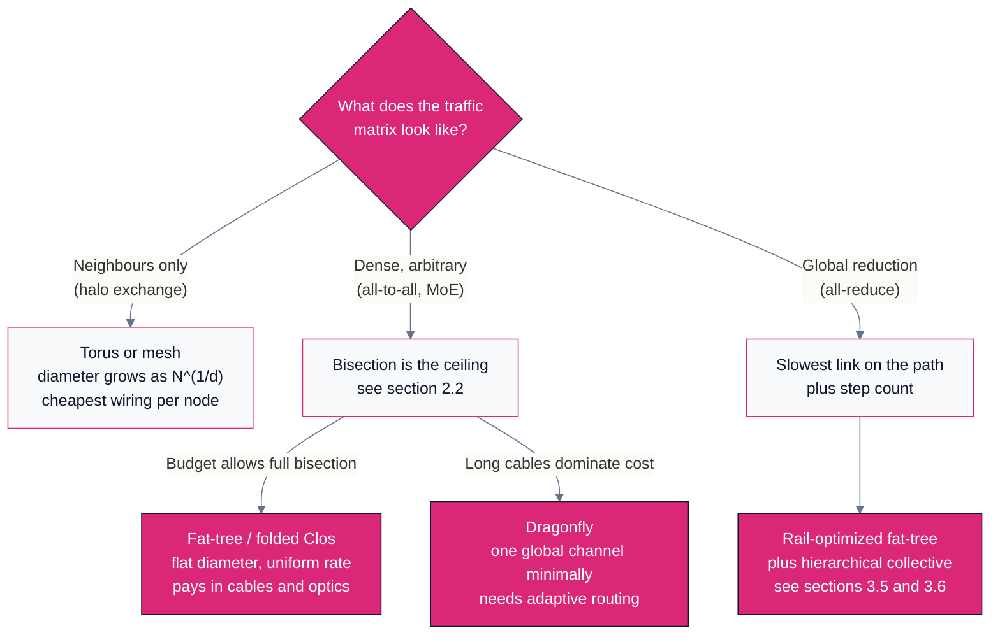
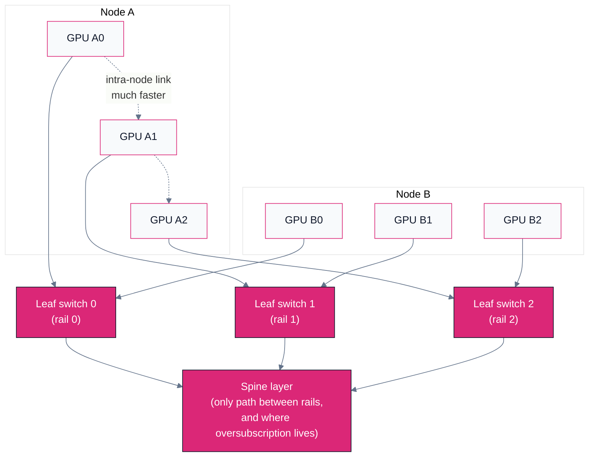
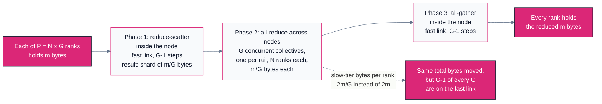

# D05 — Topology & the Scale Boundary

> Track D · Module 05 · Status: **DONE** · Est. 7 hours · Depth 4/5
>
> Prerequisites: [D04](../D04.interconnects-and-rdma/README.md) for the links themselves and
> [D03](../D03.gpu-collectives-nccl-and-rccl/README.md) for what a collective demands of them.
> [D01](../D01.scaling-limits-and-communication-cost/README.md) supplies the cost model this module
> applies at cluster scale.
>
> **Backends: none.** The tools in [`tools/`](tools/) are pure-Python analytic models — no GPU, no
> `numpy` — and label their output as models rather than measurements. Topology is the one part of a
> cluster you cannot change after the cables are pulled, so the whole point is to be able to reason
> about the shape *before* the purchase order.
> Setup: [SETUP.md](../../../docs/SETUP.md) ·
> Terms: [GLOSSARY.md](../../../docs/GLOSSARY.md) · Sources: [REFERENCES.md](../../../docs/REFERENCES.md).

---

## 1. TL;DR + Layman analogy

**TL;DR.** [D04](../D04.interconnects-and-rdma/README.md) gave you a link with a latency and a
bandwidth. A cluster is not a link; it is a *shape*, and the shape decides which of your links you
are actually allowed to use at the same time. Two numbers characterize any shape:
**diameter**, the worst-case hop count between two nodes, which sets the latency term; and
[**bisection bandwidth**](../../../docs/GLOSSARY.md#bisection-bandwidth), the total bandwidth across
the narrowest cut that splits the machine in half, which is a hard ceiling on every all-to-all
pattern — including mixture-of-experts routing. A third number,
[**oversubscription**](../../../docs/GLOSSARY.md#oversubscription), tells you how much of the
paper bandwidth was deliberately not built, and it is invisible in every two-rank benchmark you will
ever run. Get the shape wrong for your traffic pattern and no amount of tuning recovers it; get the
*rank placement* wrong on a correct shape and you can lose most of the same performance in software,
which is the good news, because software you can fix.

**Layman analogy — three ways to build a road network.**

You are moving freight between a thousand towns. There are three honest designs, and none of them is
best in general.

- **The hub-and-spoke airport system.** Every town has a flight to a regional hub, every regional hub
  has a flight to a national hub. Any town can reach any other town in a bounded number of legs, and
  the system is *deliberately* built so the hub-to-hub trunks are as fat as the sum of the spokes
  feeding them. This is a [fat-tree](../../../docs/GLOSSARY.md#fat-tree-dragonfly-and-torus): uniform
  service to everywhere, and the price is a staggering number of trunk routes.
- **Well-connected regional hubs plus a few long-haul routes.** Within each region, every town has a
  direct road to every other town in that region. Between regions there are only a handful of
  expensive long-haul routes, but they are arranged so that *any* region can reach *any* other region
  with a single long-haul leg. That is a **dragonfly**: it buys near-hub-and-spoke reachability while
  paying for far fewer long, expensive routes. The catch is that when one long-haul route jams, you
  must be willing to route freight *the wrong way first* — through a third region — to get around it.
- **A grid of neighbourhood streets and no highways at all.** Every town has short roads to its four
  immediate neighbours and nothing else. Fantastically cheap. That is a
  **torus** or **mesh**.

Now the three predictions the analogy actually earns:

- **The grid is wonderful for talking to your neighbour and terrible for talking to everyone.**
  Delivering to the town next door is one short hop, and a thousand such deliveries happen in
  parallel on a thousand different streets with zero interference. Delivering to the town on the far
  corner means crawling through every town in between, and if *everyone* is doing that at once, every
  street in the middle of the grid is carrying other people's freight. Same network, opposite verdict,
  and the only thing that changed is who is talking to whom.
- **Oversubscription is invisible until rush hour.** Suppose a regional hub has thirty-two towns
  feeding it but only sixteen trunk routes out. Send one truck: it goes at full speed, because
  fifteen trunks are idle. Send two, ten, even fifteen trucks: still full speed. Send all
  thirty-two at once and every one of them moves at half speed. Nothing broke. Nothing is
  misconfigured. The road test you ran last week with one truck was simply not the test that mattered.
- **The "best" network depends entirely on the traffic pattern.** There is no way to rank these three
  designs without being told what the freight looks like. A weather simulation talks almost
  exclusively to its neighbours; a mixture-of-experts model routes every token to an arbitrary
  destination. The first is happy on a grid; the second needs the airports.

**Where the analogy breaks — in three places, all of which matter.**

First, roads have no *credits*. A jammed road makes trucks queue on the shoulder and the rest of the
network carries on. A lossless datacenter fabric does not drop packets; it pushes back, and that
backpressure propagates *upstream*, so one congested destination can slow down flows that were never
going anywhere near it. Congestion in a lossless fabric spreads like a traffic jam that reaches
backwards down the on-ramps and out onto the streets that feed them. Section 3.7 is about that.

Second, freight does not need to arrive in order. Adaptive routing — the "go the wrong way first"
trick — delivers packets out of order, and something has to put them back together, which is a real
cost paid in hardware buffers or in software.

Third, and most importantly: in a real cluster the towns are not equal distances apart *inside* a
node either. Eight GPUs in one chassis are connected by a link an order of magnitude faster than
anything leaving the box. So the shape is not one network, it is a *hierarchy* of at least two, and
the single largest performance lever in this module — hierarchical collectives, section 3.6 — exists
only because that hierarchy exists. The road analogy has no equivalent of a town whose eight
warehouses are joined by conveyor belts.

**By the end of this module you can** take a cluster description and a traffic pattern, compute the
diameter and bisection, find the rank count at which oversubscription or bisection becomes the
binding constraint, decide whether a flat or a hierarchical collective is correct at that size, and
say what the rank-to-node mapping is costing you.

---

## 2. First Principles

### 2.1 A network is a graph, and two numbers summarize it

Strip away the vendor names and a fabric is a graph: nodes are endpoints and switches, edges are
links, each edge has a bandwidth. Almost everything you need to predict falls out of two properties
of that graph.

**Diameter** is the largest number of hops on the shortest path between any two endpoints. It sets
the floor on the `alpha` term from the
[alpha-beta model](../../../docs/GLOSSARY.md#the-alpha-beta-model): every hop is a switch traversal,
and every switch traversal costs a store-and-forward or cut-through delay plus queueing. Diameter is
a *latency* statement. It matters enormously for small messages and barely at all for a 1 GB
all-reduce, exactly as [D01](../D01.scaling-limits-and-communication-cost/README.md#3-deep-dive)
predicts.

**Bisection bandwidth** is the sum of link bandwidths crossing the *worst* cut that divides the
endpoints into two equal halves. It is a *bandwidth* statement, and it is the one people skip. Note
carefully that it is a minimum over cuts, not an average: a network with one narrow waist has the
bisection of that waist regardless of how generous the rest of it is.

A third derived quantity, **radix**, is the port count of a switch. It is not a performance metric
but it is the cost lever behind every topology in section 3: a higher-radix switch lets you build the
same node count with fewer switch levels, which means fewer hops *and* fewer cables.

### 2.2 Why bisection bandwidth is the ceiling on all-to-all

This is the single most useful derivation in the module, and it is three lines of arithmetic.

Take a cut that splits `N` endpoints into two halves of `N/2` each, with total bandwidth `B_bisect`
crossing it. Now run a traffic pattern in which every endpoint sends `m` bytes spread uniformly over
all destinations — that is a personalized all-to-all, and it is also, statistically, what uniform
random traffic looks like. Each endpoint's destinations are half on its own side and half on the
other, so each endpoint pushes `m/2` bytes across the cut. Summing over all endpoints:

```
bytes crossing the cut = N * m / 2
time >= (N * m / 2) / B_bisect
```

That is a **lower bound**, independent of routing, independent of the collective algorithm,
independent of how good your library is. No software can move bytes across a cut faster than the cut
allows. Now substitute the two extremes:

- **Full bisection** (`B_bisect = (N/2) * B_link`, which is what a non-blocking fat-tree targets):
  the time is `m / B_link`. **Independent of `N`.** An all-to-all costs the same at 64 endpoints as
  at 4,096.
- **Torus bisection** (which section 3.3 shows grows only as `N^((d-1)/d)`): the time grows as
  `N^(1/d)`. At `d = 3` that is a cube-root penalty — a 64x larger machine runs the same all-to-all
  4x slower.

**This is why mixture-of-experts routing is a topology question and not a kernel question.** MoE
dispatch and combine are all-to-all: each token is routed to an expert that may live on any rank, so
the traffic matrix is dense and essentially arbitrary. The bound above applies directly, and it says
that an MoE model's communication time is set by the bisection bandwidth of the cluster it was
scheduled on. You can pick better kernels all week; the cut does not care.

By contrast, a [ring all-reduce](../../../docs/GLOSSARY.md#ring-all-reduce) is *not* bisection-bound
in the same way. A ring only ever uses `N` links out of the whole fabric, one per adjacent pair, so
it is bound by the slowest link on the ring rather than by the global cut. That asymmetry —
all-reduce cares about link rate and step count, all-to-all cares about bisection — is why two
workloads on identical hardware can rank two topologies in opposite orders.

### 2.3 Oversubscription, with the arithmetic done out loud

[Oversubscription](../../../docs/GLOSSARY.md#oversubscription) is the ratio of downward (host-facing)
bandwidth to upward (fabric-facing) bandwidth at a switch. A 1:1 leaf is non-blocking; a 2:1 leaf has
half the escape bandwidth it would need to let every host talk off-leaf at line rate simultaneously.

Worked example, all illustrative round numbers so you can check every step. Take a leaf switch with
48 ports of 400 Gb/s. Wire 32 of them down to hosts and 16 of them up to the spine layer.

```
host-facing bandwidth  = 32 hosts   * 400 Gb/s = 12,800 Gb/s
fabric-facing bandwidth= 16 uplinks * 400 Gb/s =  6,400 Gb/s
oversubscription ratio = 12,800 / 6,400        = 2:1
```

Now ask what a host actually gets, as a function of how many of its 32 leaf-mates are sending off-leaf
at the same time. Let `k` be that number. The uplink pool is shared:

```
per-host off-leaf rate = min(400, 6400/k) Gb/s
```

| Concurrent off-leaf senders `k` | Uplink demand | Per-host rate | Fraction of line rate |
|---:|---:|---:|---:|
| 1 | 400 Gb/s | 400 Gb/s | 100% |
| 8 | 3,200 Gb/s | 400 Gb/s | 100% |
| 16 | 6,400 Gb/s | 400 Gb/s | 100% |
| 17 | 6,800 Gb/s | 376 Gb/s | 94% |
| 32 | 12,800 Gb/s | 200 Gb/s | 50% |

Read the table twice. **Nothing degrades at all until `k` exceeds the uplink count.** A two-rank
point-to-point bandwidth test — the test everybody runs, the test in every acceptance report — puts
`k = 1` and reports full line rate. A 16-rank test still reports full line rate. The cliff appears
between 16 and 17 concurrent senders, and it appears *only* for traffic that leaves the leaf. Local
traffic never touches an uplink and is unaffected forever.

And it saves genuine money. Each uplink consumes a transceiver at both ends plus a port on a spine
switch, and the optics and spine ports are the expensive part of a large fabric. Halving the uplink
count removes half of that per-leaf cost and roughly halves the number of spine switches the design
needs. That is not a rounding error at cluster scale, which is why oversubscribed fabrics get built
on purpose by competent people. The failure is not the ratio; the failure is not *knowing* the ratio,
and then being surprised when a 32-rank collective runs at half the speed the two-rank test promised.

> [!IMPORTANT]
> Oversubscription and bisection bandwidth are the same fact stated at two scales. A 2:1 leaf halves
> the bisection of the whole fabric for any traffic that crosses leaves. So when you compute the
> bisection number for a design, compute it from the *as-built* uplink count, never from the switch
> radix. This is the most common way a bisection figure in a design document is wrong by exactly 2x.

### 2.4 The traffic pattern is half of the answer

There is no such thing as a good topology, only a topology that matches a pattern. Three patterns
cover most of what runs on these machines:

| Pattern | Who does it | What it stresses | Topology that suits it |
|---|---|---|---|
| **Nearest-neighbour halo exchange** | Stencil codes: weather, CFD, molecular dynamics | Link rate to adjacent ranks; nothing global | Torus or mesh — the wiring *is* the communication graph |
| **Global all-reduce** | Data-parallel training, iterative solvers | Slowest link on the reduction path; step count | Anything with uniform link rates; hierarchy helps more than shape |
| **All-to-all / arbitrary** | MoE routing, FFTs, sorts, sparse transposes | Bisection bandwidth, full stop | Fat-tree or dragonfly; a torus is actively bad |

The practical consequence is that a cluster built for one of these and used for another will
disappoint in a way that looks like a software problem and is not. Sections 3 and 7 give the real
examples in both directions.

---

## 3. Deep Dive

### 3.1 Fat-tree, or folded Clos: pay for uniformity

The idea is older than the datacenter.
[Leiserson](../../../docs/REFERENCES.md#fat-trees-leiserson-1985) observed in 1985 that the problem
with a plain tree as an interconnect is that the root is a bottleneck: all traffic between the two
halves of the machine funnels through one link. His fix was to make the tree's edges get *fatter* as
you climb, so that the aggregate bandwidth at every level is constant. Then no level is a bottleneck
and any endpoint can reach any other at full rate.

Modern fabrics implement the same property with a **folded Clos** network: instead of a physically
fatter cable, you use many parallel switches at each level. A three-level Clos built from radix-`k`
switches gives:

- **Diameter.** The worst-case path is host, leaf switch, spine switch, core switch, spine switch,
  leaf switch, host — **five switch traversals, six link traversals**, for *any* pair in the machine.
  Crucially this does **not** grow with `N`: adding levels is what grows it, and each level multiplies
  the endpoint count by roughly `k/2`. This is a topology whose latency is essentially flat in scale.
- **Bisection.** In the non-blocking variant, every leaf devotes half its ports down and half up, at
  every level, and bisection is the full `(N/2) * B_link`. That is the definition of "full bisection"
  and it is what makes the `m / B_link` all-to-all result of section 2.2 achievable.
- **Cost driver.** Cables, optics, and switch radix — in that order. A non-blocking three-level fabric
  needs roughly one uplink per downlink at every level, so the switch and transceiver count grows
  faster than the endpoint count. This is precisely the cost that oversubscription exists to cut, and
  it is why **the oversubscribed variant is the one that actually gets built** for anything except
  the most all-to-all-heavy workloads. A 2:1 leaf takes the bisection to `(N/4) * B_link` and takes a
  large fraction of the optics bill with it.

The honest summary: a fat-tree buys you the right *not to think about placement*, and charges for it
in cables. Whether that is a good trade is a function of how uniform your traffic really is.



### 3.2 Dragonfly: buy reachability, not cable

[Kim et al.](../../../docs/REFERENCES.md#dragonfly-topology-kim-et-al-2008) started from an
observation about economics rather than graph theory: in a large machine the cost is dominated by
**long** cables, because past a few metres you leave copper and start paying for optics. So design
the topology to minimize the number of long channels, not the number of channels.

The construction has two levels. Routers are collected into **groups**, and the routers within a
group are richly connected — in the limit, all-to-all — so that the group behaves as a single
**virtual router** with an enormous effective radix. Groups are then connected by **global channels**
arranged so that every group has at least one direct global channel to every other group.

The payoff is the minimal route: source router, one local hop inside the source group, **one global
channel**, one local hop inside the destination group. **Diameter three hops** for a minimally routed
packet, at machine scale, using far fewer long optical cables than a Clos of the same size would.
Kim et al. also give the balance condition for sizing a group — with `a` routers per group, `p`
terminals per router and `h` global channels per router, the balanced design sets `a = 2p = 2h`, so
the global bandwidth leaving a group is provisioned against the terminal bandwidth inside it.

Then comes the part that makes dragonfly an operational subject rather than a diagram. **A dragonfly
cannot be run with minimal routing alone.** If two groups are exchanging heavy traffic, the minimal
path between them is *one specific global channel*, and there is no second minimal path to spread the
load over. Minimal routing on adversarial traffic therefore drives a single global channel to
saturation while the rest of the global network sits idle. The fix is **non-minimal (Valiant)
routing**: send the packet to a randomly chosen *intermediate* group first, then on to the
destination. That uses two global channels instead of one — so it costs twice the global bandwidth —
but it converts adversarial traffic into uniform traffic, which the balanced design can carry.

Neither policy is right on its own. Minimal routing is optimal for benign traffic and pathological
for adversarial traffic; Valiant routing is the reverse. Real dragonflies therefore use **adaptive
routing**: each router estimates congestion on the minimal path and diverts to a non-minimal path
only when the minimal one looks busy. That decision is made per packet, from local and partly stale
queue information, and getting it right is a hardware design problem with real failure modes. The
[analysis of the Slingshot interconnect by De Sensi et
al.](../../../docs/REFERENCES.md#slingshot-interconnect-analysis-de-sensi-et-al-2020) is the study to
read here: it examines a deployed dragonfly-based fabric with adaptive routing and congestion control
and reports how it behaves under interfering traffic from other jobs — which is the condition your
production job actually runs under, and almost never the condition a benchmark reports.

> [!NOTE]
> The dragonfly's three-hop diameter is a statement about the *minimal* route. Under adaptive routing
> a packet may take up to about five hops. When you see a dragonfly diameter quoted, check which one
> is meant — and remember that the interesting number in practice is not the diameter at all but the
> latency distribution's tail under load.

### 3.3 Torus and mesh: the cheapest wiring there is

A `d`-dimensional torus wires each node directly to its `2d` immediate neighbours, with wraparound
links closing each dimension. A mesh is the same without the wraparound. There are no switches in the
fabric sense at all; each node forwards for its neighbours. This is the cheapest possible large
network per endpoint, and it has been the choice of a long line of the largest machines ever built.

The arithmetic, for `N` nodes arranged as a cube of side `n = N^(1/d)`:

```
diameter (torus) = d * floor(n/2)          # wraparound halves the worst distance
diameter (mesh)  = d * (n - 1)
bisection        = 2 * n^(d-1) * B_link    # cutting one dimension severs two sheets of links
                 = 2 * N^((d-1)/d) * B_link
```

The bisection formula is the whole story. Full bisection would be `(N/2) * B_link`; a torus delivers
`2 * N^((d-1)/d) * B_link`, so the *ratio* falls as `N^(-1/d)`. Global collectives get relatively
worse as the machine grows, and they get worse more slowly the more dimensions you build.

Put `N = 4096` on it and the dimension count stops being an abstraction:

| Arrangement | Links per node | Diameter | Bisection (units of `B_link`) | Fraction of full bisection |
|---|---:|---:|---:|---:|
| 3D torus, 16 x 16 x 16 | 6 | 24 | 512 | 25% |
| 4D torus, 8 x 8 x 8 x 8 | 8 | 16 | 1,024 | 50% |
| 6D torus, 4^6 | 12 | 12 | 2,048 | 100% |

At this size a 6D torus reaches *full* bisection, with a diameter half that of the 3D arrangement,
and the price is twelve links per node instead of six. That trade — dimensions bought with per-node
port count — is exactly the design space the
[Tofu interconnect](../../../docs/REFERENCES.md#tofu-6d-meshtorus-interconnect-ajima-et-al-2009)
explores: Ajima et al. describe a **6D mesh/torus** built to give the topology enough dimensions that
global operations remain tractable while keeping the direct-wired, switchless economics and the
excellent nearest-neighbour behaviour. Read the table as the justification for that design rather
than as a specification of any shipped machine.

What a torus is genuinely, unbeatably good at is halo exchange. A stencil code's communication graph
*is* the torus: rank `(x,y,z)` talks to `(x-1,y,z)`, `(x+1,y,z)` and its other four neighbours and nobody else.
Every one of those exchanges runs on a dedicated link at full rate, concurrently, with zero
contention and one hop of latency, and this stays true at any machine size. There is no fat-tree
that beats it and no fat-tree that is cheaper. What a torus is bad at is anything global: the
`N^(1/d)` diameter puts a growing latency term on every reduction, and the sub-full bisection puts a
growing bandwidth term on every all-to-all.

### 3.4 The comparison, in one table

Illustrative, structural, and derived from the sections above rather than measured on any machine:

| Topology | Diameter | Bisection | Primary cost driver | Best traffic pattern | Worst traffic pattern |
|---|---|---|---|---|---|
| **Fat-tree, non-blocking** | Flat in `N`: 6 link traversals for three levels | Full, `(N/2) * B_link` | Optics, spine switch count, switch radix | Anything uniform; all-to-all and MoE | Nothing, except the budget |
| **Fat-tree, 2:1 oversubscribed** | Same, 6 | Half of full for cross-leaf traffic | Same, minus half the uplinks | Traffic with locality inside a leaf | Simultaneous off-leaf sends from every host |
| **Dragonfly** | 3 hops minimal, about 5 non-minimal | Set by global channel provisioning: a balanced `a = 2p = 2h` design puts about half of all global channels across a balanced cut of groups, so about 50% of full | Global (long, optical) channels | Uniform or adaptively-routable traffic at very large `N` | Adversarial group-to-group traffic under minimal-only routing |
| **Torus / mesh, `d` dimensions** | `d * floor(N^(1/d) / 2)`, grows with `N` | `2 * N^((d-1)/d) * B_link`, sub-full for small `d` | Per-node port count; dimension count | Nearest-neighbour halo exchange | Global all-to-all; long-distance point-to-point |

The row that surprises people is the second one. Oversubscription does not change the diameter at
all, so it does not show up in a latency test, in a ping test, or in a small-message benchmark. It
shows up only in a bandwidth test that has enough concurrent cross-leaf senders to saturate the
uplinks — which is to say, in your job and not in your acceptance test.

### 3.5 Rail-optimized design: one NIC per GPU, and which switch it lands on

[D04](../D04.interconnects-and-rdma/README.md) established the injection problem: a node with eight
GPUs and one adapter has an injection ceiling that all eight GPUs must share, so multi-node bandwidth
scales with node count and not with GPU count. The structural fix is **one adapter per GPU**. But
buying eight adapters per node only helps if the fabric is wired so that the eight of them do not
collide, and that wiring choice is what
[rail-optimized](../../../docs/GLOSSARY.md#rail-optimized-network) means.

The rule is simple and the consequence is not. Number the GPUs in each node `0..G-1`. Take the leaf
switches and number them `0..G-1` as well. Then wire **GPU `i` of every node to leaf switch `i`.**
Leaf switch `i` and everything hanging off it is **rail `i`**.



Now trace an [all-reduce](../../../docs/GLOSSARY.md#all-reduce) through it, because all-reduce is
where this design pays off and the reason is specific.

The cross-node phase of a well-implemented all-reduce has GPU `i` on node A exchanging a *shard* with
GPU `i` on node B — same index, never a different one. In a rail-optimized fabric that exchange is
**one hop, inside rail `i`**, and it never leaves the leaf switch for node counts that fit under one
leaf. Better: the `G` rails are `G` independent switch trees, so the eight shard exchanges happening
simultaneously in a node do not contend with each other at all. The node's full injection bandwidth
is usable, in parallel, with no shared uplink anywhere in the path.

Compare the alternative wiring, in which each node's eight adapters all connect to the *same* leaf
switch. The bandwidth exists on paper, but every cross-node flow from that node now shares that
leaf's uplink pool, so you are back to section 2.3's table with `k = 8` and hoping the
oversubscription ratio is kind.

Two consequences worth committing to memory:

- **Cross-rail traffic is the expensive kind.** Any communication between GPU `i` of one node and GPU
  `j` of another must climb to the spine layer, which is the tier where oversubscription lives. A
  well-designed collective produces *no* cross-rail traffic; a badly mapped one produces nothing
  else. This is the mechanism behind section 3.6's rank-placement effects.
- **The intra-node link is doing the heavy lifting.** Rails carry `1/G` of the reduction each,
  precisely because the intra-node
  [fast link](../../../docs/GLOSSARY.md#nvlink-xgmi-and-infinity-fabric) has already reduced the
  data down to a shard. Rails and hierarchical collectives are one design, not two. AMD's published
  [Instinct cluster design reference](../../../docs/REFERENCES.md#amd-instinct-cluster-design-reference-amd)
  is the place to look for how a vendor documents this wiring; treat the specific port counts and
  ratios there as the vendor's, with a retrieval date, rather than as universal.

### 3.6 Hierarchical collectives and topology-aware placement

#### The two-level algorithm

A flat [ring all-reduce](../../../docs/GLOSSARY.md#ring-all-reduce) over `P = N * G` ranks is a
single chain, and a chain runs at the pace of its slowest link. Since some of the links in that chain
must be inter-node, **the entire flat ring proceeds at the inter-node rate**, even though `(G-1)/G`
of its hops are between GPUs in the same chassis that could have run an order of magnitude faster.
That is the waste a hierarchical collective recovers.

The two-level form has three phases:

1. **Reduce-scatter inside each node**, over the fast intra-node link. Afterwards GPU `i` of each node
   holds the node's partial sum for shard `i`, of size `m/G`.
2. **All-reduce across nodes, one collective per shard**, on rail `i` for shard `i`. Each of these is
   an `N`-rank all-reduce over `m/G` bytes, and the `G` of them run concurrently on `G` disjoint rails.
3. **All-gather inside each node**, again over the fast link, to put the full reduced buffer back on
   every GPU.



Here is the part that makes this an *interesting* result rather than an obvious one.
[Patarasuk and Yuan](../../../docs/REFERENCES.md#bandwidth-optimal-all-reduce-patarasuk-and-yuan-2009)
proved that `2m(N-1)/N` bytes per rank is a lower bound for all-reduce — so the hierarchical
algorithm **cannot** move fewer bytes in total, and it does not. Count them: `m(G-1)/G` in phase 1,
about `2m/G` in phase 2, `m(G-1)/G` in phase 3, which sums to about `2m`. Identical. The hierarchical
algorithm is not more bandwidth-efficient. What it does is **route `(G-1)/G` of those bytes onto the
tier where bandwidth is cheap**, leaving only `2m/G` on the slow tier. The optimality proof is about
total movement; the win is about *which links* do the moving. Any time you see a collective
optimization that appears to beat a proven lower bound, this is the shape of the explanation.

A model, with illustrative parameters clearly labelled as such: `G = 8` GPUs per node, `m = 1 GB`,
intra-node effective 100 GB/s, inter-node effective 25 GB/s per GPU, `alpha_intra = 1 us`,
`alpha_inter = 3 us`, and `N = 128` nodes so `P = 1024` ranks.

| Algorithm | Slow-tier bytes per rank | Slow-tier steps | Modelled time |
|---|---:|---:|---:|
| Flat ring over 1,024 ranks | ~2 GB (whole ring runs at 25 GB/s) | 2,046 | ~80 ms transfer + ~6 ms latency |
| Two-level hierarchical | ~0.25 GB | 254 | ~10 ms inter + ~17.5 ms intra + ~0.8 ms latency |

That is roughly a 3x difference, and it is the *shape* rather than the ratio that you should keep:
the flat ring's cost is set entirely by the slow tier, and the hierarchical version divides the
slow-tier work by `G`. Re-run it in the lab with your own numbers; the tool prints the crossover in
node count and marks the output as a model.

Be precise about where the crossover comes from, because the idealized model does not produce one on
its own. Two-level moves the same total bytes, puts only `1/G` of them on the slow tier, and takes
fewer slow-tier steps, so whenever the intra-node tier is at least as fast as the fabric it *cannot*
lose above one node. At `N = 1` its cross-node phase is empty and the two are the same algorithm, so
they tie exactly rather than one winning. A real crossover therefore comes from the fixed cost of
running three phases instead of one — extra kernel launches, extra synchronization boundaries — which
Lab 2 charges explicitly with `--phase-overhead-us`. Finding that point, and watching it move with
message size, is Lab 2.

Two-level is also where a library's decision tree from
[Thakur, Rabenseifner and Gropp](../../../docs/REFERENCES.md#collective-algorithms-in-mpich-thakur-rabenseifner-and-gropp-2005)
starts needing topology input rather than just `m` and `N`: the right choice depends on the *ratio*
of tier bandwidths, which is a property of the machine.

#### Placement: the same job, the same hardware, a different mapping

Every one of the above arguments assumed that "the ranks in a node" are actually in a node. That is a
statement about the **rank-to-device mapping**, and it is not guaranteed by anything.

Consider a flat ring over `P = N * G` ranks under two mappings:

- **Block (node-major).** Ranks `0..G-1` on node 0, `G..2G-1` on node 1, and so on. Consecutive ranks
  are in the same node except at node boundaries, so exactly `N` of the ring's `P` links are
  inter-node — a fraction `1/G`.
- **Cyclic (round-robin).** Rank `r` goes to node `r mod N`. Now *every* consecutive pair of ranks is
  on different nodes, so **all `P` ring links are inter-node** — `G` times as many.

Each link in a ring all-reduce carries about `2m` bytes over the run, so the total cross-node traffic
the job pushes into the fabric is about `2mN` under block mapping and about `2mP = 2mNG` under cyclic
mapping. **Same job, same hardware, `G` times the fabric load.**

On a rail-optimized fabric there is a second and independent question: whether each of those flows is
same-index, and so one leaf hop, or cross-rail, and so a climb to the spine you oversubscribed. The
answer is not the one the load ratio suggests. Cyclic mapping keeps consecutive ranks at the *same*
local index — `r` and `r + 1` differ by a node, not by a GPU slot — so almost all of its `P` cross-node
flows stay on their own rail. Block mapping crosses a node boundary only `N` times, but every one of
those links joins local index `G - 1` to local index `0`, so all `N` of them are cross-rail. Block
still wins decisively, by `G` on total fabric load, which is the larger effect; it simply is not free
on the spine. The mapping that loses on both counts at once is a **random** one — which is exactly
what a scheduler hands you when nothing has asked for locality. Lab 4 computes all three.

Note carefully what does *not* change: the flat ring's serial pace was already set by its slowest
link, and it was already inter-node, so a single-tenant idealized model may show little difference.
The damage shows up as congestion, as contention with other tenants, and as run-to-run variance —
and it shows up immediately in any hierarchical algorithm, which depends on intra-node locality
being real. This is why "we changed nothing and the job got slower" is so often a placement story.

The mitigation is **topology-aware placement**: the scheduler must know the fabric shape and allocate
and order ranks to respect it. Slurm supports this through topology plugins configured from a
`topology.conf` describing the switch hierarchy, together with task distribution and binding
controls; see the [SchedMD documentation](../../../docs/REFERENCES.md#slurm-workload-manager-schedmd)
for the plugin variants available in your version and the exact configuration syntax, which does
change between releases. The operational rules that survive version changes:

- Ask for **allocation locality**, not just a node count. A job spread across many leaves has a
  different fabric than the same job packed under one.
- Verify the mapping at runtime rather than trusting it. Have rank 0 gather each rank's hostname and
  local device index and log the mapping; a three-line check at startup has caught more performance
  bugs than most profilers.
- Keep the highest-traffic parallelism axis inside the node. Tensor parallelism belongs on the fast
  intra-node link; data parallelism can tolerate the network.
  [B07](../../B-gpu-ml-performance/B07.distributed-training-and-sharding/README.md) works through the
  axis assignment in full.

### 3.7 Congestion, adaptive routing, incast, and how a lossless fabric spreads a jam

Everything so far assumed a link's bandwidth is yours. At scale it is not, and the mechanisms by
which it stops being yours are worth naming individually.

**Incast** is many senders converging on one receiver: an all-gather with a root, a checkpoint write
to one storage target, a parameter fetch, a rank-0 log collection. `k` senders at line rate arrive at
a port that can absorb one line rate, and the excess must go somewhere. In a lossy network it is
dropped and retransmitted, which is bad. In a lossless network it is *not* dropped — which is worse
in a specific way, described next.

**A lossless fabric spreads congestion instead of localizing it.** Link-level flow control, whether
credit-based as in InfiniBand or pause-based as in
[RoCE with PFC](../../../docs/GLOSSARY.md#infiniband-roce-and-slingshot), guarantees delivery by
refusing to accept more than the downstream can take. That refusal propagates backwards: the
congested port stops granting credit to its upstream switch, whose buffers fill, so *it* stops
granting credit to *its* upstream, and so on. Flows that merely share a switch with the congested
flow — "victim flows", with destinations nowhere near the hot spot — are now blocked behind it. This
is head-of-line blocking at fabric scale, and the resulting **congestion tree** can make a single
badly-behaved rank slow down an unrelated job. It is the reason end-to-end congestion notification
(ECN and its descendants) is preferred over letting link-level pause do the work: notify the source
to slow down before backpressure has to spread. [D04](../D04.interconnects-and-rdma/README.md) covers
the mechanisms; the topology-level point is that **a lossless fabric converts a local overload into a
global slowdown**, so incast patterns must be designed out rather than absorbed.

**Adaptive routing** helps and costs. It spreads flows across the many equal-cost paths a fat-tree
offers, or across non-minimal paths in a dragonfly, and it is close to mandatory on both: static
hashing of flows to paths produces collisions where two large flows land on the same path and each
runs at half rate while a parallel path sits idle, and at low flow counts — which is exactly what a
collective produces — those collisions are common rather than rare. The costs are real: packets on
different paths arrive **out of order**, so something must reorder them, which means buffering,
which means either die area or a software cost; the routing decision uses local, partly stale
congestion estimates, so it can oscillate or make the wrong call; and it makes performance
*non-deterministic*, which turns a reproducible benchmark into a distribution. De Sensi et al.'s
Slingshot analysis is again the reference for what this looks like on a deployed system with
interfering tenants.

**Other tenants.** The last mechanism is not technical. On a shared cluster your bisection is not
your bisection — it is what is left after everyone else's traffic. Run-to-run variance that
correlates with time of day and not with your code is the signature, and its cousin is the
[straggler](../../../docs/GLOSSARY.md#straggler) problem from
[D01](../D01.scaling-limits-and-communication-cost/README.md#3-deep-dive): a collective is a barrier,
so one congested rank taxes all of them.

---

## 4. Hands-On Labs

All four labs are pure Python from the standard library and run on a laptop. Each prints a banner
marking its output as a **model, not a measurement** — the topology formulas are exact, the link
rates and latencies you feed them are yours to justify, and the product of an exact formula and an
assumed parameter is still an assumption.

```bash
cd tracks/D-distributed-computing/D05.topology-and-scale-boundaries
make run          # all four labs with default scenarios
```

### Lab 1 — Diameter and bisection, three topologies, one size

**Goal:** make the two characterizing numbers concrete, and see the dimension-count trade.

```bash
python3 tools/topology_metrics.py --topology fat-tree --nodes 4096 --radix 64 --oversubscription 1
python3 tools/topology_metrics.py --topology fat-tree --nodes 4096 --radix 64 --oversubscription 2
python3 tools/topology_metrics.py --topology dragonfly --nodes 4096 --routers-per-group 16 \
    --terminals-per-router 8 --global-channels-per-router 8
python3 tools/topology_metrics.py --topology torus --nodes 4096 --dims 3
python3 tools/topology_metrics.py --topology torus --nodes 4096 --dims 6
python3 tools/topology_metrics.py --compare --nodes 4096   # all of the above in one table
```

Prints, for each configuration: diameter in switch hops and in link traversals, bisection bandwidth
in units of a single link rate and as a fraction of full bisection, links per node, the dominant cost
driver, and the modelled lower-bound time for a uniform all-to-all of a given message size using the
section 2.2 bound.

**What to observe.** Three things, in order of how much they will change your intuition. First, the
fat-tree's diameter does not move when you change `--nodes` within a level count, while the torus's
grows as `N^(1/d)` — latency and scale are decoupled in one and coupled in the other. Second, the
`--oversubscription 2` run has **exactly the same diameter** as the non-blocking run and half the
bisection, which is the whole reason oversubscription hides from latency tests. Third, run the torus
at `--dims 3` and `--dims 6` and watch the bisection fraction go from 25% to 100% while links per
node doubles: that is the Tofu design argument in two commands.

### Lab 2 — Flat ring versus hierarchical, and where they cross

**Goal:** find the node count past which a two-level collective is the right answer, and understand
that the crossover is a property of the machine and the message, not a constant.

```bash
python3 tools/collective_hierarchy.py --gpus-per-node 8 --bytes 1073741824 \
    --intra-gbs 100 --inter-gbs 25 --alpha-intra-us 1 --alpha-inter-us 3 --max-nodes 512
python3 tools/collective_hierarchy.py --gpus-per-node 8 --bytes 4096 \
    --intra-gbs 100 --inter-gbs 25 --alpha-intra-us 1 --alpha-inter-us 3 --max-nodes 512
python3 tools/collective_hierarchy.py --find-crossover --gpus-per-node 8 --bytes 1073741824 \
    --intra-gbs 100 --inter-gbs 25

# Charge the extra phases what they actually cost, and the crossover starts to move:
python3 tools/collective_hierarchy.py --find-crossover --gpus-per-node 8 --bytes 4096 \
    --intra-gbs 100 --inter-gbs 25 --phase-overhead-us 20000
```

Prints a node-count sweep with the flat-ring and two-level costs side by side, the slow-tier bytes per
rank and slow-tier step count for each, and with `--find-crossover` the smallest node count at which
the hierarchical algorithm wins.

**What to observe.** Confirm the claim from section 3.6 that **total** bytes moved per rank are about
`2m` for both algorithms, then look at the slow-tier column and see the `G`-fold difference — that
column, not the total, is what predicts the time. Then move the crossover deliberately: raise
`--inter-gbs` until it equals `--intra-gbs` and watch the hierarchical advantage collapse to almost
nothing, because the whole benefit was the tier bandwidth ratio. Then note what `--find-crossover`
reports with no phase cost charged: `2` for both message sizes, and an exact tie at `N = 1`. That is
the model being honest — with free phases the two-level algorithm cannot lose. Add
`--phase-overhead-us 20000` and the two sizes part company: 1 GB still crosses at 2, while 4 KB does
not cross until 953 nodes, because at 4 KB there are almost no bytes for the tier ratio to save and
the fixed cost has to be amortized against step count instead. A library that hard-codes one
threshold is wrong on one of these two calls.

### Lab 3 — Oversubscription: find the concurrency at which uplinks saturate

**Goal:** reproduce section 2.3's table for a fabric you describe, and locate the cliff.

```bash
python3 tools/oversubscription.py --hosts-per-leaf 32 --uplinks 16 \
    --host-gbs 50 --uplink-gbs 50
python3 tools/oversubscription.py --hosts-per-leaf 32 --uplinks 16 \
    --host-gbs 50 --uplink-gbs 50 --local-fraction 0.75
python3 tools/oversubscription.py --hosts-per-leaf 32 --uplinks 8 --host-gbs 50 --uplink-gbs 50 \
    --sweep-senders
```

Prints the oversubscription ratio, the per-host achievable off-leaf rate as a function of the number
of concurrent off-leaf senders, the sender count at which the uplink pool first saturates, and the
fabric-wide bisection implied by the leaf ratio.

**What to observe.** The saturation point is the uplink count, and everything below it reports full
line rate — so write down what your own acceptance test's concurrency was, and whether it exceeded
that number. Then use `--local-fraction` to model traffic with locality: a pattern that keeps three
quarters of its bytes inside the leaf tolerates a much worse ratio, which is the legitimate
engineering case for building oversubscribed fabrics rather than an excuse for one. Finally halve
`--uplinks` to 8 and note that the cliff moves to 8 concurrent senders while the diameter, the
latency, and every small-message benchmark stay identical.

### Lab 4 — What a bad rank mapping costs

**Goal:** quantify section 3.6's placement argument, so that "topology-aware placement" stops being a
slogan.

```bash
python3 tools/rank_placement.py --nodes 64 --gpus-per-node 8 --mapping block
python3 tools/rank_placement.py --nodes 64 --gpus-per-node 8 --mapping cyclic
python3 tools/rank_placement.py --nodes 64 --gpus-per-node 8 --mapping random --seed 7
python3 tools/rank_placement.py --nodes 64 --gpus-per-node 8 --compare-all --seed 7 \
    --bytes 1073741824 --rails 8
```

Prints, per mapping: the number of ring links that cross a node boundary, the number that would cross
a rail boundary on a rail-optimized fabric, the total modelled cross-node bytes the job pushes into
the fabric, and the modelled ring pace.

**What to observe.** The cross-node link count goes from `N` under block mapping to `N * G` under
cyclic — 64 to 512 here, a factor of `--gpus-per-node`, exactly as derived — and total fabric load
goes 8x with it. Then note the subtlety that makes this lab worth doing: the *ring pace* barely
changes, because a flat ring was already running at the inter-node rate. The damage is in the
**fabric load** column, which is why the symptom in production is congestion and variance rather than
a clean slowdown, and why an idealized single-tenant model will tell you placement does not matter
when it does.

The **cross-rail** column is a genuine surprise and worth sitting with: block's 64 cross-node links
are *all* cross-rail, while cyclic's 512 include only 8. Cyclic is bad in the way that matters more
(eight times the bytes on the fabric) and accidentally good on rails, because consecutive ranks share
a local index. Block wins anyway, and its remaining cross-rail traffic is removable — see the last
line the tool prints. Then re-run with `--mapping random` and a few seeds: a random mapping is nearly
as bad as cyclic on load *and* nearly as bad as block on rails, losing both ways at once. That is
what you get by default when nothing is asking for locality.

---

## 5. Performance Analysis

> [!NOTE]
> **Everything in this section and in section 4 is analytic.** No cluster was measured to produce any
> number in this module. The diameter and bisection formulas are exact graph properties; the times
> derived from them are the product of an exact formula and *assumed* link rates and latencies, which
> makes them models. The tools print the same warning in a banner. Where this repository has real
> transcripts they live under [`outputs/`](../../../outputs/README.md), labelled with the hardware
> and the software stack — and there are no multi-node transcripts there, so nothing in this module is
> validated on real silicon. Treat every figure above as a hypothesis with an experiment attached.

### 5.1 What the models are for

They are for **ruling things out**. The section 2.2 bisection bound tells you that an all-to-all on a
3D torus at 4,096 nodes cannot go faster than a certain time no matter what you write, which is
enough to reject a design without building it. The section 2.3 oversubscription table tells you which
concurrency your acceptance test needed in order to be meaningful. The section 3.6 crossover tells you
whether to spend engineering time on a hierarchical collective at your node count. None of them tells
you how long your job will take.

The failure mode to avoid is quoting a modelled number as a result. Every table in this module is
either pure arithmetic on a graph, or arithmetic on illustrative parameters that are labelled as such.

### 5.2 How you would validate this on real hardware

Four experiments, in the order that gives you the most information per hour of machine time.

**1. Bus bandwidth versus node count.** Run an all-reduce benchmark at a fixed large message size and
sweep the node count: 1, 2, 4, 8, 16, and onward as far as your allocation goes.
[`nccl-tests` and `rccl-tests`](../../../docs/REFERENCES.md#nccl-tests-and-rccl-tests-nvidia-amd)
report a `busbw` figure designed for exactly this comparison, because it normalizes out the
algorithm's `2(N-1)/N` factor and should therefore be **flat** across node counts for a
bandwidth-bound collective on a non-blocking fabric. See
[D03](../D03.gpu-collectives-nccl-and-rccl/README.md) for the convention and its traps.

**2. Latency floor versus node count.** Run the same collective at the smallest message size, which
isolates the latency and step-count term. On a fat-tree this should grow slowly (a `log`-ish curve
from the algorithm, and a flat diameter); on a torus it should grow visibly faster.

**3. Point-to-point across a known hop count.** Use the
[OSU micro-benchmarks](../../../docs/REFERENCES.md#osu-micro-benchmarks-ohio-state-university) to
measure latency and bandwidth between a pair of ranks on the same leaf, a pair on different leaves
under the same spine, and a pair as far apart as the machine allows. The differences give you the
per-hop cost directly, and the OSU multi-pair and all-to-all tests give you a concurrency knob, which
is what turns a latency test into an oversubscription test.

**4. The same job under two mappings.** Run identical work with a deliberately good and a
deliberately bad rank mapping, on the same nodes, back to back. This is the cheapest high-value
experiment in the list because it needs no new tooling, and it directly tests section 3.6.

### 5.3 What a disagreement would tell you

This is the part that makes validation worth doing: each *shape* of disagreement points at a
different mechanism.

| Observation | What it most likely means | Next measurement |
|---|---|---|
| `busbw` flat to some node count, then a step down to about half | You crossed a leaf boundary into an oversubscribed tier | Check allocation against `topology.conf`; re-run inside one leaf |
| `busbw` falls smoothly and continuously with node count | Step-count or latency term growing, not a bandwidth cliff | Repeat at zero or tiny message size; if that curve matches, it is latency |
| `busbw` well below model at *every* node count including two | Not a topology problem at all — injection, staging, or protocol | Back to [D04](../D04.interconnects-and-rdma/README.md): adapter count, GPU-adapter affinity, transport |
| Large run-to-run variance, mean roughly matching the model | Congestion or other tenants; adaptive routing non-determinism | Repeat at low cluster utilization; log per-rank arrival times at the collective |
| One node count anomalously bad, neighbours fine | Placement artifact or a sick link on that allocation | Log the rank-to-host-to-device mapping; re-run on different nodes |
| All-to-all much worse than model while all-reduce matches | Bisection, as section 2.2 predicts; all-reduce does not exercise the cut | Sweep all-to-all message size; compare against the bisection bound directly |
| Hierarchical collective *slower* than flat | You are below the Lab 2 crossover, or intra-node locality is not real | Verify the mapping; re-run Lab 2 with measured tier bandwidths |

The last row is the most common surprise in practice and the most instructive: a hierarchical
collective that loses is usually not a broken algorithm but a broken assumption about where the ranks
are.

---

## 6. Challenges, Drawbacks & Tradeoffs

### 6.1 Cost against bisection, which is the only real decision

Full bisection is purchasable and mostly not worth purchasing. The uplinks that provide it are the
most expensive component per unit of the fabric — optics at both ends and a spine port — and they pay
off only for traffic that actually crosses the cut in volume. So the design question is never
"do we want full bisection" but "**what fraction of our bytes cross a leaf, and at what
concurrency**". A cluster running data-parallel training with rail-optimized wiring and hierarchical
collectives can keep most of its bytes off the spine entirely and be well served by an oversubscribed
fabric. The same cluster running mixture-of-experts routing is bisection-bound by section 2.2 and the
saved money reappears as a permanent tax on every step.

The trap is that these two workloads look identical in a procurement document.

### 6.2 Adaptive routing is not free

- **Out-of-order delivery.** Spreading a flow across paths means packets arrive out of sequence, and
  reordering costs buffering somewhere — hardware area, or software work on the receive path. Some
  transports handle it well and some do not, which makes adaptive routing's benefit
  transport-dependent rather than universal.
- **Stale information.** Routing decisions use local congestion estimates that are, by construction,
  slightly out of date. That admits oscillation and wrong turns, and the non-minimal path a dragonfly
  takes to avoid congestion costs twice the global bandwidth even when the diversion turns out to
  have been unnecessary.
- **Non-determinism.** Performance becomes a distribution instead of a number. Regression testing
  against a mean hides tail behaviour, and the tail is what a barrier-synchronized collective is
  exposed to.

### 6.3 Topology-aware placement is fragile

It is the highest-leverage software fix in this module and the most brittle.

- It depends on the scheduler's fabric description being **accurate**, which means a data file
  maintained by hand alongside physical cabling. Fabrics get re-cabled; files get stale.
- Plugin names, options and semantics **change between scheduler releases**. Advice pinned to one
  version silently stops applying, which is exactly why section 3.6 points at the
  [SchedMD docs](../../../docs/REFERENCES.md#slurm-workload-manager-schedmd) for syntax rather than
  reproducing it here.
- Asking for locality **reduces schedulability**. A job that insists on being packed under one leaf
  waits longer in the queue, and total time-to-result includes queue time.
- The tuning is **not portable**. A mapping tuned for one cluster's rail count and GPUs-per-node is
  not merely suboptimal elsewhere, it can be actively bad.

The durable practice is not a clever mapping; it is *verifying and logging* the mapping every run, so
that when the shape changes underneath you, you find out from your own log instead of from a
regression.

### 6.4 Hierarchical collectives add failure modes

- **More phases, more places to be wrong.** Three phases with two synchronization boundaries instead
  of one chain. A bug in phase 1 shows up as a numerically wrong result rather than a slow one.
- **They assume locality that placement must guarantee.** If the ranks in "a node" are not in a node,
  a hierarchical algorithm is strictly worse than flat: you have added phases and kept the slow tier.
- **Numerics change.** Reduction order differs from the flat algorithm, and floating-point addition
  is not associative, so bit-exact reproducibility across algorithms is not available. This matters
  for debugging and for any test that compares checkpoints bitwise.
- **Uneven node sizes break the assumption.** A heterogeneous allocation with a partly-drained node
  gives shards of unequal size, and the phase-2 collective waits for the largest.

### 6.5 Topology optimization is worthless if you are serial-bound

The most expensive mistake in this module is to do all of it on a workload that never needed it.
[Amdahl](../../../docs/REFERENCES.md#amdahls-law-amdahl-1967) still applies: if a meaningful fraction
of your step is serial, or if your job is
[latency-bound](../../../docs/GLOSSARY.md#the-alpha-beta-model) on small messages, then bisection
bandwidth, rail wiring and rank ordering are all irrelevant and every hour spent on them is wasted.
[D01](../D01.scaling-limits-and-communication-cost/README.md#2-first-principles) has the regime test;
run it before you read this module a second time. Topology work is the correct response to exactly
one diagnosis — bandwidth or bisection-bound at scale — and the wrong response to the other three.

Note also that fixing the topology cannot fix
[strong scaling](../../../docs/GLOSSARY.md#strong-scaling-and-weak-scaling) that has already hit the
Amdahl ceiling. A perfect fabric moves the knee; it does not remove it.

### 6.6 The consolidated scale-boundary table

This is the table [D01](../D01.scaling-limits-and-communication-cost/README.md#6-challenges-drawbacks--tradeoffs)
opened and every Track D module has extended. This module owns it, because the middle rows are
topology rows. Each entry names the constraint that *typically* binds first at that scale for
GPU-based training and HPC workloads; your workload may bind earlier, and the point of the tools is
to find out which.

| Scale | Typically binds first | First symptom you will actually see | Mitigation | Covered in |
|---|---|---|---|---|
| **~8 ranks** (one node) | Intra-node [fast link](../../../docs/GLOSSARY.md#nvlink-xgmi-and-infinity-fabric) bandwidth; topology is irrelevant | Tensor-parallel all-reduce stalls; adding GPUs in the box stops helping | Raise arithmetic intensity; keep the highest-traffic axis in-node | [D03](../D03.gpu-collectives-nccl-and-rccl/README.md), [D04](../D04.interconnects-and-rdma/README.md) |
| **~64 ranks** (a few nodes) | Injection: adapters per node and LogP's gap term | Multi-node bandwidth scales with node count but not with GPU count | One adapter per GPU; [rail-optimized](../../../docs/GLOSSARY.md#rail-optimized-network) wiring; bucket and overlap | [D04](../D04.interconnects-and-rdma/README.md), this module 3.5 |
| **~1k ranks** | Topology and [oversubscription](../../../docs/GLOSSARY.md#oversubscription); the leaf-to-spine tier | `busbw` steps down when the allocation crosses a leaf; placement changes results | Topology-aware placement; hierarchical collectives; audit the as-built uplink ratio | This module, 2.3 / 3.5 / 3.6 |
| **~10k ranks** | Latency and step count on `O(N)`-step algorithms; congestion; variance across ranks | Small collectives degrade badly; run-to-run variance grows; [stragglers](../../../docs/GLOSSARY.md#straggler) become permanent | Hierarchical and multi-level collectives; adaptive routing; health-gated scheduling; drain sick nodes | This module 3.6 / 3.7, [D06](../D06.real-systems-at-scale/README.md) |
| **100k+ ranks** | [Bisection bandwidth](../../../docs/GLOSSARY.md#bisection-bandwidth) for any global pattern; component failure rate versus job length | All-to-all patterns collapse against the section 2.2 bound; MTBF falls below the time between checkpoints | Eliminate global collectives from the inner loop; exploit locality in the parallelism mapping; asynchronous checkpointing; fault-tolerant restart | [D06](../D06.real-systems-at-scale/README.md) |

Two properties of this table are worth stating explicitly. First, **the binding constraint changes as
you climb**, so the correct optimization at 64 ranks is not merely weaker at 10,000 — it is a
different optimization, and continuing to apply it is how teams spend a quarter making no progress.
Second, **the rows compose**: arriving at 10k ranks does not retire the intra-node link problem, it
adds latency and variance on top of it. A cluster at scale is failing several of these tests at once,
and the diagnostic work is deciding which one to attack first.

---

## 7. Real-World Use Cases

This section states only what the cited public sources support. Where a detail is a matter of vendor
documentation or a specific deployment's configuration, it is flagged rather than asserted.

**Dragonfly-based fabrics in the largest public systems.** HPE's Slingshot interconnect is
dragonfly-based, and it is the fabric of several of the systems at the top of the public
[TOP500](../../../docs/REFERENCES.md#top500-and-green500) lists — Frontier and El Capitan at Oak
Ridge and Livermore, Aurora at Argonne, and LUMI in Finland are all publicly described as Slingshot
systems. The reference to read is [De Sensi et
al.](../../../docs/REFERENCES.md#slingshot-interconnect-analysis-de-sensi-et-al-2020), which analyzes
the fabric's adaptive routing and congestion control on a real deployment rather than on paper. Two
honest caveats. First, per-system configuration details — group sizes, global channel counts, the
as-built oversubscription — are properties of each installation and should be taken from that site's
own documentation, not inferred from the topology family. Second, these systems have evolved and
continue to; check the current TOP500 entry and the operating site's published configuration for
anything you intend to quote.

**Torus in the Japanese line, and why.** Fugaku uses the Tofu interconnect, a descendant of the
design [Ajima et al.](../../../docs/REFERENCES.md#tofu-6d-meshtorus-interconnect-ajima-et-al-2009)
published as a **6D mesh/torus**. The 2009 paper describes the topology family and the reasoning; the
generation deployed in Fugaku is a later member of it, so treat the paper as the architectural source
and Fujitsu's own material as the source for the shipped machine's parameters. The design choice
follows directly from section 3.3: a torus is the cheapest wiring per node and unbeatable for
nearest-neighbour exchange, and six dimensions is how you keep the diameter and the bisection
tractable at scale — the `N = 4096` table in section 3.3 is the argument in miniature. It is a machine
shaped for the stencil and mesh codes that dominate classical HPC, and it is shaped *against* dense
all-to-all.

**Rail-optimized fat-trees in AI training clusters.** The prevailing shape for large GPU training
clusters is a rail-optimized fat-tree: one adapter per GPU, the `n`-th GPU of every node on the
`n`-th leaf switch, a fast intra-node link underneath, and hierarchical collectives on top. AMD's
[Instinct cluster design reference](../../../docs/REFERENCES.md#amd-instinct-cluster-design-reference-amd)
documents this class of design; the specific port counts, ratios and generation details there are the
vendor's and carry a retrieval date. The reason this shape won for training is exactly section 3.5:
data-parallel and tensor-parallel training is dominated by all-reduce, all-reduce decomposes
hierarchically, and the hierarchical decomposition produces only same-index cross-node exchanges —
which is the traffic pattern a rail wiring makes free. Whether it remains the right shape as
mixture-of-experts routing puts real all-to-all traffic back into the inner loop is an open
engineering question, and it is a *bisection* question, per section 2.2.

**The pattern across all three.** Each of these machines is shaped for a traffic pattern, and each is
a poor choice for another one. That is not a criticism of any of them; it is the content of section
2.4. Large-scale results reported to venues like the
[Gordon Bell Prize](../../../docs/REFERENCES.md#acm-gordon-bell-prize-acm) are worth reading precisely
because the good submissions describe how the application's communication structure was mapped onto
the machine's shape, which is the skill this module teaches. When reading one, look for the mapping
discussion; if there is none, the result probably ran on a topology that happened to suit it.

**Where to go next.** [D06](../D06.real-systems-at-scale/README.md) takes the shapes in this module to
the machines that were actually built and to the failure and operational realities that only appear at
the largest scale — where the binding constraint stops being bandwidth and becomes the mean time
between component failures. If you would rather see the software consequence of the placement and
hierarchy arguments,
[B07](../../B-gpu-ml-performance/B07.distributed-training-and-sharding/README.md) assigns the four
sharding axes to the tiers this module has just described, and
[D03](../D03.gpu-collectives-nccl-and-rccl/README.md) is where you go to check what your collective
library is actually doing about any of it.

---

## 8. Cited References

Shared sources, linked by anchor from [REFERENCES.md](../../../docs/REFERENCES.md):

- [Fat-trees (Leiserson 1985)](../../../docs/REFERENCES.md#fat-trees-leiserson-1985) — the original
  argument that a tree interconnect must get fatter toward the root to avoid a root bottleneck,
  section 3.1.
- [Dragonfly topology (Kim et al. 2008)](../../../docs/REFERENCES.md#dragonfly-topology-kim-et-al-2008)
  — groups as virtual routers, the one-global-channel minimal route, the `a = 2p = 2h` balance
  condition, and the need for non-minimal routing, section 3.2.
- [Slingshot interconnect analysis (De Sensi et al. 2020)](../../../docs/REFERENCES.md#slingshot-interconnect-analysis-de-sensi-et-al-2020)
  — a deployed dragonfly-based fabric measured under interfering traffic, sections 3.2, 3.7 and 7.
- [Tofu 6D mesh/torus (Ajima et al. 2009)](../../../docs/REFERENCES.md#tofu-6d-meshtorus-interconnect-ajima-et-al-2009)
  — the dimension-count argument for a direct-wired topology at scale, sections 3.3 and 7.
- [Slurm Workload Manager (SchedMD)](../../../docs/REFERENCES.md#slurm-workload-manager-schedmd) —
  topology plugins and the configuration that makes topology-aware placement possible; the
  authoritative source for syntax, which changes between releases, section 3.6.
- [Collective algorithms in MPICH (Thakur, Rabenseifner and Gropp 2005)](../../../docs/REFERENCES.md#collective-algorithms-in-mpich-thakur-rabenseifner-and-gropp-2005)
  — why algorithm selection is per call, and where topology enters that decision, section 3.6.
- [Bandwidth-optimal all-reduce (Patarasuk and Yuan 2009)](../../../docs/REFERENCES.md#bandwidth-optimal-all-reduce-patarasuk-and-yuan-2009)
  — the `2m(N-1)/N` lower bound that the hierarchical algorithm respects rather than beats,
  section 3.6.
- [The Hockney alpha-beta model (Hockney 1994)](../../../docs/REFERENCES.md#the-hockney-alpha-beta-model-hockney-1994)
  — the latency and bandwidth terms that diameter and bisection respectively bound, section 2.1.
- [LogP (Culler et al. 1993)](../../../docs/REFERENCES.md#logp-culler-et-al-1993) — the gap term
  behind the injection constraint that rail-optimized design addresses, section 3.5.
- [Amdahl 1967](../../../docs/REFERENCES.md#amdahls-law-amdahl-1967) — the reason topology work on a
  serial-bound workload buys nothing, section 6.5.
- [TOP500 and Green500](../../../docs/REFERENCES.md#top500-and-green500) — the public list from which
  the systems named in section 7 are drawn; the current entry is the authority on any given machine's
  configuration.
- [ACM Gordon Bell Prize](../../../docs/REFERENCES.md#acm-gordon-bell-prize-acm) — large-scale
  application results whose write-ups document the mapping of communication structure onto machine
  topology, section 7.
- [OSU micro-benchmarks (Ohio State University)](../../../docs/REFERENCES.md#osu-micro-benchmarks-ohio-state-university)
  — point-to-point and multi-pair measurements for the per-hop and concurrency experiments in
  section 5.2.
- [nccl-tests and rccl-tests (NVIDIA, AMD)](../../../docs/REFERENCES.md#nccl-tests-and-rccl-tests-nvidia-amd)
  — the `busbw` convention used for the node-count sweep in section 5.2.
- [AMD Instinct cluster design reference (AMD)](../../../docs/REFERENCES.md#amd-instinct-cluster-design-reference-amd)
  — vendor documentation of rail-optimized cluster wiring; specific figures there are the vendor's
  and carry a retrieval date, sections 3.5 and 7.

**Module-specific note on figures.** The diameter and bisection formulas in sections 2 and 3 are
exact properties of the graphs described and can be re-derived by hand. Every *time* in this module —
the oversubscription table in 2.3, the hierarchical comparison in 3.6, and all four labs — is
computed from **illustrative** link rates and latencies chosen for round arithmetic, and is a model
rather than a measurement. No number here was measured on a cluster; section 5.2 gives the
experiments that would validate them, and section 5.3 says what each shape of disagreement would
mean. Per-fabric figures with sources and retrieval dates are in
[D04](../D04.interconnects-and-rdma/README.md).

---

## 9. Self-Assessment & Interview Drills

### Conceptual

1. Your acceptance test measured full line rate between two nodes and you conclude the fabric is
   non-blocking. What is wrong with the inference, and what is the smallest change to the test that
   would actually check it?
2. A mixture-of-experts model trains acceptably on a 3D torus at 512 nodes and its communication time
   roughly doubles when you move to 4,096 nodes with the same per-node work. Explain the factor
   quantitatively, and say why the same move barely changes a data-parallel dense model.
3. Why does a dragonfly *require* adaptive routing when a fat-tree merely benefits from it?
4. A hierarchical two-level all-reduce moves the same total bytes per rank as a flat ring, and
   Patarasuk and Yuan proved the ring's byte count is a lower bound. So where does the speedup come
   from, and under what condition does it disappear entirely?
5. You switch a 1,024-rank job from block to cyclic rank mapping. An idealized single-tenant model
   predicts almost no change in the flat ring's step time, and yet in production the job gets slower
   and much more variable. Reconcile these.
6. One rank is writing a large checkpoint to a single storage target while a collective runs. An
   unrelated job on different nodes slows down. Name the mechanism, and say why it is a consequence
   of the fabric being lossless rather than a bug.

<details markdown="1">
<summary>Answers</summary>

1. A two-node test puts exactly **one** concurrent off-leaf sender on the leaf, and section 2.3's
   table shows that per-host rate is unaffected until the number of concurrent off-leaf senders
   *exceeds the uplink count*. So the test is passing in a region where oversubscription is invisible
   by construction; it also cannot distinguish a 1:1 leaf from a 4:1 leaf, since neither degrades at
   `k = 1`. The smallest fix is to raise **concurrency**, not message size or node count: have every
   host on the leaf send off-leaf simultaneously and check the per-host rate against line rate. A
   multi-pair bandwidth test across a leaf boundary does this. Note also that the diameter, the
   latency and every small-message number are identical in both fabrics, so no amount of latency
   testing will ever find it.

2. MoE dispatch and combine are **all-to-all**, so the section 2.2 bisection bound applies: time is
   at least `(N * m / 2) / B_bisect`. For a `d`-dimensional torus `B_bisect` grows only as
   `N^((d-1)/d)`, so the bound grows as `N^(1/d)`. Going from 512 to 4,096 nodes is an 8x increase in
   `N`, and at `d = 3` that is `8^(1/3) = 2x` — the doubling you observed, predicted from the topology
   alone with no reference to the implementation. A dense data-parallel model does an **all-reduce**,
   which uses only `N` links of the fabric (one per adjacent ring pair) and is bound by the slowest
   link on the ring plus the step count, not by the global cut. The bisection therefore does not
   appear in its cost at all. Same hardware, same scale change, two completely different answers
   because the traffic matrices are different — which is section 2.4's whole point.

3. Because of how many **minimal** paths each topology offers between a given pair. A fat-tree has
   many equal-cost paths up through the spine and core, so even static hashing spreads flows over
   them; adaptive routing improves on the hash's collisions, but there is a set of good paths to
   choose from either way. In a dragonfly the minimal route between two groups uses **one specific
   global channel**, and there is no second minimal path to spread over. Adversarial group-to-group
   traffic therefore saturates that single channel while the rest of the global network idles, and no
   load-balancing over minimal paths can help. The only escape is to route **non-minimally** — via a
   randomly chosen intermediate group, at the cost of two global channels instead of one — and
   choosing when to do that is exactly adaptive routing. Without it the topology has a pathological
   case built into its structure rather than a merely suboptimal one.

4. The speedup comes from **which links carry the bytes, not how many bytes there are**. Count the
   hierarchical algorithm's movement: about `m(G-1)/G` in the intra-node reduce-scatter, about `2m/G`
   in the cross-node phase, about `m(G-1)/G` in the intra-node all-gather, summing to about `2m` —
   identical to the flat ring, so the lower bound is respected and not beaten. The difference is that
   a flat ring is a single chain and runs at the pace of its slowest link, which is inter-node, so it
   puts about `2m` bytes per rank across the slow tier. The hierarchical version puts only `2m/G`
   there and the rest on the fast intra-node link. The advantage is therefore a function of the
   **tier bandwidth ratio**, and it disappears entirely when that ratio goes to one: on a machine
   where the intra-node link is no faster than the network, the hierarchical algorithm has added two
   phases and bought nothing. It also disappears — and inverts — if the ranks nominally in one node
   are not actually co-located, which is why it depends on placement.

5. Both observations are correct and they are about different quantities. The flat ring's **pace** was
   already set by its slowest link, and under block mapping that slowest link was already an
   inter-node one, so making *all* the links inter-node does not slow the chain down much in an
   idealized model with no contention. What changes by a factor of `G` is the **total cross-node
   traffic the job injects into the fabric**: block mapping crosses a node boundary at `N` of the
   ring's `P` links, cyclic mapping at all `P` of them, and each ring link carries about `2m` bytes
   over the run. Whether those flows are also cross-rail is a separate question with a
   counter-intuitive answer: cyclic keeps consecutive ranks at the same local index, so most of its
   flows stay on their own rail, while block's `N` boundary links all join local `G - 1` to local `0`
   and are all cross-rail. Block still wins by `G` on total load, which dominates. `G` times the
   fabric load on the tier with the least headroom produces
   congestion, backpressure, contention with other tenants and adaptive-routing non-determinism — all
   of which show up as a worse mean *and* much higher variance. The general lesson is that an
   idealized single-tenant model measures the wrong thing for placement questions; the right metric
   is bytes on the contended tier.

6. The mechanism is **incast** producing a **congestion tree** through link-level flow control. Many
   senders converge on one storage target's port, which cannot absorb them all. Because the fabric is
   lossless, the excess is not dropped: the congested port stops granting credit (or sends pause) to
   its upstream switch, that switch's buffers fill, and it in turn stops granting credit to *its*
   upstream. The backpressure propagates away from the hot spot, and flows that merely traverse a
   switch along the way — with destinations nowhere near the storage target — are blocked behind
   traffic that is not theirs. Those are victim flows, and this is head-of-line blocking at fabric
   scale. It is a direct consequence of the losslessness guarantee rather than a bug: a lossy fabric
   would have dropped the excess and localized the damage to the flows causing it, at the cost of
   retransmission. This is why end-to-end congestion notification, which tells sources to slow down
   before backpressure has to spread, is preferred over relying on link-level pause, and why incast
   patterns are designed out rather than absorbed.

</details>

### Coding & Algorithms

1. **Diameter and bisection calculators.** Implement `torus_metrics(nodes, dims, mesh=False)`
   returning the diameter and the bisection in units of a single link rate, using
   `diameter = d * floor(n/2)` for a torus and `d * (n - 1)` for a mesh, and
   `bisection = 2 * n^(d-1)`. Implement `fat_tree_metrics(nodes, radix, levels, oversubscription)`
   returning link traversals and the bisection as a fraction of `nodes/2`. Raise `ValueError` with a
   one-line message when `nodes` is not a perfect `d`-th power, when `dims < 1`, or when
   `oversubscription < 1`. Then verify the section 3.3 table by asserting that at 4,096 nodes the 3D
   torus gives 25% of full bisection and the 6D torus gives 100%.

2. **Hierarchical versus flat crossover finder.** Implement `flat_ring_cost` and
   `two_level_cost(nodes, gpus_per_node, bytes, intra_bw, inter_bw, alpha_intra, alpha_inter)` from
   section 3.6, each returning total bytes, slow-tier bytes, slow-tier steps and modelled time. Then
   write `crossover_nodes(...)` that returns the smallest node count at which the two-level cost wins,
   by scanning and then bisecting. Assert two properties that must hold for any correct
   implementation: total bytes per rank agree between the two algorithms to within a small tolerance,
   and the crossover moves with `bytes` and with the `intra_bw / inter_bw` ratio *once the extra
   phases carry a fixed cost*. With that cost at zero it does not move at all: the two-level algorithm
   never loses above one node, so the crossover is pinned at `2`. That is a property of the model
   worth stating in your answer rather than a bug to hide. Handle `nodes == 1` — the cross-node term
   must be zero, not negative, and the two costs must not both be reported as winners.

3. **Oversubscription checker.** Implement
   `achievable_rate(hosts_per_leaf, uplinks, host_rate, uplink_rate, concurrent_senders)` returning
   the per-sender off-leaf rate, and `saturation_point(...)` returning the smallest sender count at
   which the rate drops below line rate. Add `implied_bisection_fraction(...)`. Then write a
   `classify(...)` that returns `"non-blocking"`, `"safe for this pattern"` or `"oversubscribed and
   exposed"` given a traffic pattern's concurrency and locality fraction. The interesting test is that
   `saturation_point` must equal the uplink count when the rates are equal, and must not depend on
   `hosts_per_leaf` at all — if your implementation makes it depend on host count, you have modelled
   fairness instead of capacity.

4. **Rank-placement cost.** Given `nodes`, `gpus_per_node` and a mapping function from rank to
   `(node, local_index)`, compute for a flat ring over all ranks: the number of ring links crossing a
   node boundary, the number crossing a rail boundary under rail-optimized wiring (a link is
   cross-rail when the two endpoints' local indices differ), and the total cross-node bytes for a
   given message size. Implement block, cyclic and seeded-random mappings and compare. Assert the
   derived results: block mapping gives exactly `nodes` cross-node links, every one of them cross-rail
   because the boundary joins local index `G - 1` to local index `0`; cyclic gives
   `nodes * gpus_per_node` cross-node links of which only `gpus_per_node` are cross-rail, since
   consecutive ranks share a local index; and a random mapping approaches cyclic on cross-node count
   while being far worse than either on cross-rail. Predict each of those three before you run it —
   two of them are not what the fabric-load ratio would lead you to guess. Then extend it to report
   the *ratio* of cross-node bytes to the block
   baseline, which is the number worth putting in a bug report.

Starter files with TODOs are in [`exercises/`](exercises/) — one per drill, named
`01_topology_metrics.py`, `02_hierarchical_crossover.py`, `03_oversubscription_check.py` and
`04_rank_placement_cost.py` — and worked solutions with commentary are in
[`solutions/`](solutions/).
