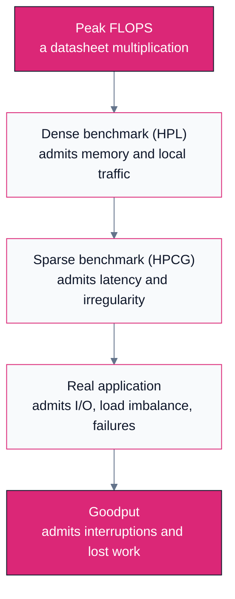
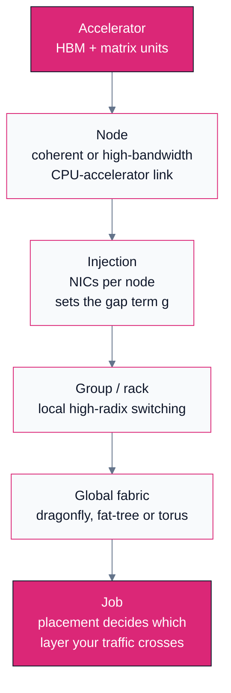
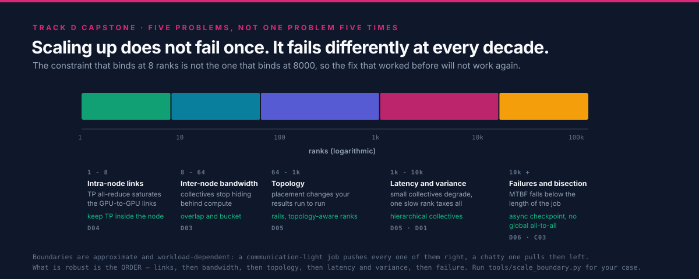
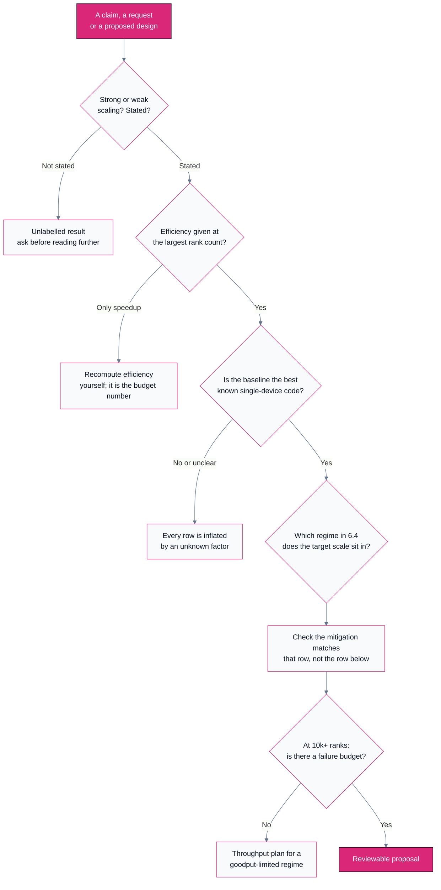

# D06 — Real Systems at Scale

> Track D · Module 06 · Status: **DONE** · Est. 6 hours · Depth 4/5
>
> Prerequisites: the rest of Track D.
> [D05](../D05.topology-and-scale-boundaries/README.md) supplies the topology vocabulary and
> [D01](../D01.scaling-limits-and-communication-cost/README.md) the cost model this module tests
> against reality.
>
> **Backends: none.** This is a reading-and-analysis capstone; the one tool in [`tools/`](tools/) is a
> pure-Python scale-boundary calculator. There is no GPU here and nothing to build — the skill being
> taught is reading a machine, a list entry and a published scaling claim without being fooled by any
> of them.
> Setup: [SETUP.md](../../../docs/SETUP.md) ·
> Terms: [GLOSSARY.md](../../../docs/GLOSSARY.md) · Sources: [REFERENCES.md](../../../docs/REFERENCES.md).

---

## 1. TL;DR + Layman analogy

**TL;DR.** Every module before this one derived a bound. This one asks whether the bounds describe
the machines people actually built, and the answer is yes, uncomfortably so. The reference systems of
the last decade — Frontier, El Capitan, Aurora, Fugaku, Summit, LUMI — differ enormously in their
processors and hardly at all in their *reasoning*: each one spends its design budget on moving data,
not on adding arithmetic. The same is true of the largest published ML training runs, where the
binding constraint at 16,000 accelerators is not throughput but **goodput**, because at that scale
something is always broken. The discipline this module teaches is narrower than it sounds: given a
system description, a list entry or a scaling plot, work out what was actually measured, under what
conditions, and which of Track D's constraints the designers were buying their way around.

**Layman analogy — the very large restaurant kitchen.**

A kitchen with two cooks is limited by the cooks. Hire two more and you serve roughly twice as many
covers. Keep hiring and something changes character: the limit stops being the cooking and becomes
everything around it.

- **The doorways.** Ingredients come in one door and plates leave through another. Past some
  headcount, the doors are busy every second of service and a new cook simply queues. That is
  [bisection bandwidth](../../../docs/GLOSSARY.md#bisection-bandwidth) — the capacity of the cut
  between one half of the kitchen and the other.
- **The runners.** Nobody cooks and fetches at the same time, so somebody has to carry. Runners are
  pure overhead that grows with the number of cooks, which is the network.
- **The head chef's call.** Every dish on a table must leave together, so the pass waits for the
  slowest plate. That is a collective, and it is why one slow cook taxes everyone
  ([straggler](../../../docs/GLOSSARY.md#straggler)).
- **The layout.** At 200 cooks you do not fix service by hiring 20 more. You rebuild the room:
  separate lines with their own doors, prep moved off the critical path, stations that never have to
  talk to each other. That rebuild is the topology, and it is what an exascale machine is.

This is why the largest computers are networking achievements rather than compute achievements. The
arithmetic units are, more or less, ones you can buy. The thing that is hard, expensive and
differentiating is the room they sit in.

**Where the analogy breaks.** Kitchens degrade gracefully: an overloaded pass gets slower and dinner
still arrives. A tightly-coupled parallel job usually does not. It runs at the speed of its worst
participant, and when a participant *dies* the whole job dies with it — so the real machines spend a
large fraction of their design effort on something the kitchen never needs, which is surviving
constant partial failure. The analogy also implies a single head chef; a well-built system has no
such point, because a global synchronization every step is precisely the thing that stops scaling
past a few thousand ranks.

**By the end of this module you can** read a public system description or a published scaling result,
name the constraint its architecture was built to defeat, and say which row of Track D's
scale-boundary ladder your own workload will land on.

---

## 2. First Principles

### 2.1 Peak is a multiplication; sustained is a measurement

**Peak FLOPS** is arithmetic performed on a datasheet: functional units, times clock, times issue
width, times device count. Nothing was run. It is a genuine upper bound and a useless prediction,
because it assumes every unit is fed every cycle — which requires infinite memory bandwidth and no
communication.

**Sustained performance** is what a program achieved, and it is always a fraction of peak. The
fraction depends on the *program*, not the machine, which is why a single "efficiency" number for a
system is meaningless without naming the workload:

| Layer | What it reports | What it assumes away |
|---|---|---|
| Peak FLOPS | Unit count times clock | Memory, network, everything |
| Dense linear algebra (HPL-like) | Compute-heavy, high reuse, mostly nearest-neighbour traffic | Sparsity, irregularity, global collectives |
| Sparse / irregular solvers (HPCG-like) | Memory- and latency-bound behaviour | Nothing much — which is why the numbers are far lower |
| Real application throughput | Science or tokens per unit time | Nothing; this is the only number a user experiences |

The ordering is the point and it is architectural, not incidental: each step down the table admits
one more constraint that the step above pretended did not exist. This is the same argument
[B02](../../B-gpu-ml-performance/B02.roofline-and-arithmetic-intensity/README.md) makes inside one
GPU, moved one level out.



Each arrow drops the reported number, sometimes by an order of magnitude or more. When a vendor,
a paper or a colleague quotes a figure, the first question is always **which box is it from**.

### 2.2 What the TOP500 and Green500 lists are for

The [TOP500 and Green500 lists](../../../docs/REFERENCES.md#top500-and-green500) are the only
long-running, publicly-submitted, uniformly-measured record of large systems that exists, and they
are genuinely valuable for that reason. They are also routinely over-read.

**What they do tell you.** A submitted, reproducible run of a defined benchmark on a named machine,
plus a structured specification of that machine: processor and accelerator model, node count,
interconnect family, and — for Green500 — measured power during the ranked run. The list is also a
historical series, so it is the right source for questions about *trends*.

**What they do not tell you.** TOP500's rank is ordered by HPL, a dense LU factorization. HPL has
very high arithmetic intensity, regular access, and almost no global communication; it is close to a
best case for the machine. A workload whose character is different — sparse, latency-bound,
collective-heavy, or memory-capacity-bound — will see a completely different fraction of peak, and
the ranking carries no information about it. The companion HPCG list, published alongside, exists
precisely because HPL flatters machines; the same systems record dramatically lower numbers on it.
Check the current lists rather than trusting any figure quoted from memory, including the ones in
this module's prose.

**Green500** re-ranks essentially the same submissions by performance per watt. It is a real
constraint made visible — at national scale, power delivery and cooling are a first-class design
input, not an operating detail — but it inherits every HPL caveat above, and it measures efficiency
during a dense compute benchmark rather than during your job.

> [!IMPORTANT]
> **List positions are edition-scoped facts.** A system's rank, and often its reported
> configuration, is a property of a specific list edition (published twice a year). "Number one" is
> a statement with a date attached. Everywhere this module mentions a ranking or a configuration, it
> names the source and the edition, and where it cannot, it describes the architecture qualitatively
> and sends you to [TOP500](../../../docs/REFERENCES.md#top500-and-green500) instead of asserting a
> number. That is a deliberate limitation of this document, not an oversight.

### 2.3 Why the Gordon Bell Prize is the better signal

The [ACM Gordon Bell Prize](../../../docs/REFERENCES.md#acm-gordon-bell-prize-acm) rewards
*applications*, not machines. Submissions must demonstrate real scientific throughput at scale, and
the award record is therefore a curated series of answers to the question this whole track asks: what
did people actually have to do to make a real code run on the largest machine of its year?

Three properties make it a better signal than a list rank for anyone planning work:

- **The unit is science, not FLOPS.** Entries are judged on delivered capability — simulated
  timescale, atoms, resolution, samples — so an algorithmic improvement counts exactly as much as a
  hardware one. That is the correct incentive and it is the opposite of a benchmark ranking.
- **The methodology is published.** Winning entries are papers. They document decomposition,
  precision choices, communication strategy and the machine configuration used, which makes them
  citable in a way a list row is not.
- **It surfaces the recurring techniques.** Read a decade of winners and the same short list appears
  repeatedly: reduced and mixed precision, communication-avoiding formulations, algorithmic
  surrogates that replace expensive physics with a cheaper learned or approximated model, and
  aggressive overlap. Section 3.8 collects them.

### 2.4 The honesty rule for this module

Every number in this module is either (a) attributed to a public source together with the conditions
it was measured under, or (b) absent, with the architecture described qualitatively instead. This
constraint costs the module some vividness and it is not negotiable: the failure mode it prevents —
a plausible, memorable, wrong number propagating into someone's capacity plan — is the exact failure
this curriculum exists to teach you to catch. Where you want current specifications, node counts,
FLOPS or rankings for any system named below, go to
[TOP500](../../../docs/REFERENCES.md#top500-and-green500) and read the current edition.

---

## 3. Deep Dive

Six systems follow, each as a short case study ending in the design lesson it teaches. They are
described from public documentation: processor and accelerator family, interconnect family, topology
class, and the constraint the design was built around. **Exact FLOPS, node counts, link rates and
list positions are deliberately omitted** — they are list-edition-dependent and vendor-published, and
the architecture is the transferable part anyway. Where public sources disagree or the author is not
certain, the text hedges rather than asserting.

### 3.1 The shared template

Before the differences, the similarity. Every system in this section is built as the same four-layer
hierarchy, and so is every large AI cluster:



Each boundary is roughly an order of magnitude cheaper to cross than the next one out. The entire
craft of running at scale is keeping traffic in the innermost layer that can hold it — which is what
[D05](../D05.topology-and-scale-boundaries/README.md) means by topology-aware placement, and what
[B07](../../B-gpu-ml-performance/B07.distributed-training-and-sharding/README.md) means when it puts
tensor parallelism inside a node and data parallelism across nodes.

### 3.2 Frontier (OLCF) — design the fabric first

**Architecture.** An HPE Cray EX system at Oak Ridge National Laboratory. Nodes pair an AMD EPYC CPU
with multiple AMD Instinct MI250X accelerators, connected within the node by AMD Infinity Fabric, and
between nodes by [HPE Slingshot](../../../docs/GLOSSARY.md#infiniband-roce-and-slingshot) in a
dragonfly arrangement. Frontier is the system that made exascale HPL a public fact; the milestone is
recorded in the [TOP500](../../../docs/REFERENCES.md#top500-and-green500) list series, and the exact
figures and current rank belong to a specific edition.

**What is interesting is what it is not.** The accelerators are not exotic — they are the vendor's
shipping data-center part. The differentiating engineering is in the interconnect, the packaging and
the power and cooling envelope: getting that many nodes into a room, keeping them fed, and giving
them a fabric whose bisection does not collapse under a global collective.
[De Sensi et al.](../../../docs/REFERENCES.md#slingshot-interconnect-analysis-de-sensi-et-al-2020)
published an independent measurement study of Slingshot, including its congestion-control behaviour,
which is worth reading precisely because it is *not* a vendor document; its dragonfly lineage traces
to [Kim et al.](../../../docs/REFERENCES.md#dragonfly-topology-kim-et-al-2008).

> **Design lesson.** At this scale, compute is procurement and the network is engineering. Design the
> fabric first and let it constrain the node, not the other way round.

### 3.3 El Capitan (LLNL) — remove the copy tax

**Architecture.** An HPE Cray EX system at Lawrence Livermore National Laboratory built on the AMD
Instinct MI300A, an APU that places CPU cores and GPU compute dies in one package behind **unified
HBM**, with Slingshot between nodes. The CDNA 3 generation's packaging and memory organization are
documented in AMD's [CDNA 3 whitepaper](../../../docs/REFERENCES.md#amd-cdna-3-whitepaper-amd); node
and rack-level topology conventions are in the
[Instinct cluster design reference](../../../docs/REFERENCES.md#amd-instinct-cluster-design-reference-amd).

**Why it matters.** In a discrete-accelerator node, every byte the CPU touches and the GPU needs
crosses a host-device link, and the programming model is organized around hiding that crossing:
pinned buffers, explicit copies, staging, prefetch. A unified-memory APU removes the copy rather than
hiding it. For workloads that are movement-bound rather than arithmetic-bound — irregular meshes,
codes with frequent CPU-side control, anything with poor locality — that is a structural win, not a
constant-factor one. For a workload that already had perfect overlap and huge on-device residency,
it changes much less.

> **Design lesson.** Unified memory pays where the workload is movement-bound. The right question is
> not "is unified memory faster" but "how much of my time is currently spent staging data across a
> boundary that would cease to exist".

### 3.4 Aurora (ALCF) — heterogeneity is fine if the model is uniform

**Architecture.** An HPE Cray EX system at Argonne National Laboratory combining Intel Xeon CPU Max
processors (which carry on-package high-bandwidth memory) with Intel Data Center GPU Max
accelerators, again over Slingshot. Public descriptions put multiple GPUs and multiple CPUs in each
node; consult ALCF's own documentation and the current TOP500 entry for the configuration, which has
been revised over the system's life.

**The transferable point.** A third accelerator vendor with a different instruction set, a different
memory hierarchy and a different software stack did not require a third way of thinking about the
machine. The decomposition, the collective algorithms and the topology reasoning carry over
unchanged, because the *programming model* (offload plus message passing) and the *fabric* are the
same as its peers. Heterogeneity is expensive when it fragments the programming model and cheap when
it does not.

> **Design lesson.** Vendor diversity is manageable when the programming model and the fabric stay
> uniform. The portability problem is a software-stack problem, not a physics problem.

### 3.5 Fugaku (RIKEN and Fujitsu) — balance beats peak

**Architecture.** The outlier, and the most instructive one. Fugaku uses Fujitsu A64FX processors —
Arm with SVE vector extensions and **on-package HBM** — and has **no discrete accelerators at all**.
Nodes are connected by TofuD, a six-dimensional mesh/torus descended from the design
[Ajima et al.](../../../docs/REFERENCES.md#tofu-6d-meshtorus-interconnect-ajima-et-al-2009)
published for the K computer, with multiple links per node and built-in fault tolerance through
dimensional redundancy.

**Why a torus, when everyone else buys a fat-tree.** Because the workloads it was built for are
nearest-neighbour. A structured-mesh halo exchange only ever talks to adjacent ranks, and a torus
wires exactly those neighbours directly and cheaply; you are not paying for global bandwidth you will
never use. The cost is diameter — a global collective on a torus crosses many hops — so the topology
is excellent for the traffic it was chosen for and poor for a global all-reduce every step. This is
the same trade [D05](../D05.topology-and-scale-boundaries/README.md) analyses in the abstract, made
concrete at national scale, and it is why "which topology is best" is not a well-formed question
without a traffic pattern. Fugaku also demonstrates that a machine can be extremely productive on
real applications without leading on accelerator peak: memory bandwidth per core and injection
bandwidth per node were treated as first-class design targets.

> **Design lesson.** Balance — bandwidth per flop, injection per node, topology matched to traffic —
> beats peak FLOPS on real applications. Topology-aware placement is a design input here, not a
> tuning knob.

### 3.6 Summit (OLCF) — the template AI clusters still copy

**Architecture.** An IBM system at Oak Ridge pairing POWER9 CPUs with NVIDIA V100 GPUs, notable for
using **NVLink between CPU and GPU** rather than PCIe, and connected by dual-rail Mellanox InfiniBand
in a [fat-tree](../../../docs/GLOSSARY.md#fat-tree-dragonfly-and-torus) — the topology
[Leiserson](../../../docs/REFERENCES.md#fat-trees-leiserson-1985) introduced.

**Why it is the template.** Look at a modern AI training cluster and you are looking at Summit's
shape: a small number of accelerators per node on a fast coherent or near-coherent intra-node fabric,
a multi-rail RDMA network between nodes, and a fat-tree above. The
[rail-optimized](../../../docs/GLOSSARY.md#rail-optimized-network) designs in
[D05](../D05.topology-and-scale-boundaries/README.md) are a refinement of the dual-rail idea, and
GPUDirect-style RDMA paths are the direct descendant
of wanting the NIC to reach GPU memory without staging. Summit is also where several Gordon Bell
entries demonstrated that **reduced precision was the route to order-of-magnitude application gains**
— the technique that later became routine in ML under the name
[mixed precision](../../../docs/REFERENCES.md#mixed-precision-training-micikevicius-et-al-2017).

> **Design lesson.** A coherent CPU-accelerator link plus a multi-rail fat-tree is a durable answer.
> Most of what an AI cluster does differently is a change of degree, not of kind.

### 3.7 LUMI (EuroHPC) — sustainability is architecture

**Architecture.** An HPE Cray EX system hosted in Kajaani, Finland, with AMD EPYC CPUs and AMD
Instinct MI250X accelerators over Slingshot — architecturally close to Frontier's GPU partition,
which makes it a useful control. Its distinguishing property is not compute at all: LUMI is
**warm-water liquid cooled** and publicly documented as feeding its waste heat into the local
district heating network, running on regional low-carbon electricity. It has been a repeated presence
near the top of the [Green500](../../../docs/REFERENCES.md#top500-and-green500) list; check the
current edition for its position.

**Why this belongs in a performance track.** Power is a hard cap, not a line item. At national scale
the question stops being "how many nodes can we afford to buy" and becomes "how many can we afford to
*power and cool*", and once cooling is on the critical path it dictates rack density, which dictates
cable lengths, which dictates topology. Warm-water cooling removes chillers from the loop and turns
waste heat into a product rather than a cost. Sustainability here is not corporate garnish; it
changes the total-cost-of-ownership arithmetic that decides what gets built.

> **Design lesson.** Power and cooling are architectural inputs. A design that ignores them produces
> a machine that cannot be sited.

### 3.8 The comparison, and the lessons that recur

| System | Site | Accelerator | Interconnect | Topology class | Design lesson |
|---|---|---|---|---|---|
| Frontier | OLCF | AMD Instinct MI250X | HPE Slingshot | Dragonfly | Exascale is a networking and packaging achievement; design the fabric first |
| El Capitan | LLNL | AMD Instinct MI300A (APU, unified memory) | HPE Slingshot | Dragonfly | Unified CPU+GPU memory removes the copy tax when the workload is movement-bound |
| Aurora | ALCF | Intel Data Center GPU Max | HPE Slingshot | Dragonfly | Heterogeneity is manageable when the programming model and fabric are uniform |
| Fugaku | RIKEN | None (A64FX CPU with on-package HBM) | Tofu-D | 6D mesh/torus | Balance beats peak FLOPS; topology-aware placement is central |
| Summit | OLCF | NVIDIA V100 (NVLink to POWER9 CPU) | Dual-rail InfiniBand | Fat-tree | The coherent-link plus fat-tree template most AI clusters still copy |
| LUMI | EuroHPC | AMD Instinct MI250X | HPE Slingshot | Dragonfly | Sustainability is architecture; power and cooling change the TCO maths |

Configurations are as publicly described by the operating sites and vendors; for current
specifications and rankings see [TOP500](../../../docs/REFERENCES.md#top500-and-green500).

**Recurring lesson 1 — the fabric is the bottleneck.** Five of the six systems above chose their
interconnect as the primary design decision and their accelerator second. This is exactly what
[D01](../D01.scaling-limits-and-communication-cost/README.md#2-first-principles) predicts: the
compute term divides by rank count and the communication term does not, so at sufficient scale the
machine is defined by its network.

**Recurring lesson 2 — algorithmic surrogates beat more FLOPs.** The order-of-magnitude results in
the [Gordon Bell](../../../docs/REFERENCES.md#acm-gordon-bell-prize-acm) record generally do not come
from running the same algorithm on more hardware. They come from changing what is computed: machine-
learned interatomic potentials standing in for first-principles quantum calculations in molecular
dynamics, implicit and multigrid solvers replacing explicit time-stepping, adaptive resolution
concentrating work where the physics is interesting. A cheaper algorithm with acceptable accuracy
beats a faster machine, every time, and it is available to you without a procurement.

**Recurring lesson 3 — mixed precision is a bandwidth technique.** Reduced precision is usually
introduced as an arithmetic-throughput story, but at scale its more important effect is that it
halves or quarters the *bytes* — in HBM, across the node, and across the wire. Since section 3.1's
hierarchy is bandwidth-limited at every boundary, precision reduction relieves all of them at once.
The mechanics of doing it without destroying convergence are in
[Micikevicius et al.](../../../docs/REFERENCES.md#mixed-precision-training-micikevicius-et-al-2017).

**Recurring lesson 4 — communication-avoiding and overlapping algorithms become mandatory.** Below
roughly 10^3 ranks you can usually get away with a straightforward implementation and a good library.
Somewhere around 10^4 ranks the latency term of any global operation, plus the variance term from
[D01 section 3.4](../D01.scaling-limits-and-communication-cost/README.md#3-deep-dive), makes
naive global synchronization untenable. The survivors restructure: hierarchical collectives, reduced
synchronization frequency, communication overlapped with compute by construction rather than by luck,
and in the extreme, formulations that provably move less data even at the cost of redundant
arithmetic. The threshold is a rough order of magnitude, not a constant — it depends on message size
and fabric, and the tool in section 4 estimates it for a described workload.

**Recurring lesson 5 — coherent or unified memory removes overhead rather than hiding it.** El
Capitan's APU and Summit's NVLink CPU-GPU link are the same idea a generation apart: make the
boundary cheap instead of building elaborate machinery to hide it.

**Recurring lesson 6 — resilience is designed in.** Fault tolerance appears in the *interconnect*
(TofuD's dimensional redundancy, adaptive routing around a failed link), in the scheduler
([Slurm](../../../docs/REFERENCES.md#slurm-workload-manager-schedmd) draining unhealthy nodes before
a job lands on them), and in the application (checkpoint cadence chosen against measured failure
rates). None of it is retrofittable at the point where you need it.

### 3.9 The ML case study: when failure becomes the steady state

The clearest public account of an ML training run at this scale is the
[Llama 3 paper](../../../docs/REFERENCES.md#the-llama-3-herd-of-models-grattafiori-et-al-2024), which
documents training at the 16,000-GPU scale on a fat-tree-style RDMA cluster and — unusually, and to
the authors' credit — publishes its reliability statistics rather than only its throughput.

The paper reports, for a 54-day snapshot of pre-training, several hundred job interruptions, the
large majority of them unplanned, with hardware faults (GPUs and their memory prominent among them)
the leading cause; it also reports the effective training time achieved despite that. Read the paper
for the exact counts and the breakdown by cause — they are that run's figures for that cluster and
that period, and quoting them out of context is precisely the error section 2.4 warns about.

The structural conclusion does transfer, and it is the most important idea in this module:

> At sufficient scale, **failure is not an exception; it is the operating regime.** The engineering
> objective stops being peak throughput and becomes **goodput** — useful work completed per unit of
> wall-clock time, after subtracting detection time, restart time and work lost since the last
> checkpoint.

Goodput reframes several decisions that look unrelated:

| Decision | Throughput framing | Goodput framing |
|---|---|---|
| Checkpoint interval | Overhead to be minimized | Balance against expected lost work per failure |
| Failure detection | An operations concern | On the critical path; slow detection costs whole-cluster time |
| Node health checks | Pre-job hygiene | Cheaper than discovering the fault mid-step |
| Job size | Bigger is faster | Bigger has a shorter mean time between interruptions |
| Elastic or redundant capacity | Idle hardware | Restart without waiting for a scheduler cycle |

The last row is the counter-intuitive one, and it is arithmetic rather than taste: if the expected
time between interruptions falls below the time to complete a job, then without checkpoint-and-resume
the job has essentially no chance of finishing, no matter how fast it runs. The mechanics —
checkpoint sizing and cadence, asynchronous and sharded checkpointing, failure detection and elastic
restart — are owned by
[C03](../../C-ml-system-design/C03.training-systems/README.md), and the sharding strategies whose
communication volume determines how much state there is to save are in
[B07](../../B-gpu-ml-performance/B07.distributed-training-and-sharding/README.md).

Note also what the ML cluster shares with the HPC systems above: the same
[fat-tree](../../../docs/REFERENCES.md#fat-trees-leiserson-1985) lineage, the same rail structure,
the same insistence on RDMA, and the same conclusion that the network is the design. The parallelism
strategies stacked on top of it —
[tensor parallelism](../../../docs/REFERENCES.md#megatron-lm-shoeybi-et-al-2019) inside a node,
[sharded optimizer state](../../../docs/REFERENCES.md#zero-rajbhandari-et-al-2020) across nodes — are
placement decisions in exactly the sense of section 3.1.

---

## 4. Hands-On Labs

This is an analysis capstone. There is no kernel to compile and no cluster to book; the labs are a
calculator, a structured reading exercise and a diagnostic drill. The calculator is pure Python from
the standard library and runs on a laptop.

```bash
cd tracks/D-distributed-computing/D06.real-systems-at-scale
make run          # runs the three built-in presets through the calculator
```

Like every analytic tool in this track, it prints a banner marking its output as a **model, not a
measurement**.

### Lab 1 — Predict where a described workload stops scaling

**Goal:** turn Track D's five constraints into one prediction for a specific workload.

```bash
python3 tools/scale_boundary.py --preset dp-training --ranks 4096
```

Then describe your own workload rather than a preset:

```bash
python3 tools/scale_boundary.py \
    --ranks 8192 \
    --model-bytes 14000000000 \
    --compute-ms 300 \
    --serial-fraction 0.005 \
    --alpha-us 3 \
    --bandwidth-gbs 25 \
    --gpus-per-node 8 \
    --node-mtbf-hours 50000 \
    --job-hours 720
```

It prints, per regime from one node to the requested rank count: the modelled step time split into
compute, collective-latency, collective-bandwidth and variance terms; the parallel efficiency; the
**binding constraint** named for each regime; the predicted knee (the rank count where efficiency
crosses `--efficiency-target`, default 0.5); and an expected-interruptions estimate for the job from
the MTBF and rank count. Add `--json` for machine-readable output.

**What to observe:** the binding constraint *changes* as rank count grows, and the mitigation changes
with it. A workload that is bandwidth-bound at 64 ranks may be variance-bound at 4,096 and
failure-bound at 32,768 — three different problems wearing the same symptom ("it stopped scaling").
Then re-run with `--bandwidth-gbs` doubled and note how little the largest regime moves; that is
recurring lesson 4 arriving as arithmetic.

### Lab 2 — Read a list entry like an architect

**Goal:** extract design decisions from a public specification instead of a ranking.

Open the current [TOP500](../../../docs/REFERENCES.md#top500-and-green500) list, pick one system that
is *not* in section 3.8, and fill in the worksheet in
[`exercises/read_a_list_entry.md`](exercises/read_a_list_entry.md). Record, from public sources only:

1. Accelerator family, and whether the CPU-accelerator link is coherent, high-bandwidth, or PCIe.
2. Interconnect family and, if published, the topology class.
3. Node composition: accelerators per node, and NICs per node if you can find it (this is the
   injection-gap term from [D01](../D01.scaling-limits-and-communication-cost/README.md#3-deep-dive)).
4. Its Green500 position in the same list edition, and whether the ordering differs from TOP500.
5. Whether HPCG results exist for it, and the ratio to its HPL figure.
6. **The design lesson** — one sentence, in the style of section 3.8, naming the constraint the
   design was built to defeat.

**What to observe:** items 1 to 3 are usually easy to find and are the ones that determine your
experience of the machine. The rank is the easiest thing to find and the least useful. Also note how
often the TOP500 and Green500 orderings disagree, and ask what design choice explains each
disagreement.

### Lab 3 — Diagnose the system

**Goal:** go from a symptom to a binding constraint without guessing.

[`exercises/diagnose_the_system.md`](exercises/diagnose_the_system.md) contains eight scenarios in
the form "at scale X, symptom Y". For each one, name the binding constraint, the measurement that
would confirm it, and the mitigation — then check your reasoning against the calculator:

```bash
python3 tools/scale_boundary.py --preset hpc-halo --ranks 65536 --explain
python3 tools/scale_boundary.py --preset llm-16k --ranks 16384 --explain
```

`--explain` adds a sentence per regime naming the term that dominates and why, and cites the Track D
module that covers it.

**What to observe:** several scenarios have more than one consistent explanation, which is the point.
The deliverable is not the answer but the *discriminating measurement* — a zero-byte collective
isolates latency, per-rank arrival timing isolates variance, and a collective run in isolation
isolates bandwidth. Any diagnosis that cannot name the measurement that would falsify it is a guess.

---

## 5. Performance Analysis

> [!NOTE]
> **This section introduces no new measurements and quotes no new figures.** It is a synthesis of the
> rules the rest of Track D established, assembled into the checklist you apply to somebody else's
> results. Every figure referenced anywhere in this module comes from a public source cited in
> section 8, together with the conditions under which it was measured; the calculator in section 4
> emits models, and says so.

### 5.1 Comparing published scaling results honestly

[D01 section 5.2](../D01.scaling-limits-and-communication-cost/README.md#5-performance-analysis)
gives three questions. At the scale of published, cross-system comparisons they need reinforcing,
because the ways a comparison goes wrong multiply:

- **Strong or weak?** Under
  [weak scaling](../../../docs/GLOSSARY.md#strong-scaling-and-weak-scaling), near-linear speedup is
  the expected result and carries almost no information; under strong scaling the same curve is a
  strong claim. A plot that does not say which one it is should be treated as unlabelled.
- **Efficiency, not speedup.** Speedup grows monotonically and always looks like progress.
  Efficiency at the largest rank count is what you are buying, and it is the number that belongs in
  a capacity request.
- **What is the baseline?** Speedup against a deliberately weak single-device implementation inflates
  every row. The honest baseline is the best known implementation on one device. When comparing two
  *systems*, the baselines must be equally good on both, which is rare and is the single most common
  defect in cross-vendor comparisons.
- **What precision, and is it the same on both sides?** A comparison across precisions is a
  comparison of different computations. It may still be legitimate — if accuracy is shown to be
  adequate — but it must be stated.
- **What problem size, and does it fit differently?** A problem that fits in one machine's memory and
  spills on another is measuring capacity, not speed.
- **Is the reported time the whole job?** Excluding I/O, setup, checkpointing or the first
  (compilation-heavy) iteration is common and rarely disclosed.
- **Which run is it?** A best-of-N result on a quiet machine is not a number you will reproduce on a
  shared one. At scale, the *distribution* of run times matters more than its minimum, because your
  job will meet the tail.

### 5.2 A comparison worth making, and one that is not

**Worth making:** the same application, same problem size, same precision, same accuracy target, run
on two systems, reported as time-to-solution with the machine configuration and node hours for each.
This answers a real question.

**Not worth making:** peak FLOPS ratios, HPL ratios used to predict a different application, or two
different applications from two vendors' marketing pages. These answer no question anyone has.

### 5.3 What "the fabric is the bottleneck" looks like in a report

You can usually spot it without access to the machine:

- Speedup that is close to linear up to one node, then bends sharply at the node boundary.
- Efficiency that falls in a stair pattern, with steps at the rack or group boundary — the fingerprint
  of crossing a [topology](../../../docs/GLOSSARY.md#fat-tree-dragonfly-and-torus) tier.
- Results that improve materially when ranks are reordered without any code change, which is a pure
  placement effect and evidence of
  [oversubscription](../../../docs/GLOSSARY.md#oversubscription) somewhere above the node.
- A collective time that is flat across rank counts (bandwidth-bound and healthy) versus one growing
  with rank count (latency- or variance-bound, and worth attacking).

---

## 6. Challenges, Drawbacks & Tradeoffs

### 6.1 The limits of reasoning from case studies

This module's method — read the systems that exist, extract the lessons — has real failure modes, and
they are worth naming explicitly because they apply to every architecture-review conversation you
will have.

| Bias | What it does | The correction |
|---|---|---|
| **Survivorship** | You only read about systems that were built, funded and worked. Cancelled designs and disappointing ones do not publish, so the sample is filtered toward success | Ask what the design *gave up*, and look for the constraint that is missing from the story |
| **Vendor best-case** | Vendor-published figures are correct and best-case: ideal problem, tuned code, healthy machine, favourable precision | Prefer independent measurement studies and published application results; note the conditions |
| **Benchmark proxy error** | List rank measures HPL. Your workload is not HPL | Use HPL to bound, never to predict. Look for HPCG and real-application results |
| **Architecture cargo-culting** | Copying a machine's shape without copying its workload | Start from your traffic pattern and derive the topology, as [D05](../D05.topology-and-scale-boundaries/README.md) does |
| **Scale extrapolation** | Assuming behaviour at 256 ranks predicts 8,192 | The binding constraint *changes* between regimes; see 6.4 |
| **Recency** | The newest system is assumed to be the best model | Fugaku and Summit teach lessons the newest systems do not |

The cargo-culting row is the expensive one. A dragonfly with adaptive routing is an excellent answer
to a global-collective-heavy workload at scale and an unnecessary expense for a nearest-neighbour
code that a torus would serve; a rail-optimized fat-tree tuned for all-reduce is a poor fit for an
all-to-all-dominated workload. Copying an architecture without copying its workload is how
organizations build expensive mismatches — and the mismatch is usually invisible until the machine is
installed.

### 6.2 What the public record does not contain

Be honest about the gaps, because they bound what any case-study analysis can conclude:

- **Failure and availability data is rarely published.** The Llama 3 paper is notable precisely
  because it published some; most operators do not.
- **Achieved utilization over a machine's life is almost never published.** Acceptance-test numbers
  are; the number that matters to a user is not.
- **Software effort is invisible.** How many person-years went into making an application scale is
  the largest hidden cost in every case study here.
- **Negative results are missing.** The approaches that did not work at scale are the most useful
  information and the least likely to be written down.

### 6.3 Tradeoffs the six systems actually made

Every design lesson in section 3 is a choice with a cost:

| Choice | Buys | Costs |
|---|---|---|
| Fabric-first design | Scaling headroom, tolerable global collectives | Capital and power spent on network rather than compute |
| Unified memory (APU) | No host-device copy; simpler model | Package-level capacity and configuration flexibility constrained |
| Torus over fat-tree | Cheap nearest-neighbour bandwidth; cost scales gently | Large diameter; global collectives and all-to-all suffer |
| Multi-vendor accelerators | Supply resilience, competitive pricing | Software-stack surface area; portability work is permanent |
| Warm-water cooling | Lower power overhead, heat reuse, higher density | Site and plumbing constraints; a serviceability burden |
| No discrete accelerator | Uniform programming model, strong balance | Lower peak arithmetic per node for dense workloads |

### 6.4 The consolidated scale-boundary table

This is the capstone artifact of Track D: every module's boundary analysis in one ladder. Each row is
a regime, and the transition between rows is where the *problem changes identity* — which is why an
optimization that worked one row up frequently does nothing on the next.



| Regime | Binding constraint | First symptom | Mitigation | Covered in |
|---|---|---|---|---|
| **1 node (1-8 ranks)** | Intra-node links ([NVLink, xGMI, Infinity Fabric](../../../docs/GLOSSARY.md#nvlink-xgmi-and-infinity-fabric)); host-device staging | Tensor-parallel all-reduce stalls; copies visible in the timeline | Raise arithmetic intensity; keep TP in-node; unified or coherent memory where available | [D04](../D04.interconnects-and-rdma/README.md) |
| **8-64 ranks** | Inter-node bandwidth; injection gap (NICs per node) | Communication stops hiding behind compute; step time flattens | Overlap and bucket gradients; one NIC per GPU; RDMA instead of staged copies | [D03](../D03.gpu-collectives-nccl-and-rccl/README.md), [D04](../D04.interconnects-and-rdma/README.md) |
| **64-1k ranks** | Topology tier and [oversubscription](../../../docs/GLOSSARY.md#oversubscription) | Identical jobs give different times; placement changes results | [Rail-optimized](../../../docs/GLOSSARY.md#rail-optimized-network) fabric; topology-aware rank ordering; keep collectives within a group | [D05](../D05.topology-and-scale-boundaries/README.md) |
| **1k-10k ranks** | Latency term and step count; [straggler](../../../docs/GLOSSARY.md#straggler) variance | Small collectives degrade; the slowest rank sets every step | Hierarchical and reduced-step collectives; health-gated scheduling; clock and core pinning | [D01](../D01.scaling-limits-and-communication-cost/README.md), [D05](../D05.topology-and-scale-boundaries/README.md) |
| **10k-100k ranks** | Failure rate; [bisection bandwidth](../../../docs/GLOSSARY.md#bisection-bandwidth) | MTBF approaches job length; all-to-all patterns collapse | Asynchronous and sharded checkpointing; elastic restart; avoid global collectives; communication-avoiding formulations | **This module**, [C03](../../C-ml-system-design/C03.training-systems/README.md) |
| **100k+ ranks** | Goodput: detection, restart and lost work dominate | Wall-clock progress diverges from throughput; the cluster is busy and the job is not advancing | Design for continuous partial failure: redundancy, fast detection, frequent cheap checkpoints, and algorithms that tolerate a lost rank | **This module**, [C03](../../C-ml-system-design/C03.training-systems/README.md) |

Two properties of this table are worth stating outright. First, **the rank boundaries are soft** —
they depend on message size, fabric and workload, and the calculator in section 4 places them for a
specific workload rather than assuming these. Second, **the mitigations are not cumulative
improvements but different problems**: hierarchical collectives do nothing for a failure-bound job,
and checkpointing does nothing for an oversubscribed fabric. Knowing which row you are on is most of
the diagnosis.

---

## 7. Real-World Use Cases

**Reviewing a capacity request.** Somebody asks for 2,048 accelerators. The request is answerable
only if it states the workload's scaling character, its expected efficiency at that count, and the
predicted knee. Run the calculator against their numbers before the meeting. The common outcome is
not "no" — it is that half the requested capacity delivers most of the value, and the remaining half
is better spent on the fabric, on engineering time to overlap communication, or on a cheaper
algorithm.

**Reviewing a proposed cluster architecture.** The design decisions that matter are, in order:
accelerators per node and the intra-node link; NICs per node and whether the path to GPU memory is
zero-copy; topology and oversubscription ratio above the node; power and cooling envelope; and only
then the accelerator model. A proposal that leads with peak FLOPS has ordered these backwards.

**Evaluating a vendor claim.** Apply section 5.1 in order and write the answers down. Most claims
survive three questions and fail the fourth, and the useful output of the exercise is not a verdict
but a list of the conditions under which the claim holds.

**Planning a large training run.** At the top two rows of the table in 6.4, the plan needs a failure
budget before it needs a throughput target: expected interruptions over the job's length, checkpoint
cost and cadence, detection and restart time, and the resulting goodput. That is
[C03](../../C-ml-system-design/C03.training-systems/README.md)'s subject; this module's contribution
is knowing that you have crossed into the regime where it is the *first* question rather than the
last.

### 7.1 A reviewer's checklist



Six questions, in order, that a reviewer can run in ten minutes:

1. What is the workload, and is its scaling strong or weak?
2. What is the **efficiency** at the target rank count — not the speedup?
3. What is the baseline, and is it the best known single-device implementation?
4. Which row of the table in 6.4 does the target scale fall on, and does the proposed mitigation
   belong to that row?
5. What crosses the node boundary every step, how many bytes, and can it overlap?
6. At or above 10^4 ranks: what is the failure budget, the checkpoint cadence, and the resulting
   goodput?

**Where to go next.** For the ML-specific consequences of everything above, go to
[B07](../../B-gpu-ml-performance/B07.distributed-training-and-sharding/README.md), which turns the
placement reasoning of section 3.1 into concrete sharding decisions across the four parallelism axes,
and to [C03](../../C-ml-system-design/C03.training-systems/README.md), which owns checkpointing,
failure detection and elastic restart — the machinery that section 3.9 argues becomes the primary
design concern at scale. Then
[C07](../../C-ml-system-design/C07.capstone-case-studies/README.md) puts the whole curriculum
together on end-to-end case studies, where you get to make these calls yourself rather than review
somebody else's. Cached transcripts from the single-node labs elsewhere in this track, with their
hardware labelled, are under [`outputs/`](../../../outputs/README.md).

---

## 8. Cited References

Shared sources, linked by anchor from [REFERENCES.md](../../../docs/REFERENCES.md):

- [TOP500 and Green500](../../../docs/REFERENCES.md#top500-and-green500) — the system-specification
  and energy-efficiency rankings discussed in section 2.2 and the source to consult for any current
  figure or position for the systems in section 3. Rankings and reported configurations are scoped to
  a list edition.
- [ACM Gordon Bell Prize](../../../docs/REFERENCES.md#acm-gordon-bell-prize-acm) — the
  real-application award record argued for in section 2.3 and the source of the recurring techniques
  in section 3.8.
- [Slingshot interconnect analysis (De Sensi et al., 2020)](../../../docs/REFERENCES.md#slingshot-interconnect-analysis-de-sensi-et-al-2020)
  — an independent measurement study of the fabric shared by four of the six systems in section 3.
- [Dragonfly topology (Kim et al., 2008)](../../../docs/REFERENCES.md#dragonfly-topology-kim-et-al-2008)
  — the topology lineage behind Slingshot-based systems, section 3.2.
- [Tofu 6D mesh/torus (Ajima et al., 2009)](../../../docs/REFERENCES.md#tofu-6d-meshtorus-interconnect-ajima-et-al-2009)
  — the interconnect family used by Fugaku, section 3.5.
- [Fat-trees (Leiserson, 1985)](../../../docs/REFERENCES.md#fat-trees-leiserson-1985) — the topology
  behind Summit and most AI clusters, sections 3.6 and 3.9.
- [The Llama 3 herd of models (Grattafiori et al., 2024)](../../../docs/REFERENCES.md#the-llama-3-herd-of-models-grattafiori-et-al-2024)
  — the public 16k-GPU training account and its interruption statistics, section 3.9. The figures are
  that run's, for that cluster and that snapshot period.
- [Mixed Precision Training (Micikevicius et al., 2017)](../../../docs/REFERENCES.md#mixed-precision-training-micikevicius-et-al-2017)
  — the precision technique behind recurring lesson 3.
- [Megatron-LM (Shoeybi et al., 2019)](../../../docs/REFERENCES.md#megatron-lm-shoeybi-et-al-2019)
  and [ZeRO (Rajbhandari et al., 2020)](../../../docs/REFERENCES.md#zero-rajbhandari-et-al-2020) —
  the parallelism strategies layered onto the hierarchy of section 3.1.
- [AMD CDNA 3 whitepaper](../../../docs/REFERENCES.md#amd-cdna-3-whitepaper-amd) and the
  [AMD Instinct cluster design reference](../../../docs/REFERENCES.md#amd-instinct-cluster-design-reference-amd)
  — packaging, memory organization and node/rack topology conventions referenced in section 3.3.
- [Slurm Workload Manager](../../../docs/REFERENCES.md#slurm-workload-manager-schedmd) — health-gated
  scheduling and topology-aware placement, section 3.8.
- [Amdahl 1967](../../../docs/REFERENCES.md#amdahls-law-amdahl-1967),
  [Gustafson 1988](../../../docs/REFERENCES.md#reevaluating-amdahls-law-gustafson-1988),
  [Hockney 1994](../../../docs/REFERENCES.md#the-hockney-alpha-beta-model-hockney-1994),
  [Patarasuk and Yuan 2009](../../../docs/REFERENCES.md#bandwidth-optimal-all-reduce-patarasuk-and-yuan-2009)
  and [Thakur, Rabenseifner and Gropp 2005](../../../docs/REFERENCES.md#collective-algorithms-in-mpich-thakur-rabenseifner-and-gropp-2005)
  — the cost model from [D01](../D01.scaling-limits-and-communication-cost/README.md) that this
  module tests against real systems.

**Module-specific note on figures.** This module deliberately publishes no FLOPS, node count, link
rate or list position for any named system. Those values are list-edition-dependent and
vendor-published; the architecture, which is the transferable part, is described qualitatively
instead and attributed to public documentation from the operating sites and vendors. Where you need a
number, take it from the current TOP500 or Green500 edition, or from the operating site's own
documentation, and record the edition and retrieval date alongside it. The calculator in section 4
emits **models, not measurements**, and says so in its own banner.

---

## 9. Self-Assessment & Interview Drills

### Conceptual

1. A vendor quotes a machine's peak FLOPS and its HPL result. What can you conclude about how your
   sparse, collective-heavy application will perform on it?
2. Two systems have nearly identical accelerators and very different interconnects. Under what
   workload will they perform about the same, and under what workload will the difference be large?
3. Fugaku has no discrete accelerators and chose a 6D mesh/torus. Explain why that is a coherent
   design rather than a compromise, and name the workload for which it is the wrong choice.
4. Why is "failure is the steady state" a statement about *scale* rather than about hardware quality?
5. Your organization proposes to copy the architecture of a well-known cluster. What is the first
   question you should ask, and what failure does it prevent?
6. A published result reports 89% scaling efficiency at 8,192 ranks. Name three things that could be
   true which would make this unimpressive, and the one question that separates them.

<details markdown="1">
<summary>Answers</summary>

1. **Almost nothing directly, and one useful bound.** Peak is a datasheet multiplication and HPL is a
   dense, high-intensity, communication-light benchmark — close to the machine's best case. Both are
   upper bounds for your application and neither predicts it, because a sparse collective-heavy code
   is limited by memory latency, message rate and global synchronization, none of which HPL
   exercises. The useful bound is that you will not exceed HPL's fraction of peak. The right sources
   are the HPCG result for the same machine, published application results, and ideally your own
   benchmark on a small allocation.

2. They perform about the same when the workload fits inside a node or communicates rarely — a
   throughput-oriented inference service, an embarrassingly parallel sweep, or a single-node training
   job. The difference becomes large as soon as a **global** operation lands on the critical path
   every step, or when the traffic pattern crosses topology tiers: all-reduce every step, all-to-all
   in expert routing, or any code whose ratio of FLOPs to bytes-across-the-network is low. This is
   the roofline argument moved one level out — the same accelerator with a different bandwidth number
   underneath it.

3. It is coherent because topology is only good or bad relative to a **traffic pattern**. Fugaku was
   built for structured-mesh applications whose communication is nearest-neighbour halo exchange; a
   torus wires exactly those neighbours directly, so you pay for the bandwidth you use and not for
   global bandwidth you never touch, and the cost scales gently with node count. The absence of
   discrete accelerators follows the same logic: on-package HBM with high bandwidth per core gives a
   balanced machine for memory-bound codes without a host-device boundary to hide. It is the wrong
   choice for a workload dominated by dense arithmetic and a global collective every step —
   data-parallel deep learning — where the torus's diameter becomes the cost and the missing matrix
   throughput becomes the ceiling.

4. Because it follows from arithmetic that has nothing to do with component quality. If each node has
   some mean time between failures, a job spanning N nodes for H hours faces an expected number of
   interruptions that grows with both N and H. Improving per-node reliability moves the threshold; it
   cannot remove it, because N grows faster than reliability improves. So at sufficient scale a job
   that runs for weeks *will* be interrupted repeatedly with excellent hardware, and the correct
   response is architectural — checkpointing, fast detection, elastic restart, algorithms that
   tolerate a lost rank — rather than procurement. The objective changes from throughput to goodput.

5. **"What is our traffic pattern, and is it the same as theirs?"** The reference cluster's shape —
   its topology, its oversubscription ratio, its rail structure, its accelerators per node — was
   derived from a workload. Copy the shape without the workload and you buy an expensive mismatch:
   global-collective bandwidth for a nearest-neighbour code, or a torus for a job that all-reduces
   every step. The failure it prevents is the one that is invisible until the machine is installed
   and the acceptance benchmark, which is usually HPL, passes.

6. Three ways 89% at 8,192 ranks could be unimpressive:
   - It is **weak scaling**, so the problem grew 8,192-fold as well; near-linear is the expected
     result and the number says little about the code.
   - The **baseline is weak** — a deliberately poor single-rank or small-scale reference inflates
     every point on the curve.
   - The measured region **excludes the expensive parts**: I/O, setup, checkpointing, or the first
     iteration, or it is a best-of-N run on a drained machine that no production job will see.

   The single most discriminating question is **"strong or weak, and what is the baseline?"** — it is
   two clauses but one question, because a weak-scaling curve against a strong baseline and a
   strong-scaling curve against a weak one are the two ways the same number means opposite things.

</details>

### Analysis drills

These are analysis exercises rather than coding ones; this is a reading capstone.

1. **Place your own workload on the ladder.** Using
   [`exercises/scale_boundary.py`](exercises/scale_boundary.py), complete the TODOs so the model
   returns, for a given rank count, the dominant term and the named binding constraint from the table
   in 6.4. Then run it on a workload you actually care about and write down which row you are on, the
   predicted knee, and the one mitigation that belongs to that row. Handle `ranks < 1` and a
   `serial_fraction` outside `[0, 1]` by raising `ValueError` with a one-line message rather than
   returning nonsense.

2. **Read a list entry.** Complete [`exercises/read_a_list_entry.md`](exercises/read_a_list_entry.md)
   for one system not covered in section 3.8, using only public sources, and record the list edition
   and retrieval date for every figure you write down. Finish with a one-sentence design lesson in the
   style of section 3.8, and one sentence on what you could *not* determine from public sources.

3. **Diagnose eight systems.** Work through
   [`exercises/diagnose_the_system.md`](exercises/diagnose_the_system.md). For each scenario give the
   binding constraint, the **discriminating measurement**, and the mitigation. Mark any scenario
   where two constraints are equally consistent with the symptom, and say what you would measure
   first.

4. **Run an architecture review.** Using
   [`exercises/architecture_review.md`](exercises/architecture_review.md), review a proposed cluster
   design against the six-question checklist in section 7.1, then write the two-paragraph memo you
   would actually send: what the design is optimized for, and the one workload characteristic that
   would make it the wrong choice. Practise saying the second part plainly; it is the part that saves
   the money.

Starter files with TODOs are in [`exercises/`](exercises/); worked solutions with commentary are in
[`solutions/`](solutions/).
