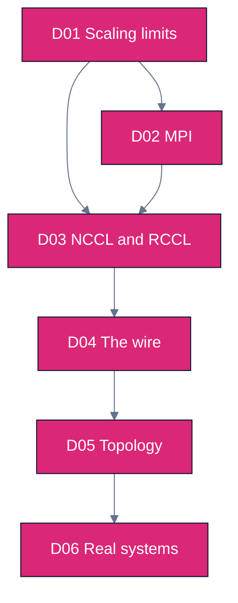

# Track D — Distributed & Cluster Computing

One GPU is a solved problem. This track is about what happens when the work no longer fits on one —
when correctness and speed start depending on a **wire** rather than a kernel. It goes below the
sharding strategies in Track B to the substrate they run on: message passing, collective libraries,
the interconnect itself, and the network topology that decides where your scaling curve bends.

The organizing question is the one nobody answers honestly: **at what scale does this stop working,
and what breaks first?**

Modules — Track D syllabus (6 modules)

| ID | Module | What you build | Status |
|----|--------|----------------|--------|
| [D01](D01.scaling-limits-and-communication-cost/) | Scaling limits & the cost of talking | A scaling-wall calculator: Amdahl, Gustafson, alpha-beta | **DRAFT** |
| [D02](D02.message-passing-and-mpi/) | Message passing (MPI / OpenMPI) | Ring all-reduce written by hand, against a real `MPI_Allreduce` | **DRAFT** |
| [D03](D03.gpu-collectives-nccl-and-rccl/) | GPU collectives (NCCL / RCCL) | A bus-bandwidth harness that reproduces `rccl-tests` numbers | **DRAFT** |
| [D04](D04.interconnects-and-rdma/) | The wire: RDMA, NVLink, xGMI, InfiniBand | A link-tier prober and a zero-copy vs staged path comparison | **DRAFT** |
| [D05](D05.topology-and-scale-boundaries/) | Topology & scale boundaries | A topology cost model: fat-tree vs dragonfly vs torus | **DRAFT** |
| [D06](D06.real-systems-at-scale/) | Real systems at scale | The consolidated scale-boundary ladder, 8 to 100k ranks | **DRAFT** |

**Suggested order.** D01 first, always — it is the theory spine and the other five quote its
vocabulary. D02 and D03 are a pair: MPI is the general model, NCCL/RCCL is what actually moves your
gradients, and the interesting content is where they disagree. D04 and D05 are the substrate, and
D06 is where every earlier module's scale-boundary table gets consolidated into one ladder.

**Prerequisite:** [A01](../A-gpu-programming/A01.foundations-and-programming-model/) for GPU
literacy. [B01](../B-gpu-ml-performance/B01.accelerator-architecture/) is strongly recommended
before D04, which extends its intra-node link analysis across the network.

**Relationship to [B07](../B-gpu-ml-performance/B07.distributed-training-and-sharding/).** B07 owns
the ML question — how to split a model across devices — and derives the ring all-reduce cost model
in the course of answering it. Track D owns the systems question underneath: what a collective
actually is, which library implements it, what it runs over, and where it stops scaling. The two
cross-reference rather than repeat; where B07 already derives something, Track D links it.

**A note on the labs.** The multi-node numbers in this track are **analytic models, not
measurements** — they say so in their own output banners — because this repo publishes no number it
cannot reproduce, and no multi-node cluster is attached to it. Single-node multi-GPU labs
(`rccl-tests`, topology probes, single-host MPI) do produce real transcripts, cached under
[`outputs/`](../../outputs/README.md). Every analytic tool runs on the Python standard library
alone. See [CURRICULUM.md](../../CURRICULUM.md) for the full dependency graph.
